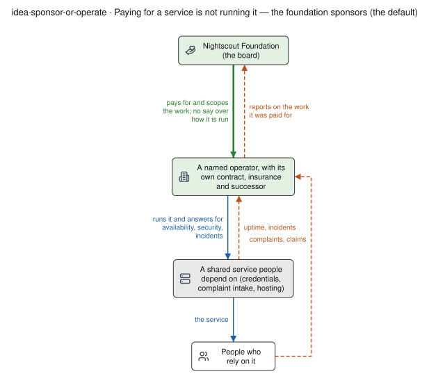
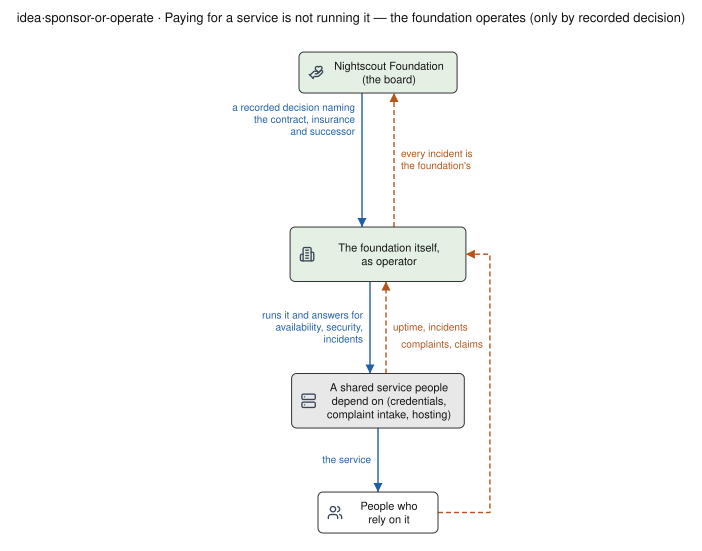

# The Nightscout ecosystem programme — one page for the whole

*Prepared for the Nightscout project; proposed for Nightscout Foundation stewardship. For the
foundation board, the maintainers of the ecosystem projects, and the community. **Recommendation**
(part 3 of the overview; [how the overview is organised](README.md)). **DRAFT PROPOSAL
for discussion.** Written 2026-09-29 against this repository at `37beb699` and cgm-remote-monitor
`official/dev` `7000eb18`; reorganised 2026-10-16 at `66403e0f` into the stack and four shared
commons, adding reports and decision support, research tools, and the controller registrations of
decisions D18–D20. The parts on consent, research access, cross-border data, decision support and
regulatory terms need review by the foundation's counsel and a privacy, quality or clinical
professional before any decision rests on them (§9). Nothing here is decided.*

## 1. What this page is

Several pieces of work are under way or proposed across the Nightscout ecosystem: releases and
modernization of cgm-remote-monitor, shared schemas, typed controller registrations and conformance
tests, multitenant hosting, a research data commons, report and decision-support prototypes, and new
interfaces such as MCP. Each has its own document. This page places them in **two views of one
programme**: the **stack**, six rows of software that each project builds and runs, and four
**shared commons** that run across every row. For each commons it says what exists, what is
proposed, and where it is decided.

It records no decisions and adds no work items. The order of the cgm-remote-monitor work is on the
[ROADMAP](ROADMAP.md); where it stands is on [PROGRAMME-STATUS](PROGRAMME-STATUS.md).

## 2. The picture

```
 the stack: built and run by each project          the shared commons: stewarded, open to every implementation

 6  Reports and decision support                   A  Shared contract
 5  Followers                                         schemas, quirks, typed controller registrations
 4  Servers: cgm-remote-monitor, Nocturne, hosted  B  Identity, trust and device access
 3  Vendor clouds and connectors                   C  Evidence: research and quality
 2  Controllers: Loop, Trio, AndroidAPS, xDrip+    D  Interfaces for people and agents
 1  Devices: CGMs and pumps                           reports, statistics, MCP
    beside: wearables and health platforms
                                                   under both: shared operations
                                                   complaints and incidents, security, partner and legal, administration
```

The **stack** is what runs. Each row is built by its own projects, and the
[stack census](../60-research/programme/stack-census-2026-09-30.md) and the
[quality-system proposal](QUALITY-SYSTEM.md) use the same six rows (§2a). The **commons** are assets
that no single app, server or operator is placed to own, and that every row uses: the description of
the data that passes between rows, the means of recognising one another, the evidence that the whole
works, and the interfaces people and agents read it through. Each commons runs across every row: a
registration is written by a controller, stored by a server and read by a follower or a report.

cgm-remote-monitor is one implementation in row 4, and it has its own section (§3) because the
commons are extracted from its behaviour: the schemas, the client census and the conformance tests
are measured against what cgm-remote-monitor and its clients actually do.

The principle: **the foundation stewards the commons and keeps them open to every implementation;
each implementation makes its own technical choices.** A second server, such as Nocturne, is a
second implementation of the same contract, not a competitor for the commons. Stewarding a commons
means hosting it and running its change process in public; the implementers decide changes to it
([COLLABORATION-MODEL](COLLABORATION-MODEL.md) rule 5).

**One codebase, two uses.** The same open-source releases serve people who build and run their own
tools, under the digital rights in [DIGITAL-RIGHTS](../DIGITAL-RIGHTS.md), and companies that host
Nightscout or use its release evidence inside their own quality systems. Companies can pay for
assurance (packaged evidence, fixes on the line they run, test runs in their configuration), and
the evidence that decides each public release stays public (SQLite's model). Commercial offerings can
show they track the same contract with the same public conformance suite (CNCF's model). There is no
separate commercial edition. Neither use carries a clinical or regulatory claim for the other
(COLLABORATION-MODEL rules 6 and 8).

## 2a. The stack

Measured by the [stack census of 2026-09-30](../60-research/programme/stack-census-2026-09-30.md)
over 62 repositories ([evidence §1](observations/ECOSYSTEM-EVIDENCE.md#1-what-the-ecosystem-consists-of)).

| row | what it is | measured |
|---|---|---|
| 1 devices | drivers that talk to CGMs and pumps over Bluetooth and radio, often through pairing cryptography volunteers had to work out | 14 device protocols with 41 independent implementations; no device repository publishes a per-release test report |
| 2 controllers | the AID apps that read devices, decide, and write what they did: Loop, Trio, AndroidAPS, xDrip+ | each writes its own shapes into the shared collections (§4) |
| 3 vendor clouds and connectors | connectors that bring a person's data back out of vendor clouds | six code bases log in to Dexcom Share and five to LibreLinkUp; no connector repository publishes a per-release test report |
| 4 servers | cgm-remote-monitor (§3), Nocturne, and hosted operators | 40 client repositories mapped against 15 parts of the API ([evidence §2](observations/ECOSYSTEM-EVIDENCE.md#2-what-depends-on-the-shared-server)) |
| 5 followers | apps and watches that show another person's data, with alarms | read the server's API; counted in the client census |
| 6 reports and decision support | reports for people and clinicians, and analysis tools that read a site (§7) | listed in [evidence §7](observations/ECOSYSTEM-EVIDENCE.md#7-research-analysis-and-test-tools) |
| beside | wearables and health platforms such as HealthKit and Health Connect | census §5 |

Rows 1 and 3 are where data sovereignty starts: the data holder's ability to get their own data, in a
form they can compute on, and to hand that job to tools and helpers they choose. The
[quality-system proposal](QUALITY-SYSTEM.md) proposes a shared kit for every row: vector corpora,
simulators, fixture suites, a change canary and one record shape. It also proposes how the
requirements for it would be agreed.

## 2b. Sponsoring and operating

Stewarding a commons can mean two different things, and they carry different exposure:

- **Sponsoring**: paying for, hosting or convening shared work that others carry out under their own
  responsibility, such as conformance tests, documentation, an audit or a research pilot.
- **Operating**: running a service that other people's data, or their therapy, depends on, and
  answering for its availability, security and incidents.

The proposal is that **the foundation sponsors by default and operates only by a recorded decision
that names the operator, its contract, its insurance and its successor.** A service whose failure
could interrupt someone's treatment, such as an authority that issues credentials for a device,
needs an operator with its own contract, security controls, insurance and continuity plan. That
operator may be a specialist organisation the foundation contracts with, or one that a
manufacturer appoints; the foundation sponsoring the work does not make it the operator. Paying for
a shared service also gives no control over any project's roadmap
([COLLABORATION-MODEL](COLLABORATION-MODEL.md) rule 2).

The difference, drawn: the same service with a named operator in the operator's box, and with the
foundation in it ([idea·sponsor-or-operate](perspective/STRUCTURES.md#ideasponsor-or-operate)).





## 2c. Shared operations the commons depend on

The four commons name technical assets. Four kinds of shared operation run underneath them, and
none exists yet as shared work:

| operation | what it covers | where it is proposed |
|---|---|---|
| complaints, incidents and support | one intake for reports from users, clinicians, developers and manufacturers; triage into support, complaints and security; investigation records and referral to the responsible manufacturer | [PARTNER-READINESS §6](PARTNER-READINESS.md#6-complaint-incident-and-support-handling) |
| security coordination | security contacts, private vulnerability reporting, embargoed fixes, an SBOM per release | [PARTNER-READINESS §8](PARTNER-READINESS.md#8-order-of-work) |
| partner and legal operations | agreements with manufacturers, the evidence a manufacturer asks for, the terms that carry data rights | [PARTNER-READINESS §3–§5](PARTNER-READINESS.md#3-what-a-manufacturer-will-need-to-see) |
| administration | funding, insurance, contracts, continuity, published accounts | [what each activity brings](perspective/ACCOUNTABILITY-THRESHOLDS.md) |

Each feeds the commons: a confirmed complaint becomes a test vector in commons A or C, a security
contact is part of what commons B's trust federation recognises, and an agreement with a
manufacturer is what keeps rows 1 and 3 reachable.

## 3. The reference implementation: cgm-remote-monitor

cgm-remote-monitor is the server most existing sites run, on MongoDB, with its own settings, data
and hosting. The work on it runs in three horizons ([PROGRAMME-STATUS](PROGRAMME-STATUS.md)):

- **Remedial.** Defects in what ships to operators today, tracked in the
  [backfix register](../30-design/remedial/nightscout-backfix-register.md). The 15.0.9 candidate is
  on `dev`, not yet tagged; its current head is in [ROADMAP §1](ROADMAP.md#1-the-next-release-1509).
- **Modernization.** A staged release train for the dependency tree and runtime
  ([ROADMAP §2](ROADMAP.md#2-modernization-the-release-train)).
- **Multitenancy.** A second deployment target for hosting providers, on PostgreSQL. Self-hosted,
  single-tenant Nightscout on MongoDB stays first-class permanently (decisions D1 and D4,
  [execution plan](../30-design/tenancy/nightscout-multitenancy-execution-plan-2026-09-14.md)).

Accepting controller registrations (§4) is queued for it as `HUB-REG-CRM`, single-tenant first.

What bounds this work is review capacity. The generated reviewer-load table on PROGRAMME-STATUS
shows most queue items routing review to the maintainer, and the SECURITY and SAFETY reviewer rows
mostly naming no individual
([the two constraints](PROGRAMME-STATUS.md#the-two-constraints-neither-of-them-engineering)). The
[sponsored-team proposal](SPONSORED-TEAM-PROPOSAL.md) is the request that addresses this.

## 4. Commons A — the shared contract

The apps exchange data through the same collections (`entries`, `treatments`, `devicestatus`,
`profile`) without a shared, measured description of what goes in them, and a controller feature
that has no shared shape lands in untyped `devicestatus`. This repository builds the description
([collaboration start page](../60-research/collaboration/README.md)):

| asset | where | state |
|---|---|---|
| schemas, each field graded measured / declared / read-from-code | `specs/openapi/`, `specs/nsschema/`, `specs/jsonschema/generated/` | exists; measured over an 11-site corpus, 9 of them Loop |
| quirks, scoped to the vendor versions that produce them | `specs/quirks/`; hub-sync design §3.7 | exists; version scoping adopted as D20 |
| per-client mappings with `file:line` citations | `mapping/<project>/` | exists |
| conformance assertions and replay vectors | `conformance/`, `specs/sync/conformance/` | exists |
| client census: 40 client repositories against 15 parts of the API | [consumer impact](../60-research/remedial/consumer-impact-15.0.9-2026-09-23.md) | exists, for 15.0.9 |
| typed controller registrations | [hub-sync design](../30-design/platform/nightscout-hub-sync-architecture-2026-09-11.md) §3.1 and §3.5–§3.7; `specs/sync/` | adopted as D18–D20 and specified; well-known declarations for Loop, Trio and AndroidAPS; not implemented in any hub (`HUB-REG-CRM` not started); not adopted by any controller project |
| one write step: `_id` form, server dates, soft delete, re-send identity, one change event | `WRITE-CONTRACT` in the [queue](../../queue/QUEUE.md) | specified; blocked on prerequisites |
| controller descriptions (`decomposesTo`) | [proposal](../30-design/platform/PROPOSAL-controller-descriptions-2026-09-11.md) | adopted as the `devicestatus` direction by D11; carried forward by the registrations |
| hub-and-spoke adoption path | [adoption roadmap](../30-design/nightscout-adoption-roadmap-2026-09-11.md) | proposed ([ROADMAP §5](ROADMAP.md#5-proposals-not-yet-adopted)) |

**Composition through registrations.** Under D18 a controller can declare its own typed definitions
(intent kinds, states, transitions, initiators, effect fields and a command contract) composed from
the shared primitives, and the hub offers typed API for them. Legacy writers are described by
well-known declarations that ship with the hub, so nothing changes for a controller that never
registers. D19 separates the immutable, content-addressed definition from each running instance
(a phone, simulator, lab rig or agent), which holds a lease and declares whether it is a device or
simulated. The roles are fixed: the hub is responsible for observability, the controller for
sending data accurately and for syncing and reconciling, and the hub decides nothing about dosing
([execution plan §1](../30-design/tenancy/nightscout-multitenancy-execution-plan-2026-09-14.md#1-decisions)).
The evidence behind D18 is the
[intent and workflow landscape](../30-design/platform/nightscout-intent-workflow-landscape-2026-10-09.md),
which measured where the controllers and hubs disagree about what is active.

With more than one server, this commons is what keeps client apps working on all of them. On
2026-09-23 Nocturne (`42275c81`) matched the 15.0.9 candidate on the count and filter fixes and
differed on eight measured behaviours; its own parity suite runs against Nightscout 15.0.3
([consumer impact §6](../60-research/remedial/consumer-impact-15.0.9-2026-09-23.md#6-nocturne-parity)).
The model is the one WHATWG uses: several implementations, one living description, and one test
suite any of them can run ([sponsored-team proposal §6a](SPONSORED-TEAM-PROPOSAL.md#6a-more-than-one-server)).

## 5. Commons B — identity, trust and device access

**What exists.** Identity today is per site. In cgm-remote-monitor, `API_SECRET` and tokens are
issued by each site. For the multitenant target, each tenant holds its own root credential (D13),
each tenant signs its own tokens (D14), and devices and the data path keep a native per-tenant
credential permanently (D17). Whether human identity comes from a shared Ory Kratos pool is held on a
proof (`T30-ORY-PROOF`, D17 row 2). Nocturne implements OAuth dynamic client registration (RFC 7591)
with a `software_id` per app and a bundled directory of known apps (Nocturne `42275c81`,
`KnownOAuthClients.cs`).

**What is proposed here.** Several parties need to recognise one another across sites: people,
self-hosted sites, hosting providers, researchers, the projects themselves, and organisations that
support the ecosystem. A **trust federation** would let each keep its own identity provider while
presenting verifiable claims ("this person is authenticated by organisation X; X is a recognised
participant; this service may read fields A and B for purpose P until date D"). The receiving
service decides whether the claims meet its own policy. The foundation would define what counts as
recognised participation. It would not hold anyone's passwords.

Existing standards cover most of the mechanism:

| standard | status | what it supplies |
|---|---|---|
| [OpenID Federation 1.0](https://openid.net/specs/openid-federation-1_0.html) | Final, 2026-02-17 | trust anchors, signed entity statements and trust chains for multilateral federations over OpenID Connect and OAuth 2.0 |
| [RFC 8693, OAuth 2.0 Token Exchange](https://www.rfc-editor.org/rfc/rfc8693.html) | Standards Track, January 2020 | exchanging one token for another scoped to a downstream service, including delegation |
| [RFC 7591, Dynamic Client Registration](https://www.rfc-editor.org/rfc/rfc7591.html) | Standards Track | app self-registration with a `software_id`; Nocturne already uses it |
| [GA4GH Passport 1.2.1](https://ga4gh.github.io/data-security/ga4gh-passport) | current | signed "visas" carrying a researcher's affiliation, role, accepted terms and data-access grants between institutions |

**Where data may go.** Joining the federation does not mean data may cross every border. The
federation would carry identities, keys, schemas, capabilities, consent references and audit
identifiers (a shared control plane). Health data would stay in regional stores that apply their own
storage, processing and export rules (regional data planes). An approved analysis could run where the
data is and return only permitted aggregates. The European Health Data Space Regulation
([(EU) 2025/327](https://health.ec.europa.eu/ehealth-digital-health-and-care/european-health-data-space-regulation-ehds_en))
entered into force on 26 March 2025; its secondary-use rules begin applying to most data categories
in March 2029. Whether and how it applies to Nightscout data or to the foundation is a question for
counsel (§9).

**Device access.** Where a device accepts only clients its manufacturer has authorised, access
depends on an agreement and on credentials issued under the manufacturer's authority. The access
tiers (observe and export first), the terms that carry data rights, and the safeguards for
credentials are in [PARTNER-READINESS](PARTNER-READINESS.md) §2, §4 and §7; who operates a
credential authority is §2b's question.

**State.** No work item and no decision on the federation. The controller-descriptions proposal
§2.2 suggests joining on Nocturne's reverse-DNS `software_id`, which would be a first shared
identifier; the registrations of D18 and D19 use reverse-DNS names too.

## 6. Commons C — evidence: research and quality

**What exists.**

- **Data pipeline.** `tools/ns2parquet/` turns Nightscout exports into Parquet with the normalisation
  written down. `tools/nsprobe` lets a data holder run this repository's probes on their own data
  without sending it anywhere, and the [collaboration start page](../60-research/collaboration/README.md)
  invites that.
- **Release evidence and labs.** Release comparison already runs for cgm-remote-monitor: the 15.0.9
  candidate was soaked against 15.0.8 and replayed through a lab
  ([quality record](../60-research/programme/paving-the-cowpaths-2026-09-27.md)). The labs under
  `tools/lab/` and `tools/review/journey-lab` run on synthetic data, and D19 makes a simulated
  instance a first-class registration.
- **Research.** The 2026 experiment campaign (`EXP-001` to `EXP-3460`) and its 488 snapshot reports
  are summarised in [evidence §7.3](observations/ECOSYSTEM-EVIDENCE.md#73-the-2026-experiment-campaign).
  The OREF-INV-003 replication
  ([brief](../60-research/collaboration/oref-inv-003-replication-brief.md)) is the first external study
  built on the pipeline.
- **Research tools across the ecosystem.** Analysis tools are built in several places: oref
  analysis tools by the author of OREF-INV-003 (insulin kinetics, dynamic ISF, smoothing, exercise,
  a digital twin), GluPredKit, cgmsim-lib and others, listed without ranking in
  [evidence §7.1](observations/ECOSYSTEM-EVIDENCE.md#71-research-tools-elsewhere-in-the-ecosystem).
  What they can share is a contract more than a codebase: the replication's 18-feature,
  algorithm-neutral feature set scores on par with the 32-feature oref set under folds grouped by
  person, and any tool, oref or Loop, can compute it from the same normalised data.

**What is proposed.** The [Nightscout datalake proposal](https://bewest.github.io/ns-data-proposal/)
asks the board for a 90-day pilot: a named foundation sponsor, a small advisory group, authority to
draft consent and access policies, work with hosting providers on consent brokering, monthly reports
and a go/no-go decision, at one of three budget levels. It treats the data lake as the first shared
service, not the whole programme. Its pilot outputs include a baseline data-quality report (gaps,
source coverage, drift), one conformance or release-comparison report, and governed extracts for two
or three external researchers. The [quality-system proposal](QUALITY-SYSTEM.md) adds the shared kit
for every row of the stack.

This commons turns the others from one-off checks into a loop: consented data from many sites shows
whether a release changed behaviour, whether an uploader started writing malformed records, or
whether two implementations read the same field differently, and the findings return to the
servers and to commons A as test vectors and defects.

**Terms.** This page uses *post-deployment safety and quality monitoring*. It does not claim that
the foundation performs regulatory post-market surveillance (§9).

## 7. Commons D — interfaces for people and agents

**What exists.**

- **Reports.** cgm-remote-monitor's built-in reports and nightscout-reporter's PDF reports read a
  site; so do research tools such as the oref digital twin and exercise-eval
  ([evidence §7.1](observations/ECOSYSTEM-EVIDENCE.md#71-research-tools-elsewhere-in-the-ecosystem)).
  The hub-sync design §4 records that a clinician cannot get a controller's settings from Nightscout:
  the digital twin reads them from a screenshot or a preference export.
- **A decision-support prototype.** `tools/cgmencode/production` produces a clinical decision support
  report: a glycemic summary, the main risks, proposed settings changes with their justification,
  expected outcomes, and criteria for success and for stopping, comparable across AID and injection
  therapy and rendered for clinicians (38 test files). It has had no clinical review. Its published
  form is a [demonstration on synthetic data](https://bewest.github.io/rag-nightscout-ecosystem-alignment/site/pages/clinical-decision-support-synthetic-demo-2026-10-16.html)
  ([markdown](../../reports/synthetic-demo-analysis/clinical-decision-report.md)): 90 days generated by
  `tools/cgmencode/synthetic_demo_patient.py` with a fixed seed, with no real person's data. On that
  data the prototype detects no inferred meals, because its metabolic engine takes the absolute value
  of changes in carbs and insulin on board, and it sets a success criterion that expects time in range
  to fall after its own carb-ratio change. Runs on real data carry health data and are not published.
- **Statistics and agents.** The statistics API proposal specifies an MCP resource provider on top of
  a documented statistics API (`REQ-STATS-005`,
  [statistics API proposal](../sdqctl-proposals/statistics-api-proposal.md)). Nocturne ships an MCP
  component.
- **Intent, action and evidence.** What a controller meant to do, what it did, and what it was based
  on now has a typed home in the registrations of commons A (D18's intent kinds and effect fields;
  D19's instances and provenance).

**What is proposed.** The work packages on [ROADMAP §5](ROADMAP.md#5-proposals-not-yet-adopted):
the report statistics as a tested module with a documented API, a first Svelte report usable as a
Web Component, and PDF export for sharing with a clinician. Settings as a first-class,
effective-dated resource (hub-sync §4.3) would give reports and clinicians the settings in force at
any time.

**The boundary.** An interface that lets software read and explain data is a different thing from
one that takes part in a dosing decision. A report that proposes settings changes is clinician-facing
decision support: it needs clinical review before anyone acts on it, the SAFETY reviewer that the
queue does not yet name, and counsel's view of its regulatory status (§9). Anything on the dosing
side depends on commons A–C: typed schemas, identity and provenance, and longitudinal quality data.

## 8. How the parts depend on each other

| part | needs | makes possible |
|---|---|---|
| reference implementation (§3) | reviewers and releases | the behaviour commons A measures; the sites commons C draws on |
| A shared contract | the servers' behaviour, client source code, real data; registrations from controllers | several servers and many clients working together; typed homes for controller features |
| B identity, trust and device access | commons A's identifiers (`software_id`, reverse-DNS registrations); D13–D17 for hosted sites; manufacturer agreements | governed research access; sites recognising one another; reachable devices |
| C evidence | commons B for consent and access; commons A for normalised data | release comparison, quality signals and research across the ecosystem |
| D interfaces for people and agents | commons A–C | reports, decision support and agent interfaces with provenance and a safety boundary |
| shared operations (§2c) | funding and named owners | the accountability manufacturers, clinicians and users ask for |

## 9. The foundation's role, and points to decide

The two proposals already before the board each cover part of this page:

- the [sponsored-team proposal](SPONSORED-TEAM-PROPOSAL.md) is about people: review, compatibility
  and security work on the reference implementation and commons A;
- the [datalake proposal](https://bewest.github.io/ns-data-proposal/) is about the first shared
  service in commons C.

This page adds the frame that joins them: the four commons and the shared operations are shared
infrastructure, stewarded by the foundation and open to every implementation, and support for each
implementation is a separate, recorded decision.

**For the board:**

1. Which commons the foundation takes on as stewardship, and which it leaves to the projects; and
   whether it adopts the rule in §2b that it sponsors by default and operates only by a recorded
   decision.
2. How a proposal for any commons is submitted, reviewed and answered, and where decisions are
   published. [COLLABORATION-MODEL](COLLABORATION-MODEL.md) §5 proposes rules for this and for
   contributions, provider listings and disclosure, each borrowed from an organisation that uses
   it (Apache, CNCF, OpenStreetMap, OpenMRS, SQLite; §4 there).
3. Whether to take the datalake pilot and the sponsored team as separate decisions or as one
   programme with shared reporting, and whether the shared quality kit of the
   [quality-system proposal](QUALITY-SYSTEM.md) belongs in it.

**For the maintainers of the ecosystem projects:**

4. Whether the six rows and four commons are the right cut, and which shared assets are missing.
5. Whether the WHATWG pattern (one living description and shared tests) is acceptable to each
   server's maintainers, with contract changes through a recorded problem-report and change-request
   process like openEHR's ([COLLABORATION-MODEL](COLLABORATION-MODEL.md) §5, rule 5).
6. Whether each controller project would register its own definitions under D18, and which feature
   it would register first.

**For counsel, and for privacy, quality and clinical professionals:**

7. Whether the EHDS, GDPR or HIPAA apply to data a federation participant holds, and to the
   foundation as a party that defines participation without holding data.
8. What consent, de-identification and publication review a research extract needs, in each region
   that contributes data.
9. Whether *post-deployment safety and quality monitoring* avoids implying a regulated
   post-market role, and what the foundation must not claim.
10. Whether defining recognised participation in a federation creates any liability for the
    foundation.
11. Whether a report that proposes settings changes is clinical decision support software that
    falls under device regulation, and what clinical review it needs before it is offered to anyone.

**To verify before this page is quoted:** the standards' status and dates in §5 were read from their
publishers' pages on 2026-09-29. The datalake proposal's terms in §6 were read from its published
page the same day. The census figures in §2a are from 2026-09-30. The review load in §3 is a
generated table on PROGRAMME-STATUS; quote the current table, not this page.
