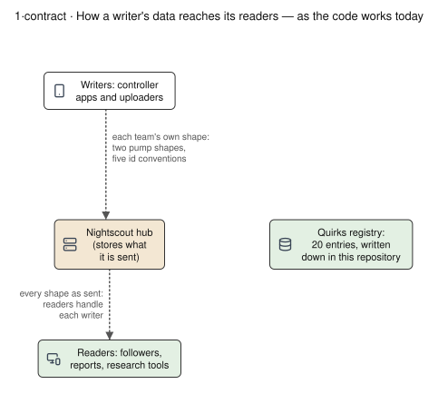
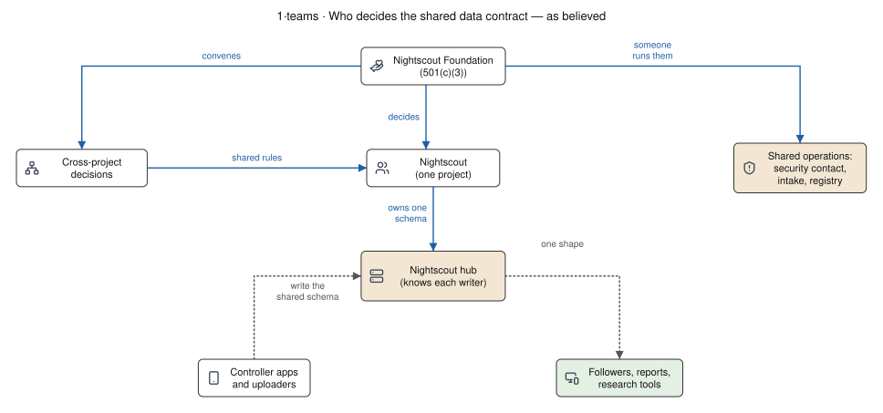

# The Nightscout ecosystem: a case study in Conway's Law

*What this is: a case study (part 2 of the overview, perspective; [how the overview is organised](../README.md)): how the ecosystem's teams explain the shape of its software and data contract, and where that points to ways to unify and move forward. For the Nightscout Foundation board, the maintainers of the ecosystem projects, and the community. Read after [process models](PROCESS-MODELS.md); leads to part 3, starting with the [ecosystem programme](../ECOSYSTEM-PROGRAMME.md). Living page,
written 2026-10-18 against this repository at `0b0d150f`. Every fact is taken from a page linked
beside it, which gives its own date and source; the Conway readings are interpretation and are
marked as such.*

*Author's interests: the author maintains cgm-remote-monitor, founded a company that hosts
Nightscout commercially, and could be a candidate for paid work under the related proposals. The
[collaboration rules](../COLLABORATION-MODEL.md) §5 would apply to that company and to the author
like anyone else.*

## 1. The frame

Melvin Conway observed in 1968 that organisations which design systems "are constrained to produce
designs which are copies of the communication structures of these organizations"
([Conway, "How Do Committees Invent?", *Datamation*, April 1968](https://www.melconway.com/Home/Committees_Paper.html),
read 2026-10-18). Where two teams talk, the interface between their parts is agreed; where they do
not, each side builds what it needs and the system holds both.

The Nightscout ecosystem fits the frame closely. Each of the 20 repositories measured in
[governance today §1](../observations/GOVERNANCE-TODAY.md#1-who-decides-in-each-project) decides
what it merges and releases, no shared body for decisions that cross projects is named
([§6](../observations/GOVERNANCE-TODAY.md#6-where-we-looked-and-found-nothing)), and the Nightscout
hub is where their data meets. This page reads the observations of part 1 and the drawings of
[control structures](STRUCTURES.md) and [process models](PROCESS-MODELS.md) through that frame.

## 2. The chronology, by kind of team

Rows from the [chronology](../observations/HISTORY.md); the drawing is generated from
`tools/structure-diagrams/history/timeline.yaml`, whose rows are checked against it.

*Interpretation.* Each section of the chronology adds a kind of team that writes to the hub:

| chronology section | teams that begin writing to the hub | what each brought to the data |
|---|---|---|
| §1, 2012–2014 | one group building both the uploader and the display | the first shapes (`entries` with `sgv`, `treatments` with `eventType`), set before there was a second team |
| §2, 2015–2019 | closed-loop communities around their own hardware, language and chat (Loop, OpenAPS, AndroidAPS) | a device-status block per family (`loop`, `openaps`) |
| §3, 2020–2024 | forks (FreeAPS X, iAPS, Trio), followers, and bridges per vendor cloud | a record-id convention per app; readers that must handle every writer |
| §4, 2025–2026 | a second server implementing the same API (Nocturne) | a second implementation of one contract, which needs the contract written down |

Trio shows the pattern inside one row. It uses the same LoopKit CGM managers as Loop, discards the
manager's `syncIdentifier` and sends a random `id` of its own
([identifier format research §1](../../60-research/tenancy/identifier-format-2026-10-17.md#1-per-app-identity-for-cgm-readings-and-the-treatment-identity-each-app-sends-r)).
Shared code did not carry a shared contract once the teams were separate.

## 3. Team edges become interface edges

| where the data meets | what each team writes | what a reader has to do | source |
|---|---|---|---|
| device status, per controller | Loop a `loop` block; oref0, AndroidAPS and Trio an `openaps` block | branch on the block present; Trio and AndroidAPS are told apart by neither | [process models, 3·registration](PROCESS-MODELS.md#3registration-who-writes-to-the-hub-and-where-a-command-goes) |
| pump state | flat (`pump.bolusing`) or nested (`pump.status.bolusing`) | read flat first, fall back to nested; a document may carry both | `QUIRK-DEVICESTATUS-001` in [`specs/quirks/devicestatus.yaml`](../../../specs/quirks/devicestatus.yaml) |
| a treatment's own id | Loop `syncIdentifier`, Trio `id`, AndroidAPS the API v3 `identifier`, xDrip+ `uuid` and a derived `_id`, xDrip4iOS a 24-character random `_id` | know each app's habit to tell a re-send from a new record | [identifier format research §1](../../60-research/tenancy/identifier-format-2026-10-17.md#1-per-app-identity-for-cgm-readings-and-the-treatment-identity-each-app-sends-r) |
| a CGM reading's id | Loop derives one per CGM source and does not send it; Trio, xDrip+ and xDrip4iOS assign random ids | two apps reading one sensor are matched by time, not by id | the same section |
| profile | Loop writes its own settings as a `loopSettings` subtree of 26 paths; glucose units have four spellings | tolerate the subtree | `QUIRK-PROFILE-003`, `-004` in [`specs/quirks/profile.yaml`](../../../specs/quirks/profile.yaml) |

The quirks registry holds 20 entries in four collections at `0b0d150f`
(`grep -c 'id: QUIRK-' specs/quirks/*.yaml`). Its guidance for the two pump shapes reads: "Write
both shapes until readers converge. This is a genuine fork, not a deprecation." The
[15.0.9 consumer-impact survey](../../60-research/remedial/consumer-impact-15.0.9-2026-09-23.md)
read 40 client repositories against 15 surfaces before one release; the
[compatibility table](../../30-design/platform/spec/compatibility.md) reads 31 apps in 32 entries
layer by layer.

*Interpretation.* A schemaless store and a server that keeps what it is sent let every team ship
without waiting for another, which suited an ecosystem with no cross-project decision body. The
cost of agreement moved to the readers: every follower, report and research tool carries code for
each writer it has met. The `entries` shape that every uploader shares (with small deviations such
as `QUIRK-ENTRIES-001`) is the one set before a second team existed.

## 4. Believed and actual: who decides the contract

The drawing's sources are in its input, `tools/structure-diagrams/inputs/1-teams.yaml`; the same
set, with its own notes, is on [process models](PROCESS-MODELS.md#1teams-who-decides-the-shared-data-contract).

| question | as believed (inferred) | as the repositories show | how the code mirrors it |
|---|---|---|---|
| who decides for the ecosystem | the foundation, or Nightscout as one project | each of 20 repositories decides alone; the foundation supports, convenes and recognises ([governance §1, §3](../observations/GOVERNANCE-TODAY.md#1-who-decides-in-each-project)) | no shared schema owner; each writer's code is its own specification |
| who knows which controller wrote a record | the hub | nobody: there is no registration code; readers infer it from the document's shape | the display plugins look for `loop` or `openaps` ([3·registration](PROCESS-MODELS.md#3registration-who-writes-to-the-hub-and-where-a-command-goes)) |
| whether a sent command was applied | the hub tracks it | one development-only AndroidAPS path returns an acknowledgement with an id; elsewhere success shows as a later record and failure as a free-text note | each controller team built its own command path and reply |
| who runs shared operations | someone | of 20 repositories, none has a SECURITY policy of its own; 4 have private vulnerability reporting; reports arrive in five chat systems ([2·shared-infra](PROCESS-MODELS.md#2shared-infra-shared-operations-and-who-runs-them)) | no project's CI runs a shared conformance suite |
| what an automated agent is | a separate actor | a shared credential, indistinguishable from the person who shared it | no delegation grant in the code |

*Interpretation.* The hub's model of "which controller" is the set of block names its display
plugins look for, one per controller family that had a plugin written. A controller that reuses an
existing name (Trio and AndroidAPS writing `openaps`, as oref0 does) inherits the name of the family
it came from and does not show as a separate system. A caregiver who reads a sent command as an
applied one acts on the believed structure; the STPA analysis places hazards in exactly that kind
of gap between a controller's model and the system.

## 5. Tensions the structure produces

| tension | the two pulls | evidence | the Conway reading (interpretation) |
|---|---|---|---|
| volunteer time against outside clocks | releases follow people's available time; hosts, phone platforms and vendors change on their own schedules | the MongoDB 5 driver upgrade was proposed in 2022 and shipped in 15.0.7 on 2026-04-29; xDrip+ could not be built with current Android tools from September 2019 to December 2020; Heroku, Railway and Fly.io ended or closed plans in 2020–2024 ([ecosystem evidence §3](../observations/ECOSYSTEM-EVIDENCE.md#3-releases-and-contributors-across-the-main-projects), [chronology §3](../observations/HISTORY.md#3-hosting-regulation-and-published-evidence-20202024)) | the system breaks at edges no team in the ecosystem owns |
| few accounts holding many merges | wide reliance on a project; merge rights held by one to three accounts in most repositories | 12 months to 2026-10-02: AndroidAPS 508 merged pull requests by 1 account, xDrip+ 132 by 1, cgm-remote-monitor 284 by 2, Trio 330 by 10 ([governance §1](../observations/GOVERNANCE-TODAY.md#1-who-decides-in-each-project)) | a contract changes only as fast as the few people on each side can talk |
| one vendor, one bridge | each manufacturer's cloud has its own terms and protocol | separate bridges for Dexcom Share, LibreLinkUp and CareLink, then one connector with a source per vendor ([chronology](../observations/HISTORY.md)) | ingestion mirrors the vendors' boundaries |
| forks against a shared contract | a fork lets a group move at its own pace; each fork adds a writer readers must learn | FreeAPS X (2021), iAPS (2023), Trio (2024); Trio's own reading id (§2) | a split in the team is followed by a split in the data |
| DIY and regulated tracks | person-held authority, fast; manufacturer-held authority, cleared | Tidepool Loop submitted 2020, cleared 2023; newer devices ask the app for a credential the manufacturer issues ([process models, 1·authority](PROCESS-MODELS.md#1authority-where-the-authority-to-act-comes-from)) | where a device checks the app, the binding constraint is who may sign, not who can build |
| one implementation, then two | the contract lived in cgm-remote-monitor's code; Nocturne implements the same API from 2025 | the [platform specifications](../../30-design/platform/README.md) and the conformance vectors in this repository | a second team building the hub needs the implicit contract written down |
| volunteer and paid work side by side | paid time can carry shared operations; paid and unpaid roles can feel unequal | Debian's 2006 experiment and its later paid long-term support ([precedents](PRECEDENTS.md#debian-dunc-tank-2006-and-paid-long-term-support-2014)) | who is paid for what is part of the communication structure, so it shows in what gets built |

Coding agents lower the cost of engineering (cgm-remote-monitor's 2026 commits include
agent-written ones, [ecosystem evidence §4](../observations/ECOSYSTEM-EVIDENCE.md#4-where-the-maintenance-time-goes-today)).
Every edge in the tables above is still a decision between people or organisations.

## 6. Inverse Conway: specifications shaped to their owners

The "inverse Conway manoeuvre" designs the system so that each part matches a team able to keep
it. The platform specifications already cut their layers this way: "Each boundary falls where the
reader, the rate of change or the review differs"
([platform index](../../30-design/platform/README.md#the-specification-set)). Controller-owned
definitions (D18, D19) move the meaning of a controller's data from the hub's plugins to the team
that writes it; the hub routes and records and never doses; version-scoped quirks (D20) write the
existing habits down, per version, so a team can retire its own.

Each layer's natural owner, and whether that owner is engaged today, is tabled on the
[platform index](../../30-design/platform/README.md#who-owns-each-layer). *Interpretation.* A
contract drafted in one repository fits that repository's habits best; the manoeuvre works when
the controller teams hold L2 and L3 in practice, through review of the parts that describe their
data and a route to change them. A single central schema committee would add a team boundary the
ecosystem has never had; owned declarations at the edges match a federation of independent teams.

## 7. What it implies for sustaining the ecosystem

*Interpretation.* If the design follows the communication structure, the structure is what has to
be sustained: a recorded channel for changes to the shared contract
([collaboration rule 5](../COLLABORATION-MODEL.md#5-proposed-rules-for-working-together)), a
second person able to review and release each widely used repository (rule 10), a shared
conformance suite and a release record with a bug-to-test rule
([quality system §3](../QUALITY-SYSTEM.md#3-what-enough-means-sqlites-plan-element-by-element)),
a security contact per project ([partner readiness §8](../PARTNER-READINESS.md#8-order-of-work)),
paid time for shared operations as a named service
([sponsored team](../SPONSORED-TEAM-PROPOSAL.md), [ecosystem programme §2b](../ECOSYSTEM-PROGRAMME.md#2b-sponsoring-and-operating)),
and an entity able to hold agreements with manufacturers under the same requirements as anyone
([partner readiness](../PARTNER-READINESS.md),
[accountability thresholds §5](ACCOUNTABILITY-THRESHOLDS.md#5-the-same-requirements-for-anyone)).

## 8. Reading intent

When two apps disagree on a field, a release is late or a proposal waits, the frame suggests
asking who would have had to talk to whom for it to come out differently, before asking why
someone chose it. The working rules that follow from that are in
[working together §5a](../COLLABORATION-MODEL.md#5a-read-the-structure-before-the-motive).

## 9. What this frame does not show

- **Causes.** The chronology gives dates, not causes; each project's maintainers are the people to
  say what held a release ([ecosystem evidence §3](../observations/ECOSYSTEM-EVIDENCE.md#3-releases-and-contributors-across-the-main-projects)).
- **Agreement that happens without a channel.** Shared shapes exist where one team set them first
  (§3), and teams agree informally in ways no repository records.
- **Whether a different structure would have shipped as much.** The arrangement described here let
  independent teams release for thirteen years; the frame describes its cost, not an alternative's.
</content>
</invoke>
