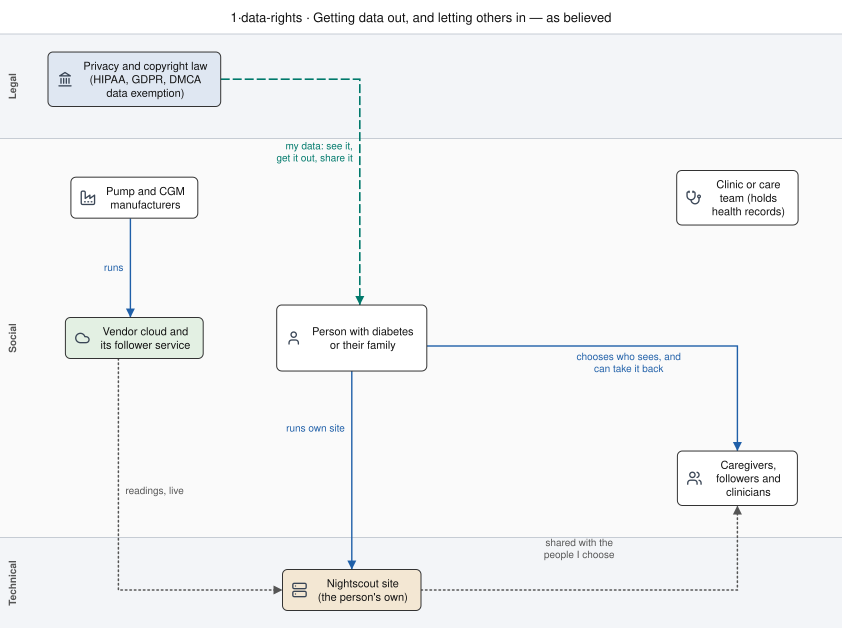
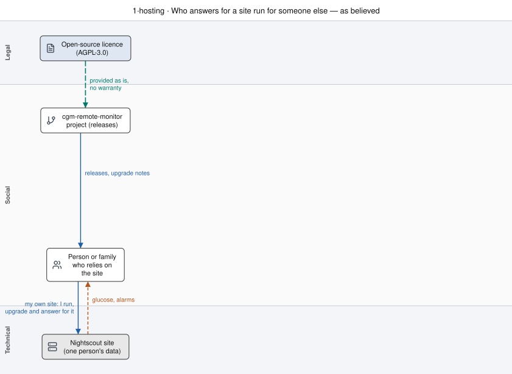
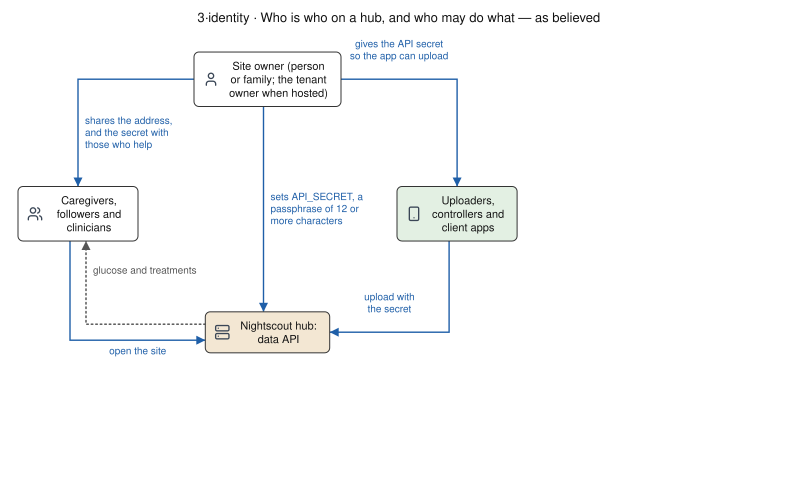
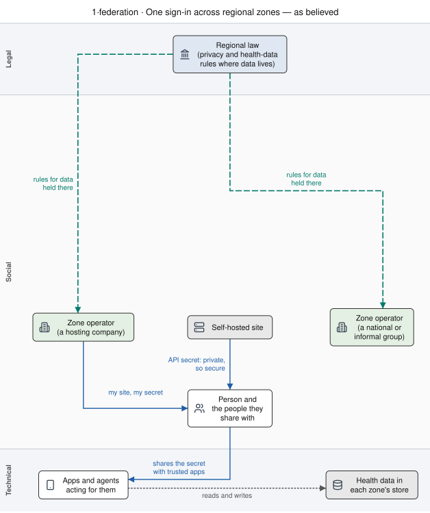
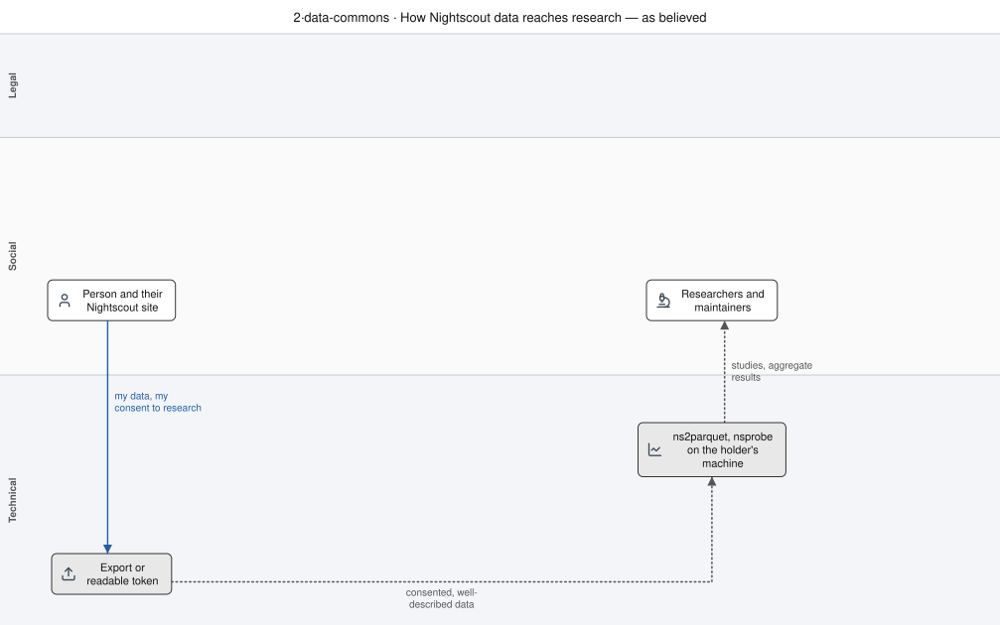
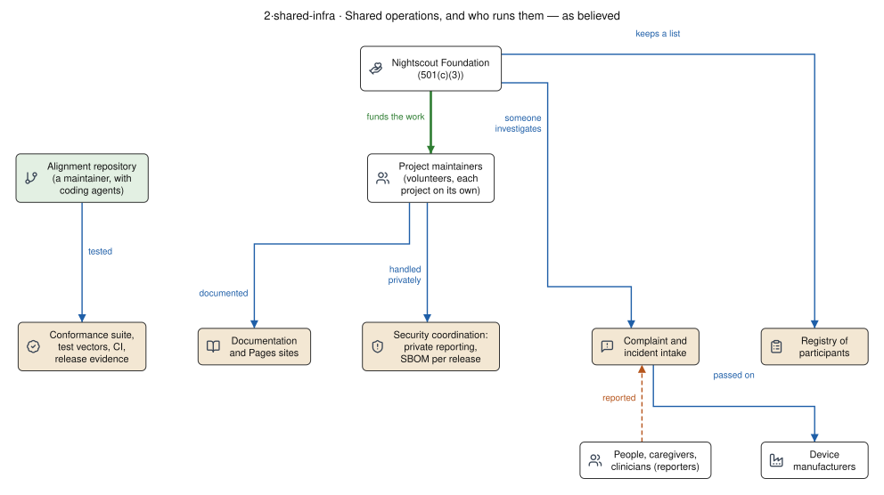

# Process models: what we believe, and how it works

*What this is: a map (part 2 of the overview, perspective; [how the overview is organised](../README.md)), for the Nightscout Foundation board, the maintainers of the ecosystem projects, and the community. Read after [control structures](STRUCTURES.md); leads to part 3, starting with the [ecosystem programme](../ECOSYSTEM-PROGRAMME.md). Living page,
written 2026-10-17. Companion to [control structures](STRUCTURES.md), whose conventions,
legend and icons apply here. Every node and edge comes from a source cited under the drawing;
where a panel is inferred or proposed, it says so.*

*Author's interests: the author maintains cgm-remote-monitor, founded a company that hosts
Nightscout commercially, and could be a candidate for paid work under the related proposals. The
[collaboration rules](../COLLABORATION-MODEL.md) §5 would apply to that company and to the author
like anyone else. Operators in the drawings are roles, not named companies.*

## How to read these drawings

Every controller in an STPA structure acts on a *process model*: its belief about the system it
controls. Many hazards come from the gap between that model and how the system actually behaves.
Each set below draws one structure three times on one layout, so the boxes line up and the lines
that appear, disappear or change their label are the finding.

- **Policy questions** are drawn *as believed* (the community's own reading), *as it works today*
  and *as it is emerging*.
- **The ecosystem's own designs** are drawn *as believed* (what clients, operators and people
  assume), *as it works today* (cited to code) and *as proposed* (cited to the decision or proposal;
  nothing in a proposed panel is built unless it says so).

Teal dashed lines are **authority**: where a party's right to act comes from (a law, an exemption, a
licence). Purple dash-dot lines are **discretion**: control another party exercises at its own
choice (terms, enforcement, revocation). The other lines and the icons are as in the
[legend and icon key](STRUCTURES.md#how-to-read-the-drawings).

| set | question | panels |
|---|---|---|
| [1·authority](#1authority-where-the-authority-to-act-comes-from) | where DIY and open-source authority to act comes from | believed, actual, emerging |
| [0·diy-status](#0diy-status-under-what-status-a-diy-build-runs) | under what regulatory status a DIY build runs | believed, actual, emerging |
| [1·data-rights](#1data-rights-getting-data-out-and-letting-others-in) | how data gets out, and how others are let in | believed, actual, emerging |
| [1·access-paths](#1access-paths-who-holds-the-key-on-each-path) | who holds the key on each path between device, phone, cloud and site | believed, actual, emerging; and a ladder |
| [1·hosting](#1hosting-who-answers-for-a-site-run-for-someone-else) | who answers for a site run for someone else | believed, actual, emerging |
| [3·identity](#3identity-who-is-who-on-a-hub-and-who-may-do-what) | who is who on a hub, and who may do what | believed, actual, proposed |
| [1·federation](#1federation-one-sign-in-across-regional-zones) | one sign-in across regional zones, with zero-trust access | believed, actual, proposed |
| [3·registration](#3registration-who-writes-to-the-hub-and-where-a-command-goes) | who writes to the hub, and where a command goes | believed, actual, proposed |
| [2·data-commons](#2data-commons-how-nightscout-data-reaches-research) | how Nightscout data reaches research | believed, actual, proposed |
| [2·shared-infra](#2shared-infra-shared-operations-and-who-runs-them) | the shared operations, and who runs them | believed, actual, proposed |

## Policy: believed, actual, emerging

### 1·authority: where the authority to act comes from

**As believed.** The community's own reading of its protections: open-source licences, the DMCA
medical-device data exemption, interoperability rights
([DIGITAL-RIGHTS, overview](../../DIGITAL-RIGHTS.md#overview)). In this picture the person's
authority runs straight from the law to their own device and data, and no one else's choices sit
between them.

**As it works today.** The same rights, read precisely, and the discretion they leave standing. The
DMCA exemption covers data access only and is a defence renewed every three years; DIY looping
"remains in a legal gray area", and the community operates partly on "the practical reality that
manufacturers have generally not pursued enforcement"
([DIGITAL-RIGHTS, implications](../../DIGITAL-RIGHTS.md#implications-for-diy-looping)). Five
discretion edges reach the person or the projects: a manufacturer's firmware and cloud changes, its
takedown notices (Abbott, 2019), cloud terms that ban "unauthorized third-party applications"
(Dexcom consumer terms §5.11, [vendor note §1.2](../../60-research/structures-2026-10-17/vendor-programs-and-data-rights.md#12-dexcom)),
the FDA's 2019 warning against unauthorised devices ([history](../observations/HISTORY.md)), and a
phone platform's signing licence, 7 days on a free account and revocable
([Apple note §1.1](../../60-research/structures-2026-10-17/apple-accountability.md#11-free-apple-account-development-personal-team)).
Regulators' requirements reach manufacturers, including premarket cybersecurity for connected
devices under FD&C Act §524B, in effect since 2023-03-29
([FDA, cybersecurity](https://www.fda.gov/medical-devices/digital-health-center-excellence/cybersecurity),
read 2026-10-17).

**As it is emerging.** Two changes are under way at once. Newer devices authenticate the app as
well as the person. The community's Omnipod 5 driver presents a controller certificate and signs
pod commands (OmnipodKit `928bb79`, read 2026-10-17;
[vendor note §1.6](../../60-research/structures-2026-10-17/vendor-programs-and-data-rights.md#16-insulet-omnipod));
where that certificate comes from is not described here, and whether the driver runs against a
real pod was not checked. The app check is already on two CGM lines: Dexcom G7 and Libre 3 ask for a
client credential after the person's code or NFC scan, and the open implementations carry a fixed
one that the manufacturer did not issue to them (xdripswift `c268542`, Juggluco `75399d7`, LibreLoop `150d2b1`, read 2026-10-17). Tandem pairs with a code shown on the
pump, and no app credential was found (pumpX2 `6fa9459`).
Why device-level controls tighten and do not loosen is not settled by any source read. One reading,
for counsel and regulatory review: §524B and the FDA's premarket cybersecurity guidance ask
manufacturers to show how device interfaces authenticate those that connect, which leaves a
manufacturer little reason to keep an unauthenticated path
([vendor note §7](../../60-research/structures-2026-10-17/vendor-programs-and-data-rights.md#7-points-for-a-reviewer-to-verify)).
And in the EU, the Data Act (applying
since 2025-09-12) turns part of the data right from a defence into a duty: the manufacturer must
share device data at the person's request, real-time where feasible, including with a third party
the person designates ([vendor note §3.1](../../60-research/structures-2026-10-17/vendor-programs-and-data-rights.md#31-eu-data-act)).
The drawing combines what exists on some devices and in one jurisdiction; it is not a forecast for
any one device or market.

*Interpretation.* Properties of the emerging landscape, read from the three drawings:

1. **Where a device checks the app, access is bound to identity.** A credential is issued to a
   known party and can be renewed or withdrawn; knowing the protocol is no longer enough.
2. **Authority is delegated, and its withdrawal is the issuer's.** Whether revocation follows a
   published process or the issuer's discretion is decided by the agreement
   ([partner readiness §4](../PARTNER-READINESS.md#4-what-the-ecosystem-needs-from-an-agreement)).
3. **Rights move from defences to duties, for data first.** The Data Act obliges sharing data; no
   law found obliges a manufacturer to accept commands from another party's software.
4. **The designated third party has to be an entity that can meet the requirements**: privacy,
   security, and the terms the manufacturer's credentials carry
   ([what each activity brings §5](ACCOUNTABILITY-THRESHOLDS.md#5-the-same-requirements-for-anyone)).
5. **Requirements flow down by contract.** Cybersecurity and quality duties sit with the
   manufacturer, and reach anyone holding its credentials through the agreement.
6. **Authorisation becomes the binding constraint.** The engineering gets cheaper for everyone; who
   is authorised to use it does not. This is a reading of the direction. Where the person holds the
   pairing secret (Tandem, Dana, Medtrum, Dexcom G6), engineering is still the constraint, and it
   has been met. Where the device checks the app (Dexcom G7, Libre 3, MiniMed 780G, Omnipod 5), open access
   today rests on credentials the manufacturer did not issue to the projects, which new sensors or
   firmware could stop accepting.

The characterisations of law here are summaries for discussion, drafts for counsel to review, and
not legal advice.

### 0·diy-status: under what status a DIY build runs

*Draft for review by regulatory counsel. This section summarises published sources for discussion;
it is not legal or regulatory advice, and it does not say what any regulator will or will not do.*

People who build and run open-source automated insulin delivery (AID) software for themselves act
under a regulatory status that the community describes one way and regulators have described only
in part. The drawings keep four positions apart, because that is where the status can change: a
person building for themselves, a project publishing source code, anyone handing out built apps,
and anyone running the software for someone else.

**As believed.** The projects' own pages say the software is not approved and that the person who
builds it carries the risk: "not approved for therapy by any government organization" and "You take
full responsibility for building and running this system and do so at your own risk"
([LoopDocs](https://loopkit.github.io/loopdocs/), read 2026-10-17); "not CE or FDA approved for
therapy" (Trio README). The AndroidAPS FAQ gives the community's fullest reading: under EU rules a
system of class IIa or IIb is a medical device needing a CE mark, distribution "even giving away
for free" is covered, and "Building a medical device for yourself is the only way to use the app
within these regulations" ([AAPS FAQ](https://wiki.aaps.app/en/latest/UsefulLinks/FAQ.html), read
2026-10-17). The repository's suggested disclaimer says the software "is NOT a medical device"
([DIGITAL-RIGHTS, disclaimers](../../DIGITAL-RIGHTS.md#disclaimers)). In this picture regulation
reaches manufacturers and people who hand out built apps, and stops short of the person and of
published source.

![0·diy-status as regulators have spoken: the FDA's route to manufacturers carries registration, 510(k) or De Novo and the iCGM, ACE and iAGC special controls, and a cleared controller sits among the manufacturers; the FDA's 2019 warning reaches the person, with no rule found on self-build; US registration and premarket notice attach to devices held or offered for sale; the EU requires a CE mark to place a device on the market, with free supply marked to verify; projects publish source to the person and to anyone who builds apps for others; anyone running it for others has no regulator line](diagrams/0-diy-status--actual.svg)

**As regulators have spoken.** On 2019-05-17 the FDA warned patients and clinicians against
"unapproved or unauthorized devices", noting that "patients may choose to create these systems",
and said it is "aware of manufacturers illegally marketing unauthorized devices"
([FDA](https://www.fda.gov/news-events/press-announcements/fda-warns-against-use-unauthorized-devices-diabetes-management),
read 2026-10-17; [history](../observations/HISTORY.md)). **No FDA statement was found on an
individual building such software for their own use.** US device duties attach to establishments
and distribution: registration (21 CFR 807), premarket notification "before ... the introduction or
delivery for introduction into interstate commerce for commercial distribution" (807.81(a)), where
commercial distribution means a device "held or offered for sale" (807.3(b)); the registration
exemptions in 807.65 list no class for a person making a device for their own use
([eCFR 807](https://www.ecfr.gov/current/title-21/part-807), read 2026-10-17). Separately, 21
U.S.C. 331(a) prohibits introducing an adulterated or misbranded device into interstate commerce
without a sale condition ([LII](https://www.law.cornell.edu/uscode/text/21/331), read 2026-10-17).
Whether publishing source code, or handing out a built app free, is either of these was not
answered by any source read. The regulated route exists: the iCGM, ACE pump and iAGC special
controls ([cloud layer §2.2](../../60-research/programme/stack-census-2026-09-30/cloud-layer.md#22-data-rights-law-and-regulation)),
and Tidepool Loop, cleared by 510(k) K203689 on 2023-01-23 as an iAGC, beside the continuing DIY
project ([precedents](PRECEDENTS.md#tidepool-loop-20202023)). In the EU, the MDR's in-house
exemption (Article 5(5)) is for health institutions: "an organisation the primary purpose of which
is the care or treatment of patients", and a device used "outside the health institution's legal
entity ... cannot be in-house" ([MDCG 2023-1](https://health.ec.europa.eu/system/files/2023-01/mdcg_2023-1_en.pdf),
January 2023, not legally binding, read 2026-10-17). No MDR provision for an individual's own build
was found. **No MHRA statement on DIY AID was found** (search, 2026-10-17).

**As it is emerging.** Three developments reach the positions differently. FD&C Act §524B
(premarket cybersecurity, in effect 2023-03-29; guidance issued 2025-06-27) applies to "a person who
submits an application or submission" for a cyber device
([FDA, cybersecurity](https://www.fda.gov/medical-devices/digital-health-center-excellence/cybersecurity);
[LII 21 U.S.C. 360n-2](https://www.law.cornell.edu/uscode/text/21/360n-2), both read 2026-10-17), so
it reaches the regulated route, not the person. Apple, from 2026-03-26, requires health and medical
apps in the US, EEA and UK to declare whether they are a regulated medical device; a "Yes" needs an
EU SRN or FDA owner/operator number, and existing apps must declare "by early 2027"
([Apple note §1.7](../../60-research/structures-2026-10-17/apple-accountability.md#17-app-review-guidelines-on-health)).
And the ACE and iAGC decision summaries record interface plans covering contracts and "who is
responsible for investigating and reporting complaints", which is a route for an operator under
contract with a manufacturer; no manufacturer was found to publish a route for a third party
([vendor note §2](../../60-research/structures-2026-10-17/vendor-programs-and-data-rights.md#2-regulatory-interoperability-fda)).
The regulated form of running it for others is drawn in 2·controller-operator.

*Interpretation.* Properties the three panels show:

1. **The status turns on distribution, not on the code.** Every published duty found attaches to
   placing on the market, commercial distribution or a premarket submission. None found attaches
   to a person building for their own use; none found settles whether publishing source does.
2. **The person's own build is the least-addressed position.** The FDA's only line to it is a
   warning; the EU's only exemption found is for health institutions. Neither is a permission.
3. **The community's beliefs differ by project.** One project reads EU rules as reaching free
   distribution of built apps; others say only "not approved". The beliefs agree that the person
   carries the risk.
4. **Running it for others has a regulated form and no published DIY form.** The regulated form is
   a submission and, for interoperable devices, a contract that assigns complaint duties.
5. **New requirements reach the distributor first.** §524B and app-store declarations bind whoever
   submits or publishes; the self-builder's position is the same in the
   actual and emerging panels.

Not drawn: the EU AI Act, because whether it reaches a rule-based controller was not determined;
the UK's own device regulations, which were not read. The characterisations of law here are drafts
for regulatory counsel, not advice; no enforcement intent is inferred from any source.

#### Points for a regulatory professional to verify

1. Whether publishing AID source code (no binaries, no sale) is "introduction or delivery for
   introduction into interstate commerce" of a device under 21 U.S.C. 331(a) or 21 CFR 807.
2. Whether free distribution of a built app is "commercial distribution" (807.3(b): "held or
   offered for sale") or otherwise triggers registration, listing and premarket notification.
3. Whether an individual building for personal use is a "manufacturer" under 21 CFR 807.3(d) or
   820.1, given that 807.65 lists no exemption for that case.
4. MDR Article 2 definitions of "manufacturer", "placing on the market" and "making available on
   the market", read from EUR-Lex (not reachable on 2026-10-17); whether "commercial activity"
   covers free supply by a hobbyist or project, as the AAPS FAQ reads it.
5. Whether any MDR provision or national rule addresses a patient's own build; MDCG 2023-1 covers
   only health institutions.
6. The MHRA's position, if any, and the UK Medical Devices Regulations 2002 on own-use builds.
7. Whether the FDA's 2019-05-17 notice remains current, and whether any later FDA statement on
   DIY or open-source AID exists.
8. Whether a person or entity running AID software for others (including paid builders or hosted
   controllers) is a manufacturer, and whether 807.65(i) (service through "a previously
   manufactured device") could ever apply.
9. Whether §524B's "cyber device" definition could reach an unsubmitted DIY build (the statute
   attaches it to a submitter).
10. Whether answering "No" to Apple's regulated-device declaration is accurate for a DIY AID app,
    and what that answer implies in each market.

### 1·data-rights: getting data out, and letting others in

**As believed.** The data rights primer names five rights: access, export, share, delegate and
audit. Sharing is to be "on your terms, with the scope you choose" and "revocable when circumstances
change" ([primer](../../10-domain/data-rights-primer.md#the-five-fundamental-diabetes-data-rights);
[DIGITAL-RIGHTS, overview](../../DIGITAL-RIGHTS.md#overview)). In this picture data runs from the
vendor cloud to the person's own site, and the person decides who sees it.

**As it works today.** US rights are a copyright exemption (a defence, not a duty to provide
access), HIPAA (the US health-privacy law) access to what a clinic holds, and state privacy laws
([vendor note §5.2](../../60-research/structures-2026-10-17/vendor-programs-and-data-rights.md#52-the-maintainers-working-view-tested)).
A manufacturer's consumer terms can forbid automated access and "unauthorized third-party
applications" (Dexcom §5.11, [vendor note §1.2](../../60-research/structures-2026-10-17/vendor-programs-and-data-rights.md#12-dexcom)).
The ecosystem's real-time data comes from follower services and device protocols the vendors do not
document for this use ([§1.9](../../60-research/structures-2026-10-17/vendor-programs-and-data-rights.md#19-where-the-vendor-routes-leave-the-ecosystem)).
The site's connector is configured with the person's vendor username and password
([nightscout-connect README](https://github.com/nightscout/nightscout-connect/blob/main/README.md),
read 2026-10-17). The vendor's own routes go elsewhere: MiniMed shares with "up to five care
partners" and uploads to the clinic ([§1.4](../../60-research/structures-2026-10-17/vendor-programs-and-data-rights.md#14-minimed-medtronic-diabetes)).
On the site, read access is one setting. As documented, the default role `readable` (`*:*:read`)
lets anyone with the address view everything unless the owner sets `denied` (cgm-remote-monitor
15.0.8 README, `AUTH_DEFAULT_ROLES`). Beyond that, sharing means handing over the API secret or a token. There
are no scoped, expiring grants ([configuration and delegation §5.3](../../30-design/tenancy/nightscout-configuration-and-delegation-2026-09-10.md#53-what-exists-today)).

**As it is emerging.** The EU Data Act has applied since 2025-09-12. It gives the user access to
product data "continuously and in real-time" where feasible (Art. 4). It also lets "a user, or a
party acting on behalf of a user" have the same data sent to a third party (Art. 5), free of charge
to the user. The third party may use it only for the agreed purposes (Art. 6)
([vendor note §3.1](../../60-research/structures-2026-10-17/vendor-programs-and-data-rights.md#31-eu-data-act)).
The European Health Data Space adds proxy services, so that a person can authorise someone else to
reach the records clinics hold (Art. 4(2), [§3.2](../../60-research/structures-2026-10-17/vendor-programs-and-data-rights.md#32-european-health-data-space)).
Scoped, revocable delegation for hubs exists only as a design: grants with scopes, constraints and
expiry ([authority model](../../10-domain/authority-model.md#delegation-grants), "not
implemented"). The drawing combines one jurisdiction's law with an unbuilt design; it is not a
forecast for any market.

*Interpretation.*

1. **The route out of the vendor cloud is the person's own login.** Today's real-time path depends
   on the vendor tolerating it, not on a duty to provide it.
2. **Delegation is shared credentials.** Revoking one helper means changing what everyone holds.
3. **The law that creates a duty is European, and covers data only.** It obliges sharing on request
   with a designated party. No law found obliges accepting commands.
4. **Two kinds of proxy are emerging.** EHDS proxy covers clinic records, and a Data Act third
   party covers device data. Neither yet reaches a self-hosted hub's own followers.

The characterisations of law here are summaries for discussion, drafts for counsel to review, and
not legal advice. Points to check: whether CGM values are in the Data Act's scope (Recital 15); the
Art. 4(2) health-and-safety carve-out; whether a US non-profit can be a designated third party; and
the current HIPAA rule for directing records to a third party (45 CFR 164.524)
([vendor note §7](../../60-research/structures-2026-10-17/vendor-programs-and-data-rights.md#7-points-for-a-reviewer-to-verify)).

### 1·access-paths: who holds the key on each path

**As believed.** Every path is open to software that knows the protocol, and the data is the
person's to share ([DIGITAL-RIGHTS, overview](../../DIGITAL-RIGHTS.md#overview);
[primer](../../10-domain/data-rights-primer.md#the-five-fundamental-diabetes-data-rights)).

![1·access-paths as it works today: readings reach the open app with the transmitter ID for G6, while G7 and Libre 3 also check the app, met by a fixed credential not issued to the open implementations; commands reach the pump by protocol (Eros, DASH, Dana, Medtronic) or a code on the pump (Tandem), while the MiniMed 780G and Omnipod 5 check the app, the 780G met by its manufacturer's own app key database and Omnipod 5 by a controller certificate whose source is not described here; the manufacturer's own issuer serves Eversense 365 through the person's account; the connector logs in to the vendor cloud as the person, under terms that ban unauthorised apps; the manufacturer changes device generations and older devices leave sale](diagrams/1-access-paths--actual.svg)

**As it works today.** Pump paths are mostly open because the secret they need is one the person
holds: a code shown on the pump, a serial, or the device itself
([device-layer census](../../60-research/programme/stack-census-2026-09-30/device-layer.md);
DanaKit `e157a86`, MedtrumKit `ef866fa`, pumpX2 `6fa9459`). The CGM paths split. Dexcom G6 needs
only the transmitter's ID (CGMBLEKit `ea224e7`). Dexcom G7 and Libre 3 check the app as well, and
the open implementations present a fixed client credential the manufacturer did not issue to them
(xdripswift `c268542`, Juggluco `75399d7`, LibreLoop `150d2b1`, read 2026-10-17). Two pumps check
the app too. The MiniMed 780G's open connectors authenticate as the manufacturer's own mobile app,
using that app's key database, after the person starts pairing from the pump (OpenMinimed Documentation `73a7811`); both
connectors say they are proofs of concept, not for therapy. The open Omnipod 5 driver presents a
controller certificate whose source is not described here (OmnipodKit `928bb79`;
[vendor note §1.6](../../60-research/structures-2026-10-17/vendor-programs-and-data-rights.md#16-insulet-omnipod)).
Eversense 365 takes a different route: the open driver signs in to the manufacturer's service with
the person's own account to get the device's certificate, so the manufacturer's service is in the
path though no check of the app was found (EversenseKit `e1bb6fa`; its predecessor, the E3, has no
link security).
The cloud path runs on the person's own login and the vendor's tolerance, and breaks when the cloud
changes ([evidence §5](../observations/ECOSYSTEM-EVIDENCE.md#5-work-that-arrives-on-other-organisations-calendars)).

**As it is emerging.** Two closures are possible on the device side: an app check that stops
accepting the credentials open software presents, and readings sealed end to end for the
manufacturer's cloud. The second was not looked for in the census
([vendor note §5.1](../../60-research/structures-2026-10-17/vendor-programs-and-data-rights.md#51-blockers-what-is-removing-them-what-still-stands)).
On the cloud side the EU Data Act adds a duty to share, and the US has none
([vendor note §3.1](../../60-research/structures-2026-10-17/vendor-programs-and-data-rights.md#31-eu-data-act)).

![1·access-ladder: five rising steps of dependence on the manufacturer. A, protocol plus what the person has: Omnipod Eros and DASH, Medtronic 5xx/7xx, Tandem t:slim X2 and Mobi, Dana RS/i, Medtrum Nano, Dexcom G6, Libre 1/2, Eversense E3, Accu-Chek SmartGuide. B, the manufacturer's own app alongside: G7 passive mode, Medtronic 640G/670G and several CGMs through companion apps. C, a credential through the person's own account: Eversense 365. D, the device checks the app: Dexcom G7, Libre 3 and MiniMed 780G, met by fixed credentials not issued to the open implementations, and Omnipod 5, whose credential source is not described here. E, sealed for the cloud: none found, not looked for. Not placed: SmartGuide advanced security](diagrams/1-access-ladder.svg)

*Interpretation.*

1. **The key, not the encryption, decides access.** Every device on step A uses authenticated or
   encrypted links, and open implementations work with all of them.
2. **Each step up moves the key towards the manufacturer.** On step B the open app depends on the
   manufacturer's app staying installed; on C, on the manufacturer's service answering the person's
   sign-in; on D, on the device continuing to accept the credential the open app presents; on E no
   app on the phone can read the data at all.
3. **Step D is in use today, not only emerging.** Every device on it works with open software only
   through credentials the manufacturer did not issue to the projects: fixed ones carried in the
   open code (Dexcom G7, Libre 3, MiniMed 780G), and for Omnipod 5 a controller certificate whose
   source is not described here. A sensor, pump or firmware change that stops accepting them would
   close the path for every open implementation at once, and whether carrying such a credential is
   lawful is a question for counsel
   ([vendor note §7](../../60-research/structures-2026-10-17/vendor-programs-and-data-rights.md#7-points-for-a-reviewer-to-verify)).
4. **Loss on the device side and on the cloud side reach different people.** The device side stops
   automation for the person; the cloud side stops remote following for caregivers
   ([partner readiness §1](../PARTNER-READINESS.md#what-is-at-stake-on-each-path)).

The drawing and ladder are at mechanism level only. The ladder's data and generator are
`tools/structure-diagrams/access/devices.yaml` and `access_charts.py`.

### 1·hosting: who answers for a site run for someone else

**As believed.** Nightscout is "software you run yourself", written for "the person who runs a
Nightscout site: for themselves, for their child, or for someone they care for"
([operator upgrade path §1](../../40-migration/operator-upgrade-path-2026-09-15.md#1-who-this-is-for-and-the-two-minute-version)).
The licence is AGPL-3.0 and the code comes "WITHOUT ANY WARRANTY" (cgm-remote-monitor `README.md`,
licence section). Here the person who runs the site is the person who relies on it.

**As it works today.** Many sites are run by a hosting operator for a subscription. The shared
documentation lists nine providers, added by pull request, with no published criteria and no rule
for the order. Its introduction reads "If you want to save time and avoid the need to maintain a DIY
solution, you have many providers", so the listing presents upgrades and upkeep as the operator's
job ([GOVERNANCE-TODAY §4](../observations/GOVERNANCE-TODAY.md#4-the-shared-documentations-provider-listing)).
What each operator promises on availability, security and exit is in its own terms, which were not
read for this drawing. Health-data law is already in force: the FTC Health Breach Notification Rule
(16 CFR 318, amended 2024) sets breach notice for health apps outside HIPAA (the US medical-privacy
law), and Washington's My Health My Data Act reaches "any legal entity", non-profits included
([vendor note §3.5–3.6](../../60-research/structures-2026-10-17/vendor-programs-and-data-rights.md#35-ftc-health-breach-notification-rule-16-cfr-318)).
Whether either reaches a given operator is a question for counsel.

**As it is emerging.** The duties follow the activity, whoever does it. "Hosting or processing
anyone's health data" brings a privacy notice, retention rules and breach response; "operating a
service that people's data or therapy depends on" brings availability, security and incident duties
and a continuity plan ([what each activity brings §3](ACCOUNTABILITY-THRESHOLDS.md#3-activities-and-the-pillars-they-trigger)).
Three changes are proposed, not adopted. The collaboration model's rule 3 lists every provider that
meets published criteria and labels any run by the project's own maintainers or founders
([COLLABORATION-MODEL §5](../COLLABORATION-MODEL.md#5-proposed-rules-for-working-together)).
Commercial offerings would show they track the shared contract with the same public conformance
suite, CNCF's model ([ECOSYSTEM-PROGRAMME §2](../ECOSYSTEM-PROGRAMME.md#2-the-picture)). And the
multitenancy design takes bulk hosting as its target, with one operator running many tenants while
"self-hosted single-tenant stays first-class permanently" (D1, with per-tenant credentials in D13;
[execution plan §1](../../30-design/tenancy/nightscout-multitenancy-execution-plan-2026-09-14.md#1-decisions)); adopted, not released.

*Interpretation.* Properties the three panels show:

1. **The licence disclaims the software's warranty; it does not disclaim the operator's duties.**
   "As is" covers the code. The duties of hosting and operating attach to whoever does them.
2. **The person who relies on a site and the person who runs it come apart.** The believed picture
   has one box doing both jobs. Today the operator runs the site and the person pays for it.
3. **The listing is the ecosystem's only lever over hosting, and it has no criteria.** Today it adds
   providers case by case. The emerging picture makes listing conditional on published criteria and
   public tests, without the foundation taking on an operator's own duties
   ([ECOSYSTEM-PROGRAMME §2b](../ECOSYSTEM-PROGRAMME.md#2b-sponsoring-and-operating): sponsor by
   default, operate only by a recorded decision).
4. **Multitenancy concentrates the duty.** One operator answers for every tenant at once.

*Caveat.* The characterisations of law here are drafts for counsel, not legal advice. Points to
check: whether the FTC rule and state health-data laws reach a hosting operator, and which state
laws beyond Washington apply; whether listing providers creates endorsement or liability exposure
(COLLABORATION-MODEL §8).

## The ecosystem's designs: believed, actual, proposed

### 3·identity: who is who on a hub, and who may do what

**As believed** (*inferred*). The README describes `API_SECRET` only as "a secret passphrase that
must be at least 12 characters long". Client apps ask for it to upload, and people share it with
apps and caregivers ([authority model, "The Credential Dilemma"](../../10-domain/authority-model.md#the-credential-dilemma)).
Read this way, the secret is an upload password.

**As it works today** (*read-derived*, cgm-remote-monitor 15.0.8; the lines are unchanged on dev).
A request with no credential gets the default roles
([`index.js:161-169`](https://github.com/nightscout/cgm-remote-monitor/blob/15.0.8/lib/authorization/index.js#L161-L169)),
`readable` unless the operator changes it ([`settings.js:39`](https://github.com/nightscout/cgm-remote-monitor/blob/15.0.8/lib/settings.js#L39)).
A matching API secret grants `*`, every permission
([`index.js:173-180`](https://github.com/nightscout/cgm-remote-monitor/blob/15.0.8/lib/authorization/index.js#L173-L180)),
including managing subjects and roles ([`endpoints.js:38-98`](https://github.com/nightscout/cgm-remote-monitor/blob/15.0.8/lib/authorization/endpoints.js#L38-L98)).
An access token resolves to its subject's roles plus the default roles
([`index.js:222-238`](https://github.com/nightscout/cgm-remote-monitor/blob/15.0.8/lib/authorization/index.js#L222-L238)).
A token can be exchanged for a JWT that lasts 8 hours ([`enclave.js:58-59`](https://github.com/nightscout/cgm-remote-monitor/blob/15.0.8/lib/server/enclave.js#L58-L59)).
Each subject's token is derived from the API secret, so changing the secret replaces every token
([`storage.js:187-193`](https://github.com/nightscout/cgm-remote-monitor/blob/15.0.8/lib/authorization/storage.js#L187-L193)).
The seven default roles are at [`storage.js:140-148`](https://github.com/nightscout/cgm-remote-monitor/blob/15.0.8/lib/authorization/storage.js#L140-L148).
This is the access model as the code and the README document it. It is not a security assessment
of any release, and it does not show how well each part of the server enforces it.

**As proposed** (hosted, `TENANCY_MODE=multi`; self-hosted single-tenant keeps `API_SECRET`, D1).
The decisions are in the [execution plan §1](../../30-design/tenancy/nightscout-multitenancy-execution-plan-2026-09-14.md#1-decisions),
§2.8 and §2.9:
- **D13**: there is no deployment-wide secret. Each tenant holds its own root credential, which the
  hosting operator mints through `ns-admin`. That port is unreachable from outside (**D7**), and
  the owner can rotate the credential.
- **D14**: a per-tenant signing key.
- **D16**: three listeners. `ns-tenant-admin` is a second socket inside `ns-api`, decided
  2026-10-16.
- **D17**: devices keep a native credential, "never Ory". Ory Kratos for people is adopted in
  principle and gated. Ory Hydra, for delegated access by third-party apps, is deferred.

A controller registration is bound to the subject that created it, "never the token". The owner may
retire, block, release or transfer it ([hub-sync design §3.5](../../30-design/platform/nightscout-hub-sync-architecture-2026-09-11.md#35-negotiation)).
Bindings made with the API secret move to the tenant root credential (walk-through 2026-10-16,
row 12, commit `66403e0f`). None of the proposed boxes is built.

*Interpretation.*

1. **One secret is both a key and the root of trust today.** It grants every permission and every
   token derives from it.
2. **The proposal separates the hoster, the owner and the data path** into separate credentials and
   separate sockets.
3. **Identity moves from a shared secret to a subject.** Registrations and tokens attach to who
   created them.
4. **Delegation to people or agents is still undecided.** Hydra is deferred, and the grant model is
   a design.

### 1·federation: one sign-in across regional zones

Identity today belongs to each site, and each hosting operator has its own sign-in. The programme
proposes a trust federation instead: each party keeps its own identity provider, the foundation
defines what counts as recognised participation, and health data stays in the zone whose law
applies to it. *Zero trust* means no request is trusted because of where it comes from: every call
carries a credential that is checked, scoped to what it may do, and short-lived.

**As believed** (*inferred*: no survey exists). Each site is its own island, kept safe by a private
secret; sharing means giving the secret to apps and people one trusts. The setup reads this way:
one `API_SECRET` per site, and Nightscout deliberately holds no usernames or passwords of its own
([ADR-003](../../90-decisions/adr-003-no-custom-credentials.md)).

**As it works today.** "Identity today is per site": `API_SECRET` and tokens are issued by each
site; in the multitenant target each tenant holds its own root credential and signing key (D13,
D14), and devices keep a native per-tenant credential permanently (D17)
([programme §5](../ECOSYSTEM-PROGRAMME.md#5-commons-b--identity-trust-and-device-access); and
3·identity above). Each hosting operator runs its own sign-in, and the providers are listed with no
published criteria ([governance §4](../observations/GOVERNANCE-TODAY.md#4-the-shared-documentations-provider-listing)).
One server, Nocturne, registers apps with OAuth dynamic client registration (RFC 7591) against a
bundled list of known apps. The programme records "no work item and no decision on the federation".

![1·federation as proposed: a members' council approves the federation policy, members and suspensions; the foundation acts as trust anchor and publishes the policy, holding no passwords; it recognises each zone operator, a hosting company or a national or informal group, by signed statement on the same criteria, and zone operators return evidence and incidents; the person signs in once, accepted in every zone; apps and agents get scoped, short-lived delegation; every request is verified and health data stays in its zone](diagrams/1-federation--proposed.svg)

**As proposed.** The trust federation of [programme §5](../ECOSYSTEM-PROGRAMME.md#5-commons-b--identity-trust-and-device-access):
each party keeps its own identity provider and presents verifiable claims; the receiving service
decides whether they meet its policy; the foundation "would define what counts as recognised
participation. It would not hold anyone's passwords." The standards exist: OpenID Federation 1.0
(final 2026-02-17) supplies trust anchors and signed entity statements, and OAuth 2.0 Token
Exchange (RFC 8693) supplies scoped, downstream and delegated tokens. The federation would carry
identities, keys, schemas, consent references and audit identifiers as a shared control plane,
while health data stays in regional stores under their own rules. The council of members is the
governance form of the 2026-01-31 draft
[community identity-provider proposal](../../sdqctl-proposals/ns-community-idp-proposal.md)
(Option A, a federated council), drawn here as roles: a zone operator may be a hosting company, or a
national or informal group, recognised on the same published criteria as every other member. None
of this is built or decided.

Two precedents show the governance at scale:
- **TEFCA**, the US Trusted Exchange Framework and Common Agreement: separately operated health
  information networks, each designated after an application and onboarding, sign one Common
  Agreement that sets baseline legal and technical requirements and a governing approach; a
  Recognized Coordinating Entity, the Sequoia Project, coordinates under contract with the federal
  government ([healthit.gov](https://www.healthit.gov/topic/interoperability/policy/trusted-exchange-framework-and-common-agreement-tefca),
  read 2026-10-17). "Individual access services" is one of its exchange purposes.
- **eduGAIN**, the interfederation of national research and education identity federations: each
  federation keeps its own members, signed metadata is aggregated and exchanged, and a steering
  group with one representative per federation approves policy, new members and suspensions
  ([Wikipedia](https://en.wikipedia.org/wiki/EduGAIN), read 2026-10-17; edugain.org refused the
  request, so re-check there before quoting).

*Interpretation.* Properties the three panels show:

1. **The foundation's role is recognition, not operation.** It publishes the criteria and signs
   statements about members; it holds no passwords and runs no zone (the §2b sponsor-or-operate
   split applied to identity).
2. **The same criteria for every member.** A hosting company and a national or informal group meet
   one published standard, the "same requirements for anyone" of
   [what each activity brings §5](ACCOUNTABILITY-THRESHOLDS.md#5-the-same-requirements-for-anyone).
3. **Identity is shared; data is not.** The control plane crosses zones; health data stays where its
   law applies.
4. **Zero trust replaces "the secret is private".** Each request carries a scoped, short-lived
   credential, so a helper or agent can be given exactly what it needs and lose it alone.
5. **Governance is visible.** A council approves policy, members and suspensions, so recognition
   and its withdrawal follow a published process rather than one party's discretion.

*Caveat.* The federation is a proposal; whether the foundation can act as a trust anchor, and what
liability recognition carries, are questions for counsel.

### 3·registration: who writes to the hub, and where a command goes

**As believed** (*inferred*: the assumptions the next panel tests). The hub knows which controller
wrote a record, an agent acts as an agent, and a command that was sent was applied.

**As the code works today** (cgm-remote-monitor `a8888f0d`, read-derived). There is no registry
(no registration code under `lib/`). Readers re-derive the controller from the document's shape, by
whether a `devicestatus` has a `loop` or an `openaps` key (`lib/plugins/loop.js:50`,
`lib/plugins/openaps.js:82`, `lib/plugins/iob.js:100-101`), so Trio and AndroidAPS, which both write
`openaps`, look the same, and the free-text `device` string is unreliable
([control-plane supersession map §3.2–§3.3](../../30-design/tenancy/nightscout-control-plane-reconciliation-2026-09-11.md#32-trio-and-androidaps-both-write-openaps)).
Access is a shared secret or tokens with default roles; the Loop relay permission is held only by
`admin` (`lib/authorization/storage.js:140-148`, `lib/api2/notifications-v2.js:19`). Only one
development-only AndroidAPS path records a command and returns an acknowledgement with an id;
elsewhere success shows as the resulting record and failure as a free-text `Note`
([technical loops §3.3–§3.4](../../60-research/structures-2026-10-17/technical-loops.md#33-paths-compared),
[landscape §6](../../30-design/platform/nightscout-intent-workflow-landscape-2026-10-09.md#6-the-remote-command-lifecycle)).
An automated agent holds a credential someone shared and is indistinguishable from them; delegation
grants are "not implemented" ([authority model](../../10-domain/authority-model.md)).

![3·registration as decided, not built: a well-known catalogue describes unchanged writers; the controller submits a content-addressed definition and a leased instance that claims roles; the owner grants permission and may block, retire, release or transfer but never edit; registrations give the hub a typed API with one source of record per role; a command goes only to the one live device command sink, else it is refused; requested is kept apart from applied; an agent registers its own instance with roles such as propose and act](diagrams/3-registration--proposed.svg)

**As decided (D18–D20): specified, not built.** D18: well-known declarations ship with the hub for
today's writers, and controllers own typed registrations; the hub is responsible for observability,
the controller for sending accurately and reconciling, and the hub records composition results
rather than computing them ([plan §2.6.1](../../30-design/tenancy/nightscout-multitenancy-execution-plan-2026-09-14.md#261-d18--two-tier-controller-registration)).
A registration is bound to the subject that created it, not to a token; the owner may block, retire,
release or transfer it, never edit it ([hub-sync §3.5](../../30-design/platform/nightscout-hub-sync-architecture-2026-09-11.md#35-negotiation)).
D19 separates the definition (what data means, identified by its content hash) from the instance
(one connected copy with a lease and `device` or `simulated` provenance per role). Each role has one
source of record, an overlap is flagged, and a command goes only to the live `device` command sink,
or is refused `no-command-destination`; that role needs the product's binding or the owner's
transfer ([plan §2.6.2](../../30-design/tenancy/nightscout-multitenancy-execution-plan-2026-09-14.md#262-d19--definitions-and-instances-maintainer-2026-10-14),
[hub-sync §3.6](../../30-design/platform/nightscout-hub-sync-architecture-2026-09-11.md#36-definitions-and-instances)).
D20 scopes quirks to the versions that produce them and splits the client-assigned `identifier`
from the hub-assigned `_id` ([hub-sync §3.7](../../30-design/platform/nightscout-hub-sync-architecture-2026-09-11.md#37-version-scoped-quirks-and-the-two-ids)).
An agent would register its own instance; role types are open "so roles such as proposing versus
acting can be added for agents" (D19 rule 5). **Open:** the command API, proposed in the
[commands specification](../../30-design/platform/spec/commands.md) and not decided, the
contract per tenancy mode (`SPEC-REG-MODES`), the first hub (`HUB-REG-CRM`), the proposals to
Nocturne and the controllers, all not started ([queue](../../../queue/work-queue.yaml)); and how an
agent is scoped, limited and revoked, which no decision covers.

*Interpretation.* Properties the three panels show:

1. **Identity moves from inference to declaration**, and the declaration is bound to a subject.
2. **The hub routes and records; it never doses.** One source of record per role and one command
   destination decide where data and commands go, not what the controller does with them.
3. **Requested and applied become separate records**, though the command record is not yet specified.
4. **The owner gains a control the code lacks**: acting on one registration without rotating a
   secret everyone shares.
5. **An agent stops being a borrowed identity** once it registers; its scope is still open.

*Caveat.* Read from code and design pages, not run; every proposed box is implemented in no hub.

### 2·data-commons: how Nightscout data reaches research

**As believed.** What each party says it needs: people want "control of their own data" and offer
"consent to research"; researchers want "consented, well-described data without taking custody of
it" ([COLLABORATION-MODEL §2](../COLLABORATION-MODEL.md#2-who-takes-part-and-what-each-needs)).

**As it works today.** Data reaches research by two routes. In the first, a person hands over an
export or a readable token (a credential that lets a program read their site), and a researcher
converts it one site at a time: `tools/ns2parquet/ns_fetch.py` reads a site address and token from
an environment file (lines 36–81; read from code). This repository's schema corpus is 11 consenting
sites, with every recorded value passed through one redaction step
([typed-schema evidence §1.3](../../30-design/platform/nightscout-typed-schema-evidence-2026-09-10.md)).
`tools/nsprobe` reverses the direction: a data holder runs the probes on their own machine and only
counts leave it, with at least three sites behind any named value
([nsprobe README](../../../tools/nsprobe/README.md); `MIN_SITES = 3` at `tools/nsprobe/privacy.py:34`).
In the second route, the foundation's Nightscout Data Transfer (2017) moves a site's data to Open
Humans, a research-data platform, and on to data commons there ([history](../observations/HISTORY.md)).
The OpenAPS Data Commons page says members "may remove your data … at any time", that data already
given to researchers "may have already been shared", and that raw data is accessed by the
volunteer administrators and the projects they authorise
([Open Humans](https://www.openhumans.org/activity/openaps-data-commons/), read 2026-10-17). Ethics
(IRB) review, consent and withdrawal terms, and data-use agreements are a duty of research with
identifiable data ([what each activity brings §3](ACCOUNTABILITY-THRESHOLDS.md#3-activities-and-the-pillars-they-trigger));
no shared record of such review was found in the sources read.

**As proposed.** The [datalake proposal](https://bewest.github.io/ns-data-proposal/) asks the board
for a 90-day pilot ([ECOSYSTEM-PROGRAMME §6](../ECOSYSTEM-PROGRAMME.md#6-commons-c--evidence-research-and-quality)).
Participants opt in through foundation-approved consent with a revocation and deletion path. Hosting
operators may offer that opt-in at sign-up. A contracted implementation team runs intake and
normalisation. A foundation sponsor and advisory reviewers decide consent, access and publication,
and the foundation "remains accountable" (proposal, board draft, "operating flow" and "consent
model"; `bewest/ns-data-proposal` at `18df3a0`). Its roadmap lists federated analysis as a later
expansion candidate, not a pilot output. That follows OHDSI's pattern: "data remains at the site …
Only aggregate results are shared" ([PRECEDENTS](PRECEDENTS.md#rules-other-organisations-use);
[ECOSYSTEM-PROGRAMME §5](../ECOSYSTEM-PROGRAMME.md#5-commons-b--identity-trust-and-device-access),
"where data may go"). The proposal names legal, privacy and methods review, not IRB review.

*Interpretation.* Properties the three panels show:

1. **Consent today is per route, not per person.** No one record shows a person where their data went.
2. **Withdrawal stops future use, not copies already shared.** This is true of today's commons. The
   proposal adds a deletion path; it does not say what happens to extracts already delivered.
3. **Two directions compete: pooling, or analysis where the data is.** The pilot pools consented
   exports in one governed store. nsprobe and the OHDSI pattern keep data with its holder and move
   only aggregates.
4. **The proposal separates sponsor from operator**, the §2b split applied to research, and puts
   consent collection with hosting operators, which joins this drawing to 1·hosting.

*Caveat.* The characterisations of research ethics and privacy here are drafts for an ethics or
privacy professional and for counsel, not advice. Points to check: whether the pilot needs IRB
review, and under which institution; and what consent, de-identification and publication review an
extract needs in each region (ECOSYSTEM-PROGRAMME §9, point 8).

### 2·shared-infra: shared operations, and who runs them

**As believed** (*inferred*): someone is doing each shared operation.

**As measured today.** Of 20 repositories (2026-10-02), none has a SECURITY policy of its own and 4
have private vulnerability reporting on; reports arrive in Discord, Facebook, Zulip, Gitter and
GitHub; the provider listing changes by pull request with no published criteria; the foundation's
resource-request page names no review criteria; no cross-project body is named
([governance §2–§6](../observations/GOVERNANCE-TODAY.md#2-written-project-governance)). No named
security contact, complaint workflow, SBOM or build-provenance record was found
([partner readiness §3](../PARTNER-READINESS.md#3-what-a-manufacturer-will-need-to-see)). The
conformance suite lives in this repository: 85 vector files, an oref0 runner, and AndroidAPS and
Loop runners not implemented ([`conformance/`](../../../conformance/README.md);
`tools/conformance_suite.py:43-55`). This repository's [CI](../../../.github/workflows/ci.yml) runs
Python syntax and spec validation; the suite and the [queue gates](../../../queue/README.md) run by
`make`, outside CI. The 15.0.9 run records are the nearest thing to release evidence
([quality system §4.1](../QUALITY-SYSTEM.md#41-the-record-every-run-leaves)).

![2·shared-infra as proposed: the foundation sponsors shared work by default and operates only by a recorded decision naming an operator with a contract, insurance and successor; that operator runs one intake with three streams, which refers reports to the responsible manufacturer and returns linked reports and regression tests to projects; each project adds a security contact and private reporting at once; the alignment repository's kit gives one run record and a suite any server can run; the foundation defines recognised participation for the registry](diagrams/2-shared-infra--proposed.svg)

**As proposed.** Four shared operations, "none exists yet as shared work"
([programme §2c](../ECOSYSTEM-PROGRAMME.md#2c-shared-operations-the-commons-depend-on)); two are
drawn, with the conformance kit, registry and documentation. The foundation sponsors by default and
operates only by a recorded decision naming the operator, its contract, insurance and successor
([§2b](../ECOSYSTEM-PROGRAMME.md#2b-sponsoring-and-operating)). One intake takes three streams and
refers reportable events to the responsible manufacturer; intake is not legal responsibility
([partner readiness §6](../PARTNER-READINESS.md#6-complaint-incident-and-support-handling)).
Security contacts and private reporting per project "can start at once" (§8). The registry, the
credential authority and hosting are kept apart (§7); the foundation would define recognised
participation ([programme §5](../ECOSYSTEM-PROGRAMME.md#5-commons-b--identity-trust-and-device-access)).
The quality kit gives one run record and a suite any server can run; each project decides whether
to join ([quality system §4–§5](../QUALITY-SYSTEM.md#4-the-quality-kit-layer-by-layer)). No change
to documentation is proposed.

*Interpretation.* Properties the three panels show:

1. **Two operations have no runner today.** Registry and intake have no edge in the actual panel.
2. **What exists is engineering, held in one repository**; the operational evidence mostly does not.
3. **Sponsoring and operating are different edges**: funding to projects, control of a service
   others depend on to a named operator, by decision.
4. **The intake closes two loops**: regression tests back to projects, referrals out to manufacturers.

*Caveat.* Counts are as measured on the dates given; re-measure before quoting. Whether operating an
intake creates duties for the foundation, and how referrals meet a manufacturer's reporting duties
(21 CFR Part 803), are drafts for counsel and a regulatory professional, not advice.
