# Control structures of the ecosystem and the proposals

*What this is: a map (part 2 of the overview, perspective; [how the overview is organised](../README.md)), for the Nightscout Foundation board, the maintainers of the ecosystem projects, and the community. Read after [accountability thresholds](ACCOUNTABILITY-THRESHOLDS.md); leads to [process models](PROCESS-MODELS.md). Living page,
written 2026-10-16, relabelled 2026-10-17. Drawings to follow and discuss the overview's proposals with: who controls
whom, what comes back, and where money flows. Every node and edge comes from a page linked under
the drawing; nothing here is a new finding. The drawings marked **proposed** show a proposal for
discussion, not a decision.*

*Author's interests: the author maintains cgm-remote-monitor, founded a company that hosts
Nightscout commercially, and could be a candidate for paid work under the related proposals. The
[collaboration rules](../COLLABORATION-MODEL.md) §5 would apply to that company and to the author
like anyone else. Operators in the drawings are roles, not named companies.*

## How to read the drawings

The drawings follow the convention of STPA (system-theoretic process analysis) control structures.
Whoever controls sits above what they control. Control actions run down the left of each loop and
the feedback that tells a controller what happened runs up the right. A loop with no feedback edge
is a loop whose controller cannot see the result of what it does.

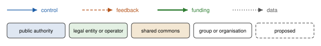

An icon at the left of each box says what the box does: a factory for a manufacturer, a civic
building for a legislature, scales for a regulator, one figure for a person and two for people, a
key for a credential authority, a phone for an app. The key lists every icon. The icons are from
[Lucide](https://lucide.dev) (ISC licence), copied into
[`tools/structure-diagrams/icons/`](../../../tools/structure-diagrams/icons/) with their licence.

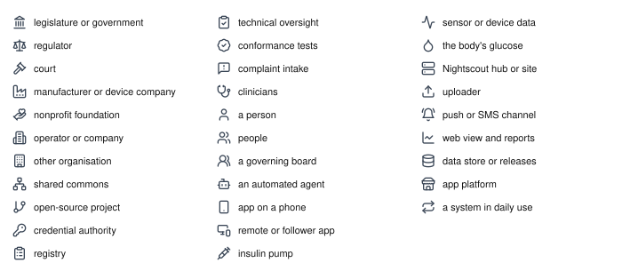

Every drawing is labelled *level · subject*. The level is where the drawing sits in the
hierarchy, from society down to software and devices; the subject is a short name that stays the
same as drawings are added beside it.

| level | what sits at it | drawings |
|---|---|---|
| 0 · society | legislatures, regulators and the sector around AID in general | 0·sector; 0·diy-status\* |
| 1 · ecosystem | the ecosystem's organisations and how they connect | 1·today, 1·proposed (and six stakeholder views); 1·authority\*, 1·data-rights\*, 1·hosting\*, 1·federation\* |
| 2 · one organisation or agreement | one entity, one agreement, one programme | 2·agreement, 2·controller-operator; the precedents 2·sqlite, 2·cncf, 2·apple; 2·data-commons\*, 2·shared-infra\* |
| 3 · technical process | one loop in software and devices | 3·controller, 3·hub-sync, 3·delegation, 3·person-loop; 3·identity\*, 3·registration\* |
| idea | one idea from the argument, drawn small | idea·sponsor-or-operate, idea·one-codebase, idea·same-requirements, idea·oversight-layer, idea·tiers, idea·credential-lifetime, idea·complaints, idea·designated-third-party |

\* Drawn three times on one layout (believed, actual, and emerging or proposed) on the companion
page [Process models: what we believe, and how it works](PROCESS-MODELS.md).

A box marked `[zoom: 2·agreement]` is drawn in more detail in that drawing. Markers are used only
where the link between two drawings would not be obvious otherwise: 0·sector's commons is the
whole of 1·proposed; 1·proposed's credential authority is where the agreements of 2·agreement reach
the projects; its regulated controller operator is 2·controller-operator; the people at the bottom
of 1·proposed, and the controller app in 2·controller-operator, run the loop drawn in
3·controller. The levels are views of one system, not separate systems, so the same box can appear
at several levels: the credential authority is in 1·proposed, 2·agreement and 3·person-loop.

Drawings that span more than one kind of boundary carry horizontal bands: **legal** (law,
regulation and the authorities that make them), **social** (organisations, agreements and people)
and **technical** (software and devices). The bands show where accountability crosses from one to
the next.

## 0·sector

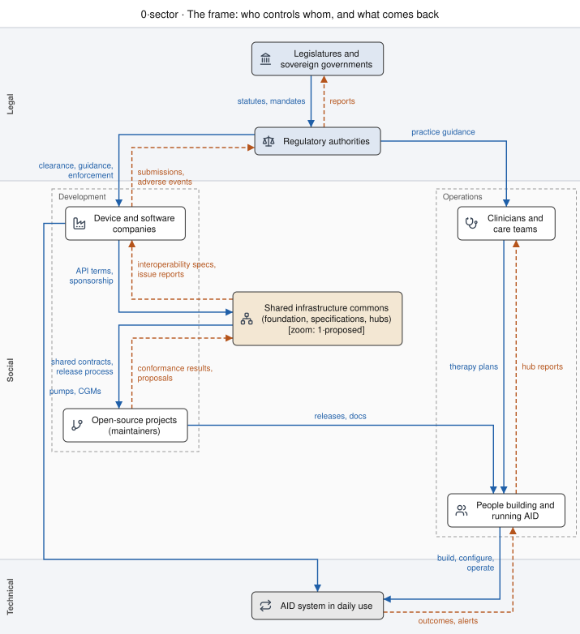

The two columns follow Leveson's sociotechnical form: development on the left, operations on the
right. The commons sits between them because it is both: specifications and release processes on
one side, documentation and hubs that people use on the other.

## 1·today

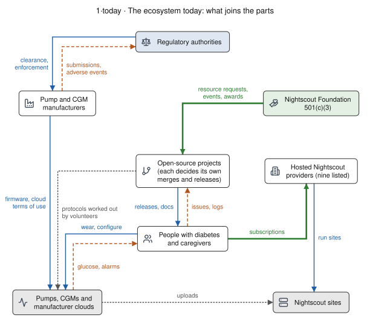

Sources: [how decisions are made today](../observations/GOVERNANCE-TODAY.md) §1, §3 and §4;
[partner readiness](../PARTNER-READINESS.md) §1 and §3. What the drawing shows by its gaps:

- No edge joins a project or the foundation to a manufacturer. Projects reach devices through
  protocols volunteers worked out (a data edge, not an agreement).
- No complaint or incident route leaves the ecosystem. Feedback from people reaches projects as
  issues and logs, and stops there.
- The only funding edges are the foundation's support to projects and subscriptions to hosted
  providers.

## 1·proposed

Sources: [ecosystem programme §2b](../ECOSYSTEM-PROGRAMME.md#2b-sponsoring-and-operating) (the
foundation sponsors by default and operates only by recorded decision);
[partner readiness](../PARTNER-READINESS.md) §2 (tiers A, B and C), §6 (complaint intake) and §7
(registry, credential authority and hosting kept apart); [precedents](PRECEDENTS.md#tidepool-loop-20202023)
(Tidepool Loop: a regulated track beside the DIY one).

What changes against today: each new edge to a manufacturer runs through a named legal entity. The
foundation signs for tier A, observe and export. Tier B and C relationships go to an operator with
its own contract, insurance and successor: a credential authority, or a regulated controller
operator as Tidepool was for Loop. The DIY track keeps its own edges to people. Complaints and
incidents gain a route back to the manufacturer; that route is drawn one level down, in 2·agreement, and
the person's own loop in 3·controller, so that this drawing carries one idea: who holds which agreement. The manufacturer is drawn above the
foundation because in this drawing it grants access; that is the direction of control, not a
ranking.

### The same drawing, from each stakeholder's side

Each view greys out everything that does not touch the stakeholder. The layout does not change, so
the views can be laid side by side.

| view | what this stakeholder controls | what reaches them as feedback |
|---|---|---|
| [a person with diabetes or a caregiver](diagrams/1-proposed--person.svg) | which releases, hosted hubs and devices they use, and whether to pay a host | releases, hosted hubs and a cleared app; their complaints and their own loop are in 2·agreement and 3·controller |
| [a project maintainer](diagrams/1-proposed--maintainer.svg) | releases to people | conformance results go up; credentials and tests come down from bodies the project does not run |
| [a Nightscout-as-a-service operator](diagrams/1-proposed--host.svg) | the hosted hubs | subscriptions; hub conformance is proposed, not existing |
| [a manufacturer](diagrams/1-proposed--manufacturer.svg) | agreements, credential authority, clearance submissions | a readiness dossier from the foundation and submissions from any regulated operator; forwarded complaints are in 2·agreement. None of this exists today |
| [the foundation board](diagrams/1-proposed--board.svg) | sponsorship of shared operations | the tier A agreement and nothing else; it operates nothing in this drawing |
| [a regulator](diagrams/1-proposed--regulator.svg) | clearance of manufacturers and of any regulated controller operator | adverse events and submissions; the DIY track has no edge to a regulator |

The "feedback" column is read from the drawing; it is where the stakeholders are likely to
disagree, and where the drawing should be corrected if it is wrong.

## 2·agreement

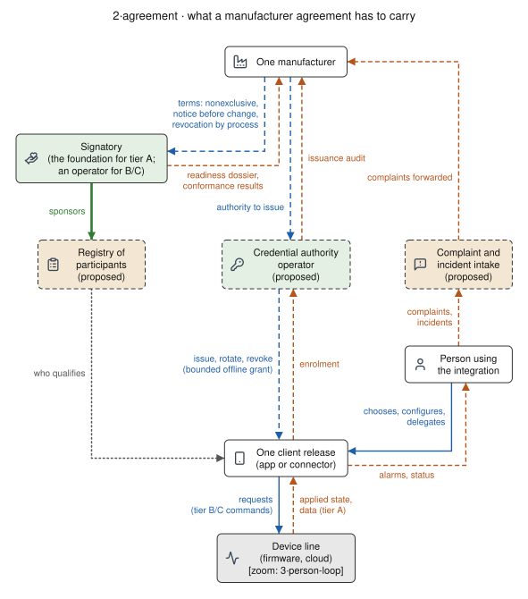

Source: [partner readiness](../PARTNER-READINESS.md) §4 (terms that carry data rights), §6
(complaints in both directions) and §7 (three roles kept apart; separating request from effect).
The registry says who qualifies, the credential authority issues credentials, and the client
release is hosted or built by someone else again. The client's commands to the device are
requests; what comes back is the state the device applied, the split the
[hub-sync architecture](../../30-design/platform/nightscout-hub-sync-architecture-2026-09-11.md)
already makes.

## 2·controller-operator: Loop-as-a-service

A proposal for discussion. Sources: the special controls for interoperable automated glycemic
controllers (iAGC, 21 CFR 862.1356), integrated CGMs (iCGM, 862.1355) and alternate controller
enabled pumps (ACE, 880.5730), as summarised in the
[stack census cloud layer](../../60-research/programme/stack-census-2026-09-30/cloud-layer.md);
[history](../observations/HISTORY.md) and [precedents](PRECEDENTS.md#tidepool-loop-20202023) for
Tidepool Loop, cleared as an iAGC on 2023-01-23 (K203689); [partner readiness](../PARTNER-READINESS.md)
§2 (tier C) and §7.

What makes this a different drawing from 2·agreement:

- **The operator is the legal manufacturer of the controller.** It answers to the regulator for
  one validated release and its updates. The DIY track continues beside it, as DIY Loop did beside
  Tidepool Loop.
- **One codebase.** The cleared release is a validated build of the same open-source releases, not
  a separate edition ([programme, "One codebase, two uses"](../ECOSYSTEM-PROGRAMME.md): SQLite sells
  assurance on the releases free users get; CNCF certifies vendors against one upstream). Fixes and
  validation evidence from the regulated track return to the shared codebase, drawn as a proposed
  edge. The reason for the edge: without it the regulated track becomes a second upstream, and the
  open project and the operator compete for the same fixes and the same maintainers' time.
- **The interfaces are regulated on both sides.** The iAGC controls ask for validated interface
  specifications, secure authentication (pairing) and a process for sharing and validating the
  interface with connected devices. The ACE pump and iCGM controls ask the device side for the
  same. The pump and CGM manufacturers' edges to the operator are therefore agreements, not
  protocols worked out by volunteers.
- **The controller's inputs and outputs are restricted.** Under the iAGC regulation it takes
  glucose only from iCGMs and commands only ACE pumps, unless the regulator determines otherwise.
  An ACE pump must fall back safely when it loses the connection.
- **Feedback has a record.** The regulation asks for a record of critical events. Together with
  complaints, it returns to the operator and from there to the regulator, which the DIY loop in
  1·today does not have.

The drawing does not settle who operates such an entity, whether the foundation sponsors it
([programme §2b](../ECOSYSTEM-PROGRAMME.md#2b-sponsoring-and-operating): sponsoring does not make
the foundation the operator), or how the return edge works when a fix to the open codebase has
not yet been validated for the cleared release. The regulatory
summary above paraphrases the regulations; it is for regulatory counsel to confirm against the
current text and any device-specific clearance.

## The technical loops

*Contributor-facing in detail; summarised here for every reader.* Three loops in software and
devices, drawn from the source code of Loop, Trio and AndroidAPS (AAPS) and the Nightscout
server. The detail, with file and line references, is in the
[technical loops note](../../60-research/structures-2026-10-17/technical-loops.md) (read
2026-10-17 from the revisions it lists; read from the code, not run on a device). The design
pages they serve embed the same drawings.

### 3·controller

The classic STPA loop: a controller (the app and its algorithm), an actuator (the pump), the
controlled process (the body's glucose and insulin) and a sensor (the CGM), with the person
supervising. All three apps command short temporary basal rates of up to 30 minutes, and
automatic or manual boluses; they stop dosing when the newest glucose reading is too old (15
minutes in Loop, 12 in Trio, 7 in AAPS, each read from the code; Loop and Trio rechecked at
LoopWorkspace v3.14.9 and Trio v1.0.2 on 2026-10-17). What each app does with a
failed or uncertain pump command, and how the person can open or close the loop, differ; the
note's §1.3 compares them. This is a description of how the software is built, not advice on
using it; settings are for each person and their care team.

### 3·hub-sync

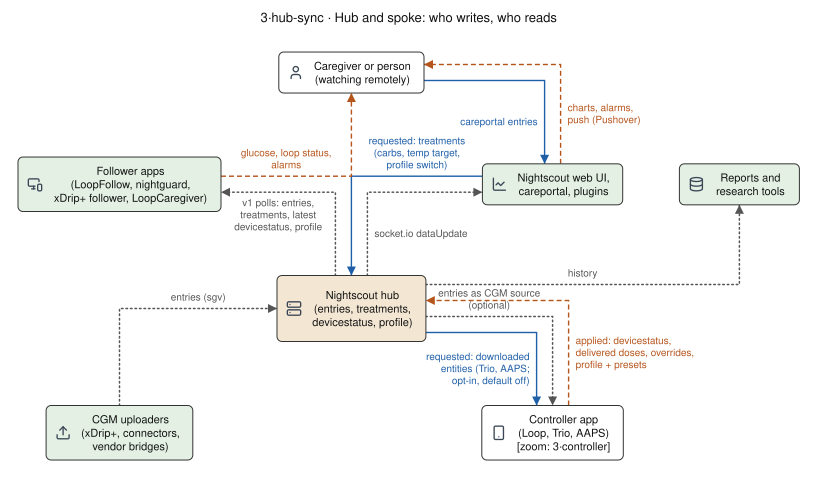

The hub in the middle: who writes each kind of record (glucose, treatments, device status,
profiles) and who reads it. What a controller says it applied and what someone asked for are kept
apart, the split the
[hub-sync architecture](../../30-design/platform/nightscout-hub-sync-architecture-2026-09-11.md)
makes.

### 3·delegation

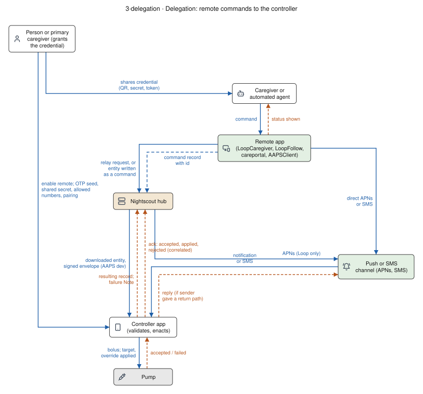

How a caregiver, or an automated agent acting for the person, sends a command (a remote bolus,
carbs, a temporary target, an override) to the controller. Measured gaps (note §3): the hub keeps
no record of a command with an id and an acknowledgement, except in AAPS's development branch; a
reply reaches the sender only where the sender supplied a return path; "success" means the pump
accepted the command, not that delivery finished; and an automated agent looks the same as
whoever shared the credential with it. The proposed command record and acknowledgement are drawn
in [3·registration](PROCESS-MODELS.md#3registration-who-writes-to-the-hub-and-where-a-command-goes),
as proposed.

## 3·person-loop

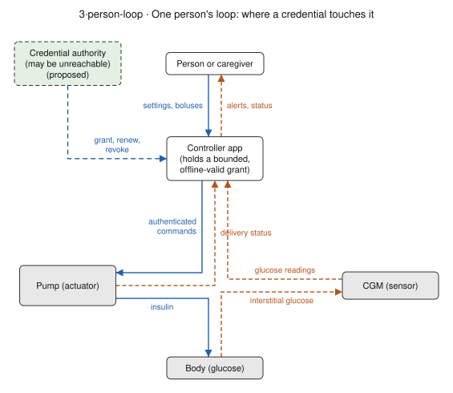

Source: [partner readiness §7](../PARTNER-READINESS.md#7-credentials-for-devices-that-require-them),
"no single point of failure for therapy". The credential authority is the only node above the
person that can reach the loop, and the drawing puts it outside the loop: the app holds a grant
that stays valid offline within bounds, so the authority being unreachable does not stop the loop.
What the bounds are is for each manufacturer to define and validate; the drawing does not describe
how any released system behaves.

## Precedents at level 2

| drawing | precedent | maps onto | the shape it shows |
|---|---|---|---|
| 2·sqlite | SQLite | 1·proposed, foundation and shared operations | companies buy assurance through one small company; no edge runs from a buyer to the developers |
| 2·cncf | CNCF | 1·proposed and 2·agreement, conformance and registry | many vendors certified against one upstream by the same public tests |
| 2·apple | Apple Developer Program | 2·agreement and 3·person-loop, credential authority | a platform owner enrols developers, issues signing credentials that expire, and approves special entitlements |

Source: [precedents, SQLite](PRECEDENTS.md#sqlite-paying-for-assurance-not-control), read from
sqlite.org 2026-09-29.

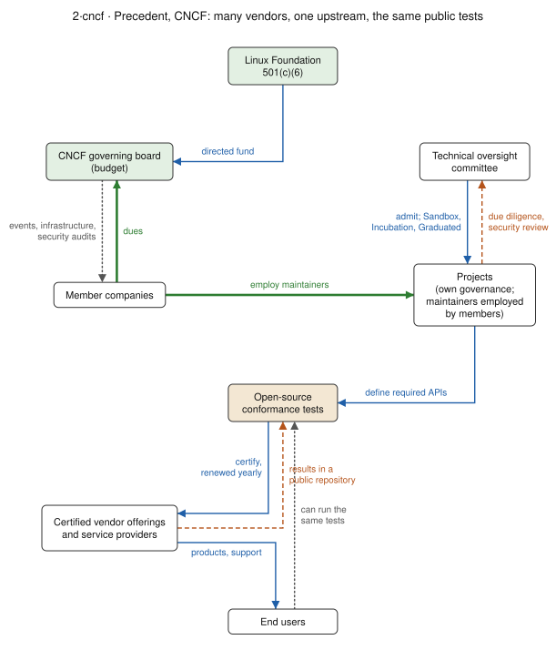

Source: [precedents](PRECEDENTS.md), funding and rules rows (charter, TOC process, conformance and
KCSP pages, read 2026-09-29 and 2026-10-01).

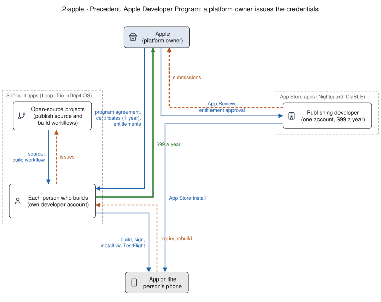

Source: [TestFlight distribution infrastructure](../../10-domain/testflight-distribution-infrastructure.md)
§1, §3 and §4. Self-built apps put one developer account, and its yearly certificate, on every
person who builds; App Store apps put one account on the publisher. That is the trade a credential
authority in 2·agreement makes too: who holds the credential decides who answers for it and whose renewal
can lapse.

## Single ideas

Leveson's figures are crisp partly because each carries one idea. These drawings take one idea from
the overview's argument and draw it with as few boxes as it needs, in two or three panels on one
layout.

### idea·sponsor-or-operate

The same service, drawn twice. The only change is who sits in the operator's box, and with it where
uptime, incidents, complaints and claims arrive. Sponsoring passes money down and reports up;
operating passes control down and makes every incident the foundation's. The programme proposes
that the foundation **sponsors by default and operates only by a recorded decision** naming the
operator, its contract, insurance and successor
([programme §2b](../ECOSYSTEM-PROGRAMME.md#2b-sponsoring-and-operating)); the duties that
operating brings are listed in [what each activity brings §3](ACCOUNTABILITY-THRESHOLDS.md#3-activities-and-the-pillars-they-trigger).

### idea·one-codebase

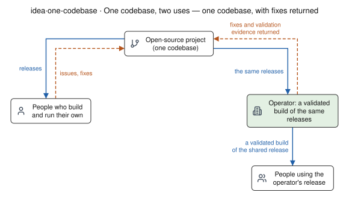

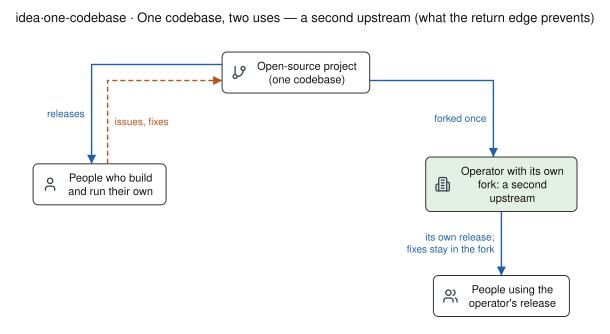

One project's releases serve both people who build their own and an operator, with no separate
edition ([programme, "One codebase, two uses"](../ECOSYSTEM-PROGRAMME.md#2-the-picture); SQLite's
and CNCF's models in [precedents](PRECEDENTS.md)). The second panel is what the proposed return edge
prevents: a fork, after which the open project and the operator compete for the same fixes and the
same maintainers' time (2·controller-operator).

### idea·same-requirements

The requirements do not change with the kind of organisation; meeting them usually takes a legal
entity. Evidence: the FDA routes are open to any manufacturer and Tidepool, a nonprofit, took the
same 510(k) route; Dexcom's agreement is standard and non-negotiable; Washington's health-data act
does not exclude nonprofits; Apple asks healthcare apps to come from a legal entity
([what each activity brings §5](ACCOUNTABILITY-THRESHOLDS.md#5-the-same-requirements-for-anyone)).

### idea·oversight-layer

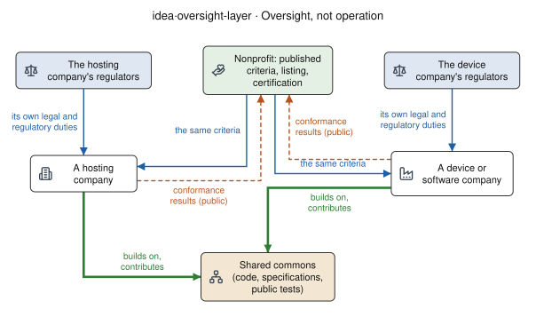

A nonprofit's role is oversight: published criteria, listing and certification, applied the same
way to every company, with results returned in public. Each company keeps its own legal and
regulatory duties; the nonprofit does not take them over (CNCF, the Open Home Foundation, TEFCA and
eduGAIN in [precedents](PRECEDENTS.md); [what each activity brings §5](ACCOUNTABILITY-THRESHOLDS.md#5-the-same-requirements-for-anyone)).

### idea·tiers

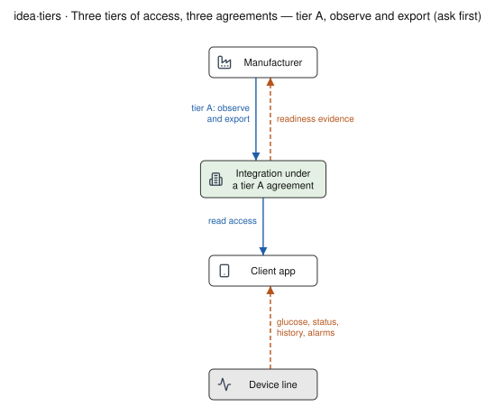

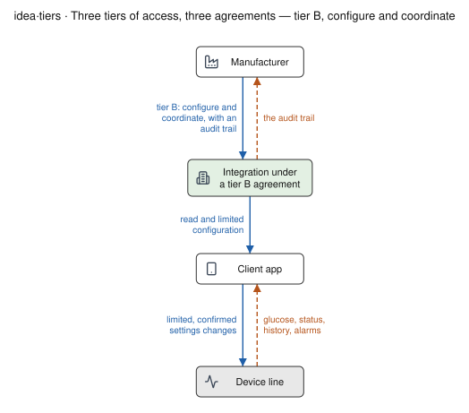

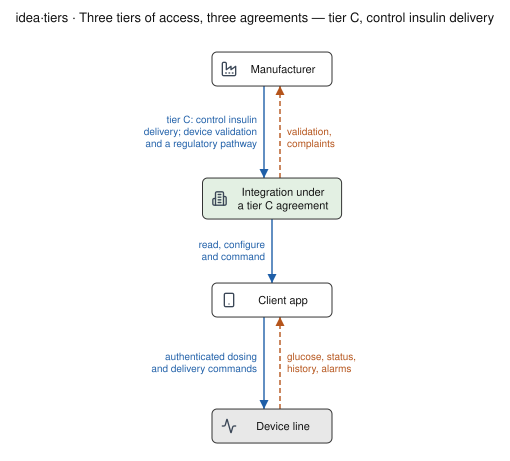

The same relationship three times, one agreement per tier, each adding lines: observe and export;
configure and coordinate; control insulin delivery. The tiers are this repository's terms for
technical risk, not FDA classifications; the recommendation is to ask for tier A first and
separately ([partner readiness §2](../PARTNER-READINESS.md#2-three-tiers-of-access-and-which-to-ask-for-first)).

### idea·credential-lifetime

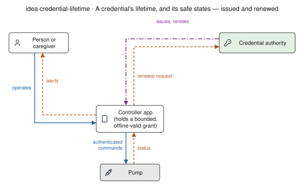

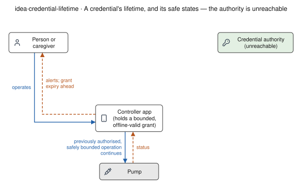

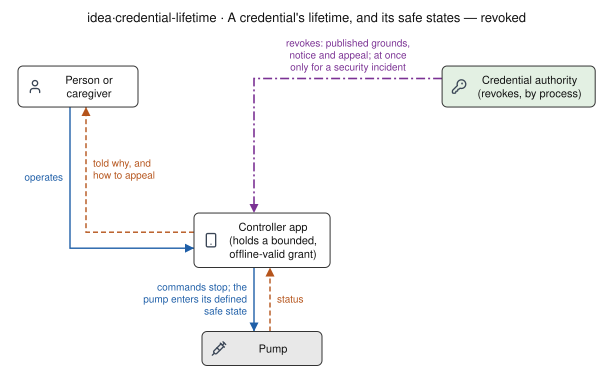

One credential in three states, each with a defined safe state. A credential service must not be
able to stop insulin delivery by being unreachable; revocation follows a published process, and
must leave a person's devices in a defined safe state
([partner readiness §4 and §7](../PARTNER-READINESS.md#7-credentials-for-devices-that-require-them)).
The bounds and safe states are for each manufacturer to define and validate; the drawing states
requirements, not the behaviour of any released system.

### idea·complaints

One intake for support, complaints and security, routing each report to the party legally
responsible. It closes two loops: regression tests back to the projects, and referrals out to the
manufacturer, whose own reporting duties stay its own (21 CFR Part 803). Intake is not legal
responsibility ([partner readiness §5 and §6](../PARTNER-READINESS.md#6-complaint-incident-and-support-handling)).

### idea·designated-third-party

In the EU since 2025-09-12, the person decides who receives their device data, and the data holder
must send it there; the recipient is bound to the agreed purposes
([vendor note §3.1](../../60-research/structures-2026-10-17/vendor-programs-and-data-rights.md#31-eu-data-act)).
This is a draft summary of the law for counsel to review, not legal advice. The drawing is also
embedded in [DIGITAL-RIGHTS](../../DIGITAL-RIGHTS.md#eu-data-act-regulation-eu-20232854), beside the Data Act entry.

## What the drawings do not show

- **Legal relationships in detail.** An edge labelled "agreement" stands for terms that
  [partner readiness §4–§5](../PARTNER-READINESS.md#4-what-the-ecosystem-needs-from-an-agreement)
  lists; which party is the manufacturer for which function, liability and intellectual property are
  for counsel and are not drawn.
- **Sizes and amounts.** Edges show that money flows, not how much.
- **Every participant.** Clinicians appear only in 0·sector; the support community and hubs other
  than Nightscout are not drawn.

## Changing a drawing

The drawings are generated. Each one's source is a YAML file in
[`tools/structure-diagrams/inputs/`](../../../tools/structure-diagrams/inputs/), with nodes placed
by level and column, edges typed as control, feedback, funding or data, and optional stakeholder
views. Edit the YAML and run `python3 tools/structure-diagrams/render.py`. The renderer places
every box on a grid and routes lines at right angles, with each control and feedback pair drawn as
two parallel lines, in the manner of Leveson's control structures. It replaced a Graphviz renderer
on 2026-10-17 after the [grid layout lab](../../../tools/lab/stpa-grid-style/README.md) measured
both; the earlier [diagram tool lab](../../../tools/lab/stpa-diagrams/README.md) compared the
off-the-shelf tools.
