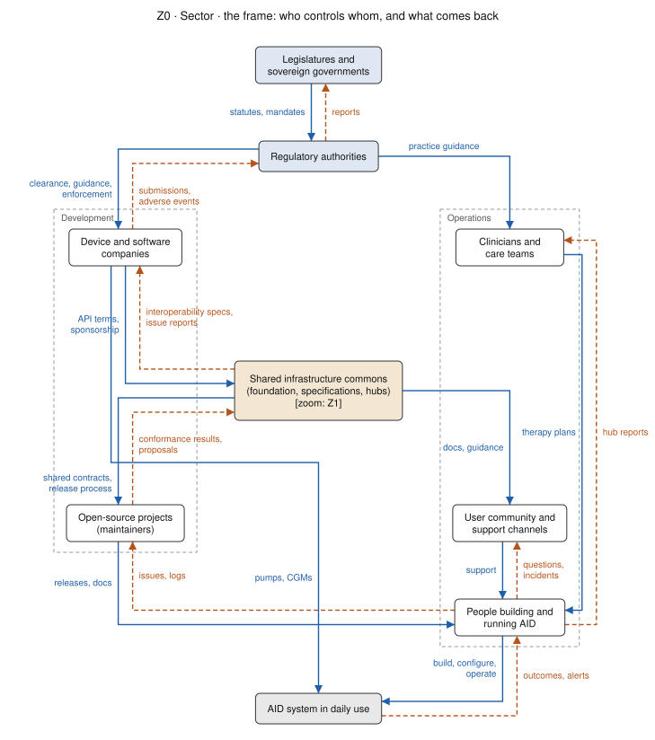
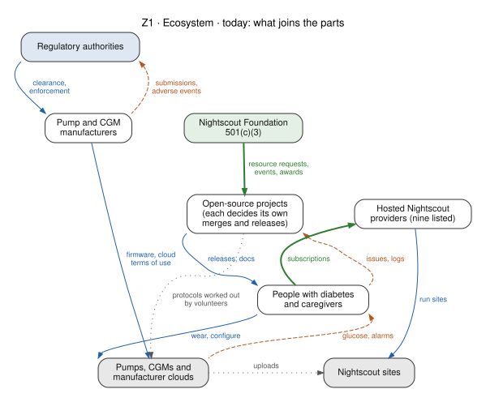
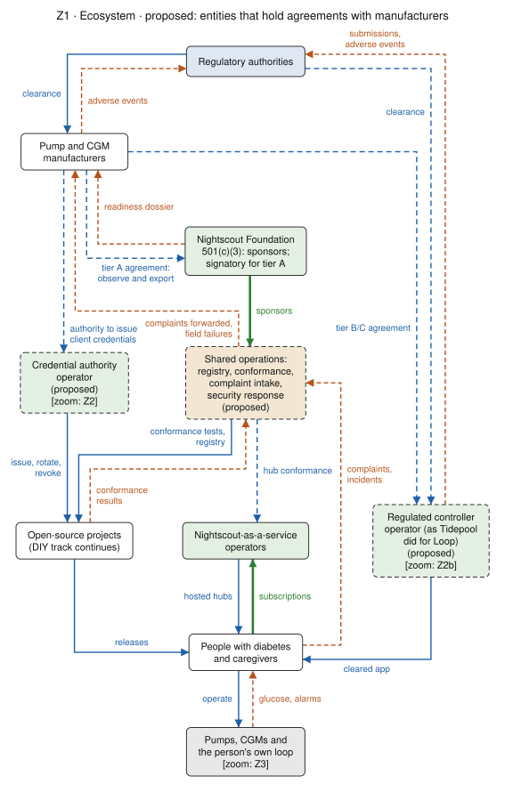
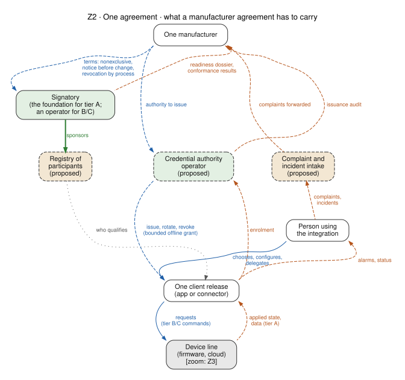
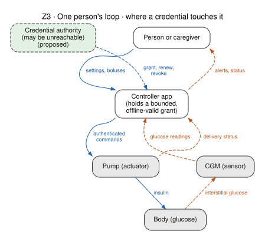
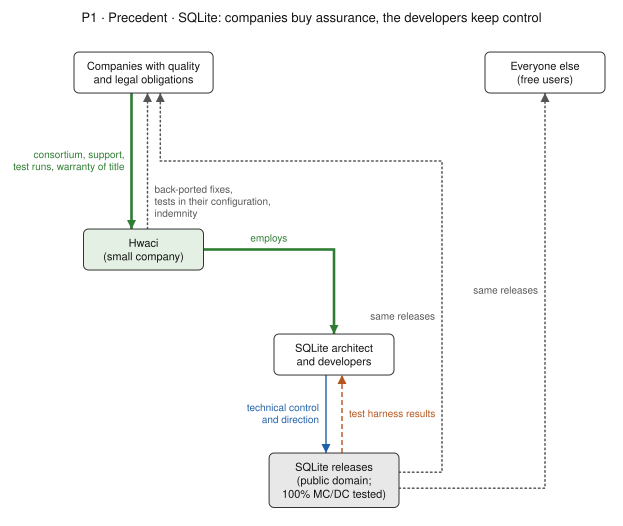
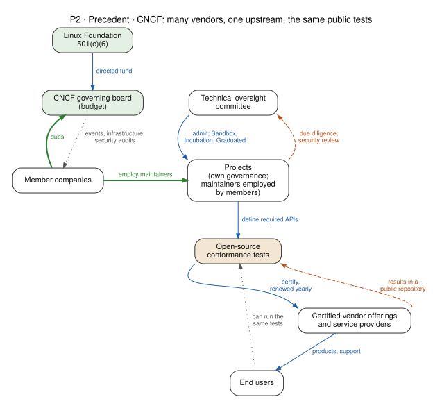
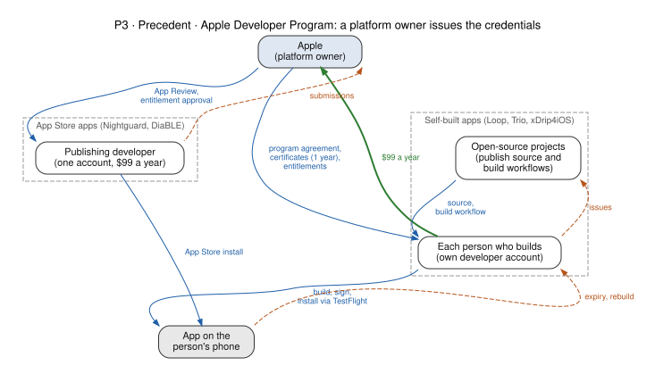

# Control structures, drawn

*For the Nightscout Foundation board, the maintainers of the ecosystem projects, and the community.
**Perspective** (part 2 of the overview; [how the overview is organised](../README.md)). Living page,
written 2026-10-16. Drawings to follow and discuss the overview's proposals with: who controls
whom, what comes back, and where money flows. Every node and edge comes from a page linked under
the drawing; nothing here is a new finding. The drawings marked **proposed** show a proposal for
discussion, not a decision.*

## How to read the drawings

The drawings follow the convention of STPA (system-theoretic process analysis) control structures.
Whoever controls sits above what they control. Control actions run down the left of each loop and
the feedback that tells a controller what happened runs up the right. A loop with no feedback edge
is a loop whose controller cannot see the result of what it does.

Every drawing is labelled by zoom level, so a box in one drawing can be opened up in another:

| label | zoom level | what it shows |
|---|---|---|
| Z0 | sector | governments, regulators, companies, clinicians and the commons around AID in general |
| Z1 | ecosystem | the Nightscout ecosystem's parts, today and as proposed, with one view per stakeholder |
| Z2 | one agreement | what one agreement with one manufacturer has to carry |
| Z2b | one regulated controller | Loop-as-a-service: an entity that answers to a regulator for a controller built from an open-source codebase |
| Z3 | one person's loop | the controller, pump, sensor and body, and where an issued credential touches them |
| P1–P3 | precedents | SQLite, CNCF and the Apple Developer Program, each mapped onto Z1 or Z2 |

A box marked `[zoom: Z2]` is drawn in more detail in Z2. Markers are used only where the link
between two drawings would not be obvious otherwise: Z0's commons is the whole of Z1; Z1's
credential authority is where the agreements of Z2 reach the projects; Z1's regulated controller
operator is Z2b; Z1's devices and Z2's device
line and Z2b's controller app are the loop drawn in Z3. The levels are views of one system, not separate systems, so the
same box can appear at several levels: the credential authority is in Z1, Z2 and Z3.

## Z0 · Sector

The two columns follow Leveson's sociotechnical form: development on the left, operations on the
right. The commons sits between them because it is both: specifications and release processes on
one side, documentation and hubs that people use on the other.

## Z1 · Ecosystem, today

Sources: [how decisions are made today](../observations/GOVERNANCE-TODAY.md) §1, §3 and §4;
[partner readiness](../PARTNER-READINESS.md) §1 and §3. What the drawing shows by its gaps:

- No edge joins a project or the foundation to a manufacturer. Projects reach devices through
  protocols volunteers worked out (a data edge, not an agreement).
- No complaint or incident route leaves the ecosystem. Feedback from people reaches projects as
  issues and logs, and stops there.
- The only funding edges are the foundation's support to projects and subscriptions to hosted
  providers.

## Z1 · Ecosystem, proposed

Sources: [ecosystem programme §2b](../ECOSYSTEM-PROGRAMME.md#2b-sponsoring-and-operating) (the
foundation sponsors by default and operates only by recorded decision);
[partner readiness](../PARTNER-READINESS.md) §2 (tiers A, B and C), §6 (complaint intake) and §7
(registry, credential authority and hosting kept apart); [precedents](PRECEDENTS.md#tidepool-loop-20202023)
(Tidepool Loop: a regulated track beside the DIY one).

What changes against today: each new edge to a manufacturer runs through a named legal entity. The
foundation signs for tier A, observe and export. Tier B and C relationships go to an operator with
its own contract, insurance and successor: a credential authority, or a regulated controller
operator as Tidepool was for Loop. Complaints gain a route back to the manufacturer and the
regulator. The DIY track keeps its own edges to people. The manufacturer is drawn above the
foundation because in this drawing it grants access; that is the direction of control, not a
ranking.

### The same drawing, from each stakeholder's side

Each view greys out everything that does not touch the stakeholder. The layout does not change, so
the views can be laid side by side.

| view | what this stakeholder controls | what reaches them as feedback |
|---|---|---|
| [a person with diabetes or a caregiver](diagrams/z1-proposed--person.svg) | which releases, hosted hubs and devices they use, and whether to pay a host | glucose and alarms from devices; nothing returns from the complaints they send unless the intake replies |
| [a project maintainer](diagrams/z1-proposed--maintainer.svg) | releases to people | conformance results go up; credentials and tests come down from bodies the project does not run |
| [a Nightscout-as-a-service operator](diagrams/z1-proposed--host.svg) | the hosted hubs | subscriptions; hub conformance is proposed, not existing |
| [a manufacturer](diagrams/z1-proposed--manufacturer.svg) | agreements, credential authority, clearance submissions | a readiness dossier, forwarded complaints and field failures, none of which exist today |
| [the foundation board](diagrams/z1-proposed--board.svg) | sponsorship of shared operations | the tier A agreement and nothing else; it operates nothing in this drawing |
| [a regulator](diagrams/z1-proposed--regulator.svg) | clearance of manufacturers and of any regulated controller operator | adverse events and submissions; the DIY track has no edge to a regulator |

The "feedback" column is read from the drawing; it is where the stakeholders are likely to
disagree, and where the drawing should be corrected if it is wrong.

## Z2 · One agreement

Source: [partner readiness](../PARTNER-READINESS.md) §4 (terms that carry data rights), §6
(complaints in both directions) and §7 (three roles kept apart; separating request from effect).
The registry says who qualifies, the credential authority issues credentials, and the client
release is hosted or built by someone else again. The client's commands to the device are
requests; what comes back is the state the device applied, the split the
[hub-sync architecture](../../30-design/platform/nightscout-hub-sync-architecture-2026-09-11.md)
already makes.

## Z2b · One regulated controller: Loop-as-a-service

A proposal for discussion. Sources: the special controls for interoperable automated glycemic
controllers (iAGC, 21 CFR 862.1356), integrated CGMs (iCGM, 862.1355) and alternate controller
enabled pumps (ACE, 880.5730), as summarised in the
[stack census cloud layer](../../60-research/programme/stack-census-2026-09-30/cloud-layer.md);
[history](../observations/HISTORY.md) and [precedents](PRECEDENTS.md#tidepool-loop-20202023) for
Tidepool Loop, cleared as an iAGC on 2023-01-23 (K203689); [partner readiness](../PARTNER-READINESS.md)
§2 (tier C) and §7.

What makes this a different drawing from Z2:

- **The operator is the legal manufacturer of the controller.** It answers to the regulator for
  one validated release and its updates. An open-source project supplies the source, and the DIY
  track continues beside it, as DIY Loop did beside Tidepool Loop.
- **The interfaces are regulated on both sides.** The iAGC controls ask for validated interface
  specifications, secure authentication (pairing) and a process for sharing and validating the
  interface with connected devices. The ACE pump and iCGM controls ask the device side for the
  same. The pump and CGM manufacturers' edges to the operator are therefore agreements, not
  protocols worked out by volunteers.
- **The controller's inputs and outputs are restricted.** Under the iAGC regulation it takes
  glucose only from iCGMs and commands only ACE pumps, unless the regulator determines otherwise.
  An ACE pump must fall back safely when it loses the connection.
- **Feedback has a record.** The regulation asks for a record of critical events. Together with
  complaints, it returns to the operator and from there to the regulator, which the DIY loop in
  Z1-today does not have.

The drawing does not settle who operates such an entity, whether the foundation sponsors it
([programme §2b](../ECOSYSTEM-PROGRAMME.md#2b-sponsoring-and-operating): sponsoring does not make
the foundation the operator), or how fixes return to the open-source project. The regulatory
summary above paraphrases the regulations; it is for regulatory counsel to confirm against the
current text and any device-specific clearance.

## Z3 · One person's loop

Source: [partner readiness §7](../PARTNER-READINESS.md#7-credentials-for-devices-that-require-them),
"no single point of failure for therapy". The credential authority is the only node above the
person that can reach the loop, and the drawing puts it outside the loop: the app holds a grant
that stays valid offline within bounds, so the authority being unreachable does not stop the loop.
What the bounds are is for each manufacturer to define and validate; the drawing does not describe
how any released system behaves.

## Precedents

| label | precedent | maps onto | the shape it shows |
|---|---|---|---|
| P1 | SQLite | Z1, foundation and shared operations | companies buy assurance through one small company; no edge runs from a buyer to the developers |
| P2 | CNCF | Z1 and Z2, conformance and registry | many vendors certified against one upstream by the same public tests |
| P3 | Apple Developer Program | Z2 and Z3, credential authority | a platform owner enrols developers, issues signing credentials that expire, and approves special entitlements |

Source: [precedents, SQLite](PRECEDENTS.md#sqlite-paying-for-assurance-not-control), read from
sqlite.org 2026-09-29.

Source: [precedents](PRECEDENTS.md), funding and rules rows (charter, TOC process, conformance and
KCSP pages, read 2026-09-29 and 2026-10-01).

Source: [TestFlight distribution infrastructure](../../10-domain/testflight-distribution-infrastructure.md)
§1, §3 and §4. Self-built apps put one developer account, and its yearly certificate, on every
person who builds; App Store apps put one account on the publisher. That is the trade a credential
authority in Z2 makes too: who holds the credential decides who answers for it and whose renewal
can lapse.

## What the drawings do not show

- **Legal relationships in detail.** An edge labelled "agreement" stands for terms that
  [partner readiness §4–§5](../PARTNER-READINESS.md#4-what-the-ecosystem-needs-from-an-agreement)
  lists; which party is the manufacturer for which function, liability and intellectual property are
  for counsel and are not drawn.
- **Sizes and amounts.** Edges show that money flows, not how much.
- **Every participant.** Clinicians, the support community and other hubs appear in Z0 only.

## Changing a drawing

The drawings are generated. Each one's source is a YAML file in
[`tools/structure-diagrams/inputs/`](../../../tools/structure-diagrams/inputs/), with nodes placed
by level and column, edges typed as control, feedback, funding or data, and optional stakeholder
views. Edit the YAML and run `python3 tools/structure-diagrams/render.py`. Graphviz was chosen
because it was the one tool that kept hierarchy, columns and the control-left convention on every
structure in the [diagram tool lab](../../../tools/lab/stpa-diagrams/README.md).
