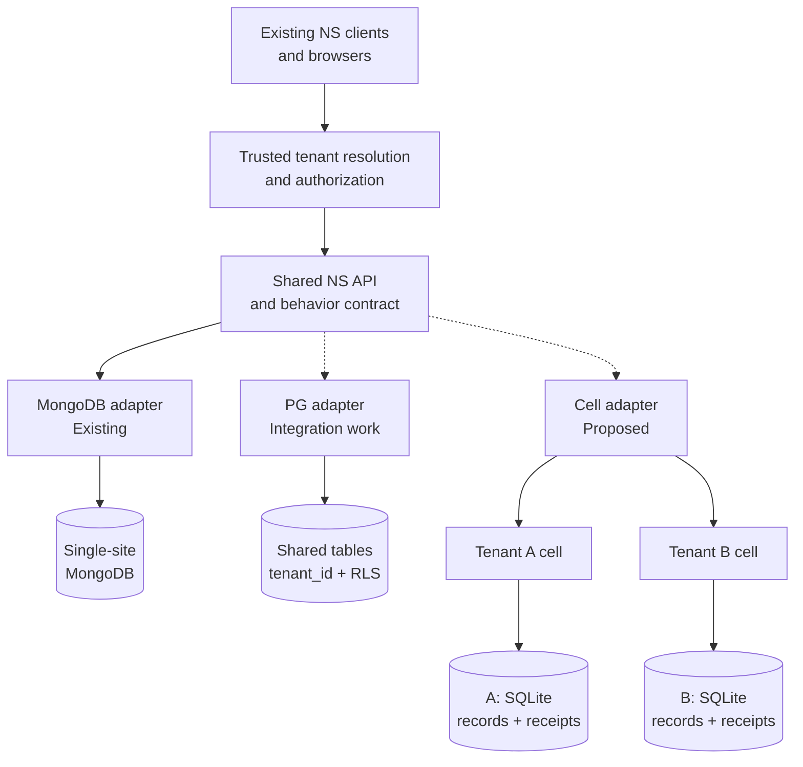
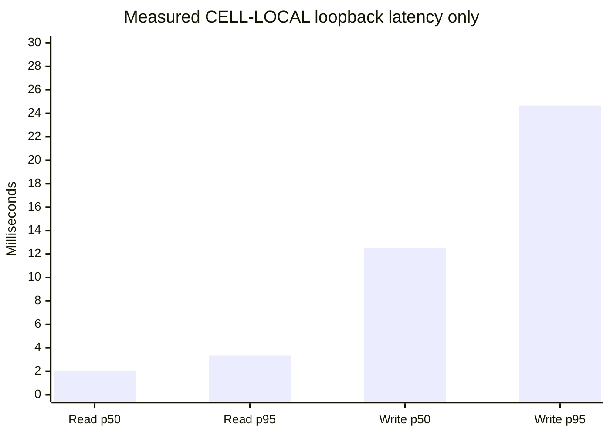
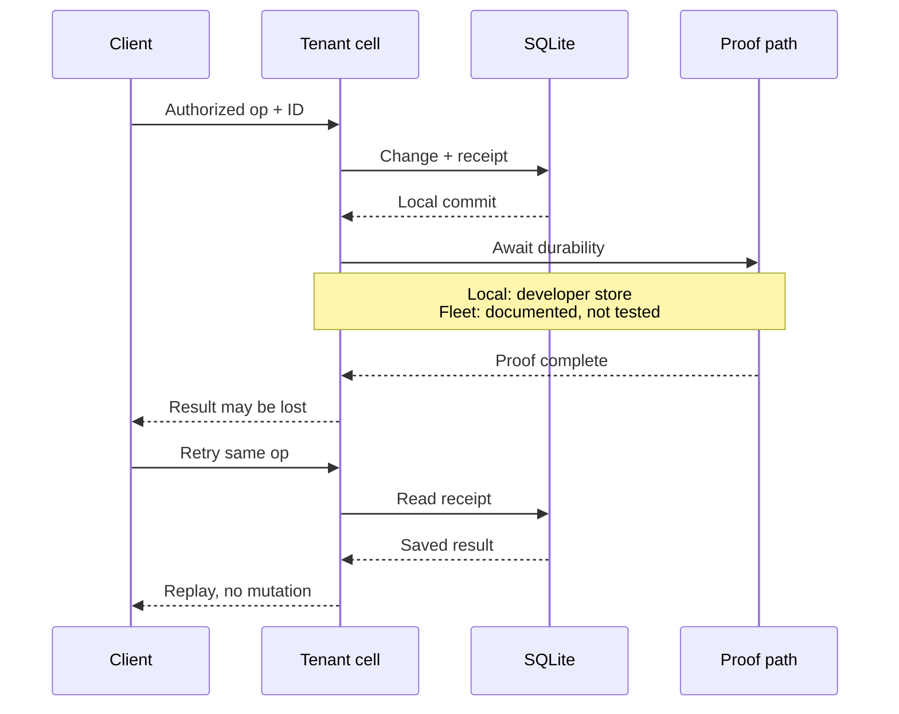
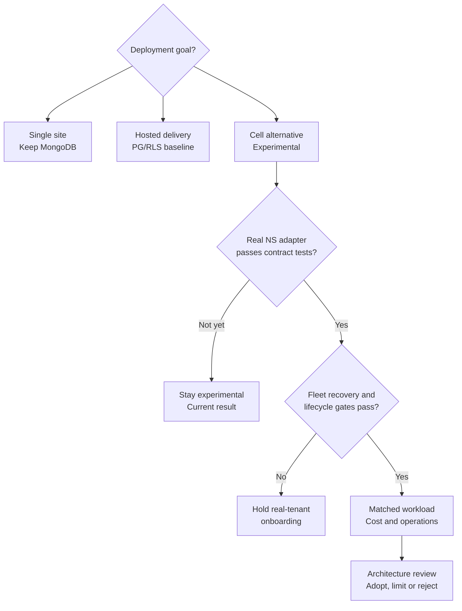

# Tenant cell + SQLite: findings, architecture and storage decision guide

**2026-11-02. Experimental, synthetic data only.** Worktree
`externals/work/celld-sqlite-20261102`, branch `lab/celld-sqlite-20261102`,
based on alignment commit `28671cb4a`; executed lab committed as `018e55c34`.
This report adds interpretation, not a new experiment run. No production backend
registry, release gate, hosted delivery roadmap or external NS checkout was changed.

## Decision brief

**A tenant cell can own its SQLite records without a second database.** Real
celld v0.6.3 passed twelve local experiment checks and a discriminating broken
routing control. This supports continuing a SQLite backend feasibility track;
it does not establish a supported third backend or production cost advantage.

| Decision to make | Evidence-based recommendation |
|------------------|-------------------------------|
| Replace existing self-hosted MongoDB? | **No.** Keep first-class single-tenant behavior and the existing adapter. Nothing here requires existing operators to migrate. |
| Replace the adopted hosted PostgreSQL direction? | **Not on this evidence.** PG/RLS remains the integration baseline; the cell track is a separate architecture candidate, not an accepted replacement. |
| Continue tenant-cell experiments? | **Yes, bounded by the gates below.** Local authority, isolation checks and restart persistence justify an actual NS adapter proof and a qualified-bucket fleet test. |
| Maintain three backends eventually? | **Plausible, conditional.** One shared NS behavior contract, explicit capability coverage and an owner for each implementation; not three divergent server products. |
| Declare a cheapest or fastest option? | **Not yet.** The experiments differ in runtime, payloads, endpoints, replication and age. There is no matched three-way benchmark. |

The existing D1-D4 [decision record](../30-design/tenancy/nightscout-multitenancy-execution-plan-2026-09-14.md#1-decisions)
retains single-tenant MongoDB and shared hosted PG/RLS. The later delivery
roadmap explicitly excludes celld from that integration stream (alignment
`ae4ad1827`, `docs/30-design/tenancy/multitenant-delivery-roadmap-2026-11-02.md:1-12`).
The user's request here authorizes investigation, not a silent amendment of
those decisions or an extra v16 dependency.

Read this report in four passes: **what was measured**, **what the alternatives
change**, **where the operational costs move**, and **what evidence would justify
promotion**. Diagrams label measured, proposed and vendor-documented boundaries;
they are not deployment instructions.

[Evidence](#comparative-evidence-ledger) |
[Results](#what-passed) |
[Comparison](#comparing-the-storage-approaches) |
[Architecture](#architecture-choices-beyond-the-database) |
[Economics](#economics-a-hypothesis-with-measurable-terms) |
[Decision gates](#decision-path-and-next-matched-comparison)

## What the tenant-cell architecture changes

Each fixture tenant uses the same class and schema but a different cell name.
A shared ingress validates the fixture principal for the tenant before resolving
the cell. Inside the cell, document changes and operation receipts share a
SQLite transaction. There is no PostgreSQL authority, MongoDB mirror or
PG-to-actor delivery gap in this arm.



**Figure 1 - Candidate architecture, not current availability.** Select one
record authority for a tenant; arrows are alternatives, not dual writes.
The SQLite lab directly exercises the lower cell/database portion through its
own small HTTP protocol, **not** through the pictured NS core/adapter.
The diagram omits replication and control-plane storage for clarity.
A platform tenant directory, quotas, secrets service and provisioning/audit
plane are still needed; they need not store copies of tenant clinical records.

## Reproducible evidence

| Item | Anchor |
|------|--------|
| Runner | `tools/lab/tenant-cell-sqlite/run.mjs:1-331` |
| Worker and SQL | `tools/lab/tenant-cell-sqlite/worker.mjs:1-166` |
| Configuration and instructions | `tools/lab/tenant-cell-sqlite/wrangler.json:1-10`, [lab README](../../tools/lab/tenant-cell-sqlite/README.md) |
| Measured output | [local.json](../../tools/lab/tenant-cell-sqlite/results/local.json), timestamp `2026-11-02T20:33:09.545Z` |
| Runtime | celld 0.6.3, Node v22.23.4, Linux x64; executable/worker/runner SHA-256 in output |
| Binary provenance | `denoland/celld` v0.6.3 release asset; `gh attestation verify` succeeded |
| NS reference | `official/dev` at `61eb37335954ae42c91345a0823bd67331025165`, read from the local official repository; not executed by this lab |

The local developer object store persists on the same host's filesystem.
No cloud bucket, ensemble, second node, remote network or disk-loss recovery
was involved. No paid resources were provisioned and no real health records or
provider credentials were used.

### Comparative evidence ledger

| Evidence | What actually ran or was inspected | What it can establish |
|----------|-----------------------------------|-----------------------|
| **CELL-LOCAL**, November 2 | This celld 0.6.3 lab; [raw JSON](../../tools/lab/tenant-cell-sqlite/results/local.json); source/runtime hashes pinned | Bounded synthetic cell storage semantics and same-disk restarts. Not NS compatibility or fleet durability. |
| **MONGO-SHAPES**, September 14 | MongoDB 7.0.43 / driver 5.9.2, transcribed dataloader queries; [report](../60-research/tenancy/exp-mt-026-database-in-the-loop-2026-09-14.md), raw [per-database](../../tools/mt-bench/results/exp-mt-040b.json) and [shared](../../tools/mt-bench/results/exp-mt-011b.json) results | Resource effects of two MongoDB layouts under that workload. The report pins no NS source commit; not a current full-server benchmark. |
| **PG-ADAPTER**, September 15 | Real old-seam adapter and emitted DDL at `7cc03cda`, PG 16.14 and MongoDB 7.0.43; [report](../60-research/tenancy/t25-postgres-backend-verification-2026-09-15.md) | 3,000/3,000 filter comparisons with planted-regression controls, plus limit/order/projection/materialization defects in that revision. Not current-dev adapter acceptance. |
| **PG-POOL**, September 15 | Real old-seam binding at `239f8c25`, PG 16.14 + PgBouncer 1.25.2; [report](../60-research/tenancy/pgbouncer-tenant-binding-2026-09-15.md) | Isolation on demonstrably reused connections in transaction pooling; a session-binding break leaks. Statement pooling cannot carry that adapter. |
| **PG-FOUNDATION**, November 2 | Follow-on local NS branch at `ce14d637`; connection module/tests inspected here, recorded run not repeated | Dormant transaction/binding foundation, not a registered adapter. The execution record reports 43 focused checks including 9 PG checks on PG 16.15. |
| **RUNTIME-DOCS**, November 2 | Celld guarantees/limitations and database documentation linked below | Documented contracts and caveats, not independently measured failover or capacity. |

PG-FOUNDATION provenance: alignment `ae4ad1827`,
`docs/30-design/tenancy/multitenant-delivery-roadmap-2026-11-02.md:150-178`;
NS `ce14d637`,
`externals/cgm-remote-monitor-official/lib/storage/postgres-connection.js:9-29,48-89`
and `externals/cgm-remote-monitor-official/tests/postgres-connection.test.js:97-205`.
The code rejects privileged connections, binds per transaction, checks commit
outcome, rolls back errors and retires released scopes. The tests use a synthetic
entries-shaped table. The full adapter port, production schema migration and
PgBouncer revalidation remain separate gates.

Historical reports are retained as evidence, not re-issued as current defect
status. In particular, the PG-POOL report's proposed BF labels collide with later
registered issues and must not be used as current register identifiers.

## What passed

| Experiment | Observation |
|------------|-------------|
| Separate record identities | Two tenants store the same `_id` and `identifier` with different contents; reads and cell IDs remain distinct. |
| Trusted routing boundary | Wrong-tenant, absent and unknown-tenant fixture principals refuse GET, PUT and DELETE; stored positive fixtures remain intact. This is not a production authentication integration. |
| Retry receipts | Sixteen simultaneous copies produce one non-replay response. A new operation can resend the same record without duplication; another tenant can reuse the receipt ID independently. Changed content under the original ID conflicts. |
| Transaction rollback | A second-row unique-identifier conflict leaves neither the preceding new row nor a receipt; a corrected operation can retry. |
| JSON predicates | Numeric comparisons exclude numeric-looking strings. The null predicate matches null and missing, while stored JSON preserves the distinction. Only these bounded predicates were implemented, not the full NS filter language. |
| Paging and index | Date/id ordering, offset and limit match the fixture; invalid limits refuse. EXPLAIN uses `entries_date`. |
| Tombstones | Deleted rows disappear from normal reads, remain visible to the explicit tombstone read, refuse an ordinary resurrecting write and do not delete the other tenant's record. |
| Concurrent distinct writes | Twenty-four parallel operations all remain stored. |
| Batched ingest | 32 tenants each ingest 288 readings, then independently read them back: 9,216 CGM rows, in addition to the correctness fixtures. One batch per tenant, **not a day-long paced workload**. |
| Warm microbenchmark | 120 sequential write/read pairs on loopback; timings below. |
| SIGTERM restart | All 32 tenants' captured documents, including tombstones, match after restart; cell identity and original receipt replay survive. |
| SIGKILL restart | The same assertions pass after killing the owned dev process tree, with local state retained. |
| Broken shared-cell routing | The isolation check fails specifically because tenant A reads tenant B's `200` rather than its own `100`. This proves that the check can discriminate the deliberate fault. |

### Measurements, not capacity estimates

| Metric | Result |
|--------|--------|
| Warm write p50 / p95 | 12.53 / 24.67 ms |
| Warm read p50 / p95 | 2.02 / 3.34 ms |
| 32-tenant batched ingest and readback | 1.27 seconds; not steady-state throughput |
| Dev process-tree RSS before tenant creation | 69.11 MiB |
| Dev process-tree RSS after workload | 132.80 MiB |
| Local `.celld` files after workload | 10,922,626 bytes, including local-store/replication overhead |
| Database size for each initial one-row tenant | 73,728 bytes, as reported by `sql.databaseSize` |
| Final database size for tenant 0 | 204,800 bytes; 439 rows and 151 receipts |



**Figure 2 - Observed latency, not an engine ranking.** Rounded from the saved
JSON; 120 warm sequential HTTP write/read pairs, on the same host and local
developer object store. No PG or MongoDB bars are shown because their historical
measurements used different paths and durability conditions. Ingest's
9,216 rows are synthetic CGM rows, not all rows in the experiment.

RSS sums the developer supervisor and server and can double-count shared pages.
These observations include the small lab implementation, runtime, records and
receipts; they are not per-tenant memory reservations. No eviction/hibernation,
plugin working set, noisy-neighbor contention or sustained-load capacity was
measured. Latency uses the local object store, not remote bucket durability.
Do not extrapolate cells per 8 GB node or dollars per tenant from this run.

## Runtime discovery

The first diagnostic attempted `SELECT sqlite_version()` and received
`not authorized to use function: sqlite_version`. Document storage had worked;
the metadata request failed explicitly. The final diagnostic uses the cell SQL
API's `databaseSize` rather than assuming an unrestricted sqlite3 connection.
The embedded SQLite engine version was **not measured**.

The runner also needed more than ten seconds for developer-mode SIGTERM
shutdown. Its bound is now 45 seconds with explicit cleanup. Reported restart
check times include shutdown, startup and all readback assertions, and must not
be presented as failover latency.

## Comparing the storage approaches

**Do not equate "MongoDB" with one deployment shape, or "SQLite" with celld.**
Per-tenant MongoDB databases on one server, one MongoDB process per tenant and
shared tenant-tagged MongoDB collections are different operating models.
Similarly, a SQLite file behind a Node worker is not celld's ownership,
replication and actor lifecycle. This report evaluates **tenant cell + SQLite**
as a combined candidate.

### Isolation and failure boundaries

| Property | Single-site / database-per-tenant MongoDB | Shared MongoDB collections | Shared PostgreSQL + RLS | Tenant cell + SQLite |
|----------|------------------------------------------|----------------------------|-------------------------|----------------------|
| Tenant data boundary | Selected database and any scoped credentials; one process per site is optional | Tenant discriminator in shared documents | Tenant discriminator plus database row policy | Selected cell and its private database |
| Omit a tenant filter after choosing the correct store | Database contains only that tenant's records | Shared service credentials can expose other tenants' rows | Correctly bound, non-bypass role remains restricted by policy | Cell database contains only that tenant's records |
| Choose the wrong tenant binding | Wrong database can still expose data if credentials permit | Wrong discriminator can still expose data | Wrong trusted binding can still expose that tenant; RLS does not authenticate it | Wrong cell can still expose data; demonstrated by the red control |
| Missing binding | Fixed single-site store is valid without a tenant; hosted database selection must refuse absent scope | Must refuse before driver access | Intended policy: unbound reads return no rows, inserts refuse; application scope should also refuse | Router must refuse, never select a shared/default cell |
| Shared failure domain | Sites sharing one `mongod` share its resource limits and outage | Shared server/cluster | Shared primary/pool/cluster | Shared nodes, bucket, runtime and fleet credentials despite separate databases |
| Privileged operator | Can cross database boundaries when granted | Can access the cluster | Owner/superuser/BYPASSRLS caveats | Fleet/bucket authority reaches tenant state |

The PG/RLS column assumes `ENABLE`/`FORCE RLS`, appropriate `USING` and
`WITH CHECK` policies, least-privilege application roles, parameterized SQL and
transaction-local trusted binding. [PostgreSQL 16 documents](https://www.postgresql.org/docs/16/ddl-rowsecurity.html)
superuser/BYPASSRLS exceptions and operations such as TRUNCATE outside row
policies. RLS protects against omitted row predicates; it does not make arbitrary
tenant-supplied SQL safe or stop trusted code from binding the wrong tenant.
A cell likewise removes the need for tenant row predicates **inside its own
database**, not the need for authorization, secret scoping or routing tests.

### What the older MongoDB and PG experiments contribute

MONGO-SHAPES found **47 additional WiredTiger files per tenant database** with
six collections and 41 indexes, and approximately **3.7 MB of RSS growth per
empty tenant** in that setup. A 50-database run hit a 1,024-descriptor container
limit and aborted the server; raising the limit let it run. **Fifty is not an
intrinsic MongoDB tenant ceiling.**

Shared MongoDB instead held **104 files total at 100-400 loaded tenants**; at
400 tenants, the selected latest-ten query examined ten keys for ten records.
Omitting the tenant predicate in the reported unindexed probe returned all
230,400 entries. This supports a distinction between resource efficiency and
storage-enforced row isolation, not a claim that MongoDB cannot be multitenant.
The file/RSS penalty of that WiredTiger layout **does not transfer to SQLite**.
Conversely, 32 small cell databases do not demonstrate that thousands of
historical tenant databases have no filesystem or replication overhead.

PG-ADAPTER shows that preserving document semantics in SQL is tractable, but
not automatic: the measured filter translator agreed on 3,000 comparisons while
other behaviors still diverged. PG-POOL demonstrates why a transaction-local
binding and observed pool reuse matter. Neither result proves the current
integration or this lab's much narrower SQLite predicates cover the full API.

### Architecture tradeoffs, not scores

| Decision axis | MongoDB approaches | Shared PG/RLS | Tenant cell/SQLite |
|---------------|--------------------|---------------|--------------------|
| Existing NS behavior | Current adapter is the reference for supported legacy behavior; shared-host tenancy still needs application work | Translate BSON/document/filter/write behavior behind the same contract | Same translation obligation, plus a bounded cell protocol or runtime adaptation |
| Scaling unit | Database/cluster resources; process-per-site adds separate app cost | Shared database/pool and independently scaled API/evaluator roles | Add cells across nodes; a hot tenant still has one active cell owner |
| Concurrency | Existing server semantics; indexes and workload determine contention | Concurrent transactions; shared locks/pool/I/O must be governed | Synchronous cell SQL serializes local writes; asynchronous handlers can interleave at awaits |
| Evaluator and realtime | Keep current single-site behavior or design tenant-scoped distributed delivery | Durable feed/checkpoint and fan-out connect storage to separate roles | Co-location may simplify tenant-local state; schedules, Socket.IO and delivery still unproved |
| Tenant restore/export | Per-database tools fit isolated layouts; shared layouts need scoped workflows | Tenant export straightforward to define; tenant-only restore needs extraction/reconciliation from a backup | Database aligns with tenant, but coordinated lineage/ownership restore is still a tool to build |
| Schema upgrades | Document/index migration remains necessary; per-database layout repeats work | Shared schema migrations affect a cohort; data backfills can be tenant-batched | Per-cell ledger and version gates repeated across many databases |
| Cross-tenant reporting | Explicit authorized aggregation; layout changes the query path | Authorized relational analysis is natural, outside tenant data credentials | Controlled fan-out or derived analytical store; no global SQLite join |
| Operational cost driver | Existing server expertise, working-set/index size and chosen isolation layout | HA database/pool, schema/role discipline, backups and app services | Runtime nodes and qualified bucket, replication/activation/compaction, spare capacity and new operational expertise |

All columns need per-tenant limits, observability and admission control.
Physical/logical database separation is not CPU fairness or an independent
outage domain. Celld's documented balancing counts cells by node weight rather
than by tenant CPU/memory, and moves only eligible hibernated cells; do not assume
a hot tenant is automatically isolated from its neighbors.

## Architecture choices beyond the database

### Storage adapter first, or whole tenant runtime?

Current inspected NS `official/dev` registers MongoDB only:
`externals/cgm-remote-monitor-official/lib/server/storage-backends.js:21-27`.
The harness lists PostgreSQL as unavailable:
`externals/cgm-remote-monitor-official/tests/support/backends.js:58-65`.
The filter contract explicitly pins MongoDB type/null/regex semantics:
`externals/cgm-remote-monitor-official/lib/storage/filter.js:35-45`;
the actual tests are at
`externals/cgm-remote-monitor-official/tests/api3.storage.filter-semantics.test.js:65-119`.
These references are **at `61eb3733`**, not a claim about the official worktree's
currently checked-out branch. A third entry must not be marked available merely
because this independent lab passed.

The next integration gate is an actual SQLite adapter exercising applicable
NS storage contract cases. Preserve legacy v1/v3/socket identity and mutation
behavior, BSON/JSON boundaries, projection/filter/paging semantics, validated
treatment updates, partial batches and committed-event behavior. The lab's
atomic batches and required identifier are not substitutes for those contracts.
Three integrations are possible, with different evidence burdens:

| Integration | What remains on Node | What celld owns | Decision consequence |
|-------------|----------------------|-----------------|----------------------|
| **Storage-only cell adapter** | Existing NS core, HTTP, plugins, evaluator and Socket.IO | Tenant records/receipts behind a narrow storage protocol | Smallest behavior-preserving integration hypothesis; an extra RPC and durable change-delivery boundary remain |
| **Whole tenant runtime cell** | Shared ingress/assets/control-plane components as chosen | Records plus tenant evaluation/realtime state | Stronger locality, larger port; Workers compatibility is not ordinary Node/Express/Socket.IO compatibility |
| **PG authority + cell runtime** | PG adapter and selected NS services | Actor state/scheduling, not primary clinical records | A different hybrid arm, not this experiment; adds durable PG-to-actor handoff and two systems to operate |

**Recommended next integration experiment:** the storage-only adapter, so it
can run the real NS contract without first rewriting its runtime. If the
economic benefit depends on co-locating evaluation and sockets, demonstrate
that in a separately measured whole-runtime arm rather than attributing it
to the storage lab. Do not copy all business logic into the cell worker.
The narrow protocol must carry validated operations, bounded results and stable
retry identities, not arbitrary SQL or caller-selected tenant capabilities.

An eventual three-backend matrix should run applicable behavior tests on each
real adapter; unsupported operations must be visible and refuse explicitly.
Keep a capability inventory where transactions, feed/replay, bulk partial
success or cursor behavior differ. Do not silently require a cross-operation
transaction from existing standalone MongoDB sites, or allow SQLite's atomic
lab batches to change established endpoint partial-success semantics.
The cost of a third backend includes this test and maintenance matrix forever.

### Acknowledgment, durability and external effects are different boundaries



**Figure 3 - Local transaction and reply proof, not exactly-once messaging.**
The authorized router from Figure 1 is omitted to keep the transaction legible.
The successful path is shown; rollback creates no receipt, and a failed proof
must not produce a success response.
The worker commits row changes and a receipt together
(`tools/lab/tenant-cell-sqlite/worker.mjs:119-154`). Concurrent retries and receipt
replay after restarts were tested. **A response lost in transit was not injected**;
that arrow explains why retry identity is needed, not another claimed experiment.
Receipts store JSON-serialized request fingerprints; key-order-equivalent JSON
is not canonicalized, retention is unbounded, and no last-writer/version
conflict policy beyond the lab rules has been validated.

Celld [documents](https://celld.dev/docs/guarantees/) acknowledgment after a
bucket or fleet proof under its required ownership/fencing/storage conditions.
A single node cannot form an ensemble and uses bucket proof; with followers,
acknowledged writes may precede bucket upload and recovery must collect tails.
This is not equivalent to pointing several ordinary SQLite writers at shared
storage. Qualified bucket semantics, private peer networking and restarting
supervisors are part of the design, not optional deployment tuning.

Likewise, PG COMMIT durability depends on WAL/replication settings and MongoDB
acknowledgment depends on configured write concern/journaling. Compare stated
failure tolerance, not just HTTP acknowledgment time; [MongoDB documents](https://www.mongodb.com/docs/manual/core/replica-set-write-concern/)
that a write-concern timeout does not imply the write did not happen.
Replication is not a backup in any column.

For notifications, none of these stores makes a downstream push exactly once.
**Proposed, not implemented:** commit a pending-effect record with the tenant
mutation, then deliver using stable effect IDs, bounded retries and durable
acknowledgments/checkpoints. Test the crash between commit and send, and between
send and acknowledgment; a provider may accept a send before its response is
lost. D6's PG feed choice is not automatically implemented by a SQLite receipt,
nor replaced by an in-process event or a runtime alarm.

### Lifecycle and control plane

Tenant-local records do not remove shared platform responsibilities. Preserve
the data/owner/operator plane separation, per-tenant credentials and signing
keys, project configuration floors and secret-consumer authorization regardless
of storage selection. A catalog of tenants, placements, schema states and limits
can be shared control-plane data without becoming a second clinical authority.
No tenant data request should acquire a fleet-wide administrative capability.

For cells, persist schema versions, upgrade before serving incompatible
operations and bound activation-time migrations. Test partially upgraded
fleets and rollback; script/class naming affects cell identity, so deployment
renames are migrations rather than cosmetic changes. Export/deletion must cover
records, receipts/fingerprints, runtime state and retained backups according to
policy. A tenant file is a convenient unit, **not yet a supported live restore
operation** in this lab.

Migration into either SQL candidate must preserve actual document/identity
semantics, not merely row counts or the hot window. The [Mongo-to-PG migration
draft](../40-migration/mongodb-to-postgres-hosted-2026-09-15.md) already identifies
BSON, array/index and rollback questions; SQLite needs its own measured mapping.
After accepting new writes on a target, rollback is reconciliation or a reverse
loader, not just switching a URI to the stale source. Do not introduce dual
writes as an unproven shortcut.

## Economics: a hypothesis with measurable terms

The cell hypothesis is **amortized runtime + tenant-local embedded storage**,
not "SQLite is free" or "idle tenants have no cost." Dormant history and replicas,
backup retention, leases/wakes, activation and operations still cost resources.
Versus a full process plus database per site, removing repeated app overhead is
promising. Versus efficiently shared PG or MongoDB, the baseline already
amortizes resources: the winner remains unknown.

```text
Monthly total =
  API/runtime compute + database/fleet compute + spare recovery capacity
  + primary/replica/history storage + backup storage
  + bucket requests / replication traffic / network egress
  + ingress + monitoring + secrets/control-plane services
  + engineering and operational labor

Cost per admitted tenant = monthly total / admitted tenant count
Cost per active tenant uses a different denominator; report both.
```

| Workload or policy change | What to measure before choosing |
|---------------------------|--------------------------------|
| Mostly inactive tenants | Can runtime eviction actually occur with connectors/timers/sockets? What remains stored and what must wake? |
| Regular five-minute CGM writes | One tenant produces 8,640 readings/30 days; 1,000 tenants produce 8.64 million, before other collections. Measure proof batching, not one assumed PUT per reading. |
| DeviceStatus/prediction payloads and historical backfills | Bytes, indexes, restore working set and per-tenant backpressure; the small SGV fixture is not a complete NS payload mix. |
| Larger tenant fleet | Schema rollout, active cell/connection counts, file descriptors, compaction/epoch GC and per-tenant observability cardinality. |
| Node loss or slow bucket/database | Reserve headroom, tail latency, backlog, duplicate requests and recovery cost under the chosen failure target. |
| Add analytics or a second durable record copy | Authorized extraction/retention and reconciliation cost; do not omit a derived store from the cell proposal's price. |

**No provider-price winner is asserted.** The current local store uses
10.9 MB for this run, not 10.9 MB of billable cloud storage or a stable
per-tenant monthly allowance. Its 132.80 MiB aggregate RSS is not a per-cell
reservation or an estimate of resident NS plugins.

## Decision path and next matched comparison



**Figure 4 - Evidence gates, not an automatic engine selector.** PG and MongoDB
still need their applicable hosted/runtime acceptance; retaining a baseline
does not declare hosted delivery complete. A failed gate can motivate a bounded
fix/retest; no local microbenchmark bypasses it.

| Next experiment | Same conditions across compared arms | Discriminating result |
|-----------------|---------------------------------------|-----------------------|
| **Contract slice** | Actual NS entry methods/filters, overlapping IDs, positive own-tenant data, identical API outcomes | No unexplained document/result divergence; deliberately wrong routing/binding and predicates go red |
| **Paced service workload** | Pinned runtime/adapters, same tenant/active mix, SGV + treatments + DeviceStatus + history, follower reads and sockets | p50/p95/p99, CPU, RSS, pool/residency pressure and queue/backlog; repeat runs and report variance |
| **Failure and lifecycle** | Declared acknowledged-write loss target, same failure domain, background traffic, versioned schema and backups | Verify every acknowledged operation after recovery; expose ambiguous retries, tombstones, restore fidelity and observable outage duration |
| **Cost accounting** | Same availability target, workload/retention and recovery headroom; paid resources explicitly approved | Itemized compute/storage/requests/egress and labor, plus cost per admitted/active tenant; no fabricated capacity extrapolation |

The hosted candidates are shared PG/RLS and cell/SQLite. Existing single-site
MongoDB provides the behavioral baseline; a shared-collection MongoDB arm may
help isolate topology/resource effects, but its tenant enforcement design must
be explicit. Database-per-tenant MongoDB should be a separately labeled arm,
not the only MongoDB number used to claim a cell win. Predeclare acceptable
latency, recovery and budget thresholds with the operator before running a paid
fleet comparison.

## Open experimental gates

These are experiment checks, not new release dependencies or duplicate protocol
GAP/REQ identifiers:

1. **Actual NS contract:** run the real backend harness on the SQLite adapter,
   with positive and deliberate-break controls. Keep unavailable backend tests
   visible rather than passing under another backend's name.
2. **Fleet durability:** use a dedicated qualified bucket and at least two
   supervised nodes; measure acknowledgments, owner loss, fencing, retained-tail
   recovery and reconnect. Repeat with reserve capacity and concurrent traffic.
   Local SIGKILL with the same disk does not prove RPO=0 or host-loss survival.
3. **Runtime behavior:** prove settings/plugin isolation, durable evaluator
   scheduling, notification acknowledgment and retry delivery, and actual
   Socket.IO compatibility. A storage receipt does not make an external push
   effect exactly once.
4. **Lifecycle:** test schema upgrades across many tenant databases, immutable
   cell addressing across deployments, full export/deletion, tenant restore,
   backup retention, tombstone/receipt GC and rollback.
5. **Economics:** compare the same paced workload and historical data on the
   three actual adapters; measure resident/idle memory, CPU, bucket requests,
   replication bytes, storage growth, recovery headroom and operational effort.
   Count retained receipt fingerprints as storage amplification. At five-minute
   CGM cadence there are 8,640 readings per 30 days per tenant, before other NS
   records; this batch test did not simulate that schedule.

The next fleet step needs dedicated object-store provisioning/credentials; none
were discovered or reused from this shared environment. The local experiment
is complete, while that fleet acceptance and the three-way comparison remain
unperformed.

## Validation

The original experiment runner exited zero with all twelve positive checks and
the precise shared-cell negative control passing. Both `.mjs` files passed
`node --check`; this documentation-only refresh does not rerun them.
Report numbers and chart values were checked against the saved JSON, and the
worker/runner hashes still match it. Local links/heading anchors and historical
MongoDB values were checked against their sources. `git diff --check` passes.
All experiment servers remain stopped.

All four Mermaid figures were parsed and rendered with the site's pinned
Mermaid 11.17.2 in headless Chrome. Rendering was inspected at 688 px document
width; labels were shortened to avoid unreadable whole-diagram downscaling.

`make verify` was repeated with existing external checkouts linked into this
worktree for reference reads. It is **not globally green**: the refresh reports
147 broken corpus references, versus 102 in the original experiment run against
the then-current checkouts. These linked checkouts can move independently of
this branch; neither count validates pinned historical source lines. The new
deep dive appears in neither run's reference errors. There remain 63 requirements
without coverage and 175 uncovered requirements in the assertion report.
Terminology reports zero issues and GAP definitions have zero duplicates.
The Make target ignores subcheck failures, so its zero exit status does not
establish success.

`make traceability` completed, but its requirements matrix extracts zero
requirements from the index despite the coverage scanner finding 323 in the
modular corpus. The regenerated matrix was not retained over the older tracked
matrix. These corpus/tool limitations are outside this experiment.

Primary runtime documentation, retrieved November 2:
[cells](https://celld.dev/docs/services/durable-objects/),
[local development](https://celld.dev/docs/#develop-an-application-locally),
[guarantees](https://celld.dev/docs/guarantees/),
[compatibility](https://celld.dev/docs/cloudflare-compat/),
[limitations](https://celld.dev/docs/limitations/).
Web docs are unpinned and the limitations page described v0.6.2 beta;
**the executed release was v0.6.3**.
