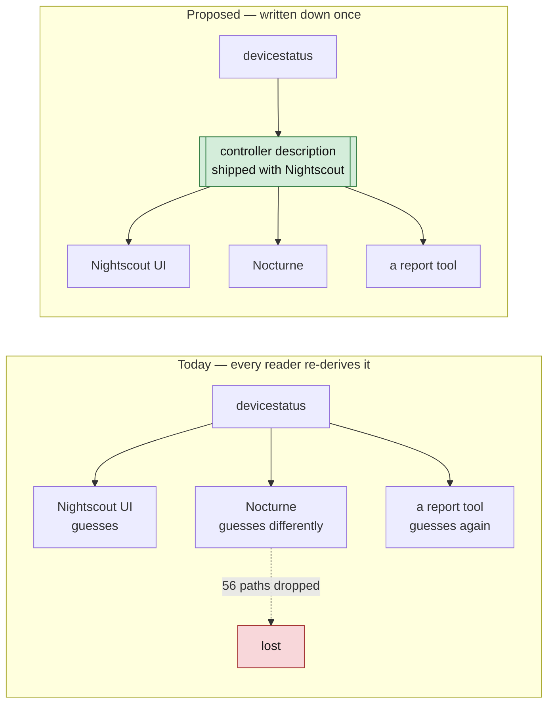
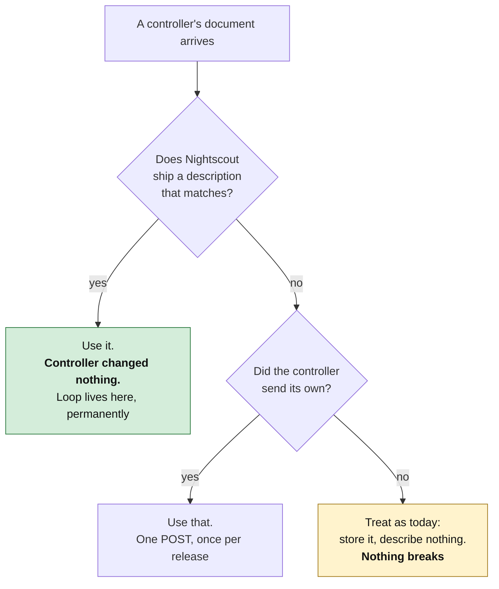

# Controller descriptions: Nightscout describes the controllers it already recognises

*What this is: a proposal (contributor-facing). Read after the [hub-and-spoke sync
sketch](nightscout-hub-sync-architecture-2026-09-11.md); leads to the [replay-fidelity
changes](PROPOSAL-replay-fidelity-changes-2026-09-11.md) and the [registration
specification](spec/registration.md).* **Snapshot, written 2026-09-11. Current: the only statement of the
controller-description proposal.** Status: proposed to the named projects; the proposal to the controller
projects is `PROPOSAL-REG-CONTROLLERS`. **Corrected in place 2026-10-18:** §4 says what the proposal
is and which ideas it takes from Kubernetes, mapped to D18–D20 as specified.
§4 is superseded in part by **D18** (two-tier registration, 2026-10-09). Its §5 `decomposesTo` mechanism is the direction adopted for `devicestatus` storage by
**D11** — [execution plan §1](../tenancy/nightscout-multitenancy-execution-plan-2026-09-14.md#1-decisions).
Measurements are over the 11-site corpus (snapshots 2026-04-01 and 2026-04-26). §2.2 was added
2026-09-27, checked against Nocturne `42275c81`. **One page of proposal, then a worked example, then
the evidence.**

> **Phase 1 is a file a controller never has to call.** Descriptions are fetched, advisory and
> generated from measurement; a controller writes as it does today. The controller-owned tier
> that D18 adds takes several ideas from Kubernetes, credited in
> [§4](#4-what-the-proposal-is-and-what-it-takes-from-kubernetes).

---

## 0. What this series is for

The work has three motivations, and every measurement in the series serves one
of them:

| | Motivation | Why it is not optional | Where the evidence is |
|---|---|---|---|
| **a** | **Unify typed representations of data.** One place says what a field means, what type it holds, and which controller writes it | Today every reader re-derives it and they disagree. 56 of 166 `devicestatus` paths are dropped by a typed consumer because the shape was never written down | [Typed schemas](./nightscout-typed-schema-evidence-2026-09-10.md), [Primitive coverage](./nightscout-primitive-coverage-2026-09-11.md), `specs/sync/primitives.yaml` |
| **b** | **Provide ways to extend it.** A controller can ship a feature nobody else has without negotiating with the ecosystem first | The current answer is "invent an `eventType` and hope". The [quirks registry](../../../specs/quirks) is the archaeology of that answer | [Extensibility models](./nightscout-extensibility-models-2026-09-10.md) §1, §5 |
| **c** | **Offer full data fidelity — replay and observability.** What a controller decided, on what inputs, in what state, is recoverable afterwards | Replay completeness is **20% for Loop, 50% for the oref0 family**. A real consumer reads settings from screenshots because there is nowhere else | [devicestatus and profile fidelity](./nightscout-devicestatus-profile-fidelity-2026-09-10.md) §3, [Hub-and-spoke sync](./nightscout-hub-sync-architecture-2026-09-11.md) §4.2, `specs/conformance/observability-profile.yaml` |

**Motivation (c) has a change list.**
[Concrete changes for replay fidelity](./PROPOSAL-replay-fidelity-changes-2026-09-11.md)
names them: eight more keys in a settings block Loop already writes takes it
from 20% to 65% recorded and 100% recorded-or-derivable; one input-vector
object takes the oref0 family from 50% to 78% and 100%. Neither needs a new
API version, and the same document shows why adding typed resources need not
cost a single extra request.

**These pull against each other, and the controller description is the
artifact that resolves the tension.** Unification (a) pushes toward one
fixed schema; extensibility (b) pushes toward letting each controller differ;
fidelity (c) fails if either wins outright — a schema too fixed drops the
vendor subtrees, and a schema too open cannot say what is missing. A
description is the third option: **the shape stays per-controller, and the
*fact* of it is unified.** That is also how (c) becomes measurable at all,
because "Loop does not publish `automaticBolusApplicationFactor`" is only
sayable once something enumerates what Loop publishes.

**And the practical outcome, which is the point of the whole exercise:** a
controller keeps innovating on the features unique to it, while every
controller gets a sync and observability floor for free. Being *described*
earns the floor with no controller change (§3); publishing a description of
your own is how you go above it. Nothing in this series asks a controller to
give up what makes it different — it asks that the difference be written
down where other software can read it.

---

## 1. The problem, in one paragraph

Nightscout already knows what kind of controller wrote a document — it has to,
because Loop's `devicestatus` and Trio's look nothing alike. But that
knowledge lives nowhere: it is re-derived, differently, by every reader.
So the same divergence is rediscovered over and over, and the parts nobody
writes down get silently dropped. Three measured consequences:

| | Measured |
|---|---|
| `devicestatus` paths a typed consumer silently drops | **56 of 166** — including Loop's automatic dose recommendation, on 10 of 11 sites |
| Loop dosing inputs recorded in Nightscout | **4 of 20**. Eight are absent, including the factor that scales every automatic dose |
| Temporary effects that record what they *did*, not just why | **2,466 of 2,865** — the other 399 carry a label and no effect at all |

None of this is a bug in any project. It is the cost of the shape being
tacit.

*Drawn 2026-10-17:* the loop whose record this proposal is about, common to Loop, Trio and
AndroidAPS, read from their source (the
[technical loops note](../../60-research/structures-2026-10-17/technical-loops.md) §1 compares
them). What the controller reports to the hub is the right-hand, dotted edge.


## 2. The proposal

**Write the description down, in the hub, on the controller's behalf.**



A **controller description** is a static file that says: here is how to
recognise this controller's documents, here is what it writes, here is which
dosing inputs it publishes and which it does not.

**Nightscout ships these files, and serves them.** A controller that never
changes anything still gets described correctly, because the descriptions are
generated from measurements of what controllers actually write — not from what
they promise.

### 2.1 Serving the catalogue: `.well-known`

Shipping the files only helps software that vendors this repository. Serving
them helps everything that can make an HTTP request:

```
GET /.well-known/nightscout/controllers          → the catalogue index
GET /.well-known/nightscout/controllers/loop      → one description
```

Static JSON or YAML, cacheable, no authentication — a description of a
*controller product* contains nothing about a person, which is what makes it
servable at all (`specs/sync/sensitivity.yaml` carries the type-level
sensitivity annotation that says so).

This is a small change with a disproportionate effect on motivation (a),
because it moves the unification from *this repository* to *the deployment*:

| Reader | Today | With a served catalogue |
|---|---|---|
| Nightscout's own UI | re-derives the shape inline | reads its own catalogue |
| Nocturne | re-derives it differently — 56 paths dropped | reads the same file |
| A report or replay tool | vendors this repo, or reverse-engineers four codebases | one GET, no dependency on this repo |
| `oref-digital-twin` | vision model over screenshots | discovers which settings *should* exist, then reads them |
| A follower app | guesses from the device string | structural discriminator, published |
| The site operator | — | can see what their own site believes it is talking to |

It also gives the operator-declared posture a runtime home: a site configured
with `ENABLE=loop` (see the [roadmap](../nightscout-adoption-roadmap-2026-09-11.md) §2.2)
serves the Loop description as its declared expectation, and a controller
that disagrees overrides it by publishing its own. The precedence is the
same three-way order in both places — controller-published, then
operator-declared, then structurally inferred.

**It is discovery.** The endpoint is optional: a hub that does not serve it
behaves exactly as it does today, and a client that cannot fetch it falls back
to what it does today.

### 2.2 Two halves: who a controller is, and what its data means

A server needs two things from a controller. It needs to know who the controller is and what it may
touch. It also needs to know what the controller's documents mean. Today each server has at most one
of the two, and never the same one.

| half | what it answers | Nocturne (`42275c81`) | cgm-remote-monitor (`dev` `295f1177`) |
|---|---|---|---|
| **registration** | who is writing, and with what permission | RFC 7591 dynamic client registration keyed on a reverse-DNS `software_id`, with OAuth scopes; a bundled directory of 13 known apps (`src/Core/Nocturne.Core.Models/Authorization/KnownOAuthClients.cs`), for example `org.loopkit.loop`, `org.nightscout.trio` and `info.nightscout.androidaps`, each with typical scopes such as `GlucoseReadWrite` and `TreatmentsReadWrite` | none. An operator creates a subject with roles in the admin UI and gives its token to the app (`lib/authorization/storage.js`) |
| **description** | what the documents mean: how to recognise them, which paths they carry, which dosing inputs they publish | none a controller can supply. Each algorithm's handling is compiled into the server: `IAidDetectionStrategy` implementations (`ApsSnapshotStrategy`, `TbrBasedStrategy`, `NoAidStrategy`) and the V4 decomposers | none served. This proposal's descriptions exist in this repository only (`specs/sync/registrations/{loop,trio,androidaps}.yaml`) |

**The proposal: join the halves on one identifier.** Add the `software_id` Nocturne already uses to
each description:

```yaml
metadata:
  vendor: LoopKit
  product: Loop
  softwareId: org.loopkit.loop   # proposed; the same reverse-DNS id as the known-app directory
```

Then one identifier connects both:

| step | registration half | description half |
|---|---|---|
| a known controller | the known-app directory has its `software_id` and scopes | the served catalogue (§2.1) has its description under the same id |
| a new controller | registers itself with its `software_id` and the scopes it asks for | optionally publishes its description under that id (§3, "one POST, once per release") |
| a reader | learns who wrote a document | learns what the document means, from the id the write carried |

**What this keeps from phase 1 (§4).** Registration stays wherever a server already requires it, and nowhere
else. On cgm-remote-monitor, a controller still writes with a token and never has to call anything.
The description stays advisory: fetched, not called; describing, not gating. A controller with no
description is treated as it is today.

**Why this matters for agents.** This is design reasoning, not a measurement. Take a software agent
that takes part in the system, for example one acting for a person or caregiver. It needs both halves:

- **Registration** says what it may read and write, as narrowly as scopes allow.
- **Description** says what its writes mean and which data it depends on that does not arrive
  through the server (out-of-band data, such as a phone's own sensor readings or a prediction it
  computed). A reader can then tell a delegated agent's records from a controller's, and can see
  what the agent relied on.

The [control-plane reconciliation](../tenancy/nightscout-control-plane-reconciliation-2026-09-11.md)
covers the authority questions this raises. No lab has yet run a synthetic controller or agent
through both halves. That would be the first measurement.

**What it proposes to each project:**

- **Nocturne:** let a known-app entry, or a registration, point to a description by `software_id`,
  and read the description where its detection strategies and decomposers now hard-code the shape.
- **cgm-remote-monitor:** serve the catalogue (§2.1) keyed by the same id. If it ever adds app
  registration, use the same `software_id`.
- **Both:** agree on the identifier scheme, including how a build-specific id maps to the stable
  one. Nocturne already does this for Trio, whose iOS bundle id carries the developer team; its
  directory uses the stable `org.nightscout.trio`.

## 3. What changes, for whom



| Actor | What they do | When |
|---|---|---|
| **Loop** | nothing, ever | — |
| **Trio, AAPS, a new controller** | optionally POST a description to correct or extend the shipped one | once per release, if they want |
| **Nightscout** | ship the files; read them where it already guesses | phase 1 |
| **A report or replay tool** | read one file instead of reverse-engineering four codebases | immediately |

**The default path requires no controller change at all.** That is not a
concession to get adoption — it is forced by the evidence: Loop has made 24
commits in six months, none touching Nightscout, and is 9 of 11 sites in the
corpus. A proposal Loop must act on is a proposal that does not happen.

## 4. What the proposal is, and what it takes from Kubernetes

> **Corrected in place 2026-10-18.** This section said what the proposal is not, and set it against
> Kubernetes. It now says what the proposal is and credits the ideas it takes from Kubernetes,
> mapped to D18–D20 as the [registration](spec/registration.md), [identity](spec/identity.md),
> [state and intent](spec/state-intent.md) and [authority](spec/authority.md) specifications state
> them. Earlier text: [§4 at `85c645c8`](https://github.com/bewest/rag-nightscout-ecosystem-alignment/blob/85c645c8b003b61dc07ea31f8a7002711493b18a/docs/30-design/platform/PROPOSAL-controller-descriptions-2026-09-11.md#4-what-this-is-not).

**Phase 1, the well-known tier.** A controller description is a file per *controller product*,
generated from measurement, shipped with the hub, reviewed in a pull request and served at a
`.well-known` path. It is advisory: readers fetch it, and it describes documents that already
exist. A controller writes with a token as it does today and calls nothing first; a hub that serves
no description, and a reader that cannot fetch one, behave as they do today. The closest everyday
analogy is a browser's list of known user agents served at a `.well-known` path: a description of
something that already exists, which the thing described may correct.

**The controller-owned tier ([D18](../tenancy/nightscout-multitenancy-execution-plan-2026-09-14.md#261-d18--two-tier-controller-registration)).**
A controller that wants typed support for its own features submits a registration, and the hub
derives typed API from it. Several ideas in that tier come from what Kubernetes does well for
declared, typed resources:

| idea | in Kubernetes | here |
|---|---|---|
| typed extension resources | CustomResourceDefinitions add typed kinds, each versioned, to the API | a registration declares typed kinds, extensions, settings and inputs; each kind and extension is versioned on its own, and readers ignore members they do not know (G1, G4, [registration §3](spec/registration.md#3-the-grammar)); definitions are content-addressed, so releases and builds coexist ([§7](spec/registration.md#7-definitions)) |
| spec and status | `spec` is what is wanted, `status` what is observed | a controller declares where it records what was *requested* and where it reports what it *applied*, as separate carriers ([state and intent S7](spec/state-intent.md#2-rules)); a registration's response reports what the hub accepted, element by element ([registration §5.3](spec/registration.md#53-elements-and-their-results)) |
| reconciliation | a controller drives observed state toward its spec | the controller reconciles, toward what it was asked, and reports the result; the hub observes and records what each instance reports, including composition, which it never computes (S1; D18: the hub is responsible for observability, the controller for syncing and reconciling) |
| leases | a `coordination.k8s.io` Lease for liveness and leadership | each running copy is an instance holding a lease it renews; a lapsed instance holds no roles and is never a command destination ([registration §8](spec/registration.md#8-instances)) |
| labels and selectors | key-value labels, chosen by selectors | instance labels, with `dev.nightscout/purpose`, `dev.nightscout/build` and `dev.nightscout/migration-group` reserved ([§10](spec/registration.md#10-labels)); a view with a label selector reads only matching instances ([§12](spec/registration.md#12-read-selection)) |
| admission | requests are checked, in order, before anything is stored | a submission passes ordered checks (authorisation, preconditions, the registration as a whole, then each element) and each element is accepted or refused with a reason ([§5.2](spec/registration.md#52-order-of-checks)); a refused typed write goes to its carrier in today's shape ([§6](spec/registration.md#6-the-controllers-side-fallback-and-refused-writes), [§11](spec/registration.md#11-typed-writes-and-attribution)) |
| discovery | the API server lists its groups, versions and resources | `GET /.well-known/nightscout/sync`, the capability document: grammar versions, the members the hub interprets, limits, the well-known catalogue and where to submit ([§4](spec/registration.md#4-the-capability-document)) |
| owner and binding | RoleBindings tie permissions to subjects; owner references tie dependents to an owner | a registration is bound to the credential subject that wrote it, and an instance to the subject that created it ([authority §3](spec/authority.md#3-binding-and-credential-kind)); the tenant's owner can block, release or transfer ([authority §4](spec/authority.md#4-the-owners-actions)); records keep their instance and definition ids, and a definition stays while records reference it ([registration §14](spec/registration.md#14-retention)) |
| object identity | `metadata.name` and `uid` | a product is `(vendor, product)`; instance ids are random UUIDs the controller supplies; a record carries its own `identifier` and the hub's `_id` ([identity §2](spec/identity.md#2-contract-ids), D20) |

**Where the design differs, and what it does instead.** The hub schedules nothing and computes no
dosing state. It records what controllers report, routes a command to the instance that holds the
role ([commands](spec/commands.md), proposed), and refuses what its checks refuse; the controller decides, enacts and validates (D18).
Version-scoped quirks record how stored documents from a given controller version deviate, and the
mapping the hub applies to each ([D20](../tenancy/nightscout-multitenancy-execution-plan-2026-09-14.md#263-d20--version-scoped-quirks-and-the-two-id-rule-maintainer-2026-10-16),
[registration §16](spec/registration.md#16-version-scoped-quirks)).

## 5. Worked example

The whole of phase 1 for Loop, which involves no change to Loop.

**Step 1 — the description Nightscout ships** (abbreviated; the generated
file is `specs/sync/registrations/loop.yaml`):

```yaml
apiVersion: nightscout.dev/sync/v1
kind: ControllerStateModel
metadata:
  vendor: LoopKit
  product: Loop
  algorithmFamily: loop
spec:
  documents:
    - collection: devicestatus
      discriminator: {path: loop, test: is-object}   # structural, not the device string
      decomposesTo: [ApsSnapshot, PumpSnapshot, UploaderSnapshot]
  replayInputs:
    - {input: maxBolus,  status: recorded, path: loopSettings.maximumBolus}
    - {input: automaticBolusApplicationFactor, status: absent, path: null}
```

That last line is the point. `status: absent` with `path: null` is how the
file says **"Loop has this value and does not publish it."** It is not a
complaint; it is the thing that makes "can this dose be reproduced?" a
question with an answer.

**Step 2 — what a tool can now do**, without reading any controller source:

```python
import yaml
reg = yaml.safe_load(open("specs/sync/registrations/loop.yaml"))
absent = [i["input"] for i in reg["spec"]["replayInputs"] if i["status"] == "absent"]
print(f"Loop replay is missing {len(absent)} inputs: {absent[:3]} ...")
# Loop replay is missing 8 inputs: ['automaticBolusApplicationFactor',
#   'carbAbsorptionModel', 'gradualTransitionsThreshold'] ...
```

Today the same answer takes reading `AlgorithmInput.swift`, `LoopStatus.swift`
and a corpus of documents. `oref-digital-twin` currently gets settings out of
**screenshots, with a vision model**, because there is nowhere to read them
from.

**Step 2a — the same thing over HTTP**, for a reader that does not vendor this
repository:

```
GET https://<site>/.well-known/nightscout/controllers/loop
```

Same document, no checkout, no authentication, cacheable. This is what makes
Nocturne and a report tool able to agree without either depending on the
other.

**Step 3 — a controller that wants to correct it** posts the same document to
the hub. One request, per release, optional. The served catalogue then
reflects the correction, so every other reader of that site picks it up
without coordinating with anyone.

## 6. Impact, measured

| | Today | With descriptions |
|---|---|---|
| A reader learning a controller's shape | read 4 codebases | read 1 file |
| Loop's dose recommendation reaching a typed consumer | dropped, 10 of 11 sites | described, so droppable only on purpose |
| "Which dosing inputs can I not replay?" | unanswerable without source | 8, named, per controller |
| A new controller's on-ramp | improvise an `eventType`, hope | a file to copy |
| Two readers agreeing on a controller's shape | vendor the same repo, or diverge | fetch the same URL |
| Sync request floor for a described controller | 1,440–5,760 requests/day, per controller's own design | the batched contract's 576, earned by being described |
| A controller's unique feature | negotiate, or be silently dropped | declared in its own description; readers can choose to handle it |
| Cost to Loop | — | **zero** |
| Cost to Nightscout | — | read a file it can already generate; optionally serve it |

## 7. If you only do one thing

**Phase 1 is not this proposal.** It is smaller, and it needs neither
descriptions nor new endpoints:

> Agree a schema for the `settings` collection — which cgm-remote-monitor
> already enables in v3 — so controllers can publish the settings that
> determine dosing.

That closes the complaint physicians actually make, and the
[roadmap](../nightscout-adoption-roadmap-2026-09-11.md) sequences it first for
that reason. Controller descriptions are phase 3, and are worth doing because
they make phase 1 *checkable* — a description states which settings a
controller publishes, so "it publishes none" stops being invisible.

## 8. Evidence and caveats

Every number above is reproducible from this repository:

| Claim | Command | Output |
|---|---|---|
| 56 of 166 `devicestatus` paths dropped | `make schema-nocturne` | `reports/schema-census/nocturne-coverage.json` |
| Loop records 4 of 20 dosing inputs | `make schema-dosing` | `reports/schema-census/dosing-inputs.json` |
| 2,466 of 2,865 effects separable | `make schema-effects` | `reports/schema-census/effects.json` |
| The shipped descriptions | `make schema-sync-model` | `specs/sync/registrations/` |

**Caveats that matter to this proposal specifically:**

* The corpus is **Loop-dominant** — 9 of 11 sites — and contains **no AAPS
  closed-loop site at all**. Every AAPS statement is read from its source, not
  observed.
* The descriptions are generated from **one corpus and today's source**. A
  wrong shipped description is worse than none, which is why they are
  versioned, derived from measurement rather than assertion, and why a
  controller must always be able to disown one.
* Every phase that names a project is a proposal to that project; the packet for the controller
  projects is `PROPOSAL-REG-CONTROLLERS`.

## 9. Where to read more

| If you want | Read |
|---|---|
| Why the schemas were wrong, with measurements | [Typed schemas](./nightscout-typed-schema-evidence-2026-09-10.md) |
| What `devicestatus` loses and why replay fails | [devicestatus and profile fidelity](./nightscout-devicestatus-profile-fidelity-2026-09-10.md) |
| Effects versus motivations, and privacy | [Effects and versioning](./nightscout-effects-and-versioning-2026-09-11.md) |
| The sync contract, if descriptions are adopted | [Hub-and-spoke sync](./nightscout-hub-sync-architecture-2026-09-11.md) |
| Who should do what, in what order | [Adoption roadmap](../nightscout-adoption-roadmap-2026-09-11.md) |
| Whether the primitives are actually evidenced | [Primitive coverage](./nightscout-primitive-coverage-2026-09-11.md) |
| The earlier draft of all of this, in cgm-remote-monitor's `docs/proposals/` | `cgm-remote-monitor/docs/proposals/` — `agent-control-plane-rfc.md`, `bridge-rules.md`, `conflict-resolution.md`, `integration-questionnaire.md`. See [hub-and-spoke sync](./nightscout-hub-sync-architecture-2026-09-11.md) §5.2 |
| What to change in that earlier draft, and what it already gets right | [Reconciling the agentic control plane RFC](../tenancy/nightscout-control-plane-reconciliation-2026-09-11.md) — seven claims the corpus confirms, five it corrects, twelve proposed edits |
| The concrete changes that raise replay fidelity, per project | [Replay fidelity changes](./PROPOSAL-replay-fidelity-changes-2026-09-11.md) — five changes, measured before and after |
