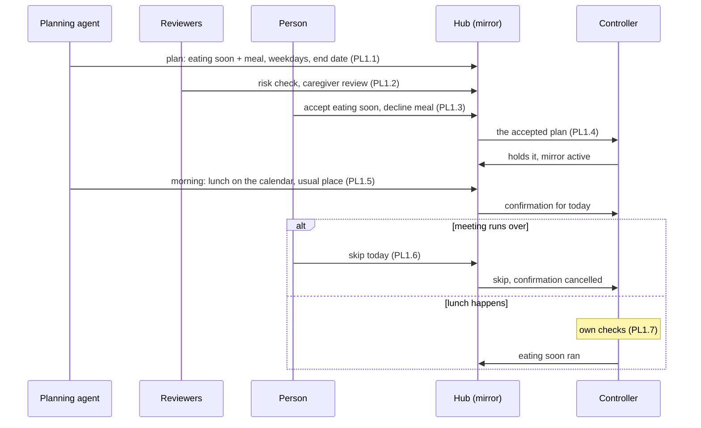
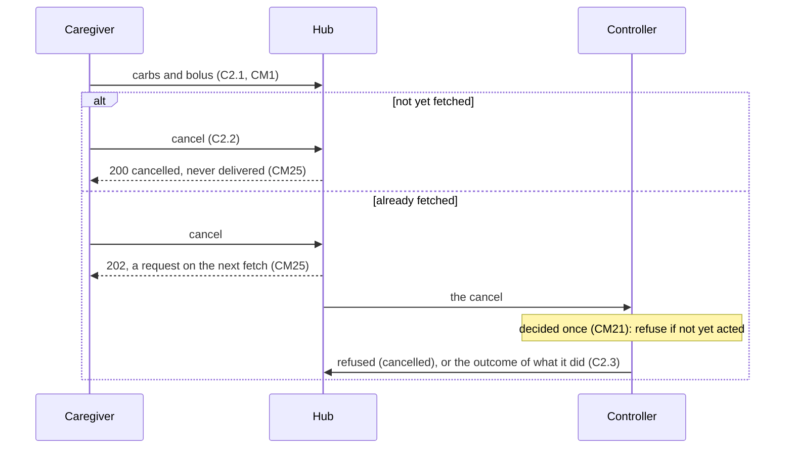

# Command journeys: plans, confirmations and moment commands for one pump with many orchestrators

*What this is: a journey map (contributor-facing). Read after the
[command queue and planning note](command-queue-and-planning-2026-10-18.md), whose use cases and §5
decisions it walks step by step; the needs it finds are specified in [commands](spec/commands.md) (CM1–CM25) and
[plans](spec/plans.md) (PN1–PN18).* **Snapshot — describes 2026-10-18. Status: proposed.**

Each journey follows the format of the [15.0.9 journey map](../../60-research/remedial/journey-map-15.0.9.md):
who is involved, then numbered steps. Each step names its level (policy, confirmation, moment or
algorithm, as in the note's §3), then **Do** (what happens), **Working** (what correct looks like),
**Watch for** (the failure a tester or reviewer looks for) and **Contributor** (the rules that apply,
the existing conformance case under `specs/sync/conformance/`, the unsafe control actions from the
[control-loop analysis](spec/control-loops.md#4-the-loops), and what is **not specified**, with the
open item or decision it needs). Claims about a named controller are read-derived, as in the note.

The journeys follow the maintainer's decisions of 2026-10-18 (note §5): a controller enacts each
`commandId` at most once; plans run on the controller and the hub keeps a read-only mirror; a plan or
proposal may require named reviews before approval; the person may withdraw or cancel any item on
their own therapy; followers read the queue; an adjustment is a new proposal, and an approval may
accept a plan in parts, naming the elements it accepts. Two dose checks apply: the hub refuses a
proposal's approval when a dose or carb record reached it after the proposal was made
([CM22](spec/commands.md#6-proposals-and-approvals-proposed)), and the controller refuses at enactment by its own rule
([CM23](spec/commands.md#5-outcomes-proposed)); Part 3 shows which serves each journey.

## Words used here

| word | meaning |
|---|---|
| **queue item** | a proposal, a plan or a command on one tenant's channel, with its state |
| **plan** | a recurring intent with its trigger, conditions, bounds and end date, approved once and held and run by the controller (note §3) |
| **element** | one separately acceptable part of a plan, such as an eating-soon target or a meal entry |
| **occurrence** | one run of a plan, such as Tuesday's lunch |
| **confirmation** | a small command against one occurrence, sent hours ahead and bounded by the plan |
| **mirror** | the hub's read-only copy of a plan and its occurrences, written from the controller's reports |
| **since check** | comparing what changed (doses, carbs, intents, the definition) since an item was made |
| **hub refuses** | the hub refuses a proposal's approval when a dose or carb record reached it after the proposal was made (CM22); it does not apply to a plan (PN7) |
| **controller decides** | the controller refuses a dose or carbs at enactment by its own rule (CM23), at each plan occurrence too (PN10); the outstanding list shows doses and carbs since (CM24) |

## The people

| role | does | who, in these journeys |
|---|---|---|
| proposer | drafts an item (CM11, CM12) | an agent with calendar, location or activity access; a clinician; a caregiver; the person |
| evaluator or reviewer | attaches evidence (CM16); a *required* reviewer must do so before a plan's approval (PN6) | a risk-check agent, a second agent, a caregiver, a clinician |
| approver | turns an item into a command or an active plan (CM13, CM14) | the person, or a delegate under a grant ([authority §7](spec/authority.md#7-delegation-not-decided)) |
| the person | may approve, adjust (by a new proposal), withdraw or cancel any item on their own therapy (CM14, CM25), skip an occurrence or end a plan (PN14, PN16) | the person with diabetes, or a parent for a young child |
| enactor | the singleton controller holding the channel's `command-sink`; validates, enacts once, reports | the AID app on the person's phone ([authority §6](spec/authority.md#6-who-may-receive-a-command)) |
| follower | reads the queue, the mirror and outcomes (CM24, PN11); never acts | a partner, a school nurse with read access, a watch app |

---

# Part 1: planning journeys

## PL1. A weekday lunch, planned from the calendar and location

| proposer | reviewer | approver | the person | enactor |
|---|---|---|---|---|
| a planning agent | a risk-check agent; a caregiver | the person | approves in parts; may skip any day | the controller |

**PL1.1 · policy · The agent drafts the plan.**
- **Do:** the agent sees the usual lunch at the usual time and place over past weeks and proposes a
  plan with two elements: an eating-soon target before lunch, and the usual lunch carbs with their
  meal bolus; weekdays only, each occurrence needing a confirmation that morning, with an end date.
- **Working:** the queue shows one open plan proposal: its elements, trigger, bounds, end date, the
  proposing agent and its expiry, and an evaluation saying in words why (no calendar entries).
- **Watch for:** calendar titles or places in the proposal or evaluation; a plan with no end date.
- **Contributor:** CM11, CM12 (`propose-with-permission-and-role`, `propose-without-role`), CM16,
  [authority DR7](spec/authority.md#7-delegation-not-decided); UCA-PROP-001, UCA-PROP-004. The
  plan object: [plans PN1–PN4](spec/plans.md#3-the-plan-object-proposed) (`plan-proposed-and-approved`,
  `plan-ends-missing`); a plan proposal stays open up to `plans.maxProposalSeconds`, not CM3's
  `commands.maxExpirySeconds` (PN1, `plan-proposal-open-past-command-expiry`). Not specified: the
  trigger grammar (plans §9 item 3) and the grammar of an element's content (commands §9 item 3).

**PL1.2 · policy · Required reviews.**
- **Do:** the plan names two required reviews: a risk-check agent and a caregiver. Each attaches an
  evaluation.
- **Working:** an approval before both are attached is refused 409 `review-required`; each review
  shows who made it, and a review by the proposer does not count.
- **Watch for:** an approval accepted with a required review missing; a review that changes the
  proposal's state.
- **Contributor:** CM16 (`evaluation-does-not-change-proposal`, `evaluate-without-read`);
  [plans PN6](spec/plans.md#4-approving-a-plan-proposed) (`approve-review-missing`,
  `approve-review-by-proposer-not-counted`): the proposer names them in `requiredReviews` (PN1),
  and a plan accepting an R3 or higher element needs at least one; UCA-PROP-011. Not specified:
  whether a second agent run by the same person or operator counts (plans §9 item 7).

**PL1.3 · policy · The person accepts part of it.**
- **Do:** the person accepts the eating-soon element and declines the meal element, preferring to
  bolus at the table.
- **Working:** the approval names the element accepted and the hash it binds to; the declined
  element is recorded as declined; one plan, with one element, reaches the controller.
- **Watch for:** the declined element reaching the controller; an approval refused because the
  person's intents changed between drafting and approval (an unrelated override).
- **Contributor:** [plans PN5, PN7, PN8](spec/plans.md#4-approving-a-plan-proposed) (`approve-one-of-two-elements`,
  `approve-element-hash-mismatch`): the approval names each accepted element by id and hash, the
  rest are recorded as declined, and the command carries the accepted elements under one hash;
  PN6 and CM14 (`approve-own-agent-plan-refused`); a plan's `basedOn` is per channel, so a change
  on a channel no accepted element acts on does not stale it (PN7,
  `approve-plan-unrelated-channel-changed`, `approve-plan-state-changed`); UCA-PROP-003,
  UCA-PROP-006. Not specified: approver signatures over the accepted elements (plans §9 item 5).

**PL1.4 · policy · The controller takes the plan; the hub mirrors it.**
- **Do:** the approval becomes one command; the controller validates the plan against its own
  limits, holds it and reports `succeeded`.
- **Working:** the command reads `succeeded`; the mirror moves from `approved` to `active` on that
  report and shows the accepted and declined elements; a redelivered copy of the command is not
  stored twice.
- **Watch for:** the mirror showing the proposal's content rather than what the controller holds;
  the plan stored again after two fetches before its report.
- **Contributor:** CM1, CM7–CM10, CM18, CM21 (`enact-identical-payload-succeeds`,
  `enact-hash-mismatch-refused`, `enact-refetched-once`); [plans PN8, PN9,
  PN11](spec/plans.md#5-the-controller-holds-the-plan-the-hub-mirrors-it-proposed) (`plan-held-active`,
  `plan-refused-by-controller`, `plan-command-expires-at-ends`): the hub keeps the mirror and moves
  the controller's states only on the controller's reports; UCA-CMD-006, UCA-PROP-008. Not
  specified: the plan channel a product declares (plans §9 item 6).

**PL1.5 · confirmation · The morning confirmation.**
- **Do:** at a set hour the agent reads today's calendar and location and confirms today's
  occurrence, with an evaluation of one line ("lunch on the calendar, at the usual place").
- **Working:** a confirmation command for this occurrence, expiring at the occurrence's time,
  appears in the queue; the mirror shows the occurrence as `confirmed`.
- **Watch for:** a confirmation carrying anything outside the plan's bounds; a confirmation for a
  plan that was ended; an agent able to send commands outside plans.
- **Contributor:** CM3, CM12; [plans PN12](spec/plans.md#6-occurrences-proposed) (`confirm-by-proposer`,
  `confirm-by-other-subject`, `confirm-too-early`, `confirm-after-role-lost`): the approved plan is
  its proposer's grant to confirm from its proposing instance without a further approval, and a
  confirmation never releases a dose by itself; UCA-AUTH-002, UCA-AUTH-003.

**PL1.6 · moment · The lunch is cancelled.**
- **Do:** the meeting runs over; the person skips today's occurrence from the phone or the hub.
- **Working:** the occurrence reads `skip-requested`; its confirmation is `cancelled` if not
  handed over, and a cancel request if it was; the controller reports `skipped`, or `ran` if it had
  already run; tomorrow's occurrence is untouched.
- **Watch for:** a skip that ends the whole plan; a skip read as done before the controller reports.
- **Contributor:** CM2, CM3; [plans PN14](spec/plans.md#6-occurrences-proposed) (`skip-by-person`,
  `skip-cancels-pending-confirmation`, `skip-then-controller-reports-skipped`), cancelling as
  [CM25](spec/commands.md#4-the-command-record-proposed) does; UCA-CMD-015, FB-CMD-001.

**PL1.7 · algorithm · The occurrence runs.**
- **Do:** at the planned time the controller starts the eating-soon target, after its own checks
  of what was dosed and eaten since the confirmation.
- **Working:** the hub shows the target active, with initiator `{value: other, controllerTerm}`
  naming the plan, and the mirror links the occurrence to its intent.
- **Watch for:** the target shown as applied when only requested; the target started twice.
- **Contributor:** S8, S10, A2, A3, A10, A12 (`active-state/requested-and-applied`); FB-STATE-004,
  UCA-CMD-010; PN10, PN17; the controller's `ran` report carries the identity of the intent that
  shows it (PN11, `plan-report-occurrence-ran`). Not specified: a field on the intent naming its
  plan and occurrence; no open item in commands §9 or plans §9 carries it.

## PL2. Exercise from the calendar

| proposer | reviewer | approver | the person | enactor |
|---|---|---|---|---|
| a planning agent | none required | the person | may cancel any session | the controller |

**PL2.1 · policy · Plan proposed and approved whole.** The agent proposes a temporary target
before calendar entries marked as exercise, confirmed by location or activity; the person approves.
**Working:** one `active` plan in the mirror; a target the controller announces ahead reads
`scheduled`, not `active` (S4). **Contributor:** CM11–CM14, PN1–PN5, PN7
(`plan-proposed-and-approved`), S4. Precedent: AndroidAPS automation triggers on time, location
and activity and can start a temporary target (note §3). Not specified: conditions on calendar,
location or activity in the trigger (plans §9 item 3).

**PL2.2 · confirmation · Confirmed by activity.**
- **Do:** the agent sees the person arrive at the gym and confirms the occurrence.
- **Working:** the confirmation is within the plan's bounds and expires at the occurrence's time;
  the evaluation says "at the usual place", not where.
- **Watch for:** location data in the queue; a confirmation arriving after the session ended.
- **Contributor:** CM3, CM16, DR7; PN12 (`confirm-by-proposer`): a confirmation at or after the
  occurrence's time is 409 `occurrence-passed`; UCA-CMD-003.

**PL2.3 · confirmation · The session does not happen.** The entry stays on the calendar; the
person stays home; no confirmation is sent. **Working:** the occurrence ends unconfirmed and nothing
is enacted, and the controller reports the occurrence `missed`. **Watch for:** an occurrence run
without a required confirmation. **Contributor:** HAZ-1; PN10, PN11. Not specified: how a plan
states that an occurrence runs only when confirmed, part of the trigger grammar (plans §9 item 3).

**PL2.4 · algorithm · Two intents at once.**
- **Do:** the target starts while an override the person set is active.
- **Working:** the hub reports both, with their initiators; the controller's combined result, if
  it publishes one, is the only composed value shown.
- **Watch for:** the hub computing a combined target, or ending one intent with the other.
- **Contributor:** S1, S3, A1, A9 (`active-state/exclusive-overlap-reported`); FB-STATE-003.

## PL3. A caregiver's week of school overrides

| proposer | reviewer | approver | the person | enactor |
|---|---|---|---|---|
| a parent | a school nurse (follower, may evaluate) | the second parent | a teenager, may cancel | the controller |

**PL3.1 · policy · A week planned on Sunday.**
- **Do:** a parent proposes five occurrences of a preset override around the timetable's sports
  lessons, referring to the preset by its controller id.
- **Working:** the proposal records the destination's `definitionId`; the nurse can read it.
- **Watch for:** a preset referred to by a name the controller can rename.
- **Contributor:** CM11, PN1, S9 (`idField`, `referencedBy`); UCA-PROP-008. The nurse reads the
  proposal with `api:proposals:read` (CM11), and the outstanding list and the mirror with any of
  CM24's read permissions (PN11, `plan-read-with-proposals-read`, `plan-read-without-permission`).

**PL3.2 · policy · The other parent approves.**
- **Do:** the second parent approves. The proposing parent may also approve a plan they made from
  their own app (CM14); a plan with an R3 or higher element still needs a review from another
  subject first (PN6).
- **Working:** one approval, one command, the plan held by the controller and mirrored.
- **Watch for:** two approvals at once creating two plans.
- **Contributor:** CM13, CM14 (`approve-own-proposal-by-person`, `approve-approved-proposal`;
  `self-approval-refused` applies to an agent's proposal), PN5, PN6 (`approve-r4-without-any-review`);
  UCA-PROP-009, UCA-PROP-013. Not specified: that the change from `open` to `approved` is atomic
  under concurrent approvals (commands §9 item 7).

**PL3.3 · policy · Wednesday changes.** A school trip moves Wednesday's lesson; the parent
proposes an adjusted plan, a new proposal. **Working:** once approved it replaces the held plan, and
the mirror shows which plan is current. **Watch for:** both plans running on Wednesday.
**Contributor:** decision 4; S3 `supersedes`, A7; PN16 ends the held plan. Not specified: an
adjusted plan replacing one the controller holds, and several plans active on one channel
([plans §9 item 10](spec/plans.md#9-open)).

**PL3.4 · algorithm · The controller was updated midweek.**
- **Do:** the app updates and renews under a new definition in which the preset changed.
- **Working:** the controller refuses Thursday's occurrence with a reason the hub records, and the
  parents see it.
- **Watch for:** the occurrence enacted under the changed preset with no notice.
- **Contributor:** CM8, S12, [registration §8](spec/registration.md#8-instances); UCA-PROP-008. A
  plan approved after a renewal under a new definition is refused 409 `definition-changed` (PN7,
  `approve-plan-definition-changed`); a renewal after the approval does not affect it
  (`approve-plan-definition-unchanged`), so the controller's check at the occurrence catches this
  (PN10) and it reports the occurrence `refused` with its reason (PN11). For a moment proposal the
  definition at approval is open ([commands §9 item 7](spec/commands.md#9-open)).

## PL4. A sensitivity plan for illness or a cycle phase, with an end date

| proposer | reviewer | approver | the person | enactor |
|---|---|---|---|---|
| a planning agent | a named human reviewer (a clinician or caregiver) | the person | may end it early | the controller |

**PL4.1 · policy · Proposed with an end date and a disclosure.**
- **Do:** the agent proposes a sensitivity change for the coming days, ending on a date, labelled
  for display with the effect only.
- **Working:** the queue shows the effect and the end date; the reason is visible only as the
  person's disclosure allows.
- **Watch for:** the motivation (illness, cycle phase) shown to followers.
- **Contributor:** CM11; [state and intent §5](spec/state-intent.md#5-effect-and-motivation-proposed)
  (`disclosure`, proposed, not adopted). Not specified: disclosure on queue items and the mirror,
  which waits on [state and intent §8](spec/state-intent.md#8-open) (effect and motivation).

**PL4.2 · policy · A required human review, then approval.** The reviewer attaches a review and
the person approves; **Working** and **Contributor** as PL1.2–PL1.4.

**PL4.3 · algorithm · Runs and ends.** The controller applies the change each day and reports it.
**Working:** active each day; the controller reports the plan `ended` at `endsAt` and no
occurrence runs after it. **Contributor:** S5, A4, A12, PN10, [PN15](spec/plans.md#7-ending-a-plan-proposed)
(`plan-ended-by-controller`).

**PL4.4 · moment · The person ends it early.**
- **Do:** feeling better, the person ends the plan.
- **Working:** the mirror reads `ending` and the plan's queued occurrence commands are cancelled;
  the controller ends the active change with `cancelled`, stops future occurrences and reports the
  plan `ended`.
- **Watch for:** future occurrences still listed; the change still active on the pump.
- **Contributor:** S5, A5; [plans PN16](spec/plans.md#7-ending-a-plan-proposed) (`end-plan-by-person`,
  `end-cancels-pending-confirmation`, `end-unconfirmed-plan`): the person, the approver or the
  proposer may end a plan, by an end command to the controller; CM14, CM25 for other items. Not
  specified: who counts as the person ([commands §9 item 7](spec/commands.md#9-open)).

## PL5. A clinician's settings proposal for the next visit

| proposer | reviewer | approver | the person | enactor |
|---|---|---|---|---|
| a clinician | a risk-check agent; the person's caregiver | the person, at the visit | approves in parts | the controller |

**PL5.1 · policy · Proposed weeks ahead.**
- **Do:** the clinician proposes changes to several settings, to be discussed at a visit weeks away.
- **Working:** the proposal is readable to the person and the reviewers until the visit.
- **Watch for:** the proposal expiring before the visit, or a hub limit raised so far that every
  command could live that long.
- **Contributor:** CM11, CM3 (`proposal-expiry-too-long`); [plans PN1](spec/plans.md#3-the-plan-object-proposed): a plan
  proposal stays open up to `plans.maxProposalSeconds`, separate from the command limit
  (`plan-proposal-open-past-command-expiry`, `plan-proposal-expiry-too-long`); UCA-AUTH-006. Not
  specified: how a capability document marks a clinician's propose role (commands §9 item 1).

**PL5.2 · policy · Reviews before the visit.** A risk-check agent compares the proposal with
recent history; a caregiver adds notes. **Working:** evaluations attached, none changing the
proposal. **Contributor:** CM16; as PL1.2.

**PL5.3 · policy · Accepted in part at the visit.**
- **Do:** the person accepts one setting change and declines the others.
- **Working:** the approval names the accepted element; the declined ones stay on record.
- **Watch for:** a `state-changed` refusal because an override started that morning.
- **Contributor:** PN5, PN7: a plan's `basedOn` is per channel, so the override stales it only
  when an accepted element acts on the override's channel (`approve-plan-other-channel-override`);
  as PL1.3.

**PL5.4 · algorithm · The controller applies it** under its own limits. **Working:** its next
settings upload shows the change; the command reads `succeeded`. **Watch for:** the hub's stored
settings changed before the controller reports. **Contributor:** CM7, S10, D18; a settings element
is R5 in the draft classes, so it cannot be standing (PN4) and its occurrence needs the person's
own approval (PN13, `approve-r5-occurrence-by-person`). Not specified: a settings change is not a
span intent, and no controller declares accepting one as a command.

---

# Part 2: moment journeys

## C1. A correction bolus for a child at school

| proposer | reviewer | approver | the person | enactor |
|---|---|---|---|---|
| — | — | a parent (sends directly) | the child | the controller |

**C1.1 · moment · The parent looks before sending.**
- **Do:** the parent reads glucose, insulin on board and the outstanding list.
- **Working:** the list shows any open proposal and any command on the channel not yet final, with
  its sender, and the dose and carb records that reached the hub since the earliest of them.
- **Watch for:** insulin on board from before a dose the controller already gave.
- **Contributor:** [CM24](spec/commands.md#4-the-command-record-proposed) (`outstanding-lists-open-items`,
  `outstanding-excludes-final`); UCA-SYNC-SERVE-004, UCA-CMD-001.

**C1.2 · moment · Sends a correction bolus** with a `requestId` and a short expiry. **Working:**
one command, `pending` then `fetched`; a retried send returns the first.
**Contributor:** CM1–CM5 (`request-id-same-payload-returns-first`, `expiry-required`).

**C1.3 · algorithm · Enacted once, after the controller's checks.**
- **Do:** the controller receives the command by fetch, after a fetch-now signal or on its cycle,
  and again by its next fetch before it reports; it checks hash, expiry and
  its own limits and recent doses, and enacts it once. Today Trio refuses a remote bolus when
  boluses since the command's timestamp reach a fifth of the request; Loop's remote bolus checks the
  amount and the one-time password and no doses since.
- **Working:** one bolus; the second delivery is recognised by `commandId`.
- **Contributor:** CM10, CM18, CM21, CM26 (`enact-refetched-once`, `enact-after-restart-once`),
  CM23 (`enact-dose-refused-doses-since`); UCA-CMD-006, UCA-CMD-010.

**C1.4 · moment · The outcome.** The controller reports `succeeded`; later the pump fails the
delivery. **Working:** the parent sees the failure. **Watch for:** `succeeded` standing after it.
**Contributor:** CM9 (`report-after-final-refused`); UCA-CMD-013. Not specified: a further state
after `succeeded` ([commands §9 item 4](spec/commands.md#9-open)).

## C2. A meal sent, then not eaten

| proposer | reviewer | approver | the person | enactor |
|---|---|---|---|---|
| — | — | a caregiver | the child | the controller |

**C2.1 · moment · Carbs and bolus sent.** The caregiver sends the meal's carbs and bolus.
**Working:** one command per item, or one command whose parts are reported separately.
**Contributor:** CM1; UCA-CMD-011.

**C2.2 · moment · The meal is refused at the table.**
- **Do:** the caregiver cancels before the phone has fetched it.
- **Working:** the command reads `cancelled`, final, never handed over.
- **Watch for:** a cancel reported as done after the command was `fetched`; there it is only a request.
- **Contributor:** CM2, CM3, [CM25](spec/commands.md#4-the-command-record-proposed) (`cancel-pending-is-final`,
  `cancel-after-fetch-is-a-request`); UCA-CMD-015.

**C2.3 · algorithm · Already handed over.**
- **Do:** the controller had stored the carbs and refused the bolus, as Trio's meal command can.
- **Working:** the outcome shows carbs entered and bolus refused, and the caregiver removes the
  carbs as a separate action.
- **Contributor:** CM9, CM25; UCA-CMD-011. Not specified: an outcome per part (commands §9 item 4).

## C3. Two caregivers act for one meal

| proposer | reviewer | approver | the person | enactor |
|---|---|---|---|---|
| — | — | a parent; a school nurse | the child | the controller |

**C3.1 · moment · Both send.** A parent and a nurse each send a meal bolus minutes apart.
**Working:** the second sender sees the first command in the outstanding list, with who sent it.
**Watch for:** two commands accepted with neither sender told. **Contributor:** CM4 matches within
one subject only (`request-id-scoped-to-subject`); CM24 lists the first command with its sender,
and the reply accepting the second carries the list (`outstanding-lists-open-items`); UCA-CMD-001.
Not specified: refusing a second command while one is outstanding (commands §9 item 7).

**C3.2 · algorithm · The controller's check.** Enact once does not catch this: the commands have
different ids. Only the controller's doses-since check does, after the first bolus is stored.
**Contributor:** CM10, CM23 (`enact-dose-refused-doses-since`); UCA-CMD-010; HAZ-1.

## P1. The person doses while a proposal is outstanding

| proposer | reviewer | approver | the person | enactor |
|---|---|---|---|---|
| an agent | — | a caregiver | doses on the phone | the controller |

**P1.1 · moment · Proposal made.** An agent proposes a correction bolus with `basedOn`.
**Contributor:** CM11.

**P1.2 · moment · The person boluses locally.** The dose reaches the hub one upload later.
**Contributor:** A12 covers intents, not doses; CM22 covers doses at approval; FB-STATE-006.

**P1.3 · moment · The caregiver approves.**
- **Working:** when the dose reached the hub after the proposal was made, the approval is refused
  409 `doses-since` and the proposal stays open; a dose not yet uploaded is the controller's to
  catch at enactment.
- **Watch for:** an approval accepted after the dose reached the hub (UCA-PROP-012).
- **Contributor:** CM15 (`approve-state-unchanged`), [CM22](spec/commands.md#6-proposals-and-approvals-proposed) (`approve-doses-since`,
  `approve-doses-before-proposal`), CM23 (`enact-dose-refused-doses-since`). CM22 catches a dose
  already uploaded; CM23 catches it at enactment on a controller with a since check.

## P2. The person sees and withdraws or cancels

| proposer | reviewer | approver | the person | enactor |
|---|---|---|---|---|
| an agent; a caregiver | — | — | withdraws and cancels | the controller |

**P2.1 · any · Opens the queue.** The person sees proposals, plans and commands on their channels.
**Contributor:** CM6, CM11, CM24 (`outstanding-lists-open-items`), PN11 and PN18 for plans.

**P2.2 · any · Withdraws an agent's proposal.** **Working:** the proposal reads `withdrawn`.
**Contributor:** CM14 lets the proposer and the person withdraw (`withdraw-by-person`,
`withdraw-by-other-subject`). Not specified: who counts as the person, and whether there may be
more than one ([commands §9 item 7](spec/commands.md#9-open)).

**P2.3 · any · Cancels a caregiver's command.** As C2.2; the person may cancel any command on
their therapy (CM25, `cancel-by-person`).

## A1. Carbs proposed from a photo of the meal

| proposer | reviewer | approver | the person | enactor |
|---|---|---|---|---|
| an agent | a risk-check agent | the person | adjusts | the controller |

**A1.1 · moment · Proposed.** The agent proposes carbs with an evaluation of its estimate.
**Watch for:** units or product misread on the approval screen. **Contributor:** CM11, CM16;
UCA-PROP-004. Not specified: payload grammar (commands §9 item 3).

**A1.2 · moment · The person adjusts.** The adjusted amount is a new proposal (decision 4), which
the person may approve because they made it from their own app, or send as a command; either way
they withdraw the agent's. **Contributor:** CM14 (`approve-own-proposal-by-person`,
`withdraw-by-person`).

**A1.3 · algorithm · Enacted.** The controller checks carbs since; Trio refuses when newer carbs
exist and misses a back-dated meal. **Contributor:** CM10, CM23; UCA-CMD-010.

## A2. A correction bolus proposed by an agent

| proposer | reviewer | approver | the person | enactor |
|---|---|---|---|---|
| an agent | a required risk check | the person or a delegate | may withdraw | the controller |

**A2.1 · moment · Proposed and reviewed.** The required risk check is attached.
**Contributor:** CM11, CM16; UCA-AUTH-002. Not specified: required reviews on a moment proposal;
PN6 covers plans, and no open item in commands §9 carries it.

**A2.2 · moment · A controller preview.** **Working:** the approver sees the dose the controller
would give now. Only AndroidAPS's client-control prepare and commit offers this today.
**Contributor:** not specified ([commands §9 item 2](spec/commands.md#9-open)).

**A2.3 · moment · Approved.** **Contributor:** CM13–CM15, CM22 (`approve-doses-since`), CM24;
UCA-PROP-007, UCA-PROP-012.

**A2.4 · algorithm · Enacted once.** As C1.3–C1.4.

## Further cases, briefly

- **C4, an override or temporary target now:** CM1–CM5; the since check is intents (A12, CM15 for
  a proposal). **C5, closed loop or automatic bolus off:** a running-mode channel; LoopCaregiver
  sends these to `/api/v2/remotecommands`, which no hub implements (commands §3).
- **A3, too many proposals:** UCA-PROP-002; not specified: a limit per proposing instance and
  channel (commands §9 item 7).
- **U1, the controller's own automation:** outside the hub; Trio's Shortcuts use a six-minute
  window. The mirror would show such plans only if the controller reports them.
- **U2, a downloaded careportal entry:** no expiry, destination or outcome (UCA-SYNC-DL-001,
  [state and intent §8](spec/state-intent.md#8-open)).
- **F1, a follower:** reads proposals, plans, the mirror and outcomes; any write is 403. Any of
  `api:commands:read`, `api:commands:create` or `api:proposals:read` reads the outstanding list and
  the mirror (CM24, PN11; `outstanding-lists-open-items`, `plan-read-with-proposals-read`).

---

# Part 3: what the journeys show

## The since check and the dose checks

| journey | since check | which check serves it |
|---|---|---|
| PL1 | intents per channel at approval; doses and carbs at each occurrence | controller decides (CM23, PN10): the occurrence runs hours after any hub check; hub refuses does not apply to a plan (PN7) |
| PL2 | intents; confirmation freshness | controller decides (PN10); a confirmation expires at the occurrence's time (PN12) |
| PL3 | definition unchanged | `definition-changed` at a plan's approval (PN7); after it, the controller (PN10, PN11) |
| PL4 | intents; definition | controller decides (PN10); PN7 at approval |
| PL5 | definition; long expiry | PN7 at approval; PN1 bounds the proposal's open time; doses are not what changes over weeks |
| C1 | doses since; outstanding | controller decides (CM23); a command is not a proposal, and CM5 keeps the hub from judging it; CM24 shows doses since |
| C2 | carbs and doses since; cancel | controller decides (CM23), with cancel (CM25) |
| C3 | doses since; outstanding, who sent | controller decides (CM23), with the list showing the other sender (CM24) |
| P1 | doses and carbs since the proposal | hub refuses (CM22) catches an uploaded dose; controller decides (CM23) catches it only on a controller with a since check |
| A1 | carbs since | hub refuses (CM22) and controller decides (CM23); Trio's check misses back-dated meals |
| A2 | doses and carbs since; preview | hub refuses (CM22) before approval; controller decides (CM23) at enactment, best with a preview (commands §9 item 2) |
| C4, C5 | intents | CM15 for a proposal |
| U1, U2, F1 | none at the hub | neither |

Hub refuses serves only P1, A1 and A2, and only when the local dose reached the hub before the
approval. Controller decides serves every journey in which a controller checks doses since, which
Loop's remote bolus path does not today.

## Specification needs

| need | journeys | status |
|---|---|---|
| list outstanding, with sender and doses since | C1, C3, P1, P2, F1 | specified: CM24, PN18 |
| cancel (before hand-over final; after, a request) | PL1.6, PL4.4, C2, P2 | specified: CM25; PN14, PN16 for occurrences and plans |
| enact once per `commandId`, kept until expiry | PL1.4, C1, A2 | specified: CM21; PN17 for occurrences |
| the plan object: elements, trigger, conditions, bounds, end date, confirmation rule | PL1–PL5 | specified: PN1–PN4; open: the trigger grammar, including a confirmation rule (plans §9 item 3) |
| a confirmation bound to one occurrence, and whether the plan authorises its proposer | PL1.5, PL2.2 | specified: PN12 |
| partial acceptance: the approval names elements; a hash rule for the accepted subset | PL1.3, PL5.3 | specified: PN5, PN7, PN8; open: approver signatures (plans §9 item 5) |
| required reviews: who names them, refusal when missing | PL1.2, PL4.2, A2.1 | specified for plans: PN1, PN6; open: independence (plans §9 item 7), per occurrence (plans §9 item 9); a moment proposal has no rule or open item |
| the mirror: plan kind, carrier, occurrence link to its intent | PL1.4, PL1.7, PL3.3 | specified: PN9, PN11; open: the plan channel (plans §9 item 6); a field on the intent naming its occurrence has no open item |
| follower read of proposals, plans and commands | PL3.1, F1 | specified: CM11, CM24, PN11 |
| the person's withdraw, cancel, skip and end on any item | P2, PL1.6, PL4.4 | specified: CM14, CM25, PN14, PN16; open: who counts as the person (commands §9 item 7) |
| proposal expiry separate from command expiry | PL5 | specified for plans: PN1; a moment proposal stays under CM3 (CM11) |
| `basedOn` for plans, and a `definitionId` check at approval | PL1.3, PL3.4, PL5.3 | specified for plans: PN7; open for a moment proposal (commands §9 item 7) |
| plan supersession by an adjusted plan; several plans on one channel | PL3.3 | open: plans §9 item 10 |
| proposal limit | A3 | open: commands §9 item 7 |
| outcome per part; a late failure after success | C1.4, C2.3 | open: commands §9 item 4 |

## What the journeys cannot show without a controller implementation

- whether a controller holds, runs and reports a plan, and the end reason of an unconfirmed or
  refused occurrence;
- whether enact once survives a restart on each controller;
- what a cancel after hand-over achieves;
- the since checks a controller makes at enactment, and how often they refuse;
- a preview before approval, outside AndroidAPS's client control;
- whether the mirror stays in step with what the controller holds.
