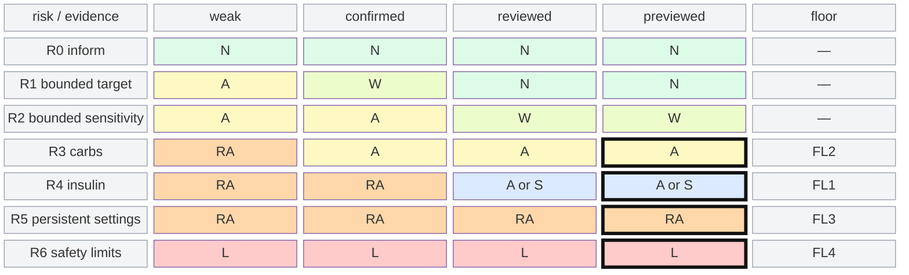

# Evidence-weighted approval: what a plan or proposal needs before a controller acts on it

*What this is: a design framework (contributor-facing). Read after the
[command queue and planning note](command-queue-and-planning-2026-10-18.md) (its levels in §3 and
decisions in §5) and the [command journeys](command-journeys-2026-10-18.md); it leads to the
[commands specification](spec/commands.md), where the plan object, evidence records and approval
paths would be written, and to [authority §7](spec/authority.md#7-delegation-not-decided), where
standing approval becomes a grant.* **Snapshot — describes 2026-10-18. Status: proposed; draft for
clinical review.** FL1 follows the maintainer's answer of 2026-10-18 that a bounded standing
bolus is acceptable with predetermined withdrawal criteria and mitigations. The risk classes (§2), the floors (§5) and the matrix (§4) are a draft that a
qualified clinician reviews before anything here is relied on, specified or implemented; §9 lists
exactly what that review checks. Nothing here gives a dose, a target or a setting value.

**The question.** CM15 refuses an approval when the hub's whole-state version differs from the
proposal's `basedOn`. For a moment proposal that is the right check; for a plan drafted days
earlier it almost never passes, because any unrelated override changes the version
([journeys PL1.3, PL5.3](command-journeys-2026-10-18.md#pl1-a-weekday-lunch-planned-from-the-calendar-and-location)).
The maintainer's answer (2026-10-18): "We may need both, depending on different types of
plans/proposals, and depending on the kinds of evidence that can be provided to confirm them.
Stronger evidence for a benefit may outweigh the need for an approval with weak evidence."

**The framework in one line.** The approval an item needs is a function of two axes, the
**risk class** of what it can do and the **evidence class** of what supports it, bounded below by
**floors** that no evidence lowers. The controller declares the risk class; the hub enforces the
approval path as process; the controller enforces the floors and everything about its own state.

## 1. Two questions evidence answers

An item that runs hours or days after it was drafted raises two separate questions, and evidence
serves each differently:

| question | example in PL1 | evidence that answers it |
|---|---|---|
| **Is the situation happening?** (occurrence) | lunch is on today's calendar and the person is at the usual place | out-of-band confirmation, fresh, for this occurrence |
| **Is this change right for the situation?** (appropriateness) | an eating-soon target before this lunch has helped before | the person's own history, an independent evaluation, a human reviewer, the controller's preview |

Evidence lowers an approval path only when both questions are covered at the strength the risk
class asks for. Occurrence evidence alone ("the meal is happening") says nothing about whether the
change suits it; appropriateness evidence alone says nothing about today.

## 2. Axis 1: risk class (draft for clinical review)

A class belongs to an **element kind**, one separately acceptable part of a plan or proposal
(an eating-soon target, a meal's carbs, a bolus), not to the plan as a whole. Severities use the
S1–S4 scale of the [STPA usage guide](../../STPA-USAGE-GUIDE.md#severity-scale), rated higher when
in doubt; hazards are those of the [control-loop analysis](spec/control-loops.md#2-losses-and-hazards).

| class | element kinds | what it can do | worst severity | hazards and unsafe control actions |
|---|---|---|---|---|
| **R0 inform** | a reminder, a notification, a display of a plan or occurrence | changes no therapy | S1 | HAZ-3 (a wrong display) |
| **R1 bounded target** | a temporary target, eating soon, an exercise target, each within bounds the controller declares, ending by itself | moves the algorithm's target; the algorithm still decides delivery under its own limits | S3 (draft) | HAZ-1, UCA-CMD-003, UCA-PROP-006 |
| **R2 bounded sensitivity** | an override or profile percentage that scales insulin needs, within declared bounds, with an end | changes how much the algorithm delivers for hours or days | S3 | HAZ-1, UCA-PROP-008, FB-STATE-003 |
| **R3 carbs** | a carb entry | the algorithm may dose for announced carbs; carbs not eaten leave insulin with nothing to cover | S4 (draft) | HAZ-1, UCA-CMD-015, UCA-SYNC-DL-001, journey C2 |
| **R4 insulin** | a bolus, or any element the controller declares as delivering insulin directly | delivers insulin that cannot be withdrawn once given | S4 | HAZ-1, UCA-CMD-001, UCA-CMD-006, UCA-PROP-007, UCA-PROP-012, UCA-SYNC-SERVE-004 |
| **R5 persistent settings** | basal rates, sensitivity, carb ratio, targets in the profile itself | changes every later decision, with no end | S4 | HAZ-1, UCA-PROP-008, journey PL5 |
| **R6 safety limits** | the controller's own maximums (bolus, insulin on board, basal) and its closed-loop or automatic-bolus switches | changes the bounds every other class is checked against | S4 | HAZ-1, [audition §4.6](algorithm-audition-2026-10-18.md#46-no-audition-result-is-promoted-to-control) |

**Modifiers raise the class, never lower it.** An element is treated one class higher when it
lasts longer than the controller's declared short duration, does not end by itself, or is outside
the bounds the controller declares; and when it would increase insulin delivery where the same
kind could reduce it (a lower target versus a higher one). Whether a reduction may sit one class
lower than an increase is a clinical question (§9, point 4); the draft treats both alike.

**Fail closed.** A kind with no declared class is handled as R4. A plan's approval path is the
strictest of the paths its accepted elements need, element by element (decision 4: an approval
names the elements it accepts).

## 3. Axis 2: evidence class

Evidence is attached as evaluations ([CM16](spec/commands.md#6-proposals-and-approvals-proposed)):
it never changes an item's state and never approves. What this framework adds is that an
evaluation declares its class, so the hub can count it.

| class | what it is | answers | independent of the proposer when |
|---|---|---|---|
| **E0 assertion** | the proposer's own statement, with nothing behind it | neither | never |
| **E1 pattern** | the same situation and change recurring in the person's own history, with how often and how recently | appropriateness | never by itself: the proposer computed it |
| **E2 out-of-band** | a fresh signal for this occurrence from calendar, location, activity or the person's reply, summarised without the data ([DR7](spec/authority.md#7-delegation-not-decided)) | occurrence | its source is not the record the proposer drafted from |
| **E3 independent review** | an evaluation by a subject other than the proposer: a second agent, a deterministic risk check run by another instance, a caregiver, a clinician | appropriateness | it is a different subject, bound to the same payload hash |
| **E4 controller preview** | the enacting controller's own computation for this payload on its current state, before approval (AndroidAPS client control's prepare and commit is the only precedent) | appropriateness, at the moment | always: it is the enactor's state, not the hub's record |

**Properties every evidence record carries:** its class; the subject and instance that made it
(for independence); the payload hash and, for a plan, the occurrence it is bound to; when it was
observed and when it stops counting (freshness); and a one-line summary with no calendar titles,
places or health reasons. E2 counts only for the occurrence it names and only until its stated
freshness ends; E1 and E3 bind to the plan element's hash and count for its life; E4 counts only
for the approval it was made for.

**Combined strength**, used by the matrix: **weak** is E0 or E1 alone; **confirmed** is E1 with a
fresh E2 for the occurrence; **reviewed** is confirmed plus E3 (for a plan, an E3 attached at plan
approval counts); **previewed** is E3 with E4 (moment items).

## 4. The matrix: from (risk, evidence) to the approval path

Paths, from lightest to heaviest:

| path | what happens |
|---|---|
| **N notify** | the occurrence runs; the person, followers and the delegate see it, and the person can end it at any time |
| **W cancel window** | the person is notified ahead of the occurrence and it runs unless the person or the delegate cancels before it starts |
| **A approve** | one approval per occurrence or proposal, by the person or a delegate under a grant, bound to the payload hash |
| **RA reviews, then approve** | the item's required reviews (decision 3) are attached, then A |
| **S standing, with withdrawal** | an occurrence of an approved plan runs within its declared bounds unless a withdrawal criterion fires or the person cancels; the person is notified ahead; if a criterion cannot be evaluated with fresh data, the occurrence does not run |
| **L local only** | not through the hub at all; changed on the controller by the person |

**Plan approval** (policy level) always needs a human approval of the plan: A for R0–R2 elements,
RA for R3–R5. R3 and R4 elements may be standing only under FL1's conditions, and R5 elements only
per occurrence ([plans PN4](spec/plans.md#3-the-plan-object-proposed)). No evidence makes a plan
active without a human approving it.

**Occurrence or moment item**, for a plan already approved or a moment proposal:

| risk \ evidence | weak | confirmed | reviewed | previewed |
|---|---|---|---|---|
| R0 inform | N | N | N | N |
| R1 bounded target | A | W | N | N |
| R2 bounded sensitivity | A | A | W | W |
| R3 carbs | RA | A | A | A |
| R4 insulin | RA | RA | A, or S under FL1 | A, or S under FL1 |
| R5 persistent settings | RA | RA | RA | RA |
| R6 safety limits | L | L | L | L |

The same matrix as a grid. N notify, W cancel window, A approve, RA reviews then approve, S
standing under FL1's conditions, L local only; the heavy border marks where a row meets its floor,
which no evidence lowers.

Reading it: stronger evidence moves an item left in the paths, as the maintainer framed it, but
the floors of §5 stop that movement at A for carbs, at S under FL1's conditions for insulin, at
RA for persistent settings, and at L for safety limits. A modifier (§2) moves the row down before the cell is read.

## 5. Floors evidence cannot lower (draft for clinical review)

| # | floor | why |
|---|---|---|
| FL1 | **Insulin runs on a standing approval only under conditions set when the plan is approved** (maintainer, 2026-10-18; clinical review required). Otherwise each dose is approved per occurrence by the person or a delegate, bound to its payload hash, with a short expiry. The conditions, all recorded in the plan and checked by the controller: the dose stays within bounds the controller declares for the element kind; predetermined withdrawal criteria, such as live location or activity that contradicts the planned meal, withdraw the occurrence automatically, and an occurrence whose criteria cannot be evaluated with fresh data does not run; and at least one of: an eating-soon target with a reduced portion of the meal bolus, the rest left to a decision at the meal, or a human approval of that occurrence given within the 12 hours before it. An agent's confirmation alone never releases a dose (FL5). | a delivered dose cannot be withdrawn; double and stale doses are S4 (UCA-CMD-001, UCA-PROP-007, UCA-PROP-012), and the hub's picture of doses lags the controller (UCA-SYNC-SERVE-004, FB-STATE-006) |
| FL2 | **Carbs are approved per occurrence by a human** while the controller may dose for announced carbs, except carbs that accompany an insulin element released under FL1, which then carry FL1's conditions with it. | carbs not eaten leave insulin delivered for them (journey C2, UCA-CMD-015); a carb entry acts as a dose request (UCA-SYNC-DL-001) |
| FL3 | **Persistent settings need required reviews and the person's approval**, every time, accepted element by element. | no end date bounds the exposure; the change outlives its evidence (UCA-PROP-008, journey PL5) |
| FL4 | **Safety limits and loop-mode switches are local only.** | they bound every other class; changing them remotely removes the check the other floors rely on |
| FL5 | **An agent never approves.** Agents propose and supply evidence (E1–E3); approval is a human's or a delegate's under a grant. An approval by the proposing subject stays refused (CM14). | UCA-AUTH-002, UCA-PROP-009, UCA-PROP-011 |
| FL6 | **No plan is active without an end date, and no standing approval without a grant** that names its purpose, expiry and revocation (§7). | UCA-AUTH-003, DR3, DR6 |
| FL7 | **The person can always cancel or withdraw**, whoever proposed or approved the item (decision 3). | HAZ-1 when the reason goes away (UCA-CMD-015) |
| FL8 | **The controller validates and may refuse anything**, whatever path the item took. Evidence and approval never widen a controller's limits (D18). | UCA-CMD-010; the hub does not judge (CM5) |

The person, a caregiver for a child, or the care team may set a stricter path for any class; none
may set one below these floors.

## 6. What the hub checks and what only the controller can

D18: the hub routes and records; the controller validates and enacts. The approval path is
process, which the hub can enforce without judging therapy; everything about the person's state
at the moment is the controller's.

| check | hub | controller |
|---|---|---|
| the element kind's declared class, read from the controller's definition | yes (never inferred from the payload, CM5) | declares it |
| required reviews present, evidence classes counted, independence (a subject other than the proposer), freshness against the hub's clock, evidence bound to the payload hash | yes | — |
| the approver may send the command; not the proposer (CM14); the path's approval present per occurrence for R3–R4, or FL1's recorded conditions met | yes | **also yes**: a controller refuses an R3 or R4 element arriving without a per-occurrence approval or a plan whose FL1 conditions it holds and finds met, because the hub can be bypassed or misconfigured and CM10's hash does not authenticate the approver |
| `definitionId` unchanged since the proposal | yes, at approval (UCA-PROP-008) | yes, at each occurrence: it enacts under its current definition or refuses |
| intents on the plan's channels unchanged | a scoped `basedOn` at approval (below) | its own composition at enactment (S1) |
| doses and carbs since | shows them in the outstanding list; a refusal for moment proposals is the open dose check | yes, at enactment, from its own records |
| bounds, limits, the pump's state, a preview | — | yes, only it can |

**Which since check applies, per plan type and level.** "Both", in the maintainer's answer, becomes
a choice of check by level and class:

| level | R0 | R1–R2 | R3–R4 | R5 |
|---|---|---|---|---|
| policy (plan approval) | none | `definitionId`; intents on the plan's channels, scoped | `definitionId` | `definitionId`; whole-state `basedOn` (CM15) at the visit |
| confirmation (hours ahead) | none | the plan is still active; confirmation fresh | as R1–R2, plus doses and carbs since shown to the approver | — |
| moment (a proposal now) | none | whole-state `basedOn` (CM15) | CM15, plus doses and carbs since `basedOn` (UCA-PROP-012) | CM15 |
| algorithm (enactment) | none | the controller's composition and limits | doses and carbs since the approval, at the controller | the controller's limits |

A **scoped `basedOn`** versions only the active intents on the slots the plan's elements touch,
by A12's rule applied to those rows. It lets a plan made on Sunday survive an unrelated override
on Monday while still catching a plan that would collide with an intent on its own slot.

## 7. Standing approval is a delegation grant

Approving a plan whose occurrences run on N or W paths, or are confirmed by an agent, is standing
approval: the agent's later confirmations are commands sent without a per-command approval, which
is UCA-AUTH-002 unless it is bounded. The framework makes that bound a grant under
[authority §7](spec/authority.md#7-delegation-not-decided):

| grant member (DR3, DR6) | for a plan |
|---|---|
| grantor | the person, or the delegate who approved the plan |
| grantee | the instance that confirms occurrences, usually the proposing agent |
| purpose | this plan's id and the element ids accepted, nothing else |
| scope | confirm occurrences of those elements within the plan's bounds; only classes whose cell is N or W at the evidence the grantee supplies; never R3–R6 |
| expiry | the plan's end date, required (FL6); a maximum length per class, set by clinical review |
| revocation | cancelling the plan revokes the grant: unsent confirmations are cancelled, the controller drops the plan and reports it, the mirror shows who ended it |

The grant's life:

```mermaid
stateDiagram-v2
  accTitle: A plan's standing approval
  accDescr: A plan is proposed, reviewed and approved by the person or a delegate; the approval is the grant, scoped to the plan and its accepted elements and expiring at the plan's end. While it is in force the grantee may confirm occurrences inside its scope; a confirmation outside it is refused. The grant ends when the plan reaches its end date or when the person, the approver or the proposer ends the plan, which cancels unsent confirmations.
  state "in force: confirm occurrences within scope" as inforce
  [*] --> proposed: agent proposes the plan
  proposed --> reviewed: required reviews attached
  reviewed --> inforce: person or delegate approves (grant)
  inforce --> inforce: confirmation within scope
  inforce --> expired: endsAt (FL6)
  inforce --> revoked: plan ended (FL7), unsent confirmations cancelled
  expired --> [*]
  revoked --> [*]
```

This narrows UCA-AUTH-002 to a grantee that can only confirm occurrences of one approved plan, and
UCA-AUTH-003 to the plan's life. It does not give the agent `api:commands:create` on the channel;
a confirmation outside the grant is refused at the hub and, for R3–R4, at the controller (§6).

## 8. The journeys through the matrix

| journey | element | class | evidence | plan path | occurrence path | check | floor that binds |
|---|---|---|---|---|---|---|---|
| PL1 | eating-soon target | R1 | pattern; morning calendar and location; risk check and caregiver review | A after required reviews | N (reviewed) | `definitionId`, scoped intents; controller since at enactment | FL6, FL7 |
| PL1 | meal carbs and bolus | R3, R4 | as above | RA, with FL1's conditions recorded | S with withdrawal criteria and a reduced portion, or A within the 12 hours before | doses and carbs since, at the controller | FL1, FL2 |
| PL2 | exercise target | R1 | pattern; activity or location | A | W, or N once an E3 review is attached | scoped intents; confirmation freshness | FL6 |
| PL3 | preset override for school | R2 (R1 if target only) | caregiver-authored; second parent approves (E3) | A by the second parent | W | `definitionId` at approval and each occurrence | FL5, FL7; a child's plan may set a stricter path |
| PL4 | sensitivity with an end date | R2 | agent inference (E1); required human review (E3) | RA | W | scoped intents; `definitionId` | FL6, FL7 |
| PL5 | settings change | R5 | clinician proposal; risk check (E3) | RA, element by element, at the visit | — | `definitionId`; whole-state CM15 | FL3; FL4 for any limit among them |
| A1 | carbs from a photo | R3 | the agent's estimate (E0–E1); risk check | — | A; RA without the risk check | carbs since: shown by the hub, checked by the controller | FL2 |
| A2 | correction bolus | R4 | required risk check (E3); preview where offered (E4) | — | A | CM15 and doses since; the controller at enactment | FL1 |

PL1's meal element is where the framework and the planning use case meet. The agent's morning
confirmation answers "is lunch happening"; the withdrawal criteria answer "is it still happening"
close to the meal, from live location or activity; and the person chooses, at plan approval,
between a reduced standing portion with eating soon and an approval of each day's occurrence up
to 12 hours ahead. Either way the plan moves the decision from the moment to the morning or the
week, which is the policy experience the planning use cases ask for.

## 9. What the clinical review checks

1. The class of each element kind in §2, in particular whether eating-soon and other lowered
   targets belong in R1 or R2, since they lead the algorithm to deliver more.
2. Whether carbs belong at the insulin floor (FL2) for every controller, or only for those that
   dose automatically for announced carbs.
3. FL1's conditions for insulin on a standing approval: the controller-declared bounds, which
   withdrawal criteria are adequate and how fresh their data must be, the size of the reduced
   portion relative to the planned bolus, whether 12 hours is the right outer window for an
   advance approval, and whether the fail-closed rule (no fresh data, no dose) is sufficient.
4. Whether a change that reduces insulin delivery may sit one class lower than one that increases
   it, given hyperglycaemia and ketoacidosis risk over long durations.
5. The quantities this draft leaves unset: the short duration that triggers a modifier, freshness
   windows for E2, the maximum plan length per class, and the recurrence that makes E1.
6. Whether W (run unless cancelled) is acceptable for R2 at all.
7. Whether any population (young children, pregnancy, reduced awareness of hypoglycaemia) moves
   every class one step stricter by default.
8. The severities assigned in §2.

## 10. What would have to be specified

| need | where |
|---|---|
| `riskClass`, `bounds`, `selfEnding`, `direction` per element kind, declared by the controller (S10, S11); the hub reads, never derives (CM5); undeclared is R4 | state and intent, registration §7 |
| evidence fields on evaluations: `evidenceClass`, subject and instance, `boundTo` (payload hash, occurrence), `observedAt`, `countsUntil`, minimised summary | commands CM16 |
| the plan object with elements, each with kind, class, bounds, end date and the path recorded at approval | [plans](spec/plans.md) PN1–PN8 |
| the approval naming accepted elements, the path used and the evidence ids relied on | commands CM13, decision 4 |
| required reviews and the refusal when missing; who may name them | commands, decision 3 |
| a scoped `basedOn` beside CM15's whole-state version | state and intent A12, commands CM15 |
| a `definitionId` check at approval | commands §9 item 7 |
| the plan grant (§7) and a confirmation bound to one occurrence | authority §7, commands §9 item 5 |
| a controller refusal reason for a missing per-occurrence approval | commands CM8 |
| conformance cases: an R4 element on a standing approval without FL1's conditions refused at hub and controller; an occurrence whose withdrawal criteria lack fresh data not run; an advance approval older than 12 hours not counted; an evaluation by the proposer not counted as E3; stale E2 not counted; an undeclared kind treated as R4; a confirmation outside its grant refused | commands §10 |

## 11. Open questions for the maintainer

1. **Who declares the class:** each controller per kind (proposed), or a shared table for
   well-known kinds that a controller may only make stricter.
2. **Enforcement at both ends:** whether controllers are asked to enforce FL1 and FL2 themselves
   (proposed), which no controller does today for hub-originated commands.
3. **Independence:** whether a second agent run by the same person or vendor counts as E3, or
   independence needs a different operator.
4. **A preview for plans:** whether E4 should exist at the confirmation level (the controller
   previews tomorrow's occurrence), which no controller offers.
5. **Signatures for R3–R4 approvals:** CM10's hash does not show that a hub delivered what a human
   approved; whether an approver signature is required at these classes.
6. **Who may make a path stricter:** the person, a caregiver for a child, the care team, and how
   that setting is recorded.
7. **Scoped `basedOn` or none** at plan approval for R1–R2.
8. **Where withdrawal criteria are evaluated:** on the controller when it holds the data (a phone's
   location and steps, as AndroidAPS automation reads them), or by the agent, which then cancels
   the occurrence; and whether both must agree before a standing dose runs.
