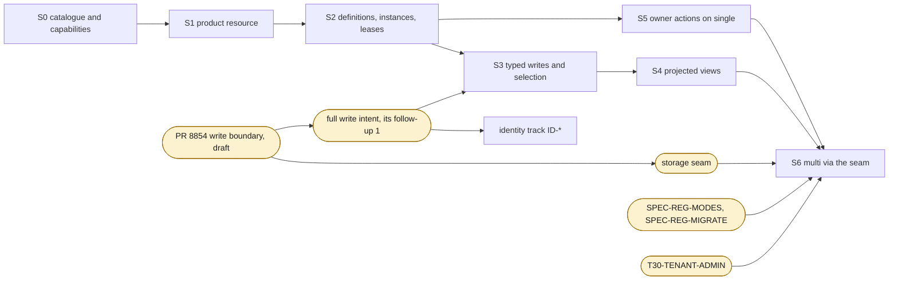

# Implementing registration in cgm-remote-monitor: where each slice goes, in what order, and how it is checked

*Contributor-facing. Living guide, current at `main` `f1119d4c` (2026-10-26) and cgm-remote-monitor `official/dev` `47723cda` (the merge of #8605). Uses the [platform specifications](../README.md); terms are in the [glossary](../spec/glossary.md). Status: the specifications are proposed and not implemented; this guide plans `HUB-REG-CRM` and its backlog. Every module path that is not on `dev` is marked proposed, and every route and permission name is a proposal, as the specifications say.*

This guide is the hub-side companion of [bring a new controller onto a hub](new-controller.md) and
[add a setting in your next release](add-a-setting.md). Those tell a controller author what to send.
This one tells a cgm-remote-monitor contributor, human or agent, where each piece of the
[registration](../spec/registration.md) and [identity](../spec/identity.md) specifications goes in
the code at `official/dev` `47723cda`, in what order, and how each slice is checked before review.

Each slice names the rules it implements, the conformance cases under `specs/sync/conformance/`
that check it, the reference function in `tools/nsschema/` that decides those cases, the existing
modules a reviewer will expect the code beside (file:line at `47723cda`), and, for the slices that
need the shared write boundary or `multi`, where that work stands. The write boundary is draft PR
#8854 (`wip/architecture-data-contracts`, `880b7369`, by Andy Low), which is not on `dev`; the
maintainer's direction is that the storage seam will most likely be built on it. The local seam
chain (`seam/*`, tip `65ce54b9`) is reference only: it shows what `multi` needs, and none of it is
on `dev`.

## 1. What the hub does and never does

The hub records, routes and refuses. It never decides whether a change to therapy is safe, never
alters what a sender asked, and never doses (D18). It checks structure; the controller owns policy.
`dev` already draws the same line for record validation: `lib/server/write-validation.js:13-17`
keeps "ranges a controller chooses for itself" with the controller, and a typed record's check
against its declared type fragment (G2) is the same kind of structural rule.

Three invariants hold on every slice:

- **Unregistered writers see nothing change.** Every client that writes today (Loop, Trio,
  AndroidAPS, xDrip+, uploaders, the careportal) writes no registration. Their writes on API v1,
  API v3 and the socket must stay byte-identical with the flag off and with it on (§6.4).
- **Nothing happens without the flag.** With the flag off, the hub serves no capability document
  and no new route, as every hub released before `HUB-REG-CRM` does.
- **Single-tenant first, mode-aware from the first commit.** The first implementation runs with
  `TENANCY_MODE` unset on MongoDB. Every invariant that `multi` will need (namespace claims, role
  exclusivity, etag preconditions) is built as a single-document conditional write or a unique
  index, never a multi-document transaction, so the port to `multi` changes the store and not the rule
  (`HUB-REG-CRM` note 6).

## 2. The slice order

| slice | serves | queue item | waits on |
|---|---|---|---|
| **S0** | the well-known catalogue and the capability document, read-only, behind a flag | `HUB-REG-CRM` | nothing on `dev` |
| **S1** | the product resource: submit, etag, retire; the MongoDB collections | `HUB-REG-CRM` | S0 |
| **S2** | definitions, instances, roles and leases | `HUB-REG-CRM` | S1 |
| **S5** | the owner's actions and listing on `single` with `API_SECRET` | `HUB-REG-CRM` | S1, S2 |
| **S3** | typed writes, attribution of every write, and read selection | `HUB-REG-CRM` | S2, #8854's write boundary, and its first follow-up (full write intent) |
| **S4** | projected views for older readers | `HUB-REG-CRM` | S3 |
| **S6** | `multi` through the storage seam and `ns-tenant-admin` | `HUB-REG-CRM-SEAM`, `HUB-REG-CRM-ADMIN` | S0–S5, the storage seam, `SPEC-REG-MODES`, `SPEC-REG-MIGRATE`, `T30-TENANT-ADMIN` |

The slices keep the numbers S0 to S6; the build order puts **S5 before S3**. The specifications
give the owner's actions (block, unblock, release, transfer, retire, free namespaces, transfer a
role, pin a version, the listing) no dependency on typed records: they act on the product resource
(S1) and on instances (S2) ([authority §4](../spec/authority.md#4-the-owners-actions)). S3 cannot
start until every write passes one boundary that can attribute it and answer with both ids (§4.4):
#8854 draws the boundary, and the per-item write intent is the first follow-up it lists. Building
S5 while S3 waits closes 31 cases that need nothing from the boundary. The one coupling is the
owner's pin: S5 stores it, and S3's read selection reads it (`instances/select-owner-pin.yaml`), so that case is green only after both.

S3 and S4 both need the single write boundary, for two reasons the specifications state:

- **Attribution reaches every write path.** A write with no instance id is attributed to the
  product's unregistered instance and is never refused for exclusivity
  ([registration §11](../spec/registration.md#11-typed-writes-and-attribution)); a catalogue mapping
  for an older writer is recorded on the reply and the stored document as `quirksApplied` (Q2, Q3);
  and every write reply returns both ids (I4). `dev` writes through six v1 and in-process storage
  modules, API v3 and the socket, each with its own matching and reply policy (measured on `dev`
  `43289dde` in the [write contract §1](../../tenancy/write-contract-spec-2026-10-07.md#1-the-matrix-measured),
  before the cuts, and not re-measured at `47723cda`). Only a boundary every one of them passes
  through can attribute every write; the write contract's proposed `write(intent)` returns
  `WriteResult.items[]` with `_id`, `identifier` and a per-item outcome
  ([write contract §2.2](../../tenancy/write-contract-spec-2026-10-07.md#22-interface)).
- **A projected document is read-only on every path.** A write aimed at either id of a projected
  document is refused `projected-read-only` (I8, [registration §13](../spec/registration.md#13-projected-views-for-older-readers)),
  which only a check inside the boundary makes true for v1, v3 and the socket at once.

The 12 cases that check carrier writes on today's paths (both ids, `UUID_HANDLING`'s move, the
identifier-first re-send) are the identity track, not a registration slice: they land with
the write boundary and the `ID-*` items (§5). The 10 command-routing cases under `instances/` belong to
`SPEC-REG-COMMANDS` and need S2's command-sink roles; the command record itself is outside this
guide ([commands](../spec/commands.md)).



## 3. The modules a reviewer expects the code beside

Measured at `official/dev` `47723cda` (`git -C externals/cgm-remote-monitor-official show official/dev:<path>`).
dev has no storage interface, no `TENANCY_MODE` and no tenant scope; `lib/storage/` holds
`mongo-storage.js`, `mongo-client-configuration.js`, `mongo-read-options.js`, `run-with-callback.js`
and `assert-no-query-javascript.js`.

| concern | on `dev` `47723cda` | what a slice does there |
|---|---|---|
| route mounting | `lib/server/app.js:237-240` builds the v1, v2 and v3 routers; `:298-301` mounts `/api`, `/api/v1`, `/api/v2`, `/api/v3`; `:209-215` serves only the boot-error view when boot failed; `:218-234` is the CORS middleware | S0 mounts `/.well-known/nightscout/sync` and `/.well-known/nightscout/controllers` beside these, after the boot-error branch; S1 mounts the router at `submit.href` (the cases use `/api/v4/registrations`) |
| the versions list | `lib/api/root.js:12-16` lists v1 to v3 for `GET /api/versions` | S1 adds the new router's entry, behind the flag |
| flags | `lib/server/env.js:123-127` parses `WRITE_VALIDATION` as `off`, `log` or `reject` (any other value `off`); `:111` `UUID_HANDLING`; `:120-121` the two `API_V1_COUNT_*` compatibility flags; collection names in `setStorage()` `:167-176` | S0 adds the registration flag beside `WRITE_VALIDATION`, with the same parse-to-`off` rule; S1 adds the collection names to `setStorage()` |
| boot | `lib/server/bootevent.js:461-465` is the boot sequence; `setupAuthorization` `:231-250`; `setupInternals` `:252-311` assigns `ctx.entries`, `ctx.treatments` and the rest (`:286-296`); `ensureIndexes` `:313` | S1 builds the registration store in `setupInternals` and asks for its indexes in `ensureIndexes` |
| indexes | `lib/storage/mongo-storage.js:263-295` `ensureIndexes(collection, fields)` takes keys only, and logs a failure without rejecting ("a missing index makes queries slower, not wrong") | a unique index that holds a namespace claim or a role cannot go through it: S1 and S2 create theirs with `unique: true` and fail boot when the build fails (§7, item 5) |
| credentials | `lib/authorization/index.js:138` `resolve`; `:178-184` `API_SECRET` resolves to `*` with no subject; `:249-264` `resolveAccessToken` returns `{shiros, subject}`; `:106-113` `resolveWithRequest` reads both the secret and the token; `:275-299` `isPermitted(permission)` | S1 decides binding from this result: a subject's `_id`, or `api-secret` when the request was authorised by the secret ([authority §3](../spec/authority.md#3-binding-and-credential-kind)) |
| roles and subjects | `lib/authorization/storage.js:228-236` default roles; `:238-243` its `ensureIndexes`; `:285-290` a subject's access token is derived from its `_id` and the `API_SECRET` hash (`lib/server/enclave.js:71-76`) | the permissions `api:registrations:create` and `api:registrations:delete` need no new role: `admin` holds `*`; a subject is the binding key, never its token (AU4) |
| API v3 authentication | `lib/api3/security.js:21-31` accepts a bearer JWT only; `:15-18` grants `*` with no subject when `API3_SECURITY_ENABLE` is off | the registration routes do not reuse it: they need the credential kind and the subject, which `resolveWithRequest` gives |
| API v3 | `lib/api3/index.js:66` `enabledCollections`; `:76-97` `setupApiRoutes`; `lib/api3/generic/setup.js:39` `storageColNames`; `lib/api3/generic/collection.js:40-70` the per-collection routes | S4 serves projections to v3 readers through these reads |
| socket | `lib/server/websocket.js:126-147` socket authorization; `:507` `dbAdd`; its `insertOne` sites `:678`, `:722`, `:777`, `:799`; `lib/api3/storageSocket.js:45-47` subscribes to the `storage-socket-*` bus events; `lib/api3/generic/create/insert.js:50` emits one | S3 attributes `dbAdd` writes behind the write boundary; typed records on the socket (T11) need the boundary's event fan-out (§4.4) |
| record validation (#8841) | `lib/server/write-validation.js:29` the three modes, `:37-46` `mode` and `parseMode`, `:131` `checkTreatment`; callers `lib/server/treatments.js:37-56`, `lib/api3/shared/operationTools.js:107-160`, `lib/api/treatments/index.js:140` | S3's type-fragment check sits beside it and follows its pattern: a pure check function, a refusal shape, one log line naming the rule and never the value |
| the write boundary (draft #8854, not on `dev`) | at `880b7369`: `lib/storage/write-step.js:81-100` `write({collection, method, args, context})` returns `{result, event}`; `:103-114` `collection(raw, context)` is a Proxy over the driver collection, used by the six v1 and internal modules, the socket and API v3's `mongoCollection`; `:68-79` emits one data-free `storage-write-committed` event per changed driver operation; `scripts/check-write-boundary.js:6-8` lists the eight adapter files its AST gate covers | S3 writes its typed collection through the same Proxy and adds that adapter to the gate's list; attribution and the projected-read-only refusal go behind the boundary with the full write intent (§4.4) |
| identity (#8845) | `lib/api3/shared/operationTools.js:197-203` refuses a v3 body `_id` with 400 (BF-170); `:209-216` keeps a client `identifier`, else `:168-185` computes a UUID v5; `lib/api3/storage/mongoCollection/utils.js:10-16` serves `identifier` and drops `_id` on v3 reads; `:105-125` `filterForOne`; `lib/server/treatments.js:185-224` answers a v1 re-send with the stored `_id` on an identifier or fallback-key match (BF-165); `lib/server/object-id-forms.js:42` `isHexId`, `:81` `idForms` | §5 |

New code goes in one new directory, proposed here as `lib/registration/` (not on `dev`; its name is
the maintainer's choice), with one module per resource so each slice adds files rather than
editing the last slice's. New tests go in `tests/` and each needs a tier in `tests/tiers.json`
(`unit`, `core`, `integration` and the rest, #8839).

## 4. The slices

The counts below come from one command each, run from the root of this repository. The total is
186 = 54 + 103 + 29, the cases [registration §19](../spec/registration.md#19-conformance-cases)
lists:

```bash
C=specs/sync/conformance
grep -L '^  action:' $C/*.yaml | wc -l                                                          # S0: 4
grep -l '^  action: \(submit\|retire\)$' $C/*.yaml \
  | grep -v -e '/typed-write-' -e '/owner-' -e '/accepted-dual-write-view-' | wc -l           # S1: 32
grep -l '^  action: \(put-definition\|put-instance\|delete-instance\)$' \
  $C/instances/*.yaml $C/quirks/*.yaml | wc -l; ls $C/instances/product-update-*.yaml | wc -l  # S2: 58 + 2
grep -l '^  action: \(write\|select-versions\|retention-check\)$' $C/instances/*.yaml $C/quirks/*.yaml \
  | grep -v -e '/write-projected-' -e '/write-stored-carrier' -e '/carrier-' | wc -l
ls $C/typed-write-*.yaml | wc -l                                                                # S3: 23 + 5
grep -l '^  action: project$' $C/instances/*.yaml | wc -l
ls $C/instances/write-projected-*.yaml $C/instances/write-stored-carrier*.yaml \
   $C/quirks/write-projected-*.yaml $C/quirks/write-stored-carrier*.yaml \
   $C/instances/carrier-view-needs-mapping.yaml $C/accepted-dual-write-view-*.yaml | wc -l      # S4: 2 + 7
ls $C/owner-*.yaml | wc -l
grep -l '^  action: \(block\|unblock\|release\|transfer\|free-namespaces\|transfer-role\|pin-version\|unpin-version\|list-instances\)$' \
  $C/instances/*.yaml $C/quirks/*.yaml | wc -l                                                  # S5: 11 + 20
ls $C/quirks/carrier-*.yaml $C/instances/carrier-write-*.yaml | wc -l                           # identity track: 12
grep -l '^  action: route-command$' $C/instances/*.yaml | wc -l                                 # commands: 10
```

| slice | implements | cases | decided by | rule | case |
|---|---|---|---|---|---|
| S0 | the catalogue, the capability document, and their absence | 4 | `negotiate.capability_problems`, `should_submit`, `described_by` | registration §2, registration §4, registration §17 | `hub-without-submit.yaml`, `older-hub-no-capabilities.yaml`, `newer-hub-older-controller.yaml` |
| S1 | product `PUT`, `GET`, controller `DELETE`; order of checks; elements; etag; retire | 32 | `negotiate.negotiate`, `evaluate`, `etag`, `definition_id`, `bound_to` | registration §5.1, registration §5.2, registration §5.3, registration §5.4, registration §5.5, authority §3, authority §5 | `accepted.yaml`, `create-retry-noop.yaml`, `update-stale-etag.yaml`, `rejected-namespace-claimed.yaml`, `retire.yaml`, `accepted-api-secret-single.yaml` |
| S2 | definitions, version conflicts, instances, roles, channels, labels, leases | 60 | `instances.put_definition`, `put_instance`, `delete_instance`, `evaluate_roles`, `instance_etag`; `negotiate.version_conflicts` | registration §7, registration §8, registration §9, registration §10, Q2 | `instances/definition-put.yaml`, `instances/definition-version-conflict.yaml`, `instances/instance-create.yaml`, `instances/instance-role-held.yaml`, `instances/instance-renew.yaml`, `quirks/same-as-role-granted.yaml` |
| S5 | the owner's actions and listing on `single` with `API_SECRET` | 31 | `negotiate.negotiate` (owner branch), `instances.transfer_role`, `pin_version`, `list_instances`, `overlaps`, `drop_on_rebind` | authority §4, registration §5.1, registration §9, registration §12 | `owner-block-api-secret-single.yaml`, `owner-retire.yaml`, `instances/owner-transfer-role.yaml`, `instances/owner-pin-version.yaml`, `instances/instance-overlap-listed.yaml` |
| S3 | typed writes, attribution, catalogue mappings, read selection, retention | 28 | `instances.write`, `quirks_registration.typed_write`, `catalogue_mapping`, `instances.select_versions`, `retention` | registration §11, registration §12, registration §14, I4, I5, I7, Q2, Q3 | `instances/typed-write-attributed.yaml`, `instances/typed-write-instance-required.yaml`, `quirks/typed-write-resend-same-ids.yaml`, `quirks/catalogue-mapping-applied.yaml`, `instances/select-live-device.yaml`, `typed-write-route-404.yaml` |
| S4 | projected views, their ids, and the read-only refusal | 9 | `instances.project`, `quirks_registration.projected_ids`, `negotiate.has_carrier_mapping` | registration §13, I8 | `instances/project-served.yaml`, `instances/project-no-mapping.yaml`, `instances/write-projected-read-only.yaml`, `quirks/write-projected-read-only-by-objectid.yaml`, `accepted-dual-write-view-served.yaml` |
| S6 | every case above in `multi`, and the owner on `ns-tenant-admin` | the same, per mode | the same | registration §4, authority §3, AU2, AU3 | `owner-action-on-data-listener.yaml`, `instances/owner-transfer-role-data-listener.yaml` |
| identity track | carrier writes on today's paths: both ids, `UUID_HANDLING`'s move, identifier first | 12 | `quirks_registration.carrier_write`, `normalise_sent_id`, `resolve` | I2, I4, I5, I9 | `quirks/carrier-write-both-ids.yaml`, `quirks/carrier-uuid-id-moved.yaml`, `quirks/carrier-resend-identifier-first.yaml`, `instances/carrier-write-older-controller.yaml` |

The reference functions are in `tools/nsschema/negotiate.py`, `instances.py` and
`quirks_registration.py`; each case's `run_case` dispatches on `request.action`
(`instances.py:1140-1195`). They check that the cases are self-consistent. They are not a hub, and a
hub that disagrees with one on a case is either a hub defect or a gap in the specifications, which
is reported rather than fixed by editing the case.

### 4.1 S0: the catalogue and the capability document

**What.** `GET /.well-known/nightscout/sync` (the capability document, unauthenticated, cacheable,
about the software and never a person) and `GET /.well-known/nightscout/controllers` (the
well-known registrations) ([registration §2](../spec/registration.md#2-two-tiers),
[§4](../spec/registration.md#4-the-capability-document)). The document is validated against
`specs/sync/hub-capabilities.schema.json`. In S0 it carries `grammar`, `horizons`, `typeFragment`,
`limits` and `wellKnown`, and no `submit` and no `instances`: a controller reading it writes every
element as its carrier (`hub-without-submit.yaml`).

**Where.** The flag is parsed beside `WRITE_VALIDATION` (`lib/server/env.js:123-127`); its name and
default are the maintainer's, and the conservative default is off, under which both routes answer
404 exactly as on `dev`. The routes mount in `lib/server/app.js` after the boot-error branch
(`:209-215`) and before `/api` (`:298`). The catalogue is the three generated registrations,
`specs/sync/registrations/loop.yaml`, `specs/sync/registrations/trio.yaml` and
`specs/sync/registrations/androidaps.yaml` (`make schema-sync-model`), with the shared slot list
`specs/sync/shared-slots.yaml`. They ship inside cgm-remote-monitor as data files, proposed under
`lib/registration/well-known/`; a check in this repository compares the shipped copy with the
generated one, so the product repository keeps no generator (D12).

**Seam.** Nothing. The document is deployment-level in every mode; whether the flag, `limits` and
`instances.leaseSeconds` are per deployment or per tenant is `SPEC-REG-MODES` point 4.

### 4.2 S1: the product resource

**What.** `PUT`, `GET` and the controller's `DELETE` on `<submit.href>/<vendor>/<product>`, with the
order of checks in [registration §5.2](../spec/registration.md#52-order-of-checks): authorisation and
binding, then the precondition (428, 412), then the owner's block, then the registration as a
whole, then each element. S1 adds `submit` to the capability document.

**Where.**

- Authorisation uses `ctx.authorization.resolveWithRequest` (`lib/authorization/index.js:106-113`)
  and `checkMultiple` (`:123`), not `isPermitted` alone, because the binding needs the result: a
  subject (`:249-264`) binds to `subject._id`; a request authorised by `API_SECRET` (`:178-184`) has
  no subject and binds `api-secret`, which exists only on `single` (D13).
- The etag and the definition id are SHA-256 over RFC 8785 canonical JSON. `dev` has no
  canonicalisation library and no JSON Schema validator in its dependencies; whether to add one is
  the maintainer's choice. The values the cases use are strings, integers, booleans, null and short
  decimals, so a short canonicaliser that sorts keys by UTF-16 code unit (JavaScript's default
  sort) is enough, and the cases' stated etags and `definitionId`s, computed by
  `negotiate.canonical_json`, check it.
- Storage: one MongoDB collection for products, proposed `registrations`, keyed by
  `(vendor, product)` with a unique index; the stored document holds the registration, state,
  `boundTo`, credential kind, binding event and claimed namespaces. Namespace claims are a second
  unique index over the claimed namespace, so "first to claim holds it"
  (`accepted-first-to-claim.yaml`) is decided by MongoDB, not by a read before the write. An update
  is one conditional replace on `{_id, etag}`; a replace that matches nothing is 412.
- The collection name is read in `setStorage()` (`lib/server/env.js:167-176`) like the others; the
  store is built in `setupInternals` (`lib/server/bootevent.js:252`).

**Write boundary and seam (neither on `dev`).** The registration store is control-plane state, not
records: it is written by etag compare-and-set, never by a record write's merge-on-match. #8854's
boundary passes a driver call through unchanged (`write-step.js:81-100`), so a conditional
`replaceOne` on `{_id, etag}` keeps its meaning behind it. On the seam chain, which is reference
only, a store gets its collection from `collectionFor` (`lib/storage/collection-for.js:22` at
`65ce54b9`), and on PostgreSQL `replaceFiltered` throws by name
(`lib/api3/storage/pgCollection/index.js:318`). `HUB-REG-CRM-SEAM` carries both points.

### 4.3 S2: definitions, instances and leases

**What.** `PUT …/definitions/<definitionId>` (immutable, `If-None-Match: *` only), `PUT` and
`DELETE …/instances/<instanceId>`, per-role results, exclusivity among live `device` instances,
labels, leases ([registration §7–§10](../spec/registration.md#7-definitions)). The capability
document gains `instances`. "One element at one version has one meaning" uses the meaning table in
§7; `negotiate.version_conflicts` and `negotiate.meaning` are the reference.

**Where.**

- Two more collections, proposed `registration_definitions` (keyed by `definitionId`, content
  addressed, so a retried `PUT` is a no-op) and `registration_instances` (keyed by instance id).
- Exclusivity is one holder per (channel, role) among live `device` instances. A lease that lapses
  holds no roles with no housekeeping, so the holder is computed from `leaseExpiresAt` at the time of
  the request, and a claim is one conditional update on the instance document. Two claimants racing
  for one channel must leave one holder; the `HUB-REG-CRM-SEAM` gate (c) states the concurrent test
  and its control, and the same test belongs in S2 on MongoDB.
- The instance id is a lowercase UUID v4 the controller supplies; the hub refuses any other form
  (`instances/instance-invalid-id.yaml`) and never derives one from a device name.
- The observed alias (`devicestatus.device` seen in an instance's writes) is stored withheld:
  absent from the default listing and from the capability document.

**`multi` (reference only).** Under `multi`, the channel scope of a product's own slot and the shared
slots are per tenant. Cache compiled validators by `definitionId`, which means the same on every
tenant, never by `(vendor, product)` (`HUB-REG-CRM` note 7).

### 4.4 S3: typed writes, attribution and read selection

**What.** The typed write: an instance id on every typed write (proposed as a request header),
422 `instance-required` without one, 409 `not-live`, `role-held` or `role-not-granted`, the
record attributed to its instance, definition and provenance, and both ids in the reply
([registration §11](../spec/registration.md#11-typed-writes-and-attribution), I4, I5, I7). Every
carrier write is attributed too: to its instance, or to the product's unregistered instance, and a
catalogue mapping for a known older version is applied and recorded (Q2, Q3). Read selection picks
the version a view shows: capability limit, owner's pin, live `device` source, newest stored
([registration §12](../spec/registration.md#12-read-selection)). Retention refuses to remove a
definition a record or a live instance uses (§14).

**Base: #8854's write boundary, draft, not on `dev`.** At `880b7369`, `lib/storage/write-step.js`
puts every driver write from the six v1 and internal storage modules, the legacy socket and API
v3 behind one Proxy (`:103-114`), checks selectors, keeps the driver's result and errors, and emits
a data-free `storage-write-committed` event per changed driver operation (`:68-79`);
`scripts/check-write-boundary.js` fails when one of the eight adapter files (`:6-8`) bypasses it.
Matching, server dates and reply policy stay in each adapter, by design
(the PR's `data-contracts.md`, "Implemented boundaries").

That boundary is where S3 attaches, and it is not yet enough for S3. The PR's own follow-up list
names what S3 needs as separate, measured slices:

- **Follow-up 1, full write intent and event fan-out:** matching, server-date allocation,
  stale-id cleanup and request-level outcomes move behind the boundary. Per-item outcomes with both
  ids (I4), the unregistered instance's attribution (§11) and `quirksApplied` (Q3) are request-level
  outcomes, so S3 waits on this slice; the write contract's `write(intent)` → `WriteResult`
  ([§2.2](../../tenancy/write-contract-spec-2026-10-07.md#22-interface)) is one proposal for its
  shape. Today's event carries counts, not documents, so typed records on the socket and in v3
  history (T11, sync-transport §5) need the fan-out half of the same slice.
- **Follow-up 4, delivery and cursors (Q-D):** the cursor rules typed records share with history.
- **Follow-up 5, units and identity (Q-E):** `_id` versus `identifier` precedence and mandatory
  identifiers at a version boundary (§5).
- **Follow-up 2, atomic validation:** a type-fragment check that reads before it writes races like
  today's v3 checks; S3 keeps its own checks to the record in hand.

The queue item for the first release of a single write step is `WC-STEP-PATCH`, which the queue
blocks on `SEAM-REFRESH`; with the seam built on #8854, the item's base becomes that boundary.

**Where.** The type-fragment check of a typed record sits beside `lib/server/write-validation.js`,
in its pattern (pure check, refusal shape, a log line with field names and never values), and covers
only the keywords the capability document's `typeFragment` lists. The typed collection gets its
driver collection through #8854's `collection(raw, context)` with a source label of its own, and its
adapter joins the boundary gate's list. On the socket path, #8854 already routes `dbAdd`
(`lib/server/websocket.js:507` on `dev`, four `insertOne` calls at `:678`, `:722`, `:777`, `:799`)
through the boundary.

**`multi` (reference only, seam chain `65ce54b9`).** The filter AST (`lib/storage/filter.js`: `validate` `:58`, `toMongo`
`:118`, `toSql` `:200`, `fromMongo` `:402`) is how a typed query and a label selector reach both
backends. Under `multi`, an emission with no tenant bound is withheld
(`lib/server/socket-tenancy.js:258-266`), so typed records on the socket need the request's tenant
in hand.

### 4.5 S4: projected views

**What.** For an accepted element whose `carrierView` is `served`, each typed record is served to
API v1 and v3 readers as a document in the carrier's shape, labelled `projectedFrom`, never stored
as a source, read-only (409 `projected-read-only`), with the same `_id` on every read; without a
declared mapping, `not-served` in the submit response and 409 `no-carrier-mapping`
([registration §13](../spec/registration.md#13-projected-views-for-older-readers), I8). Until S4,
S1 reports `not-served` for every element, which the cases model as their `carrierViews` input.

**Where.** v1 reads are each collection's `list` (for treatments `lib/server/treatments.js:343`);
v3 reads go through `lib/api3/storage/mongoCollection/find.js` and its `normalizeDocs` (`:19-24`).
The `_id` of a projection is assigned at the typed write and stored with the typed record, so a
projection is a read-time merge, not a second stored copy. The read-only refusal is a check behind the
write boundary against the projected ids (`instances._projected_ids` is the reference), so it holds
on v1, v3 and the socket at once.

### 4.6 S5: the owner's actions on `single`

**What.** Block (including a pre-emptive block of an identity with nothing stored), unblock,
release, transfer, retire, free namespaces, transfer a role, pin and unpin a version, and the owner's
listing with overlaps, `slotNameObservations` and withheld members
([authority §4](../spec/authority.md#4-the-owners-actions)). Each changes the product's or the
instance's etag, so two owner actions racing meet 412; pins are their own resource with their own
etag (§12).

**Where.** On `single` there is one listener; the owner is whoever presents `API_SECRET`
(`lib/authorization/index.js:178-184`). 28 cases name `ns-tenant-admin` and run on `single` with
`API_SECRET`, as [registration §5.2](../spec/registration.md#52-order-of-checks) step 1 and the
`HUB-REG-CRM` gate state. The two cases that name `ns-api` for an owner action
(`owner-action-on-data-listener.yaml`, `instances/owner-transfer-role-data-listener.yaml`) have no
single-mode form until `SPEC-REG-MODES` states one; on `single` they are reported not applicable.
The owner routes are proposed under the same router as S1, as `POST …/block` and the others in
[registration §5.1](../spec/registration.md#51-identity-and-methods).

### 4.7 S6: `multi`

**What.** The same contract under `TENANCY_MODE=multi`: registrations, definitions, instances,
pins and overlaps are tenant data; the capability document is the same on every tenant host; there
is no `API_SECRET` (D13), so no `api-secret` binding; owner actions move to `ns-tenant-admin`
(AU2), which does not exist anywhere yet.

**What the seam chain shows (reference only, at `65ce54b9`, not on `dev`).** The seam itself will
most likely be built on #8854; these are the pieces of the old chain a `multi` implementation needs
an answer for.

| piece | where on the seam chain | used for |
|---|---|---|
| the tenant binding | `lib/storage/tenant-scope.js:51` `SINGLE_TENANT`, `:106` `withTenant`, `:137-150` `requireTenant` | every registration read and write runs bound; `single` resolves to `SINGLE_TENANT`, which is not a tenant id |
| the mode flag | `lib/server/env.js:176-198` `setTenancy`, `TENANCY_MODE` default `single`, `TENANT_CONTEXT_MAX` `:195` | the harness's mode parameter maps onto it |
| store selection | `lib/server/storage-backends.js:82` `selectBackend`; `lib/storage/collection-for.js:22` | the registration store on MongoDB or PostgreSQL |
| tenant resolution | `lib/server/tenant-middleware.js:204` `create`, `:332` `fromEnv` | host to tenant before any registration route |
| export and delete | `lib/admin/platform-store.js:191-203` `tenantScopedTables`, `:56` `NOT_TENANT_DATA` | the registration tables must appear in the list (`HUB-REG-CRM-SEAM` gate d) |
| credential kinds | `lib/admin/platform.sql:139-141` `tenant_secret` with kind `root` | the tenant root credential, which has no `credentialKind` yet (`SPEC-REG-MODES` point 2) |
| `_id` on PostgreSQL | `lib/api3/storage/pgCollection/sql.js:64-78` mints a 24-hex ObjectId-shaped `_id` | I2's 24-hex `_id` on every legacy surface, on PostgreSQL |

`lib/admin/` on the seam chain is the platform operator's plane (`ns-admin`), not `ns-tenant-admin`.
How a site's registrations travel when it moves into a tenant is `SPEC-REG-MIGRATE`.

## 5. Identity for registered instances

The two ids ([identity I1–I9](../spec/identity.md#1-rules), D20 rule 5 in the
[hub-sync design §3.7](../nightscout-hub-sync-architecture-2026-09-11.md#37-version-scoped-quirks-and-the-two-ids)):
`identifier` is the sync identity the client assigns, the real thing a record describes; `_id` is
the storage key the hub assigns, 24 hex on every legacy surface. In the typed API, `identifier` is
the controller's record id. Three ids are easy to confuse in this code:

| id | who assigns it | where it lives | rule |
|---|---|---|---|
| instance id | the controller, a random UUID v4 per running copy | the instance resource, and the header of each typed write | identity §2 |
| `identifier` | the controller, from the same inputs on every device that writes the record | the typed record and every carrier document | I1, I6, [identifier conventions](../identifier-conventions.md) |
| `_id` | the hub, at the write; its time is the receipt time | every stored record, and every projection of a typed record | I2, I3, I8 |

**What the slices owe.**

- **S3** answers every typed write with `ids: {identifier, _id}` and `matchedBy`; a re-send with
  the same `identifier` for the same product matches the stored typed record whichever instance
  sent it (I7), so a controller keeps no cache of server ids
  (`quirks/typed-write-resend-same-ids.yaml`).
- **`identifier` is mandatory for registered controller instances** (maintainer, 2026-10-18,
  [identifier conventions §1](../identifier-conventions.md#1-decisions) decision 1). On the typed
  path the hub can refuse a typed write that carries no record id. On a legacy path, how the hub
  recognises that a carrier write comes from a registered instance is open (`ID-ABSENT-DECISION`):
  §11 proposes the instance id only on typed writes. No case and no reference function states the
  refusal yet (§7, item 2).
- **A registered instance's convention** (its `identifier` templates) is proposed as a meaning
  member of its definition ([identifier conventions §5](../identifier-conventions.md#5-how-a-registered-controller-declares-its-convention));
  the grammar v1 has no member for it. If it is adopted, S2's meaning table gains it, so a changed
  template needs a new definition version.
- **S4**'s projection carries the typed record's `identifier` and the `_id` stored at the typed
  write (I8).

**What `dev` already does (#8845, merged in `47723cda`).** API v3 refuses a body `_id` with 400
(BF-170, `lib/api3/shared/operationTools.js:197-203`), keeps a client `identifier` as sent and
otherwise computes a UUID v5 (`:209-216`, `:168-185`); its reads serve `identifier` and drop `_id`
(`lib/api3/storage/mongoCollection/utils.js:10-16`). API v1 treatments answer a re-send with the
stored `_id` on an identifier match and on a fallback-key match (BF-165, `lib/server/treatments.js:185-224`).
`UUID_HANDLING` (`lib/server/env.js:111`, default on) moves a non-hex string `_id` to `identifier`
on treatments and entries; the identity track records that move as `quirksApplied` (I9).

**Where the `ID-*` items land.**

| item | state in the queue | lands | relative to the slices |
|---|---|---|---|
| `ID-SIMPLE-MATCH` | not started, unblocked since RT-1 merged | v1 entries and devicestatus match on `identifier`, on `dev` | before the write intent and independent of every slice |
| `WC-STEP-PATCH` | blocked on `SEAM-REFRESH` in the queue | the one write step, today's behaviour pinned; BF-165's `_id` in every reply | #8854's boundary is its likely base and follow-up 1 its content; S3 and S4 wait on it; the identity track's 12 cases are checked when it lands |
| `ID-FIRST-MATCH`, `ID-BATCH-RESULTS`, `ID-VALIDATE`, `ID-V1-LOOKUP` | blocked on `WC-STEP-PATCH` | identifier-first matching on every path, per-item batch results, identifier validation, v1 lookup by any identifier | beside S3, behind the boundary; `ID-VALIDATE`'s checks apply to typed record ids once `ID-FORMAT-DECISION` decides C1–C7 |
| `ID-UNIQUE-INDEX` | blocked on the four above | a partial unique index on `identifier` | after S3; the typed collection's index on `(vendor, product, identifier)` is S3's own |
| `ID-FORMAT-DECISION`, `ID-ABSENT-DECISION`, `ID-CLIENT-OID-DECISION`, `ID-V3-IMMUTABLE-DECISION`, `ID-DELETE-REUSE-DECISION` | needs decision | the maintainer's | `ID-ABSENT-DECISION` decides how S3 recognises a registered instance on a legacy path |
| `ID-SCOPE-DECISION` | needs decision | per collection, across collections, per tenant | S6: the per-tenant scope is a column in the key under `multi` |

## 6. How to check a slice

### 6.1 The harness lives here

The harness that runs the conformance cases against a booted cgm-remote-monitor lives in this
repository (D12), not in the product repository. It does not exist yet; `HUB-REG-CRM` builds it.
It boots the slice's worktree in process, as `tools/qc/write-contract-matrix.js` does
(`WC_WORKTREE`, `WC_MONGO`, a fresh database per run, liveness asserted before and after every
measured step), so a "nothing happened" result cannot come from a dead server.

For each case it:

1. seeds the case's `hubState` into the slice's collections (the seed is written against the
   slice's storage shape, so it changes with the slice);
2. sends the case's `request` with the case's `submitter` as its credential (`API_SECRET` for an
   `api-secret` submitter, a subject's token otherwise);
3. compares the response, and the stored state where the case states `stateAfter` or
   `storedAfter`, with `expected`; `detail` strings are not compared.

### 6.2 The mode is a parameter from the first commit

The harness takes the mode as a parameter on day one, even while only one value runs:
`single` on MongoDB for S0 to S5; `single` on PostgreSQL and `multi` on PostgreSQL with two
tenants for S6 (the `HUB-REG-CRM-SEAM` gate). Each case runs in each mode `SPEC-REG-MODES` assigns
it, so adding a mode later adds runs rather than rewriting the harness.

### 6.3 Every case is reported by name

Each case prints as **passed**, **mapped** or **not applicable**, by name, and none is dropped. A
case is red when its response or stored state differs. The mappings on `single` at `47723cda`:

| case or group | reported | why |
|---|---|---|
| the 28 cases that name `ns-tenant-admin` | mapped: run on `single` with `API_SECRET` | registration §5.2 step 1; `HUB-REG-CRM` gate |
| `owner-action-on-data-listener.yaml`, `instances/owner-transfer-role-data-listener.yaml` | not applicable | `single` has one listener; `SPEC-REG-MODES` states the form |
| `update-token-rotated.yaml` | mapped: a new JWT for the same subject, or a changed `API_SECRET` | on `dev` a subject's access token is derived from its `_id` and the secret (`lib/authorization/storage.js:285-290`), so the subject survives either |
| carrier-write cases whose sent document carries a client `_id` | mapped: sent over API v1 | API v3 refuses a body `_id` (BF-170) |
| `typed-write-load-429-retry-after.yaml`, `typed-write-load-502.yaml`, `typed-write-load-503.yaml` | not applicable beyond the status the hub sends | they check the controller's retry, not a hub decision |
| any case in a slice not yet built | not applicable, with the slice named | so the run's totals always add to 186 |

### 6.4 The unregistered writer is the control

Run `tools/qc/write-contract-matrix.js` on the base commit and on the slice's branch, with the flag
off and with it on, and compare with `--compare`: every cell must be identical for a client that
never registers. Red when any cell differs. This is what keeps today's apps unchanged, and it is
the answer the [compatibility tables](../spec/compatibility.md#43-l2-definitions-and-instances) give
for every older app. #8854 adds an in-repository companion, `tests/api.crud-by-id.matrix.test.js`
(336 cells with stated replies and stored id forms, `CRUD_MATRIX_OUT` for a before-and-after
report); run both. From S3 on, the base is the matrix as pinned by the write intent slice.

### 6.5 Non-vacuity: remove each hub check

Each hub check the cases exercise is removed in turn, and its cases must turn red with the expected
code, not with any error: the binding (`not-registration-owner`), the preconditions (428, 412), the
owner's block (`blocked-by-owner`), the namespace claim (`namespace-claimed`), role exclusivity
(`role-held`), `instance-required`, and the projection's read-only refusal
(`projected-read-only`). Perturb one cell of the write matrix and the §6.4 control must turn red.
A red for the wrong reason (a crash, a 500, a dead server) does not count; show that the one removed
check is the cause.

### 6.6 Before review

- `python3 -m pytest tools/nsschema/test_registration_negotiation.py tools/nsschema/test_registration_instances.py tools/nsschema/test_registration_quirks.py`
  stays green: the harness reads the cases, never edits them.
- In cgm-remote-monitor, every new test file has a tier in `tests/tiers.json`, and
  `npm run test:smoke` passes after merging the latest `official/dev`.

## 7. Where the specifications and `dev` differ

Measured at `47723cda` (and `65ce54b9` for item 6); each is reported to the specification's owner rather than worked around.

1. **API v3 and `_id`.** [Identity I2](../spec/identity.md#1-rules) says API v1 and v3 serve a 24-hex
   `_id` and keep a client's 24-hex `_id` as that ObjectId. Since #8845, API v3 refuses a body `_id`
   with 400 (`lib/api3/shared/operationTools.js:197-203`) and its reads drop `_id`
   (`lib/api3/storage/mongoCollection/utils.js:10-16`, applied by `find.js:19-24`). So I8's "every
   read of that projection carries the same `_id`" holds on API v1 only. Identity §6 is read at
   `fade2299`, before #8845.
2. **A typed write with no `identifier`.** The decision that `identifier` is mandatory for
   registered instances has no case, and `instances.write` accepts a typed write that carries no
   record id (`tools/nsschema/instances.py:1009`). None of the five `instances/typed-write-*.yaml`
   cases carries `recordId`, and the accepted ones expect `accepted: true`.
3. **Token rotation.** [AU4](../spec/authority.md#2-principals-and-credentials) and
   `update-token-rotated.yaml` assume a token can rotate on one subject. On `dev` a subject's access
   token is a function of its `_id` and the `API_SECRET` hash, so it rotates only when the secret
   does, for every subject at once; a JWT re-issued from the same access token is the per-subject
   case. The binding holds either way (§6.3).
4. **Credential kind on API v3.** `lib/api3/security.js` accepts a bearer JWT only (`:21-31`) and
   grants `*` with no subject when `API3_SECURITY_ENABLE` is off (`:15-18`). The registration
   routes need the subject and the credential kind, so they use the v1 resolution
   (`lib/authorization/index.js:106-113`).
5. **Indexes that hold an invariant.** `lib/storage/mongo-storage.js:263-295` builds key-only
   indexes and treats a failed build as a slowdown. A namespace claim or a role holder enforced by a
   unique index is a correctness property, so its index is built with `unique: true` outside that
   helper and a failed build is a boot error.
6. **The seam chain's write methods on PostgreSQL.** At `65ce54b9` (reference only), `PgCollection` throws for
   `insertMany`, `updateMany` and `replaceFiltered` (`lib/api3/storage/pgCollection/index.js:308-318`);
   an etag compare-and-set has no method on PostgreSQL yet. This is an input to `HUB-REG-CRM-SEAM`.

## 8. Checklist

- [ ] The flag defaults off; with it off, both well-known routes and the registration router answer
      404 as on `dev`.
- [ ] The capability document validates against `specs/sync/hub-capabilities.schema.json` and
      advertises only what the built slices serve (`submit` from S1, `instances` from S2).
- [ ] Binding is to a subject's `_id` or `api-secret`, never a token.
- [ ] Every invariant across documents (namespace claim, role holder, etag) is one conditional
      write or one unique index, and no multi-document transaction.
- [ ] Typed and carrier writes go through the one write boundary, and every new adapter is on the
      boundary gate's list; no slice adds a write path of its own.
- [ ] The harness reports all 186 cases by name as passed, mapped or not applicable, with the mode
      named.
- [ ] The unregistered-writer matrix is identical to the base, flag off and on.
- [ ] Each hub check, removed alone, turns its cases red with the expected code.
- [ ] New tests have tiers; `npm run test:smoke` passes after merging `official/dev`.
