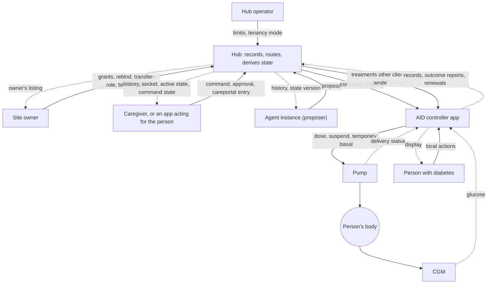
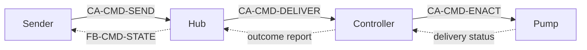
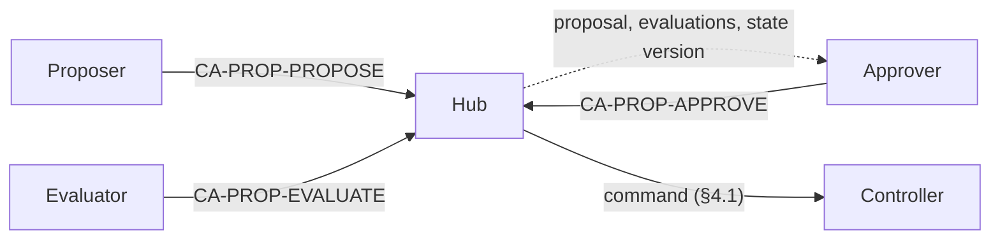

# L2–L5 Control loops: what each mechanism controls, and the unsafe control actions its rules prevent

*Contributor-facing. Living specification analysis, current at `main` `85c645c8` (2026-10-18).
Covers layers L2–L5 of the [platform index](../README.md); terms are in the
[glossary](glossary.md). Decisions: [D18 and D19](../../tenancy/nightscout-multitenancy-execution-plan-2026-09-14.md#261-d18--two-tier-controller-registration).
Queue: `SPEC-STPA-PLATFORM`.*

*An analysis across the seven specifications in the [reading order](../README.md#reading-order);
read it after [commands](commands.md), or after all seven. Expect the losses and hazards, the
control structure the specifications set up, one section per control loop with its unsafe control
actions and the rule that prevents each, the patterns that apply to the proposed mechanics, what
the analysis found, and the checks that hold it to the specifications.*

This page applies STPA (System-Theoretic Process Analysis) to the mechanisms the platform
specifications propose. STPA models a system as controllers that issue control actions and
receive feedback, and asks, for each control action, how it could be unsafe: provided when it
should not be, not provided when it should be, provided too early or too late, or applied for too
long or too short. Each answer is an *unsafe control action* (UCA). The specifications' rules are
then read as the constraints that prevent them. Where no rule prevents one, the analysis names the
gap and the specification lists it as open.

Status: the loops are drawn from the specifications, which are proposed or specified and not
implemented. Of 72 entries, 41 are covered by a rule and a case, 6 are the controller's
responsibility (D18), 3 have a rule and no case, and 22 are gaps, each listed in its
specification's open items.

## 1. Files

| file | holds |
|---|---|
| `specs/sync/stpa/platform-control-loops.yaml` | losses, hazards, loops, control actions, every entry with its hazards, severity, constraints, verification and status, and what was considered not hazardous for each STPA type |
| `tools/nsschema/test_stpa.py` | the checks in §8 |
| `tools/nsschema/stpa_tables.py` | writes the tables in §4 from the file |
| [`docs/STPA-USAGE-GUIDE.md`](../../../STPA-USAGE-GUIDE.md) | the ecosystem's STPA method, severity scale (S1–S4) and id conventions |
| [`traceability/stpa/cross-project-patterns.md`](../../../../traceability/stpa/cross-project-patterns.md) | the controller-side unsafe control actions (`UCA-BOLUS`, `UCA-CARB`, `UCA-REMOTE`, `UCA-SYNC`) this analysis meets at the hub |

## 2. Losses and hazards

| loss | |
|---|---|
| LOSS-1 | Harm to the person with diabetes from insulin delivered or withheld (hypoglycaemia, hyperglycaemia, ketoacidosis). |
| LOSS-2 | Loss of the ability to say afterwards what was asked, by whom, and what was enacted, for care, incident review or regulatory review. |
| LOSS-3 | Disclosure of health data, or of control over therapy, to someone the person did not authorise. |

| hazard | | losses |
|---|---|---|
| HAZ-1 | Insulin delivery, or a therapy setting, that the person or someone they authorised did not intend at that time, including the same change enacted twice. | LOSS-1 |
| HAZ-2 | A therapy change someone intended is not made, while the people relying on it believe it was. | LOSS-1 |
| HAZ-3 | A person, controller or agent acts on a picture of delivered insulin, active therapy or a command's fate that differs from what happened. | LOSS-1, LOSS-2 |
| HAZ-4 | Control over therapy, or health data, reaches someone not authorised for it, such as another tenant or a reader promoted to an actor. | LOSS-1, LOSS-3 |
| HAZ-5 | The record cannot show what was asked, by whom, what was enacted, and when. | LOSS-2 |

Losses and hazards use `LOSS-` and `HAZ-` so that they do not read as the layers L0–L5.

## 3. The control structure

Solid arrows are control actions; dotted arrows are feedback. Every box is a role, not a product.

Two observations follow from the drawing.

- **The hub has no control action on the pump.** D18 puts every dosing decision in the controller,
  and the structure shows it: the hub's control actions are routing and delivering what a sender
  asked, and the controller validates before it acts. A second path reaches the controller as
  well: treatments other clients wrote, which a controller that accepts them
  ([S10](state-intent.md#2-rules)) acts on with none of a command's record, expiry or outcome
  (§4.4). The pump has more than one controller
  upstream of it (the person, the algorithm, each caregiver and agent), and only the controller
  arbitrates among them ([state and intent S1](state-intent.md#2-rules)).
- **The hub is in the feedback path of every other controller.** A caregiver decides whether to
  send a bolus from the hub's history, its active state and its command states; an agent bases a
  proposal on the hub's state version; a controller that downloads treatments acts on records the
  hub stored. So the rules about what the hub reports (the command states, the active-state rules
  A1–A13, the sync rules T6–T10, re-send matching I5) are safety constraints, although the hub
  never doses.

## 4. The loops

Each loop lists its control actions and feedback, then its entries. *Prevented by* names rules
and sections; *status* is `covered` (a rule and a case), `uncased` (a rule, no case),
`controller` (the controller's own validation, D18) or `gap` (no rule; the open item named).

### 4.1 A remote command

[Commands §2, §4, §5 and §7](commands.md#2-where-a-command-goes). The sender sends a command
(CA-CMD-SEND), or would cancel one (CA-CMD-CANCEL, not specified); the hub records it and delivers it by push or fetch (CA-CMD-DELIVER); the
controller validates and enacts it (CA-CMD-ENACT) and reports an outcome, which the hub shows the
sender as the command's state (FB-CMD-STATE). The sender's process model is the command's state;
the hub's is its record; only the controller knows what the pump did.

<!-- BEGIN GENERATED: stpa-command -->
| id | type | unsafe control action or feedback | hazards | severity | prevented by | status |
|---|---|---|---|---|---|---|
| UCA-CMD-001 | provided | A sender sends a second command for the same intent while the first is pending, sent, fetched or unconfirmed, and both are enacted. | HAZ-1 | S4 | CM3, CM4 | gap: commands §9 |
| UCA-CMD-002 | provided | A retry of one request is treated as a new command. | HAZ-1 | S4 | CM4 | covered |
| UCA-CMD-003 | timing | A command is enacted long after it was sent, when the sender's reason for it no longer holds. | HAZ-1 | S3 | CM3, CM10 | covered |
| UCA-CMD-004 | provided | A command reaches an instance other than the live device holder of the channel's command sink, such as a lapsed former holder, the newest instance, or a simulator. | HAZ-1 | S4 | commands §2, CM1, CM2 | covered |
| UCA-CMD-005 | provided | A command reaches an instance on another tenant, or a push for one tenant is sent with another tenant's or the deployment's credentials. | HAZ-4, HAZ-1 | S4 | CM6, CM19, CM20 | covered |
| UCA-CMD-006 | provided | One command is delivered more than once, by a push and again by a fetch that returns sent commands, and the controller enacts it each time. | HAZ-1 | S4 | CM18 | gap: commands §9 |
| UCA-CMD-007 | provided | The payload a controller receives differs from the one the sender sent. | HAZ-1 | S4 | CM5, CM10 | covered |
| UCA-CMD-008 | not-provided | A push is lost and the destination never receives the command, while the sender reads sent as delivered. | HAZ-2, HAZ-3 | S2 | CM17, CM18 | covered |
| UCA-CMD-009 | timing | A command is sent or fetched at or after its expiry. | HAZ-1 | S3 | CM3 | covered |
| UCA-CMD-010 | provided | A controller enacts a remote command that its own limits, or a recent local action, should have refused. | HAZ-1 | S4 | CM5, CM10 | controller |
| UCA-CMD-011 | provided | A controller enacts part of a command, such as storing a meal's carbs and refusing its bolus, and reports one final state. | HAZ-3 | S3 | CM9 | gap: commands §9 |
| UCA-CMD-012 | timing | A controller enacts a command past its expiry because the hub's clock and its own differ. | HAZ-1 | S3 | CM10 | covered |
| UCA-CMD-013 | not-provided | A controller does not enact a command it reported as succeeded, such as a bolus the pump later fails. | HAZ-2, HAZ-3 | S3 | CM9 | gap: commands §9 |
| FB-CMD-001 | incorrect | A command that was handed over reads expired or undeliverable, and the sender sends it again. | HAZ-3, HAZ-1 | S4 | CM2, CM3 | covered |
| FB-CMD-002 | incorrect | A command reads succeeded because a subject other than the destination's bound subject reported it. | HAZ-3 | S3 | CM7 | covered |
| FB-CMD-003 | incorrect | A command reads as done because it was sent or fetched. | HAZ-3 | S3 | CM7, CM17 | covered |
| FB-CMD-004 | absent | The sender learns nothing after the hub accepts a command, with no record of it and no outcome. | HAZ-3, HAZ-5 | S3 | CM1, CM7 | covered |
| UCA-CMD-014 | provided | A process other than the destination that holds its credential, such as another app sharing API_SECRET under single, fetches the command, which moves it to fetched and out of the controller's next fetch, or reports its outcome. | HAZ-2, HAZ-3 | S3 | CM7, CM18 | gap: commands §9 |
| UCA-CMD-015 | not-provided | A sender cannot cancel a pending command after the reason for it went away, such as a meal not eaten. | HAZ-1 | S3 | CM3 | gap: commands §9 |
<!-- END GENERATED: stpa-command -->

### 4.2 A proposal and its approval

[Commands §6](commands.md#6-proposals-and-approvals-proposed) and
[authority §7](authority.md#7-delegation-not-decided). A proposer proposes (CA-PROP-PROPOSE),
anyone who may read it may evaluate it (CA-PROP-EVALUATE), and an approver approves it
(CA-PROP-APPROVE), which creates a command that then runs the loop in §4.1. The approver's
process model is the proposal's payload, its `basedOn` and what the hub shows as active (§4.5);
the approval is a control action taken on that model, and every check CM13–CM15 makes is a check
that the model still matches the hub's record.

<!-- BEGIN GENERATED: stpa-proposal -->
| id | type | unsafe control action or feedback | hazards | severity | prevented by | status |
|---|---|---|---|---|---|---|
| UCA-PROP-001 | provided | A credential or tool that may only read proposes a change. | HAZ-4 | S3 | CM12 | covered |
| UCA-PROP-002 | provided | A proposer floods a channel with proposals, and the approver approves from habit rather than reading. | HAZ-1 | S3 | CM11 | gap: commands §9 |
| UCA-PROP-003 | provided | An approval creates a command whose payload differs from the one the approver approved. | HAZ-1 | S4 | CM13 | covered |
| UCA-PROP-004 | provided | An approver approves a payload whose meaning they misread, such as its units or which product it is for, because nothing declares the payload's shape for a display to render. | HAZ-1 | S4 | CM5 | gap: commands §9 |
| UCA-PROP-005 | provided | An approval reaches a device other than the one whose state the proposer read. | HAZ-1 | S4 | CM13 | covered |
| UCA-PROP-006 | provided | An approval is given after the controller's reported intents changed from the ones the proposal was based on. | HAZ-1 | S3 | CM15 | covered |
| UCA-PROP-007 | provided | Two proposals on one channel are approved before the controller reports either, so both pass the state-version check and both are enacted. | HAZ-1 | S4 | CM15 | gap: commands §9 |
| UCA-PROP-008 | provided | An approval is enacted under a different definition from the one the proposal was made against, after the destination instance renewed under a new definitionId. | HAZ-1 | S3 | CM11, CM13, S12 | gap: commands §9 |
| UCA-PROP-009 | provided | The proposer approves its own proposal. | HAZ-1, HAZ-4 | S3 | CM14 | covered |
| UCA-PROP-010 | timing | A proposal is approved after its expiry. | HAZ-1 | S3 | CM13 | covered |
| UCA-PROP-011 | provided | An evaluation changes a proposal's state or approves it. | HAZ-1 | S3 | CM16 | covered |
| UCA-PROP-012 | provided | A dose proposal is approved after the person dosed locally, because the state version covers intents and not doses or carbs. | HAZ-1 | S4 | A12, CM15 | gap: commands §9 |
| UCA-PROP-013 | provided | Two approvers approve one proposal and two commands are created. | HAZ-1 | S4 | CM13 | covered |
<!-- END GENERATED: stpa-proposal -->

### 4.3 Which instance receives commands

[Registration §8 and §9](registration.md#8-instances), [authority §4 and
§6](authority.md#6-who-may-receive-a-command). The hub grants and keeps a command-sink role
(CA-ROUTE-GRANT) from each instance's renewals; the owner moves a product or a role
(CA-ROUTE-REBIND). The controlled process is the routing table: which instance a command for a
channel reaches. Feedback is the renewal reply (a changed etag, a 412) and the owner's listing.

<!-- BEGIN GENERATED: stpa-routing -->
| id | type | unsafe control action or feedback | hazards | severity | prevented by | status |
|---|---|---|---|---|---|---|
| UCA-ROUTE-001 | provided | A device command-sink role goes to an instance not bound to the product, such as another subject's development build. | HAZ-1, HAZ-4 | S4 | authority §6 | covered |
| UCA-ROUTE-002 | provided | Two instances, such as an old and a new phone, both hold a channel's device command sink and both enact. | HAZ-1 | S4 | registration §9 | covered |
| UCA-ROUTE-003 | provided | A lapsed or dropped role passes to the newest instance without its own claim or the owner's transfer. | HAZ-1 | S3 | registration §9 | covered |
| UCA-ROUTE-004 | not-provided | The instance now attached to the pump cannot take the command sink, because a former phone still renews it. | HAZ-2 | S2 | authority §4, registration §9 | covered |
| UCA-ROUTE-005 | provided | A former holder keeps routing commands to itself after its lease lapsed. | HAZ-1 | S3 | registration §8 | covered |
| UCA-ROUTE-006 | provided | After the owner transfers or releases a product, commands still reach an instance of the former binding. | HAZ-1, HAZ-4 | S4 | authority §6 | covered |
| UCA-ROUTE-007 | provided | An owner moves a command sink and nothing records who did it or when. | HAZ-5 | S2 | authority §8 | gap: authority §9 |
| UCA-ROUTE-008 | duration | A phone that no longer has the pump keeps the command sink until its lease lapses, and commands sent in that window go to it. | HAZ-2 | S2 | CM2, CM7, authority §4 | controller |
<!-- END GENERATED: stpa-routing -->

### 4.4 Records written, matched and read back

[Identity §1](identity.md#1-rules), [sync-transport §2 and §4](sync-transport.md#2-the-write-path),
[records §2](records.md#2-rules). The hub stores, matches and merges what controllers write
(CA-SYNC-STORE) and serves it back as history pages and socket events (CA-SYNC-SERVE). Every
reader's picture of delivered insulin is built from this loop. A controller that accepts
treatments other clients wrote ([S10](state-intent.md#2-rules)) acts on what the hub serves it
(CA-SYNC-DOWNLOAD): a careportal carb entry works as a command with no record, expiry or
outcome.

<!-- BEGIN GENERATED: stpa-sync -->
| id | type | unsafe control action or feedback | hazards | severity | prevented by | status |
|---|---|---|---|---|---|---|
| UCA-SYNC-STORE-001 | provided | A re-sent dose or carb record is stored twice, and a reader, or a controller that downloads treatments, counts it twice. | HAZ-3, HAZ-1 | S4 | I5, T1, T7 | covered |
| UCA-SYNC-STORE-002 | provided | Two different doses sent with one identifier are merged into one record, and the second dose disappears from every reader's history. | HAZ-3 | S4 | I1, I6 | controller |
| UCA-SYNC-STORE-003 | provided | A re-send after a delete brings back a dose record the person deleted as wrong. | HAZ-3 | S3 | I5, identity §3 | gap: identity §5 |
| UCA-SYNC-STORE-004 | provided | A stored record is converted to another definition version, or a quirk mapping is applied, without a record of it. | HAZ-3, HAZ-5 | S2 | T13, Q3 | covered |
| UCA-SYNC-STORE-005 | provided | A setting the controller did not publish is stored with a default value, and a replay or reader takes it as the controller's. | HAZ-3 | S2 | R6 | covered |
| UCA-SYNC-STORE-006 | provided | A reader times a record by when the hub received it, the time in its `_id`, rather than its own time field. | HAZ-3 | S3 | I3, A3 | covered |
| UCA-SYNC-SERVE-001 | not-provided | A history read skips a record, at a page boundary or while a write is in flight, and the reader never sees that dose. | HAZ-3 | S3 | T6, T9 | covered |
| UCA-SYNC-SERVE-002 | not-provided | A client that follows the socket alone misses writes that never reach it. | HAZ-3 | S3 | T10, T12 | covered |
| UCA-SYNC-SERVE-003 | provided | A history page includes records the credential may not read. | HAZ-4 | S3 | T5 | covered |
| UCA-SYNC-SERVE-004 | timing | A reader shows insulin on board from before a dose the controller already gave, because the dose has not reached the hub, and a caregiver sends another dose. | HAZ-3, HAZ-1 | S4 | CM5, CM10 | controller |
| UCA-SYNC-STORE-007 | provided | Two distinct doses with the same created_at and eventType and no identifier are merged by the natural key, and one disappears from every reader's history. | HAZ-3 | S3 | identity §3, T2 | gap: identity §5 |
| UCA-SYNC-SERVE-005 | duration | A socket subscription keeps receiving events after its credential is revoked or its permission narrowed. | HAZ-4 | S3 | T11, DR6 | gap: authority §9 |
| UCA-SYNC-SERVE-006 | provided | A socket event reaches a subscriber whose credential may not read the record. | HAZ-4 | S3 | T11 | uncased: sync-transport §8 |
| UCA-SYNC-DL-001 | provided | A controller acts on a carb or bolus entry another client wrote, with no expiry, no destination, no outcome and no record that it acted, so the entry works as an unrecorded command. | HAZ-1, HAZ-5 | S4 | S10 | gap: state-intent §8 |
| UCA-SYNC-DL-002 | timing | A controller acts on a downloaded entry long after it was written, such as after an outage. | HAZ-1 | S3 | S10 | controller |
| UCA-SYNC-DL-003 | provided | An entry is edited or deleted after a controller acted on it, so the record and what was enacted differ for every reader. | HAZ-3 | S3 | S10, A6 | gap: state-intent §8 |
<!-- END GENERATED: stpa-sync -->

### 4.5 What is active, as the hub reports it

[State and intent §6](state-intent.md#6-what-is-active-at-a-time). The hub derives which intents
are active, and the state version, from the records it holds (FB-STATE-ACTIVE). It controls
nothing; it is the sensor on which caregivers, agents and approvers act.

<!-- BEGIN GENERATED: stpa-state -->
| id | type | unsafe control action or feedback | hazards | severity | prevented by | status |
|---|---|---|---|---|---|---|
| FB-STATE-001 | incorrect | An override that ended is shown active, because a later record arrived first. | HAZ-3 | S3 | A7 | covered |
| FB-STATE-002 | incorrect | A duration is read in assumed units, so an intent is shown active for the wrong length of time. | HAZ-3 | S3 | A11 | covered |
| FB-STATE-003 | incorrect | The hub composes overlapping intents into an effective value that the controller does not use. | HAZ-3 | S3 | S1, A9 | covered |
| FB-STATE-004 | incorrect | What was requested is shown as what was applied. | HAZ-3 | S3 | A10 | covered |
| FB-STATE-005 | incorrect | One product's intent ends another product's intent on a shared slot. | HAZ-3 | S2 | A1 | covered |
| FB-STATE-006 | delayed | The state version is unchanged although the controller has already changed its state, so an approval based on it passes. | HAZ-3, HAZ-1 | S4 | A12, CM15 | controller |
<!-- END GENERATED: stpa-state -->

### 4.6 Controller-owned definitions

[Registration §5 and §7](registration.md#7-definitions), [authority
§5](authority.md#5-authorisation-of-registrations). The hub accepts a registration, a definition
or an element (CA-DEF-ACCEPT), and every reader interprets stored records by it.

<!-- BEGIN GENERATED: stpa-definitions -->
| id | type | unsafe control action or feedback | hazards | severity | prevented by | status |
|---|---|---|---|---|---|---|
| UCA-DEF-001 | provided | A definition or update from a subject other than the product's binding is accepted, so another controller redefines what a product's records mean. | HAZ-3, HAZ-5 | S3 | authority §5 | covered |
| UCA-DEF-002 | provided | An extension is accepted in a namespace another registration holds. | HAZ-3 | S2 | authority §5 | covered |
| UCA-DEF-003 | provided | A changed meaning is accepted under an existing version, so records already stored are read with the new meaning. | HAZ-3 | S3 | S12, registration §7 | covered |
| UCA-DEF-004 | provided | The site's owner edits a controller's registration content. | HAZ-3, HAZ-5 | S3 | authority §4 | uncased: authority §9 |
<!-- END GENERATED: stpa-definitions -->

### 4.7 Credentials, permissions and delegation

[Authority §2, §3, §4 and §7](authority.md#2-principals-and-credentials). The owner grants a
credential or permission (CA-AUTH-GRANT) and blocks, retires, frees namespaces or pins a version
(CA-OWNER-ADMIN); the operator sets the hub's limits and tenancy mode (CA-OP-CONFIG). The hub
enforces them on every other loop.

<!-- BEGIN GENERATED: stpa-authority -->
| id | type | unsafe control action or feedback | hazards | severity | prevented by | status |
|---|---|---|---|---|---|---|
| UCA-AUTH-001 | provided | A credential on one tenant acts on another, because a deployment-wide secret signs every tenant's tokens. | HAZ-4 | S4 | AU3 | uncased: authority §9 |
| UCA-AUTH-002 | provided | An agent that holds the permission to send commands sends them directly, with no proposal or approval. | HAZ-1 | S4 | CM12, CM14 | gap: authority §9 |
| UCA-AUTH-003 | duration | A grant to a caregiver, app or agent outlives its purpose, because grants carry no expiry and revocation does not reach what was read. | HAZ-4 | S3 | DR3, DR6 | gap: authority §9 |
| UCA-AUTH-004 | provided | A read grant discloses more than its purpose needs, and the reads are not recorded. | HAZ-4, HAZ-5 | S2 | DR1, DR4, DR5 | gap: authority §9 |
| UCA-AUTH-005 | provided | The owner blocks or retires a product, and another product's instance takes its command sink on a shared channel, receiving commands senders meant for the blocked one. | HAZ-1 | S3 | registration §9, authority §4 | gap: authority §9 |
| UCA-AUTH-006 | provided | The operator sets commands.maxExpirySeconds so long that a command can be enacted hours after it was sent. | HAZ-1 | S3 | CM3 | gap: commands §9 |
<!-- END GENERATED: stpa-authority -->

## 5. Control-loop patterns in the proposed mechanics

Several mechanics in the specifications are control loops in their own right, and STPA's
vocabulary says what each one has to get right.

| mechanic | as a control loop | what STPA asks of it | where |
|---|---|---|---|
| Instance leases | a heartbeat: each renewal is feedback that the instance is alive; a lapse removes its roles | a lease is minutes long, longer than moving a pump to another phone takes, so a command sent in that window reaches the old phone; what holds then is routing once, the old phone's controller reporting failed, and the owner's transfer-role; a lapsed holder is never a destination | [registration §8](registration.md#8-instances), UCA-ROUTE-005, UCA-ROUTE-008 |
| The state version | optimistic concurrency, like an etag, on the hub's record of what a controller reported | it is a sensor reading with a lag of one upload cycle; it covers intents, not doses or carbs; commands approved and not yet enacted are outside it | [A12](state-intent.md#61-rules), CM15, UCA-PROP-007, UCA-PROP-012, FB-STATE-006 |
| The command states | the hub's model of an actuator it cannot see | a state must never say less than the hub knows: a command that was handed over is `unconfirmed`, never `expired`, because a sender acts on the state | [commands §4](commands.md#4-the-command-record-proposed), FB-CMD-001 |
| Delivery by push and fetch | two actuators for one action | at least once means duplicates; the receiving controller has to enact one command once | CM18, UCA-CMD-006 |
| Prepare and commit | feedback before action: the controller computes and caps a dose, then a second message commits it, as AndroidAPS `dev` does | a controller check before approval would give the approver the controller's own model, not the hub's | [commands §9](commands.md#9-open) item 2 |
| Several controllers of one pump | the person, the algorithm, caregivers and agents all act on one controlled process | conflicting actions are resolved by one arbiter, the controller; the hub reports overlaps and never resolves them | [S1](state-intent.md#2-rules), [A9](state-intent.md#61-rules), FB-STATE-003 |
| Reconciliation (from Kubernetes) | a controller drives its registration and instances toward what it declares; the hub records what it granted | reconciliation stops at the hub's records: the hub never reconciles therapy toward a desired state | [platform index](../README.md#ideas-borrowed-from-kubernetes), D18 |
| Process models | each controller acts on what it believes; [process models](../../../00-overview/perspective/PROCESS-MODELS.md) draws believed and actual designs | the feedback rules in §3 are what keep a caregiver's or agent's belief close to what the controller did | §3 |

## 6. What the analysis found

22 gaps, each listed in its specification's open items:

- **Commands** ([§9](commands.md#9-open)):
  - a command can be enacted twice, because delivery is at least once and no rule asks a
    controller to enact a `commandId` once (UCA-CMD-006);
  - a sender or approver does not see a channel's outstanding commands, so a second command, or
    a second approval inside the controller's upload lag, is enacted as well (UCA-CMD-001,
    UCA-PROP-007);
  - the state version covers intents and not doses, so a dose proposal passes after a local dose
    (UCA-PROP-012);
  - an approval does not check that the destination's definition is unchanged (UCA-PROP-008);
  - another process holding the destination's credential can fetch or report a command
    (UCA-CMD-014);
  - a sender cannot cancel a pending command (UCA-CMD-015);
  - nothing limits open proposals (UCA-PROP-002) or the operator's maximum expiry (UCA-AUTH-006);
  - no definition declares a payload's shape for an approver's display (UCA-PROP-004);
  - a late failure after success, and a command enacted in part, cannot be recorded
    (UCA-CMD-011, UCA-CMD-013).
- **State and intent** ([§8](state-intent.md#8-open)): a treatment a controller downloads and acts
  on has none of a command's record, expiry or outcome (UCA-SYNC-DL-001), and an edit after the
  controller acted changes the record and not what was enacted (UCA-SYNC-DL-003).
- **Identity** ([§5](identity.md#5-open-decisions)): §3 stores a re-send of a deleted record
  again, which can bring back a dose the person deleted (UCA-SYNC-STORE-003); two distinct doses
  with one `created_at` and `eventType` and no identifier are merged (UCA-SYNC-STORE-007).
- **Authority** ([§9](authority.md#9-open)): an owner's move of a command sink is not recorded
  (UCA-ROUTE-007); blocking or retiring a product can pass its shared-channel command sink to
  another product (UCA-AUTH-005); an agent holding command permission sends commands with no
  proposal (UCA-AUTH-002); grants carry no expiry (UCA-AUTH-003); reads are neither scoped nor
  recorded (UCA-AUTH-004); revocation does not reach open socket subscriptions
  (UCA-SYNC-SERVE-005).

3 rules have no case: the owner never edits a registration's content (UCA-DEF-004), AU3's
per-tenant credential root (UCA-AUTH-001), and the socket's permission check
(UCA-SYNC-SERVE-006).

6 entries are the controller's: validating a remote command against its own limits and recent
local actions (UCA-CMD-010), assigning identifiers that are unique per record
(UCA-SYNC-STORE-002), acting on its own state where the hub's lags (UCA-SYNC-SERVE-004,
FB-STATE-006), its age limit for downloaded treatments (UCA-SYNC-DL-002), and failing a command
it cannot deliver to a pump (UCA-ROUTE-008). These meet the controller-side constraints in the
ecosystem's earlier analysis, such as SC-REMOTE-002 (refuse a remote command after a recent local
action) and the de-duplication constraints behind UCA-BOLUS-003 and UCA-CARB-001.

## 7. Open

1. **Severity.** Each entry's severity (S1–S4) follows the [usage guide's
   scale](../../../STPA-USAGE-GUIDE.md#severity-scale) and was assigned by the analysis; S3 and
   S4 ratings need review by a qualified clinician before they are used to prioritise anything.
   The scale is clinical; entries whose hazards lead only to LOSS-2 or LOSS-3 are rated by their
   worst effect on care, and need their own review.
2. **Loss scenarios.** STPA's fourth step, the causal scenarios behind each unsafe control action,
   is written only as notes on the gaps.
3. **The usage guide's other fields.** Likelihood, causal factors and `SC-` constraint ids are not
   assigned; the specifications' rule ids stand in for constraint ids. Feedback flaws use the
   prefix `FB-`, which the guide does not define.
4. **The controller side.** Each controller's own loops (its algorithm, its pump driver, its
   handling of a command) belong to an analysis of that controller; this page stops at the
   command it receives.

## 8. Checks

13 checks, in `tools/nsschema/test_stpa.py`, run with `python3 -m pytest -q
tools/nsschema/test_stpa.py`.

| check | holds that |
|---|---|
| `tools/nsschema/test_stpa.py::test_ids_are_unique` | no entry id repeats |
| `tools/nsschema/test_stpa.py::test_hazards_name_losses_and_are_used` | every hazard names known losses and has an entry |
| `tools/nsschema/test_stpa.py::test_every_loop_cites_sections_that_exist` | every section a loop cites is a heading in its specification |
| `tools/nsschema/test_stpa.py::test_every_type_is_considered` | each control action has an entry or a reason for each of the four types, and each feedback for each of incorrect, absent and delayed |
| `tools/nsschema/test_stpa.py::test_considered_names_known_actions` | every reason names a known control action or feedback |
| `tools/nsschema/test_stpa.py::test_entry` | each entry's rules and sections exist; a covered entry names its verification, a gap or uncased entry an Open section, a controller entry its evidence |
| `tools/nsschema/test_stpa.py::test_verification_exists_and_is_about_the_rule` | each case or check named exists, and a case that lists its rules lists one the entry cites |
| `tools/nsschema/test_stpa.py::test_gaps_are_listed_in_the_open_items` | the Open section an entry names lists it |
| `tools/nsschema/test_stpa.py::test_page_lists_exactly_the_entries` | this page names every entry and no other |
| `tools/nsschema/test_stpa.py::test_page_tables_are_generated` | every row in §4 is the file's, as `python3 -m tools.nsschema.stpa_tables` writes it |
| `tools/nsschema/test_stpa.py::test_references_in_reasons_and_notes_exist` | every entry id named in a reason, note or evidence exists |
| `tools/nsschema/test_stpa.py::test_findings_counts_match_the_file` | the counts in §6 are the file's, and §6 names every gap, uncased and controller entry |
| `tools/nsschema/test_stpa.py::test_status_counts_match_the_page` | the counts in the status line are the file's |
