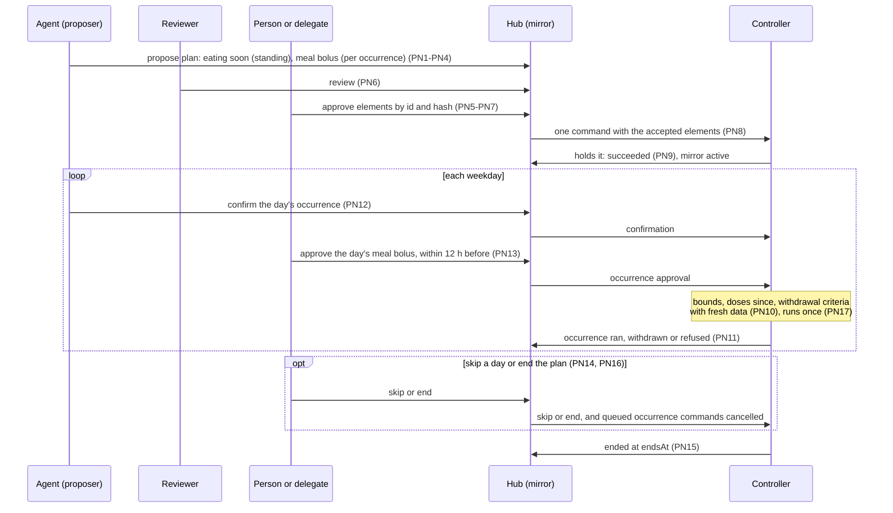

# L3 and L5 Plans: how a plan is proposed, approved in parts, held by the controller and mirrored by the hub

*Contributor-facing. Living specification, current at `main` `b081a15c` (2026-10-18). Layers L3
and L5 of the [platform index](../README.md); terms are in the [glossary](glossary.md). Decisions:
[D18 and D19](../../tenancy/nightscout-multitenancy-execution-plan-2026-09-14.md#261-d18--two-tier-controller-registration)
and the maintainer's answers of 2026-10-18 recorded in the
[command queue and planning note](../command-queue-and-planning-2026-10-18.md#5-decided-and-open).
Queue: `SPEC-PLANS`.*

*Specification 6 of 8 in the [reading order](../README.md#reading-order); after commands, whose
proposals, approvals, commands and outcomes it builds on, and before sync-transport. Expect what a
plan is, rules PN1–PN18 for the plan object, its approval, the controller's hold and the hub's
mirror, occurrences and ending, compatibility, open items, and the conformance cases.*

A plan is a recurring intent with its trigger, bounds and end date, approved once and run by the
controller: eating soon before a weekday lunch, a temporary target before a calendar's exercise,
a week of school overrides. It moves a decision from the moment to the morning or the week. The
controller holds and runs the plan; the hub records the proposal, the approval and what the
controller reports, and keeps a read-only mirror of the plan and its occurrences. The hub never
schedules an occurrence, never decides whether one runs, and never doses (D18).

Status: proposed and specified with cases; none is implemented. The risk classes, floors and
windows follow [evidence-weighted approval](../evidence-weighted-approval-2026-10-18.md), a draft
that needs review by a qualified clinician before any of it is relied on.

## 1. Files

| file | holds |
|---|---|
| `tools/nsschema/plans.py` | the reference decision function, built on `commands.py` |
| `tools/nsschema/test_plans.py` | checks every case and the invariants in §10 |
| `specs/sync/conformance/plans/` | hand-authored cases and `FORMAT.md` |
| [commands](commands.md) | proposals (CM11–CM16, CM22), commands and outcomes (CM1–CM10, CM21, CM23–CM25) that plans use |
| [evidence-weighted approval](../evidence-weighted-approval-2026-10-18.md) | risk classes R0–R6, floors FL1–FL8, the approval paths |

## 2. What a plan is

A plan has four levels of decision, and each has its own party and its own check:

| level | horizon | who acts | what it does here |
|---|---|---|---|
| policy | days to weeks | a proposer (often an agent), reviewers, the person or a delegate | proposes, reviews and approves the plan, in parts (§4) |
| confirmation | hours | the proposer under the plan's grant; the person | confirms, approves, skips one occurrence (§6) |
| moment | minutes | the person, a caregiver | ordinary commands (commands §4) |
| algorithm | five minutes | the controller | runs each occurrence within its bounds after its own checks |

One controller instance, the destination, holds the plan and is the only thing that acts on the
pump. Agents, reviewers, a delegate and the person all work on the same plan record.

A plan's life, for a weekday lunch with an eating-soon target that runs on the plan's approval
and a meal bolus approved each day:

## 3. The plan object (proposed)

| # | rule |
|---|---|
| PN1 | **A plan is a proposal.** A plan is proposed as a proposal (CM11, CM12) whose `kind` is `plan`, which names its `product` (422 `product-required`) and whose payload has `elements`, a `trigger`, `startsAt`, `endsAt` and `requiredReviews`. It is routed when made (commands §2) on the channel the product declares for plans, and the destination's `definitionId` is recorded. Its own open time is bounded by the operator's `plans.maxProposalSeconds`, not by `commands.maxExpirySeconds`, so a plan proposed for review at a visit weeks away can stay open; beyond it the proposal is refused 422 `expiry-too-long`, as CM3 refuses a command. |
| PN2 | **Elements.** Each element has an `id` unique in the plan, a `kind` (PN3 says how an undeclared kind is classed), the `channel` it acts on, its `content` and its `path`: `standing` (runs on the plan's approval) or `per-occurrence` (each occurrence needs its own approval, §6). Each element's hash is `sha256:` over the canonical JSON of the element (CM1's rule), and the proposal's `payloadHash` covers the whole plan. |
| PN3 | **Risk class comes from the definition.** The destination's definition declares a risk class per element kind, R0 (inform) to R6 (safety limits), as [evidence-weighted approval §2](../evidence-weighted-approval-2026-10-18.md#2-axis-1-risk-class-draft-for-clinical-review) defines them. A kind with no declared class is R4. The hub reads the class; it never derives one from the content (CM5). |
| PN4 | **Structural floors at proposal.** After the proposer's checks (CM12) and before routing, a proposal is refused 422, with nothing recorded, when: an element id repeats or there are none (`invalid-plan`); an element is R6 (`local-only`); an R5 element is `standing` (`standing-not-allowed`); an R3 or R4 element is `standing` without `standingConditions` naming at least one withdrawal criterion, each with its `signal` and `evaluatedBy` (`controller` or `agent`), the mitigation `reduced-portion`, and a `companion` element of the plan, the eating-soon target the reduced portion goes with (`standing-conditions-required`); a `standing` R3 element is in a plan with no `standing` R4 element (`standing-carbs-without-insulin`, FL2); `endsAt` is missing or not after `startsAt` (`ends-required`); or `endsAt` is more than the operator's `plans.maxPlanSeconds` after `startsAt` (`plan-too-long`). The hub checks that the conditions are declared; the controller checks that they hold (PN10). FL1's other choice, a human approval of each occurrence within the 12 hours before, is the `per-occurrence` path (PN13), so a `standing` insulin element always carries the reduced portion. After routing, an element whose channel has a command-sink holder other than the destination is 409 `element-destination-differs`: the plan's elements act through the one controller that holds the plan. |

## 4. Approving a plan (proposed)

| # | rule |
|---|---|
| PN5 | **An approval accepts elements.** An approval of a plan names each accepted element by `id` and hash. An approval that accepts nothing is 422 `nothing-accepted`; an id the plan does not have is 422 `unknown-element`; a hash that differs from the element's is 409 `hash-mismatch`. The elements not named are recorded as declined. An approval closes the proposal: accepting a declined element later is a new proposal. |
| PN6 | **Who approves, and what must be attached first.** CM14 applies: an agent's proposal is never approved by the subject that proposed it. An approval that accepts an R3 or higher element comes from the subject marked as the person or a delegate acting for them (FL5), never from an agent's credential, else 403 `not-person-or-delegate`. A review counts when an evaluation (CM16) names it and comes from a subject other than the proposer. Each review named in `requiredReviews` must have been attached, and a plan that accepts an R3 or higher element needs at least one review whatever `requiredReviews` says (the framework's reviews-then-approve path); else 409 `review-required`. Whether two agents run by one operator are independent of each other is open (§9). |
| PN7 | **What the approval checks.** In this order: the approver (CM14 and PN6, 403); `nothing-accepted` and `unknown-element` (422); PN4's floors over the accepted elements alone (422), so an approval that keeps standing carbs while declining the standing insulin is `standing-carbs-without-insulin`, and one that accepts standing insulin without its companion is `companion-declined`; the proposal's state (CM13: `proposal-expired`, `proposal-closed`); `hash-mismatch` (PN5); the reviews (PN6); routing again, 409 `destination-changed` when the holder changed (CM13); 409 `definition-changed` when the destination's `definitionId` differs from the one recorded at the proposal; and 409 `state-changed` when the state version of any accepted element's channel differs from the plan's `basedOn` for that channel; a channel missing from `basedOn` differs unless the channel has no state version. `basedOn` for a plan is a map from channel to the channel's state version, the part of [A12](state-intent.md#61-rules) on that channel, so an unrelated override does not stale a plan. CM22's doses check does not apply to a plan; doses are checked at each occurrence by the controller (PN10). |
| PN8 | **An accepted plan becomes one command.** The command's payload is the plan with only the accepted elements, and its `payloadHash` is the hash of that payload, which the controller checks (CM10) and decides once (CM21). As CM13 says of any approval, the command carries the plan's `proposalId`. It expires at `endsAt` or `commands.maxExpirySeconds` after the approval, whichever is sooner. The hub records the plan's mirror (PN11) in state `approved`, with the accepted and declined elements. The replies to plan operations (PN8, PN12–PN14, PN16) do not carry CM24's outstanding list; the mirror shows the plan's occurrences, and PN18 lists them on each element's channel. |

## 5. The controller holds the plan; the hub mirrors it (proposed)

| # | rule |
|---|---|
| PN9 | **The controller decides whether to hold it.** On the plan's command the controller validates the plan against its own limits and definitions, and reports `succeeded` when it holds the plan, or `refused` or `failed` with a reason (CM7, CM8). The mirror becomes `active`, or `refused` for either refusal, from that report. A plan command handed over and then `unconfirmed` (CM3) leaves the mirror `approved`, because the controller may hold the plan. |
| PN10 | **The controller runs each occurrence.** At each occurrence the controller applies its own checks: the bounds of each element, the doses and carbs since (CM23), the plan's withdrawal criteria with data it judges fresh, and, for a `standing` R3 or R4 element, the declared mitigation. An occurrence whose criteria cannot be evaluated with fresh data does not run. The hub schedules nothing and sends nothing at an occurrence's time. |
| PN11 | **The mirror.** The hub keeps, per plan, its state (`approved`, `active`, `refused`, `ending`, `ended`), its accepted and declined elements, and its occurrences, each keyed by the controller's occurrence key with a state: `confirmed`, `approved`, `skip-requested` (set by the hub, §6), and `ran`, `withdrawn`, `skipped`, `refused`, `missed` (reported by the controller, with a reason where one applies, and for `ran` the identity of the intent or record that shows it). The states the controller owns move only on its reports; the hub sets only what it was asked (`skip-requested`, `ending`). Only the destination's bound subject reports (CM7: anyone else is 403 `not-registration-owner`). A report on a plan the controller may hold (`approved`, `active`, `ending`) is accepted, and on an `approved` plan it also shows the controller holds it, so the mirror becomes `active`; on a plan that is `refused` or `ended` it is 409 `plan-not-active`. Anyone who may read the outstanding list (CM24) may read the mirror, which lists `occurrences` even when there are none; anyone else is 403 `not-authorised`. |

The mirror's states. Each state the controller owns moves only on its reports; the hub sets
`ending` when it is asked to end the plan.

```mermaid
stateDiagram-v2
  accTitle: Plan mirror states
  accDescr: An approved plan's mirror becomes active when the controller reports holding it, or refused when the controller refuses or fails the plan command. The person, the approver or the proposer can end a plan that is approved, active or ending; ending again re-sends the end. The mirror becomes ended when the controller reports the end, either after an end request or at endsAt.
  [*] --> approved: approval accepted (PN8)
  approved --> active: controller holds it (PN9, PN11)
  approved --> refused: refused or failed (PN9)
  approved --> ending: end requested (PN16)
  active --> ending: end requested (PN16)
  ending --> ending: end sent again (PN16)
  active --> ended: reported at endsAt (PN15)
  ending --> ended: reported (PN16)
  refused --> [*]
  ended --> [*]
```

## 6. Occurrences (proposed)

| # | rule |
|---|---|
| PN12 | **The plan is its proposer's grant to confirm.** While the mirror is `active` and before `endsAt`, the plan's proposer, from its proposing instance, may confirm an occurrence: the hub records it and sends the controller a command naming the plan and the occurrence, expiring at the occurrence's time. A confirmation is evidence that the occasion is happening; it never releases a dose by itself (FL5), and the controller still applies PN10. The checks, in order: another subject or instance is 403 `outside-grant`; a proposer that no longer holds `api:proposals:create` or its propose role on the plan channel (CM12) is 403 `role-not-granted`; a plan that is not `active` is 409 `plan-not-active`; at or past `endsAt`, 409 `plan-ended`; an occurrence time outside `startsAt` to `endsAt` is 409 `occurrence-outside-plan`; more than `plans.maxAdvanceApprovalSeconds` ahead, 409 `too-early`; at or after the occurrence time, 409 `occurrence-passed`; and an occurrence that is `skip-requested` or reported finished (`ran`, `withdrawn`, `skipped`, `refused`, `missed`) is 409 `occurrence-closed`. |
| PN13 | **A per-occurrence element needs an approval per occurrence.** A `per-occurrence` element runs only on an approval of that occurrence, which names the plan, the occurrence key, its time, the element and its hash. The approver holds `api:commands:create` (403 `not-authorised`) and follows CM14; an R3 or higher element is approved by the person or a delegate (403 `not-person-or-delegate`), and an R5 element by the person (403 `person-required`, FL3). Then, in order: the plan is `active` and before `endsAt` (PN12's 409s); the element is `per-occurrence` and accepted, else 409 `not-per-occurrence`; its hash, else 409 `hash-mismatch`; and PN12's occurrence checks, so the approval is accepted from exactly `plans.maxAdvanceApprovalSeconds` before the occurrence (12 hours, pending clinical review) until the occurrence's time, on an occurrence not closed. An accepted approval sends the controller a command for that occurrence and element, expiring at the occurrence's time, as a confirmation's does. |
| PN14 | **Skipping an occurrence.** The person (CM14), the plan's approver, or its proposer from its proposing instance (an agent whose live data contradicts the occasion withdraws it this way) may skip an occurrence while the plan is `approved` or `active` and before `endsAt`; anyone else is 403 `not-authorised`, a plan in another state 409 `plan-not-active`, at or past `endsAt` 409 `plan-ended`, and an occurrence already closed 409 `occurrence-closed`. The hub sets it `skip-requested`, cancels the occurrence's queued confirmation and approval commands as CM25 does (final before hand-over, a request after), and sends the controller a skip command expiring `commands.maxExpirySeconds` after the request; the controller reports `skipped`, or `ran` if it had already run. |

An occurrence's states. The hub records `confirmed`, `approved` and `skip-requested` as it is
asked; the controller reports how the occurrence finished, and a finished occurrence takes no
further confirmation or approval.

```mermaid
stateDiagram-v2
  accTitle: Occurrence states
  accDescr: An occurrence is confirmed by the proposer or approved by the person or a delegate, in either order, or skipped. A skip cancels what was queued for the occurrence. The controller reports how it finished: ran, withdrawn, skipped, refused or missed; a skip request ends as skipped, or ran if the controller had already run it. A finished occurrence is closed.
  state "skip-requested" as skip
  state "finished, reported by the controller" as finished {
    ran
    withdrawn
    skipped
    refused
    missed
  }
  state open {
    [*] --> confirmed: proposer confirms (PN12)
    [*] --> approved: person or delegate approves (PN13)
    confirmed --> approved: approved (PN13)
  }
  [*] --> open
  [*] --> skip: skipped (PN14)
  open --> skip: skipped (PN14)
  open --> finished: controller reports (PN11)
  skip --> finished: skipped, or ran if it already had (PN14)
  finished --> [*]: closed (PN12)
```

## 7. Ending a plan (proposed)

| # | rule |
|---|---|
| PN15 | **The controller ends a plan at `endsAt`.** It reports `ended`, and no occurrence runs after `endsAt`. The hub never extends a plan; a longer plan is a new proposal. |
| PN16 | **The person can end a plan at any time.** The person, the plan's approver, or its proposer from its proposing instance may end a plan the controller may hold (`approved`, `active` or `ending`): the mirror becomes `ending`, the plan's queued occurrence commands are cancelled as CM25 cancels, and the controller receives an end command expiring `commands.maxExpirySeconds` after the request, then reports `ended`. Ending a plan that is already `ending` sends the end command again, for an end that was lost. An end command is never cancelled (409 `not-cancellable`). A plan that is `refused` or `ended` is 409 `plan-not-active`; anyone else is 403 `not-authorised`. A confirmation or an occurrence approval for a plan that is `ending` or `ended` is 409 `plan-not-active`. |
| PN17 | **An occurrence runs once.** The controller runs each occurrence key at most once, whatever confirmations and approvals arrive for it (CM21), and reports one finished state for it. |
| PN18 | **Occurrence commands are listed where they act.** CM24's outstanding list for a channel includes each queued occurrence command of a plan with an accepted element on that channel, as well as the plan channel's own commands, so a caregiver looking at the bolus channel sees a plan's pending bolus. |

## 8. Compatibility

Per app: [compatibility](compatibility.md) L3.

No released controller holds a plan from a hub. The nearest precedent runs on the controller:
AndroidAPS's automation plugin (`dev` `7e1d537d49`) triggers on recurring time, location, Wi-Fi
network, steps and heart rate, and acts with a temporary target, a profile percentage, scenes, a
notification or an SMS, and with no bolus or carb action. A plan under PN1–PN18 is the hub-side
record of such a rule when it is proposed or approved away from the phone.

| | older hub | newer hub |
|---|---|---|
| **older controller** | no plans | the product declares no plan channel, so a plan proposal is refused at routing (commands §2) |
| **newer controller** | no `plans` member in the capability document: the controller keeps its rules local and sends no mirror reports | PN1–PN18 |

## 9. Open

1. **Values for clinical review:** `plans.maxAdvanceApprovalSeconds` (12 hours), the risk class of
   each element kind, which withdrawal signals suffice and how fresh their data must be, and the
   reduced portion ([evidence-weighted approval §9](../evidence-weighted-approval-2026-10-18.md#9-what-the-clinical-review-checks)).
2. **The approval paths that depend on evidence** (notify, cancel window) for R0–R2 occurrences:
   PN12 and PN13 cover confirmation and approval; the lighter paths wait for evidence classes on
   evaluations (CM16).
3. **The trigger grammar.** PN1 names `trigger`; recurrence, local time and time zones, and
   conditions on location or activity are not specified, and the hub stores them unread.
4. **Where withdrawal criteria are evaluated** when both the controller and an agent can, and
   whether both must agree.
5. **Approver signatures** over the accepted elements, which let a controller detect a hub that
   built the wrong subset ([partial acceptance](../partial-acceptance-prototype-2026-10-18.md)).
6. **The plan channel** a product declares, and the capability document member that says a hub
   serves plans.
7. **Independence of reviews:** whether a review by a second agent run by the same person or
   operator counts toward PN6 (UCA-PLAN-010 in the [control-loop analysis](control-loops.md)).
8. **Doses since, for an occurrence approval:** CM24's list shows doses since the earliest
   outstanding item; whether an occurrence approval returns the doses since the previous
   occurrence.
9. **Required reviews per occurrence** for R5 and for R3–R4 occurrences with weak evidence
   (FL3, the framework's reviews-then-approve path).
10. **Not specified:** an adjusted plan replacing one the controller holds (journey PL3.3); several
    plans active on one channel at once; occurrence reports for elements not accepted or dated
    after `endsAt`; a maximum plan length per risk class, for clinical review; a field on an
    intent naming the plan and occurrence that started it (FB-PLAN-004).

## 10. Conformance cases

PN10 and PN17 have no case: they are the controller's, and the hub has nothing to refuse.

Checked by `tools/nsschema/test_plans.py` against `tools/nsschema/plans.py`, which also checks on
every case that no command carries a declined element; each command was made at the time of the
call that named it (the hub schedules nothing); every element a command carries is the proposed
element, byte for byte, and a plan command's hash is the hash of what it carries; every accepted
standing R3 or R4 element carries its withdrawal criteria, mitigation and an accepted companion,
and standing carbs come with standing insulin; a plan or occurrence approval at R3 or higher comes
from the person or a delegate, and at R5 from the person; occurrence operations happen only while
the controller holds the plan; an occurrence approval falls inside its window and never comes from
the agent that proposed the plan; and nothing is confirmed or approved for an occurrence after it
was skipped.

104 cases.

<!-- BEGIN GENERATED: plans-cases (tools/nsschema/spec_cases.py) -->
| case | shows | expected | control |
|---|---|---|---|
| `plans/approve-carbs-with-insulin` | Standing carbs are accepted with standing insulin and their companion | rules PN4, PN5 | `approve-drops-insulin-keeps-carbs` |
| `plans/approve-checks-approver-before-elements` | The approver is checked before the accepted elements | rules PN7, CM14 | `plan-proposed-and-approved` |
| `plans/approve-declined-element-later-closed` | A declined element cannot be accepted by a second approval | rules PN5, CM13 |  |
| `plans/approve-drops-insulin-keeps-carbs` | An approval cannot keep standing carbs while declining the standing insulin | rules PN4, PN5 | `approve-carbs-with-insulin` |
| `plans/approve-element-hash-mismatch` | An approval naming the wrong hash for an element is refused | rules PN5 | `approve-one-of-two-elements` |
| `plans/approve-elements-before-proposal-state` | nothing-accepted is checked before the proposal's expiry | rules PN7 | `plan-approve-after-proposal-expiry` |
| `plans/approve-insulin-without-companion` | Standing insulin cannot be accepted without its eating-soon companion | rules PN4, PN5 | `approve-carbs-with-insulin` |
| `plans/approve-nothing-accepted` | An approval that accepts nothing is refused | rules PN5 | `approve-one-of-two-elements` |
| `plans/approve-occurrence-after-skip` | An occurrence that was skipped cannot be approved | rules PN13, PN14 | `approve-occurrence-within-window` |
| `plans/approve-occurrence-at-window-start` | An occurrence approval exactly maxAdvanceApprovalSeconds before is accepted | rules PN13 |  |
| `plans/approve-occurrence-before-active` | An occurrence approval before the plan is active is refused | rules PN13 | `approve-occurrence-within-window` |
| `plans/approve-occurrence-by-agent-proposer` | The agent that proposed the plan cannot approve an occurrence | rules PN13, CM14 | `approve-occurrence-within-window` |
| `plans/approve-occurrence-by-agent-subject` | An agent's credential cannot approve an insulin occurrence | rules PN13 | `approve-occurrence-within-window` |
| `plans/approve-occurrence-by-follower` | A follower cannot approve an occurrence | rules PN13 | `approve-occurrence-within-window` |
| `plans/approve-occurrence-declined-element` | A declined element has no occurrence approval | rules PN13 | `approve-occurrence-within-window` |
| `plans/approve-occurrence-hash-mismatch` | An occurrence approval naming the wrong hash is refused | rules PN13 | `approve-occurrence-within-window` |
| `plans/approve-occurrence-passed` | An occurrence approval at the occurrence's time is refused | rules PN13 | `approve-occurrence-within-window` |
| `plans/approve-occurrence-standing-element` | A standing element has no occurrence approval | rules PN13 | `approve-occurrence-within-window` |
| `plans/approve-occurrence-too-early` | An occurrence approval before the window is refused | rules PN13 | `approve-occurrence-at-window-start` |
| `plans/approve-occurrence-within-window` | An occurrence approval within the window is accepted | rules PN13 |  |
| `plans/approve-one-of-two-elements` | An approval accepts one element and the other is declined | rules PN5, PN8 |  |
| `plans/approve-own-agent-plan-refused` | An agent cannot approve the plan it proposed | rules PN6, CM14 | `plan-proposed-and-approved` |
| `plans/approve-plan-based-on-missing-channel` | A basedOn without an accepted element's channel is stale | rules PN7 | `plan-proposed-and-approved` |
| `plans/approve-plan-by-agent-subject` | An agent's credential cannot approve a plan with an insulin element | rules PN6 | `plan-proposed-and-approved` |
| `plans/approve-plan-definition-changed` | A plan approved after the destination renewed under a new definition is refused | rules PN7 | `approve-plan-definition-unchanged` |
| `plans/approve-plan-definition-unchanged` | A renewal after the approval does not affect it | rules PN7 |  |
| `plans/approve-plan-destination-changed` | A plan approved after the plan channel passed to another instance is refused | rules PN7, CM13 | `plan-proposed-and-approved` |
| `plans/approve-plan-doses-since-not-checked` | CM22's doses check does not apply to a plan | rules PN7 |  |
| `plans/approve-plan-other-channel-override` | A channel outside the plan changing does not stale it | rules PN7 |  |
| `plans/approve-plan-state-changed` | A plan whose accepted element's channel moved is refused | rules PN7 | `approve-plan-unrelated-channel-changed` |
| `plans/approve-plan-unrelated-channel-changed` | A change on a channel no accepted element acts on does not stale the plan | rules PN7, PN5 |  |
| `plans/approve-r1-only-by-any-approver` | A plan accepted only for its R1 element needs no review and no person or delegate | rules PN6, PN5 | `approve-plan-by-agent-subject` |
| `plans/approve-r4-without-any-review` | A plan with an insulin element needs at least one independent review | rules PN6 | `plan-proposed-and-approved` |
| `plans/approve-r5-occurrence-by-delegate` | A persistent settings occurrence needs the person's own approval | rules PN13 | `approve-r5-occurrence-by-person` |
| `plans/approve-r5-occurrence-by-person` | The person approves a persistent settings occurrence | rules PN13 | `approve-r5-occurrence-by-delegate` |
| `plans/approve-review-by-other-subject` | A review by another subject satisfies requiredReviews | rules PN6, CM16 |  |
| `plans/approve-review-by-proposer-not-counted` | A review by the proposer does not count | rules PN6, CM16 | `approve-review-by-other-subject` |
| `plans/approve-review-missing` | An approval before a required review is refused | rules PN6 | `approve-review-by-other-subject` |
| `plans/approve-review-other-name-not-counted` | A review under another name does not count | rules PN6 | `approve-review-by-other-subject` |
| `plans/approve-unknown-element` | An approval naming an element the plan lacks is refused | rules PN5 | `approve-one-of-two-elements` |
| `plans/cancel-end-command-refused` | An end command cannot be cancelled | rules PN16, CM25 | `end-plan-by-person` |
| `plans/confirm-after-controller-ended` | A confirmation after the controller ended the plan is refused | rules PN15, PN12 | `confirm-before-ends` |
| `plans/confirm-after-role-lost` | A proposer that lost its propose role cannot confirm | rules PN12, CM12 | `confirm-by-proposer` |
| `plans/confirm-at-ends` | A confirmation at endsAt is refused | rules PN12 | `confirm-before-ends` |
| `plans/confirm-before-active` | A confirmation before the controller holds the plan is refused | rules PN12 | `confirm-by-proposer` |
| `plans/confirm-before-ends` | A confirmation one second before endsAt is accepted | rules PN12 |  |
| `plans/confirm-by-other-subject` | Only the proposer may confirm | rules PN12 | `confirm-by-proposer` |
| `plans/confirm-by-proposer` | The proposer confirms an occurrence from its proposing instance | rules PN12 |  |
| `plans/confirm-from-other-instance` | The proposer must confirm from the proposing instance | rules PN12 | `confirm-by-proposer` |
| `plans/confirm-occurrence-outside-plan` | A confirmation for an occurrence after endsAt is refused | rules PN12 | `confirm-by-proposer` |
| `plans/confirm-other-subject-before-active` | Who may confirm is checked before the plan's state | rules PN12 | `confirm-by-proposer` |
| `plans/confirm-too-early` | A confirmation more than the advance window before its occurrence is refused | rules PN12 | `confirm-by-proposer` |
| `plans/end-cancels-pending-confirmation` | Ending a plan cancels its pending occurrence commands | rules PN16, CM25 | `end-plan-by-person` |
| `plans/end-plan-by-approver-then-approve-occurrence` | The approver ends a plan; an occurrence approval while ending is refused | rules PN16, PN13 | `approve-occurrence-within-window` |
| `plans/end-plan-by-other-subject` | Neither the person nor the approver: ending is refused | rules PN16 | `end-plan-by-person` |
| `plans/end-plan-by-person` | The person ends a plan; the controller reports ended; confirmations stop | rules PN16, PN12 | `end-plan-by-other-subject` |
| `plans/end-plan-twice` | Ending a plan that is already ending sends the end again | rules PN16 | `end-plan-by-person` |
| `plans/end-unconfirmed-plan` | The person ends a plan whose command was handed over and never reported | rules PN16 | `end-plan-by-person` |
| `plans/outstanding-lists-occurrence-on-element-channel` | An occurrence command is listed under the channels its plan acts on | rules PN8, CM24 |  |
| `plans/plan-approve-after-proposal-expiry` | A plan approved after its proposal expired is refused | rules PN1, PN7, CM13 | `plan-proposed-and-approved` |
| `plans/plan-at-max-length` | A plan exactly plans.maxPlanSeconds long is accepted | rules PN4 |  |
| `plans/plan-command-expires-at-ends` | The plan command expires at endsAt when that is sooner | rules PN8 | `plan-proposed-and-approved` |
| `plans/plan-duplicate-element-ids` | Element ids repeat: invalid-plan | rules PN2, PN4 | `plan-proposed-and-approved` |
| `plans/plan-element-held-by-destination` | A plan whose element channels the destination holds is accepted | rules PN4 | `plan-element-held-by-other-instance` |
| `plans/plan-element-held-by-other-instance` | A plan whose element channel another instance holds is refused | rules PN4 | `plan-element-held-by-destination` |
| `plans/plan-ended-by-controller` | The controller ends the plan at endsAt; later reports are refused | rules PN15, PN11 | `plan-report-occurrence-ran` |
| `plans/plan-ends-at-start` | endsAt must be after startsAt | rules PN4 | `plan-at-max-length` |
| `plans/plan-ends-missing` | A plan without endsAt is refused | rules PN4 | `plan-proposed-and-approved` |
| `plans/plan-failed-report-refuses-plan` | A failed plan command leaves the plan refused | rules PN9 | `plan-held-active` |
| `plans/plan-floor-before-routing` | The floors are checked before routing | rules PN4 | `plan-older-controller-no-plan-channel` |
| `plans/plan-held-active` | The controller holds the plan and the mirror becomes active | rules PN9, PN11 |  |
| `plans/plan-no-elements` | A plan with no elements: invalid-plan | rules PN2, PN4 | `plan-proposed-and-approved` |
| `plans/plan-older-controller-no-plan-channel` | A plan for a product that declares no plan channel is refused at routing | rules PN1 | `plan-proposed-and-approved` |
| `plans/plan-product-required` | A plan proposal must name its product | rules PN1 | `plan-proposed-and-approved` |
| `plans/plan-proposal-expiry-too-long` | A plan proposal open beyond plans.maxProposalSeconds is refused | rules PN1, CM3 | `plan-proposal-open-past-command-expiry` |
| `plans/plan-proposal-open-past-command-expiry` | A plan proposal may stay open longer than a command may | rules PN1 |  |
| `plans/plan-proposed-and-approved` | A plan is proposed, approved whole and mirrored as approved | rules PN1, PN5, PN8, PN11 |  |
| `plans/plan-r3-standing-agent-evaluated` | Standing carbs beside standing insulin, with agent-evaluated withdrawal, are accepted | rules PN4 | `plan-standing-carbs-alone` |
| `plans/plan-r3-withdrawal-without-evaluator` | Each withdrawal criterion names who evaluates it | rules PN4 | `plan-r3-standing-agent-evaluated` |
| `plans/plan-r4-standing-empty-withdrawal` | A standing R4 element needs at least one withdrawal criterion | rules PN4 | `plan-r4-standing-with-conditions` |
| `plans/plan-r4-standing-with-conditions` | A standing R4 element with its conditions is accepted | rules PN4 |  |
| `plans/plan-r4-standing-without-conditions` | A standing R4 element needs standing conditions | rules PN4 | `plan-r4-standing-with-conditions` |
| `plans/plan-r4-standing-without-mitigation` | A standing R4 element needs the reduced-portion mitigation | rules PN4 | `plan-r4-standing-with-conditions` |
| `plans/plan-r5-per-occurrence-accepted` | An R5 element per occurrence is accepted | rules PN4 | `plan-r5-standing-refused` |
| `plans/plan-r5-standing-refused` | An R5 element cannot be standing | rules PN4 | `plan-r5-per-occurrence-accepted` |
| `plans/plan-r6-element-local-only` | An R6 element cannot be in a hub plan | rules PN3, PN4 | `plan-proposed-and-approved` |
| `plans/plan-read-with-proposals-read` | A reader with api:proposals:read reads the mirror | rules PN11 | `plan-read-without-permission` |
| `plans/plan-read-without-permission` | Reading the mirror needs a permission that reads the queue | rules PN11, CM24 | `plan-held-active` |
| `plans/plan-refused-by-controller` | A plan the controller refuses is mirrored refused | rules PN9 | `plan-held-active` |
| `plans/plan-report-before-active` | A controller report on an approved plan shows that the controller holds it | rules PN11 | `plan-report-occurrence-ran` |
| `plans/plan-report-by-other-subject` | Only the destination's subject reports on a plan | rules PN11, CM7 | `plan-report-occurrence-ran` |
| `plans/plan-report-occurrence-ran` | The controller reports an occurrence ran | rules PN11 |  |
| `plans/plan-report-on-refused-plan` | A report on a plan the controller refused is refused | rules PN11, PN9 | `plan-report-occurrence-ran` |
| `plans/plan-standing-carbs-alone` | A standing carbs element without standing insulin is refused | rules PN4 | `plan-r3-standing-agent-evaluated` |
| `plans/plan-too-long` | A plan longer than plans.maxPlanSeconds is refused | rules PN4 | `plan-at-max-length` |
| `plans/plan-undeclared-kind-is-r4` | A kind with no declared risk class is treated as R4 | rules PN3, PN4 | `plan-undeclared-kind-with-conditions` |
| `plans/plan-undeclared-kind-with-conditions` | An undeclared kind standing with R4's conditions is accepted | rules PN3, PN4 |  |
| `plans/skip-by-approver` | The plan's approver skips an occurrence | rules PN14 |  |
| `plans/skip-by-other-subject` | Neither the person nor the approver: a skip is refused | rules PN14 | `skip-by-approver` |
| `plans/skip-by-person` | The person skips an occurrence | rules PN14 |  |
| `plans/skip-by-proposer` | The proposing agent withdraws an occurrence its live data contradicts | rules PN14 | `skip-by-other-subject` |
| `plans/skip-cancels-pending-confirmation` | Skipping an occurrence cancels its pending confirmation | rules PN14, CM25 | `confirm-by-proposer` |
| `plans/skip-command-expires` | A skip command expires after the command limit | rules PN14 | `skip-by-person` |
| `plans/skip-then-controller-reports-skipped` | The controller reports the skipped occurrence | rules PN14, PN11 |  |
<!-- END GENERATED: plans-cases -->
