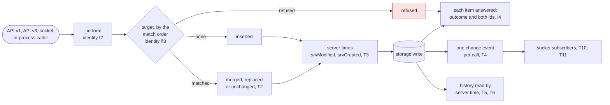

# L4 Sync transport: how writes are matched, ordered and delivered over REST and the socket, and at what cost

*Contributor-facing. Living specification, current at `main` `df621fa7` (2026-10-18). Layer L4 of
the [platform index](../README.md); terms are in the [glossary](glossary.md); how a re-send is
matched is in the [identity specification](identity.md) §3. Decisions: the
[write contract's §6.1](../../tenancy/write-contract-spec-2026-10-07.md#61-decided-2026-10-12)
(2026-10-12) and [D6](../../tenancy/nightscout-multitenancy-execution-plan-2026-09-14.md#1-decisions)
(the change feed under multi). Queue: `SPEC-SYNC-TRANSPORT`.*

*Specification 7 of 8 in the [reading order](../README.md#reading-order); after the layers whose records it moves, before authority. Expect the decided write path (T1–T4), each client's declared sync endpoints, the proposed read, cursor and socket rules (T5–T16), and the conformance cases.*

How writes are applied, ordered and delivered, over REST and the socket, and what a client pays to
stay in sync. Status: the write path is decided, except re-sends of `devicestatus` (T2), and T3 is on `dev`;
§3 is evidenced; §4–§6 are
proposed, and §4 is specified with cases. §2 is the write path, with each rule's status; §3 is what each client's sync code
can call, read from its source; §4–§6 are proposed and specified with cases where a rule can be
checked by one.

## 1. Files

| file | what it is |
|---|---|
| [write contract](../../tenancy/write-contract-spec-2026-10-07.md) | the measured write matrix, the write step and the re-send rule this page states as rules |
| `tools/nsschema/sync_cost.py` | `make schema-sync-cost`: distinct endpoints each client's sync path can call, from its own source |
| `tools/nsschema/sync_cursor.py` | reference decision function for the cursor rules (§4); it checks the cases and is not a hub |
| `specs/sync/conformance/sync-transport/` | 13 synthetic cases (§9) |

## 2. The write path

| # | rule | status |
|---|---|---|
| T1 | **One write step.** Every path that writes (API v1, API v3, the socket, in-process callers such as nightscout-connect) writes through one step, which decides per item, in order: the `_id` form, the target (identity §3), the outcome (`inserted`, `merged`, `replaced`, `unchanged`, `deleted`, `not-found`, `refused`), the server dates, the storage write, and then one change event for the call. Each item is answered with its outcome and both ids (identity I4). | specified (`WRITE-CONTRACT`, blocked) |
| T2 | **Re-send outcomes.** For treatments, entries, profile, food and activity, a re-send that matches a stored record merges into it; an explicit update (v1 `PUT`, v3 `PUT`) replaces. **A `null` in an update removes the field** (JSON Merge Patch, RFC 7386, recursive, arrays replaced whole) on a merge on match, on an API v3 `PATCH` and on the socket's `dbUpdate`, which follows `PATCH`; never on a replace (v1 or v3 `PUT`) or on any create, which store a `null` as sent. On API v1 it runs after `prepareData`; `dbUpdateUnset` stays (identity §3). An identical re-send keeps each path's behaviour today: rewritten on API v1, v3 and in-process, answered unchanged on the socket. For devicestatus, a re-send whose `identifier` is already stored writes nothing (no merge, no new record, no `srvModified` change) and is answered with the stored `_id`, on API v1 and v3 (decided 2026-10-26); a re-send with the same `created_at` and `device` is a retry only when its body is identical, answered unchanged; a differing body is a new record. The socket keeps its ±2 s similar-treatment match as an explicit option. `activity` gets server dates and soft delete like the other collections. The step ships first with today's behaviour pinned (a patch), then these changes (a minor). | decided 2026-10-12; devicestatus reopened the same day, because Loop writes distinct statuses that share `created_at` and `device`; the `null` rule and its scope decided 2026-10-26, for 16.0.0 (write contract Q1b) |
| T3 | **Server write times.** `srvModified` and `srvCreated` are the server's, in milliseconds since the epoch, set on every write to a collection API v3 serves, by any path; a value a client sends is replaced. Within one process every `srvModified` is unique and never goes backwards, even when the clock does, and boot restores the clock from stored records before any writer starts. A hard delete leaves no `srvModified`, so history does not show it; a soft delete does. | merged on `dev` (`lib/server/srv-dates.js`, `lib/api3/generic/create/insert.js:27` at `fade2299`, read) |
| T4 | **The change event.** One event per write call: the collection, the operation, the stored documents (or the removed ids), the largest `srvModified` among its records, and the origin. Under `TENANCY_MODE=multi` the event is read from the replication slot (D6), so every field but `runtime` and `origin` is derived from the committed row; how the slot reader groups one call's rows into one event is not specified. | specified (write contract §2.4) |

The write step, per item, as T1 orders it:

## 3. What each client's sync code can call

`make schema-sync-cost`, run 2026-10-18, counts the distinct endpoints each client's Nightscout
code declares, read from its source. It is not a count of calls per cycle: some endpoints are
called only on first load or on a user action, and AndroidAPS declares three that nothing outside
its SDK calls (`createSettings`, `patchSettings`, `getSettingsModifiedSince`, read 2026-10-18). The
units differ: AndroidAPS is counted by method and path, Loop and Trio by path alone, so their reads
and writes to one path count once.

| client (source read) | API | endpoints declared | watermark | delta read |
|---|---|---:|---|---|
| AndroidAPS `7e1d537d49` (dev; `core/nssdk/.../NightscoutApi.kt`) | v3 | 26 | yes | per collection |
| Loop: NightscoutKit `4ec9fd12a1` | v1 | 7 (one an authentication check) | no | no |
| Trio `0b29cd5341` | v1 | 5 | no | no |

What this shows is the shape, not a price: API v3 gives a client one delta read per collection, so
the client that uses v3 as designed reads each collection separately, and every typed collection
added to the model adds a read. T5 and T7 make one read and one write per cycle whatever the
number of collections. Request counts and payload sizes on the wire are not measured.

## 4. The sync read and write (proposed)

| # | rule |
|---|---|
| T5 | **One read across collections.** `GET /api/v3/history/{cursor}?collections=&limit=` answers `{cursor, complete, collections: {name: [records]}}` for every collection the credential may read (each checked as `api:<collection>:read`); a collection it may not read is left out. Per-collection `history` stays. |
| T6 | **The merged cursor.** A page returns records with `srvModified` above the cursor and at or below the low watermark (T9), up to a limit per collection, and never ends inside a group of records that share one `srvModified`. The cursor returned is the smallest last `srvModified` among the collections that were truncated, or the low watermark when none was; `complete` is true only when no collection was truncated. A client reads again from the returned cursor while `complete` is false. A record can come back twice across pages; the client keeps one (T10). |
| T7 | **One write across collections.** `POST /api/v3/batch` takes `[{collection, doc}]` and answers each item as T1 does; a batch is idempotent per record. |
| T8 | **One opaque cursor.** The sync cursor is opaque to clients. Under `single` it is a `srvModified` watermark; under `multi` it is the replication slot's position (D6), which is commit-ordered. An event cursor, if one is added, is the same cursor. |
| T9 | **A low watermark.** Over the collections the reader may read, the low watermark is one less than the smallest `srvModified` taken by a write not yet visible, or the largest value taken when none is in flight. A value is released when its write becomes visible or fails. No page returns a record above it and no cursor passes it, so a slow write is never skipped and a page cannot loop. The same rule applies to the per-collection history read. Under `single` the hub tracks the values it has taken and not yet stored; under `multi` the slot's position gives this. Computing it over readable collections only keeps a reader from learning when collections it cannot read were written. |
| T10 | **The socket is the fast path; history is the record.** A socket event delivers a record; it never moves the client's history cursor. The client reads history from the cursor its last history read returned: after a reconnect, and from time to time while connected, so a write that produced no event (T12), or one in a collection it did not subscribe to, still arrives. A record version received both ways is kept once, by `identifier` (or `_id`) and `srvModified`; an update is a new version. |

## 5. Typed records on the socket (proposed)

| # | rule |
|---|---|
| T11 | **Subscribe by what the credential may read.** A client subscribes by product and channel ([registration §9](registration.md#9-channels-roles-and-provenance)); the hub delivers events for typed records the credential may read. Each event carries the typed record, both ids (identity I4), its definition id, its instance and the role's provenance, and the T10 cursor. Where an element's `carrierView` is `served` ([registration §13](registration.md#13-projected-views-for-older-readers)), subscribers to the carrier's collection receive the projected document. |
| T12 | **Which writes reach the socket is open.** Today only API v3 writes reach the API v3 storage socket; writes through v1, the v1 socket and in-process callers do not (BF-164, reproduced on `dev` `43289dde` and 15.0.8). Whether broadcasting them would help or harm AndroidAPS, which uses the socket by default and stops polling after its first load (read), is a question to its authors before a rule is set. T10 holds either way: a client that misses an event reads it from history. |
| T16 | **The socket carries the fetch-now signal.** A controller instance subscribes to its own signals on the existing listener with its own credential, naming its `instanceId`; a subscription naming an instance that is not the credential's own is refused, as a fetch is ([commands CM18](commands.md#7-delivery-in-each-mode-proposed)). The hub sends the signal ([commands CM27](commands.md#7-delivery-in-each-mode-proposed)) to that subscription only, as an event that carries nothing, and only inside a request bound to the command's tenant (CM19). It is not a record: it carries no record, ids or cursor, and the controller answers it with a fetch. T10's rule holds for it: the fetch, not the signal, is what delivers. |

## 6. Definitions and versions (proposed)

| # | rule |
|---|---|
| T13 | **Stored records keep their definition.** A typed record keeps the `definitionId` it was written under. The hub never converts a stored record to another version without a lossless mapping the definition declares ([registration G4](registration.md#3-the-grammar)); a reader chooses the version it shows ([registration §12](registration.md#12-read-selection)). |
| T14 | **A page carries the definitions it needs.** A sync read includes, under `definitions`, each definition referenced by a returned record, so a client can read a record written under a definition it has not seen. |
| T15 | **Moving records to a new version is the controller's.** A controller that wants stored records under a new version sends them again under the new definition with the same `identifier`; the re-send matches the stored record (identity I7) and replaces its content and `definitionId`. The hub records the change like any other write. |

## 7. Compatibility

| | older hub | newer hub |
|---|---|---|
| **older client** | today's per-collection reads and writes | unchanged: per-collection `history`, v1 and the v1 socket stay |
| **newer client** | no `history` envelope: it reads per collection, as AndroidAPS does today | one read and one write per cycle (T5, T7), with the socket for latency (T10) |

Nothing is retired. The capability document member that would say a hub serves T5 and T7 is open
(§8).

## 8. Open

1. **Choices for the maintainer:** the T5 and T7 paths; whether a typed re-send under a new
   definition replaces or merges (T15); whether a page carries definitions inline (T14) or only
   their ids; a capability member for the sync envelope; how often a connected client reads
   history (T10). Letting socket events move the cursor would save those reads, but only once
   every write to a subscribed collection produces an event (T12), with each event naming the
   cursor before it so a client can tell it missed none.
2. **The in-flight window today.** `srv-dates.js` takes a value just before the write, and the
   per-collection history read returns the largest `srvModified` it found as its `ETag` and
   `Last-Modified` (`lib/api3/generic/history/operation.js:45-50` at `fade2299`, read). A slow write
   can therefore become visible after a reader has passed its value, for every API v3 client
   today. T9 closes this once the hub tracks the values it has taken. How often it happens is not
   measured.
3. **Several writers on one site.** T3's uniqueness and T9's tracking hold within one process. A
   second process, or a writer that goes to the database directly, can produce equal or
   out-of-order values; T6 keeps equal values on one page, and `multi` (T8) orders by commit, but
   `single` with more than one writer is not covered.
4. **BF-164** (T12). A socket event's permission check (T11) has no case (UCA-SYNC-SERVE-006 in
   the [control-loop analysis](control-loops.md)).
5. **The write step** (`WRITE-CONTRACT`, `WC-STEP-PATCH`, `ID-BATCH-RESULTS`) is blocked behind the
   storage seam refresh.
6. **Not measured:** payload size; real request counts; `srvModified` order under several writers
   on one site; the replication-slot path (T4.1 in the execution plan).
7. **The v1 socket's events under `multi`.** On the seam branch the load cycle's `dataUpdate`
   and the `/alarm` events reach no tenant (commands §3); LoopFollow slows its polling while
   connected, and AndroidAPS 3.4.x listens for them ([compatibility §5](compatibility.md#5-where-an-answer-changes)).
   Whether a hub under `multi` sends them inside a bound request, as CM19 does for fetch-now
   signals, is not specified.

## 9. Conformance cases

13 cases under `specs/sync/conformance/sync-transport/`, checked by
`tools/nsschema/test_sync_cursor.py`, whose expectations are written by hand. Each is a timeline of
writes, each taking its `srvModified` at one step and becoming visible at the same or a later one
(or failing), and the client's history reads and socket events. The typed socket (§5) and versions (§6) are
proposed without cases.

<!-- BEGIN GENERATED: sync-transport-cases (tools/nsschema/spec_cases.py) -->
| case | shows | expected | control |
|---|---|---|---|
| `sync-transport/duplicate-delivery-is-one-record` | A record version received by event and by history is kept once | rules T10 |  |
| `sync-transport/equal-values-at-page-boundary` | A page never ends inside a group of records with the same srvModified | rules T6 |  |
| `sync-transport/failed-write-released` | A write that fails releases its value, and the cursor moves on | rules T9 | `in-flight-write-not-skipped` |
| `sync-transport/in-flight-write-not-skipped` | Nothing above a write still in flight is returned, so the cursor cannot pass it | rules T9 | `no-write-in-flight` |
| `sync-transport/merged-cursor-min-over-truncated` | A page truncated in one collection holds the cursor at that collection's last value | rules T6 | `single-page-complete` |
| `sync-transport/no-write-in-flight` | With nothing in flight the page reaches the latest value | rules T9 |  |
| `sync-transport/nothing-new` | A read with nothing newer returns no records and keeps the cursor | rules T6 |  |
| `sync-transport/single-page-complete` | With a large enough limit one page is complete | rules T6 |  |
| `sync-transport/socket-resume-after-disconnect` | After a disconnect the client reads history from its last history cursor | rules T10 |  |
| `sync-transport/truncated-above-watermark-no-stall` | Records above the low watermark wait for the next read, so a truncated page cannot loop | rules T6, T9 | `in-flight-write-not-skipped` |
| `sync-transport/unreadable-collection-omitted` | A collection the credential cannot read is left out and does not move its cursor | rules T5, T9 |  |
| `sync-transport/update-is-a-new-version` | An update to a record already received is received again, as a new version | rules T10 | `duplicate-delivery-is-one-record` |
| `sync-transport/write-without-event-not-lost` | A write that produced no event is still read, because events never move the cursor | rules T10, T12 | `socket-resume-after-disconnect` |
<!-- END GENERATED: sync-transport-cases -->
