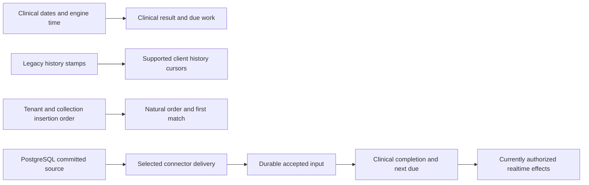

# Ordering, history and restore responsibilities

*Contributor-facing living architecture guide, reconciled 2026-11-16.
Current implementation is **read-derived** from qualified core
`c31c6e0b69a2a2f2a5320b9e4d32195f1b3e1878`; reproduced evidence retains the source
named in each linked record. The [release decision](multitenancy-decisions.md#stream-native-coverage-direction)
owns the direction to evaluate stream-native internal coverage. A replacement
for current clock-event sealing is **proposed, unimplemented and unqualified**.
No new cursor, CDC engine, event log or replication-slot topology is adopted.*

## Four separate meanings

| State | Owner and purpose | Current dependency and compatibility boundary |
|---|---|---|
| Clinical time | The clinical engine interprets measurement dates and computes time-dependent answers and due work. | It does not establish transaction coverage or a history cursor. A future-clamped write stamp must not define clinical expiry. |
| Public legacy history | The supported API/history contract exposes server modification/delete stamps and numeric cursors. | The existing tenant write-clock fence prevents a later visible cursor from missing an earlier still-committable write. Preserve no-missed-write tests and client shapes until a compatible replacement is actually qualified. |
| Insertion order | A per-tenant, per-collection allocator supports natural-order and first-match reads. | Already implemented in the admitted ordered catalogue. It is neither update/delete history nor commit order, public identity or a universal revision counter. Its ordinary transaction still locks the tenant counter row; a lower cost is UNMEASURED. |
| Internal stream progress | PostgreSQL commits source data; the selected connector transports it; evaluator owns durable accepted versus clinically completed work. Realtime consumes completed output under current authority. | Current c31 seals an XID cohort using a clock-table event and records the clock floor as observed work. Replacing that dependency is a design/proof task, not an implemented stream-native guarantee. Transport position, acceptance and completion remain distinct. |

The diagram separates responsibilities; it does not claim the selected webhook
transport already proves native transaction framing. The
[communication contract](evaluator-realtime-communication.md#transaction-coverage-and-mechanism-retirement)
owns the proposed replacement's proof and recovery boundary.

## Insertion ordering already exists

At c31, `migrations/candidates/postgres-entries-v1.json:52–62` creates and seeds
`tenant_insertion_ordinal`, applies forced tenant RLS, removes the old identity
allocator and installs the transactional tenant-local allocator. Ordinary inserts
allocate within their tenant/collection. Updates preserve identity and ordinal;
explicit restore has separate rights. The [SQL guide](sql-and-migration-architecture.md#history-clock-and-insertion-counter-serve-different-contracts)
owns catalogue, trigger, grant and restore details.

The [consumer proof](../../../reports/tenancy/insertion-order-consumers-2026-11-07/README.md)
reproduces selected real server reads on its f0 source: renumbering while preserving
relative order preserves the selected full profile; reversing order changes the
first match. Exact private ordinal values are not an observed client requirement
in that proof. This is not an all-client qualification or permission to change
public history cursors. Do not promote the ordinal into a universal progress counter.

## Current recovery and compatibility obligations

Restore must preserve current authority, exclude stale effects and establish
consistent accepted/completed/pending/due state before reopening. Logical restore
and whole-deployment physical backup retain their distinct fidelity contracts.
The [forward history policy](multitenancy-decisions.md#restore-history-forward-correction)
preserves supported history continuity; independent tenant progress and bounded
failure recovery remain required. The existing implementation is qualified only
for the source and scenarios in the
[canonical integration report](../../../reports/tenancy/pgstream-idiomatic-2026-11-14/README.md).

Authorized REST durability remains independently measurable during evaluator
recovery. Missing evaluator readiness alone is not a universal REST load gate;
actual authority, storage admission and explicit backlog/resource bounds can
refuse writes. New connector/progress work preserves all clinical, isolation,
authorization, restore, durability and supported-client outcomes.

## Retained alternatives and proof

The [November 7 counter/restore analysis](../../archive/tenancy/counter-and-restore-options-2026-11-07.md)
retains the global-allocator baseline, prototype alternatives, database analogies
and original source surveys. Its prototype and pending statements are historical.
The [November 6 history-clock proof plan](../../archive/tenancy/postgres-tenant-clock-proof-2026-11-06.md)
retains the original concurrency, rollback, restart and public-history controls.
Those compatibility outcomes remain required; its clock-specific implementation
choices and old dispatch/serial-slot instructions do not mandate current internal
stream architecture. Git retains intermediate revisions; the
[archive index](../../archive/tenancy/README.md) owns retention scope.
