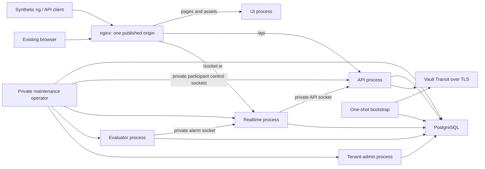

# Deployment scenarios and rig testing

*Contributor-facing living runbook. Deployment structure and commands are
**read-derived** from cgm-remote-monitor
`151de0248a1e4301c85b5c638185eec3ca8c38e6`, with the nginx edge-network correction
in `4935aa77049c66793669a7be940e40ed6ba5b386`, inspected 2026-11-07. Executed
results retain their own source in the linked records. The [accepted cold
Compose measurement](../../../reports/tenancy/operation-window-acceptance-2026-11-07/ed2-cold-accepted.json)
records the later ed2 implementation, including its Host-preserving demo sender.
Architecture/evidence grooming: 2026-11-08; no new runtime campaign was run.
This document implements
the documentation scope of MT-DOC-DEPLOY; current claims live in the
[work queue](../../../queue/work-queue.yaml) and
[delivery dashboard](multitenant-delivery-dashboard.md).*

## Choose the experiment

| Scenario | Purpose | Boundary |
|---|---|---|
| Existing single-tenant installation | Compatibility baseline for a selected rig/client | Existing MongoDB deployment and client configuration; `nightscout single` remains the default. |
| One-host synthetic Compose preview | Exercise separate services, browser/API/socket paths and tenant-local restore | Fixed participants, private Unix sockets, direct PostgreSQL and locally generated credentials. [Cold functional acceptance](../../../reports/tenancy/operation-window-acceptance-2026-11-07/ed2-cold-accepted.json) passed on ed2; real-client, capacity and production admission have separate gates. |
| Headless client lab | Compare pinned clients against the admitted API surface | Follow the [binary client lab](../../../tools/lab/m4-client-binaries/README.md); its evidence does not establish every mobile device or every new source head. |
| Physical mobile or pump/CGM rig | Verify the chosen client, network path, upload/history and reconnect behavior | A separately recorded experiment using synthetic input. Device execution is not implied by source-pattern replay. |
| Multi-host, orchestrated replicas or failover | Explore later deployment design | Proposed topology: the current private socket roster is a one-host contract, not distributed discovery or HA. |

The [application Compose guide](https://github.com/nightscout/cgm-remote-monitor/blob/ed2ced00c80bd0a6a7d75f834d2c6e2af8c71364/deploy/multitenant/README.md)
owns runnable packaging instructions. The
[service-process decision](../../../releases/cgm-remote-monitor-16.0.0/decisions.md#restore-service-processes)
owns the deployment requirement. Compose is implemented; a Jsonnet generator is
an optional way to produce configuration, not another runtime component or a
selected prerequisite.

The [binding and public-name contract](deployment-bindings-and-public-names.md)
maps ordinary Kubernetes resources onto these logical roles without assuming
multi-host membership or a particular Ingress controller. Its candidate resource
layout and access-policy extensions need their own acceptance.

## Deployment choices and fault domains

Tenancy, storage, execution and placement answer different questions. The
[adopted profiles](multitenancy-decisions.md#2-storage-resolution-and-profiles)
are resident `single` on MongoDB and explicit multitenant roles on PostgreSQL/RLS.
Storage ports make other combinations researchable; they do not admit a new
supported deployment. The comparison below is **read-derived architecture
analysis**; executed acceptance is linked separately.

| Axis | Current supported/reference choice | What changing it requires |
|---|---|---|
| Tenant scope | One site for `single`; bound tenant context for multitenant roles | Authorization, configuration, caches, history and lifecycle must all preserve the chosen scope. |
| Datastore | MongoDB for `single`; PostgreSQL/RLS in the multitenant preview | Backend conformance, isolation, migrations, backup/recovery and operational acceptance; a new adapter alone does not qualify a server. |
| Computation | Resident single-site runtime; request-local API frames plus independent multitenant evaluator/realtime projections | The separate nonresident-single prototype and reusable derived-result proposal need their own admission. |
| Process/container | Existing combined single-site server; separate API, realtime, evaluator and tenant-admin preview processes | Role authority, private communication, operation lifetime and recovery must work across the actual processes. A container is packaging, not a tenant boundary. |
| Host/replicas | One-host fixed-cohort multitenant reference | Multiple hosts or replicas need reviewed membership, producer fencing, transport trust, failover and recovery acceptance. |

| Deployment model | Scope of a failure | Evidence and decision use |
|---|---|---|
| Independent single-site servers | A server process failure affects its site. Shared database/host/ingress still couple whichever sites use them. | Existing compatibility baseline; inspect the operator's actual infrastructure before calling sites independent. |
| One-host multitenant reference | Tenant authority/history/restore are scoped; role processes, PostgreSQL, Vault, ingress and host remain shared. | Actual cold UI/socket/restore and tenant-local restart proofs inform one-host composition and protocol design. They do not establish HA or capacity. |
| Per-tenant database/process/host cells | Isolation depends on what each cell actually owns; a shared controller, identity provider or ingress can still couple cells. | An architectural alternative, with no admission from the current RLS/cohort proof. Define and test cell provisioning, migration, credentials, recovery and cross-cell operations first. |
| Replicated or multi-host roles | New partitions, split ownership, delayed messages and failover can affect tenants across hosts. | Later topology research. Replicas or an orchestrator do not supply the missing application ownership/recovery contract. |

The distinction matters during failures:

| Fault | Boundary established by the reference | Shared or unmeasured consequence |
|---|---|---|
| A's restore, uncertain DATA commit or unresolved operation | A remains unavailable where required; tested B traffic and fresh shared-role startup continue. | This is cooperative tenant-operation isolation, not a bound on all database locks, pool use or tenant load. |
| A role process exits | Separate roles can be restarted; incarnation checks prevent a replacement participant satisfying an old restore pin. | Tenants using that role lose its service; automatic failover and recovery-time bounds are unmeasured. |
| PostgreSQL, shared schema/privileges or pool fails | Unsafe shared readiness refuses rather than serving through it. | Shared tenants/roles depend on that infrastructure; RLS isolates rows, not database uptime or resource exhaustion. |
| Vault or credential service becomes unavailable | Current-authority and secret-dependent paths retain their refusal rules. | Do not infer that every operation fails or survives identically; production service login, key recovery and dependency-outage acceptance remain separate. |
| nginx or the host fails | No redundant public path or host is accepted in this reference. | Public reachability or all local roles can be lost together. |
| Independently authorized direct SQL bypasses the cohort | A current-session census can detect and refuse known unexpected actors. | The cooperative protocol cannot exclude a new raw SQL actor; database/authentication fencing needs a separate design and proof. |

These boundaries explain why tenant-local restore can be useful before a
production topology is qualified. The accepted experiment narrows the recovery
mechanism; production admission additionally needs the intended edge/service
identity, credential custody/renewal, lifecycle/key recovery, workloads and
operating limits, monitoring and operator recovery procedures. See the
[architecture evidence guide](single-and-multitenant-architecture.md#what-the-proofs-can-inform)
for which results support current decisions.

For aligned top-to-bottom zones and explicit communication planes, use the
[current and proposed grid topology plates](runtime-topology.md). The compact
flowchart below retains the accepted reference's connection summary.

## One-host reference topology



The [accepted cold measurement](../../../reports/tenancy/operation-window-acceptance-2026-11-07/ed2-cold-accepted.json)
exercises this topology as a one-host synthetic reference. UI and nginx receive
no database credentials. PostgreSQL, Vault,
tenant-admin and maintenance endpoints have no public port in this reference.
The UI renders the shipping templates/assets; API and realtime decide data
authority. See the [communication architecture](evaluator-realtime-communication.md)
for the two distinct record-frame and evaluator-output paths.

The [Compose file](https://github.com/nightscout/cgm-remote-monitor/blob/ed2ced00c80bd0a6a7d75f834d2c6e2af8c71364/deploy/multitenant/compose.yaml#L1)
declares internal service ports: API 1337, realtime 1339, UI 1340 and tenant-admin
1341. Only nginx's 8080 is published, by default at `127.0.0.1:18080`.
The [nginx route map](https://github.com/nightscout/cgm-remote-monitor/blob/151de0248a1e4301c85b5c638185eec3ca8c38e6/deploy/multitenant/nginx.conf#L14)
preserves the public Host for configured tenant resolution and strips selector
headers. Public tenant-management/operator routes are refused. The preview's
public origin is HTTP; Vault's internal connection uses the generated CA and TLS.
An external TLS ingress requires its own declared trust configuration and test.

nginx alone attaches to both the internal `backend` network and the `edge`
bridge. The edge bridge permits host publication; every application, database,
Vault and maintenance service stays on the internal backend network. The
[accepted cold measurement](../../../reports/tenancy/operation-window-acceptance-2026-11-07/ed2-cold-accepted.json)
reproduces reachable UI/API/socket paths and A restore with B committing work;
it retains exact source/image and independent cleanup attribution.

## Prepare a disposable synthetic instance

Use an isolated application checkout, Docker Engine with Compose v2, Node.js and
OpenSSL. The reference requires the host uid/gid to match the image's 1000:1000
account. Check the selected source and clean tracked build inputs before preparing.
The wrapper uses a fixed Compose project name. A second checkout alone does not
isolate its containers and volumes from that project: reserve it for one
experiment, or use a separate Docker context. Another project requires explicit
Compose invocations with its own project name rather than the unchanged wrapper.
Preparation records that commit, generates private state and refuses an existing
state directory or deployment `.env`. Build uses a Git archive and lockfile;
runtime commands refuse an image whose recorded source differs.

From that application's root:

```bash
cd deploy/multitenant
./demo.sh prepare
docker compose --project-name nightscout-multitenant-demo --env-file .env -f compose.yaml pull postgres vault nginx
node check-compose.js
./demo.sh build
./demo.sh bootstrap
./demo.sh up
./demo.sh status
```

On a fresh host, the explicit pull fetches the digest-pinned public dependency
images. Startup uses `--pull never`; bootstrap does not start nginx, so it cannot
be relied on to fetch that image.

These are the inspected source's commands, not commands executed by this
documentation change. `check-compose.js` checks structural boundaries; it does
not perform the browser, restore or rig experiment. Bootstrap deliberately
prepares schemas, grants, Vault and synthetic tenant configuration. Runtime
readiness checks do not migrate or repair a partially provisioned deployment.
`up` invokes bootstrap's supported restart/unseal handling before starting roles;
unknown existing state must refuse rather than be adopted.

For the already configured lab interface, choose this **instead of** the default
preparation, before any state or `.env` exists:

```bash
./demo.sh prepare --bind 169.254.1.1 --port 18080
```

[Preparation](https://github.com/nightscout/cgm-remote-monitor/blob/151de0248a1e4301c85b5c638185eec3ca8c38e6/deploy/multitenant/prepare.js#L11)
accepts only loopback or that existing address. It does not create an interface,
route or firewall rule. A mobile device's loopback addresses the device itself;
reaching this host requires an explicitly arranged lab route and name resolution.
The reference does not establish remote reachability merely by selecting a bind.

## Connect clients without changing their protocol

Resolve the generated synthetic tenant aliases to the chosen ingress address.
Use the alias in the client's configured URL, including the selected port;
substituting the bare IP loses Host-based tenant selection. Check a known tenant,
an unknown alias and the other tenant's credentials before a longer experiment.
Container loopback belongs to that container, not to the host or another service.

Take credentials only from the generated private operator material. Do not print
it into a lab report, shell history or captured request URL. A legacy subject
credential must use the shipping authorization exchange before API3 Bearer use;
the resulting DATA JWT is the Bearer credential. Existing clients using their
supported tenant-local API secret or token flow retain that flow. A public login
page does not supply management membership or implement the separate optional
OIDC/session capability.

For each selected client, record the client build, server source/image, tenant
alias and transport shape without recording credentials. Use the same synthetic
records for single-tenant and multitenant runs. Check upload acknowledgement,
addressed read, history cursor advancement, deletion handling and reconnect.
For a browser/socket consumer, verify an actual new frame contains the uploaded
record; a connected socket alone proves no data delivery. Public API identifiers
and internal storage identifiers need not be identical.

The [pinned client lab](../../../tools/lab/m4-client-binaries/README.md) owns
supported headless client execution. Android emulator and physical-device runs
remain separately attributed; [promotion decisions](../../../releases/cgm-remote-monitor-16.0.0/decisions.md#multitenant-promotion-bars-2026-11-06)
define their milestone scope. Avoid replacing a real client execution with a
handwritten request and describing the result as that client's acceptance.

## Restore and failure scenarios

Run the synthetic restore demonstration only in its prepared disposable instance:

```bash
./demo.sh demo
```

The [demo implementation](https://github.com/nightscout/cgm-remote-monitor/blob/151de0248a1e4301c85b5c638185eec3ca8c38e6/deploy/multitenant/demo.js#L60)
captures A, changes A, restores A using the real lifecycle/controller, writes B
during the held A operation and checks forward history correction/deletion.
The [restore-history decision](../../../releases/cgm-remote-monitor-16.0.0/decisions.md#restore-history-forward-correction)
owns client convergence semantics. B's preexisting state must remain unchanged;
its explicitly authored new writes are expected differences.

| Experiment | Observe | Required failure behavior |
|---|---|---|
| Ordinary A restore | A's clinical values/public identity and relative ordering; normal forward history updates and deletions; B read/write progress | No global pause or indiscriminate rewind of current authority/consumer state. |
| Interruption before activation | Durable claim, audit, unfinished operations and actual data outcome | Keep A unavailable; no blind replay, timeout-based reopening or orphan clearance. |
| Activation acknowledgement lost | Actual persisted phase and the recorded uncertain result | Activation may already have committed after its prerequisites succeeded; inspect the outcome rather than assuming suspension or blindly repeating activation. |
| Shared-role restart with A suspended | Fresh API/realtime/evaluator processes actually serving B; A refused with no stale output; A protected state unchanged | Deferred A initialization cannot bypass shared schema/permission checks or silently reactivate A. The [c23 native matrix](../../../reports/tenancy/operation-window-acceptance-2026-11-07/c23-native-accepted/README.md) reproduces the bounded shared-role restart criterion; the [ed2 cold record](../../../reports/tenancy/operation-window-acceptance-2026-11-07/ed2-cold-accepted.json) supplies the separate packaged ordinary-restore proof. |
| Missing/restarted participant | Changed incarnation, missing acknowledgement or unresolved operation | Old restore pins cannot activate using replacement processes. |
| Database/Vault/shared-host outage | Which shared dependency failed and what each tenant can still do | Tenant-local restore does not promise tenant-local infrastructure failures or HA. |

The [startup-admission decision](../../../releases/cgm-remote-monitor-16.0.0/decisions.md#tenant-local-startup-admission)
and [application recovery contract](https://github.com/nightscout/cgm-remote-monitor/blob/151de0248a1e4301c85b5c638185eec3ca8c38e6/docs/tenant-operation-cohort.md#failure-recovery-and-shared-role-restart-boundary)
own restart behavior. Process/control liveness and each tenant's readiness are
different observations. Realtime `/health` retains strict aggregate readiness;
Compose probes TCP, private sockets and participant status instead.

## Credential and recovery boundaries

Each service mounts its own private configuration. Bootstrap alone receives
initial database/Vault material; runtime roles must not reuse that administrator.
The [credential inventory](https://github.com/nightscout/cgm-remote-monitor/blob/151de0248a1e4301c85b5c638185eec3ca8c38e6/deploy/multitenant/CREDENTIALS.md)
owns generated capabilities. Fixed private sockets require the common numeric
uid, 0700 directories and 0600 endpoints. No dynamic membership is inferred.

Restore excludes A's cooperating service operations. Private database ingress
and custody of serving credentials are deployment requirements. A census of
current PostgreSQL sessions can refuse unknown actors; it cannot prevent a new
independently authorized raw SQL client from bypassing the protocol. A stronger
database/authentication fence is separate work, not a requirement to combine API
and realtime into one process. Direct PostgreSQL is required; transaction-pooling
proxies and multihost coordination are outside this reference.

The preview provides no automatic orphan clearance or supported suspended-restore
resume command. Operator-verified recovery remains separate work; the native
refusal and restart evidence does not establish a recovery-time bound.

The lab Vault credentials expire after 24 hours and restart does not renew them.
The generated CA expires after 30 days. Preserve verification and prepare a fresh
synthetic instance when appropriate; do not disable TLS checks. Vault sealing,
key custody and eventual production service login remain governed by the
[adopted trust contracts](../../../releases/cgm-remote-monitor-16.0.0/decisions.md).

## Stop, retain and report

```bash
./demo.sh stop
./demo.sh down
```

Both commands retain named data volumes and private state. `down` removes the
Compose services/network; it does not erase database/Vault volumes. Record the
exact project and owned resources before any separately authorized destruction.
Do not remove sockets from running participants or use whole-cohort restart as
a substitute for investigating an uncertain restore.

A useful report contains the exact source/image/client versions, named scenario,
synthetic workload, observed HTTP/frame/history outcomes, fault and restoration
control, and verification that owned processes/sockets/containers are released.
Separate elapsed observations from a recovery guarantee. Keep raw credentials,
private identities and record payloads out of committed evidence.

The [c23 native matrix](../../../reports/tenancy/operation-window-acceptance-2026-11-07/c23-native-accepted/README.md)
reproduces the separate-role restore and shared-role restart criteria, including
B progress while A remains unavailable, with independent physical closure. Its
fixed trusted cooperative cohort and private credential/ingress boundary remain
load-bearing. The earlier [b029 record](../../../reports/tenancy/operation-window-acceptance-2026-11-07/b029-native-accepted/README.md)
retains its own narrower scope. The [current acceptance family](../../../reports/tenancy/operation-window-acceptance-2026-11-07/README.md)
keeps their source-specific verdicts separate. The [ed2 cold record](../../../reports/tenancy/operation-window-acceptance-2026-11-07/ed2-cold-accepted.json)
adds actual UI/socket and ordinary restore/history/B-continuity acceptance.
The [ed2 pinned-client record](../../../reports/tenancy/operation-window-acceptance-2026-11-07/ed2-clients-accepted.json)
adds actual cgmsim/oref0 execution with matching stored outcomes and independent
physical closure. The [final ed2 regression](../../../reports/tenancy/operation-window-acceptance-2026-11-07/ed2-full-accepted/README.md)
passed all seven nonbrowser tiers. Other clients and rigs, capacity, HA,
production recovery and M6 retain their own admission criteria.
The [release contents](../../../releases/cgm-remote-monitor-16.0.0/contents.md)
own the latest executed acceptance and remaining blockers.
