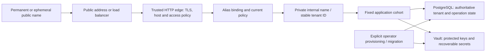

# Deployment bindings, public names and load behavior

*Living contributor-facing requirements and decision-preparation guide, 2026-11-08.
The maintainer clarified the target: ordinary Kubernetes resources should be able
to express the bounded deployment, public-name lifetime must be distinct from
private tenant identity, and shareable names need explicit authentication and
access policy. Jsonnet bindings and emergent-load measurement are useful next
work. Concrete resource composition, policy defaults and scheduling semantics
below are proposals; no Kubernetes binding, group/schedule engine or new production
acceptance is claimed. This analysis is **read-derived** from the accepted
[application cohort contract](https://github.com/nightscout/cgm-remote-monitor/blob/ed2ced00c80bd0a6a7d75f834d2c6e2af8c71364/docs/tenant-operation-cohort.md),
existing [tenant decisions](multitenancy-decisions.md) and Kubernetes documentation.
No cluster or provider deployment was inspected or exercised.*

The [grid topology plates](runtime-topology.md) show public-to-backing-store
zones without crossing connection arms. The
[endpoint/API implementation plan](selectable-endpoints-and-api-scaling-plan.md)
is queued as MT-ENDPOINT-TRANSPORT and MT-API-FIXED-ROSTER. Current work proves
component contracts using native processes; Kubernetes deployment proof and
Jsonnet are deferred. Existing platform lifecycle/discovery/identity primitives
are inputs to the architecture, not products to reimplement.

## Portability is distinct from distributed application ownership

The target is a deployment contract with Compose and Kubernetes bindings.
Kubernetes may schedule and expose one bounded application cohort without
introducing multiple active producers or dynamic restore membership. It does not
need a particular Ingress controller, service mesh, discovery service or operator.
An ordinary public address/load balancer can lead to the deployment's nginx or
other trusted HTTP edge. A Kubernetes Service of type LoadBalancer is one binding
when the platform supports it; an external load balancer to an available service
endpoint is another. The actual peer/source-address and TLS behavior must be
measured, rather than inferred from the YAML. See [Kubernetes Services](https://kubernetes.io/docs/concepts/services-networking/service/).

The diagram describes logical responsibilities, not a selected process count or
a new mandatory per-request network hop. The registry/policy lookup may be a
current-authority component inside an admitted application. DNS locates an edge;
it supplies neither tenant authority nor permission to see data.

## What a Kubernetes binding must preserve

The current native reference uses a fixed participant roster and private Unix
control sockets. A normal TCP Service does not transport that filesystem socket
contract. The smallest candidate translation is separate role containers in one
Pod with a private shared socket volume; this is a proposal to measure, not a
requirement that every future binding use one Pod. Multi-container Pods can share
an [emptyDir volume](https://kubernetes.io/docs/concepts/storage/volumes/#emptydir).
The volume can hold IPC endpoints; durable operations, tenant identity, keys and
recovery evidence must survive Pod replacement elsewhere. Their durable homes
remain the database and admitted secret/artifact stores.

| Responsibility | Candidate ordinary-resource binding | Acceptance that makes it equivalent |
|---|---|---|
| Public reachability | A Service/public-address adapter leads to the selected nginx/edge. No particular Ingress API is required. | Actual TLS, Host, forwarded-client identity, socket upgrades and trusted-peer behavior; unknown/conflicting names refuse. Public DATA ingress cannot bypass separately authenticated owner controls or reach private operator/database controls. |
| Fixed application cohort | Separate containers/processes with the same explicit roster and private IPC; one-Pod placement is an initial candidate. | Effective UID/socket permissions, actual participants and incarnations, drains/invalidation acknowledgements, A restore and B continuity; individual container restart and whole-Pod replacement retain uncertainty/refusal semantics. |
| Non-secret configuration | Versioned ConfigMaps and image/config identity, rendered from deployment inputs. | Effective role/catalogue/tenant binding matches the declared generation; drift and partial rollout refuse where required. Image/config identity is evidence of intended inputs, not producer exclusion. |
| Credential delivery | Narrow per-role Secret mounts or an admitted secret-delivery adapter; Vault retains the adopted cryptographic role. | Each workload can use only its declared credentials; service login/renewal/rotation and failure behavior pass. Kubernetes Secret storage/RBAC and workload creation authority enter the deployment trust record. Secret objects alone do not satisfy Vault custody or renewal. |
| Explicit provisioning/migrations | Operator-executed command or controlled Job, separate from ordinary serving startup. | Idempotency/partial-failure recovery, effective grants/RLS, supported catalogue and read-only startup checks; retries or a Job completion flag cannot erase uncertain results. |
| Datastore and recovery artifacts | Declared external services or admitted persistent storage; separate ownership from disposable compute. | Actual backend identity/direct-connection contract, backup/key fidelity and recovery under restart/replacement. A Service address or PVC existence alone is insufficient. |
| Health and replacement | Separate shared-process liveness from tenant admission; declare readiness/termination/update policy. | A suspended tenant does not cause a restart loop or block healthy-tenant startup. Delayed termination, overlapping replacement and dependency recovery preserve authority, durable operations and client results. |

A replica count of one is desired placement, not proof of unique execution.
Kubernetes Deployments default to rolling updates, which can overlap old and new
Pods. An initial binding can choose a controlled no-overlap update strategy, but
must still prove safe replacement and retain application/database safeguards;
control-plane state alone does not prove an old actor has stopped. Refer to
[Deployment strategies](https://kubernetes.io/docs/concepts/workloads/controllers/deployment/#strategy).
Splitting the same roster across Pods or nodes requires a qualified transport,
membership and lifetime binding; merely adding Services does not close that gap.

[Kubernetes Secret guidance](https://kubernetes.io/docs/concepts/security/secrets-good-practices/)
explains storage encryption and access controls. The production trust record must
cover those controls as well as the existing database/Vault/edge boundary.

A role box is not a mandatory service deployment. The
[logical REST/worker placement map](runtime-topology.md#logical-rest-cohesion-and-worker-placement)
permits cohesive data/authorization/owner REST modules with separate audiences;
background connectors/evaluation and privileged maintenance execution have their
own responsibilities. The [admission review](tenant-admission-and-activity.md)
distinguishes generic participant gating from owning the restoration workflow.

### Configurable transports and independently scaled API

REST APIs (v1/v2/v3) are one stateless request-serving component with internal
version-specific adapters. A Compose service or Kubernetes Deployment runs
instances of that component; replica count and placement do not split API
versions. Each replica serves the same configured admitted route set. See the
[component contract](tenant-admission-and-activity.md#one-logical-api-does-not-require-one-listener-or-process)
for transient-state, maintenance and owner-audience boundaries.

**Read-derived mechanism assessment:** there is no architectural requirement
that the request-serving API have a single replica or share a host with realtime.
The [current cohort specification](https://github.com/nightscout/cgm-remote-monitor/blob/ed2ced00c80bd0a6a7d75f834d2c6e2af8c71364/docs/tenant-operation-cohort.md#L3)
already permits explicitly declared API replicas as separate participants.
The [API implementation](https://github.com/nightscout/cgm-remote-monitor/blob/ed2ced00c80bd0a6a7d75f834d2c6e2af8c71364/lib/server/serve/preview-api.js#L129)
acquires fresh request frames and exposes invalidation of local startup/readiness
state. Stateless request handling means durable authority is external and local
state can be reconstructed; it does not mean an instance has no connections,
caches, in-flight responses or restore obligations.

The current [private transport](https://github.com/nightscout/cgm-remote-monitor/blob/ed2ced00c80bd0a6a7d75f834d2c6e2af8c71364/lib/server/realtime/ipc.js#L107)
already carries bounded HTTP POST/JSON over Unix sockets. Configuration resolves
an environment reference into `socketPath`; the parser currently accepts only
that transport. Node supports HTTP over a Unix `socketPath` or a TCP host/port,
and a [separate HTTPS request adapter](https://nodejs.org/api/https.html#httpsrequestoptions-callback).
See [HTTP request options](https://nodejs.org/api/http.html#httprequestoptions-callback).
Adding a network transport is feasible without changing operation payloads or
requiring realtime to share API memory. It needs an admitted client/listener and
trust profile, not merely a new value in the current socket-only field.

**Proposed configuration boundary:** operator environment or mounted config
selects an endpoint kind and address; the normalized adapter implements the same
bounded invoke/response contract. A name such as `NS_PRIVATE_API_ENDPOINT` with
`unix:/run/ns-ipc/api.sock` or `https://api.internal:8443` illustrates that design;
**this variable and URL syntax are proposals, not shipping options**. Keep listen
binding distinct from the client's service destination. CA/client identity and
other credentials use separate private file/secret references, not ConfigMap
plaintext or credentials embedded in the URL. An HTTP endpoint needs an explicitly
admitted private trust profile; HTTPS still needs caller authorization. Verify
service identity before granting the internal transport capability, in addition
to the unchanged tenant/client credential checks. Refuse unsupported schemes,
redirects or trust failures; do not fall back silently between transports.

The calls have different addressing semantics:

| Call / component | Appropriate destination | What changes with replicas |
|---|---|---|
| Realtime to API authorization/mutation | A trusted service endpoint may select any equivalently configured, admitted API replica. | Each request still resolves the tenant and checks current authority, RLS and operation lifetime. No inherent affinity to one API is needed for these request-scoped calls; joined concurrency/compatibility acceptance remains required. |
| Restore controller to each participant | A separately addressable instance endpoint, with authenticated identity and pinned boot incarnation. | The controller must reach every relevant instance for status/drain/invalidation. A single load-balanced endpoint cannot stand in for the complete roster: repeated calls could reach the same replica while missing another. |
| Evaluator notification to realtime | A destination whose receipt/fanout contract reaches the intended connected viewers. | Load-balancing one handoff to one realtime replica does not broadcast it to sockets on other replicas. Qualify fanout or explicit delivery ownership and durable retry/deduplication. |
| Browser to realtime | A connection-owning realtime instance. | Socket connections, rooms and local projections are retained state. Current polling plus WebSocket compatibility needs session affinity for polling, and correct cross-instance delivery. A generic URL alone does not solve that. See [Socket.IO multiple-node guidance](https://socket.io/docs/v4/using-multiple-nodes/). |

Start API scale-out with an explicit fixed roster if desired. Prove concurrent
requests on different APIs, current revocation/config consistency, actual drain
of an in-flight response, all-replica invalidation, replica death/replacement,
foreign-tenant refusal and unchanged mutation replies. Database pool/connection
limits and load tests must account for the aggregate across replicas. Ordinary
API replication does not inherently need the evaluator's single-producer
ownership protocol. Dynamic joins/leaves still need an admission/drain rule
serialized with maintenance; that can use the existing authoritative database
and does not inherently require a new consensus/discovery product.

Preserve deadlines, cancellation, byte bounds and actual acknowledgement
semantics across both transports. An ambiguous mutation response must not cause
a new transparent retry: the current forwarder returns no acknowledgement rather
than fabricating success. Network/partition tests add cases to prove; they do not
make API scale-out theoretically invalid. Evaluator scheduling/notification
production and realtime fanout retain their own independent ownership questions.

The inspected node-multienv source provides narrower prior art: its
[redirector listener](https://github.com/bewest/node-multienv/blob/2602c94ee2f9ceefc886907f1df63ef2e172daf4/redirector-server.js#L160)
passes configured listen values through and handles a filesystem socket, while
[backend selection](https://github.com/bewest/node-multienv/blob/2602c94ee2f9ceefc886907f1df63ef2e172daf4/redirector-server.js#L97)
constructs a remote URL. This source reading does not establish one uniformly
interchangeable Unix/HTTP/HTTPS client abstraction across that project. No
transport-parity or replica runtime campaign was run for this assessment.

### Jsonnet and node-multienv integration boundary

A proposed Jsonnet binding should take a deployment identifier, named role set,
image/config generation, private tenant-resolution configuration, edge placement,
resource limits and secret **references**. It should render resources and an
inspectable inventory, never embed live credentials or clinical data. Keep public
name/access-policy records separate from internal service-discovery endpoints.

The reviewed [node-multienv prior art](production-critical-path.md#prior-art-from-the-existing-projects)
can inform renderer inputs, reconciliation, resource ownership and provisioned vs
serving states. It does not make an existing per-site resource schema the required
shape for shared multitenant roles. A binding is independently deliverable once
it renders deterministically, exposes the same logical endpoints and passes the
cold-start, restart, restore, current-authority and teardown scenarios on its
actual topology. No Jsonnet implementation or new operator dependency is selected.

## Public name, tenant identity and access policy

| Identity or binding | Lifetime and meaning | Required boundary |
|---|---|---|
| Stable tenant ID | Durable authority/data identity | RLS, credentials, grants, history and lifecycle bind here; a public rename never transfers them. |
| Private internal name | Operator-controlled resolution label bound to the stable tenant | Discovery or routing metadata is trusted only through the admitted deployment boundary. It is not a public authentication credential. |
| Permanent public alias | A long-lived address intended to be safe to publish, including on social media | Knowing the address confers no additional authority. Explicit current access policy determines anonymous/authenticated behavior; revocation or suspension applies without needing to hide or rename the URL. |
| Ephemeral public alias | A rotatable or expiring address bound to the same tenant | Expiry/rotation changes reachability, not ownership. It is not an authorization capability unless a separate reviewed capability-link contract is adopted. |
| Alias policy binding | Which current policy applies to this public entrypoint | Binding changes are versioned/audited and may narrow access; another alias or direct backend route must not bypass the intended policy. Reassignment cannot inherit the old tenant's memberships, grants or caches. |

The existing [resolution contract](multitenant-delivery-roadmap.md#tenant-identity-migrations-and-import)
already separates disposable aliases, durable internal names and stable IDs.
The public-name policy requirement extends the design questions beyond simple
host lookup. Its persistence/update/API contract still needs implementation and
acceptance; this document selects no table schema or policy engine.

### Authenticated sharing and group policies

Strong OIDC login identifies a person. Current membership and the permitted
Nightscout grant determine what that person may do. Anonymous access is a
separate explicit policy choice; neither a permanent alias nor a successful OIDC
login silently grants tenant data or management authority.

A proposed policy surface needs these distinct controls:

- Require human authentication for selected public browser journeys, or allow
  only the explicitly configured anonymous permissions under project/operator
  floors. A blocked journey must not fall back to a broader anonymous policy.
- Bind authenticated groups to explicit allowed operations and any operator
  ceiling, with current membership, grant and session/key state on protected use.
  Merely having permission does not establish delegation authority.
- Preserve the permanent native device/headless credential path from D17. Its
  route/audience policy is explicit; it does not gain human-management authority,
  and a browser policy change cannot accidentally remove supported device access.
- Apply the selected policy across pages, API routes, socket subscription/write
  and protected delivery, reconnects and relevant cache keys. UI-only login is
  insufficient; direct backend access cannot bypass the public policy boundary.
- For optional schedules, specify timezone/DST, boundary/clock behavior, group
  overlap/precedence and ongoing-stream rechecks. Specify whether access is the
  intersection of grants and schedule constraints, or an explicit alternate grant;
  do not let an implementation choose that policy silently.

The [roles gateway and WWW journeys](production-critical-path.md#prior-art-from-the-existing-projects)
are prior art for these controls. Current OIDC/owner authority remains the base
contract. Alias-bound group/policy behavior and schedule precedence need a bounded
decision packet before claiming the feature. Ordinary production identity
acceptance does not imply these richer sharing policies are already implemented.

Evidence for an admitted policy includes synthetic anonymous/allowed/blocked
users, overlapping groups, membership revocation, issuer outage, exact schedule
boundaries, alias rotation/reassignment, cached/reconnected sockets and independent
stored effects. Exercise every exposed path. OIDC-provider outage follows the adopted bounded-existing-access rule with
current local authority still available. If current alias/group/schedule authority
cannot be established, refuse the protected operation; never expand permissions. The first production scope must state which of these public-name
features it offers and qualify those features before publication of user data.
The clarification adds a target capability, not an unmeasured M6 promotion or an
implicit waiver of existing preview decisions.

## Load-bearing metrics and emergent failure experiments

The measurement unit is a workload and shared dependency, not a uniform tenant.
Use aggregate metrics and synthetic fixtures; exclude identifiers, credentials,
public aliases and clinical values from metric labels and captured logs.

| Trigger | Observe | Evidence / proposed mitigation to evaluate |
|---|---|---|
| Many tenants/processes start or reconnect together | Work arrival/concurrency, pool acquisition wait, connection churn, CPU/event-loop lag, memory, error/retry rate and evaluator/data freshness | Burst and recovery campaigns with a quiet comparison. Evaluate bounded concurrency, retry backoff/jitter and staged admission; prove healthy-tenant progress and absence of duplicate effects. |
| Timers, polling or token renewals align | Per-interval scheduled vs actual work, queue age, lag tails, Vault/identity request rate and renewal failures | Compare synchronized and staggered workloads. Any jitter must preserve expiry/freshness; never extend credential validity or silently skip safety-relevant work. |
| One hot tenant, large history or public-name traffic spike | Per-workload resource cost, shared pool/lock waits, cache churn, rejected/admitted work and latency/freshness for other tenants | Independently verify isolation and state while evaluating budgets, bounded queues and load shedding. Unknown names/unauthenticated bursts must not allocate unbounded tenant contexts or expensive work. |
| Dependency outage and return | Retry amplification, outstanding work, recovery drain time, ambiguous commits and restored service freshness | Test outage plus recovery, including a prolonged one. Evaluate capped retries/backlog and gradual resumption; report when operator recovery is required. |
| Configuration/watch/reconcile or rollout churn | Queue depth, reconcile/watch frequency, API calls, desired/observed generation, overlapping actors and replacement time | Test partial rollout and repeated changes. Evaluate idempotency, coalescing/debouncing and paced rollout while preserving the fixed-cohort recovery protocol. |
| Group/schedule policy changes affect many active viewers | Authorization query/load, protected-delivery delay, current-policy version and refusal rate | Test simultaneous boundary/revocation and reconnect. Any policy cache needs scoped identity, valid lifetime and current-authority guarantees; a wider TTL is not a correctness-neutral optimization. |

Agree thresholds and supported workloads before using them as pass criteria.
Thundering-herd avoidance is an experiment with before/after outcomes, not an
assumption that jitter, Kubernetes or an extra load balancer solves the problem.
These experiments feed the [production operating-envelope gate](production-critical-path.md#what-blocks-the-path-and-what-closes-it).
