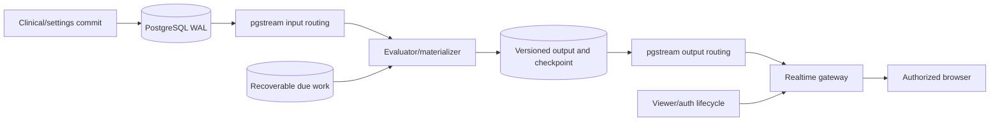
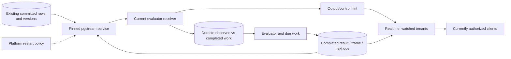
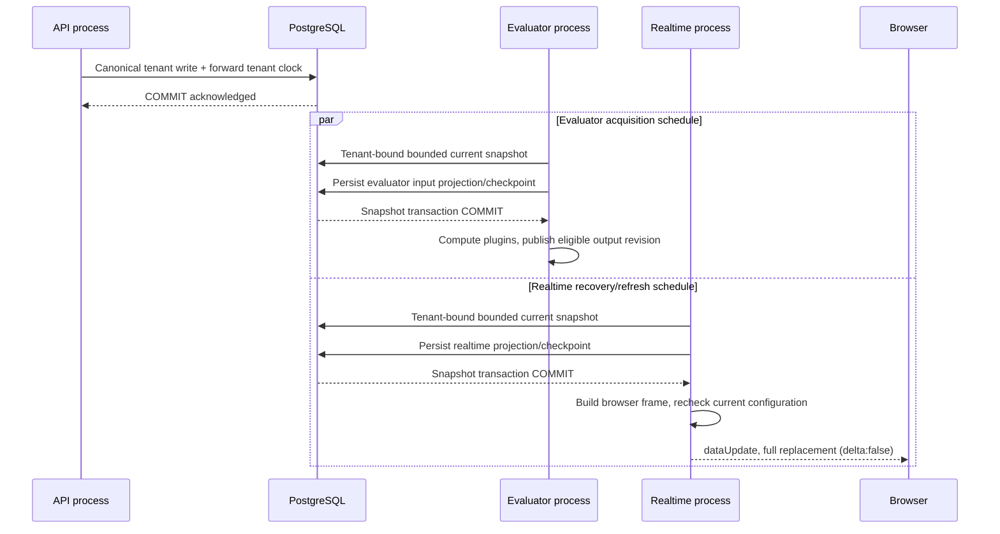
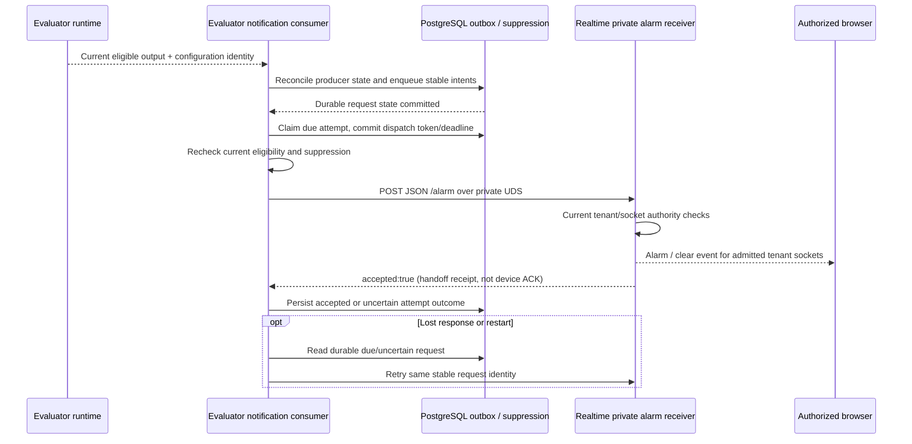
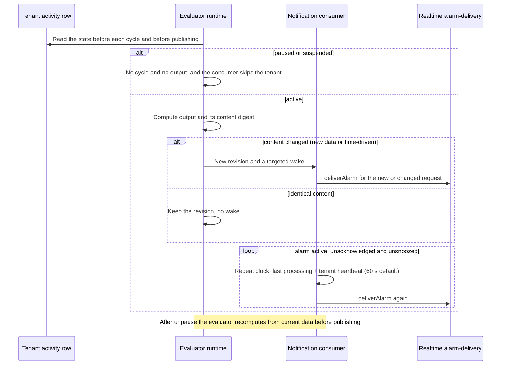
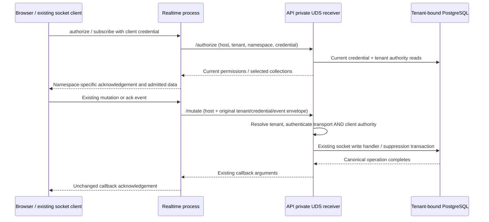

# Evaluator, realtime and API communication

*Contributor-facing living explanation, 2026-11-07. Mechanisms below are
**read-derived** from cgm-remote-monitor `151de0248a1e4301c85b5c638185eec3ca8c38e6`,
tree `3bb46431a19e604dc028768f0e72e6ad29616c26`. Source file/line anchors were
checked against that immutable tree. These are branch implementation mechanisms;
pinned source links identify the inspected revision, not a released feature.
Recorded reproductions retain their own source in the evidence section. The
later c23 native matrix measures bounded tenant-local restart behavior; it does
not relabel this inspected tree as the executed source.*

This guide explains which process owns each result and which messages cross a
boundary. Decisions remain in [tenancy decisions](multitenancy-decisions.md), the
[durable event contract](durable-event-delivery-contract-2026-11-06.md),
[owner authority](owner-authority.md) and the
[release decisions](../../../releases/cgm-remote-monitor-16.0.0/decisions.md).
The [delivery dashboard](multitenant-delivery-dashboard.md) owns milestone status;
this guide does not promote M6.

## Stream-fed clinical materializer — adopted target, 2026-11-16

The maintainer directs the evaluator to consume committed clinical inserts,
updates and deletes into a bounded tenant working set. Clock notification
followed by routine clinical snapshot acquisition does not meet this target.
Settings, policy and lifecycle changes join the same processing contract.
Preserve existing identity, ordering, units, clinical algorithms, extension
fields and client contracts. Typed clinical projections are appropriate where
established semantics or query/CDC benefits justify them; typed bookkeeping
alone is not clinical materialization.

Transport acknowledgement follows cheap validation and recoverably accepted
input. Evaluation, viewer delivery and provider I/O run separately. Transport
position and clinically completed input/settings versions are distinct. A
transaction cohort becomes visible coherently; clinical dates do not define
coverage. Durable input or consistent snapshot/replay recovery must reconstruct
all accepted work after process loss. Snapshots serve bootstrap, gaps, cache
loss and missing historical needs; warm event handling applies streamed rows.

One bounded scheduler owns startup, unfinished versions, actual clinical due
work and recovery, with fair tenant selection and serial execution per tenant.
Completion atomically persists covered versions, result/frame/revision and next
due under current authority, ownership and restore fences before RAM advances.
Newer input stays pending. Realtime consumes completed output, applies current
viewer authority/demand, and keeps one retry responsibility per owed delivery.
Durable receipts recover lost wakes; external exactly-once delivery is not claimed.
Healthy idle has no hot full-roster polling or per-event catalogue screening.

| Boundary | Implemented branch behavior and qualification boundary |
|---|---|
| Clinical CDC and durable acceptance | Six clinical routes retain typed identity, extension fields, physical storage size and insertion order. Raw rows commit to the existing input checkpoint before transport ACK. An XID (transaction identifier) cohort seals with its matching final clock, atomically with the typed observed-work receipt. Same-LSN COPY rows remain distinct. |
| Working set and recovery | Warm evaluation reads accepted rows, without clinical source/count/statistics scans. Consistent bootstrap retains physical invalid-row history for size and correction semantics while excluding it from clinical output. A known row/byte overflow durably marks a non-ready gap, evicts the input cache and preserves the sealed clinical floor and completed output; bounded successful bootstrap is required before evaluation resumes. Malformed data is refused. |
| Scheduling and completion | One bounded scheduler owns startup, pending, due and recovery. A held tenant leaves free slots and later recovery pages available to neighbors. Retry backoff belongs to the failed tenant. Concurrent earliest-due reads coalesce, with a fresh lookup after changed work and safe ownership release before settlement. TIME acquires newly observed input before completion; input arriving during evaluation remains owed. Result/frame/revision, covered versions and next due commit under existing ownership/current-authority/restore fences before RAM completion. |
| Realtime | The completed-output path distinguishes upstream pending, unwatched/deferred and ineligible work from actual failed delivery. Durable receipts own owed-delivery retries. Realtime does not build a raw clinical projection. |
| Optional path | The separate selected-intake materializer remains unqualified and is explicitly refused before effects by the public evaluator configuration. It is not the default path or a prerequisite. |
| Qualification | Focused default native tests include coherent corrections/deletes, process recovery, due work without a write, held-neighbor progress and unchanged warm snapshot/statistics query counts. Source-scoped controls are in the [existing discriminator harness](../../../tools/mt-bench/m7-joined/README.md#stream-materializer-discriminators). The [existing report](../../../reports/tenancy/pgstream-idiomatic-2026-11-14/README.md#stream-fed-clinical-materializer--2026-11-16) owns final source/image/operating evidence and limits. |

These branch changes do not establish the cause of the historical intake delay.
The existing lane handoff is `externals/work/HANDOFF-switch-over-finish-2026-11-15.md`.
Both predecessor lanes released all custody after exact-resource cleanup and are
archived; their captures remain unchanged. Single-host and single-tenant
compatibility remain required. Optional multihost, Kubernetes, HA and complete
platform-artifact work are not baseline prerequisites.

## Event-driven target and first proof

**Direction adopted 2026-11-13; current local integration and recovery evidence retain their exact source and limits.**
The [release decision](../../../releases/cgm-remote-monitor-16.0.0/decisions.md#event-driven-reset)
owns this priority. The ownership and placement model below is proposed for the
proof; it is not implementation acceptance. Evaluate maintained pgstream CDC (change data capture) before
further tuning or benchmarking the polling implementation described below.

| Logical module | Owns | Durable recovery boundary |
|---|---|---|
| Evaluator/materializer | Raw clinical and settings changes, clinical computation, time-driven work and versioned output | Existing input versions, projections, processed checkpoints, notification producer state and recoverable next-due work |
| Realtime gateway | Output/alarm changes, browser frames, viewers and current authorization lifecycle | Persisted output revisions and existing alarm/retry state; rebuild local connections and caches after restart |

The proposed ownership model gives evaluator raw inputs for clinical computation. Realtime consumes
committed outputs; it does not independently sweep raw inputs. Keep these as two
logical modules and initially co-locate them where that simplifies the local
proof. This changes the prototype placement priority of the earlier
[separate-process decision](../../../releases/cgm-remote-monitor-16.0.0/decisions.md#restore-service-processes).
Independent physical scaling remains possible, subject to evidence.

“Stateless evaluator” means caches can disappear without losing correctness.
Tenant versions, completed work, pending alarms and due times remain state and
must survive process loss. A timer must become eligible without another write.
Restart reconstructs due work and resumes committed versions; a newer generation
must remain pending when an older evaluation completes. Input acquisition alone
must never acknowledge completed clinical evaluation.

The adapter must distinguish input, output and control tables. Output publication
must not loop back into raw-input evaluation. Prefer output CDC to a new direct
RPC delivery chain. Reuse the [B7 recovery contract](durable-event-delivery-contract-2026-11-06.md)
and existing producer/output/checkpoint storage before adding a queue. HTTP 2xx
acknowledges recoverable work or durable completion; RAM-only enqueue is
insufficient. Clinical write transactions remain independent of notification
availability, as [D6](multitenancy-decisions.md#d6) requires.

One capability owner first proves a small local flow with pinned pgstream and
actual app, clinical and socket modules: committed input and settings changes,
correct tenant evaluation, durable output and actual client update; due work
without a write; restart/redelivery and concurrent-generation correctness;
quiet idle without roster scans. Focused break-it controls must detect dropped
work, early acknowledgement, tenant misrouting and output feedback. Verify the
upstream acknowledgement/checkpoint/retry contract, schema/plugin footprint,
strict failure behavior and bounded WAL retention. This is a prototype criterion,
not an adopted pgstream delivery guarantee or production acceptance.

The [local pgstream proof](../../../reports/tenancy/pgstream-flow-2026-11-13/README.md)
now establishes this bounded flow on a single serialized adapter. It records the
executed source, positive and red controls, explicit cache-loss recovery and
remaining notifier-liveness, schema-routing and ownership/recovery gaps. It does
not enable a shipping role or establish production delivery guarantees.

## Actual-role integration: objective and completion criteria

*Execution plan, 2026-11-13; read-derived from core prototype
`aba583199e9ab8a4bb907adc46dc9262a3dcedf5` and deployment reference
`84accb33c3daccebfdf886300c3ba6c638e003c6`. Final joined acceptance remains open. Focused current-source results are recorded in
the [switch-over release update](../../../releases/cgm-remote-monitor-16.0.0/contents.md#update--coherent-switch-over-candidate-2026-11-15); each criterion keeps its measured scope.*

**Objective:** the actual multitenant evaluator and realtime roles process
committed changes and due clinical work, recover after process loss, and refuse
stale-owner effects. The existing pgstream capability has one implementation
owner for core, its fixtures/controls and matching deployment wiring. The sole M7
coordinator owns dependency reconciliation, the joined candidate and acceptance.

### Internal trust and state ownership

Evaluator and realtime are trusted internal roles that work across tenants.
Internal CDC payloads may contain clinical, configuration and completed-output
rows. A blanket non-clinical-only feed is not an isolation requirement. Reuse
existing rows and versions; add a marker only where it makes coalescing or
recovery simpler. Do not add tables or rereads solely to hide data from these
trusted workers. Current tenant identity, authority, ownership and restore state
still govern computation, persistence and externally visible effects. Trusted
metadata work may batch across tenants; this plan adds no per-event catalogue
screen or public request-admission path to internal scheduling.

One receiver in the evaluator role durably coalesces **observed** versions before
returning HTTP success. Evaluation drains observed-versus-completed differences
separately, so clinical computation does not hold the serial CDC delivery open.
The existing evaluator checkpoint consumer is the proposed home for observed and
completed versions, completed result/frame, content revision, next due instant
and ownership/restore generation. Keep acquisition separate from clinical
completion. Add only the schema necessary to make this recovery state durable.

The [platform restart decision](../../../releases/cgm-remote-monitor-16.0.0/decisions.md#evaluator-platform-restart)
places pgstream in an independently managed service. It sends webhooks to the
evaluator's private receiver. The platform owns the pinned process and its restart
policy; the evaluator owns durable receipt, clinical completion and application
readiness. A stream outage withdraws readiness and recovery reconciles current
state. Restarting pgstream does not itself require evaluator exit. Existing
internal API and deployment trust conventions apply.

Each replication slot has one active stream consumer. Delivery must reach the
current receiver owner, or an ingress implementation that provides equivalent
durable admission. The current selected binding targets its sole intake owner;
ordinary load balancing across evaluator replicas is not qualified by the private
Service address. Receiver availability and clinical readiness are separate so
service discovery does not require clinical readiness before delivery can start.

The [bounded platform witness](../../../reports/tenancy/switch-over-finish-2026-11-15/external-platform04.json)
measures a Docker-managed stream replacement with the same evaluator and exact
durable catch-up. It does not qualify the new application image, Kubernetes,
general failover or a capacity limit.

Completion commits the result, processed versions and next due together under a
current ownership/restore fence. A newer version remains pending when an older
cycle finishes. Reuse current transactional write clocks, settings/activity
versions, notification producer identities and recovery contracts. Clinical dates
and CDC arrival order never stand in for commit versions.

Input, output, heartbeat and schema/control routes are explicit. Output and
receiver acknowledgement writes must not feed an input-evaluation loop. A
validated output payload may accelerate delivery. Durable output revision remains
truth; reconnect and bounded reconciliation for watched tenants recover a missed
private/local hint. This hint may use an existing private interface; successful
RPC is not the sole delivery/recovery path. Realtime does not build a second raw
clinical projection. Preserve the adopted connection-driven lifecycle and update
its move-readiness contract in the same source cut where that behavior changes.

### What must pass

| Criterion | Required behavior | Focused failing control |
|---|---|---|
| Actual role flow and durable acknowledgement | Launch the actual role entrypoints/configuration. A committed input/settings change produces a completed clinical result and frame, then updates an already-connected client. ACK follows durable observed work; clinical output, completed versions and due state commit coherently. Newer or reordered work cannot roll completion backward. | ACK before observed commit; drop output hint; hold an older cycle while a newer write/settings version commits. Require recovery from durable state and correct tenant/client result, rather than counting callback entry. |
| Notifier health and recovery | Detect a live-but-stopped notifier, hung delivery, database/receiver outage and backlog using end-to-end heartbeat receipt plus pending/checkpoint progress. A fresh heartbeat cannot hide stuck clinical work. The platform owns pgstream restart. The evaluator withdraws readiness, preserves durable work and reconciles after delivery returns; it does not own a pgstream child process. The producer's `/health` alone is insufficient. | Stop notifier while process stays alive; wedge webhook or partition its network. Health must change and recovery complete, or a named refusal occur, within deadlines declared before the run. Healthy idle with fixed heartbeat work must stay healthy. |
| Schema/control routing | Classify DML, heartbeat, schema and lifecycle events. Relevant DDL invalidates affected admission and invokes revalidation; irrelevant supported DDL does not create clinical work. Unknown/malformed relevant events cannot be silently acknowledged as completed. | Deliver the observed `pgstream.ddl` action `M`, unrelated DDL and an unknown event. Confirm defined routing/refusal, unchanged tenant completion and no data/output feedback loop. |
| Actual worker restart and stream coverage | Kill the evaluator OS process after durable receipt, during evaluation and after output commit; restart from persisted pending/completed/due state. An overdue/future clinical timer fires without a new input write. Establish stream coverage before the bootstrap reconciliation boundary, including writes during startup. Recover lost/invalidated slots through explicit rebootstrap, not silent recreation. | Kill at each durable boundary; write while boot/recovery enumerates tenants; invalidate the owned slot. Omit pending/due recovery to prove red. Test the process, not only cache clearing. |
| Ownership and restore fencing | An old process cannot commit output or emit socket/alarm effects after its ownership/backend/assignment or restore generation is superseded. Fence at the effect boundary, not only during a later health probe. Preserve existing stable notification identities, suppression and retry semantics. | Hold an old cycle/send, replace its owner or ownership backend, then resume it; change restore generation before publication/dispatch. The old effect is refused, the current owner finishes, and another tenant continues. This is not an exactly-once provider-delivery claim. |
| Deployment and compatibility | DBA init is separate; normal pgstream runs nonsuperuser/nonowner with enumerated streaming/metadata grants. Qualify precreated subscriptions with least necessary grants; keep receiver/subscription endpoints private. Bind the pinned artifact, plugin, restart policy, migrations and existing authority/lifecycle contracts. Single-tenant behavior remains compatible. | Remove a required grant, use the wrong datastore/slot identity, expose a subscription endpoint in a probe, and exercise pause/suspend/revocation with idle sockets. Preserve focused regression/control failures for changed contracts. |

Use existing health/probe/recovery settings where they fit. Declare heartbeat,
stall detection, step timeout and recovery bounds in the pinned configuration
before executing controls; report observed times against those bounds. Do not
extend a timeout after a failure merely to relabel it green. `REPLICATION` is an
explicit WAL-decoding trust capability; SQL table ACLs do not prove it is confined
to those tables. Start with DBA-precreated subscriptions and enumerate actual
runtime grants. If a narrow operating role cannot work, report the exact failure
and evaluate the adopted Debezium fallback; do not silently run as owner.

Healthy steady state uses fixed worker/feed health, actual changes, watched
clients and indexed pending/due work. Bounded startup/rebootstrap reconciliation
and the adopted slow settings safety net retain their explicit scope. Do not
restore a hot roster sweep or add an arbitrary per-read catalogue check to pass a
control. Measure adapter and pgstream SQL separately; a short quiet callback
counter is not a database idle-cost result. WAL retention configuration is not a
proof of overflow/invalidation recovery.

### Ordered delivery and one acceptance boundary

1. Reconcile the minimum restore/recovery dependencies, and qualify runtime
   grants plus the targeted feed wrapper. Keep the prototype source/captures
   immutable; implement in an owned continuation worktree.
2. Integrate durable receiver/completion/due state into evaluator and replace
   realtime raw acquisition with completed-output consumption. Carry settings,
   activity, authorization and connection-driven behavior together.
3. Close schema routing, OS-process recovery/bootstrap and stale-owner/restore
   controls on the joined core/deployment pair. Record concrete failures and
   fix them in the same capability lane.
4. Once the focused criteria pass, the coordinator freezes one coherent pair for
   applicable full/browser/enabled-corpus acceptance and final prcheck. Repair
   diagnosed failures before repeating final acceptance. No leaf commit triggers
   a new comprehensive campaign.

Claude's final restore-resume repair and datastore-recovery semantics are
prerequisite assessments, not automatic ancestry acceptance. Reconcile stronger
existing guards; apply needed cleanup/lint/CI repairs. Old reader advancement,
tenant-version polling and authorization-cache experiments stay parked. Packaging
retirement is assessed separately and does not delay CDC correctness unless its
contract is actually required. The local capability handoff names exact heads,
source anchors, owners and preserved drafts.

Only after actual-role integration closes should a small matched measurement
precede a capacity plan. No paid host, old capacity retry, topology matrix,
generic control framework, application-dev merge, push or release is part of this
implementation batch.

## Inspected implementation reference

The sections below describe the pinned implementation in the opening provenance
block. Its independent raw-input projections and polling schedules are reference
behavior, not the target to preserve. Existing isolation, clinical, authority,
restore and single-tenant compatibility obligations still apply.

## The two outputs have different owners

Realtime and evaluator each acquire clinical data from PostgreSQL. The evaluator
does not send its SQL projection to realtime. Realtime builds the browser's record
frames from its own bounded projection and checkpoint. Separately, evaluator
consumers can send a durable alarm/notification intent to realtime for browser
fanout. That handoff is not a glucose-data replication stream or proof of device
notification delivery.

| Component | Owns | Reads or sends |
|---|---|---|
| API process | Current client authority, REST and existing socket write handlers, canonical clinical mutation | Tenant-bound PostgreSQL writes; scoped secrets; private socket authorization/mutation receiver |
| Evaluator process | Clinical acquisition, plugin cycle and eligibility of its current in-memory output | Its own durable input checkpoint/projection; current configuration; independently scheduled durable notification producer/retries |
| Realtime process | Browser connections, socket namespace state, independent current-record projection | Its own SQL reads/checkpoint; current API authorization; private API mutation forwarding; private alarm receiver |
| Tenant-admin process | Current tenant management and owner authority | Separate listener and management credential audience; it does not execute clinical socket writes |
| Private restore controller | A's suspension, draining and exclusive maintenance claim, committed-data and activation outcome | Fixed participants' control endpoints and actual backend identities; per-tenant invalidation |

These are application modules wired by explicit preview role configuration.
Separate processes/containers can share a private directory containing Unix-domain
sockets (UDS): an endpoint is a transport address, not shared JavaScript memory.
The [adopted separate-process decision](../../../releases/cgm-remote-monitor-16.0.0/decisions.md#restore-service-processes)
retains this deployment boundary. A local `EventEmitter` does not become a durable
cross-process event bus merely because the processes share a host.

## Clinical acquisition and browser records

The evaluator's acquisition first commits a bounded current-state projection and
input checkpoint, then computes the clinical/plugin cycle. Its checkpoint records
input acquisition, not completed evaluation or notification delivery. A later
failure can therefore leave committed input with no eligible evaluated output.
The runtime reports an output revision only from a successful cycle and requires
an admitted tenant operation for `last(tenant)` to expose it.
[Evaluator acquisition][evaluator-acquisition], [runtime output][evaluator-runtime]
and [durable snapshot/checkpoint][replay] implement these separate stages.

**Adopted 2026-11-10, not in the inspected tree.** The [output revision changes
only when the output content changes](../../../releases/cgm-remote-monitor-16.0.0/decisions.md#evaluator-revision-on-content-change)
(time-driven changes included); an identical cycle keeps its revision, and the
realtime consumer is woken on real changes only for tenants with a pending alarm.
The inspected code bumps the revision on every cycle (read-derived, cited in the
decision). Alarm repetition is separate: an active, unacknowledged, unsnoozed alarm
[repeats on its own clock equal to the single-site heartbeat](../../../releases/cgm-remote-monitor-16.0.0/decisions.md#alarm-repeat-clock)
(same setting, 60 s by default) and on new data, as on a single site. Both are
BF-231 / `MT-CONSUMER-STALE-RESELECT` work. The evaluator only works tenants
eligible under the [activity policy](../../../releases/cgm-remote-monitor-16.0.0/decisions.md#activity-is-pause-suspend): while a site
is paused or suspended no alarms are computed or delivered.

The namespaces for evaluator and realtime checkpoints must be distinct.
[Role composition][role-composition] enforces that ownership boundary.
[Realtime projection][realtime-projection] builds a full replacement frame,
including absence, so a hard-deleted record is not retained by a delta-only merge.
Its runtime rechecks the configuration identity before fanout and exposes no healthy
last value after refusal. [Realtime refresh][realtime-runtime] supplies these checks.

Public API3 `identifier` and the storage `_id` are different identities. A browser
SGV frame carries the stored record key in `_id` and its value in `mgdl`; an API3
POST acknowledgement names the public identifier. Bind them through the actual
stored record when comparing transports, rather than assuming the strings match.
The [shipping frame loader][frame-loader] preserves this distinction.

The current reference uses bounded snapshot reconciliation and polling schedules.
It does not implement the full replication-slot/reader-NOTIFY design as a transport
between these roles. The durable-event contract owns that longer-term direction;
R73's polling/snapshot acceptance does not imply a LISTEN latency guarantee.
Time-only evaluator ticks reuse retained successful input; they do not substitute
for fresh acquisition or establish recovery after missed writes.

## Notification intents, retries and alarm handoff

The evaluator's optional realtime consumer is separately scheduled from clinical
computation. It reads eligible current output and current configuration, reconciles
persisted producer state and suppression acknowledgements, and records durable
intents with stable origin/request identity. The producer must still be current
after pending reads. The coordinator then selects due requests for retry.
[Producer][producer] and [consumer coordinator][consumers] implement this path;
when no consumer is selected, it opens no extra consumer pool, timer or socket.

The attempt and dispatch state commit before the adapter call; the network wait is
not held inside SQL. Deadline, abort or an ambiguous response preserves a durable
retryable outcome. Before dispatch, the notifier rechecks configuration eligibility
and the current suppression reader, so an old selected cycle is not standing
permission to deliver. [Notification attempts][notification-attempts] owns the
implementation. Clear requests have their own retirement/suppression handling;
this is not a blanket rule to discard every request when an output is unavailable.

The actual [alarm adapter][alarm-transport] sends tenant, request ID, attempt,
notification and receipts to `/alarm`. Acceptance means the realtime handoff
completed. It does not mean a browser displayed it, a person acknowledged it, or a
provider/device received it. A lost handoff response can repeat the unchanged
request: there is no exactly-once delivery promise.

A browser's `ack` follows the private API mutation route below. API checks current
credential/tenant permission and, for linked consumer state, current evaluator
configuration inside the acknowledgement admission. It persists original
suppression state; the evaluator subsequently reads that state.
[Private acknowledgement admission][private-api] is distinct from the transport
receipt acknowledging an evaluator-to-realtime handoff.

The diagrams above follow the inspected tree. The 2026-11-10 decisions
([evaluator-revision-on-content-change](../../../releases/cgm-remote-monitor-16.0.0/decisions.md#evaluator-revision-on-content-change),
[alarm-repeat-clock](../../../releases/cgm-remote-monitor-16.0.0/decisions.md#alarm-repeat-clock), [activity-is-pause-suspend](../../../releases/cgm-remote-monitor-16.0.0/decisions.md#activity-is-pause-suspend))
change when the consumer is woken and how an active alarm repeats. Built on lanes `956d0940` and `07981b55`,
in the batch join that is in acceptance; [evidence](../../../reports/tenancy/consumer-refusal-2026-11-10/README.md).

## Browser authorization and mutations

Socket.IO exposes `/`, `/storage` and `/alarm`. Tenant resolution uses the admitted
host/configuration mapping. The root namespace accepts the existing `authorize`
shape; `/storage` and `/alarm` use their own subscription/credential contracts.
Their credential forms and permissions are not interchangeable. The
[realtime protocol][realtime-protocol] rechecks current authority across asynchronous
acquisition and before fanout; a long-lived connection is not a permanent grant.

Realtime does not replace the user's credential with its database identity.
[Forwarding][forwarding] preserves the event namespace, arguments and callback
shape. Failure or ambiguity produces no synthetic success and no automatic socket
mutation retry. The [API executor][socket-executor] invokes the same socket write
handlers/purifier/write intents as the single-tenant socket listener. This is a
private HTTP/JSON call over UDS, not a replay of a public REST request. Public REST
requests use the real API handlers and shared storage/write-intent ports directly.

The private API independently resolves the host and compares the envelope's tenant,
authenticates the owned transport, verifies the current client credential and
checks the operation's permission. [Private API][private-api] and
[namespace credential normalization][socket-authority] define these boundaries.
A socket-path possession check is not permission to mutate a tenant's records.

## Wire format and operation lifetimes

The current [private transport][ipc] uses bounded JSON objects in HTTP POSTs over
fixed UDS endpoints, with explicit byte/time limits and restrictive same-UID
filesystem/socket ownership. It accepts a fixed operation list: `/authorize`,
`/mutate`, `/alarm`, `/cohort/status` and `/cohort/invalidate`. Application payloads
and cohort controls have different handlers; they are not a public administration
API. A private directory and fixed manifest are deployment trust inputs, not an
authentication substitute for each client's current authority.

A registered tenant operation surrounds actual HTTP response completion, not just
entry into a handler. [API lifetime middleware][api-lifetime] waits for response
finish/close; private IPC similarly retains its lifetime through response finish.
Socket authorization, forwarding, clinical/evaluator acquisition and notification
attempts also use the actual operation window. Tenant-scoped lower handles enforce
that window when used. These lifetimes let maintenance drain real unfinished work
rather than infer quiescence from a callback returning.

## Disconnect, restart and tenant-local restore

Ordinary process restart reacquires current records and persisted checkpoints.
An evaluator's in-memory output is recomputed; a committed input checkpoint is not
relabelled as a successful output. Realtime rebuilds its own projection and full
browser frame. Durable notification requests survive and retain their retry
identity. Current credentials/configuration are checked again; retained process
memory does not authorize a new connection.

The [logical restore policy](../../../releases/cgm-remote-monitor-16.0.0/decisions.md#restore-history-forward-correction)
requires forward changes and deletion records for known captured/current clinical
identities, preserving public IDs and clinical fields. It retains current
nonclinical authority, consumer state and the authoritative live clock; physical
backup fidelity is a separate operation. Activity retains its existing full-read
behavior rather than acquiring a new v3 history contract. IDs purged from both
artifact and current retained history remain outside that bounded guarantee.
[Logical restore source][logical-restore] enforces captured/live floor checks.

The controller suspends A durably, drains A operations and holds an actual
backend-bound exclusive claim. After definite outer DATA commit, it runs registered
commit effects, invalidates the configured roles' tenant caches/sockets/output,
then activates A. A's sockets disconnect; fresh readers and evaluator acquisition
must obtain the restored current state. B has independent tenant operation keys
and counters. Lost COMMIT or invalidation acknowledgement does not authorize
blind replay, orphan clearance or expiry-based reopening.
[Controller contract][maintenance] and [participant protocol][cohort] supply this
ordering; participant incarnation changes invalidate an old pin.

### Independent startup on the inspected candidate

At `151de024`, shared schema/ACL checks remain unconditional. Genuine suspension
from the actual registered operation gate defers only that tenant's initialization;
a lookalike error code, metadata drift, bad binding, transport failure or other
application failure is not swallowed as suspension. The full configured tenant
roster remains present. A deferred tenant retries through the same gate when work
is admitted, with invalidation retiring its cached initialization.
[Tenant startup][tenant-startup] implements this provenance distinction;
[evaluator metadata admission][evaluator-readiness] runs READ ONLY, and
[consumer admission][consumers] retains unconditional metadata and actual
same-datastore checks before tenant-local initialization.

Consequently the source intends a restarted shared API/realtime/evaluator process
to serve active B while suspended A remains unavailable, with no stale A output.
[Realtime startup][realtime-runtime], [API startup][api-startup] and
[evaluator startup][evaluator-preview] use that mechanism. Aggregate health can
remain degraded while B is available: do not omit A from the roster or require A
to become active merely to make a process health summary green. The [c23 native matrix](../../../reports/tenancy/operation-window-acceptance-2026-11-07/c23-native-accepted/README.md)
reproduces this bounded restart criterion on its exact later source; the inspected
151de024 mechanisms above remain read-derived.

## What the evidence establishes

| Record | Actual accepted scope | Remaining boundary |
|---|---|---|
| [R73 durable runtime and bounded operations](../remedial/rc-16.0.0-integration-record.md#r73---durable-runtime-and-bounded-operations-batch-2026-11-07) | Reproduced functional M5 reference on its recorded source: durable bounded acquisition, current socket authority/compatibility, suppression and stable-request handoff; complete named broad acceptance on that tree | Current polling/snapshot reference does not establish provider/device delivery, capacity, multi-node ownership or all later source |
| [b029 native operation-window matrix](../../../reports/tenancy/operation-window-acceptance-2026-11-07/b029-native-accepted/README.md) | Reproduced all 17 criteria on `b029f5d8`: actual four CLI roles, forward logical history, B progress, rollback, changed-participant refusal, real COMMIT/invalidation acknowledgement loss and orphan refusal; independent physical closure | Not new-source restart-while-A-suspended acceptance, Compose/browser acceptance, released feature or whole M6 |
| [c23 native operation-window matrix](../../../reports/tenancy/operation-window-acceptance-2026-11-07/c23-native-accepted/README.md) | Reproduced actual fresh shared API/realtime/evaluator startup with B progress while A remained unavailable after the recorded failure cases; unsafe-clock API startup refused; independent physical closure | Fixed trusted cooperative participants, private serving credentials and database ingress. No raw-SQL fence, automatic orphan clearance, suspended-restore resume command or recovery-time guarantee |
| [ed2 cold Compose measurement](../../../reports/tenancy/operation-window-acceptance-2026-11-07/ed2-cold-accepted.json) | Reproduced actual UI, main/alarm sockets and ordinary A restore with B committing work; public identity, forward history and synthetic client convergence preserved; independent configuration/resource/process closure | Exact ed2 source and image, one-host synthetic scope. Actual pinned clients, final regression and wider M6 admission remain separate |
| [ed2 pinned-client measurement](../../../reports/tenancy/operation-window-acceptance-2026-11-07/ed2-clients-accepted.json) | Reproduced actual cgmsim/oref0 execution with matching stored outcomes and no unexplained or missing differences; independent baseline/resource/process closure within the original deadline | Synthetic pinned-client scope; connector polling, Android/device, provider delivery and wider milestone admission remain separate |
| Startup mechanism inspected here, `151de024` | Read-derived per-tenant deferred initialization and source-protocol controls owned by its implementation lane | Runtime measurements retain the c23 source attribution above; [current acceptance family](../../../reports/tenancy/operation-window-acceptance-2026-11-07/README.md) owns the separate cold Compose/client/full/corpus verdicts |

Application modules above are real code selected by explicit role configuration.
Recording connections, monkey-patched observers, COMMIT-loss proxies, privileged
same-PID/different-birth seeds and synthetic fixtures belong to the evidence
harnesses. They are not deployed communication services or credential providers.
The b029 record distinguishes real backend death from its separate privileged
counterfactual. Reproduced handoff or browser protocol equivalence does not imply
an Android binary, rig, external provider or device-delivery test ran.

## Pinned source map

All links below name `151de0248a1e4301c85b5c638185eec3ca8c38e6`; line anchors were
verified from that tree. Application API/format policy remains in the contracts
linked above rather than in this explanatory map.

[evaluator-acquisition]: https://github.com/nightscout/cgm-remote-monitor/blob/151de0248a1e4301c85b5c638185eec3ca8c38e6/lib/data/tenant-projection-evaluator.js#L49-L101
[evaluator-runtime]: https://github.com/nightscout/cgm-remote-monitor/blob/151de0248a1e4301c85b5c638185eec3ca8c38e6/lib/server/serve/evaluator-runtime.js#L125-L154
[replay]: https://github.com/nightscout/cgm-remote-monitor/blob/151de0248a1e4301c85b5c638185eec3ca8c38e6/lib/storage/postgres-durable-replay.js#L79-L144
[role-composition]: https://github.com/nightscout/cgm-remote-monitor/blob/151de0248a1e4301c85b5c638185eec3ca8c38e6/lib/server/serve/index.js#L42-L46
[realtime-projection]: https://github.com/nightscout/cgm-remote-monitor/blob/151de0248a1e4301c85b5c638185eec3ca8c38e6/lib/server/realtime/projection.js#L8-L32
[realtime-runtime]: https://github.com/nightscout/cgm-remote-monitor/blob/151de0248a1e4301c85b5c638185eec3ca8c38e6/lib/server/realtime/runtime.js#L11-L58
[producer]: https://github.com/nightscout/cgm-remote-monitor/blob/151de0248a1e4301c85b5c638185eec3ca8c38e6/lib/tenant-notifications/producer.js#L13-L51
[consumers]: https://github.com/nightscout/cgm-remote-monitor/blob/151de0248a1e4301c85b5c638185eec3ca8c38e6/lib/server/serve/evaluator-consumers.js#L109-L162
[notification-attempts]: https://github.com/nightscout/cgm-remote-monitor/blob/151de0248a1e4301c85b5c638185eec3ca8c38e6/lib/tenant-notifications/component.js#L28-L105
[alarm-transport]: https://github.com/nightscout/cgm-remote-monitor/blob/151de0248a1e4301c85b5c638185eec3ca8c38e6/lib/server/realtime/alarm-transport.js#L5-L20
[private-api]: https://github.com/nightscout/cgm-remote-monitor/blob/151de0248a1e4301c85b5c638185eec3ca8c38e6/lib/server/realtime/private-api.js#L35-L86
[realtime-protocol]: https://github.com/nightscout/cgm-remote-monitor/blob/151de0248a1e4301c85b5c638185eec3ca8c38e6/lib/server/realtime/protocol.js#L78-L162
[forwarding]: https://github.com/nightscout/cgm-remote-monitor/blob/151de0248a1e4301c85b5c638185eec3ca8c38e6/lib/server/tenant-socket-forwarding.js#L28-L51
[socket-executor]: https://github.com/nightscout/cgm-remote-monitor/blob/151de0248a1e4301c85b5c638185eec3ca8c38e6/lib/server/tenant-socket-write-executor.js#L12-L29
[socket-authority]: https://github.com/nightscout/cgm-remote-monitor/blob/151de0248a1e4301c85b5c638185eec3ca8c38e6/lib/server/realtime/authority.js#L7-L18
[ipc]: https://github.com/nightscout/cgm-remote-monitor/blob/151de0248a1e4301c85b5c638185eec3ca8c38e6/lib/server/realtime/ipc.js#L14-L49
[api-lifetime]: https://github.com/nightscout/cgm-remote-monitor/blob/151de0248a1e4301c85b5c638185eec3ca8c38e6/lib/server/tenant-app/index.js#L139-L162
[logical-restore]: https://github.com/nightscout/cgm-remote-monitor/blob/151de0248a1e4301c85b5c638185eec3ca8c38e6/lib/tenant-lifecycle/logical-restore.js#L58-L185
[maintenance]: https://github.com/nightscout/cgm-remote-monitor/blob/151de0248a1e4301c85b5c638185eec3ca8c38e6/lib/tenant-lifecycle/maintenance-window.md#L35-L70
[cohort]: https://github.com/nightscout/cgm-remote-monitor/blob/151de0248a1e4301c85b5c638185eec3ca8c38e6/lib/server/serve/operation-cohort.js#L129-L206
[tenant-startup]: https://github.com/nightscout/cgm-remote-monitor/blob/151de0248a1e4301c85b5c638185eec3ca8c38e6/lib/server/serve/tenant-startup.js#L5-L42
[evaluator-readiness]: https://github.com/nightscout/cgm-remote-monitor/blob/151de0248a1e4301c85b5c638185eec3ca8c38e6/lib/server/serve/evaluator-readiness.js#L80-L100
[api-startup]: https://github.com/nightscout/cgm-remote-monitor/blob/151de0248a1e4301c85b5c638185eec3ca8c38e6/lib/server/serve/preview-api.js#L92-L106
[evaluator-preview]: https://github.com/nightscout/cgm-remote-monitor/blob/151de0248a1e4301c85b5c638185eec3ca8c38e6/lib/server/serve/evaluator-preview.js#L25-L57

[frame-loader]: https://github.com/nightscout/cgm-remote-monitor/blob/151de0248a1e4301c85b5c638185eec3ca8c38e6/lib/data/dataloader.js#L244-L255
