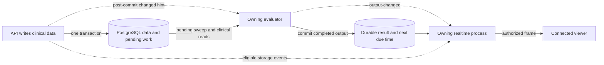
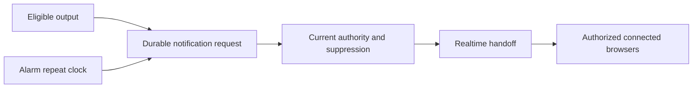

# Evaluator, realtime and API communication

The API commits a tenant's clinical write and its pending work together in PostgreSQL. The evaluator can therefore find work even if a post-commit hint is lost. Realtime serves the evaluator's completed output to authorized viewers. This is the adopted multitenant path on candidate 5. The single-site server retains its in-process path. [Writer-driven transport](multitenancy-decisions.md#writer-driven-transport-direction) · [Candidate evidence](execution-log.md#candidate-5-qualification-and-nominal-discovery)

## From a write to a viewer

**Read-derived at candidate 5.** Core `lib/internal-hints/contract.js` defines the three versioned calls in the diagram. A scheduling acknowledgement means the receiver accepted a hint. Clinical completion can be observed once the evaluator commits its result. Browser latency ends later, when a viewer receives the frame. Measure those intervals independently. [Latency objectives](multitenancy-decisions.md#latency-objectives)

### Bounded clinical input

Each evaluator slice owns a stable hash partition. It can reuse bounded resident rows and prepare inputs for the same clinical plugins used on a single site. Changes in settings or restore generation, or a change too broad to apply incrementally, require a full bounded read. PostgreSQL supplies the recovery state after a restart. Compare resident evaluation with the full rebuild for identical outputs. [Resident window](multitenancy-decisions.md#stateful-evaluator-resident-window) · [Evaluator scaling strategy](multitenancy-decisions.md#evaluator-scaling-strategy)

### Raw storage delivery is independent of clinical membership

For the paths that emit single-site `/storage` events, the API sends stored mutations to the realtime owner after commit. Realtime applies subscriber authority. Live storage delivery is best effort. A pending sweep recovers clinical work. A raw storage event and a clinical viewer frame have different consumers and timing. The main browser feed sends deltas derived from completed evaluator output so an alarm can accompany the reading it concerns. [Storage event parity](multitenancy-decisions.md#storage-events-single-tenant-parity) · [Browser frame decision](multitenancy-decisions.md#no-realtime-fast-path)

## Notification intents, retries and alarm handoff

The evaluator owns notification eligibility, durable requests and attempts. Realtime owns delivery to the connected, authorized audience. A retry uses the same request identity and checks current suppression and authority. Active alarms repeat on the single-site heartbeat clock. A handoff receipt measures one stage of that path. [Request and retry contract](multitenancy-decisions.md#durable-notification-requests-and-retries) · [Alarm repeat clock](multitenancy-decisions.md#alarm-repeat-clock)

## Browser authorization and mutations

Realtime forwards socket writes and alarm acknowledgements to the API with the original client authorization. The API checks tenant and permission at admission and executes the canonical mutation. A client can reconnect to recover current state. Socket credentials, management authority and the private operator listener have separate audiences. [D23](multitenancy-decisions.md#d23) · [Credential changes](multitenancy-decisions.md#credential-rotation-next-request) · [Owner authority](owner-authority.md)

## Recovery, compatibility and qualification

A pending sweep recovers missed clinical hints. Time-dependent work still has a due time. Supported provisioning and management writers signal changes through the shared writer path, while restore and import finish with a tenant re-sweep. Restore suspends the tenant and fences old-generation effects across data replacement. Public history uses the tenant write clock independently of clinical scheduling. [Writer contract](multitenancy-decisions.md#writer-driven-transport-direction) · [Restore decision](multitenancy-decisions.md#restore-suspend-drain-replace) · [Ordering and history](counter-and-restore-options.md)

## Retained reference

The [November 16 communication guide](../../archive/tenancy/pgstream-communication-2026-11-16.md) preserves the stream-fed materializer, proposed XID coverage, single-evaluator experiment order and raw journal at their inspected revisions. The [pgstream integration report](../../../reports/tenancy/pgstream-idiomatic-2026-11-14/README.md) owns those results. The [writer-driven Kubernetes matrix](execution-log.md#update--writer-driven-kubernetes-matrix-complete-2026-11-21) records the evidence behind transport adoption.

Sections in the captured guide:

- [Stream-fed clinical materializer](../../archive/tenancy/pgstream-communication-2026-11-16.md#stream-fed-clinical-materializer)
- [Single-evaluator efficiency plan](../../archive/tenancy/pgstream-communication-2026-11-16.md#single-evaluator-efficiency-plan)
- [Keep, replace and regroup](../../archive/tenancy/pgstream-communication-2026-11-16.md#keep-replace-and-regroup)
- [Reconcile evaluator, realtime and REST](../../archive/tenancy/pgstream-communication-2026-11-16.md#reconcile-evaluator-realtime-and-rest)
- [Existing work and integration boundaries](../../archive/tenancy/pgstream-communication-2026-11-16.md#existing-work-and-integration-boundaries)
- [Measurements and implementation order](../../archive/tenancy/pgstream-communication-2026-11-16.md#measurements-and-implementation-order)
- [Preserve the horizontal execution seam](../../archive/tenancy/pgstream-communication-2026-11-16.md#preserve-the-horizontal-execution-seam)
- [Transaction coverage and mechanism retirement](../../archive/tenancy/pgstream-communication-2026-11-16.md#transaction-coverage-and-mechanism-retirement)
- [Internal trust and state ownership](../../archive/tenancy/pgstream-communication-2026-11-16.md#internal-trust-and-state-ownership)
- [Bounded clinical input: selected contract](../../archive/tenancy/pgstream-communication-2026-11-16.md#bounded-clinical-input-selected-contract)
