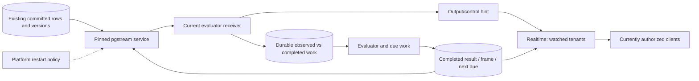
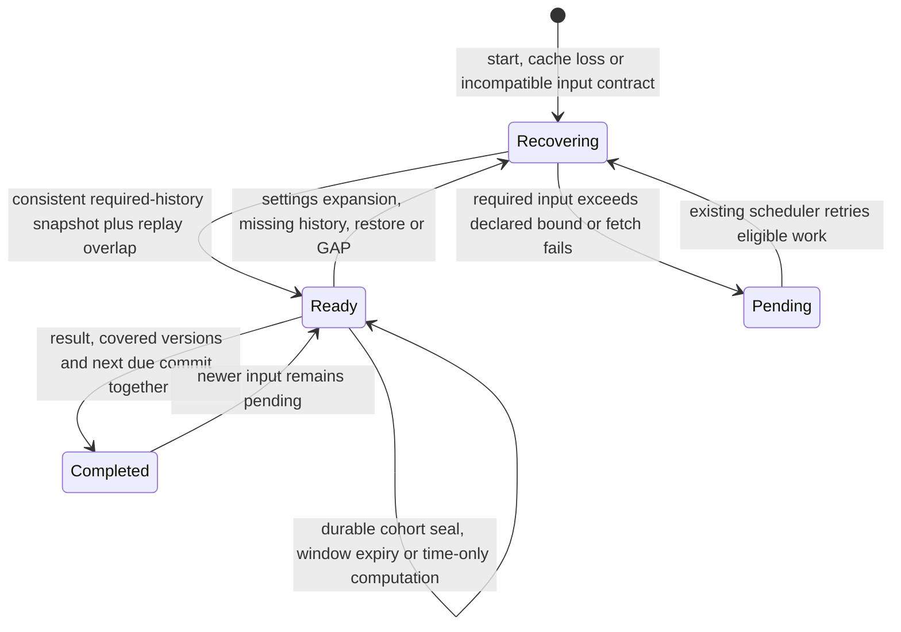
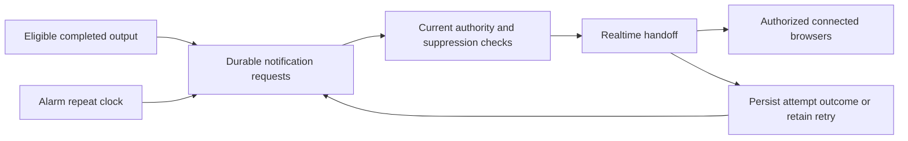

# Evaluator, realtime and API communication

*Contributor-facing living explanation, reconciled 2026-11-16 against selected
cgm-remote-monitor `5e112547b31252ec428747c821d3cd1b3684ce2b` and alignment records
`5fdc4bf0685d35d2fac980bad1b28bd66525ccdb`. Architecture is **read-derived**;
reproduced acceptance retains its executed source/image in the
[current integration record](../../../reports/tenancy/pgstream-idiomatic-2026-11-14/README.md#streamlined-runtime-integration--2026-11-16).
These mechanisms are fixed on local branches, not merged into dev or released.
The bounded-input query census retains its separate inspected source below.*

This guide owns component responsibilities, accepted versus completed state,
raw storage delivery and recovery. Decisions remain in [tenancy decisions](multitenancy-decisions.md),
the [durable event contract](durable-event-delivery-contract-2026-11-06.md),
[owner authority](owner-authority.md) and
[release decisions](../../../releases/cgm-remote-monitor-16.0.0/decisions.md).
The queue owns claimed work state; release contents own qualification and publication.

## Stream-fed clinical materializer

The evaluator consumes committed clinical inserts, updates and deletes into a
bounded tenant working set. Routine warm changes apply accepted rows; they do
not reacquire a full clinical source snapshot.
Settings, policy and lifecycle changes join the same processing contract.
Preserve existing identity, ordering, units, clinical algorithms, extension
fields and client contracts. Source JSONB retains original clinical fields;
generated typed SQL columns and typed metadata already support identity, ordering
and stream admission.

Transport acknowledgement follows cheap validation and recoverably accepted
input. Evaluation, viewer delivery and provider I/O run separately. Transport
position and clinically completed input/settings versions are distinct. A
transaction cohort becomes visible coherently; clinical dates do not define
coverage. Durable input or consistent snapshot/replay recovery must reconstruct
all accepted work after process loss. Snapshots serve bootstrap, gaps, cache
loss and missing historical needs; warm event handling applies streamed rows.

One bounded scheduler owns startup, unfinished versions, actual clinical due
work and recovery, with fair tenant selection and serial execution per tenant.
Completion atomically persists covered versions, result/frame/revision and next
due under current authority, ownership and restore fences before RAM advances.
Newer input stays pending. Realtime consumes completed output, applies current
viewer authority/demand, and keeps one retry responsibility per owed delivery.
Durable receipts recover lost wakes; external exactly-once delivery is not claimed.
Healthy idle has no hot full-roster polling or per-event catalogue screening.

| Boundary | Implemented branch behavior and qualification boundary |
|---|---|
| Clinical CDC and durable acceptance | Six clinical routes retain typed identity, extension fields, physical storage size and insertion order. Raw rows commit to the existing input checkpoint before transport ACK. In the inspected implementation, an XID (transaction identifier) cohort seals with its matching clock-table event, atomically with the typed observed-work receipt. That current dependency is evaluated under the [transaction-coverage direction](#transaction-coverage-and-mechanism-retirement). Same-LSN COPY rows remain distinct. |
| Working set and recovery | Warm evaluation reads the accepted clinical window, without full clinical source reacquisition. Consistent bootstrap uses the engine's historical exceptions and settings; whole-history storage statistics stay authoritative outside the clinical cache. A known row/byte overflow durably marks a non-ready gap, evicts the input cache and preserves the sealed clinical floor and completed output; bounded successful bootstrap is required before evaluation resumes. Malformed data is refused. |
| Scheduling and completion | One bounded scheduler owns startup, pending, due and recovery. A held tenant leaves free slots and later recovery pages available to neighbors. Retry backoff belongs to the failed tenant. Concurrent earliest-due reads coalesce, with a fresh lookup after changed work and safe ownership release before settlement. TIME acquires newly observed input before completion; input arriving during evaluation remains owed. Result/frame/revision, covered versions and next due commit under existing ownership/current-authority/restore fences before RAM completion. |
| Realtime | The completed-output path distinguishes upstream pending, unwatched/deferred and ineligible work from actual failed delivery. Durable receipts own owed-delivery retries. Realtime does not build a raw clinical projection. |
| Optional path | The separate selected-intake materializer remains unqualified and is explicitly refused before effects by the public evaluator configuration. It is not the default path or a prerequisite. |
| Qualification | Focused default native tests include coherent corrections/deletes, process recovery, due work without a write, held-neighbor progress and unchanged warm snapshot/statistics query counts. Source-scoped controls are in the [existing discriminator harness](../../../tools/mt-bench/m7-joined/README.md#stream-materializer-discriminators). The [current integration record](../../../reports/tenancy/pgstream-idiomatic-2026-11-14/README.md#streamlined-runtime-integration--2026-11-16) owns selected-source qualification; operating measurements retain separate attribution. |

## Single-evaluator efficiency plan

*Execution priority requested by the maintainer, 2026-11-16: improve one evaluator
before expanding evaluator replication, while preserving a path to the
[100,000-plus-tenant fleet](runtime-topology.md#scale-envelopes-and-fleet-planning).
This is a plan, not a capacity qualification. Mechanism assessments are
**read-derived** from qualified core `c31c6e0b69a2a2f2a5320b9e4d32195f1b3e1878`
and receipt follow-on `c1173eab7c4fea1270eb585aff5961142849d048`, with deployment
`92227d9d4853ed75c5f1ea10c0ba00f03bd2dac5`. Linked records own reproduced results.
Proposed alternatives below are not selected by this plan.*

The objective is more correct clinical completions per unit of evaluator CPU,
memory and database work, within declared input-to-output freshness, clinical
clock deadlines and recovery bounds. Count source writes, accepted input,
completed clinical opportunities, connected viewers and delivered frames
separately. An unchanged frame can still cover new input; a due cycle can be
required without a source write. Fleet population is not a claim that one
process or database serves that population.

### Keep, replace and regroup

| Responsibility or mechanism | Disposition and boundary |
|---|---|
| Shared committed-change detection | **Keep pgstream** as the selected transport. Discover work once rather than restore per-worker/per-tenant polling. One receiver and one replication slot do not distribute clinical execution by themselves. |
| Durable acceptance, completed coverage and pending work | **Keep the distinct outcomes.** Acknowledge only recoverable input; completion covers only the input/configuration actually evaluated. Newer input remains pending. Reuse existing durable stores rather than add a broker or general event log. |
| Clinically sufficient input and source truth | **Keep explicit row/byte bounds and consistent recovery.** Clinical windows, historical exceptions, typed identity, ordering and extension fields remain required. Source history is authoritative; a clinical cache is replaceable. Incremental windows versus coalesced snapshot rebuilds are a measured design comparison, not a reason to narrow clinical inputs. |
| Clinical scheduling | **Regroup under the existing bounded scheduler:** startup, accepted pending work, recovery and actual due deadlines. Keep serial work within a tenant, progress for healthy neighbors, tenant-local retry backoff and bounded concurrency. Do not add an independent retry owner for the same obligation. |
| Clinical result and browser frame | **Keep one clinical interpretation.** Evaluator produces both using shared engine primitives. Realtime consumes completed output and does not reacquire clinical history or run a second clinical projection. Remove redundant copies only with equivalent clinical/client output and recovery controls. |
| Transaction completeness and internal progress | **Evaluate replacing clock-event sealing** using the exact connector contract or a coherent invalidation/snapshot alternative. See [transaction coverage](#transaction-coverage-and-mechanism-retirement). Native WAL semantics alone do not qualify the webhook boundary. Public history and insertion ordering retain their separate contracts. |
| Receipt SQL, JSONB envelopes and encoding | **Optimize physical work, preserve semantics.** A mandatory row rewrite, SQL shape, RAM generation or acquisition/TIME label is not a product obligation. Retire displaced executable code and mechanism-only assertions together, with semantic controls. Acknowledged input must never exist only in RAM. |
| Authority, activity, ownership, schema and restore checks | **Keep their guarantees; consolidate equivalent reads.** Batch addressed trusted metadata work and keep current effect/completion fences. Do not replace current authorization with a cached prior allow decision, or run expensive catalogue admission for every event without a demonstrated requirement. |
| Completed frames, raw mutations and alarms | **Keep different delivery contracts.** Current display frames may supersede older frames; raw subscriptions preserve required operation order or explicitly lose continuity; alarms retain stable intents, suppression, attempts and retry deadlines. Shared helpers must not erase these distinctions. |
| Optional membership, placement and process topology | **Keep outside the unpartitioned hot path.** A standalone evaluator owns its configured eligible tenants without fabricated membership leases. Existing optional partitioning remains available. Additional workers, threads, services and pool connections need a measured reason. |

The selected design already separates input acceptance, clinical completion and
external effects. Co-locating code may remove a network hop; it does not remove
these durable boundaries. Conversely, different logical responsibilities do not
require different processes. Bound intake, clinical and delivery work so a slow
provider, viewer burst or expensive tenant cannot exhaust the whole worker.

### Reconcile evaluator, realtime and REST

| Component | Owns | Efficiency and compatibility rule |
|---|---|---|
| REST API | Canonical storage reads/writes, request authorization and versioned adapters | Ordinary authorized storage operations remain independent of clinical readiness while storage/backlog policy permits them. Writes do not wait for evaluation or viewer delivery. Preserve truthful write uncertainty and supported history. |
| Evaluator | Background clinical interpretation, covered input, completed frame and next due | Viewer count does not multiply clinical calculation. A source write, settings change or clinical deadline can create work without a viewer. |
| Realtime | Connections, subscriptions, currently authorized frame/raw delivery and socket forwarding | Use evaluator output for the current clinical display. Forward original mutation/acknowledgement authority to the canonical API handler. No parallel clinical source acquisition. |
| Notification producer and delivery | Durable alarm identity, suppression, attempt state and retries | Keep external I/O outside stream acknowledgement and clinical execution slots. One retry responsibility per obligation; provider/browser handoff is not proof of human receipt. |

Reuse input-selection, normalization and calculation primitives for REST derived
endpoints. Each endpoint retains its stated consistency/freshness contract; do
not silently substitute a retained evaluator frame. Reuse mathematical credential
proofs where qualified, while checking current claims and database authority as
required. API replicas and realtime placement keep their existing independent
ownership and maintenance contracts.

### Existing work and integration boundaries

The canonical [runtime qualification](../../../reports/tenancy/pgstream-idiomatic-2026-11-14/README.md#streamlined-runtime-integration--2026-11-16),
[amplification retirement](../../../reports/tenancy/pgstream-idiomatic-2026-11-14/README.md#stream-amplification-and-executable-retirement--2026-11-16)
and [receipt efficiency](../../../reports/tenancy/pgstream-idiomatic-2026-11-14/README.md#realtime-receipt-write-and-planning-cost--2026-11-16)
retain their exact source/image and test scope. They do not establish a matched
operating improvement on later sources.

| Work | Already covered or currently owned | Next boundary |
|---|---|---|
| Qualified runtime and bounded state | Incremental warm input, consistent recovery, one clinical scheduler, atomic completion, independent bounded raw tail, output-only realtime and stock-client qualification | Preserve and reuse unchanged source-scoped qualification. Do not rebuild a second clinical cache in realtime. |
| Qualified amplification and receipt changes | Subscription caching, normalized replay without redundant updates, addressed output delivery with lost-wake recovery, executable untyped-runtime retirement, duplicate realtime receipt rewrite avoidance and bounded prepared statements | Measure residual unique-event work and the actual operating duplicate fraction; primitive savings are not a frame-latency gain. |
| Incremental snapshot-to-stream handover | The dedicated handover source owner owns exact snapshot/stream overlap, connector integration and internal progress while preserving incremental warm processing without routine window rereads. The predecessor keeps its frozen coalesced dirty/snapshot qualification and bounded lost-wake repair. | Handover owner completes its coherent correctness capability. The fallback remains an unqualified comparison, not the selected replacement. The profiling continuation does not repeat connector/handover proof or implement another intake path. |
| Operating and HTTP/delivery diagnostics | Existing operating owner retains runs, helpers, pins, budget and cleanup. Existing diagnostics work provides bounded HTTP classification, partial captures and revision-correlation facilities. | Reuse released instruments and inspect their remaining coverage. Exact cross-process/raw-delivery correlation and sustained instrument overhead require evidence; do not create a competing telemetry framework. |
| Single-evaluator efficiency continuation | The [accepted-input component profile](../../../reports/tenancy/pgstream-idiomatic-2026-11-14/README.md#single-evaluator-accepted-input-profile--2026-11-16) is closed with a retain decision; its rejected experiment is not adopted. | Further optimization needs a distinct measured hypothesis and explicit source boundary. SQL/statistics, real scheduling and operating costs remain separate evidence gaps; reuse existing instruments and preserve the handover and operating owners' boundaries. |

The predecessor's unqualified snapshot candidate is a deliberate trade: less internal staging
and clock coupling, but source rereads on dirty acquisitions. A dirty burst may
coalesce many receipts into one snapshot; steady writes or large required windows
may make those reads expensive. The selected incremental contract above remains
the qualified reference. The active handover lane aims to preserve incremental
warm work; adoption of any alternative still needs source acceptance and an
explicit decision.

### Measurements and implementation order

Use the existing runner and bounded diagnostics. Freeze source/deployment/image,
instrument, workload, CPU/memory limits and database history for each comparison.
Retain originals outside Git and report shared-host interference. Start with the
smallest discriminator that can select a design; a broad capacity sweep is not
the prerequisite for isolated synthetic profiling. An independently owned branch
experiment may start before final source acceptance; label its unqualified source
and scope. Source-owner release means permission to use the named checkpoint, not
a requirement to wait for every acceptance tier before collecting evidence.

| Priority / owner | Measurement and decision | Required discriminator and exit criterion |
|---|---|---|
| **1 — efficiency continuation, using released diagnostic helpers** | Attribute source commit → durable acceptance → queue wait → input acquisition → clinical calculation → output commit → realtime selection/send → client callback. Record process-local durations; use exact revisions and process incarnations for joins. Separately record intake backlog, accepted-versus-completed lag and overdue clinical work. | A delayed stage must appear in that stage; missing/corrupt revision links remain UNMEASURED. Reconcile accepted writes to independent storage and completed opportunities to output. Select the dominant supported cost, rather than infer it from HTTP success or a late frame alone. |
| **2 — efficiency continuation; connector changes remain with source owner** | Compare unique and replayed input: receipt transactions, statements, tuple rewrites, parameter/result bytes, lock wait, WAL and recovery. Compare the released coalesced snapshot candidate with incremental input at equal clinical output. Vary burst/coalescing, transaction size and required history size. | Preserve complete clinical transactions, same-LSN distinct rows, receipt-before-ACK, uncertain-COMMIT replay, input arriving during evaluation/snapshot and recovery. Report snapshot queries/WAL as well as intake savings. Choose a mechanism only when total cost and freshness justify it; batching is conditional on a real bounded transport/ACK contract. |
| **3 — efficiency continuation** | Profile CPU and allocation/GC across cache application, decoding/encoding/freezing, view materialization, engine execution, digest and frame creation. Measure resident/peak memory, cache rebuild frequency and authoritative whole-history statistics queries. | Hold output and clinical windows equal. First reuse existing data and calculation paths; change representation or statistics maintenance only for a measured cost. Deletes/corrections, settings expansion, historical fallback, expiry, restore and byte accounting remain correct. A cached-window byte sum is not whole-history storage size. |
| **4 — efficiency continuation; operating owner consumes result** | Tune bounded concurrency, resident input limits and intake/clinical/delivery pool budgets together. Inspect real pending/due query plans, lock/pool waits and event-loop delay under busy-tenant plus due-only-neighbor load. | Healthy neighbors and actual deadlines progress under one held/failed tenant; memory and backlog stay bounded. More promises overlap I/O, not synchronous JavaScript CPU. Threads/processes or new indexes follow a demonstrated bottleneck, not a tenant-count assumption. |
| **5 — operating owner after source release** | Run a matched sustained operating comparison on the coherent selected candidate, including startup, steady traffic, quiet due work, burst, restart and backlog drain. Include evaluator, PostgreSQL, pgstream, API, realtime and provider-adapter costs. | Report freshness tails and correct completed opportunities per CPU time, peak/RSS/GC, database work/WAL and recovery bounds. Preserve original failures. Accept workload/resource limits explicitly; do not extrapolate a primitive or one operating point into fleet capacity. |

An optimization closes when a meaningful break fails the retained behavior,
restoration passes, and the matched measurement supports its intended benefit
without moving unreported work into PostgreSQL, API or realtime. If evidence
refutes a prescribed fix, retain the measured result and choose the simpler
supported mechanism. Missing optional metrics narrow that claim rather than
invalidate independent observations. Join planned repairs before one coherent
applicable final campaign and final prcheck; leaf changes do not each trigger a
new comprehensive campaign.

### Preserve the horizontal execution seam

Keep intake ownership separate from permission to execute clinical work. The
unpartitioned evaluator owns all its eligible tenants; future selected workers
own subsets through the existing assignment contract. Pending input, completed
coverage, output and due obligations survive process replacement. Completion and
effects reject stale authority/ownership/restore state; assignment alone does
not prove those checks or duplicate-effect safety.

A future worker must select only its assigned pending/due work, without replaying
all tenants' input or performing full-roster screening. Qualify membership change,
cache transfer/rebuild, old-worker exclusion or the admitted overlap policy,
duplicate alarm prevention and recovery before claiming horizontal execution.
Equal tenant counts need not mean equal CPU or memory. A single intake owner can
feed several execution workers only with a qualified work-distribution boundary;
a load-balanced receiver address is not that boundary. Keep this seam explicit
now; defer new fleet/placement machinery until single-worker measurements justify
it. The [topology ownership inventory](runtime-topology.md#evaluator-inspection-and-workload-ownership)
owns the other roles' scaling semantics.

## Transaction coverage and mechanism retirement

**Direction for evaluation, 2026-11-16; replacement proposed, unimplemented and
unqualified.** The [release decision](../../../releases/cgm-remote-monitor-16.0.0/decisions.md#stream-native-coverage-direction)
directs internal ordering and coverage toward the PostgreSQL committed stream.
Evaluator still owns recoverable accepted versus completed work, clinically
sufficient bounded state and actual due obligations. Realtime consumes completed
output under current authority. These outcomes do not require one particular
application clock, cache generation, counter label or physical write pattern.

| Boundary | Status and requirement |
|---|---|
| Clinical, isolation, authorization, restore, durable acceptance and supported-client outcomes | Adopted obligations. Preserve correct output, coherent committed input, no early acknowledgement, recovery and current-effect fences. |
| Current clock-event sealing | Read-derived at qualified c31 `lib/storage/clinical-stream-sql.js:30–41`: a clock-table event seals the staged XID cohort, and its floor becomes observed work. Existing qualification remains valid for that source. This coupling is an implementation dependency to evaluate, not an enduring product requirement. |
| Connector-framed internal coverage | Proposed replacement. PostgreSQL native commit semantics alone do not prove that the selected pgstream webhook interface preserves transaction completeness. No stream-native replacement is implemented or accepted by this direction. |
| Public history and insertion ordering | Separate supported contracts. The [ordering guide](counter-and-restore-options.md) distinguishes clinical time, legacy history stamps/cursors, already-present tenant/collection insertion ordinals and internal transport/processing positions. Do not substitute one for another. |

The first discriminator uses the exact pinned connector and its actual
transaction framing, replay and acknowledgement behavior. It must distinguish
multiple rows sharing an LSN, a complete commit from a partial cohort, rollback,
consistent snapshot/replay overlap, and source/restore-generation changes.
Only evidence that this interface preserves the required boundary can qualify a
replacement. Reuse the selected transport and durable stores; this direction
introduces no new CDC engine, general event log, per-tenant replication slots or
opaque-cursor subsystem.

Tests are evidence of adopted behavior, not independent authority to preserve an
implementation. In the same capability change, retire or replace assertions that
demand a mechanism being removed. Name the old assertion, retained user-visible
invariant and replacement semantic control; show the meaningful break fail and
restored behavior pass. Preserve public history no-missed-write checks while that
client contract is supported. Do not restore an obsolete path just to satisfy a
source regex, and do not delete correctness because its old test mentions clocks.

Potential retirement candidates include stable RAM generation, acquisition/TIME
labels, unexplained absolute failed-attempt counts, blanket evaluator-ready
admission for otherwise authorized REST load, exact private ordinal values,
mandatory physical row rewrites and clock-specific internal seals. Each depends
on its actual outcome contract; none authorizes ignoring wrong output, lost
committed input, authority/restore changes or durable progress rewinds. Authorized
REST durability remains independently observable during evaluator recovery;
explicit storage/backlog bounds can still refuse writes.

Completion requires one owner for each responsibility, obsolete executable paths
and their mechanism-specific assertions retired together, focused semantic
controls, compatible recovery/client behavior, then one coherent applicable final
acceptance on the changed source. Existing pinned-source qualification and entered
experiments remain unchanged. The source/operating lane owns the proposed proof;
release contents and the canonical report own any later measured acceptance.

## Internal trust and state ownership

Evaluator and realtime are trusted internal roles that work across tenants.
Internal CDC payloads may contain clinical, configuration and completed-output
rows. A blanket non-clinical-only feed is not an isolation requirement. Reuse
existing rows and versions; add a marker only where it makes coalescing or
recovery simpler. Do not add tables or rereads solely to hide data from these
trusted workers. Current tenant identity, authority, ownership and restore state
still govern computation, persistence and externally visible effects. Trusted
metadata work may batch across tenants without a per-event catalogue screen or
public request-admission path.

One receiver in the evaluator role durably coalesces **observed** versions before
returning HTTP success. Evaluation drains observed-versus-completed differences
separately, so clinical computation does not hold the serial CDC delivery open.
The existing evaluator checkpoint consumer retains observed and completed
versions, completed result/frame, content revision, next due instant and
ownership/restore generation. Acquisition and clinical completion remain separate.

The [platform restart decision](../../../releases/cgm-remote-monitor-16.0.0/decisions.md#evaluator-platform-restart)
places pgstream in an independently managed service. It sends webhooks to the
evaluator's private receiver. The platform owns the pinned process and its restart
policy; the evaluator owns durable receipt, clinical completion and application
readiness. A stream outage withdraws readiness and recovery reconciles current
state. Restarting pgstream does not itself require evaluator exit. Existing
internal API and deployment trust conventions apply.

Each replication slot has one active stream consumer. Delivery must reach the
current receiver owner, or an ingress implementation that provides equivalent
durable admission. The current selected binding targets its sole intake owner;
ordinary load balancing across evaluator replicas is not qualified by the private
Service address. Receiver availability and clinical readiness are separate so
service discovery does not require clinical readiness before delivery can start.

The historical [bounded platform witness](../../../reports/tenancy/switch-over-finish-2026-11-15/external-platform04.json)
measures a Docker-managed stream replacement with the same evaluator and exact
durable catch-up. It does not qualify the new application image, Kubernetes,
general failover or a capacity limit.

Completion commits the result, processed versions and next due together under a
current ownership/restore fence. A newer version remains pending when an older
cycle finishes. Reuse current transactional write clocks, settings/activity
versions, notification producer identities and recovery contracts. Clinical dates
and CDC arrival order never stand in for commit versions.

Input, output, heartbeat and schema/control routes are explicit. Output and
receiver acknowledgement writes must not feed an input-evaluation loop. A
validated output payload may accelerate delivery. Durable output revision remains
truth; reconnect and bounded reconciliation for watched tenants recover a missed
private/local hint. This hint may use an existing private interface; successful
RPC is not the sole delivery/recovery path. Realtime does not build a second raw
clinical projection. Preserve the adopted connection-driven lifecycle and update
its move-readiness contract in the same source cut where that behavior changes.

## Bounded clinical input: selected contract

*Selected contract, 2026-11-16. The query census below is **read-derived** from
application commit `543808784e0f5f03945b840142a0df31177443ba`; its path/line anchors
retain that source. The selected implementation and reproduced qualification now
belong to the [current integration record](../../../reports/tenancy/pgstream-idiomatic-2026-11-14/README.md#streamlined-runtime-integration--2026-11-16).
Historical sources are not relabeled as the executed selected candidate.*

The evaluator needs the rows its existing property view can read, plus recoverable
state needed to maintain those answers. It does not need all source history in
RAM. The property view supplies both clinical properties and the completed browser
frame (`lib/data/tenant-projection-evaluator.js:141–154`). Its windows below are
existing query contracts, not new clinical retention policy. Narrowing those
windows needs the existing equality and replay controls
(`lib/data/views/bounds.js:20–25`).

| Input | Existing need and source | Required cache semantics |
|---|---|---|
| Entries | Empty-cache loader reads `date >= now - 2 days`, ascending; property view keeps that query (`lib/data/dataloader.js:179–192`; `lib/data/views/bounds.js:97–107`). | Preserve every matching type and extension field, not only SGV. This includes meter readings and calibrations. Do not substitute the alarm-only view's newest-12/newest-1 queries. |
| Ordinary treatments | Every `created_at >= now - 60 hours`, ascending (`lib/data/views/bounds.js:37–44,85–89`). COB chains absorption across treatments and uses historical device-status IOB; a DIA-only window changes output (`lib/data/views/bounds.js:64–79`). | Retain the full window. Duration, carbohydrate/insulin fields, units and unfamiliar fields remain engine input. An ongoing duration does not authorize inventing an additional lookback or dropping part of the existing one. |
| Treatment history exceptions | Latest of each exact event type: Sensor Start, Sensor Change, Sensor Stop, Site Change, Insulin Change and Pump Battery Change within 62 days (`lib/data/dataloader.js:406–437`). Latest duration-zero Profile Switch within `31 * 12` days (`lib/data/dataloader.js:362–381`). | A conservative cache may retain all candidates in each specified range. Keeping only each winner requires historical fallback when a correction, soft delete or hard delete removes it. These exceptions survive ordinary 60-hour expiry. |
| Device status | `created_at >= now - 24 hours`, or 48 hours when extended `devicestatus.days == 2` (`lib/data/views/bounds.js:46–55,90`). | Preserve complete nested uploader, pump, openaps, loop and xdripjs data. Larger plugin alert thresholds do not widen this existing query. A 24-to-48-hour settings change must recover the missing day before completing that settings version. |
| Profile | `profile.last()` reads one visible profile sorted by `startDate DESC, _id DESC` (`lib/server/profile.js:21,176–178`; `lib/data/dataloader.js:448–457`). | There is no age cutoff and no selection of “latest before now” here. Keep the selected document, including its complete `store`, or a bounded candidate set with explicit historical fallback on winner removal. Retaining every profile has no automatic population bound. |
| Food and activity | Property view answers both with no rows (`lib/data/views/bounds.js:92–93`; `lib/data/views/index.js:174–193`). | Do not load their history into this clinical cache. This preserves the current property view's result; it does not change REST or export. The completed frame retains its existing `food` field and current empty answer (`lib/data/ddata.js:134–158`); activity is absent from that frame. Both domains still contribute to storage accounting. |
| Storage statistics | Tenant logical JSONB bytes across the configured source tables, including invalid and old rows (`lib/storage/postgres-tenant-stats.js:15–32`). | Maintain an independent authoritative aggregate or read that aggregate through its existing contract. Clinical eviction must not reduce `dataSize`. Per-row bytes of cached rows alone cannot answer this statistic. |

The query compiler and existing engine own type handling, units and ordering.
Entries use numeric `date`; the other range queries compare `created_at` with an
ISO string. Replacing that membership test with a permissive date parser can
change answers for legacy or malformed values. Preserve the existing filter's
type and array semantics. Those queries have no upper time bound unless the
loader is explicitly asked for a framed historical read
(`lib/data/dataloader.js:188–192,367–368,423–424`). Future records therefore stay
eligible input. They become clinical work when their time arrives
(`lib/data/evaluator-due.js:62–65`). The cache does not discard them as “too new.”

Typed identity is `(domain, id_kind, _id)`; a string and an ObjectId with the same
hex text remain distinct (`lib/storage/postgres-identity.js:13–38`). Preserve each
row's insertion ordinal and the existing total-order tie-break. Keep original
clinical values in durable input; unit and duration normalization remains in
`ddata`, including temporary-target conversion
(`lib/data/ddata.js:37–79,469–505`). A record with `isValid: false` stays out of
clinical answers, while source history and byte accounting still include it
(`lib/server/soft-deleted.js:3–24`). A late correction is classified by its new
contents; commit coverage is classified by the stream's versions and cohort,
never by the record's clinical date.

One existing scheduler owns expiry, clinical due work and recovery. Expiry removes
only derived rows and schedules the next boundary even without an input write.
Shrinking a window can prune its derived state. Expansion, backward clock movement
or a ranked winner lost from a reduced candidate set requires a named historical
recovery path before completion. A consistent tenant-bound snapshot includes the
required source ranges and its input floor; replay overlap skips cohorts already
covered by that floor and applies later committed cohorts whole. Restart may
reuse a compatible durable working set. An incompatible policy, schema or restore
generation must recover rather than reinterpret old coverage. Routine warm
changes apply accepted row data; a legitimate missing-history fetch has a
separate recovery reason and is not an every-change full-source reconcile.

Window membership is not a hard memory bound. Declared row and byte limits still
refuse a clinically required set that exceeds them; the implementation must retain
pending work and the last completed output without certifying the refused version.
Fleet admission must also account for retained decoded/prepared input, plugin and
date caches, staged cohorts, result/frame copies and in-flight evaluations. Cold
cache eviction preserves durable pending versions, deadlines, notification state
and completed output. It must not turn tenant admission into roster scans or
repeated failed bootstrap attempts. Viewer presence does not control clinical
admission or deadlines.

Derived expiry never deletes source rows. Source retention is separately optional:
API v3 autoprune runs only when configured, and profile pruning is an explicit
API DELETE operation (`lib/api3/generic/collection.js:33,139–180`;
`lib/api/profile/index.js:232–240`). Neither guarantees the population fits a
clinical cache. REST history/export and logical restore retain their existing
source contracts. Restore invalidates derived membership under its existing
suspension, authority and generation fences. Whole-history accounting must survive
that invalidation independently; identity-only deletes and unchanged-TOAST updates
cannot derive an evicted row's former byte size from its absent cached document.

Clinical evaluation remains current-state computation. This cache does not create
a guarantee to evaluate every superseded intermediate row version. Transaction
cohorts must remain coherent, and durable notification requests already produced
retain their identities, suppression and retries. Any consumer that requires an
intermediate transition needs retained event/effect semantics before coalescing;
window expiry or latest-state replacement cannot silently satisfy that obligation.
Realtime continues to consume the completed result and current viewer authority,
not a second raw projection. Qualification must compare actual engine answers and
frame fields, distinguish required historical recovery from warm rediscovery, and
prove that expiry neither deletes source data nor completes unseen input.

### Raw storage delivery is independent of clinical membership

The focused precursor implementation is application branch
`codex/bounded-storage-20261116`, commit
`3e085e056330d2f0ddf29c4000e526a968462620`. It includes the integrator's committed
`1dc7a74576b5d77f99cc4a42d900e1692d94a393` scheduler and populated-backfill repairs. It is fixed on that branch and
joined into the selected streamlined candidate. Its focused evidence retains its
original source; the current integration record owns joined acceptance.

The input checkpoint carries two JSONB envelopes: the clinically sufficient
working set first, a bounded source-mutation tail second. An accepted source row
and its existing completed-checkpoint delivery revision commit in the same
transaction before transport acknowledgement. The raw tail shares the existing
input-row write; the completed frame is not rewritten for each raw event.
Clinical bootstrap, expiry and GAP replacement preserve the second envelope.
Lifecycle/schema invalidation resets its continuity under the existing fences.
No new tenant table, broker, consumer retry loop or source-history projection is
introduced. Whole-history statistics still use `postgres-tenant-stats`.

The existing realtime receipt drain refreshes addressed controls once, consumes
completed frames without clinical row transfer, and independently delivers raw
mutations to storage subscribers. Each raw delivery failure remains local to its
tenant. Current worker, owner, restore-generation, activity and viewer authority
still fence publication. No viewers means no raw-tail fetch or retained offline
client obligation. Notifications keep their independent clinical deadlines.

A storage subscription records the current mutation sequence and then receives
later normalized operations in source order. Its existing packet supplies no
initial population, offline cursor or reset event; reconnect begins another live
subscription. Exact retained retries are idempotent within the live cursor;
external exactly-once delivery is not promised. A temporarily uncertain authority
holds its cursor for recheck. If that cursor falls behind the bounded tail, the
server disconnects it with `REALTIME_STORAGE_CONTINUITY_LOST`; it does not silently
coalesce required mutations. An older concurrent tail read cannot move a cursor
backwards. Clinical expiry emits no source event. Food/activity and out-of-window
corrections/deletes remain raw events even when absent from clinical input.

Append-only migration `0100_<domain>_storage_identity` sets source tables to
`REPLICA IDENTITY FULL`. Actual old documents preserve public delete identifiers
that differ from typed `_id`, including TOAST values. Metadata-only updates with
unchanged documents emit no client mutation. Catalogue checks accept only this
exact typed operation; readiness refuses the old identity mode. Existing RLS,
grants, logical export/restore/delete inventory and single-tenant socket wiring
remain the authority for those responsibilities.

The [focused qualification record](../../../reports/tenancy/pgstream-idiomatic-2026-11-14/bounded-storage-2026-11-16.md)
contains the reproduced engine/history/expiry, native WAL/COPY/replay/RLS,
current-authority, fleet-cache and mutation-control results, exact sources and
retained evidence. The integration record now owns selected-source actual-role
client and full/browser/enabled-native qualification. Operating profiles and
capacity retain separate source, evidence and claims.

The selected stream path keeps warm replay read-only, including time-only expiry.
It reads only the clinical component, without transferring the raw delivery tail.
The existing receipt seal advances the window using the last completed clinical
engine instant and prunes it while owning the input transaction. Idle state cannot grow. Evaluation
can remove more expired rows locally; distinct remaining subsets carry distinct
progress identities. Clock rewind or settings expansion uses consistent recovery.
This avoids a checkpoint write and full policy comparison on each warm cycle.

Completed stream output keeps the clinical result and stock-client frame without
a second copy of raw clinical rows. The input checkpoint owns those rows; the
independent mutation tail owns raw delivery. Nonstream snapshot output preserves
its established row contract. Realtime reads completed output and the raw tail
under current tenant authority; it does not reconstruct clinical projections.

Raw publication opens its tenant operation before it validates a captured tail.
It then checks current authority and every send within that operation. A closed
read operation cannot supply an active publication scope; retries retain the
owed delivery instead of bypassing restore checks.

Bounded state transitions replace changed envelopes and arrays while sharing
read-only retained values. Raw-tail eviction counts exact UTF8 bytes once and
subtracts removed elements. Persisted size estimates do not override an exact
fresh bound; overflow, cohort and prior-state mutation controls remain.

Qualification follows durable outcomes. Cache eviction may advance a disposable
component generation, and due work may need an acquisition after cache loss.
Neither a stable RAM generation nor a particular acquisition/TIME counter split
is an enduring clinical requirement. Preserve process/restart provenance,
monotone completed coverage, pending work, due obligations, current authority and
restore fences. A counter-only observation cannot establish those durable
properties or justify relabeling an earlier failed capture.

FULL replica identity is retained for the selected candidate. It supplies the
old public identifier and unchanged TOAST document required for truthful deletes
and corrections without another history projection. Its synthetic WAL cost is
material, so this is an explicit correctness/storage trade-off. It is not an
established throughput cause or an assertion that every future storage design
must use FULL. A replacement must preserve old identity semantics and recoverable
acceptance before acknowledgement.

Full old identity adds WAL bytes for unchanged documents; the qualification
record measures that trade-off in a synthetic fixture. It does not establish
serving latency, capacity or the cause of the earlier delay. Whole-history
statistic scans and total fleet heap/RSS remain unmeasured here. The bounded
clinical set may still exceed its declared limits when actual required input is
too large; that stays pending/refused rather than completed.

## Notification intents, retries and alarm handoff

The evaluator notification component owns durable producer, suppression, request
and attempt state. Realtime owns authorized connected-browser fanout. A stable
request identity survives an uncertain response or restart. Attempt state commits
before external I/O; retries recheck current eligibility, suppression, authority
and restore state. A handoff receipt does not prove browser display, human
acknowledgement or provider/device delivery. External exactly-once delivery is
not claimed.

Content-identical clinical cycles keep their output revision under the
[content-revision decision](../../../releases/cgm-remote-monitor-16.0.0/decisions.md#evaluator-revision-on-content-change).
Durable completed coverage may advance without changing the frame. An active,
unacknowledged, unsnoozed alarm repeats on its own
[heartbeat clock](../../../releases/cgm-remote-monitor-16.0.0/decisions.md#alarm-repeat-clock).
Paused or suspended tenants neither compute nor deliver alarms; resuming requires
current eligible output under the [activity policy](../../../releases/cgm-remote-monitor-16.0.0/decisions.md#activity-is-pause-suspend).

## Browser authorization and mutations

Main, storage and alarm namespaces retain their existing credential, subscription
and callback contracts. Realtime forwards the original client authorization and
mutation envelope to the API's private contract. API independently resolves the
tenant, checks the current credential and permission, and invokes the canonical
socket write or suppression handler. Transport identity does not replace client
authority. Ambiguous failures produce no synthetic success or automatic mutation
retry. REST v1/v2/v3 remain adapters of the same request-serving component.

A registered tenant operation lasts through actual response or publication
completion. Each send rechecks current authority inside that operation. Maintenance
uses the complete participant roster and actual backend/incarnation pins to drain
work and invalidate tenant state. A service address is not that roster. The
[runtime topology](runtime-topology.md) owns private listener composition and
[owner authority](owner-authority.md) owns credential/audience boundaries.

## Recovery, compatibility and qualification

Process-local caches may be evicted or rebuilt. Durable accepted/completed
positions, pending input, actual due work and current ownership/restore generation
determine recovery. Due work must complete whether the runtime labels its cycle
acquisition or TIME. A later next-due time can be legitimate; completion does not
require all future deadlines to disappear. Unclassified rejected-attempt counters
alone cannot establish a clinical failure or its cause. Actual wrong output,
missing coverage, authority loss and durable rewinds remain failures.

Lost-slot recovery stops serving, reconstructs consistent accepted/completed
state and verifies current due/restore state before explicit reopening. A revision
upgrade and rollback require the admitted source/deployment pair and compatible
WAL/input contracts. The [existing integration record](../../../reports/tenancy/pgstream-idiomatic-2026-11-14/README.md#streamlined-runtime-integration--2026-11-16)
owns the reproduced ordinary recovery, populated upgrade, cold rollback, selected
client and final full/browser/enabled-native results, including pending cases.
It preserves the different executed image/helper attributions. The
[production path](production-critical-path.md) explains remaining deployment
admission; the [operating report](../../../reports/tenancy/pgstream-idiomatic-2026-11-14/README.md)
owns workload measurements. Functional qualification does not establish capacity,
HA, a live provider or all clinical production behavior.

Single-tenant behavior, stock client code and wire formats retain their existing
contracts. Stream output omits duplicated clinical rows; the nonstream snapshot
contract and independent raw storage events retain their own fields.

## Retained reference

The [polling reference and stream integration plan](../../archive/tenancy/evaluator-realtime-reference-2026-11-16.md)
preserve the November 7 source map and snapshot/polling diagrams, November 13
prototype criteria and original evidence limits. Independent raw clinical
projections, feed-reader polling and their dispatch instructions describe those
baselines. They are outside the current normal stream path. Existing clinical,
authority, notification, restore and compatibility obligations still apply.
