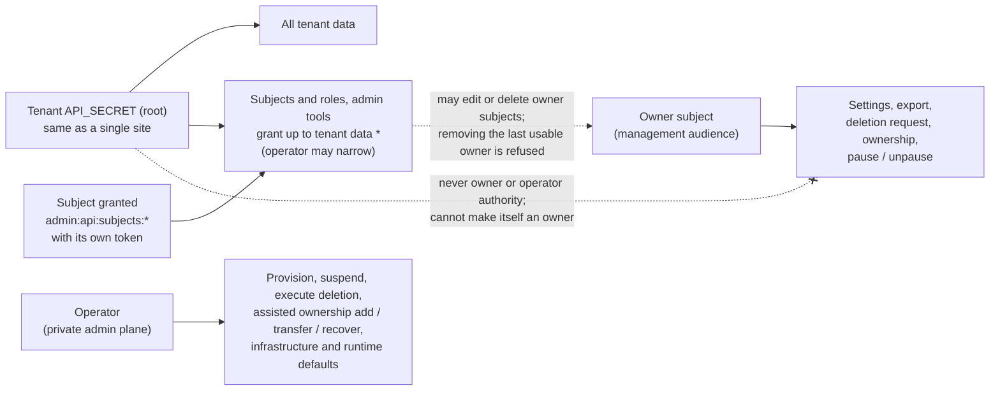
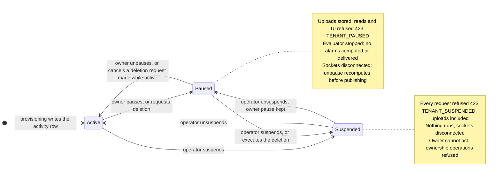

# Multitenancy decisions and architectural contracts

*Contributor-facing living decision reference. Consolidated 2026-11-06 from the
maintainer's D1–D23 decisions and their later amendments. This is a read-derived
reorganization, not new implementation acceptance or a new decision. The
[retained execution journal](../../archive/tenancy/nightscout-multitenancy-execution-plan-2026-09-14.md)
preserves the original rationale, prototypes, task definitions and measurements.*

This document owns the D1–D23 architectural decisions. The [owner-authority
contract](owner-authority.md) owns the later D17/D22 management and verification
amendment; the [durable event contract](durable-event-delivery-contract-2026-11-06.md)
owns B7's consumer/recovery rules. Later [release decisions](../../../releases/cgm-remote-monitor-16.0.0/decisions.md)
own promotion-bar, compatibility and lifecycle decisions. Their amendments take
precedence over earlier journal text. The [dashboard](multitenant-delivery-dashboard.md)
owns milestone claims, the [queue](../../../queue/work-queue.yaml) owns item state
and gates, and [release contents](../../../releases/cgm-remote-monitor-16.0.0/contents.md)
owns integration/publication status. Read the [tenancy guide](README.md) for the
current execution plan; archived “next” instructions are historical.

## 1. Decisions

| Decision | Adopted direction and qualifications |
|---|---|
| **D1** — targets | Multitenant service is the design target; families, clinics and communities are configurations of it. Self-hosted single-tenant remains first-class permanently. |
| **D2** — shared storage | Shared logical storage with a tenant discriminator, rather than a database per tenant. The retained database experiments own the comparative cost evidence. |
| **D3** — isolation | PostgreSQL with RLS for multitenancy. Serving connections must not own tables or bypass RLS; trusted tenant binding is transaction-local. A missing binding must not expose other tenants. |
| **D4** — MongoDB | MongoDB remains permanent for single-tenant sites. The storage seam carries two mature backends; an adapter change must preserve single-tenant behavior. |
| **D5** — workload roles | One core, with one stateless multitenant `api` component containing v1/v2/v3 REST adapters, change-driven `evaluator`, fan-out `realtime` and connector `vcpool`; `single` keeps its server. D21 packages roles under one executable. |
| **D6** — feed | Replication slot as the durable spine. The [event-driven reset](#event-driven-reset) prioritizes a maintained pgstream adapter proof over the custom SQL-reader/NOTIFY transport. Clinical writes must remain independent of notification failure; never emit notifications from a write trigger. The proof assesses evaluator ownership of raw inputs and recoverable due work, with realtime consuming durable outputs and authority lifecycle. B7 recovery obligations remain. The [local proof](../../../reports/tenancy/pgstream-flow-2026-11-13/README.md) records bounded replay evidence; production acknowledgement/recovery guarantees remain UNMEASURED. |
| **D7** — operator plane | Platform administration has its own entrypoint/network interface and is secured by unreachability, without a deployment API credential. Tenant administration is authenticated and tenant-bound; D16 gives it a separate listener. |
| **D8** — query contract | API v3's closed operator set is the initial query contract; v1 is bounded by client/corpus evidence. Use `mingo` as a differential oracle, with live-backend checks where oracle semantics differ. |
| *Superseded (historical base; replaced by the adopted current-dev delivery plan). Text archived unchanged in [the superseded-decisions archive](../../archive/tenancy/multitenancy-decisions-superseded-2026-11-18.md#d9).* | |
| **D10** — tenant label | Slug is a globally unique host label within one deployment, not a full hostname. Configured trusted resolution maps host to label to stable tenant id; no hardcoded first-label assumption. |
| **D11** — devicestatus | Generate columns only for the collection's indexed fields; retain the body as JSONB. Decomposition into normalized series is controller-declared and sits above the seam, so single-tenant benefits too. |
| **D12** — repositories | Alignment holds tooling, evidence, documentation and QC. Shipping code/tests belong in `cgm-remote-monitor`; findings and experimental scaffolding do not. Harnesses exercise shipping modules by path. |
| **D13** — credentials | No deployment-wide secret on any multitenant interface. Each tenant retains its own root/legacy credential; root-derived subject tokens must also be tenant-scoped. The operator plane remains credential-free. |
| **D14** — token keys | Per-tenant signing authority; resolve the tenant before examining a credential. A token for A used on B must fail signature verification, while opaque credential lookup and subjects also remain tenant-bound. Current key/credential state and rotation require their own acceptance. |
| **D15** — configuration source | `single` reads the environment. Multitenant per-tenant values come from storage, administered by owners under policy. Deployment-only values remain in each role's environment; D22 clarifies that distinction. |
| **D16** — audience listeners | Separate data, tenant-owner and private-operator sockets for the deployment, multiplexed by tenant rather than duplicated per tenant. Extract shared tenant resolution/credential verification before adding the owner listener. The adopted initial owner listener is a second bound socket inside `api`, movable to its own process later. |
| **D17** — authentication audiences | Devices permanently keep native tenant credentials; Hydra is deferred and D7 is unchanged. External human identity uses the later [shared optional single/multitenant OIDC integration](owner-authority.md#shared-oidc-integration), provider-backed renewal first and separate authorization adapters behind Nightscout's own credential exchange. The cohort-wide Kratos pool remains adopted in principle and gated, with cookie scope E and the production conditions below. |
| **D18** — registration | Well-known declarations describe existing writers without client changes. Controller-owned, dynamic typed declarations support new kinds, states, transitions, initiators, effects and commands. The controller owns lifecycle, composition, synchronization and reconciliation; the hub records and observes, never derives dosing state. Its extensible grammar is specified below. |
| **D19** — instances | Immutable content-addressed definitions are separate from leased instances. Each channel role declares `device` or `simulated` provenance; one device source of record holds a role, with explicit handoff and visible overlap. Definitions survive while data references them. |
| **D20** — identities and quirks | `identifier` is client sync identity; `_id` is the hub storage key. Every legacy surface serves hub-assigned 24-hex `_id` values on either store; the opaque alternative is withdrawn. Quirks are version-scoped, recorded when applied, and retired only from measured evidence. |
| **D21** — executable/profiles | One Node executable, `bin/nightscout.js`: `single`, `multitenant <role>[,<role>…]`, and operator tools. The namespace is `multitenant`, not `serve`; the subcommand selects tenancy and retires `TENANCY_MODE` as an operator setting. Legacy single-site start paths stay equivalent. Roles/listeners are admitted only by their gates. |
| **D22** — policy/secrets | Effective settings combine code defaults, operator defaults, permitted owner values and operator pins, under code-enforced project floors. Secrets are a separate encrypted component. The owner-authority amendment governs delegation, sessions and local public-key verification. |
| **D23** — socket writes | Multitenant `realtime` is a reader without data-storage write authority. It forwards every socket mutation and alarm ack/snooze unchanged, with the socket's authorization, to an internal `api` endpoint using the same write step and `socket` source label. Relay the actual result to the acknowledgement; a failed forward yields no acknowledgement, preserving client no-ack retry. Never synthesize success. No client change; `single` stays unchanged. |

D1–D17 were adopted in September 2026; D18 and its grammar amendment in October,
D19/D20 and their walk-through amendments in October, D21 on October 26 with the
November 3 namespace amendment, D22 on October 27 with the November 5 owner
amendment, and D23 on November 6 with its same-day all-socket-write amendment.
The original dated basis for each remains in the [journal decision table](../../archive/tenancy/nightscout-multitenancy-execution-plan-2026-09-14.md#1-decisions).
D17's human-identity gate is the exception to unconditional adoption.

## 2. Storage, resolution and profiles

The seam expresses backend-independent storage and write intent, rather than
exporting driver semantics. Both supported adapters stay in applicable CI;
unavailable backends register pending tests instead of silently disappearing.
Query coercion belongs above the seam, generated from the shared schema. MongoDB
write validation remains inside its adapter. The initial v3 operators are `eq`,
`ne`, `gt`, `gte`, `lt`, `lte`, `in`, `nin`, `re`; v1 admissions and explicit
refusals depend on measured client contracts. `mingo` agreement alone does not
establish MongoDB/PostgreSQL agreement for regex or BSON truthiness/order.

One shared write boundary owns identity forms, server dates, soft deletion,
resend identity and the logical per-write event. Runtime-derived fields are
computed on copies, not persisted as source data. Import uses the admitted write
contract and typed-identity rules. Preserve collection/path-specific behavior
until a change has its own compatibility decision and consumer replay; the
[write contract](write-contract-spec-2026-10-07.md#9-current-shared-intent-and-backend-capabilities-2026-11-05)
and [storage interface](nightscout-storage-seam-interface-2026-09-14.md#11-current-admitted-ports-and-independent-scopes-2026-11-05)
own their current admitted contracts.

Tenant resolution precedes authentication. Slug labels use lowercase
alphanumerics and `-`, without leading/trailing `-`, validated on write and read.
A resolver's configured pattern has exactly one capture and no stateful flags;
trusted host/header provenance is explicit. Stable ids bind RLS, not reassignable
slugs. Socket handshakes resolve by host, not the client-chosen engine path;
path-only socket tenancy must refuse unless a reviewed trusted edge supplies the
host assertion. Unknown tenants must not allocate an unbounded context cache.

The current target profiles are resident `single` on MongoDB and multitenant
roles on PostgreSQL/RLS. Backend portability does not automatically admit
single-tenant PostgreSQL or multitenant MongoDB. SQLite/Celld needs a separate
backend/profile decision and compatibility, isolation, migration and operations
acceptance. The API v3 headless test launcher is development tooling, outside
the operator CLI/image. Resident versus computed execution is a separate axis;
its prototype/placement decisions live in the [release decisions](../../../releases/cgm-remote-monitor-16.0.0/decisions.md).

`single` is dispatched in-process so termination reaches the server directly.
Each HTTP role has its own bind; private admin cannot share the consumer address.
Unknown commands exit 64 and help names the available commands. Packaging into
separate repositories/packages and an all-roles invocation remain separate
questions. The original journal's automatic image-healthcheck instruction is
historical: the [platform plan](../platform/next-gen-platform-plan.md) records
no automatic image healthcheck, preserving visible boot-error behavior.

## 3. Administration, identity and configuration

### Operator, owner and data authority

The operator plane alone provisions, suspends and executes lifecycle deletion.
It is cross-tenant by construction, with an explicit reachability/bind contract;
code review bounds that authority. Default operator bind is loopback; non-loopback
requires explicit acknowledgement (`ADMIN_INSECURE_BIND_ACKNOWLEDGED=true`) and may
never bind every interface. The operator listener [may share the consumer
listener's address on a different port](#admin-plane-same-address-different-port)
(2026-11-10), on loopback and non-loopback addresses alike; separation of a shared
non-loopback address rests on the port, the acknowledgement and the deployment's
network policy. A name used for a loopback bind must resolve only to loopback addresses.
Authenticated owner operations remain RLS-scoped. The dashboard's path holds no
credential for every tenant, and the operator plane never reveals owner secrets.

Credentials are per-tenant, identity may be per-cohort, authorization is
per-tenant. Isolation rests on current authorization and RLS, not the identity
provider's tenancy model. D17's native device path remains permanent. Providers
handle human password/recovery/MFA/session functions; Nightscout's exchange maps
verified `(provider, subject_id)` to current tenant membership and mints its own
tenant-bound credential. Membership keys are text, unique within a tenant, with
no foreign key to a Nightscout identity table.

For the gated Kratos direction, scope E is the apex cookie behind a hardened
edge. Before real identities: strip Kratos and CSRF cookies before tenant
backends; refuse cross-origin writes including WebSocket upgrades; route every
API/socket path through that edge; measure the conditions over HTTPS; assign
an owner to the compliance question. A different provider still needs its own
issuer/audience/cookie and logout/revocation acceptance. External identity alone
does not establish current Nightscout grants.

The [owner-authority contract](owner-authority.md) is authoritative for explicit
ownership, management versus data audiences, permission use versus delegation,
proposed-grant transaction fencing, lifetimes and next-operation revocation.
Legacy data/root credentials gain no implicit management privilege. Initial
headless management credentials are explicitly provisioned; a root bootstrap
would need its own explicit exchange ceremony. Last-owner removal must not
orphan a tenant. The [later compatibility decision](#multitenant-promotion-bars-2026-11-06)
drops the optional subject-reader clamping mode; it does not drop proposed-grant
writer ceilings or permit breaking existing root/data clients.

As decided on 2026-11-10 ([tenant-root-single-site-parity](#tenant-root-single-site-parity),
[root-may-edit-owner-subjects](#root-may-edit-owner-subjects),
[root-grant-ceiling-default-all](#root-grant-ceiling-default-all),
[admin-role-subjects-use-admin-tools](#admin-role-subjects-use-admin-tools)), the three authorities split
as drawn below; the decisions amend the "no implicit management privilege" sentence above for subject and
role administration only. Built on lane `165c13bf`, in the batch join that is in acceptance.

### D22 policy and project floors

Policy per setting has a default, `open`/`bounded`/`pinned` mode and constraint
(allowed values, range, floor or host allow-list). Effective order is code
default → operator default → permitted owner value → operator pin. Deployment
policy may have tenant-specific operator overrides; project floors apply to all.
A launch-environment migration sends values an owner can no longer set to a
review list rather than dropping them.

| Project floor | Required behavior in multitenant roles |
|---|---|
| Tenant credentials and API security | No `API_SECRET`/`API_SECRET_FILE` deployment root; API3 security cannot be disabled. |
| Anonymous authority | Default roles limited to `denied`, `readable`, `status-only`; no anonymous writes or `TREATMENTS_AUTH=off`. |
| Network safety | Explicit hop-count/CIDR trust for proxy inputs; public-address webhooks only; driver-defined connector hosts; tenant-derived `BASE_URL`. |
| App settings privacy | Identifier reads require `api:settings:admin`, as search/history do; strict settings reads always enabled. |
| Data/log safety | `WRITE_VALIDATION` at least `log`; debug payload logging off; ignore `IMPORT_CONFIG`; permanent autoprune requires confirmation and an export offered first. |

Deployment-only ports, storage URIs, proxy trust, logging and release-driven
compatibility switches belong in the consuming role's environment. A role refuses
startup when required deployment values are missing and names them. No per-tenant
value leaks in from process environment. Operator policy contains tenant-facing
defaults/modes/constraints, not deployment infrastructure values.

Changes are versioned with who/when/what, invalidate the tenant cache live, and
apply on the next request or background cycle. An owner rollback is refused
whole if current operator policy would block any setting, naming every conflict.
Alarm settings remain hidden with a plain-language explanation until actual
multitenant alarm acceptance; preview/confirmation precedes alarm-policy changes.

Integrations are typed kind-catalogue records with schema-validated settings,
credential references, status, and operator-enabled kinds/limits. Several of one
kind may coexist. A kind may split credential parts between operator and owner;
owners never see the operator part. Existing environment aliases stay in `single`.

Secrets stay encrypted at rest; only their named consumers decrypt. Reveal is a
separate logged permission with recent reauthentication, never an operator-plane
operation. The provider remains pluggable: built-in development/small-operator
signer, Vault Transit and a cloud key service behind the common interface.
Private signing keys stay inside the secrets component. New-format tokens are
verified locally with trusted public keys and current PostgreSQL authority;
legacy signing/derivation material is retained compatibly until migration is
measured. Cache keys, never stale grants; unknown keys and unavailable current
authority refuse. The owner-authority contract defines the exact outage/session
rules. `secrets` is a role of the one executable, not an owner-dashboard privilege.

Migration tooling is the adopted Umzug wrapper with explicit operator-run
multitenant migrations before serving. PostgreSQL ledger/lock and each migration
commit together. MongoDB migrations are safe to rerun with ledger/lease locking;
transactional steps use transactions where supported, index creation precedes
writes to new collections, `listCollections` stays outside the transaction, and
a repeated body is tolerated. Single-site boot changes retain their own release
placement; journal prototype behavior is not an instruction to change defaults.

### Suspension and lifecycle

Suspend is total blackout, including ingest; pause blocks UI/reads while ingest
continues. Delete requires suspend, not pause. On suspension, disconnect sockets
and show last data visibly stale using existing staleness vocabulary; silent
frozen charts are not sufficient.

Pause and suspend are also the whole operator activity policy ([adopted
2026-11-10](#activity-is-pause-suspend)); there is no third state.
Background workers build their work lists from tenants eligible under the current
state, not from configured presence. While paused, uploads and connector polling
continue and the evaluator stops, so **no alarms are computed or delivered while a
site is paused**; on unpause it recomputes from current data before publishing.
While suspended nothing runs for the tenant. Restore and restart preserve the
state. [An owner may pause](#owner-may-pause) their own site; only the
operator suspends and deletes. [An owner's deletion request pauses the site](#deletion-request-auto-pauses),
cancelling restores the earlier state and execution suspends.
[Every tenant has an activity row](#activity-row-always-provisioned); an
unreadable row stops the evaluator for that tenant only. Refused requests return
[423 `TENANT_SUSPENDED` or `TENANT_PAUSED`](#suspended-refusal-423). The
[admission and activity guide](tenant-admission-and-activity.md) explains how
this policy stays separate from the claim-bound restore window and current
authority.

Destructive lifecycle preconditions, export coverage and key retention are
[release decisions](#multitenant-promotion-bars-2026-11-06); after the
30-day window, [key destruction also removes the export file](#key-destruction-removes-export).
Ownership operations [refuse unless the tenant is active](#restore-census-and-ownership-phase).
The [archived owner-lifecycle packet](../../archive/tenancy/owner-lifecycle-decision-packet-2026-11-06.md)
keeps the alternatives. Do not infer current deletion behavior from the original
seam's admin prototype. Shared-role startup follows the adopted [tenant-local
startup admission decision](#tenant-local-startup-admission). The release
record owns implementation and acceptance state.
Deployment support-contact metadata remains a recommendation, not an adopted
schema: its privacy/availability rationale is retained in the [journal](../../archive/tenancy/nightscout-multitenancy-execution-plan-2026-09-14.md#211-deployment-metadata-a-recommendation-not-a-decision).

Activity states as decided on 2026-11-10
([activity-is-pause-suspend](#activity-is-pause-suspend), [owner-may-pause](#owner-may-pause),
[deletion-request-auto-pauses](#deletion-request-auto-pauses), [suspended-refusal-423](#suspended-refusal-423),
[activity-row-always-provisioned](#activity-row-always-provisioned)); they supersede the open review linked above.
Built on lane `07981b55`, in the batch join that is in acceptance. Restore and restart preserve the state.

## 4. Typed controllers, provenance and compatibility

The living [registration](../platform/spec/registration.md),
[records](../platform/spec/records.md), [identity](../platform/spec/identity.md)
and [authority](../platform/spec/authority.md) specifications own the detailed
D18–D20 contracts. The following clauses remain architectural requirements.

- Unknown grammar fields are must-ignore within a major version: preserve them
  without interpreting or serving them as data. Controller extensions use owned
  reverse-DNS namespaces and declared restricted JSON-Schema types. Missing types
  refuse; missing sensitivity labels withhold. Declarations carry units, ranges,
  horizon and evidence. The hub derives storage/validation/query, never dosing.
- Vocabularies stay open through `other` plus the controller's term. Each kind and
  extension has its own versions, served/stored selection and optional declared
  lossless mappings; absent a mapping, never convert. Horizons are `cycle`,
  `span`, `effective-dated`, `definition`, `aggregate`, with cadence/retention;
  experimental values get no invented well-known mapping or long-term promise.
- Capability negotiation precedes typed writes; unsupported elements use their
  declared well-known carrier. Typed 5xx responses retry with backoff until they
  succeed, never fall back to a carrier after a possibly stored write. Definite
  4xx refusal may use the carrier; no arbitrary delivery deadline is adopted.
- A definition is `sha256:` of RFC 8785 canonical JSON; many coexist per product.
  Conflicting meanings for the same kind/version refuse. References to catalogue
  kinds get the catalogue's native storage/carrier mapping. Retain definitions
  while stored records depend on them.
- Instances name definitions and renew capability-defined leases; no hardware
  identifiers. Identifying fields must be typed and sensitivity-labelled. Labels
  use reverse-DNS keys, including `dev.nightscout/purpose`, `/build` and
  `/migration-group`; only device-provenance data enters default therapy views
  and exports. Labels never substitute for provenance.
- Source-of-record selection is per channel role among device instances. Refuse
  a second holder, flag overlap, and hand off by release, lease lapse or owner
  transfer. Simulated roles never compete with device roles or receive their
  commands. The hub does not stop, direct or compose dosing.
- Default read versions obey operator capabilities, owner pins/blocks, then the
  newest live device instance. Lab/development views select instances explicitly.
  Legacy readers get declared read-only projections, labelled projected and
  never stored as sources. Typed/carrier dual-write links by instance and record
  identity apply only during migration or without a declared carrier mapping.
- A channel is shared only by the shared-slot catalogue or `sameAs`. An unlisted
  slot is product-scoped; equal names across products only produce an observation.
  Infer a command's product only when exactly one candidate exists; ambiguity
  refuses. Device command sinks require the product's bound subject or explicit
  owner transfer. A changed binding drops mismatched sinks immediately except
  owner-transferred roles; until a new destination exists, commands refuse.
  Simulated sinks are exempt from that binding rule.
- A released registration binds its next permitted writer, with binding event
  and credential kind visible. Migrating an `api-secret` binding uses the tenant
  root credential and changes the etag. Loop-status exclusivity remains
  unspecified until its decomposition is a typed channel. An agent initiator
  uses the open `other`/`controllerTerm` form rather than a new shared `agent` value.
- `identifier` survives retries/devices; resend matches it first and replies
  return it with the server's `_id`. Projected legacy ids are assigned at typed
  write time and remain stable, using hub receipt time rather than record time.
  Version-scoped quirk mappings are observed, never silent, and move
  proposed → active → historical → retired only from evidence; “recent” is the
  declared 365-day measurement parameter. Trio's `id` observation adds no new
  mapping. Shared slot candidates remain for controller-author confirmation.

## 5. Runtime isolation and clinical acceptance

B7's [durable event contract](durable-event-delivery-contract-2026-11-06.md)
owns producer/consumer checkpoints, replay and crash recovery. The per-write
logical stamp is the transaction's final clock floor; equal-stamp cohorts commit
together. Bound tenant scope is carried in the event; `single`, settle, MongoDB
and clock-off cases retain the contract's null-tenant/null-stamp rules. Provider
choice, hard-delete recovery and multi-node failover retain separate decisions.

D23 forwarding must preserve pinned client requests, stored outcomes, retries and
acknowledgements. Authorize with the socket's credential, not a role credential;
recheck current tenant authority. A failed forward yields no acknowledgement, preserving the client's no-ack retry; never synthesize success.
Durable tenant-keyed alarm acknowledgement must survive process/restart changes.
Typed role metadata records listener, data-storage authority, feed consumer,
egress and forwarding; distinguish a reader's checkpoint bookkeeping from data
write authority. [B7 leaves provider selection deferred](durable-event-delivery-contract-2026-11-06.md#9-what-this-contract-does-not-decide):
a slot, polling or both may satisfy the durable contract. When a `LISTEN`/`NOTIFY`
provider is selected, hold one `LISTEN` per held/served tenant on a direct
connection rather than transaction pooling. The [R73 first reference](../remedial/rc-16.0.0-integration-record.md#r73-durable-runtime-operations-batch)
uses polling over consistent tenant snapshots; it establishes no `LISTEN`
handshake or notification-transport latency result.
Re-run the socket-writer inventory when client pins change. The retained
[D23 analysis](../../archive/tenancy/nightscout-multitenancy-execution-plan-2026-09-14.md#214-d23--realtime-is-a-reader-socket-writes-and-acks-are-forwarded-to-api-maintainer-2026-11-06-amended-the-same-day)
contains original corpus/rationale and entry-control design.

The evaluator materializes a transient bounded slice rather than resident
`ddata`, while retaining the actual alarm dependencies on treatments, profiles
and device status. Device-status bounds must preserve relevant kinds and success
conditions, not merely the newest few documents: retained [clinical findings](../../archive/tenancy/nightscout-multitenancy-execution-plan-2026-09-14.md#7b-the-per-tenant-evaluator-is-cheap-and-the-split-is-by-depth)
explain how crowding can hide alarms. Current acquisition contracts, costs and
runtime acceptance remain in their own records; old spike figures are not a
capacity guarantee. No single-tenant computed profile is enabled by this design.

Before multitenant alarms/live updates are enabled, require actual A-to-A and
not-A-to-B producer delivery, durable ack/snooze, per-tenant exception containment,
and health signals for silent evaluation failure. Snooze data-time versus
wall-time remains an explicit policy question. Shared mutable locale, levels,
plugins, caches and authorization state require tenant-safe lifecycle controls;
a source grep is insufficient. Changes to alarm rendering also require a
single-tenant regression in a non-English locale. Never hold the synchronous
alarm decision waiting for storage; the durability/freshness trade-off needs
explicit measured acceptance. The [retained alarm-gate analysis](../../archive/tenancy/nightscout-multitenancy-execution-plan-2026-09-14.md#7a-what-stands-between-here-and-alarms-being-on-under-multi)
contains original failure mechanisms and controls.

## 6. Retained evidence and current work

The [archived execution journal](../../archive/tenancy/nightscout-multitenancy-execution-plan-2026-09-14.md)
retains all original sections: deployment/storage rationale; auth and delegation;
registration amendments; query/coercion and write-seam findings; branch-refresh
rehearsals; Phase 0–4 task definitions, measurements, controls and limitations;
clinical/runtime analysis. Measurements keep their original dates and source
heads. The archive is not an instruction to rerun old branch work or a status
monitor. Current work follows the dashboard, completion schedule and queue.

## Programme decisions after D23

*Moved 2026-11-17 from the [16.0.0 release decisions](../../../releases/cgm-remote-monitor-16.0.0/decisions.md),
which ships no multitenant role. Rows are unchanged: dates, owners, anchor ids and wording are as
recorded. New multitenant decisions are appended at the end of this section, one row each,
stated as they stand.*

### Multitenant rows from the 16.0.0 cycle table (2026-11-03)

| decision | who, when | queue | as it stands |
|---|---|---|---|
| **Publish accepted R73 application and alignment records, update existing draft #8898 and verify remote CI; separately remove exactly the 19 reviewed disposable test volumes.** | maintainer, 2026-11-07 | `MT-RUNTIME-PLAN`; bounded M6 operations | Normal fast-forward publication only; no dev merge, tag or operator release. Exact cleanup requires original ownership/current metadata and all-container reference validation, preserves non-target resources and original failed captures. The separate human IdP-outage policy question remains pending. See [publication update](../../archive/tenancy/execution-log-2026-11-03-to-2026-11-13.md#update--r73-publication-and-approved-cleanup-2026-11-07). |
| **Prepare the next several multitenant execution phases**, with bounded subagent work after the #8898 confidence correction | maintainer, 2026-11-03 | `ST-PG`, `TEN-RESOLVE`, `T30-WIRING`, `TEN-LAB`, `MT-RUNTIME-PLAN` | The [execution plan](../../archive/tenancy/multitenant-delivery-roadmap-2026-11-02.md#execution-phases-and-subagent-plan-2026-11-03) prepares two initial lanes: entries/API compatibility and deployment authority/runtime wiring. Integration and milestone acceptance remain explicit joins; broad REST/client, realtime and operations follow. No architecture/provider decision, role enablement or additional 16.0.0 tag prerequisite is adopted by this planning request. |
| **Multitenant data HTTP authorization reuses existing Shiro permissions, scoped to the resolved tenant; owner/operator authorization remains distinct** | maintainer, 2026-11-03 | `TEN-RESOLVE`, `T30-WIRING` | Preserve shipping `api:<collection>:read/create/update/delete` semantics rather than introduce a separate data permission vocabulary. Current tenant authority must still be established for each protected operation; secrets grants are not HTTP ACLs. Read-derived basis on #8898 head `0afdb87f`: `lib/api3/generic/read/operation.js:25`, `create/operation.js:34`, `patch/operation.js:24`, and injected callback `lib/server/tenant-app/index.js:128-130`. This selects a dormant adapter contract, not completed runtime acceptance, a provisioning schema, owner/operator permission names or role enablement; single behavior remains unchanged. |
| **Identity and authorization are separate contracts; stage identity-bound multitenant tokens independently of an optional single-tenant OIDC plugin** | maintainer, 2026-11-03 | `T30-WIRING` | A stable verified credential principal is distinct from Shiro permissions and need not represent a human; multitenant identity also requires tenant binding. Read-derived inventory on `0afdb87f`: shipping JWT issuance signs `accessToken`, while subject name and permissions appear in the authorization response (`lib/authorization/index.js:306-329`); dormant secrets JWTs add tenant audience but no stable subject claim (`lib/secrets/component.js:90-105`). Exact principal/root encoding, trusted tenant-scoped current Shiro authority and token migration acceptance remain design outputs. No single-token format change or OIDC implementation is authorized by this direction. |
| **Optional OIDC plugin exchange versus direct provider access-token acceptance: decision deferred, research continuing** | maintainer, 2026-11-03 | — | Separate single-tenant identity-plugin workstream, not a storage/HTTP prerequisite. Explore configurable compatible identity-provider keys/endpoints, verified identity/audience claims and local identity/display attribution caching; configuration, schema, retention and token acceptance are not selected. Provider authentication must not be confused with Nightscout grants or credential identity. No provider choice, personal data capture or production acceptance is recorded. |
| **Multitenant data authority uses PostgreSQL/RLS tenant-scoped subjects and roles with existing Nightscout semantics** | maintainer, 2026-11-03 | `TEN-RESOLVE`, `T30-WIRING` | Resolve the tenant through trusted hostname mapping before consulting its current subjects, roles, anonymous policy and root credential authority. Preserve per-tenant `AUTH_DEFAULT_ROLES` choices `denied`, `readable`, `status-only`; anonymous writes remain forbidden, owner/operator management separately authenticated. Existing contract basis: `docs/30-design/tenancy/tenant-config-schema-2026-10-27.md:155-160,188-189`; shipping subject/default-role and root semantics on `0afdb87f`, `lib/authorization/index.js:166-184,255-262`. Implement a bounded reviewed candidate schema/current-state adapter through explicit operator migrations, with cross-worker revocation, isolation and outage controls. No serving migration, role enablement, single MongoDB behavior change, OIDC dependency or JWT format change follows from this decision. |
| **Extend tenant-bound credential verification behind the secrets boundary while preserving the existing HTTP authentication contract** | maintainer, 2026-11-03 | `T30-WIRING`, `MT-SECRETS-CONTRACT` | After trusted hostname resolution, verification returns an explicit verified tenant root or stable subject principal; transport does not receive root plaintext or infer root from claims/names. Preserve accepted credential forms, headers, token exchange and authorization outcomes; preserve imported subject IDs and root authority where required for existing credentials. Any required client change stops the slice for discussion. Invalid supplied credentials cannot fall back to anonymous. Exact root-reference provisioning, provider operations and verification metadata remain measured implementation/design outputs, not permission to invent a new credential scheme or export signing keys. No single MongoDB behavior change, new JWT format, OIDC dependency, coordinated client upgrade or role enablement. Existing single-site JWT validity after migration is not presumed. |

### Multitenant exchange continuation (2026-11-03)

| decision | who, when | queue | as it stands |
|---|---|---|---|
| **Preserve exact current subject name alongside stable subject ID for compatible exchange responses** | maintainer, 2026-11-03 | `T30-WIRING` | Shipping exchange returns the exact current name as response `sub` (`lib/authorization/index.js:326`); token prefixes cannot reconstruct it. Add current-name metadata through a new operator-run candidate, preserve it during import and update on rename; stable ID remains identity. Read current name and permission groups together. Incomplete name imports refuse exchange rather than invent a name. No single behavior or JWT identity-format change. |
| **Tenant compatibility exchange issues eight-hour tokens with an eight-hour maximum for this issuer/verifier** | maintainer, 2026-11-03 | `T30-WIRING`, `MT-SECRETS-CONTRACT` | Matches measured shipping issuance duration (`lib/server/enclave.js:58-60`) while explicitly configuring the tenant secrets duration ceiling. Expiry and current authority checks still apply; duration is not a revocation grace period. Future owner/operator lifetime policy is separate. No existing single issuance change or claim of cross-deployment JWT portability. |

### Multitenant ingress and POST continuation (2026-11-04)

| decision | who, when | queue | as it stands |
|---|---|---|---|
| **Separate disposable public aliases, durable DNS-friendly internal tenant names and stable tenant IDs; introduce internal ingress only through an explicit trusted mode** | maintainer, 2026-11-04 | `TEN-RESOLVE`, `T30-WIRING` | Preserve existing direct-alias mode. A provider-neutral authoritative deployment mapping binds an internal name to a stable ID; public alias rotation must not change identity, data or credentials. Consul/Kubernetes/vendor discovery is optional, not first-party infrastructure or caller authentication. Vendor domain provisioning, customer mappings, certificates and private routing remain vendor-owned; no private implementation is imported. Current resolver supports static aliases but gives trusted forwarded public Host precedence, not this new internal-ingress mode. Durable allocation, provenance, transport trust, collision/reassignment rules and conformance remain implementation/design outputs. See the [boundary and measured gap](../../archive/tenancy/multitenant-delivery-roadmap-2026-11-02.md#canonical-internal-hostname-boundary-2026-11-04). |
| **Canonical internal ingress selects only rewritten Host and requires explicit immediate-transport trust on every request** | maintainer, 2026-11-04 | `TEN-RESOLVE`, `T30-WIRING` | Approve the bounded opt-in resolver implementation and resolver/tenant-app tests: preserve default direct-alias behavior; select a stable ID only from the canonical internal-name snapshot after a synchronous trusted-peer predicate returns exactly true, including Host-only requests. Forwarded public names never select; unknown well-formed public names are metadata, known conflicting aliases refuse. `X-Resolved-Tenant` remains assertion-only. Unknown canonical names, trust failure and malformed/duplicate selectors refuse without fallback. Static maps do not establish durable allocation or registry lifecycle, and a synthetic predicate does not establish production transport provenance. No provider dependency, registry writer, role enablement or single/Mongo change. [R31](../remedial/rc-16.0.0-integration-record.md#r31---canonical-ingress-packet-on-6cad7a42-2026-11-04) records the current gap; proposed behavior remains UNMEASURED until implementation acceptance. |
| **Tenant subject POST requires complete current attribution metadata: missing name refuses 401; unavailable metadata refuses 503** | maintainer, 2026-11-04 | `T30-WIRING`, `ST-PG` | Reuse exchange's current-subject refusal; existing GET remains unchanged. This is not only an import race: incomplete provisioning or later metadata changes can also prevent writes. Once valid current metadata and grants exist, normal create/resend outcomes apply. Import should finish metadata before admitting traffic; do not omit attribution, substitute stable IDs or trust stale JWT metadata. Root remains an explicit principal without an invented subject name. Characterization and limits are in R28. |
| **Classify demonstrably nonrepresentable submitted data as tenant-only 400, recognized unavailable services as 503, and unclassified/internal stored-state failures as 500** | maintainer, 2026-11-04 | `ST-PG` | No blanket mapping of TypeError or unsupported-adapter errors. Preserve existing single/Mongo behavior. This improves refusal classification; it does not establish Mongo/PG input parity or broad client retry compatibility. Measure actual HTTP JSON edge cases and legitimate client shapes; do not reject fields merely because their names are unfamiliar or coerce/drop data to achieve parity. Existing parser/purifier, branch-sensitive create/update grants, resend behavior and tenant-local configured pruning remain required. |

#### Runnable preview and parallel CRUD delivery (2026-11-04)

| decision | who, when | queue | as it stands |
|---|---|---|---|
| **Prioritize substantial runnable multitenant implementation and full entries CRUD in parallel; tests and records belong to those deliverables, not separate prerequisite packet chains** | maintainer, 2026-11-04 | `ST-PG`, `T30-WIRING`, `TEN-LAB`, `PLAT-SERVE` | Build an explicitly bounded `nightscout multitenant api` process using accepted tenant/PG/provider components alongside remaining actual entries mutation/history routes. Complete CRUD, production HA, durable registry and every owner capability are not prerequisites for building the bounded experimental runtime. They remain requirements for their respective capabilities and complete milestone promotion. Preserve single/Mongo and report supported/unsupported preview capabilities explicitly. |
| **Apply the established POST attribution and narrow refusal policy consistently to tenant CRUD writes** | maintainer, 2026-11-04 | `ST-PG`, `T30-WIRING` | Subject mutations require exact current name: missing metadata401, genuine authority outage503; root stays explicit without an invented subject name. Marked nonrepresentable submitted data400, recognized storage outage503, internal/unclassified failure500. Preserve single/Mongo and shipping read-then-write, seconds-floor/invalid-date precondition behavior. Refuse unsupported PG path operations rather than approximate Mongo semantics; no blanket exception conversion or new update language. |
| **Enable the API role only through explicit operator preview configuration and credential environment references** | maintainer, 2026-11-04 | `PLAT-SERVE`, `T30-WIRING`, `TEN-RESOLVE` | Implement `nightscout multitenant api` with already-provisioned schemas/tenants, read-only readiness/privilege checks, existing PG/Vault/current authority components and owned shutdown. Configuration describes tenant/provider bindings and credential environment-variable names, not secret values. Direct aliases reject proxy selectors by default; canonical mode requires explicit trusted immediate-peer configuration. No implicit migration, provisioning, single/Mongo fallback or owner/operator/realtime/evaluator role enablement. Static operator configuration is not a durable registry, automatic activation, production service identity or HA acceptance. |

#### REST continuation with parallel implementation and review (2026-11-04)

| decision | who, when | queue | as it stands |
|---|---|---|---|
| **Continue derived REST reads, source-pinned client replay and independent authority review in parallel from the accepted published integration** | maintainer, 2026-11-04 | `ST-PG`, `T30-WIRING`, `TEN-LAB`, `MT-RUNTIME-PLAN` | Use separate worktrees with one owner for shared composition/test registration. Adopt existing committed domain histories rather than duplicating Claude/Copilot work. Deliver implementation and meaningful synthetic HTTP tests/controls together; distinguish client-pattern replay from client binary execution. Coordinator reconciles QMS records and integrates clean reviewed commits with full affected/provider/nonbrowser/browser checks and final prcheck. Administration and side effects retain their separate contracts; production lifecycle and complete milestone acceptance remain open. Agents prepare local commits and draft publication text; only the maintainer pushes or sends. |

#### Future fields and controller registration

The [specified registration contract](../platform/spec/registration.md)
already provides typed declarations, per-element version/capability negotiation,
must-ignore grammar members, namespaced extensions and declared legacy
carriers (sections 2-5). It is specified, not implemented. It can describe and
negotiate future controller fields; it does not make an otherwise
unrepresentable value storable, bypass authorization or authorize arbitrary
schema execution. Legacy POST does not acquire a registration prerequisite.
Unknown representable fields and unsupported storage shapes are different
contracts; future schema upload does not waive current compatibility testing.
### REST and compatibility priority (2026-11-05)

| decision | who, when | queue | as it stands |
|---|---|---|---|
| Prioritize multitenant subject administration and remaining REST/client acceptance, with parallel single/multitenant cross-compatibility and backwards compatibility modulo intended RC bug corrections, defined edge cases and existing client quirks. | maintainer, 2026-11-05, this session | `MT-CONFIG-MIN`, `T30-WIRING`, `ST-PG`, `TEN-LAB`, `MT-RUNTIME-PLAN` | [Priority packets and direct comparison matrix](../../archive/tenancy/multitenant-delivery-roadmap-2026-11-02.md#prioritized-rest-and-compatibility-execution-2026-11-05) are active from published ded254b9. No new RC merge-list admission, milestone promotion, client-quirk policy or credential/rate-limit disposition follows. Celld/SQLite remains a hypothetical seam review, outside delivery scope. |

### Owner authority and local verification (2026-11-05)

| decision | who, when | queue | as it stands |
|---|---|---|---|
| Adopt explicit tenant-owner management authority, bounded delegation and reviewed roles; separate use from delegation. Enforce project catalogue, operator ceiling and actor delegation authority, including proposed role changes in the management transaction. No implicit elevation of data/root credentials. | maintainer, 2026-11-05, owner-authority chat | `MT-CONFIG-MIN`, `T30-WIRING` | [Owner authority contract](owner-authority.md) is the state of record. Separate management audience/listener; explicitly provisioned headless credentials first, interchangeable human identity. Full ceiling/transfer/role implementation remains open. |
| Adopt initial human management limits: 10-minute access token, 30-minute idle/12-hour absolute session, authentication within 5 minutes for reveal/ownership changes/privileged issuance. Preserve existing 8-hour device exchange and unattended machine renewal. | maintainer, 2026-11-05, owner-authority chat | `MT-CONFIG-MIN`, `MT-IDENTITY-PLAN` | Current authorization on the next protected operation remains mandatory across workers; expiry is not revocation. Values are adopted policy, not measured production optima or implemented human sessions. |
| Amend D22: new tokens are verified locally with public keys; non-exportable private signing keys stay in the secrets component. PostgreSQL holds current tenant/session/credential/grant/policy and key-acceptance state. Cache public keys, never stale grants. | maintainer, 2026-11-05, owner-authority chat | `MT-SECRETS-CONTRACT`, `T30-WIRING` | Ordinary new-token operations do not call Vault. Existing tokens may continue during Vault outage only with trusted cached keys and current PostgreSQL authority; issuance/secret operations refuse; unavailable authority refuses reads/writes. Ed25519 is the prototype, pending production JOSE/provider interoperability. |
| Distinguish first-party credential records from recoverable secrets: use PostgreSQL metadata/one-way verifiers where compatible; retain encrypted legacy derivation material while needed. Vendor/cloud/connect/APNs values remain recoverable by authorized consumers under the secrets component. | maintainer, 2026-11-05, owner-authority chat | `MT-SECRETS-CONTRACT`, `T30-WIRING` | Transit protects keys; tenant-bound ciphertext/references remain in PostgreSQL. JWTs are credentials, not signing keys. No change to single-tenant MongoDB/legacy defaults, provider KV selection, release admission or production enablement. |

### B7 durable multitenant delivery (2026-11-06)

| decision | who, when | queue | as it stands |
|---|---|---|---|
| **Adopt B7's durable multitenant delivery design direction and executable entry bar.** Use tenant-local durable checkpoints, commit-coupled ordering, at-least-once replay and idempotent consumers. Run experiments to inform scalability/performance; per-tenant costs are an architectural hypothesis, not a measured capacity. | maintainer, 2026-11-06, B7 approval chat ("let's approve as appropriate"; experiments should inform scalability/performance) | `MT-RUNTIME-PLAN` | [Contract and experiment questions](durable-event-delivery-contract-2026-11-06.md#11-maintainer-acceptance-and-experiments). Design direction adopted; recovery controls and workload-specific capacity remain UNMEASURED. Notification/checkpoint crash boundaries and intermediate-transition retention require explicit experiments. Provider selection, hard-delete recovery, multi-node failover, default enablement, M5/M6 promotion and release admission remain separate. |
| **The per-write logical event's `stamp` is the transaction's final clock floor**, not the floor at the moment a nested write resolved; the event names the equal-stamp cohort that committed together (contract §9 row, closed). `tenant` is the bound scope, null under `single`; `settle`, MongoDB and clock-off writes carry `stamp: null` | maintainer, 2026-11-06, via session -8c ("use the final floor for the stamp") | `MT-RUNTIME-PLAN`, `ST-EVENT` | built on `codex/event-payload-20261106` at `e7baff74` (local, unpushed): final-floor capture, nested-allocation test, unit 134 / 33 / 0, control red and restored, Mongo-gated suite 103 / 0 / 0 on MongoDB 8.0.34; joins #8898 at the root coordinator's next batch boundary |

### Multitenant completion execution

| decision | who, when | queue | as it stands |
|---|---|---|---|
| **Complete the roadmap in capability/criterion lanes and coherent implementation batches, with targeted checks and early uncertainty proofs.** A covers data/control/clients (M0–M4), B durable runtime (M5), C synthetic operations (M6). | maintainer, 2026-11-06, completion batches adopted and completion-focused coordination reaffirmed | Existing multitenant items; milestone scope and manifest claims unchanged | The [completion schedule and criterion matrix](multitenant-integration-batching-plan-2026-11-06.md#5-current-completion-schedule-adopted-2026-11-06) define delivery. [Coordination rules](multitenant-integration-batching-plan-2026-11-06.md#completion-focused-coordination) keep helper changes, fixtures and controls within one owned capability. Focused checks support implementation; the coordinator freezes the combined candidate for comprehensive full/browser/enabled-corpus acceptance and final prcheck. Preserve failures and diagnose narrowly before freezing planned repairs; do not repeat broad campaigns per leaf, control or resumption. Repair/preflight setup-only failures before retrying the intended campaign. Early architectural/critical-boundary proofs remain, with explicit exit conditions. Report criteria closed, remaining blockers and next join/owner with evidence links, using one evolving lane handoff and coherent batch acceptance record. Exact-source attribution, meaningful controls, milestone criteria, notification/production gates and publication authority remain unchanged. |

### Multitenant promotion bars (2026-11-06)

Decided in the open-decisions discussion ([note](../../archive/tenancy/multitenant-open-decisions-2026-11-06.md)).

| decision | who, when | queue | as it stands |
|---|---|---|---|
| **M2 is held to the roadmap's cell**: tenant-local config and versioned writes, unknown-tenant refusal, A's token fails on B by signature, no environment/root/key leakage, separate owner/data/operator routes. The dashboard's four additions (human issuer/refresh, existing-grant clamping, tenant lifecycle, production trust for resolution) are M6 criteria and move there in the dashboard and status overlay | maintainer, 2026-11-06 (open-decisions item 2, "roadmap cell") | `T30-WIRING`, `T30-TENANT-ADMIN`, `TEN-RESOLVE` | [R72](../remedial/rc-16.0.0-integration-record.md#r72---admitted-entries-and-owner-configuration-completion-batch-2026-11-06) accepts actual typed/versioned owner settings and comprehensive OWNER/DATA/operator separation; M2 promoted under this bar. Human issuer/refresh, wider catalogue/lifecycle and production trust retain M6 scope. |
| **M4 promotes on executed headless clients plus source-pattern replay for the rest**, with the "no all-client claim" line in the record; an Android emulator lab (xDrip+, AndroidAPS) is a batch C item, not an M4 prerequisite; iOS execution stays out of the automated lab | maintainer, 2026-11-06 (open-decisions item 4) | `TEN-LAB`, `M4-CLIENT-LAB` | [R72](../remedial/rc-16.0.0-integration-record.md#r72---admitted-entries-and-owner-configuration-completion-batch-2026-11-06) accepts M3 and then M4 through actual pinned headless clients and source-pattern replay. No all-client claim; Android emulator C, iOS outside automated execution. |
| **The optional subject-reader catalogue-clamping mode ("selected owner mode", joined dormant in R62, measured against actual clients in R63) is dropped.** It breaks backward compatibility: a tenant's own API_SECRET, sent as the `api-secret` header by cgmsim and most legacy uploaders, has no subject row under the mode and is refused (503 observed). The maintainer wants backward-compatible solutions only: a tenant's api-secret gets 200 on its own tenant resource. Per-subject clamping, if it returns, comes through the M6 lifecycle work (lifecycle packet Q4) in a form that keeps existing credentials working | maintainer, 2026-11-06 (open-decisions item 1: "I don't recall creating these modes; this mode would destroy backwards compatibility and should be dropped; we want backward compat solutions") | `MT-CONFIG-MIN`, `T30-WIRING`, `T30-TENANT-ADMIN` | Removed and joined in accepted/published `74d7b3fc` on draft #8898. [R72](../remedial/rc-16.0.0-integration-record.md#r72---admitted-entries-and-owner-configuration-completion-batch-2026-11-06) preserves own-tenant legacy API_SECRET compatibility and management-writer fences. R62/R63 remain historical source-attributed measurements; no replacement reader mode is introduced. |
| **Batch C's backup/restore and upgrade/rollback get their own lane now**, opened by the open-decisions session off `83582e87`, depending only on the migration runner and R62's populated restore lab; bounds wait for the benchmark window and the final-tree review for the frozen C candidate | maintainer, 2026-11-06 (open-decisions item 5, "new lane now, this session") | `MT-RUNTIME-PLAN`, `MIG-RUNNER` | Representative entries/clock proof on `f77c025f` passes its [native boundary](../../../reports/tenancy/backup-upgrade-native-f77-2026-11-06.md). Original Claude worktree preserved; broader catalogue/durable backup/operations acceptance remains separate C work. Its application source is not joined to the A candidate. |
| **Numeric bounds and performance budgets are deferred to batch C**: no threshold is approved now; M1 may promote with "resource bounds: deferred, measured in C" stated; one controlled benchmark window (benchmark flag on, quiet machine, steady state, independent stored-count oracle) sets thresholds. The PostgreSQL sort-key cap stays at 5 and is recorded as an intentional PG-only difference | maintainer, 2026-11-06 (open-decisions item 3) | `ST-PG`, `MT-RUNTIME-PLAN` | R65's figures stay descriptive. The benchmark window has no lane yet. |
| **Tenant deletion keeps the tenant's Transit keys and export artifact for a retention window, then an operator destroys the keys** (lifecycle decision 1, option (a)): executing a deletion removes secret and audit rows only after the artifact holds every ciphertext and key reference; keys are never deleted at execute time, so a restore within the window recovers credentials in full; at the window's end key destruction cryptographically erases the artifact's secrets. Retention window: 30 days, the recommended default; the maintainer set no other value | maintainer, 2026-11-07, via session -8c ("a") | `MT-RUNTIME-PLAN`, Batch C | mechanism measured in R69 on `fd827e35` (keys retained, artifact decrypts after re-import); the destroy step and the restore-after-window refusal are UNMEASURED and are the first controls when wired |
| **Restore preserves the original tenant ID; cloning/import into another tenant is a separate operation with new destination secrets and credentials.** Clinical/data import and synchronization do not migrate credential authority. Cross-tenant cryptographic remapping requires a separately reviewed contract. | maintainer, 2026-11-06 (restore-versus-clone reply in the completion review) | `MT-RUNTIME-PLAN`, Batch C / M6 | Existing original-tenant import binding remains. R69 retains its historical executed source and results; representative backup/upgrade proof remains at its entries/clock scope. Cloning implementation and native acceptance are UNMEASURED. This adds no M1–M4 gate. |
| **The first deleted-tenant recovery path uses the exact operator-confirmed deletion artifact within the adopted retention window and restores the original tenant ID.** Older clinical snapshots combined with deletion-time authority are deferred. The exact artifact supplies the latest credential, write-clock and insertion-order floors without a second reconstruction source. | maintainer delegated the choice to architecture, performance and delivery judgment, 2026-11-15; completion coordinator selected exact artifact first | Refines [tenant deletion key retention](#tenant-deletion-key-retention) and [restore identity](#restore-identity-and-cloning); selected-platform lifecycle/recovery | Implementation and native reconstruction remain open. Current logical correction requires a live write-clock row and cannot by itself recommission an erased tenant. The existing retention ledger holds the deletion digest, but admission must bind that exact artifact before reconstruction. Preserve other tenants, current control authority and the existing supported-writer boundary. Local implementation custody: `externals/work/HANDOFF-selected-platform-artifact-2026-11-15.md`. |
| **Bounded snapshot reconciliation first for M5 current-state recovery:** reconcile the full admitted current identity/absence set in a consistent tenant snapshot, with explicit row/byte refusal. Preserve existing hard-delete, activity timestamp and write-result behavior. Retained change/deletion journals, every-transition semantics and notification delivery remain separate contracts. | maintainer, 2026-11-06 ("Bounded snapshot reconciliation first (recommended)") | `MT-RUNTIME-PLAN`, M5 | Adopted after the separate0bcdec22 native characterization reproduced stale deleted projection and unstamped activity refusal. Product reconciliation implementation/native acceptance remains UNMEASURED; scan cadence/capacity thresholds remain C. This adds no M1–M4 gate or production/default enablement. |
| **First-preview ownership changes are operator-assisted.** Self-service co-owner addition and ownership transfer are later enhancements, not first-preview gates. Keep explicit owner relationships, last-owner protection, audited private-operator execution and no automatic operator access to owner secrets. Prefer a minimal working base with incremental enhancements; a scope deferral remains explicit and does not waive other milestone criteria. | maintainer, 2026-11-06 ("Operator-assisted ownership changes are fine for the first preview"; incremental enhancement from a simpler base is acceptable) | `T30-TENANT-ADMIN`, M6 | Operator-assisted transaction/recovery and native acceptance remain UNMEASURED. The [roadmap acceptance families](multitenant-delivery-roadmap.md#m5m6-acceptance-families) specify required evidence. Human session, alarm delivery and resource policies are separate decisions. |
| **Use one shared optional OIDC integration for single-tenant and multitenant Nightscout, with provider-backed renewal first and separate authorization adapters.** Provide equivalent human-authentication/renewal support in both modes; single-tenant opt-in should use `ENABLE=oidc` or an equivalent explicit feature flag, with `ENABLE=oidc` the preferred interface. Identity verification/session integration is shared; local single-tenant authority and current tenant-scoped multitenant authority remain distinct. Preserve existing data/machine credentials and do not infer root or management authority from login. | maintainer, 2026-11-06 (shared OIDC, provider-backed renewal, equivalent optional single/multitenant support) | `MT-IDENTITY-PLAN`, `T30-TENANT-ADMIN`, M6 | [Shared integration contract](owner-authority.md#shared-oidc-integration) owns placement and parity acceptance. No Nightscout-owned rotating refresh credential is required initially. Login/callback/exchange/renewal, cookie transport, upstream logout, idle activity and outage acceptance remain UNIMPLEMENTED/UNMEASURED; no provider, route spelling, browser UI or production enablement is selected by this decision. |
| **During an OIDC provider outage, existing valid Nightscout human access may continue only until its existing token or session expires, subject to current local authority on every operation.** Do not extend token/session lifetimes or allow new provider login or renewal while unavailable. Preserve the management-token ceiling of 10 minutes and sensitive-action authentication freshness requirements; local logout/revocation remains effective. Provider-only revocation can remain unknown until expiry or recovery. Apply equivalent behavior to optional single-tenant and multitenant OIDC; existing API_SECRET/device access keeps its current contract. | maintainer, 2026-11-07 ("Allow existing valid access until expiry") | `MT-IDENTITY-PLAN`, `T30-TENANT-ADMIN`, M6 | Policy adopted; shared OIDC outage integration remains UNIMPLEMENTED/UNMEASURED. Acceptance must prove existing valid access, expiry without extension, login/renewal refusal, local logout/revocation and authority-store failure refusal during provider outage, sensitive-action freshness, recovery and enabled/disabled single/multitenant parity. Current management verification uses a 600-second ceiling and a current authority snapshot; these existing mechanisms alone do not prove the OIDC outage contract. |
| **Alarm acknowledgement/snooze suppresses the alarm group/level tenant-wide for the first preview, preserving single-tenant behavior.** Retain the original absolute expiry across restart; ignore repeats during the active suppression window rather than extending it. Per-user/per-device suppression is a separate enhancement. | maintainer, 2026-11-06 ("Tenant-wide suppression (recommended)", answering the scope/expiry/retry question) | `MT-RUNTIME-PLAN`, M5 | [B7 alarm contract](durable-event-delivery-contract-2026-11-06.md#7-evaluator-and-notification-state) retains API persistence/D23 forwarding and existing level/default semantics. [R73](../remedial/rc-16.0.0-integration-record.md#r73-durable-runtime-operations-batch) accepts the bounded persisted/restart/actual-consumer effects. The existing client protocol has no durable request identity; this decision does not promise deduplication of a delayed retry after expiry or exactly-once external delivery. Historical row retention remains separate operational work. |
| **Use durable notification requests and retries for the explicit multitenant preview.** Persist a tenant-bound stable request intent before dispatch and retry the same identity after ambiguous sends. Preserve existing tenant-wide suppression/original expiry, normal deduplication and single-tenant behavior. Verify notification-consumer impacts in the joined M5 candidate. | maintainer, 2026-11-06 (direct reply in completion-coordination chat: "Let's proceed with durable notification requests and retries, preserving existing suppression and single-tenant behavior") | `MT-RUNTIME-PLAN`, M5 | [B7 handoff contract](durable-event-delivery-contract-2026-11-06.md#7-evaluator-and-notification-state) distinguishes persisted intent, attempt, adapter acceptance and device delivery. Ambiguous acceptance can produce duplicate external notifications; clinical write identity does not deduplicate them. Failed clinical cycles create no ordinary clinical request; independently authorized committed ACK/snooze controls may create a control-clear request. Current authority/configuration and suppression govern dispatch. [R73](../remedial/rc-16.0.0-integration-record.md#r73-durable-runtime-operations-batch) accepts joined controlled-consumer, restart, isolation and shutdown effects. No exactly-once external guarantee, provider, retry cadence/capacity or production enablement is selected. |
| **First-preview tenant deletion requires an explicit request and operator confirmation, permits cancellation until execution starts, and has no mandatory pre-deletion waiting period.** The owner request does not authorize execution on the owner interface. Keep verified export/recovery prerequisites and the separate adopted 30-day post-deletion key/artifact retention. | maintainer, 2026-11-06 ("Operator confirmation, no mandatory wait (recommended)", answering the explicit request/cancellation/wait question) | `MT-RUNTIME-PLAN`, M6 | [Lifecycle acceptance](multitenant-delivery-roadmap.md#m5m6-acceptance-families) must prove current tenant/operator authority, explicit confirmation bound to the request/artifact, no effect after cancellation, and atomic cancellation-versus-execution claiming. No fixed waiting timer or proposed 14-day cancellation window is required. [R73](../remedial/rc-16.0.0-integration-record.md#r73-durable-runtime-operations-batch) accepts bounded synthetic SQL confirmation/cancellation/execution/rollback controls. Complete production authority/recovery/key-retention admission remains M6; artifact retention is not the cancellation period. |

### Human sessions and tenant restore direction (2026-11-07)

The [OIDC provider-outage decision](#oidc-provider-outage-existing-access) owns
existing-access, expiry, renewal and local-revocation policy.

| decision | who, when | queue | as it stands |
|---|---|---|---|
| *Superseded (shared allocator and shared pause not the target); replaced by [tenant-local-insertion-semantics](#tenant-local-insertion-semantics), [restore-suspend-drain-replace](#restore-suspend-drain-replace). Text archived unchanged in [the superseded-decisions archive](../../archive/tenancy/multitenancy-decisions-superseded-2026-11-18.md#allocator-preserving-restore-first).* | | | |

### Tenant-local restore continuation and consumer compatibility (2026-11-07)

| decision | who, when | queue | as it stands |
|---|---|---|---|
| **Proceed with same-deployment original-tenant restore while preserving other tenants' current state and supported relative ordering.** | maintainer, 2026-11-07, tenant-local restore clarification and subsequent insertion-state simplification | `TEN-RESOLVE`, `MT-RUNTIME-PLAN`, M6 | Retain the tenant-local history clock. [Tenant-local insertion semantics](#tenant-local-insertion-semantics) owns the allocator design direction. The existing-allocator proof remains source-attributed feasibility evidence. Read-only advisory preflight cannot authorize execution: complete held-A serving/writer exclusion and revalidation remain required. Shared-pause allowance remains conditional; no global restore pause is selected. |

### Tenant-local insertion semantics (2026-11-07)

| decision | who, when | queue | as it stands |
|---|---|---|---|
| **Require insertion order only within a selected tenant/collection; no cross-tenant ordering or globally meaningful insertion number is required. Pursue tenant-local insertion state to remove shared allocator maintenance from tenant restoration.** | maintainer, 2026-11-07, consumer/Byzantine-fault discussion and explicit simplification request | `TEN-RESOLVE`, `MT-RUNTIME-PLAN`, M6 | Preserve public record IDs, documents/history and supported per-tenant first-match/natural ordering. Existing mobile/data clients retain tenant-local behavior; private ordinal values are not a public identity. Prototype per-domain forced-RLS counter rows and invoker triggers without new service, per-tenant sequences, SECURITY DEFINER or dependence on optional history-clock composition. Source/native feasibility precedes migration/role/readiness/lifecycle integration and final joined acceptance. Current shared-allocator preflight is retained as bounded evidence, not selected as the target architecture. The one-time operator schema conversion requires ordinary DDL exclusion; no global restore pause is selected. |

### Same-ID restore history continuity (2026-11-07)

| decision | who, when | queue | as it stands |
|---|---|---|---|
| **Publish normal history updates and deletion records during same-ID logical restore so existing clients converge automatically.** | maintainer, 2026-11-07, explicit choice after the reproduced stale-cache protocol | `TEN-RESOLVE`, `MT-RUNTIME-PLAN`, M6 | Preserve the authoritative live history floor before destructive changes. Compare current and captured tenant records; publish restored/changed values and post-backup deletions above issued cursors, preserving public IDs, clinical fields and per-tenant relative ordering. Exact raw snapshot server metadata is a separate physical-backup contract. Reconcile current authority, checkpoints and retained caches deliberately; do not rewind them indiscriminately. Publish effects only after the actual outer restore transaction commits; ambiguous commit outcomes require verification, not automatic replay/reopening. Preserve other tenants' current state without a global pause. [Protocol evidence](../../../reports/tenancy/restore-history-continuity-2026-11-07/README.md) establishes the problem, not implementation acceptance. The initial guarantee covers identities retained in the live tenant or artifact, matching existing retained-history behavior. Identifiers already hard-purged from both sources are outside that guarantee; no new universal identity journal or all-time/all-client cache guarantee is required. Missing or invalid authoritative live floors still refuse. |

### Restore across separate service processes (2026-11-07)

| decision | who, when | queue | as it stands |
|---|---|---|---|
| **Preserve separately deployable API, realtime, evaluator and tenant-admin processes for restore integration.** | maintainer, 2026-11-07, deployment clarification | `MT-RUNTIME-PLAN`, `MT-DOC-DEPLOY`, M6 | The maintainer expects container/process composition, potentially Compose or jsonnet and shared private sockets. No particular packaging generator is selected. A single-process cohort was a prototype limitation, not an adopted deployment requirement. Extend actual participant registration, tenant-local operation draining and cache/socket invalidation across configured processes. Separate processes do not by themselves require a new database-enforced fence; assess concrete bypasses under the declared credential and ingress trust boundary. An observed-session census is diagnostic/refusal, not physical exclusion of future raw clients. Preserve tenant B and existing clients without a global pause; cross-process native acceptance remains required. |

### First-preview owner surface (2026-11-07)

Decided in the owner-surface discussion (packet read from the M5 head `f0fac99a`, the
[dev census](../../60-research/tenancy/t30-census-dev-2026-10-27.md) and the
[schema candidate](tenant-config-schema-2026-10-27.md)).
The D22 floors restated on 2026-10-27 stand and were not re-asked: `API_SECRET`/`API_SECRET_FILE`
and `IMPORT_CONFIG` refuse under multi; `TRUST_PROXY` and `API3_SECURITY_ENABLE` are deployment
floors; `DEBUG_LOGGING` is pinned off; `DBSIZE_*` and `TREATMENTS_AUTH` are not offered; `BASE_URL`
is derived; `API3_AUTOPRUNE_*` is pinned off unless an operator sets a minimum; anonymous roles are
limited to `denied`, `readable` and `status-only`.

| decision | who, when | queue | as it stands |
|---|---|---|---|
| **First-preview owner-writable settings are the projected display catalogue:** the client keys the tenant environment already projects (`lib/server/tenant-app/environment.js:6-16` on `f0fac99a`: units, time format, day start/end, night mode, show seconds, edit mode, raw BG, custom title, theme, the alarm enables and minute windows, time-ago warnings, pump battery warning, language, scale, show plugins/forecast, focus hours, heartbeat, clock delta/last time, authentication prompt) plus the plugin `enable` list, each typed and under operator open/bounded/pinned policy. Every other name is unsupported on the owner surface and refuses by name. | maintainer, 2026-11-07 ("Projected display keys (Recommended)") | `MT-CONFIG-MIN`, `T30-TENANT-ADMIN`, M6 | Only `DISPLAY_UNITS` and `SHOW_SECONDS` are implemented and measured (R72). The remaining keys are operator-static JSON per tenant today (`lib/server/serve/preview-config.js:135`); their owner-writable path, operator policy rows and the evaluator/presentation consumers reading a committed change are UNIMPLEMENTED/UNMEASURED. The full per-tenant census class is not declared implemented. |
| **Glucose thresholds (`bgHigh`, `bgTargetTop`, `bgTargetBottom`, `bgLow`) and the four alarm enables are owner-writable in the first preview,** stored in mg/dL, bounded 30–600 as decided on 2026-10-29, partial threshold input refused, an operator default per threshold. This supersedes the 2026-10-27 "hidden until the alarm gate" direction now that R73 accepted the durable M5 evaluator and alarm suppression on one host. | maintainer, 2026-11-07 ("Owner-writable, bounded (Recommended)") | `MT-CONFIG-MIN`, `MT-RUNTIME-PLAN`, M6 | UNIMPLEMENTED/UNMEASURED. Required evidence: the evaluator consumes a committed owner threshold on its next cycle, a partial or out-of-bounds write refuses without a partial row, and a mmol display setting never rewrites a stored mg/dL threshold (BF-67). Live external delivery remains the separate provider decision. |
| **Owner credential management is single-tenant equivalent within the data-plane catalogue:** an owner creates and revokes subjects and defines roles from any Shiro permission string single tenant accepts, **wildcards included** (`*`, `*:*:read`, `api:treatments:*`), under the operator ceiling if one is set. Role permissions are evaluated by the same shiro-trie checker as single tenant (`lib/tenant-authorization/postgres.js:41-46`, `lib/tenant-authorization/access-postgres.js:70-76`). Shipped default roles are provisioned per tenant as single tenant ships them (`lib/authorization/storage.js:239-245`: `admin` = `*`, `readable` = `*:*:read`). Management authority is the owner relationship, not a data permission string. | maintainer, 2026-11-07 ("Single-tenant equivalent (Recommended)"; amended the same day: "it should accept wildcards, same as single tenant", replacing the wildcards-expanded, 37-terminal form first recorded) | `T30-TENANT-ADMIN`, M6 | The ceiling check is measured (R53) **but only over the 37-terminal universe**: `lib/subject-admin/owner-policy.js:38-41` refuses any permission outside it, so the implementation lane must replace the set-intersection ceiling check with a Shiro-implication check that accepts wildcard grants under a wildcard or concrete ceiling, and the R53 controls must be re-run on that. Subject creation, credential issuance, role creation and per-tenant default-role provisioning are UNIMPLEMENTED/UNMEASURED. Anonymous roles stay clamped to `:read` (`lib/tenant-authorization/postgres.js:51-55`). This replaces the "reviewed roles first, role editing later" phasing in owner-authority.md. Clients holding today's `admin` token keep data-route behaviour under `*`; management calls through the authorization API differ by design. |
| **A proposal to tighten permission strings (refusing wildcards, bounding roles to a terminal catalogue) applies to single and multitenant alike and is handled as a separate proposal.** The multitenant effort targets the same behaviour as single tenant; it does not introduce a stricter permission model on its own. | maintainer, 2026-11-07 ("If there's a proposal to tighten, it should probably affect both, let's treat such a proposal separately; this large effort has been towards same behavior") | `T30-TENANT-ADMIN`, M6 | No such proposal is open. The terminal-universe bound in `lib/subject-admin/owner-policy.js` and its README ("wildcard role permissions refuse") is an artefact of the R53 bounded acceptance, not a product decision, and is superseded by the row above. |
| **No owner-configurable integrations in the first preview.** The four lab kinds (push relay, app push, webhook, CGM connector) and the secret-reference schema stay ready; the owner surface lists them as unsupported. Revisit after the live notification provider is admitted. The first integration kind is the [tenant-side Nightscout connector](#first-preview-no-push-provider), operator-entered in the first preview. | maintainer, 2026-11-07 ("None in first preview (Recommended)") | `MT-SECRETS-CONTRACT`, `T30-TENANT-ADMIN`, M6 | No integration code is owner-reachable on `f0fac99a`; the notification component takes an explicitly supplied adapter and selects no provider. Operator-side kind limits and host allow-lists remain the schema candidate's measured lab contract, not product code. |

### First-preview external delivery channel (2026-11-07)

Decided in the live-notification-provider discussion (packet read from the M5 head `f0fac99a`:
`lib/server/pushnotify.js`, `lib/tenant-notifications/README.md`, `lib/server/serve/roles.js:81-87`
and the pinned `nightscout-connect` 0.1.0 Nightscout source driver). The 2026-10-27 outbound-endpoint
floor stands: connector endpoints under an operator allow-list or public-address rule, `BASE_URL` derived.

| decision | who, when | queue | as it stands |
|---|---|---|---|
| **The first multitenant preview admits no live push provider.** Alarms reach the unchanged client over the socket (in-app). The first external channel is Nightscout-to-Nightscout synchronization through the existing `nightscout-connect` Nightscout source driver (`CONNECT_SOURCE=nightscout`, source endpoint, optional source API secret), **in both directions, outbound admitted first**: a family's existing single-tenant site pulls from the tenant using a pre-issued tenant reader credential (an existing-client read, no new tenant code); the tenant-side connector (tenant pulls from the family's existing site) is built as the first integration kind in the declared `vcpool` connector role, writing through the tenant's own API as a tenant-bound subject with operator-entered endpoint/secret held as tenant secrets. Pushover and Maker are deferred; Pushover is next when a push provider is taken up. Loop APNs is a command channel, not an alarm provider, and the arbitrary-host webhook plugin stays out until a host allow-list exists. | maintainer, 2026-11-07 ("in-app alarms or Nightscout configuration for nightscout-connect nightscout:nightscout sync"; "Let's do Nightscout-Connect using the Nightscout backend first"; "Both; admit outbound first (Recommended)") | `MT-RUNTIME-PLAN`, `MT-SECRETS-CONTRACT`, M6 | Outbound direction is covered by M4's measured existing-client surface but no connector sync has been run against a tenant: UNMEASURED. The driver's auto-creation of its `nightscout-connect-reader` subject does not work against a tenant until subject creation lands, so the first preview issues the reader credential first. The `vcpool` role has no start and no per-tenant code: UNIMPLEMENTED. No push adapter exists. |
| **Integration credentials are split into parts per kind; a part is operator-owned or owner-owned, and neither side can read the other's parts.** When Pushover is adopted, all its parts are owner-owned by default (the family's own application token and keys, single-tenant equivalent), with an operator-owned alternative where a kind needs it. | maintainer, 2026-11-07 ("Owner-owned, all parts (Recommended)"; "some plugins we may need flexibility for operator to own it, and/or for owner to bring their own, without leaking operator creds to the owners and vice versa") | `MT-SECRETS-CONTRACT`, M6 | The schema candidate's lab measured per-kind owner/operator credential parts and the no-plaintext scan; product code holds no integration credentials yet. Secret reveal remains a separate reauthenticated permission under owner authority. |
| **Initial notification and connector operating bounds are the single-tenant constants** (15-minute normal dedup, one-hour receipt window, 30-second minimum retry, the connector's existing page size and poll alignment) together with the durable component's existing explicit page/payload/inflight/attempt-timeout/retry-delay limits. Retention, backlog, cadence and egress budgets are measured in the batch C benchmark window before any production or capacity claim. | maintainer, 2026-11-07 ("Single-tenant constants first (Recommended)") | `MT-RUNTIME-PLAN`, Batch C | No budget value is approved as a pass threshold; functional passes establish none. |
| **External delivery is admitted by probes and tests appropriate to the channel, not by a human-observed device.** Nightscout-to-Nightscout sync is admitted by a lab sync between the frozen candidate's tenant and a local single-tenant Nightscout in each direction, with an independent stored-state oracle and a second tenant shown untouched. A push provider, when adopted, is admitted on synthetic consumer proofs plus a recorded request/response contract; its first live delivery is on an operator's own deployment. | maintainer, 2026-11-07 ("we prioritized Nightscout:Nightscout plugin, can't we use probes/test as appropriate") | `MT-RUNTIME-PLAN`, M6 | R73 measured the durable handoff with a synthetic consumer only. The two-direction lab sync is UNMEASURED and needs a local single-tenant Nightscout beside the candidate; credentials for any lab come only from the environment. |

### M6 human session effects (2026-11-07)

Decided in the human-session discussion (packet read from the M5 head `f0fac99a`:
`lib/server/serve/owner-preview-authentication.js:7-19` (600-second management ceiling, bearer
only), `lib/server/subject-management-app.js:70-86`, `lib/tenant-authorization/access-postgres.js`
(read-only current-authority snapshot; `access_sessions` carries `purpose`, `expires_at`, `active`
and no idle timestamp), `lib/client/hashauth.js:244-256` (secret hash in localStorage; sign-out
forgets it locally) and `lib/client/browser-settings.js:166-182` (`?token=` carried on links); no
cookie infrastructure exists in the application). The [shared OIDC](#shared-oidc-provider-renewal),
[provider-outage](#oidc-provider-outage-existing-access) and 2026-11-05 lifetime rows stand and
were not re-asked. Everything below is adopted policy; human login, sessions, cookies and provider
logout remain UNIMPLEMENTED/UNMEASURED.

| decision | who, when | queue | as it stands |
|---|---|---|---|
| **The adopted idle (30-minute) and absolute (12-hour) lifetimes apply to the human management session only; data viewing is unchanged.** Ambient and always-on displays keep today's non-expiring data credentials (secret hash, read token, 8-hour device exchange with silent renewal) in both modes, and a viewer signed in through OIDC receives a data session with no idle limit. Any successful authenticated request on a management route advances the management idle deadline; data polling, socket keepalives, stream delivery, health checks and renewal never do. | maintainer, 2026-11-07 ("1? How easy is this to change later?", after asking whether an idle lifetime had been decided and that always-on tablets must not be affected) | `MT-IDENTITY-PLAN`, `T30-TENANT-ADMIN`, M6 | The lifetimes were adopted on 2026-11-05 for management access; this row fixes their scope. Change cost: lifetimes are per-purpose policy values and route classification is a per-route attribute, so widening idle to data sessions or changing the numbers later needs no schema or client change (read-derived from the `purpose` column and the adopted policy table; the lifecycle writer that enforces idle does not exist yet). Check and touch happen atomically; a touch never resets the absolute deadline or the 5-minute sensitive-action freshness. Headless callers need no activity. An explicit client activity signal may be added later on top; it is not required. |
| **Where a server-side session exists, logout commits Nightscout session invalidation first, then clears the browser credential, then calls the provider's logout when it has one; where no server session exists, sign-out stays browser-only as today.** Provider-originated logout is applied when the provider sends a verifiable signal bound to the configured issuer and the mapped session; providers without a logout or revocation signal are admitted with the limitation disclosed (provider revocation becomes visible at expiry or renewal). Logout never revokes unrelated device credentials or other sessions implicitly; an all-sessions logout, if offered, is a separate explicit action. | maintainer, 2026-11-07 ("1 or 3 as appropriate", confirmed as this reading) | `MT-IDENTITY-PLAN`, `T30-TENANT-ADMIN`, M6 | A provider timeout after the local commit cannot restore the session; a provider response alone never counts as local revocation. If the session store is unavailable, clear the browser material and return an explicit local-revocation-unconfirmed result. Legacy secret-hash and `?token=` sign-in (`hashauth.js:252-256`) keeps its current local-forgetting meaning and is not repurposed. Acceptance: two workers share one session, logout through one, replay through the other and protected stream delivery refuse; break durable invalidation and the copied token must stay authorized (red). No propagation delay is promised. |
| **Concurrent renewal is fenced and idempotent per session.** Renewal re-checks idle, absolute, revocation and current Nightscout authority inside one transaction on the session row; expired or revoked state is never resurrected; concurrent renewals of a live session all succeed with tokens bound to the same session; renewal never resets the absolute deadline or authentication freshness. A new session after explicit re-authentication is distinguishable from rolling renewal. | maintainer, 2026-11-07 ("Fenced, idempotent per session") | `MT-IDENTITY-PLAN`, `T30-TENANT-ADMIN`, M6 | No Nightscout-owned single-use rotating grant is introduced (the shared OIDC row defers it); last-writer-wins without fencing is rejected because a renewal racing a logout could issue a token after revocation committed. Acceptance: expire or revoke before a pending renewal releases and no usable token appears; break the fence and a new accepted token must appear (red); verify stored absolute and fresh-authentication timestamps independently of the helper that writes them. |
| **Both browser transports are supported, with the HttpOnly cookie as the default when OIDC is enabled; headless bearer is unchanged.** The human session rides an HttpOnly, Secure, SameSite cookie scoped to the serving host with CSRF/origin checks on state-changing routes. Direct-token mode remains available so the legacy client behaviour and single/multitenant parity hold under OIDC optionality. Both modes receive the same acceptance in single and multitenant. | maintainer, 2026-11-07 ("3, 1", confirmed as both with cookie default: "this ordering supports OIDC optionality and keeps single and multitenant the same") | `MT-IDENTITY-PLAN`, `T30-TENANT-ADMIN`, M6 | The application has no cookie layer today; cookie mode adds cookie parsing, CSRF/origin checks and browser tests (scope, logout, back button, cross-tab); direct-token mode needs the equivalent replay and session-boundary tests. A page-script compromise can read a direct token but not an HttpOnly cookie, which is why cookie is the default. Existing management bearer authentication (`owner-preview-authentication.js`) is not replaced. No provider, library or route spelling is selected. |

### M6 deployment and trust (2026-11-07)

Decided in the deployment-trust discussion (packet read from the M5 head `f0fac99a`:
`lib/tenant-resolution/index.js` and `README.md` (direct-alias rejects proxy headers; canonical-internal
requires an exact synchronous trusted-peer predicate on every request; measured R33),
`lib/server/serve/preview-config.js:92-148` (peer list by socket address; one static Vault token per
tenant from an environment reference), `lib/secrets/vault-transit.js:29-49` (HTTPS required except
loopback; async `getToken` seam; no renewal), `lib/server/client-ip.js` (single-tenant `TRUST_PROXY`,
empty by default), the compose deployment lane (`deploy/multitenant/*` on `b029f5d8`: four role
containers, nginx, PostgreSQL, Vault over HTTPS from a local CA, one-share unseal, bootstrap-issued
scoped tokens; image built, cold compose smoke UNMEASURED) and the [Ory proof](../../60-research/tenancy/ory-proof-2026-10-07.md)
(Kratos, Hydra, PostgreSQL, a mail catcher and the lab's own Node login page; 23/23). Everything below
is adopted policy; no real edge, operator CA, service login, provider over HTTPS or production
deployment has run.

| decision | who, when | queue | as it stands |
|---|---|---|---|
| **The reference deployment trusts its edge by immediate peer address, and one explicit peer list serves both tenant selection and client-IP trust.** Canonical-internal mode runs with the edge on a private network and the app trusting the immediate peer by socket address. The same list feeds `TRUST_PROXY`; an empty `TRUST_PROXY` refuses to start a multitenant role. Direct-alias remains for a single edge that passes the public Host through. Authenticated transport (mTLS, unix socket) is a later adapter behind the same predicate, not a precondition. | maintainer, 2026-11-07 ("Peer-list trust, one list for both") | `TEN-RESOLVE`, `T30-WIRING`, M6 | Today the preview peer list and `TRUST_PROXY` are separate settings; joining them and the empty-refusal are implementation. Forwarded selectors stay refused outside the trusted peer; conflict and spoof fail closed as measured in R33. Public domains, certificates and the edge implementation remain deployment concerns. |
| **One secrets provider, Vault Transit, at every stage, so no record is ever re-encrypted between stages; the service-login adapter is the one code item and is required before production use.** Developer: dev-mode Vault on loopback HTTP as the lab runs. Staging: the compose deployment as built (local CA over HTTPS, one-share unseal, static scoped tokens from bootstrap). Production: the same compose and configuration shape with an operator or public CA, multi-share or auto-unseal custody, and a service login with lease renewal behind the existing `getToken` seam. Every other transition is configuration. | maintainer, 2026-11-07 ("All of these options are good; is it increasing work? Can we do 1 and then add the other incrementally?") | `MT-SECRETS-CONTRACT`, `T30-WIRING`, M6 | Incremental by construction: the login adapter may land in staging as soon as it exists (that is ordering, not extra work), and the adopted built-in encrypted signer remains a later additional provider behind the same interface. Ciphertext is bound to its provider key, so a tenant that later moves between providers must re-encrypt every record; that cost is why the ladder keeps one provider. Static tokens are operator-rotated with no renewal; loopback HTTP stays lab-only. Nothing here changes single-tenant MongoDB or legacy defaults. |
| **Generic OIDC adapter; Authentik is the intended reference provider because it bundles the login UI, the OIDC provider and administration in one deployment, subject to passing the same proof Kratos passed; Kratos stays the measured fallback reference.** The adapter contract is issuer, audience, subject and session claims and optional back-channel logout; any conforming provider is configuration. Single tenant uses the same adapter under `ENABLE=oidc`. | maintainer, 2026-11-07 ("Is 2 easier to test/develop since it includes login UI? Otherwise 1.") | `MT-IDENTITY-PLAN`, `T30-TENANT-ADMIN`, M6 | Read, not run: every Authentik claim. Kratos is headless by design, so its reference needs a separate self-service UI; the Ory proof used the lab's own Node page. Before Authentik ships as the reference, repeat the Ory proof's isolation, revocation, cookie and logout cases against it on the generic adapter, including the local-first logout row. If it fails, Kratos configuration ships as the reference. No first-party login UI is added either way. |
| **A deployment is admitted for production use by a written trust record plus spoof, conflict and outage probes run against its live edge and Vault.** The trust record names edge peers, TLS and CA, Vault authentication and unseal custody, identity provider and `TRUST_PROXY`. The maintainer reviews the reference deployment's record once; any other deployment is admitted the same way by its operator. Real-data and default role enablement remain separate approvals. | maintainer, 2026-11-07 ("Probes per deployment plus a trust record") | `MT-RUNTIME-PLAN`, `T30-WIRING`, M6 | The probes exist as synthetic resolver and lab controls; running them against a live edge, an HTTPS Vault and a provider is UNMEASURED. The compose deployment's CREDENTIALS.md is the seed of the reference trust record. Admission is not milestone promotion. |

### Tenant-local startup admission (2026-11-07)

| decision | who, when | queue | as it stands |
|---|---|---|---|
| **A suspended tenant must not prevent other tenants from becoming ready when shared service processes restart. Resolve this coupling as a defect.** | maintainer, 2026-11-07, explicit rejection of the shared-role restart limitation | `TEN-RESOLVE`, `MT-RUNTIME-PLAN`, M6 | Start shared infrastructure while deferring only the suspended tenant's clinical admission. Preserve that tenant's unavailable responses, unresolved recovery state, leases, orphans and commit/invalidation uncertainty; do not clear a phase or serve stale output to make startup succeed. Shared schema, binding, ledger, ACL, datastore and transport failures still refuse startup. Acceptance requires fresh replacement processes to serve tenant B through actual HTTP, realtime and evaluator paths while tenant A remains unavailable and its protected state is unchanged. Running B continuity alone does not satisfy this criterion. Source implementation and native restart acceptance remain open; this does not adopt a broader HA or raw-private-writer guarantee. |

---

*Draft, 2026-10-26; rows added 2026-10-30 and 2026-10-31. Requires maintainer review before it is relied upon.*

### Exclusive application ownership of PostgreSQL (2026-11-08)

| decision | who, when | scope | as it stands |
|---|---|---|---|
| **Nightscout has exclusive application ownership of its selected PostgreSQL namespaces. Supported writers are its declared internal components and explicit provisioning, migration and lifecycle tools using their admitted contracts. Other direct database writers are unsupported; their effects are undefined behavior.** | maintainer, 2026-11-08, explicit ownership-contract instruction | Multitenant PostgreSQL; consistent with single-tenant Nightscout's unsupported external MongoDB writers | Ownership is collective across the application, not a single process or database connection. Internal components must preserve tenant binding/RLS, current authority, canonical write semantics, operation admission/drain and restore invalidation. Use application interfaces for commands across component ownership boundaries; direct storage access remains appropriate for admitted reads and component-owned persistence. Maintain scoped roles, private credentials and explicit maintenance authority. The cooperative protocol need not exclude an independently authorized raw SQL writer outside this supported contract. No stronger arbitrary-writer fence, new storage privilege or runtime acceptance follows. [Component ownership and internal APIs](sql-and-migration-architecture.md#component-ownership-and-internal-application-apis) describe the design direction and existing implementation boundaries. |

### Deployment portability and public-name requirements (2026-11-08)

| decision / requirement | who, when | scope | as it stands |
|---|---|---|---|
| **The bounded deployment should be expressible with ordinary Kubernetes resources, without requiring a particular Ingress or discovery implementation.** Kubernetes packaging and potential Jsonnet bindings are distinct from distributed application ownership or HA. | maintainer, 2026-11-08, deployment-target clarification | Multitenant topology and production preparation | Preserve the accepted cohort, transport, authority and recovery semantics. A public address can lead to the deployment's HTTP edge. Concrete Pod/resource layout and its restart/replacement behavior require qualification; no Kubernetes execution or HA acceptance is inferred. [Binding contract](deployment-bindings-and-public-names.md#what-a-kubernetes-binding-must-preserve). |
| **Separate permanent and ephemeral public names from private tenant identity; a shareable public address needs explicit strong human authentication and access policy.** The target includes controls for anonymous allow/block, authenticated-group authorizations and potential scheduled permissions. | maintainer, 2026-11-08, public-name/access clarification | Public browser/access-policy surface | Keep current owner/data/device boundaries. Exact alias-policy defaults, group mapping, schedule precedence/time semantics and admitted feature scope remain design/acceptance work; no policy engine or implementation is selected. Load-bearing metrics and synchronized-work/recovery experiments must address herd behavior. [Public-name and load contract](deployment-bindings-and-public-names.md#public-name-tenant-identity-and-access-policy). |

### Endpoint/API capability scope and orchestration boundary (2026-11-08)

| decision / direction | who, when | scope | as it stands |
|---|---|---|---|
| **Plan and queue selectable UDS/HTTP(S) endpoints and fixed-roster independent API scaling, preserving restore and existing clients.** | maintainer, 2026-11-08 | MT-ENDPOINT-TRANSPORT, MT-API-FIXED-ROSTER | [Implementation plan](selectable-endpoints-and-api-scaling-plan.md) defines source/instrument boundaries and planned controls. Runtime implementation and acceptance are not started/UNMEASURED. Keep service routing separate from per-instance restore addressing; no transport trust/default chosen implicitly. |
| **Keep evaluator work singly owned; reuse orchestration primitives rather than building another membership service or scheduler. Kubernetes is an architecture frame and Jsonnet/deployment proof may be deferred.** | maintainer, 2026-11-08, scope clarification | Architecture and implementation plan | Current evaluator remains singleton. Predictable bounded work may favor singleton deployment when measured headroom and restart availability suffice; this sizing rule is distinct from logical single ownership. Future StatefulSet-style stable identities may supply disjoint partition identities; actual assignment/reassignment is a separate contract when pursued. The scoped native fixtures consume an explicit roster and test application lifetime/restore semantics. [Grid topology and coupling guide](runtime-topology.md) distinguishes platform inputs from application invariants. |

#### REST API component and replica placement (2026-11-08)

| Decision | Basis and scope | Acceptance boundary |
|---|---|---|
| Keep v1/v2/v3 REST routers/adapters together in one stateless request-serving `api` component. Replicas repeat the same configured admitted route set; replica count and Compose/Kubernetes placement are separate from API versioning. | Maintainer requested this clarification after the source assessment; [component contract](tenant-admission-and-activity.md#one-logical-api-does-not-require-one-listener-or-process) links read-derived ed2 composition. Owner versus DATA audience/listener/credential boundaries remain; evaluator, realtime, connectors and private maintenance retain their responsibilities. | Architecture clarification, no runtime change. Stateless instances still drain actual responses and invalidate reconstructible state during maintenance. No extra route/client coverage, API replication, Kubernetes, production or HA acceptance. |

### Plan restructuring and process simplification (2026-11-09)

| decision | who, when | scope | as it stands |
|---|---|---|---|
| *Superseded (move timing and core copy replaced); replaced by [deploy-tree-home-now](#deploy-tree-home-now), [core-static-plan-retired](#core-static-plan-retired). Text archived unchanged in [the superseded-decisions archive](../../archive/tenancy/multitenancy-decisions-superseded-2026-11-18.md#deploy-tree-lives-in-nightscout-deploy).* | | | |
| **Vault connectivity uses Vault Agent as a sidecar: auto-auth (AppRole in Compose, Kubernetes auth in that binding), token sink file, renewal and templating belong to the Agent. The application reads the token from the sink at call time and keeps its small Transit client.** | maintainer, 2026-11-09, "use established dependencies" | Secrets ladder (supersedes "service-login adapter before production" as application work) | Core supports `tokenFile` read at call time (`MT-VAULT-TOKEN-FILE`). The [registry/fixed-replica Agent conversion and finite native lifecycle proof](../../../reports/tenancy/vault-agent-registry-2026-11-12/README.md) belong to `DEPLOY-VAULT-AGENT`: exact APIs read the serving sink; private provisioning and management credentials remain separate. No hand-rolled login or renewal in core. Final combined acceptance and capacity remain open. |
| **Native acceptance runs through a disposable harness, not a grant ceremony. Containers (PostgreSQL, Mongo, Vault) are started per run by digest and removed by the reaper; the run records the source commit it executed, its commands and its red controls. Lead reservations, grant JSON, chat-ID attestations and freshness windows are retired.** | maintainer, 2026-11-09, process-drag review | Every native campaign from here on, starting with the owner/OIDC nine-stage matrix | The prepared nine stages, their oracles and mutant controls are kept; the driver's grant/reservation preconditions are removed. Cleanup is a container lifetime, not a custody attestation. First application: `MT-OIDC-NATIVE`. |
| **M6 is split into four bounded milestones and a production milestone: M6a identity and owner API, M6b lifecycle and keys, M6c deployment trust (deploy repo), M6d connector sync; M7 production readiness holds the operating envelope, the Android lab, endpoint transport and API scaling, and the Kubernetes binding. Umbrella queue items whose accepted scope is on draft #8898 are closed as superseded; their remaining scope moves to one capability item each with one gate.** | maintainer, 2026-11-09 | Roadmap milestone table, dashboard, queue | Preview release needs M6a to M6d. M7 is required before any production cohort, not before the dormant alpha. Closed items keep their gates and evidence; `MT-M6A-JOIN` owns the coherent join and final campaign on #8898. |
| **The M7 operating envelope is measured, not declared. Benchmark the one-host reference at stepped tenant counts and publish the numbers; contrast the cohort against the deployment shapes operators run today at equal synthetic load; prove that API, realtime, evaluator, PostgreSQL and the Vault Agent each scale horizontally or vertically as intended, with no hidden binding. Limits are set from the measurements afterwards.** | maintainer, 2026-11-09 ("we just need to benchmark what the numbers are") | M7 (`MT-BENCH-BASELINE`, `MT-BENCH-CONTRAST`, `MT-SCALE-UNBOUND`) | Supersedes the "operator proposes workload first" ordering in the decision index and the production critical path. Workloads stay synthetic and pinned (cgmsim, oref0 replay, browser polling, reconnect floods); established load tooling; an independent stored-count oracle; the disposable-harness pattern. Any component whose scaling is capped by a shared singleton, lock, cache or file is a `file:line` finding, handled as a defect or design change, never a waiver. Prior provider tenant counts or incident figures are not imported. |
| *Superseded (heartbeat agreement replaced; idempotence premise refuted); replaced by [static-hash-ownership](#static-hash-ownership), [alarm-output-idempotent-by-content](#alarm-output-idempotent-by-content). Text archived unchanged in [the superseded-decisions archive](../../archive/tenancy/multitenancy-decisions-superseded-2026-11-18.md#evaluator-static-partition).* | | | |
| **One AppRole per deployment for the Vault Agent, not one per tenant. Tenant separation at Vault is not a goal; it is provided by application authority and row-level security. The Agent's policy is a path pattern over the Transit mount, not a union of per-tenant policies.** | maintainer, 2026-11-09 ("if we are expecting potentially thousands of tenants, it needs to scale against one AppRole for the deployment") | M6c `DEPLOY-VAULT-AGENT`; closes the open question in the decision index | At thousands of tenants a per-tenant Agent or per-tenant token means thousands of containers or renewing leases; neither scales. The policy union is replaced by fixed path patterns in local delivery `fa558353154c875312da984926a4efd83dfcbef6`, with [actual Agent renewal, reauthentication and refusal/recovery proof](../../../reports/tenancy/vault-agent-registry-2026-11-12/README.md). The M7 [profile seam](../../../reports/tenancy/m7-profile-provenance-2026-11-12/README.md) derives the current six-key schema; the earlier two-key estimate is superseded. Actual capacity key-count observations remain separate from schema expectation. |

| **The OIDC browser client looks for a human session only when the page server marks the page as OIDC-enabled (`<meta name="nightscout-human-sessions">`, rendered when `app.locals.humanSessions` is set). Sites without OIDC start exactly as before.** | maintainer, 2026-11-09 ("opt-in discovery ... fine") | M6a `MT-M6A-JOIN`, head `74036ba6` | A probe on every page produced a 404 console error and asynchronous startup on every default-off site, which failed the dom, browser and serving-status tests. Cost: a multitenant page server that wants browser sign-in must render the marker; the Compose UI does not yet. |
| **An owner may revoke (DELETE) subjects on their own site through the owner capability.** | maintainer, 2026-11-09 ("owner DELETE ... fine") | M6a `MT-M6A-JOIN`, head `74036ba6` | The owner capability code in the candidate already permitted it; the tests now assert it. Same behaviour in single-site and multitenant modes. |
| **Direction for single-site OIDC: `ENABLE=oidc` switches it on; anonymous visitors keep `AUTH_DEFAULT_ROLES`; an operator-supplied list (environment or file, CSV/TSV/JSON) maps signed-in identities to existing roles such as careportal + readable; signed-in people not on the list fall back to a configured role such as readable.** | maintainer, 2026-11-09 (direction); design settled in the lane 2026-11-10 | `MT-OIDC-SINGLE-PROVISION` | Fixed on local branch `codex/oidc-single-provision-20261110` `4b81f59d`, joined into `codex/m6b-join-20261110`: `OIDC_IDENTITIES` / `OIDC_IDENTITIES_FILE` (CSV, TSV or JSON) keyed on issuer + provider subject, or an email the same issuer marks verified; `OIDC_FALLBACK_ROLES` for unlisted signed-in people (unset: refused, as before); a principal binds to an auth subject and reads its current roles; single-site may sign with a local Ed25519 key, so Vault is optional there. [Evidence](../../../reports/tenancy/oidc-single-provision-2026-11-10/README.md). Not pushed. |
| **The single-site identity list is authoritative: each start re-applies the listed roles and removes the bindings and subjects of list-managed people no longer on it.** | maintainer, 2026-11-10 | `MT-OIDC-SINGLE-PROVISION`, single-site only | As built in `lib/human-session/provision.js` on `4b81f59d`. An admin-UI role edit to a list-managed subject lasts until the next restart, and the subject's notes say so. Chosen over add-only, where removing someone from the file would leave their access in place. People bound outside the list are not touched; a list entry that collides with such a binding refuses at start. |

### Internal service API contracts and listener ownership (2026-11-09)

| decision | who, when | scope | as it stands |
|---|---|---|---|
| **Internal APIs use shared transport with separate service contracts, request/response schemas, named clients and documentation. Each listener owns an explicit operation set; a component with a public contract opens a second listener/port for its private contract. Unix sockets and explicitly configured internal HTTP are supported. HTTP access policy belongs to the deployment; no new bearer authentication convention is introduced.** | maintainer, 2026-11-09, internal IPC/API refactor discussion | Realtime authority/writes, alarm delivery, lifecycle participant coordination; public/private listener separation | Incorporated in joined candidate `dc795bd1515f11808a8d0732f2be9925cb2ffcd1`; its [recorded acceptance](../../../reports/tenancy/m6a-join-2026-11-09/dc795bd1-acceptance) retains executed scope. UDS/HTTP schemas, clients and endpoint references exist; network qualification beyond loopback remains unmeasured. [Current topology and remaining composition work](runtime-topology.md) distinguish private application/lifecycle purpose from listener allocation. Direct application calls retain existing authority; an optional JSON-to-status/header edge adapter does not imply an authentication redesign or mandatory gateway hop. Communicating peers require coordinated upgrade. No dev merge or operator release is claimed. |

### Deploy companion, internal listener, activity policy and #8898 timing (2026-11-10)

| decision | who, when | scope | as it stands |
|---|---|---|---|
| **`nightscout-deploy` (github `nightscout/nightscout-deploy`, pushed 2026-11-10) is the home of the Compose deployment tree from the next #8898 batch on, not from deploy wave 2. Core keeps only the fixture its own native and CI tests boot; #8898 drops or shrinks `deploy/multitenant` accordingly.** | maintainer, 2026-11-10 | Refines [deploy-tree-lives-in-nightscout-deploy](#deploy-tree-lives-in-nightscout-deploy); #8898, deploy repo | Removes the byte-identity sync between the two copies. Changes that today land in `deploy/multitenant/config.js` (for example the `ownership_operator` grants) are written so they port to a deploy-repo overlay. Which core tests need the fixture is read from the tests in the batch, not assumed. |
| **The `nightscout-deploy` README addresses an operator: what runs today (Compose binding, Vault Agent overlay), how to run it, the core commit it pins. Placeholder directories stay, each saying in one line that it is not started; programme vocabulary (waves, gates) moves out of the front page.** | maintainer, 2026-11-10 ("looks written like a rough draft") | `nightscout-deploy` README, roadmap, stub READMEs | The pushed README (`cda3826`) is anchored to `ed2ced00`, calls the organisation home and licence "intended/pending" although both are now in place, and 7 of 13 areas are 4–8 line notes. |
| **Each role process has one private listener, `serve.internal`, configured Ory-style: `host`/`port` or `socket`, each overridable from the environment (`NS_SERVE_INTERNAL_HOST`, `_PORT`, `_SOCKET`), with a default. The role's code decides which internal contracts the listener serves; configuration cannot move or merge contracts. Callers receive peer addresses (for example `NS_API_INTERNAL_URL`). The default is a unix socket under a runtime directory; network exposure requires an explicit host/port.** | maintainer, 2026-11-10 (prior art: Ory Kratos/Hydra `serve.public`/`serve.admin`) | Refines [internal-service-contracts](#internal-service-contracts); `MT-ENDPOINT-TRANSPORT`, multitenant only | Replaces the per-contract `socketPathEnv`/`endpoint` indirection with no defaults (`lib/server/internal-api/endpoint-config.js:11-30`; callers `realtime/private-config.js`, `serve/operation-cohort-config.js`, `serve/evaluator-consumer-config.js`). The preview is unreleased, so there is no compatibility shim. A socket default because the internal listener trusts its network (`trust:'network'`) and has no authentication of its own; Ory's admin listener does. The public listener stays separate. |
| **On SIGTERM the internal listener stops accepting connections, lets in-flight calls finish and send their responses up to a configurable deadline, then force-closes what remains; callers still treat a force-closed call as uncertain.** | maintainer, 2026-11-10 | `MT-ENDPOINT-TRANSPORT` | Reproduced current behaviour (listener-composition lane, Compose, `d69b873a`): `close()` dropped a held call at 176 ms while the server still drained its handler and window (29/29, 1535 ms). The deadline sits under the platform's termination grace. Acceptance needs a held-call test whose caller receives the response, and a control that restores the early drop. |
| **Operator activity policy is pause and suspend; there is no third state. Background workers build their work lists from tenants eligible under the current state, not from configured presence. While paused, uploads and connector polling continue and the evaluator stops; on unpause it recomputes from current data before publishing. While suspended, nothing runs for the tenant. Restore and restart preserve the state.** | maintainer, 2026-11-10 | Closes the open topic in the [decision index](m5-m6-decision-list.md#human-policy-review); multitenant; [proposal](tenant-admission-and-activity.md) | Today the evaluator iterates every configured tenant and installs timers for each (`evaluator-runtime.js:101,152`, read-derived), refusing per cycle rather than skipping. Operator-visible consequence: **no alarms are computed or delivered while a site is paused**; owner- and operator-facing text says so in plain language. Connector workers do not yet exist as a multitenant runtime (`roles.js:81`). |
| **An owner may pause their own site; only the operator suspends (and deletes, which requires suspend).** | maintainer, 2026-11-10 | Owner API, operator plane; multitenant | Needs an owner-API verb with audit; the pause control states that alarms stop while paused. Single-site behaviour is unchanged. |
| *Superseded (batch joined; draft continues); replaced by [8898-continue-adding](#8898-continue-adding). Text archived unchanged in [the superseded-decisions archive](../../archive/tenancy/multitenancy-decisions-superseded-2026-11-18.md#8898-review-after-batch).* | | | |
| **A tenant's `API_SECRET` (root) has the same authority in multitenant as on a single site: all data, plus creating and editing subjects and roles and the admin tools page. It never has owner authority (settings, export, deletion, ownership) or operator authority (infrastructure, environment, runtime defaults, vendor connectivity), and it cannot make itself an owner.** | maintainer, 2026-11-10 ("the use of API SECRET should be equivalent between single tenant and multitenant") | Amends [owner authority](owner-authority.md) ("legacy root/data credentials never acquire management authority implicitly"); multitenant DATA API, subject management | Today a tenant root secret verifies as `root` (`lib/secrets/component.js:62-93`) and is allowed every data permission (`lib/tenant-authorization/postgres.js:204`), but owner/subject management accepts only a provisioned actor (`lib/human-session/management.js:4`) and the DATA API excludes the admin-tools authorization routes (read-derived). Implementation restores those routes for a tenant's root through the tenant's subject store under RLS. Consistent with the 2026-11-07 direction that multitenant behaves as single tenant. |
| **Root may edit or delete any subject, including an owner's; removing the last usable owner is refused (BF-229 guard). Root cannot add or transfer ownership. In multitenant mode every subject write goes through the owner-aware writer; the older writer without `ownerPolicy` is not built in multitenant mode. Single-site is unchanged.** | maintainer, 2026-11-10 (chose "root can edit any subject" over owner subjects read-only to root and over root managing ownership) | Subject admin, multitenant; closes decision question D-A of the [M6b follow-ups](../../../reports/tenancy/m6b-followups-2026-11-10/README.md) | Trade-off accepted: a leaked `API_SECRET` (commonly configured in uploaders and shared with caregivers) can remove co-owners but not the last one, and cannot take over ownership, export or deletion; recovery is the operator's audited `recover`. Making owner subjects read-only to root later is a breaking change. The owner-aware writer needs read access to owner rows for the guard. |
| **When the operator destroys a deleted tenant's keys at the end of the 30-day retention window, the same step removes the export artifact file it knows by digest, recorded in the same audit entry. Copies made elsewhere are the operator's responsibility, and the operator note says so.** | maintainer, 2026-11-10 | Refines [tenant-deletion-key-retention](#tenant-deletion-key-retention); multitenant; closes D-B of the [M6b follow-ups](../../../reports/tenancy/m6b-followups-2026-11-10/README.md) | Today no path removes `tenant-artifact-<digest>`; the only `rm` cleans staging after a failed save (`filesystem-artifact.js:48`, read-derived). Key destruction leaves the artifact's clinical records readable, so the file must go with the keys. No new timer. |
| **The restore census accepts connections from database identities whose grants are checked, at census time, to exclude every clinical table (the admin role's `ownership_operator`). Ownership operations refuse unless the tenant is active (not suspended, restoring, exporting or in a deletion ceremony). The admin role does not join the lifecycle cohort.** | maintainer, 2026-11-10 (chose over admin joining the cohort and over stopping admin by procedure) | `operation-cohort.js` `assertComplete`; ownership operations; multitenant | Read-derived from the ownership-role lane: the census refuses any non-participant backend (`RESTORE_COHORT_UNKNOWN_BACKEND`), so restore refuses while admin is connected, although restore keeps authority and ownership untouched (`logical-restore.js:3`); and nothing fences ownership changes during lifecycle operations. Control for the census: grant the identity one clinical table and the census must refuse. |
| **The admin listener may share the public API listener's address when the ports differ, on loopback and non-loopback addresses alike. It still may not bind every interface, and a non-loopback address still needs `ADMIN_INSECURE_BIND_ACKNOWLEDGED=true`.** | maintainer, 2026-11-10 | `lib/server/serve/listeners.js` plane rule; multitenant | Reproduced 2026-11-10 by resolving listeners directly on `1376c294`: with nothing set, admin resolves to `127.0.0.1:1338` and starts (the consumer address is every interface); with `HOSTNAME=127.0.0.1` it refuses ("is on the consumer listener's address"). The ownership lane's "exits 78 by default" came from a test environment that sets `HOSTNAME`. Relaxes the same-address check written with D7/D21 (`listeners.js:8-16`); separation of a shared non-loopback address now rests on the port, the acknowledgement and the deployment's network policy. |
| **A repeat key destruction does not retry a failed export-file removal; it reports the recorded outcome and the file is the operator's to delete by hand. An interrupted destruction that already removed the file records `absent` on the resumed run.** | maintainer, 2026-11-10 | `MT-EXPORT-EXPIRY` (`701eba6f`) | As built in the export-expiry lane; the audit records what each run found (`removed`, `absent`, `failed` with a fixed code). |
| **Every tenant has an activity row: a migration backfills existing tenants as active, and tenant provisioning writes the row in the same transaction. If a tenant's row cannot be read, the evaluator stops for that tenant only, with a per-tenant health code and log warning; other tenants continue.** | maintainer, 2026-11-10 | `MT-ACTIVITY-ELIGIBILITY` | A missing row becomes a provisioning defect caught by tests, not an operating state. Isolation of one tenant's unreadable row from the others is required acceptance (not yet measured: the lane measured B unaffected while A was paused or suspended, not while A's row was unreadable). The health code becomes an alertable metric when the operational health/metrics module exists (`MT-ENDPOINT-TRANSPORT`); today it is a log and health code only. |
| **An owner's deletion request pauses the site automatically; cancelling the request restores the state the site had before; the operator's execution suspends it, as deletion already requires. An owner may also pause or unpause during a pending deletion ceremony; ownership changes still refuse then.** | maintainer, 2026-11-10 | `MT-ACTIVITY-ELIGIBILITY`, deletion request flow | Alarms and viewing stop as soon as the owner asks to delete; uploads are still stored until suspension. The deletion confirmation tells the owner in plain language that alarms stop now. |
| **The adopted pause/suspend semantics stand in full: suspend refuses ingest and reads and disconnects sockets; pause blocks UI and reads while uploads continue (and, per [activity-is-pause-suspend](#activity-is-pause-suspend), stops the evaluator).** | coordinator, 2026-11-10, restating [suspension-and-lifecycle](#suspension-and-lifecycle) | `MT-ACTIVITY-ELIGIBILITY` | Not yet wired on `8f3e3c60`: API ingest and read refusal, socket disconnect on suspend, read blocking on pause. The owner-facing suspend text ("uploads stop") is accurate only once ingest refusal is wired. |
| **Through the admin tools, root may edit a role's permissions; renaming is refused; deleting a role is refused while any subject holds it.** | maintainer, 2026-11-10 (chose over rename/delete carrying the links, and over leaving 501) | `MT-ROOT-ADMIN-PARITY`, multitenant | Differs deliberately from single-site, where a deleted or renamed role leaves dangling names that silently remove permissions. Needs an authorization migration (audit operations, role UPDATE/DELETE) and grants for the root identity only; the migration number must be allocated at the join. |
| **Root may grant any tenant data permission (`*`) unless the operator narrows the list for the deployment; never owner or operator permissions.** | maintainer, 2026-11-10 | `MT-ROOT-ADMIN-PARITY` | On `cfae532c` root is bounded by the owner catalogue and operator ceiling, and the Compose demo's catalogue is `api:entries:read` only; the default becomes `*` within tenant data. |
| **A subject whose roles grant `admin:api:subjects:*` may use the admin tools with its own token, as on a single site, with the same last-owner guard and never owner or operator authority.** | maintainer, 2026-11-10 | `MT-ROOT-ADMIN-PARITY` | On `cfae532c` the restored routes accept the tenant root secret only. |
| **The restore census also refuses a connected non-participant whose identity can write the insertion-order or write-clock tables; read-only identities stay exempt. Ownership changes are not refused during export: an export is one consistent snapshot transaction and has no lifecycle state.** | maintainer, 2026-11-10 | Refines [restore-census-and-ownership-phase](#restore-census-and-ownership-phase); `MT-ADMIN-LIFECYCLE-FIT` | The census checks identities and grants of connected backends (configuration), not live writes, and refuses only the restore of the tenant being restored; participants (api, realtime, evaluator) keep serving other tenants. In the current design only api writes those counters, so nothing trips it; it guards against a future worker or a wrong grant. |
| **While a site is suspended, every refused request, uploads included, returns 423 `TENANT_SUSPENDED`; paused reads return 423 `TENANT_PAUSED`. Uploaders are not invited to retry, because a suspension may not be temporary.** | maintainer, 2026-11-10 (chose over 503 for refused uploads) | `MT-ACTIVITY-ELIGIBILITY` (`07981b55`) | Some uploaders treat a 4xx as final and drop data sent during a suspension; accepted. |
| **The evaluator's output revision changes only when the output content changes (time-driven content changes included); a cycle with identical output keeps its revision. The realtime consumer is woken on those real changes, only for tenants with a pending alarm. The stale-selection retry stays as defence in depth.** | maintainer, 2026-11-10 (chose over waking on every publication and over comparing alarm content) | BF-231, `MT-CONSUMER-STALE-RESELECT` | Today every cycle bumps the revision (`evaluator-runtime.js:82`), so the consumer's freshness gate (`component.js:38-43`) fires on cycles where nothing changed, and timer publications never wake the consumer. Acceptance measures wakes and query load before and after; a precise definition of "same output" with a control that a real change still bumps. |
| **In multitenant, an active, unacknowledged, unsnoozed alarm repeats on its own repeat clock equal to the single-site heartbeat (same setting, 60 s by default) and on new data, as on a single site. The evaluator revision signals content change only (freshness and the targeted wake); the producer's repeat no longer depends on a per-cycle revision bump. Acknowledgement and snooze silence are unchanged.** | maintainer, 2026-11-10 | Refines [evaluator-revision-on-content-change](#evaluator-revision-on-content-change); BF-231, `MT-CONSUMER-STALE-RESELECT`; multitenant | Read-derived: single-site re-sends the highest unsnoozed alarm on every processing cycle (`lib/notifications.js:131-165`), driven by the heartbeat (`lib/server/bootevent.js:537-540`, `lib/settings.js:38`) and data events. Measured: the multitenant preview re-delivers an active alarm about once per second per tenant, because the producer treats every evaluator cycle as fresh (`lib/tenant-notifications/producer-state.js:57-68`). Content-change revisions alone would have reduced repeats to one per change; the separate clock keeps single-site behaviour. |
| **One pool-membership primitive serves every partitioned worker kind: the table and slice function of [evaluator-static-partition](#evaluator-static-partition), keyed by pool kind as well as ordinal. The evaluator pool and the `vcpool` connector pool use the same primitive and stay separate pools; a member of one kind never counts toward, or conflicts with, another kind. Connector tenants are hashed by tenant ID, so all of one tenant's sources stay on one member. Built now, ahead of M7; the preview runs flag off (one member owns every tenant).** | maintainer, 2026-11-10 ("we can re-use the same table so long as the kind of pool/schedule is kept clean/separate") | `MT-POOL-PRIMITIVE`, `MT-CONNECTOR-REVERSE`, `MT-EVALUATOR-PARTITION` | Partitioning is across a ring of tenants, not a per-tenant lease (the 2026-11-09 rejection stands). Realtime is not a pool of this kind: sockets arrive at an edge that must route a tenant to its shard (`MT-REALTIME-SHARDING`). The evaluator adopts the primitive flag off; its scale-event acceptance stays with `MT-EVALUATOR-PARTITION`. |
| **`vcpool` members call third-party servers, so a connector pool is sized against external quotas and rate limits as well as CPU: egress goes through a proxied pool of IPs large enough for the cohort's density, or the pool scales across enough source IPs to stay within each upstream's limits.** | maintainer, 2026-11-10 | `MT-CONNECTOR-REVERSE`, M7, nightscout-deploy | A deployment concern: core exposes the per-member egress setting and reports upstream refusals (HTTP 429 and similar) per member. Upstream quotas are UNMEASURED; the first preview's only upstream is a family's own Nightscout site. |
| **#8898 stays a draft and keeps receiving batches and productive spikes. Whether it merges before 16.0.0 is not decided; high-fidelity equivalence with single-site behaviour is what makes it easier to merge.** | maintainer, 2026-11-10 | #8898 | Refines [8898-review-after-batch](#8898-review-after-batch), whose batch joined at `16a1fc2d` with CI green (17 pass, 3 skipped, read 2026-11-11 02:27Z). Later batches keep the frozen-head acceptance and the delta campaign for leaf changes. |
| **The Kubernetes binding is a Tanka-style Jsonnet environment in nightscout-deploy, run on a local cluster, and may proceed in parallel with the Compose baseline benchmark.** | maintainer, 2026-11-10 | `DEPLOY-K8S-BINDING`, `MT-BENCH-BASELINE` | Refines the 2026-11-08 note that Jsonnet could be deferred. The binding-equivalence claim still waits on the trust probes; the Jsonnet tree and its cluster smoke do not. |
| *Superseded (run environments now set by tiers and fan-out); replaced by [capacity-test-tiers](#capacity-test-tiers), [cluster-fan-out-testing](#cluster-fan-out-testing). Text archived unchanged in [the superseded-decisions archive](../../archive/tenancy/multitenancy-decisions-superseded-2026-11-18.md#bench-first-on-workstation).* | | | |
| **A tenant reports `devicestatus: {advanced: true, days: 1}` in its status, as a single site does by default; the operator's per-tenant configuration may override it.** | maintainer, 2026-11-10 ("report it for parity") | `MT-TENANT-EXTENDED-SETTINGS` follow-up, next #8898 batch | Display parity only while tenant realtime frames stay full (`delta:false`, `lib/server/realtime/projection.js:29`), where merge and replace agree; measured in `reports/tenancy/devicestatus-advanced-2026-11-10/README.md`. If tenant frames become incremental, `advanced:true` keeps deleted statuses in the client, as on a single site. |
| **The tenant-operations census keeps seeing every catalogue under `lib/`; operational (non-tenant) catalogues such as `pool_membership` are named in an explicit `OPERATIONAL` list, pinned by digest and excluded from per-tenant restore, export and deletion.** | maintainer, 2026-11-10 | `MT-POOL-PRIMITIVE` (`5a789903`) | One inventory, so a new table cannot sit outside both; a changed operational catalogue refuses with `OPERATIONS_CENSUS_OPERATIONAL_CHANGED`. The pool row key is `(pool_kind, ordinal, member_id)`: the member incarnation is in the key so two processes claiming one ordinal appear as two rows and the duplicate is detectable (refines [pool-primitive-shared](#pool-primitive-shared)). |
| *Superseded (pool partition flag topology retires); replaced by [static-hash-ownership](#static-hash-ownership), [legacy-topology-retirement](#legacy-topology-retirement). Text archived unchanged in [the superseded-decisions archive](../../archive/tenancy/multitenancy-decisions-superseded-2026-11-18.md#evaluator-partition-now).* | | | |
| **For the preview, a `vcpool` connector that starts while its tenant is paused does not pull until unpause; one already running keeps pulling. No data is lost: the source keeps everything and the pull catches up on unpause.** | maintainer, 2026-11-10 | `MT-CONNECTOR-REVERSE` (`1792063a`) | Mechanism: the connector reads the tenant to find its resume point and the paused api refuses reads with 423. Measured: 55 of 56 while paused, `CONNECTOR_GAP_FAILED`, `write:423` ×30; 56/56 after unpause, no duplicate. Visible in the connector inspection read. Revisit options: admit a precise list of uploader reads while paused, or a durable operational bookmark. Also recorded from the lane: v1 requires read on a collection for every request, so the connector subject holds read+create, not create-only (`data-access.js:52,57,147`). |
| **Evaluator alarm output is idempotent by content: the producer's freshness comparison uses the evaluator's content digest, input checkpoint and identity instead of the process's runtime id and revision, and effect origins derive from content, so two evaluators computing the same alarm produce one request. This replaces the "idempotent by contract" premise of [evaluator-static-partition](#evaluator-static-partition), which measurement refuted.** | maintainer, 2026-11-10 ("a or b: which is less expensive, which is better for maintenance and architecture"; coordinator recommended b) | `MT-EVALUATOR-PARTITION` | Refutation (reproduced, reducer level, `reports/tenancy/evaluator-partition-2026-11-10/README.md`): identical content for 10 s, single owner 1 effect, two alternating runtimes 10, control with one runtime id 1. Cause: freshness tuple `[identity, runtimeId, outputRevision, inputCheckpoint]` (`producer-state.js:43-44`) and producer-revision origins (`:88`) in the dedupe key (`producer.js:62`). Consequence accepted: restarting a tenant's evaluator no longer re-sends an active alarm at once; it waits for the repeat clock (multitenant restart is not comparable to a single-site restart). The pool lease stays as hygiene; no overlap fence is built. |
| **A pool's expected member count lives in the pool table, set by an operator command; members carry only their ordinal in the environment. Scaling adds or removes members without restarting the others, and members switch slices together once every expected ordinal is live.** | maintainer, 2026-11-10 | `MT-POOL-PRIMITIVE`, `MT-EVALUATOR-PARTITION`, `MT-CONNECTOR-REVERSE`, `DEPLOY-K8S-BINDING` | Refines [evaluator-static-partition](#evaluator-static-partition) (count from the renderer's environment). Reason: with the count in each Pod's environment, a rolling change keeps counts in disagreement and the agreement rule stops the whole kind for the rollout. Readiness never depends on pool eligibility, so an `OrderedReady` rollout cannot deadlock. |
| **The one-Pod cohort (all roles in one Pod) is a monolith placement: it may be scaled vertically, never horizontally, and the deployment binding, not core, holds it to one replica. Horizontal scale and high availability come from deploying the roles as separate components (per-role placement), each scaled through its own mechanism (API replicas through the fixed roster, evaluator and `vcpool` through the pool table, realtime through sharding). The two placements are alternatives, never run alongside each other against the same database.** | maintainer, 2026-11-10 ("deployment-level only"; "don't scale the monolith horizontally; instead deploy as separate components to scale horizontally as appropriate or for high availability") | `DEPLOY-K8S-BINDING`, `MT-API-FIXED-ROSTER`, `MT-REALTIME-SHARDING` | Kind smoke (k8s 1.32, `reports/tenancy/k8s-binding-2026-11-10/README.md`): scaled to 2 Pods, both served and the second evaluator took every tenant; core at `16a1fc2d` enforces nothing. The binding's offline invariant (`replicas: 1` on the cohort, with a break-it control) and its README carry the rule; the queue gate's "two Pods of one cohort refuse" is replaced by it. |
| *Superseded (operation window replaced by generation fencing); replaced by [restore-fence-generation](#restore-fence-generation). Text archived unchanged in [the superseded-decisions archive](../../archive/tenancy/multitenancy-decisions-superseded-2026-11-18.md#root-writer-fenced).* | | | |
| *Superseded (polling, epoch and roster mechanisms replaced by CDC); replaced by [event-driven-reset](#event-driven-reset). Text archived unchanged in [the superseded-decisions archive](../../archive/tenancy/multitenancy-decisions-superseded-2026-11-18.md#cost-proportional-to-activity).* | | | |
| **Pool members recover cleanly: a stale serve.internal socket file is reclaimed when nothing answers on it (an answering socket still refuses); a partitioned `vcpool` refused at boot waits and alerts like the evaluator instead of exiting; the admin role may serve pool operations without ownership operations (at least one required).** | maintainer, 2026-11-10 | `MT-EVALUATOR-PARTITION` (`cb1b751d`), `MT-CONNECTOR-REVERSE`, `MT-ENDPOINT-TRANSPORT` | Measured trigger: a killed partitioned member's restart refused with `SOCKET_IPC_PATH_EXISTS`, so in a Kubernetes Pod it would not return until the Pod is replaced. |
| *Superseded (fixed tenant gate replaced by signals and target ladder); replaced by [performance-signals-not-gates](#performance-signals-not-gates), [capacity-test-tiers](#capacity-test-tiers). Text archived unchanged in [the superseded-decisions archive](../../archive/tenancy/multitenancy-decisions-superseded-2026-11-18.md#m7-capacity-gate).* | | | |
| **At scale a role is ready once its own dependencies are up; tenants warm in the background with bounded concurrency (or on first request), and a tenant not yet warm answers 503 with `Retry-After` for that tenant only. A misconfigured tenant fails alone and alerts instead of failing the boot. An operator flag can require all-tenants readiness, for acceptance tests and cautious operators.** | maintainer, 2026-11-10 | perf lane DB (`codex/perf-db-20261110`), realtime and evaluator perf lanes | Measured basis: bounded warm (concurrency 4) started 1,000 tenants with the api ready after 341 s and the evaluator after 421 s (`reports/tenancy/perf-db-2026-11-10/README.md`); derived about 17 min at 3,000 and 57 min at 10,000 if readiness waits for every tenant. |
| *Superseded (per-transaction catalogue epoch replaced); replaced by [restore-fence-generation](#restore-fence-generation), [catalogue-verification-admin-owned](#catalogue-verification-admin-owned). Text archived unchanged in [the superseded-decisions archive](../../archive/tenancy/multitenancy-decisions-superseded-2026-11-18.md#admission-epoch-everywhere).* | | | |
| *Superseded (clock no longer serves change detection); replaced by [write-clock-history-arms](#write-clock-history-arms). Text archived unchanged in [the superseded-decisions archive](../../archive/tenancy/multitenancy-decisions-superseded-2026-11-18.md#change-stamp-definer-function).* | | | |
| *Superseded (checkpoint re-reads replaced by streamed rows); replaced by [incremental-refresh-realtime-only](#incremental-refresh-realtime-only), [stream-fed-clinical-materializer](#stream-fed-clinical-materializer). Text archived unchanged in [the superseded-decisions archive](../../archive/tenancy/multitenancy-decisions-superseded-2026-11-18.md#incremental-refresh).* | | | |
| *Superseded (rationale retired; history requirement moved); replaced by [write-clock-history-arms](#write-clock-history-arms). Text archived unchanged in [the superseded-decisions archive](../../archive/tenancy/multitenancy-decisions-superseded-2026-11-18.md#write-clock-complete).* | | | |
| *Superseded (evaluator streams input; realtime consumes output); replaced by [stream-fed-clinical-materializer](#stream-fed-clinical-materializer), [realtime-connection-driven](#realtime-connection-driven). Text archived unchanged in [the superseded-decisions archive](../../archive/tenancy/multitenancy-decisions-superseded-2026-11-18.md#incremental-refresh-realtime-only).* | | | |
| **Reduce the evaluator's per-evaluation cost with all five profiled candidates, in risk order: first C (no per-cycle JSON parse/stringify or deep clone, copies kept independent), D (document dates parsed once, matching moment's ISO parsing) and E (acquisition skips clone and deep compare when the signature is unchanged); then B (keep the materialised working set between time-only cycles and re-cut only time windows, with a mutation guard); then A (answer view reads from the retained projection in process instead of re-querying PostgreSQL, proved by a differential lab over the views corpora with the `mingo` oracle). Each step passes the clinical-equivalence gate (same alarm set, timing and messages on the 13-hour synthetic timeline) plus its own proof and break-it control before the next starts.** | maintainer, 2026-11-11 | `MT-PERF-EVALUATOR` | Measured basis (`reports/tenancy/perf-evaluator-2026-11-10/README.md`, Round 3): time-only cycle 22–30 CPU-ms, acquisition 40–45 CPU-ms; plugins under 2% of busy time; working-set rebuild 22–25%, projection reads through PostgreSQL 21–23% and all 44 statements of a time-only cycle, JSON copying 12–13%, deep clone 6–8%, date parsing 3–13%. A and B together are derived to bring a time-only cycle to a few CPU-ms and no statements. |
| **View reads have an explicit total order: ties on the sort key break on the per-tenant insertion ordinal, on both the SQL path (`ORDER BY <key>, ordinal`) and the in-process path (stable sort over the same key). No port of PostgreSQL's internal sort. Scope now: the evaluator's view reads; the API v1/v3 reads follow once the compatibility corpus shows no client depends on tie order.** | maintainer, 2026-11-11 ("on A, that doesn't sound maintainable"; chose option 2) | `MT-PERF-EVALUATOR` (eval-cost step A), compat survey | PostgreSQL leaves tie order unspecified (plan, `work_mem`, sort method, version); single-site MongoDB does not guarantee it either, though it usually returns insertion order. Measured in the eval-cost lane: a stable in-process sort differed from PostgreSQL on 394 tie orders and changed output on typed twins; porting PostgreSQL 16's quicksort removed the difference but ties the code to PostgreSQL internals. Before switching, the lane reports which order matches single-site on the views-equality and replay corpora and every output change on ties; the change applies to ties only. |
| **The tenant list moves to a PostgreSQL registry (tenants and host aliases), read through a narrow security-definer function. Roles look a tenant up on its first request, keep it in a bounded cache and refresh it on the existing change signal (stage 1 aggregate poll, then NOTIFY). Vault key names derive from the tenant id by a fixed rule. Until the registry lands, the preview keeps the static file list with an operator-set size cap (`MT-CAPACITY-FIXES`). A file describing a set of tenants remains a lab and test input to provisioning (below), never a second runtime home.** | maintainer, 2026-11-11 ("1/4/3: we need to be able to rig our labs/tests with primed material easily, and support production needs for 1"; make the changes that can be made before the quiet-machine load tests) | `MT-TENANT-REGISTRY`, `MT-CAPACITY-FIXES` | Read at 0392acf9: `lib/server/serve/preview-config.js:128-148` builds the resolver and the Vault bindings from `config.tenants` at startup; no registry table exists. The 1 MiB cap refused the api config at 3,000 tenants (1,923,124 bytes, reproduced). Unmeasured: first-request lookup latency and cache misses at 10k. |
| **Provisioning, role configuration and lab priming are separate steps. Provisioning (registry and alias rows, Vault keys, activity row; idempotent, refuses partial results) is an operator operation on the `admin` role (D7's operator plane, its own listener, secured by not being reachable). Every caller goes through it: a Kubernetes controller or Job, a provider's control panel, the Compose bootstrap, and the lab and bench bulk job, which reads a seed file and calls a batch form of the same operation. No caller writes provisioning rows with its own database credentials. Bootstrap sets up infrastructure only (schema, identities, role configs without a tenant list). Synthetic data loading belongs to the bench harness. There is no migration path: no multitenant operator holds a database yet, so preview deployments re-provision, and once the registry lands a role refuses a config that still carries a tenant list.** | maintainer, 2026-11-11 ("1 for production, 2 for our labs etc"; refined the same day: provisioning is exposed by the admin API and controllers are its clients; migration: "whatever is consistent with our plans, high quality and efficient progress"; prioritise the path to the 3k/5k/10k data while respecting the quiet-machine runs) | `MT-TENANT-REGISTRY` | Order: the cap and deploy fixes first, then the 3k/5k/10k campaign on a quiet machine, while the registry lane avoids heavy runs during that window; then a startup-only re-measure on the registry. |
| **The operator operations (provisioning, pause and suspend, ownership, deletion and export status, pool counts) are published as a versioned REST API with an OpenAPI description on the `admin` listener: resources, idempotency keys, status for long-running operations, and error codes that stay the same across versions. As with Ory's admin APIs, core does not authenticate callers. Whoever operates the deployment controls who can reach the listener, through a private network, a NetworkPolicy, or their own gateway or mTLS proxy (D7 and D13 unchanged). Each kind of operator connects through its own adapter: a provider's private control system, a DIY script or the core CLI, and test, QMS or lab priming. All of them call the same API.** | maintainer, 2026-11-11 (asked whether a provider needs a REST API; confirmed the Ory-style private admin API with adapters per operator) | `MT-TENANT-REGISTRY` (provisioning resource first), later operator operations | Read at 0392acf9: `lib/server/serve/admin-preview.js:1-18` serves RPC-style internal contracts with no credential. Not decided: core-side caller authentication (mTLS or client-credentials). Reopen it if an operator cannot put a gateway in front. |
| **Running evaluator and realtime processes pick up a newly provisioned tenant without a restart. This is a separate lane after the registry's step (a): the tenant set is read from the registry at startup, removals apply within the refresh bound, and an alert fires while added tenants wait for a restart. The lane adds the tenant to the evaluator runtime, consumers, startup cells, pool slice and realtime admission while they run, under clinical-path review, and measures how long a new tenant takes to get its first alarm.** | maintainer, 2026-11-11 (chose "(b) next, as its own lane"; asked whether the performance runs add tenants mid-run) | `MT-TENANT-LIVE-ADD`, `MT-TENANT-REGISTRY` | Read at 0392acf9: both roles refuse to add a tenant while running (`REALTIME_RESTART_REQUIRED`, "tenant expansion requires restart"). Every evaluator restart pauses alarms for every tenant: the gap reached a maximum of 75 s at 1,000 tenants (capacity run r1; the record is still to be written). The capacity harness (`tools/mt-bench/capacity/probe.js`) provisions every tenant at bootstrap and only restarts all four roles, so the 3k/5k/10k data does not need this lane. A future campaign that adds tenants while running would. |
| **Realtime has no per-process socket cap, matching a single site. The `maxSockets` refusal at `bind`, which accepts a socket and then disconnects it from the server side, is removed. Three changes come with it. Every server-side disconnect carries a cause code and a counter. A socket that has not authorized within a deadline is closed, but only for refusal or idle and never while the api is not ready. Flood control belongs to the edge (nginx connection limits in nightscout-deploy), not to an application-wide total.** | maintainer, 2026-11-11 ("why not 3, why produce an arbitrary cap? Probably 3") | `MT-REALTIME-SOCKET-CAP` | Read-derived, consistent with run b3's counters (`reports/tenancy/realtime-restart-disconnect-2026-11-11/README.md`). At cap 2N, 499 of 2,000 stock clients got `io server disconnect` after a restart, because dead sessions count toward the cap for up to about 45 s, and the stock client never reconnects. A process-wide total does not isolate tenants either: whoever fills it shuts every tenant out. Nothing tenant-scoped is sent before authorization (`protocol.js:414`, `:247-286`). A single site has no cap (`lib/server/websocket.js`). |
| **The next core lane cuts the cost of each authorization before scaling the api out. It starts with a CPU and allocation profile of the socket-authorization path on a quiet machine. The joined implementation consolidates permission reads, batches audit writes, and bounds worker-owned lifetime sessions while preserving current authority checks. A bounded process-local cache reuses only successful Ed25519 mathematical proofs; trusted key, claims, expiry and current database authority are checked on every authentication. Broader credential-decision caching and sharing authorization results across sockets are deferred pending measured residual cost and a compatible freshness/issuance contract; research continues. Legacy DATA credentials retain the Vault verification path. Each step reproduces the same allow and deny decisions, with break-it controls that show a revoked credential is refused. The 3,000-tenant runs are repeated afterwards. API replicas are joined as a separate capability; their scaling benefit still requires source-paired capacity measurement.** | maintainer direction, 2026-11-12 (chose "Profile, then cut cost"); coordinator, 2026-11-12, records the bounded implementation and remaining research | `MT-AUTHZ-COST` | Measured (capacity runs x1–x3 and b4, 5c60aec6+d1c7aca, `reports/tenancy/capacity-2026-11-11/`): at 3,000 tenants the api's JavaScript main thread is pinned at 99.5%, at about 200 authorizations per second (about 5 ms of main thread each) plus about 3.4 cores of garbage collection; a 32-client operation pool did not change throughput; PostgreSQL ran at 1.8–4.5 cores. At 1,000 tenants the main thread is already 73% busy. Mechanism read from code: `reports/tenancy/api-cost-vs-n-2026-11-11/README.md`. Current capability evidence: [signature proof](../../../reports/tenancy/access-signature-proof-2026-11-12/report.md), [lifetime sessions](../../../reports/tenancy/operation-lifetime-2026-11-12/report.md); these focused records do not establish a joined capacity gain. |
| **In registry mode, OIDC derives each tenant's origin from the host alias the request resolved through (`https://<alias>`), with a bounded per-origin provider cache. Human sign-in uses two key purposes of its own, `human-data` and `human-management` (Vault keys `tenant-human-<purpose>-<uuid>`, public keys in the registry), separate from the headless access and management keys. The identity provider must list every alias's callback URI; that is the operator's provisioning adapter's job. The cookie, CSRF and origin model is unchanged.** | coordinator, 2026-11-12, implementing #tenant-registry (the per-tenant origin model of shared-oidc-provider-renewal kept) | `MT-TENANT-REGISTRY` | Read at d1b030ad: static mode needs `OIDC_TENANT_ORIGINS` and per-tenant keys (`lib/human-session/runtime.js:56-59`, `access-config.js:83-101`). A shared login origin with a code hand-off was not chosen: it is a new authentication flow and would need its own decision. Unmeasured: provider-client creation cost, and the cache size at 10k. |
| **Once registry mode is complete, a role refuses a `tenants` list unless `MULTITENANT_STATIC_TENANTS=lab` is set, and it logs at startup when the flag is on. Test and lab fixtures then move to provisioning one at a time (`MT-STATIC-MODE-RETIRE`), and after that static mode is removed. Seed files remain provisioning input.** | coordinator, 2026-11-12, carrying out #provisioning-split ("a role refuses a config that still carries a tenant list") | `MT-TENANT-REGISTRY`, `MT-STATIC-MODE-RETIRE` | About 15 multitenant suites, the core fixtures and the nightscout-deploy bootstrap use static lists today. No operator holds a multitenant database. |
| *Superseded (completed one-time join instruction); replaced by [restore-candidate-frozen](#restore-candidate-frozen). Text archived unchanged in [the superseded-decisions archive](../../archive/tenancy/multitenancy-decisions-superseded-2026-11-18.md#push-m7-join-9db).* | | | |
| **Capacity campaigns characterize performance; they do not fail on durations. Warm-up, readiness, time to first evaluation and recovery times are measured outputs, reported with their cause when they are slower than expected (an evaluator ready in 30 s instead of 12 s is a finding to explain, not a stopped run). A run stops only when the system is incorrect (stored-count oracle, tenant isolation, lost or duplicated writes, alarms not evaluated at all, a role that does not come back) or when the harness cannot measure. Acceptable deadlines are chosen afterwards from the measured characteristics, then weighed against improvements. Milestone statements still cite the exact core, deploy and image they ran.** | maintainer, 2026-11-12 ("the idea is to find out what the performance characteristics are, and then weigh improvements, we don't yet know which deadlines are acceptable") | `MT-SCALE-UNBOUND`, `MT-AUTHZ-COST` | Baseline attempts A–C on 2026-11-12 stopped on image-identity, evaluator-readiness and collector-timing checks before producing a capacity figure; the 2026-11-11 campaign (`reports/tenancy/capacity-2026-11-11/README.md`) produced verdicts in one night with the lighter harness. Whether the evaluator does its work stays measured and reported; it is no longer a precondition for collecting the rest. |
| *Superseded (polling-era remote comparison; droplets stop); replaced by [event-driven-reset](#event-driven-reset), [cluster-fan-out-testing](#cluster-fan-out-testing). Text archived unchanged in [the superseded-decisions archive](../../archive/tenancy/multitenancy-decisions-superseded-2026-11-18.md#capacity-ab-1000-two-machines).* | | | |
| **nightscout-deploy sizes PostgreSQL `max_connections` from the declared connection budget: the per-role pools (`NS_POOL_<ROLE>_MAX`) times their replicas, plus the fixed side connections, the reserved slots and headroom, instead of the PostgreSQL default of 100. Every connection a role opens is to be declared in that budget (the opt-in connection-plan lane is the home). A tapered warm-up is measured as an experiment (startup concurrency 4, 2, 1 at 1,000 tenants: peak connections against warm-up time) before any default changes.** | maintainer, 2026-11-12 ("raise max connections if other apps commonly do this … components might taper their connections up to steady") | `MT-SCALE-UNBOUND` | Read at core `9db0ce94`: the four role pools and startup concurrency come from the environment (`lib/server/serve/pool-config.js:9-27`; defaults api 4, realtime 4, evaluator 4, operation 8, startup 4). Not under that budget: pool-membership pool max 2 (`lib/pool-membership/postgres.js:74`), provisioning pool 4 (`lib/tenant-registry/provision.js:47`), the change-feed reader and listener clients, and single readiness/preview/migration clients. Measured on the 2026-11-12 startup census (coordinator branch): peak 97 of 97 available, falling by 10.3 s; the warm-up cause is read-derived. The reference discovery baseline retains its captured database settings; this decision governs later deployment sizing. |
| *Superseded (named as superseded there); replaced by [event-driven-reset](#event-driven-reset). Text archived unchanged in [the superseded-decisions archive](../../archive/tenancy/multitenancy-decisions-superseded-2026-11-18.md#d6-paged-backstop).* | | | |
| *Superseded (SQL polling reader replaced by pgstream); replaced by [event-driven-reset](#event-driven-reset). Text archived unchanged in [the superseded-decisions archive](../../archive/tenancy/multitenancy-decisions-superseded-2026-11-18.md#d6-sql-reader-transport).* | | | |
| **Paused and suspended tenants do no evaluator or realtime data work. D6 must preserve a control path that detects pause/suspend and resumption without depending on a data write: disconnect existing sockets, refuse new reads/subscriptions and stop evaluation within a measured bound; resume eligible work on resumption.** | maintainer, 2026-11-11, recovered Q5 answer, applied with [adopted activity semantics](#activity-adopted-semantics-wiring) | `MT-D6-SLOT-READER`, `MT-ACTIVITY-ELIGIBILITY` | The lightweight activity-control observation needed to stop/resume work remains necessary. Pause continues to permit uploads; suspend refuses uploads, per the existing decision. Control-path mechanism and latency UNMEASURED; exercise transitions on an otherwise idle tenant, reader outage/recovery, and isolation of other tenants. |
| **Include durable connector definitions in the current registry/M7 join. The multitenant connector reads tenant-scoped source definitions and secret references from durable configuration, with the registry owning tenant identity and membership. Endpoint/credential values remain in tenant secrets. Expose configuration through the versioned private operator API and its adapters, preserving source allow-lists, egress policy, pool-kind separation and pause/suspend semantics.** | maintainer, 2026-11-11, continuation answer: "Move connector definitions into durable configuration now" | `MT-TENANT-REGISTRY`, `MT-CONNECTOR-REVERSE` | Read-derived gap at core `65ea9e37`: `lib/tenant-connector/config.js` `connectorOf` and `lib/server/serve/vcpool-preview.js` consume definitions only from the static tenant list. Conversion must establish durable storage/API, tenant isolation, definition refresh and secret-authority controls before the registry connector capability is accepted. Single-tenant behavior is unchanged; no lab-only deferral is adopted. Implementation and native acceptance remain UNMEASURED. |
| *Superseded (dynamic placement and map moves retire); replaced by [static-hash-ownership](#static-hash-ownership). Text archived unchanged in [the superseded-decisions archive](../../archive/tenancy/multitenancy-decisions-superseded-2026-11-18.md#realtime-controlled-moves).* | | | |
| **Measure evaluator idle safety against observed scheduling demand; keep an independent strict native TIME witness for capacity support.** | coordinator implementation decision, 2026-11-12, following reproduced default-profile opportunity analysis | `MT-EVALUATOR-PARTITION`, `MT-SCALE-UNBOUND` | [Idle support contract and controls](../../../reports/tenancy/evaluator-idle-safety-2026-11-12/README.md): healthy stable owners with complete clear clinical-job flags and trustworthy read clocks may report `TIME_NOT_EXERCISED` when no timer is declared or the observed due remains beyond the whole period. Pending/unknown work or an earlier due cannot become a quiet pass. Strict actual TIME, load and recovery progression remain required in their own scopes; no seeds, plugins, traffic, cadence or deadlines change. This does not claim active-alarm capacity or continuous unsampled quiescence. |
| *Superseded (generalized into discovery tier); replaced by [concurrent-branch-experiments](#concurrent-branch-experiments), [capacity-test-tiers](#capacity-test-tiers). Text archived unchanged in [the superseded-decisions archive](../../archive/tenancy/multitenancy-decisions-superseded-2026-11-18.md#m7-parallel-unaccepted-measurement).* | | | |
| **Allow concurrent isolated synthetic branch experiments before full acceptance, locally and remotely. Execution uses existing resource/spending authority and focused checks; acceptance gates promotion of a coherent candidate. Parameter changes within that authority do not require repeated approval or application acceptance. Preserve failed and partial evidence; qualify each observation independently. Keep running lanes on their own pinned tooling and resources.** | maintainer, 2026-11-15, explicit approval and concurrent-workflow clarification | `MT-BENCH-BASELINE`, `MT-SCALE-UNBOUND` | [Operating policy](deployment-and-rig-testing.md#concurrent-experiments-and-acceptance). Reuse qualified images and unchanged evidence with original attribution. Shared-host contention limits comparisons, not diagnostic execution. Optional metric gaps and expected overload do not suppress other useful measurements. Isolation, resource ownership, source identity, credentials, finite budgets and cleanup remain execution boundaries. Tool approval failures are resolved through the supported approval path; no alternate executor bypass. This decision grants no capacity acceptance or new spending ceiling. |
| **Keep multitenant discovery flexible across local and Kubernetes experiments. Multitenant has no production deployment. Reference sizes and tested points are configurable starting values; identify the source and scope of a restriction before adding it. Reuse resolved workload/allocation inputs, expose effective limits before expensive preparation, and improve tooling and ergonomics where they remove concrete churn.** | maintainer, 2026-11-17, explicit request to review downstream caps/restrictions, additional tooling and ergonomics | `MT-BENCH-BASELINE`, `MT-SCALE-UNBOUND` | [Restriction policy](deployment-and-rig-testing.md#configurable-limits-and-restrictions) owns default, implementation, environment, authority and acceptance boundaries. Preserve correctness, source identity, synthetic inputs and owned finite cleanup. No capacity, topology support or spending authority is granted by a configurable limit. Existing entered runs retain their original configuration and custody. |
| **Routine private diagnostic image publication and pulls at negligible cost do not need per-image approval.** Reuse this standing authority for local/Kubernetes testing and source-repair iterations, keeping exact artifact and run provenance. | maintainer, 2026-11-17: general image-repository push/pull at the roughly $0.00067 example cost needs no approval | `MT-BENCH-BASELINE`, `MT-SCALE-UNBOUND` | Clarifies [existing experiment authority](deployment-and-rig-testing.md#concurrent-experiments-and-acceptance). Image receipts record this authority, selected source/image, observed bytes/storage, cache custody and cleanup. A new digest is not itself a reason to stop for another human decision. Existing tool permissions and ownership remain applicable. |
| *Superseded (polling-architecture baseline stopped); replaced by [event-driven-reset](#event-driven-reset), [capacity-test-tiers](#capacity-test-tiers). Text archived unchanged in [the superseded-decisions archive](../../archive/tenancy/multitenancy-decisions-superseded-2026-11-18.md#m7-baseline-discovery).* | | | |
| **Core's static Compose plan (`deploy/multitenant/config.js`, which writes tenant lists and has no registry grant) is retired. nightscout-deploy's registry plan is the one deployment plan. Core tests that used the static plan move to a small registry-mode plan under `tests/fixtures`. Static-mode tests that gave each tenant its own Vault token are restated as role-token scope: a server component's Vault token cannot reach another key purpose or another mount. Tenant isolation stays covered by application authority and row-level security.** | maintainer, 2026-11-12 (chose both recommendations in the `static-retire` lane questions) | `MT-TENANT-REGISTRY`, proposed `MT-STATIC-MODE-RETIRE` | Read at J `debcc2c7`: the registry plan is only in nightscout-deploy (`bindings/compose/multitenant/registry-plan.js`), consistent with [deploy-tree-home](#deploy-tree-home-now). Registry mode uses one token per role over key-prefix globs (`lib/server/serve/registry-config.js:31`, `lib/tenant-registry/rules.js:6-8`), consistent with [vault-one-approle-per-deployment](#vault-one-approle-per-deployment). Multitenant only; operators see no difference. |
| *Superseded (shard map replaced by per-process slice); replaced by [static-hash-ownership](#static-hash-ownership). Text archived unchanged in [the superseded-decisions archive](../../archive/tenancy/multitenancy-decisions-superseded-2026-11-18.md#realtime-shard-rule).* | | | |
| **A shard move does not replay alarms, matching a single site: active alarms return on the 60 s heartbeat and refused handoffs retry by id. Measure the time from a move to the first active alarm on a reconnected stock client.** | maintainer, 2026-11-12 (adopted packet Q2) | `MT-REALTIME-SHARDING` | Read-derived (same packet). The added measurement is unrun. |
| *Superseded (amended window default and scope); replaced by [legacy-decision-reuse-60s](#legacy-decision-reuse-60s). Text archived unchanged in [the superseded-decisions archive](../../archive/tenancy/multitenancy-decisions-superseded-2026-11-18.md#legacy-decision-reuse-window).* | | | |
| **The tenant root secret is the multitenant API_SECRET. A tenant owner can reveal it after an extra unlock step (re-authentication), see an audit history of reveals and changes, rotate it to a generated value, and set a new value of their own. A tenant without a working owner can ask the deployment's support for help through an audited operator-assisted reset. Provisioning still returns the first value once.** | maintainer, 2026-11-12 ("A tenant owner should be able to unlock to see and audit their API SECRET as well as rotate and set a new one"; "a tenant should be able to reach out to deployment's support") | `MT-ROOT-ADMIN-PARITY`, proposed `MT-PROVISION-OPERATOR` | Read at J `debcc2c7`: the root secret is generated at `lib/tenant-registry/provision.js:222` and stored Vault-encrypted (`:232`), so it can be revealed by decryption. No reveal, rotate or set operation exists (read-derived). Interfaces, unlock strength and audit fields are still to be designed. |
| *Superseded (peer takeover and map revisions retire; platform restarts); replaced by [static-hash-ownership](#static-hash-ownership), [k1-per-role-deployments](#k1-per-role-deployments). Text archived unchanged in [the superseded-decisions archive](../../archive/tenancy/multitenancy-decisions-superseded-2026-11-18.md#realtime-automatic-recovery).* | | | |
| *Superseded for operator repair by [operator-repair-scope](#operator-repair-scope). The November 12 factory-reset intent and credential-preservation decision continue under that row.* | | | |
| **Amends [legacy-decision-reuse-window](#legacy-decision-reuse-window): when legacy decision reuse is enabled, its default window is 60 s (still settable, ceiling 60 s), and a cache miss skips the second authority-state read when the first is only milliseconds old, so a miss costs the same as no cache. Reuse covers the legacy credentials only: API_SECRET and Nightscout subject access tokens, including tokens exchanged from them. New access tokens (`ns-access+jwt`) and human sessions never pass through it. It stays off by default until the 1,000-tenant results justify it.** | maintainer, 2026-11-12 (leaning to "60 s + cheaper misses"; confirmed the scope as Nightscout subject tokens) | `MT-AUTHZ-COST` | Measured in the counting instrument on leaf `claude/authz-next-20261112` `b8063348`: realtime re-checks each connected credential every `authorizationRecheckMs` (30 s, `lib/server/realtime/protocol.js:430`), so a 30 s window gave 0 of 5,000 steady-state hits and a 60 s window 2,000 of 5,000. Revocation, membership, permissions, pause/suspend and token expiry are read fresh on every call; only Vault-held state (a retired signing key, Vault sealed) can lag by up to the window. Multitenant only. |
| **A defect in one tenant's own state (for example a missing per-tenant write clock) refuses that tenant only; the role starts and serves the other tenants. Deployment-level defects (grants, row-level security, catalogues, configuration) still refuse startup. An all-or-nothing readiness view stays available through `NS_TENANT_READINESS=all` (ready only once every tenant has initialized), and tests inject faults through fixtures rather than through a second startup mode.** | maintainer, 2026-11-12 ("for production/default usage, 1"; asked what is best long term for fault-injection testing) | `MT-TENANT-REGISTRY`, proposed `MT-STATIC-MODE-RETIRE` | Reproduced on leaf `claude/static-retire-20261112` `2aaa929c`: in registry mode tenants initialize on first request (`lib/server/serve/preview-api.js:76`), so `tenant-commit-clock-http` binds where static mode exited 78. `NS_TENANT_READINESS` is read at `lib/server/serve/pool-config.js` (J). Unmeasured: what a request for the broken tenant returns. |
| **A tenant closed by an interrupted restore is reopened by its own audited operator operation, `resume`, not by factory reset. Resume collects fresh acknowledgements from every running role and treats "closed before the data was replaced" differently from "data already replaced". Restore refuses up front, while the tenant is still open, when in-flight operation records remain; an operator can clear records whose owning process is provably gone. Restore into a new deployment ends by calling `ensure` for each tenant and reports itself unfinished until that succeeds.** | maintainer, 2026-11-12 (chose "Resume op + check before closing") | proposed `MT-RESTORE-RESUME`, `MT-RESTORE-PREFLIGHT` | Reproduced at J `debcc2c7` on deploy branch `claude/recovery-drills-20261112` `d479f77f`: four interruption kinds left the tenant closed indefinitely; leftover markers from a killed api turned a restore into a permanent closure (`lib/tenant-lifecycle/maintenance-window.js:143`, `:151-161`). The only exit today is whole-deployment recovery, which loses every tenant's writes since the backup. Multitenant only. |
| **When PostgreSQL goes away, a role reports itself unhealthy while it cannot answer a tenant request, reconnects with backoff, rebuilds the tenant state it caches, and catches pool errors. It exits only when it cannot recover within a bound; then the restart policy takes over.** | maintainer, 2026-11-12 (chose "Health tells the truth + recover in place") | proposed `MT-DATASTORE-RESTART-RECOVERY` | Reproduced on the same drills: after a PostgreSQL restart every tenant was refused (edge 503) until all roles restarted, while container health stayed `healthy`; one earlier run saw tenant-admin exit on an unhandled pool error. Pools without an error listener read at `lib/server/serve/index.js:97`, `lib/pool-membership/postgres.js:74`. |
| **Workload plans for remote and capacity runs use real time (acceleration 1); local harness checks may accelerate. Overload studies use the hot-tenant family or more tenants.** | maintainer, 2026-11-12 (chose "Refuse remotely") | proposed `MT-WORKLOAD-FAMILIES` | Measured locally on deploy branch `claude/workloads-20261112`: at 60x on 12 tenants 77% of requests failed and the run was marked invalid, a shape that says nothing about tenant capacity. Implemented at `c70c4386` with two break-it controls. |
| **Multitenant upgrades: the platform rolls the processes (Kubernetes rolling update, canary or blue-green; a restart sequence in Compose). Core supplies the shared-database part: two-step migrations (add first; remove only after no old version runs) so old and new code share one schema, a one-shot migration job (a Kubernetes Job or Helm hook), and pre- and post-checks (backup exists, no tenant closed or mid-restore, no shard move running; tenant census and per-tenant health afterwards). The recovery drills rehearse an interrupted migration and a rollback before the remove step. A new deployment remains the path for large jumps.** | maintainer, 2026-11-12 (asked why Kubernetes practices don't already solve this; adopted "migrations + checks, platform rolls") | proposed `MT-UPGRADE-OPERATOR-COMMAND` | Read at J: no in-place upgrade command exists and `lib/tenant-operations` is not wired to one (deploy branch `claude/recovery-drills-20261112` `d479f77f`). One PostgreSQL holds every tenant, so every rollout runs old and new code against one schema. |
| **One deployment plan, in nightscout-deploy. Core publishes the contract a plan must produce (the role configuration schema and the provisioning CLI/REST interface) and keeps only a small test plan for its own tests. nightscout-deploy checks its plan against that contract instead of byte-matching core's file. Order: core publishes and checks the schema; deploy switches to contract checks; core moves its tests to the test plan and deletes `deploy/multitenant/config.js`. Hosting providers can build their own plans against the same contract.** | maintainer, 2026-11-12 (asked what is best for maintenance, testing and adoption by hosting providers; adopted "contract in core, plan in deploy") | `MT-STATIC-MODE-RETIRE` (proposed), [core-static-plan-retired](#core-static-plan-retired) | Read at deploy `2e9afbb6`: `bindings/compose/SOURCE.md`, `SOURCE.delta.patch` and `tools/compose-identity-check.sh` require core's `deploy/multitenant` plus a patch to equal the deploy copy byte for byte, so every plan change is made twice. |
| **The Compose edge keeps forwarding `X-Resolved-Tenant`, `X-Forwarded-Port` and the client-address headers as it does today; core's refusal of the tenant selector remains the control. The trust record lists the forwarded set, so any future code that reads one of these headers must first treat it as client-supplied.** | maintainer, 2026-11-13 (chose "Leave as is" for trust-probes finding F1) | `DEPLOY-TRUST-PROBES` | Measured on deploy `claude/g2-join-20261113` `3178cfd2`: the contract probe reports 10 checks red for these headers (`bindings/compose/multitenant/nginx.conf:25-30`, `:47-52`, `:65-70`); core refuses the selector (`lib/tenant-registry/resolver.js:128`), so they cannot select a tenant. |
| **The deployment's single Vault AppRole login has Vault's user lockout disabled. The secret-id is long and random, so lockout adds little against guessing, while it is a deployment-wide availability hazard. The trust record documents the setting; revoking a machine credential still requires both destroying the secret-id and revoking its issued token.** | maintainer, 2026-11-13 (chose "Turn off lockout for this login") | `DEPLOY-TRUST-PROBES`, proposed `DEPLOY-VAULT-LOCKOUT` | Reproduced twice (trust-probes on J; g2-join on `3178cfd2` with the Vault Agent overlay): after machine-credential revocation the Agent's retries locked the AppRole, and a correctly re-credentialed deployment stayed refused for 120 s until `unlock` (`bindings/compose/vault-agent/README.md:86-88` has no unlock step). Destroying a secret-id left its issued token valid (finding F5). Multitenant only. |
| **The multitenant API delays the next request after a failed authentication exactly as a single site does, keyed on the real client address. To make that address trustworthy, every multitenant role refuses to start without an explicit trusted-proxy setting (finding F3). The edge's per-client budget remains a coarse backstop; there is no separate nginx login limit.** | maintainer, 2026-11-13 (chose "Core, plus require trusted-proxy config" after the trade-off against an nginx-only limit) | `DEPLOY-TRUST-PROBES`, proposed `MT-FAILED-AUTH-DELAY` | Measured on deploy `3178cfd2`: wrong secrets answered 401 in 54-93 ms with no delay. Single site: `lib/authorization/index.js:12-15`, `:169-181`, default 5000 ms at `lib/settings.js:71`; the multitenant path (`lib/server/tenant-app/legacy-authorization`, wired at `lib/server/serve/preview-domains.js:15`) has none. Decision `deployment-ingress-peer-list-trust` already requires the trust setting; roles start without it today (trust-probes F3). Same behaviour in single and multitenant. |
| **The Compose binding's production default is `restart: on-failure` for every role, so the recovery decisions' deliberate exits are restarted by the platform. Test and lab runs can select no restart to inject failures or hold an instance down, and lab records count restarts so a crash loop is visible in evidence.** | maintainer, 2026-11-13 ("1 for production defaults, except for tests where it is desirable to inject failure") | proposed `DEPLOY-RESTART-POLICY` | Measured on deploy `claude/datastore-recovery-20261113`: with `restart: "no"` (`bindings/compose/multitenant/compose.yaml:11`) an api that reached its recovery bound stayed down. Supports [realtime-automatic-recovery](#realtime-automatic-recovery) and [datastore-loss-recover-in-place](#datastore-loss-recover-in-place). |
| *Superseded (polling-era feed sweep); replaced by [event-driven-reset](#event-driven-reset), [pgstream-operating-constraints](#pgstream-operating-constraints). Text archived unchanged in [the superseded-decisions archive](../../archive/tenancy/multitenancy-decisions-superseded-2026-11-18.md#feed-healthy-sweep-default).* | | | |
| **When a role's database session lane fails under overload, the role reports itself unhealthy and replaces the lane in place, after confirming that any operation the lane held finished or is recorded as uncertain. It never silently replaces a lane that hides an uncertain completion. This is the same rule as [datastore-loss-recover-in-place](#datastore-loss-recover-in-place).** | maintainer, 2026-11-13 (chose "Recover in place, report unhealthy meanwhile") | proposed `MT-OVERLOAD-STICKY-503` | Reproduced on J at 200 tenants (idle-cost record): after a 1,500-concurrent burst all 200 tenants answered 503 `AUTHORITY_UNAVAILABLE` for 4.5 minutes until an api restart. A lane that fails once throws on every later acquire and is never replaced (`lib/tenant-lifecycle/lifetime-sessions.js:34`); an overload completion timeout poisons it (`operation-window.js:255`). The coherent join's lane replacement is read to cover this; unmeasured under overload. |
| *Superseded (named as superseded there); replaced by [event-driven-reset](#event-driven-reset). Text archived unchanged in [the superseded-decisions archive](../../archive/tenancy/multitenancy-decisions-superseded-2026-11-18.md#feed-slot-advance-idle).* | | | |
| **Evaluator and realtime read unchanged-tenant state in one batched call per pass, through a small privileged function that returns, for the role's own pool slice only, each tenant's pause/suspend state, settings version and last change marker, and no clinical data or settings content. A tenant's full settings read runs only when its version moved, plus the periodic recovery reconciliation and all time-driven clinical evaluation, which stay as they are. Settings reads that do run use one owned connection performing tenant binding, revocation, catalogue validation, readiness and the read, with every check fresh on every read (no caching of successful checks).** | maintainer, 2026-11-13 (approved the version-only cross-tenant function; Codex proposed batching and the one-checkout settings read) | proposed `MT-SETTINGS-SCREEN-PER-READ`, `MT-TENANT-VERSION-BATCH` | Measured at 200 idle tenants on J (idle-cost record): each evaluator check is a full settings read of about 33 statements and three new connections (`evaluator-runtime.js:404`, `effective-postgres.js:55`, `tenant-settings/readiness.js:9-29`, `migrations/postgres.js:139-160`); the scope screen is 20.6 ms each, 53% of evaluator exec time. Derived saving up to about 70% of the evaluator's remaining calls; unmeasured. Multitenant only. |
| *Superseded (evaluator per-read screen named as superseded); replaced by [trusted-worker-performance-boundary](#trusted-worker-performance-boundary). Text archived unchanged in [the superseded-decisions archive](../../archive/tenancy/multitenancy-decisions-superseded-2026-11-18.md#settings-screen-evaluator-only).* | | | |
| **Settings-read failures reach the evaluator as `SETTINGS_POLICY_UNAVAILABLE` with a short cause code (for example screen refusal or transport failure), as in the other roles. Driver error text is logged only when diagnostic logging is switched on for debugging or maintenance, and never appears in alerts.** | maintainer, 2026-11-13 ("1, but when debugging or maintaining, driver errors may be needed with extra logging") | proposed `MT-SETTINGS-EVALUATOR-ERROR-SHAPE` | Read at Codex `2bff10a0`: `read()` no longer wraps failures, and `lib/server/serve/evaluator-config.js:179` has no wrapping layer, so a cross-scope read reaches the evaluator as an uncoded driver error (measured), while api and realtime still return the fixed code from `presentation-reader.js` (measured). |
| **The tenant version function bounds a caller to a live member of its pool kind (wrong kind, dead member, mismatched ordinal and widened count refused); a member sharing the pool's database login could name a peer's slice. That is accepted for now because the same login can already read any tenant directly. One database login per member is tracked as later hardening. The row also carries the operator-policy generation, since a policy change alters effective settings. The idle feed checkpoint runs at most once a second and stays configurable (`idleAdvanceMs`); the binding keeps a 50 ms poll until 100 and 250 ms are measured at 1,000 tenants; upgrade steps for existing databases follow [multitenant-upgrade-shape](#multitenant-upgrade-shape).** | maintainer, 2026-11-13 (accepted the shared-login bound; did not object to the lane recommendations listed) | proposed `MT-TENANT-VERSION-BATCH`, `MT-FEED-SLOT-IDLE-ADVANCE`, `MT-FEED-READER-POLL-COST` | Measured on core `claude/tenant-version-batch-20261113` `fda2a126` (17 break-it mutations; alignment record `45cb01db`) and `claude/feed-slot-advance-20261113` `bf4aadf7` (record `bfd06e67`): an idle checkpoint on every empty poll cost more reader CPU (0.325 vs 0.261 cores) for no smaller lag. Shared evaluator login read at deploy `bindings/compose/multitenant/config.js:155`. |
| **With the tenant version batch, the evaluator also re-reads every tenant's full settings on a slow unconditional timer, every 10 minutes by default and configurable, in addition to full re-reads whenever the feed is degraded. This bounds how long a settings change that did not bump a version (a manual database edit, a restore of older rows, a change in how effective settings are computed, a change in the deployment's default policy) can leave alarms evaluated against old thresholds.** | maintainer, 2026-11-13 (chose "Yes, every 10 min, configurable") | proposed `MT-TENANT-VERSION-BATCH` | As built on core `fda2a126`, only ticks taken while the feed is degraded read in full (`lib/change-feed/consumer.js:89`, `evaluator-runtime.js:462`). Derived cost: about 0.33 extra full reads/s at 200 tenants, about 17/s at 10,000. Keeps [periodic recovery reconciliation](#tenant-version-batch-read). |

| **Trusted evaluator and feed workers process their global or assigned tenant set directly. Their normal scheduling and settings paths do not impersonate each tenant or repeat full grant, RLS and migration inspection for each tenant operation. Public and routed components retain tenant-scoped authorization and database protections. Expensive shared integrity screens belong to the admin-owned platform operation in [boot-independent-of-tenants](#boot-independent-of-tenants), outside serving boot, reconnect and hot traffic. Serving roles retain cheap identity and verified-state admission; health reads report the recorded verification state. Tenant-local data invariants remain at their required boundaries. Restore and ownership guards at effects are unchanged.** | maintainer, 2026-11-13, performance architecture chat (trusted verified workers; one coherent implementation batch); 2026-11-17 clarification after the 1,000-tenant baseline showed the per-read scan was 14.5 s of the settings reader's 19.9 s database time at 180 req/s on c1173eab | `MT-PERF-EVALUATOR`, `MT-PERF-REALTIME`, `MT-TENANT-VERSION-BATCH` (proposed) | Supersedes the evaluator per-read inspection obligation in [settings-screen-evaluator-only](#settings-screen-evaluator-only), the procedural discovery boundary in [tenant-version-batch-read](#tenant-version-batch-read), and the same-runtime-check requirement there. Use ordinary role/table grants appropriate to trusted multitenant workers and set-based metadata access. Assignment, tenant identity, clinical outputs and database restore exclusion remain correctness obligations. Dirty state records observed and processed generations/checkpoints; work arriving during evaluation remains pending. Unchanged tenants cause no routine full settings reads; due clinical timers, committed changes, recovery and the adopted [slow settings safety net](#evaluator-settings-safety-net) remain. One implementation owner delivers source, deployment wiring, focused controls and comparative measurements as a coherent batch; the existing integrator owns the joined acceptance freeze. Proposed implementation and scalability remain UNMEASURED; this decision grants neither public cross-tenant access nor capacity acceptance. |
| **Multitenant realtime is connection-driven by default: it loads a tenant when its first socket connects, follows that tenant's change notifications (with a slow safety-net re-read) only while it has sockets, and drops it after a grace period. Tenants with no sockets cost realtime nothing. Placement mode parks a socket for an unloaded tenant instead of refusing it; restore invalidation of an unloaded tenant is a no-op; the cold-tenant alert covers loaded tenants only. Realtime accepts the evaluator's alarm handoff for a tenant with no `/alarm` subscriber without loading it, after the shard route check; alarm evaluation and repeat timing stay with the evaluator.** | maintainer, 2026-11-13 (chose "Adopt as the default directly" and "Accept without loading") | proposed `MT-REALTIME-CONNECTION-DRIVEN` | Read-derived design packet on alignment branch `claude/rt-connection-driven-20261113` `1767f388` (22 findings with `file:line` at Codex join `e1f130ec`): every detection pass reads settings for every tenant (`change-detector.js:41`, `preview-realtime.js:49-61`, `:187`), matching the measured 6.9 reads/s at 200 tenants with no clients. Changes needed: `preview-realtime.js:138` (park, not `TENANT_WARMING`), `runtime.js:165-166` (no-op invalidate), `tenant-startup.js:252-258` (cold alert). Estimated cold first frame about 50-100 ms of server work at 1,000 stored rows and 0.5 s at 10,000 (unmeasured). Lands after the realtime author's recovery source freeze. Single site unaffected (`lib/server/websocket.js`). |
| **Under [connection-driven realtime](#realtime-connection-driven), a worker taking over a shard counts as ready when it holds the shard's ownership lock, can reach the database and api, and has loaded the tenants that currently have viewers on the old owner; other tenants load on their next connect. This is a new version of the recovery readiness contract, built in the same change as connection-driven realtime after the realtime author's recovery source freezes. Until then, moves keep the current rule of loading every tenant in the shard.** | maintainer, 2026-11-13 (chose target (b) with (a) until then, after asking what is best for maintenance, performance and architecture) | proposed `MT-REALTIME-CONNECTION-DRIVEN`, `MT-REALTIME-SHARDING` | Read at Codex join `e1f130ec`: the recovery warm proof requires every affected tenant to report `startupComplete` and `modelAvailable` (`realtime-inspection.js:18-21`; deploy `realtime-recovery-warm.js:52`, untracked). Derived at 10,000 tenants, 256 shards, about 75 ms per tenant load, 10% watched: taking over a crashed worker loads about 2,500 tenants (about 90 s) under the current rule against about 250 (about 9 s) under this one. Unmeasured. |

#### Event-driven priority — 2026-11-13

| Decision as it stands | Owner / date | Scope | Basis and limits |
|---|---|---|---|
| **Stop tuning and benchmarking the old M7 polling architecture. First prove a small local maintained-pgstream CDC flow through actual clinical and socket modules. Assess evaluator ownership of input/settings changes and recoverable due work, with realtime consuming durable output/alarm changes and viewer/auth lifecycle. The proposed proof keeps two logical modules, initially co-located where useful; physical separation follows evidence.** | maintainer, 2026-11-13; successor coordinator owns integration/design/local resources | M7; [retained communication proof target](../../archive/tenancy/evaluator-realtime-reference-2026-11-16.md#event-driven-target-and-first-proof), [D6](#d6) | Direction adopted; [local proof](../../../reports/tenancy/pgstream-flow-2026-11-13/README.md) retains bounded prototype delivery/recovery evidence. The [canonical report](../../../reports/tenancy/pgstream-idiomatic-2026-11-14/README.md) owns later source-scoped runtime/integration qualification and operating limits; prototype evidence does not qualify capacity. Supersedes the immediate SQL-polling/NOTIFY and paged-roster tuning priority in `d6-sql-reader-transport`, `d6-paged-backstop`, `feed-slot-advance-idle` and `cost-proportional-to-activity`; retains clinical-write decoupling, B7, isolation, authority, restore and compatibility. Prefer output CDC over an unrecorded direct-RPC chain. Caches may disappear; durable versions/checkpoints, alarm and due state may not. Reuse current durable contracts before adding queues. No paid hosts, old 500 retry, broad acceptance, generic control framework or configuration matrix during this proof. Thin flow and focused controls precede small matched measurements and any later capacity campaign; previous capacity targets remain unproved. |
| **For the pgstream change-delivery batch ([event-driven-reset](#event-driven-reset)): pgstream's webhooks land on one receiver in the evaluator role, with no extra broker. Its privileged init (event triggers) runs once per deployment as a separate DBA step, and the running process uses a narrow streaming role, not a database owner; if a narrow role cannot work, the batch reports it and Debezium Server is the fallback. wal2json with `output_plugin_libraries` set is accepted for deployments. Webhook delivery runs with `strict_mode: true`. The supported single-host baseline retires synthetic heartbeat rows, pulses and timers, including heartbeat-driven blanket application unavailability, trusted-state invalidation and full-roster recovery. Platform lifecycle remains separate from durable receipt/completion/due and real per-use authority/owner/schema/restore checks. Process health is not proof of delivery; bounded detection of a silently stalled idle feed is no longer claimed. Evaluator and realtime are trusted internal roles; their internal CDC payloads may contain clinical, configuration and completed-output rows. Reuse existing rows and versions. Small hints are an implementation optimization, not a requirement to add sanitized tables or extra reads; current tenant authority and ownership/restore fences remain mandatory at effects.** | maintainer, 2026-11-13; heartbeat retirement clarified 2026-11-15 (chose one receiver in the evaluator role and one-time DBA setup with a narrow streaming role; accepted wal2json, noting Codex's proof already ran it; clarified that the internal roles are trusted across tenants) | `event-driven-reset` batch | Codex proof `reports/tenancy/pgstream-flow-2026-11-13/` ran pgstream v1.6.0 with wal2json 2.7 on PostgreSQL 16.16 and `output_plugin_libraries=wal2json`. Documented and source-read on the web, cited 2026-11-13 (alignment `claude/change-delivery-options-20261113` `2f62f694`, not run): wal2json only; init needs a superuser for event triggers; default (non-strict) webhook delivery drops a 4xx and still checkpoints (`webhook_notifier.go:79-80`, `:217-220`); serial webhooks stop after 3 retries; `/health` always 200; single process only. Multitenant only. |
| **Separate pgstream restart custody from evaluator process lifetime. Assess pgstream as a separately restarted service that delivers to the evaluator receiver; a pgstream restart does not by itself require evaluator exit.** | maintainer, 2026-11-15 clarification; recovery lane owns topology and protocol assessment | [pgstream operating constraints](#pgstream-operating-constraints), multitenant recovery | Platform-managed pgstream and the evaluator private receiver are implemented on local branches. Separately attributed restart, durable catch-up, missing-slot refusal and schema/receipt recovery evidence is linked from [the execution log](execution-log.md); final candidate and capacity acceptance remain separate. Existing trust conventions, one intake owner, current authority, ownership/restore fences, due work and per-tenant isolation remain mandatory. Overload alone is not a confirmed stall. Current custody: `externals/work/HANDOFF-switch-over-finish-2026-11-15.md`. |
| **Qualify a simple single-host evaluator/realtime baseline first and explore 10,000 synthetic tenants using existing Unix-domain-socket interfaces where supported. Kubernetes, multihost operating models and selected-v2/desired-N/HOLD/platform-recommission expansion continue as parallel research; they are not prerequisites to supported baseline testing or qualification.** | maintainer, 2026-11-15, clarified to minimize deliverables and process overhead | Streaming baseline, experiments and qualification | Use the existing runnable configuration, runner, authority and durable receipt/completion/due/restore/notification contracts. Declare every actual transport, including pgstream private HTTP; do not add a proxy, supervisor or configuration layer merely to label the topology all-UDS. Keep one implementation outcome, concise evidence in existing records and one coherent final baseline-candidate campaign. Independent finite experiments continue while research is unfinished. Preserve entered inputs, original bounds and cleanup; source or optional metric gaps never become passes. Remote runs may proceed as needed within the active owner’s explicit authorization, budget/time ledger and actual tool review; this architecture decision grants no separate spend. |

#### Stream-fed clinical materializer (2026-11-16)

| Date / authority | Decision | Implementation and evidence boundary |
|---|---|---|
| 2026-11-16, maintainer direction through dispatch | Adopt actual committed clinical-row streaming into the evaluator working set, recoverable acceptance before transport ACK, one bounded clinical scheduler, atomic fenced completion/due state, and output-only realtime with one owed-delivery retry responsibility. Snapshot acquisition is for bootstrap/recovery/gaps/history, not routine event rediscovery. | The [architecture contract](evaluator-realtime-communication.md#stream-fed-clinical-materializer--adopted-target-2026-11-16) owns responsibilities and current gaps. One integration batch must prove the default deployed route, restart recovery, clinical/client/isolation obligations and meaningful obsolete-path controls before promotion. Implemented and source-qualified on local branches; the [current evidence](../../../reports/tenancy/pgstream-idiomatic-2026-11-14/README.md#final-source-and-operating-result) owns final native/browser/prcheck and the completed partial local operating point. Capacity remains UNMEASURED. Historical acceptance does not qualify this target. |
| 2026-11-16, bounded-state selection and outcome requirement review | Select the engine-sufficient clinical window and independent raw mutation tail in the existing checkpoint machinery. Completed stream output retains results/frames without duplicating clinical input. Keep FULL old identity for truthful raw updates/deletes and its explicit WAL trade-off. Keep actual current authority, restore, durable coverage and due/output obligations; stable RAM generations and acquisition/TIME classification are implementation observations. | The [selected contract](evaluator-realtime-communication.md#bounded-clinical-input-next-batch-contract) owns the mechanism; the [integration evidence](../../../reports/tenancy/pgstream-idiomatic-2026-11-14/README.md#streamlined-runtime-integration--2026-11-16) owns exact source, required client qualification and final acceptance. Existing failed captures remain unchanged; counter-only idle evidence cannot promote clinical correctness or capacity. |

#### Internal stream coverage and mechanism retirement (2026-11-16)

| Date / authority | Direction and enduring obligations | Implementation and evidence boundary |
|---|---|---|
| 2026-11-16, maintainer direction relayed through coordinated source/records owners | Evaluate PostgreSQL committed-stream ownership of internal transaction ordering/coverage instead of treating the application clock-table seal as permanent architecture. Evaluator owns durable accepted-versus-completed work, bounded clinical state and due obligations; realtime consumes completed output under current authority. Clinical time, public legacy history, insertion ordering and internal stream positions remain separate. Preserve clinical correctness, isolation, authorization, restore, durable acknowledgement and supported clients. | Qualified c31 still depends on clock-event sealing and observed clock floors (`clinical-stream-sql.js:30–41`); its qualification remains valid. A connector-framed replacement is **proposed, unimplemented and unqualified** pending actual pinned transaction framing, complete commits, rollback, replay/ACK, same-LSN rows, snapshot overlap and source/restore-generation controls. The [communication contract](evaluator-realtime-communication.md#transaction-coverage-and-mechanism-retirement) owns this boundary. No new CDC engine, general event log, per-tenant slots or opaque cursors are adopted. |
| Same direction; one source capability and one records boundary | Retire obsolete mechanisms and their implementation-specific test assertions together, with replacement semantic red/restored controls for the retained user-visible outcome. Tests do not independently mandate old machinery. Keep public history no-missed-write tests until an actually qualified compatible replacement exists. Ordinary tenant-local insertion allocation already exists and still uses a transactional row lock; it is not a universal revision/history counter and a lower cost is UNMEASURED. | The [ordering guide](counter-and-restore-options.md) owns the current distinctions and retained consumer proof. Authorized REST durability remains independently measurable during evaluator recovery; explicit storage/backlog limits may refuse writes. Source/operating owner coordinates the pinned-connector proof with the current source continuation; records owner updates existing homes after measured closure. Focused controls and one coherent applicable final source acceptance qualify a replacement. Entered experiments, original receipts, resource custody and supported public history remain unchanged. |

#### Single-evaluator efficiency priority (2026-11-16)

| Date / authority | Direction | Scope and evidence boundary |
|---|---|---|
| 2026-11-16, maintainer request in architecture review | Prioritize one evaluator's efficiency while preserving future horizontal evaluator execution and the 100,000-plus-tenant fleet path. Reconcile evaluator, realtime and REST responsibilities; make keep/remove/regroup choices, ongoing coverage and next measurements concrete in existing architecture documents. Use a fresh-context chat for the continuation. | The [execution plan](evaluator-realtime-communication.md#single-evaluator-efficiency-plan) owns the proposed comparisons and ordering. Preserve pgstream, durable accepted/completed work, clinical/due/recovery correctness, current authority and supported clients. Compare released incremental and coalesced-snapshot implementations before adopting a winner. This request adopts an execution priority, not a snapshot replacement, new CDC engine, capacity claim or additional paid allocation. Existing source/operating owners retain their entered work and cleanup. |

#### Efficient single-host streaming: remove serial machinery (2026-11-17)

The streaming design exists so that the system can scale horizontally later. First, one host must
scale and perform properly. These rows come from the maintainer's review of the 1,000-tenant
baseline and candidate measurements in the
[canonical report](../../../reports/tenancy/pgstream-idiomatic-2026-11-14/README.md). At 180 req/s the
candidate `7aab0694` leaves 338 tenants pending while no role reaches its CPU quota, so serial work
sets the limit (reproduced). The Codex coordinator brief that dispatches this work is local:
`/mnt/data/nightscout-workspace/artifacts/handoffs/HANDOFF-mt-efficient-streaming-brief-2026-11-17.md`.

| Date / authority | Decision | Scope and evidence boundary |
|---|---|---|
| 2026-11-17, maintainer | **General direction: remove per-tenant and global serial machinery that the streaming design no longer needs, rather than tune it.** Where a design choice is open, run competing arms concurrently in separate worktrees under the existing matched runner. Adopt by a short decision matrix: objectives, maintenance, performance and architecture. A predictable simplification that removes machinery needs correctness controls, not a performance arm. One parallel lane classifies the 34 `pool-*` and `*-candidate.js` paths in `lib/` (read-derived count at `1449eb23`) as supported single-host path, horizontal seam (the assignment contract) or retired topology. It removes retired code together with its tests under the existing classification rule. | Multitenant only. Preserves clinical correctness, tenant isolation, authorization, restore, durable acknowledgement and supported clients. Does not change [pgstream-operating-constraints](#pgstream-operating-constraints) or [single-host-streaming-first](#single-host-streaming-first). Paths that an active efficiency arm changes stay with that arm. |
| 2026-11-17, maintainer | **Performance results are signals, not pass/fail gates.** Every operating run reports: stage latency from write to delivered frame, backlog and pending tenants at the end of load, statements and database time per unit (REST request, evaluator cycle, delivery), lock wait, and CPU per role against its quota. Correctness and safety gates remain strict. Run a realistic-mix point at 10,000 tenants early; its result may move focus to deployment and operations. Statement counts from other ecosystem servers (for example Nocturne) may serve as rough reference points. Statement count is a proxy; database time and lock wait per unit are the primary signals. | Supersedes the use of fixed rate targets as exit criteria in this cycle. Existing failed or partial verdicts keep their original wording. A missing signal is reported as UNMEASURED, never as a pass. |
| 2026-11-17, maintainer (chose "supersede; parallel arms") | **The polling-era rationale of [write-clock-complete](#write-clock-complete) is retired. CDC carries deletes and activity, so the clock no longer serves change detection. The narrowing in Codex `681fd4719` (activity, physical deletes and pruning do not use the clock) is ratified.** The one remaining requirement is public history: a v3 `srvModified` cursor must never skip an earlier write that commits late. Competing arms run against the same no-missed-write controls, including the existing held-writer counterexample: (a) the current per-tenant row lock, shrunk mechanically; (b) a commit-order watermark, where readers stop below the oldest in-progress transaction, with no row lock; (c) history derived from the committed stream. The per-tenant insertion-order counter lock is studied in the same arms. | Measured basis: the clock `SELECT … FOR UPDATE` (`lib/storage/postgres-write-clock.js:62`, held through all inserts to COMMIT) is 28.5% of SQL execution time at 180 req/s, mostly lock wait (reproduced, `7aab0694`). Origin read from git: opt-in prototype `3e76b2701` (2026-11-06) for v3 history; extended to every write by `03661f228` (2026-11-11). Client shapes and no-missed-write tests stay until the selected arm qualifies. |
| 2026-11-17, maintainer direction | **Replace the per-transaction operation-window fence with tenant generation fencing.** Restore and recommission suspend the tenant and advance its generation. Each effect transaction takes a transaction-scoped shared lock on the tenant and reads the generation inside that transaction; COMMIT releases the lock. Restore takes the exclusive form. Because `lib/tenant-lifecycle/maintenance-window.js:165-184` commits the new generation before it takes the exclusive lock, the effect keeps both the lock and a final generation compare before COMMIT; Lane B reproduced that removing either goes red (`RESTORE_CROSSED_CHECKED_RECEIPT`, `GENERATION_CHANGE_MUST_REFUSE`). The property is that no old-generation effect lands after data replacement. Writer intake already has this form (`lib/pgstream/receipt-authority.js:12-17`: `pg_try_advisory_xact_lock_shared`, then the lifecycle generation read). The session-scoped shared advisory lock, its explicit unlock, the backend-identity proof and the per-transaction role-flag and grant re-checks retire. Structural checks run at backend admission, startup, recovery and readiness/health, as for settings in [trusted-worker-performance-boundary](#trusted-worker-performance-boundary). This is a predictable simplification: it needs correctness controls, not a performance arm. Restore waits only for in-flight transactions to commit, not for application-level operation windows to drain. New old-generation work fails its non-blocking lock or its generation read. | Basis: about 6 overhead statements per tenant transaction (`lib/tenant-lifecycle/operation-window.js:242-276`, read-derived). Origin read from git: `6a245c09f` (2026-11-07), polling-era cross-process restore exclusion. Required controls (correction 2026-11-17, from Codex review): a controlled race in which restore starts after an effect's generation check and before its COMMIT, showing the effect either commits before restore proceeds or is refused, with a break-it control that removes the transaction lock and goes red; restore during open connections never mixes generations in a read or write; a suspended tenant refuses effects; a stale evaluator completion is refused. Writes and restore (maintainer decision 2026-11-17): neither waits for the other. A write may complete before or after a restore, never across it: it lands wholly before the data replacement (and restore then replaces it) or wholly after it, on the restored data. While restore runs, the tenant is suspended and every write is refused with a retryable status; restore is short and uploaders retry. A write whose transaction crosses the generation change is refused the same way. The server does not hold or queue writes. Effects outside the database are not drained: an HTTP response for a write committed before restore may be delivered after restore (the held-response native test is updated to that outcome). Alarms queued before restore are never dropped: an alarm describes the person's real glucose, which restore does not change, and a missed alarm is worse than a duplicate. The accountable boundary for an alarm is transport acceptance; alarms carry their origin generation for display and audit only. Ordinary clinical frames keep their existing generation check (`lib/pgstream/realtime-output.js:16`). Stop and report if a requirement needs cross-process drain, for example an external notification effect that cannot be made generation-checked. |
| 2026-11-17, maintainer | **One supported evaluator topology: the native stream with the assigned-worker seam (`lib/pgstream/assigned-worker.js`, `lib/pool-membership/slice.js`). Every other pool, placement, lease and `*-candidate` topology retires, in Lane E as one deliverable.** Now: the V2 live-member adapter (`pool-membership/pool-member.js` and its V2 branches in `pool-membership/{index,postgres,pool-candidate}.js` and `server/serve/evaluator-pool.js`), the orphaned `pgstream/pool-operator-grants.js`, and the legacy selectors outside Lane D's files (realtime `intakeProfile`, `tenant-operations/selected-platform.js`, legacy pool intake grants and receipts), with their mechanism tests. After Lane D merges: the restore, recommission and notification pool paths and the deploy `restore.js` intake binding. | Basis: Lane E classification at `52d1709e2d46` (callers read-derived; controls reproduced). Multitenant internals carry no compatibility obligation. Kept: `server/serve/pool-config.js`, shared `pool-membership` primitives the connector uses, and `tenant-notifications/partition-candidate.js` while it has supported callers. Each successor outcome (restore, recommission, notification ACK, realtime source admission) must pass on the native path before its legacy selector is removed. The maintainer approved removing the V2 adapter and operator grants explicitly on 2026-11-17. |
| 2026-11-17, maintainer | **Evaluator: profile first, then K processes; no coalescing window. API: no lane yet.** At C1 180 req/s the evaluator Node process averaged 0.95 cores (about 20 ms CPU per cycle, read-derived), near one thread's limit; API 0.74 and realtime 0.27 cores. The one-ticket-per-tenant queue (`lib/server/serve/evaluator-runtime.js:465-477`) already merges a tenant's writes under backlog, so no delay window is added. Order: event-loop utilization and one CPU profile per role; skip re-hashing unchanged output; then Lane B's B2 arm moves from in-process lanes (which share one thread) to K evaluator processes on the existing tenant-hash assignment, the same unit as horizontal scaling. Incremental evaluation only if the profile shows the plugin pipeline dominates. API replicas stay a measured option; one API profile runs in Lane A. | Prediction to test: under backlog, demand is tenants with new data per second (about 35-40/s at 10,000 realistic tenants) against about 50 cycles/s per process. Signals: cycles per write, backlog trend, timer-cycle count, event-loop utilization. |
| 2026-11-17, maintainer | **Read-only transactions skip the final generation check, and the lock plus generation read is one statement.** Lane D (`333712d2`) measured 7 → 12 SQL statements per public read operation (28 → 48 for four reads). A read-only transaction already holds the shared replacement lock, so restore cannot replace data under it; a read that finishes after restore is the same case as a late response, which [restore-fence-generation](#restore-fence-generation) accepts. Writes keep the final short lock and generation compare. Combine `set_config`, the shared lock and the phase/generation read into one statement where the driver allows. **Amended 2026-11-17, maintainer, after Lane D's reproduced controls:** the skip and the combined statement apply only through an explicit read-only port, `connection.readOnlyTransaction(fn)`, which opens a PostgreSQL `REPEATABLE READ READ ONLY` transaction under the tenant scope. The general connection API is not read-only (`transaction_read_only = off`; a synthetic insert committed), so reads through it keep the write fence. Writes keep two statements, lock first and then the authoritative generation SELECT: under READ COMMITTED a combined statement can take its snapshot before the lock is granted and return the old generation after restore commits (reproduced: epoch 1, then epoch 2 in the next statement). A read-only port called inside an existing write joins that write's transaction and keeps its fence. | Target: reads at or below C1's 7 statements per operation; measured with D's existing counter. Keep D's red controls for writes; add one showing a read crossing restore returns consistent pre-restore data. The read-only port must refuse a write inside PostgreSQL, and the joined-inside-a-write case needs its own control. The writable path remains as a counter control arm. Evidence: `HANDOFF-mt-efficient-streaming-D-2026-11-17.md` (local), rows for the four-operation counter and the combined READ COMMITTED read. |
| 2026-11-17, maintainer | **Horizontal shape is static hash ownership with matching proxy routing, for evaluator and realtime alike.** Each process of a role owns the tenants with `slice(hash(tenant), K)` (`lib/pool-membership/slice.js`); changing K is a restart. Evaluator: the native producer sends each evaluator process only its slice instead of fanning the full stream to every process, and each process holds one owner lock for its slice for its lifetime instead of per-completion owner probes; D's generation checks fence effects. Realtime: the proxy routes each tenant's connections to its owning process with the same function (a small nginx njs function or a rendered map, with a conformance test against `slice.js`); dynamic realtime placement publication (`lib/realtime-placement/` publisher, versioned map moves) retires. API: N stateless replicas behind an nginx upstream. In Kubernetes terms: API is a Deployment behind a Service; evaluator and realtime are StatefulSets whose ordinal is the slice. | PostgreSQL needs no new machinery: delivery receipts already carry one owner per tenant. Session stickiness alone is insufficient for realtime because delivery ownership is per tenant. Not urgent: round2-profile-run02 at C1 180 req/s measured event-loop utilization API 55.5%, evaluator 53.6%, realtime 20.0%, superseding the 0.95-core reading in [evaluator-scale-direction](#evaluator-scale-direction), which came from a point with earlier load history. |
| 2026-11-17, maintainer | **Decision deferred, research continuing: credential and authority read reduction.** Add no authority cache or epoch machinery in this round. Revisit after the larger items land, and adopt a change only if it retires existing machinery as well as cutting cost. | Basis: authority reads are 5.5% of SQL time at 180 req/s (reproduced, `7aab0694`); `681fd4719` repeats the full authority read inside each write transaction (`api-admission.js:122`, read-derived). Revocation stays immediate at effects. |
| 2026-11-17, maintainer; **architecture adopted, implementation open** | **Serving-role boot must be independent of tenant count. Expensive platform verification belongs to internal operations on the `admin` role, outside serving-role boot and hot traffic.** This separates platform commissioning and maintenance from tenant application work. (1) Schema and catalogue conformance, shared migration-ledger checks, and database-wide identity and privilege screens run as explicit bounded operations on `admin`'s private listener, under [provisioning-split](#provisioning-split) and [internal-service-contracts](#internal-service-contracts). A Kubernetes Job, Helm hook, Compose bootstrap step or another controller invokes that API. Elevated database credentials remain with `admin`; orchestration jobs do not receive them. The internal listener's existing access boundary remains required. (2) Verification records must identify the actual database, schema generation and relevant role/privilege contract, and distinguish running, successful, failed and stale results. A serving role performs a cheap check of its own identity and the verified state it requires. Missing, stale, failed or mismatched verification refuses readiness. Boot, reconnect, readiness and tenant traffic must not trigger the expensive platform scan. The platform invokes commission-time checks and any bounded maintenance or drift recheck through the same admin API. Cheap health reads report the recorded status and operation progress. (3) Tenant initialization is bounded and separate from role readiness. In `serve` mode tenants warm on first use, with finite backoff and tenant-specific failure reporting; one failed tenant must not prevent healthy tenants serving. `NS_TENANT_READINESS=all` retains strict all-tenant acceptance. Evaluator restart must independently recover accepted pending and future due clinical work without waiting for a fresh write. (4) Tenant scope, authorization, data invariants and the write generation fence remain at their supported application/effect boundaries. Admin-owned tenant lifecycle and health provide one internal status surface; moving restore and recommission invocation to that listener is a later capability. Endpoint names, operation scheduling and the precise verification-state format are implementation details to qualify. | Multitenant; single-tenant behavior remains covered. This adopts the platform/application ownership split and supersedes the earlier dependency on Lane A's capture for that architectural choice. The capture still diagnoses specific startup faults and resource costs. Read-derived source basis at C1 `25c93493`: shared checks in `lib/server/serve/postgres-domains.js:42-110`, tenant retry in `lib/server/serve/tenant-startup.js:267-278`, and existing internal admin resources in `lib/server/serve/admin-preview.js:18-25`. Implementation must demonstrate missing/wrong/stale verification refusal, no expensive scan during serving boot or traffic, admin credential custody, bounded tenant retry with healthy-neighbor progress, and pending/due recovery without new input. Performance, warm-only SQL costs and 10,000-tenant operating capacity remain UNMEASURED until captured on the selected implementation. |
| 2026-11-17, maintainer; **decision deferred, research continuing**; preferred shape recorded | **Deferred: evaluator routing for K > 1. Preferred shape when it is needed: producer → private stream router → owning evaluator, with stock producer components and no patched producer.** Until then K = 1 needs no routing ([static-hash-ownership](#static-hash-ownership): not urgent). (1) pgstream posts to one private proxy. This proxy is separate from the public edge proxy: a separate deliverable, configuration and instance. (2) The router reads the tenant from the request **body**, computes the owner with the same function as [static-hash-ownership](#static-hash-ownership) (`lib/pool-membership/slice.js`, `sha256-modulo-v1`), and proxies the request to that evaluator. The evaluator's response is the acknowledgement; the router never retries to another owner. (3) The router is nginx with njs (`js_content` reads the body, then an internal redirect to a per-owner `proxy_pass`) or a small Node proxy, with a conformance test against `slice.js`. Prefer njs's QuickJS engine (`js_engine qjs;`, ES `import`, BigInt), which runs the `slice.js` arithmetic unchanged. Stock pgstream sends up to 10 concurrent requests per webhook URL by default (`URLWorkerCount`), so per-tenant order through one router URL needs a worker count of 1 or another ordering guarantee. nginx `auth_request` cannot do this: the subrequest receives no body. (4) The design uses stock pgstream only. The local framing and slicing commits (`6bea476`, `fdc4bb1`, `e0dcdb9`, `af590c5`) will not go upstream and the target must not depend on them; the forked binary stays the incumbent until a replacement qualifies. Transaction completeness then needs an application commit marker (a transactional logical message per write transaction) or an own pgoutput consumer; that choice is separate. (5) Deployment shape is open: a standalone router, or **colocated** with each evaluator (nginx in the same pod or host proxies to its local evaluator or to the owning peer, mesh-like). Colocation may suit Kubernetes, where it avoids a second Deployment; compare its failure behaviour and configuration surface with the standalone router. (6) Evaluating every row in every evaluator and dropping the rest (`full-filter`) remains the comparison arm. (7) Other candidates under research: per-evaluator PostgreSQL publications with row filters (the database routes; needs a pgoutput consumer and a stored bucket column); HAProxy body routing through a tenant map; Debezium Server in place of pgstream, which a reproduced spike found covers three of the four local pgstream commits with stock configuration (BEGIN/END with per-instance event counts, strict stop, routing by row-filtered publications with one instance per evaluator) but not one transaction per request, so the receiver must reassemble transactions and drop at-least-once duplicates (`artifacts/debezium-spike-20261117/RESULTS.md`, local; experimental brief `HANDOFF-mt-debezium-producer-experiment-2026-11-17.md`); a tenant-keyed broker, which the standing no-broker constraint excludes unless reopened. | Multitenant only; single-tenant sites have one evaluator and no router. **Reproduced** in a disposable container spike (nginx 1.27.5 with bundled njs, Node 24 stubs, synthetic bodies; `/mnt/data/nightscout-workspace/artifacts/private-stream-router-spike-20261117/RESULTS.md`, local): `auth_request` with the body passed to the resolver timed out (`auth request unexpected status: 504`, client 500); the njs router sent four tenants to the same ordinals as the Node reference, carried 57-byte and 200,062-byte bodies (including chunked) intact, answered 400 without a tenant, and returned 502 with no fallback when the owner was down. A follow-up check ran the BigInt slice under `js_engine qjs` (njs 0.8.10) and matched the Node result. UNMEASURED: stock pgstream delivery order and concurrency per URL, whether logical messages reach webhook subscribers, throughput and latency through the router, connect-timeout tuning, and the colocated shape. Brief: `HANDOFF-mt-fence-residue-retirement-2026-11-17.md`, R10. |

### Capacity test tiers (2026-11-17)

| Decision as it stands | Owner / date | Scope | Basis and limits |
|---|---|---|---|
| 2026-11-17, maintainer | **Capacity work optimises for velocity with low overhead.** (1) **Target ladder, in order:** a headroom ratio (the largest multiple of the realistic-v1 rate with zero clinical deadline misses and zero pending tenants after drain, at each tested population); then 1,000–3,000 tenants per host with horizontal scale by process or node; then 10,000 tenants per host. (2) **Three run tiers.** *Smoke*: a few tenants, minutes, runnable by any lane without a host reservation; reports statements and database time per unit against a committed baseline. *Discovery*: any clean commit and built image; provenance (source heads, image digest, config/workload/allocation hashes, limit readback) is recorded automatically; no sealed review, release or independent cleanup review. *Acceptance*: the existing receipt, control and cleanup procedure, once per frozen candidate. Correctness, isolation, authorization, clinical and restore oracles stay strict in every tier; performance stays a signal ([performance-signals-not-gates](#performance-signals-not-gates)). (3) **Metrics: harness first**, with standard exporters (container CPU/throttling, PostgreSQL statements/locks, k6 histograms that merge across shards) and one run index with baseline comparison. Product-exported metrics follow later. (4) **Environments, first come first served:** a reserved window on the local workstation, or a dedicated cloud host of one fixed size. DigitalOcean droplets are allowed within a budget the maintainer approves for each batch. | Basis: 2026-11-17 assessment. About 7 of about 40 runs from 11-10 to 11-17 produced a usable number, and most failures were harness or admission refusals (read-derived from lane handoffs). The best evidence is the 1,000-tenant matched comparison (`claude/mt-efficiency-measure-20261117` `4c4791f0`). Nothing above 1,000 tenants has carried traffic. Brief: `/mnt/data/nightscout-workspace/artifacts/handoffs/HANDOFF-capacity-velocity-brief-2026-11-17.md`. |

### Experiment phase ownership (2026-11-17)

| Decision as it stands | Authority | Scope and limits |
|---|---|---|
| **Use fresh chats with models suited to the work at phase boundaries, or when fuller context, repeated churn or difficulty completing work warrants a successor.** Group independently deliverable capabilities for concurrent execution. Prioritise reusable experiment tooling and solve downstream startup, transport, image-delivery, resource and observation blockers before they delay the next run. Keep local and Kubernetes experiments independent where actual combined resources fit. | Maintainer, 2026-11-17, in Review velocity handoff. | Entered tests stay with their current owner, source, helper and finite clocks. A successor may start disjoint work immediately, but accepts explicit source and resource custody before overlapping implementation or execution. Archive an older owner only after the successor accepts its handoff and the predecessor is idle with its resources released or exact cleanup verified. Keep one evolving handoff per capability; a test or commit alone is not a new phase. Existing correctness, acceptance, cleanup and spending boundaries remain in force. |

### Real-run completion and coordination (2026-11-18)

| Decision as it stands | Authority | Scope and limits |
|---|---|---|
| **The evaluator gate judges outcomes.** A run fails on: an accepted write not stored or uncertain; an accepted input not evaluated with durable output inside the 120 s clinical deadline (the sampled oracle plus an end-of-run catch-up over every tenant); wrong, foreign-scope or stale clinical output; any isolation or authorization failure; any failed completion whose reason is untyped, unknown or hard (worker fault, authority drift, scope mismatch). A failed completion with a declared transient reason (own-scope `verification-pending`, startup warming) that is retried and completes inside the deadline is counted and reported by reason, not failed. Midpoint readiness is a recorded signal; readiness is judged at preload convergence and at the end of drain. Missing reason evidence is UNMEASURED, never PASS. | Maintainer, 2026-11-18 (adopted P1 of the unblock brief) | Replaces lifetime `failedCompletions == 0` and the instant midpoint null-code requirement in `tools/mt-bench/m7-joined/evaluator_{progress,idle,recovery}.py` and `preload_convergence.py`. Until the source emits typed reasons, every failed completion is treated as untyped (hard). Retained runs are re-reduced under this rule as separate verdict files; original verdicts stay unchanged. Correctness, clinical, isolation and cleanup gates keep their strictness; see [performance-signals-not-gates](#performance-signals-not-gates) and [readiness-serve-then-warm](#readiness-serve-then-warm). |
| **The evaluator runs on a stable schema. Deployment operators schedule migrations and manage downtime; the evaluator does not handle schema or migration changes while running.** At startup the evaluator verifies the schema and records the change-stream position that verification covers. DDL at or before that position (provisioning or migration DDL replayed from the slot) is acknowledged without invalidation. Relevant DDL after that position is unsupported while running: the role stops serving with one typed terminal code and is restarted by the operator after the migration. The live in-place schema invalidation path (global trusted-reader invalidation, per-tenant serial invalidation loops, re-verification while serving) retires. | Maintainer, 2026-11-18 (adopted P2 with amendment: "evaluator needs a stable runtime: deployment operators should schedule migrations and manage downtime") | Read-derived basis: run `joined-909863-3000-07` received three schema requests at early stream positions (`0/1E4D6E0`, `0/1E4EBD0` twice), each taking 41–79 s, and its three failed completions followed (`lib/server/serve/evaluator-preview.js:194-208` at `c4f1dce7`). The replayed DDL content is confirmed read-only by the source lane before code changes. Applies the [serial-machinery-retirement](#serial-machinery-retirement) direction. Authority drift remains a hard refusal through existing verification. If tenant provisioning or live add itself emits relevant DDL, the source lane stops and reports. |
| **Local 10,000-tenant realistic-mix point runs now on the a72 reference, reported under the current gate and, once available, re-reduced under [outcome-evaluator-gate](#outcome-evaluator-gate).** The comparison review happens on the 10,000 result. | Maintainer, 2026-11-18 (adopted P3) | Releases the comparison-review hold. Follows [performance-signals-not-gates](#performance-signals-not-gates). Uses the existing frozen instrument, explicit allocation and finite clocks; effective limits are explained before preparation. A refusal before traffic gets one focused fix and one rerun; a second refusal of the same kind goes to the coordinator. Does not interrupt any entered run. |
| **Multitenant execution runs as one coordinator and three lanes: source, gate/instrument, operations.** Each lane has one owner, one evolving handoff and one integration boundary. Optional capabilities pause after their current step: population ceiling, clinical-expiry discovery mode, node-memory admission integration, owned-worker support and further primer options. One receipt per lane integration, not per leaf. Parameter changes within the frozen instrument are configuration, not new releases. Execution-log rows stay short (closed, figure, blocker, owner, evidence link). The coordinator joins at most twice a day at named points. | Maintainer, 2026-11-18 (adopted P4) | Refines [fresh-context-phase-ownership](#fresh-context-phase-ownership) and [flexible-experiment-limits](#flexible-experiment-limits). Paused branches, worktrees and evidence are retained, not deleted. Entered runs keep their owner, source, helper and clocks to completion. Agents never push; cleanup, attribution and evidence rules are unchanged. Brief: `/mnt/data/nightscout-workspace/artifacts/handoffs/BRIEF-mt-unblock-real-runs-2026-11-18.md` (local). |
| **An existing Kubernetes worker may be reserved for a run window.** Reservation is a `NoSchedule` taint and label on the image-cache worker for the run, with a matching toleration on the run's Pods; existing Pods are never evicted. A run enters only after a fresh fit with the original requests and protected reserve. The taint is removed at cleanup and recorded with the run evidence. | Maintainer, 2026-11-18 (adopted P5: "reserving an existing worker is fine") | No new compute or spending. If fresh fit still misses because of resident Pods, wait for them to finish; do not evict. Proposals if the miss persists come back to the maintainer: (a) warm the image cache on a second existing worker and reserve that one; (b) an authored smaller allocation for the run; (c) a dedicated worker. |
| **Migrations are rehearsed as a scheduled maintenance operation, separate from performance, scaling and acceptance runs.** Qualifying runs apply no migration while roles serve; deployment setup DDL completes before the evaluator's startup baseline ([stable-evaluator-runtime](#stable-evaluator-runtime)). The rehearsal runs: steady traffic, scheduled window (stop or drain affected roles), migration, restart, recovery. Hard checks: no accepted write lost or duplicated across the window; after restart every tenant's pending input is evaluated, with overdue work reported; isolation and authorization checks pass after the migration; an evaluator left running through a migration stops with `EVALUATOR_SCHEMA_CHANGED_AFTER_STARTUP` rather than serving stale output. Signals, not gates: downtime, client refusals and retries during the window, migration duration at N tenants, catch-up time after restart. | Maintainer, 2026-11-18 ("rehearse migrations as a scheduled rolled out maintenance operation separately from qualifying performance and scaling behavior without introducing overly restrictive requirements") | Basis: reproduced by the source lane. Migration `0011` and an ownership change from the native lifecycle install reached the evaluator's change stream after slot creation and caused every Kubernetes startup failure; no qualifying run applied a migration deliberately. The rehearsal is scheduled by the operations lane after the first Kubernetes 1,000 run on the joined candidate. It adds no gate to capacity or acceptance runs. |
| **Platform and application concerns are separate. The application assumes a stable, verified platform and fails closed when that assumption breaks; it does not re-verify the platform while serving.** Platform concerns (migrations, role/grant/ownership setup, schema verification before start, image delivery and provenance, placement and node fit, secrets and trust bindings, restore/recommission/maintenance windows, source and image identity proof) are owned by deployment/admin tooling and proved in their own rehearsals or once per candidate. Application runs (correctness, performance, scaling) prove serving behavior: tenant reads/writes, evaluator correctness and clinical deadline, realtime delivery, per-request isolation and authorization, throughput, latency and per-tenant cost. A complexity census classifies every remaining mechanism in core and run tooling as (1) required application correctness, (2) platform concern to move out of the serving path, (3) obsolete under streaming, to delete with a no-regression control, or (4) a tooling guarantee re-proved per run, to prove once per candidate. Deletions follow [serial-machinery-retirement](#serial-machinery-retirement): a predictable simplification needs correctness controls, not a performance arm. | Maintainer, 2026-11-18 ("separate platform and application concerns for maintenance, quality, and architecture reasons"; "evaluate unnecessary sources of work and complexity that should still be eliminated") | Generalizes [stable-evaluator-runtime](#stable-evaluator-runtime) and [migration-rehearsal-separate](#migration-rehearsal-separate). Core census at `382f3755` (read-derived, `/mnt/data/nightscout-workspace/artifacts/complexity-census-20261118/core/`): 22 tracked `pool-*`/`*-candidate` JavaScript files remain after [legacy-topology-retirement](#legacy-topology-retirement); the operation window (`lib/tenant-lifecycle/operation-window.js`, 558 lines, 21 production and 23 test requirers) remains after [restore-fence-generation](#restore-fence-generation); 135 `lib` JavaScript files use generation/epoch/fence; 67 mechanisms classified, 6,152 lines removable from the serving path; run tooling at `5a203ee7` is 15,912 non-blank code lines in `m7-joined` and 7,439 in `kubernetes`, with 1,586 distinct `M7_`/`K8S_` tokens in non-test files, 1,319 of them named by no test or control (tooling census, `/mnt/data/nightscout-workspace/artifacts/complexity-census-20261118/tooling/`). The tooling census attributes 28 of 38 stopped runs since 2026-11-16 to tooling and 10 to the application (reproduced from retained outcomes, two codes read-derived); no run stopped on a lost write or an isolation or authorization failure. The census is read-only; deletions start after the joined candidate's first Kubernetes 1,000 result so regressions stay attributable. Clinical, isolation and authorization gates are unchanged. |
| **Machinery introduced by an obsolete design or requirement is removed on architectural grounds; it needs no performance measurement and no new experiment.** The evidence for removal is: the decision that made it obsolete, the census row that shows it is unused or duplicated, and passing correctness controls. A break-it control is required only where the mechanism protects a property that must still hold (restore fencing, one writer per tenant, clinical deadline, isolation, authorization); then the control shows the surviving mechanism still protects it. Removals are developed now on their own branches and joined after the merged candidate's first Kubernetes 1,000 result, so any regression stays attributable. | Maintainer, 2026-11-18 ("do we really need measurements to adjust if something was introduced by an obsolete design/requirements and is unjustified by a simpler architecture?") | Refines [serial-machinery-retirement](#serial-machinery-retirement) and [platform-application-boundary](#platform-application-boundary). Measurement stays required for a claim about performance or capacity, not for deleting machinery. |
| **A platform concern that has no natural home in cgm-remote-monitor moves to nightscout-deploy.** Examples: pre-start schema, grant and ownership verification; migration ordering; issuing the platform verification proof; image and source identity; placement and node fit. cgm-remote-monitor keeps only what a serving role needs to fail closed: one cheap check that the verified platform is present, and the typed terminal when it is not. | Maintainer, 2026-11-18 ("if a platform concern doesn't belong in nightscout or in application code, it may have a home in nightscout-deploy") | Applies to the core census class-2 rows (C-01 to C-05, B-03, B-19, A-13, A-14) and the platform tooling the tooling census lists (F1, F2, F3, F5, F12). |
| **Catalogue and structural verification is admin-owned; per-backend catalogue checks leave the serving path (census B-03).** The admin role, or nightscout-deploy's pre-start step, verifies the catalogue once per deployment and issues the platform proof. Serving keeps one cheap check that fails closed. This supersedes the structural checks at backend admission kept by [restore-fence-generation](#restore-fence-generation); restore's lock, generation read and final compare are unchanged. | Maintainer, 2026-11-18 (adopted recommendation on census B-03) | Read-derived basis: core census `/mnt/data/nightscout-workspace/artifacts/complexity-census-20261118/core/`. Authority drift after start is detected by the serving role's fail-closed check or the next restart, consistent with [stable-evaluator-runtime](#stable-evaluator-runtime). |
| **Datastore-loss recovery moves to a plain connection probe before the operation-window code is retired (census C-11).** Today recovery depends on the operation cohort (`lib/server/serve/index.js:216` at `382f3755`). Removing the window first would leave roles reporting healthy while refusing every tenant after a PostgreSQL restart. | Maintainer, 2026-11-18 (adopted ordering rule) | Control: restart PostgreSQL under a serving role; health must turn unhealthy, then recover with tenants served again, before and after the window retirement. |
| **Priority: a simplified, robust, runnable and operable architecture first; baseline performance measurement completes on that architecture.** Performance and scaling work is lower priority while realistic-use behavior is converging. Simplification lanes are judged by correctness controls and operability (start, restart, restore, migration window, failure behavior), not by performance arms. | Maintainer, 2026-11-18 | Orders the work under [architecture-justified-removal](#architecture-justified-removal) and [platform-application-boundary](#platform-application-boundary). Measurement stays the evidence for any performance or capacity claim. |
| **Proposed: evaluator output commits are versioned conditional writes, not serialized on an owner connection.** Each evaluation's version is `(restore generation, per-tenant insertion ordinal, time bucket)`; the output commit succeeds only if its version is greater than the stored version, and identical versions give identical output. Alarm and notification enqueues carry a dedupe key derived from the version and a unique constraint; delivery stays at-least-once with idempotent consumers ([durable event delivery contract](durable-event-delivery-contract-2026-11-06.md)). Static hash ownership ([static-hash-ownership](#static-hash-ownership)) stays for efficiency only. If adopted, the serial owner backend (`lib/pgstream/assigned-worker.js:40-42`, census A-12), the duplicate owner-lock schemes, and the per-effect final generation compare for evaluator completions retire. | Maintainer, 2026-11-18 (proposed; 2026-11-18 later: held, not joined, until conditions (a)–(d) below hold) | Read-derived basis: outputs are derived state; `runtime-topology.md:386` already allows overlap with idempotent effects. Evidence required (correctness only): arm (a) today's code without the owner connection shows the stale-overwrite or duplicate-effect failure; arm (b) versioned commit plus dedupe keys passes the same faults: overlapping evaluations, stale completion after a newer one, held writer across restore. The lane lists every non-derived state the evaluator mutates (acknowledge/snooze, rate limits, last-sent); each must be versioned or the proposal stops. **Held, 2026-11-18.** Lane V (`claude/versioned-output-20261118` `3b8215a2`) passed both arms; the Codex qualification (`codex/versioned-output-qualification-20261118` `697c9bd2`) reproduced three gaps: equal versions can compute different content because plugins read the wall clock (`lib/plugins/treatmentnotify.js:172` and the device-status frame), so commit order selects the stored content; `work_completed_at` is reinterpreted, which is unsafe across upgrade and rollback; the version is a six-component input vector, not one ordinal. Adoption requires: (a) evaluation deterministic per version, with the evaluation instant passed to plugins instead of read from the clock; (b) a new column for the evaluation instant, leaving `work_completed_at` unchanged; (c) the version vector stated explicitly here; (d) the existing causal notification keys kept, not replaced by a version-derived key. |
| **Restore is suspend, drain in-flight transactions, replace, activate.** The suspended state refuses new writes with a retry; the transaction-scoped shared lock lets restore wait for writers that started before suspension; no write crosses the replacement ([restore-fence-generation](#restore-fence-generation)). API writes that take the lock and then read the phase inside their transaction need no separate final generation compare. Evaluator completions are covered by the version in [versioned-output-not-owner-lock](#versioned-output-not-owner-lock). The cross-process cohort invalidate and census step after data replacement retires (census C-10). | Maintainer, 2026-11-18 (confirms the restore model; read-derived from `lib/tenant-lifecycle/maintenance-window.js:150-200` at `382f3755`) | Keeps: suspended refusal, the shared transaction lock, generation advance, audit rows. The final compare stays on any path that captures a generation outside its transaction until its replacement is in place. Controls from [restore-fence-generation](#restore-fence-generation) remain the evidence. |
| **Kubernetes runs stop selecting the opt-in platform proofs (phase-fit, owned-worker, node-memory, private source equality); one fit check and image publication move to nightscout-deploy.** Under [reserved-k8s-worker](#reserved-k8s-worker) the operator selects none of these proofs. nightscout-deploy provides one tracked fit check (requested memory and CPU against the reserved worker's free capacity after the protected reserve, refused before any Namespace is created, no eviction), replacing the untracked operator script, and publishes and warms the image once per candidate. The alignment tooling keeps measurement only; the opt-in proof code is deleted once nothing selects it. The duplicate Kubernetes preload reader merges into the shared one, and its tooling-internal refusal codes change. The Kubernetes population-ceiling hooks stay paused. | Maintainer, 2026-11-18 (adopted recommendation on tooling census F2, F3, F9, F11, F12) | Basis: tooling lane T (`claude/tooling-simplification-20261118` `4570cf55`) found these proofs opt-in, not per-run defaults; 10 of the 17 remaining tooling stops came from selecting them (read-derived attribution in `/mnt/data/nightscout-workspace/artifacts/complexity-census-20261118/tooling/run-stops.json`). Applies [platform-home-nightscout-deploy](#platform-home-nightscout-deploy). Per-stage `verify(d,m)` (F1) stays until a receipt-digest design is proposed. |
| *Candidate selection for subsequent discovery is superseded by [concurrent-capacity-axes](#concurrent-capacity-axes); this frozen candidate and its evidence retain their original scope.* **The selected candidate was the restore branch (core `codex/restore-window-retirement-20261118`, which carries Lane 1, S and P) joined with the K1 deploy profile and the alignment K1 helper (which carries the outcome gate and the tooling simplification).** Versioned output is now [deferred](#versioned-output-deferred). | Maintainer, 2026-11-18 (original frozen candidate; later superseded for subsequent discovery) | Anchors at recording: core restore `bbc99a85`, deploy restore `0ed89577`, deploy K1 `ee986df2`, alignment K1 helper `bfcc9373`. One acceptance campaign runs on each coherent frozen application candidate; a helper change does not repeat it. |
| **Kubernetes runs use one Deployment per application role (api, evaluator, realtime, tenant-admin), one replica each with the `Recreate` strategy, private per-role ClusterIP Services and directed NetworkPolicies. PostgreSQL and Vault stay StatefulSets; pgstream stays one receiver; migrations and provisioning run as Jobs that finish before serving.** Roles are replaced and restarted independently. | Maintainer, 2026-11-18 | Replaces the single shared application cohort StatefulSet and its shared socket volume. Source: Codex K1 lane (`HANDOFF-k1-components-2026-11-18.md`, local). Per-role replacement and restore behavior are measured after the first tiny baseline. Unix-socket IPC between roles retires where per-role HTTP Services replace it. |
| **vcpool checks the platform proof at start like the other serving roles.** The proof role set gains `vcpool`; vcpool's own catalogue screen leaves its serving path. Owner and admin keep their screens because they are platform tooling and admin is the verifier. | Maintainer, 2026-11-18 (adopted recommendation on census A-14) | Applies [platform-application-boundary](#platform-application-boundary) and [catalogue-verification-admin-owned](#catalogue-verification-admin-owned). |
| **The separate durable-intake latency lane remains held.** Its former restriction of the next performance figures to the frozen candidate's Kubernetes 1,000 and local 10,000 runs is superseded by [concurrent-capacity-axes](#concurrent-capacity-axes): throughput and latency are measured within the workload capabilities. | Maintainer, 2026-11-18; narrowed by the later concurrent campaign instruction | Applies [operable-architecture-first](#operable-architecture-first). The separate proposal stays at `/mnt/data/nightscout-workspace/artifacts/latency-review-20261118/` (local). |
| **Whole-roster preload convergence is a signal, not an entry condition. Traffic starts when roles are ready; tenants warm per [readiness-serve-then-warm](#readiness-serve-then-warm).** Convergence time and per-tenant readiness are reported. Correctness is judged by [outcome-evaluator-gate](#outcome-evaluator-gate): the clinical deadline, the all-tenant catch-up, stored writes and isolation. | Maintainer, 2026-11-18 (immediate) | Basis (reproduced): local 10,000 `local10000-a72-realistic1800` stopped in strict preload with 270 of 10,000 ready and no traffic. An operator flag may still require all-tenant readiness for a cautious deployment. |
| **Run cleanup is one owned delete plus one absence check: `kubectl delete namespace --wait` for Kubernetes, `docker compose down -v` on the owned project label locally.** UID-qualified censuses, guard processes, cleanup locks and independent all-resource absence proofs per run retire. Cluster-scoped objects the run creates (for example the TokenReview binding) carry the run label and are deleted by label. | Maintainer, 2026-11-18 (immediate) | Applies [architecture-justified-removal](#architecture-justified-removal). Shared-host safety comes from unique run names and labels. |
| **Run and deploy tooling uses Kubernetes as designed instead of re-proving its guarantees.** Ordering: migration/provisioning Jobs plus init containers or deploy-tool ordering, not a custom phase lifecycle. Identity: images pinned by digest, with the Pod `imageID` as the record, not private source-equality proofs. Fit: Pod requests and limits, a namespace `ResourceQuota` and `LimitRange`, and a taint/toleration for the reserved worker; the scheduler decides. Readiness: per-role readiness and liveness probes and `kubectl rollout status`. Load: k6 runs as an in-cluster Job against Service names, not through port-forwards. Metrics: kube-state-metrics/cAdvisor or `metrics-server`, not custom cgroup samplers. Access: one namespaced ServiceAccount with namespace-only RBAC, not per-call guarded wrappers. Local runs use the same manifests on kind or k3d; Compose remains a developer convenience. One record per run: commit, image digest, configuration hash. | Maintainer, 2026-11-18 | Applies [platform-home-nightscout-deploy](#platform-home-nightscout-deploy) and [k8s-platform-proofs-to-deploy](#k8s-platform-proofs-to-deploy). Implemented as one deploy lane and one tooling lane, joined after the frozen candidate's Kubernetes 1,000 result. Unmeasured: kind behavior at 10,000 tenants on one host. Correctness gates are unchanged. |
| **The existing Kubernetes cluster is the shared place to run test scenarios concurrently.** Each scenario gets its own namespace with a `ResourceQuota`, `LimitRange` and run labels; test suites and load drivers run as in-cluster Jobs; scenarios are deleted by namespace. Concurrency is bounded by the cluster's measured request headroom after peers and the protected reserve; no eviction, no new nodes, volumes or load balancers, and no new spending. Scenario requests are sized from measured use under [flexible-experiment-limits](#flexible-experiment-limits). Use it for correctness and acceptance work (the integration tier with MongoDB 4.4+ and PostgreSQL with wal2json, restore, migration and role-replacement rehearsals, configuration matrices, client compatibility) and for small and medium capacity points. The largest single points (3,000–10,000 tenants) run on the workstation, which has more memory headroom than the cluster. Remote droplets stop. **Amends** [reserved-k8s-worker](#reserved-k8s-worker): a node reservation applies only to capacity points that need clean numbers. **Amends** [latency-lane-held](#latency-lane-held): capacity points may run in the fan-out; the separate latency-observer lane stays held. **Ownership:** lane K may run a small live fan-out (two namespaces, 8 tenants each, inside quota, its own labels, deleted afterwards); every other cluster action stays with the workload operator. | Maintainer, 2026-11-18 ("k8s cluster is already paid for while approving new testing budgets is not"; "use [it] to help fan-out testing scenarios and load/capacity testing to help accelerate qualification and other tests concurrently") | Read-derived capacity (Codex read-only capture `latency-review-20261118/cluster-readonly-03`, request arithmetic, not a capacity test): 11 nodes, 28.9 cores and 45.6 GiB allocatable, 16.3 cores and 11.8 GiB request headroom after peers and reserve, about 5 cores actual CPU use. A K1 tiny fixture requests 2.23 cores and 3.0 GiB, so memory requests bound concurrency to about 3–4 fixtures until requests are sized from measured use. |
| **Versioned evaluator output is deferred; xdripjs keeps its shipped state-notification behavior in both modes, documented rather than changed.** Lane W's branch (core `claude/versioned-output-conditions-20261118` `4b78e26f`) is retained and not joined; it changes shared plugin code (`lib/plugins/xdripjs.js`, `treatmentnotify.js`, `loop.js`, `openaps.js`) and adds a migration, which the run-path simplification does not need. Known behavior, read-derived (`lib/plugins/xdripjs.js:10,145-150` at `cd05701d`): the plugin keeps the last non-OK sensor-state notification time in the memory of its plugin instance, so a restart of the process that evaluates a tenant (the single-tenant server, or the multitenant evaluator) can repeat that notification before the user's interval preference elapses. Whether the multitenant evaluator holds one plugin instance per tenant is UNMEASURED; the view path builds its own plugin set (`lib/data/views/index.js:99-112`). Duplicate alarms are still prevented by the producer's causal keys in multitenant mode. | Maintainer, 2026-11-18 | Narrows [versioned-output-not-owner-lock](#versioned-output-not-owner-lock): held becomes deferred, and the xdripjs clinical-timing options 2 and 3 are not pursued. Revisit with W after baselines repeat. |
| **Checks that can refuse a run, deploy, boot or serving for anything other than a product property are removed.** Product properties: isolation, authorization, one writer per tenant, restore fencing, the clinical deadline, datastore health and stored writes. Removed classes: reading, hashing or string-matching source files or layout (for example the settings fingerprint, `tools/mt-bench/m7-joined/fingerprint.cjs`); exact-count or exact-shape assertions on application internals; tooling allowlists and self-hash pins that make a parameter change a new identity; refuse-until-reviewed gates; per-run re-proof of what images, Kubernetes requests, quota and the scheduler already guarantee. Run identity is the image digest plus the run configuration. Owned-resource absence after cleanup stays. | Maintainer, 2026-11-18 | Applies [architecture-justified-removal](#architecture-justified-removal), [platform-application-boundary](#platform-application-boundary) and [kubernetes-idiomatic-operations](#kubernetes-idiomatic-operations). Basis (reproduced): five of five tiny Kubernetes attempts on the joined candidate stopped in tooling or binding checks, tiny-05 on the fingerprint naming a core file removed as unused; 28 of 38 earlier stops were tooling (complexity census). Lanes: alignment `claude/run-path-simplification-20261118`, deploy `claude/deploy-brittle-checks-20261118`, core `claude/core-brittle-checks-20261118`. |
| **The six open questions in the decisions-in-force "Unclear" list are resolved toward removal.** (1) [pool-desired-count-in-table](#pool-desired-count-in-table): the in-table expected count retires everywhere; K comes from configuration and changing it is a restart, including for vcpool. (2) [restore-census-counter-writers](#restore-census-counter-writers) and the census part of [restore-census-and-ownership-phase](#restore-census-and-ownership-phase): the pre-restore census of connected writers retires; [restore-fence-generation](#restore-fence-generation) and [restore-suspend-drain-replace](#restore-suspend-drain-replace) protect restore. Ownership operations still refuse unless the tenant is active. (3) [evaluator-revision-on-content-change](#evaluator-revision-on-content-change): content-only revisions stay, because output change data capture needs them; the revision-driven consumer wake and the stale-selection retry retire. (4) [evaluation-cost-candidates](#evaluation-cost-candidates): B is done by the stream-fed working set; C–E stay as ordinary optimizations that must keep clinical results equivalent; A is dropped unless a measured cost asks for it. (5) [evaluator-idle-opportunity](#evaluator-idle-opportunity): the idle-safety witness leaves the run verdict; [outcome-evaluator-gate](#outcome-evaluator-gate) judges outcomes. (6) [realtime-move-readiness-viewers](#realtime-move-readiness-viewers): the shard-move readiness contract retires; restart readiness is the platform readiness probe plus load-on-connect. | Maintainer, 2026-11-18 (accepted the groom lane's proposals together) | Applies [architecture-justified-removal](#architecture-justified-removal), [brittle-check-removal](#brittle-check-removal) and [static-hash-ownership](#static-hash-ownership). Removal of the code these retire follows the same rule: correctness tests, no measurement. |
| **Continue feasible simplification and run local and existing-cluster synthetic experiments concurrently on two axes: realistic traffic toward a local 10,000-tenant stretch, and throughput/latency relationships by tenant population and component.** A fresh candidate/integration owner selects coherent core, deploy and helper successors; one local owner and one Kubernetes owner retain their fixtures, diagnostics, observations and cleanup. Local points do not wait for Kubernetes success or full acceptance. At fixed tenant count and resource allocation, vary offered rate; then vary population or one component allocation to test attribution. Preserve entered tuples, finite clocks, measured resource fit and product outcome checks. Useful bounded results and concrete limits count even when the stretch point does not complete. | Maintainer, 2026-11-18, direct instruction in chat `01a1f11a-70e8-7400-ac49-cace02966988` | Supersedes subsequent candidate selection in [restore-candidate-frozen](#restore-candidate-frozen) and the fixed performance sequencing in [latency-lane-held](#latency-lane-held); the separate durable-intake observer lane stays held. Applies [brittle-check-removal](#brittle-check-removal), [cluster-fan-out-testing](#cluster-fan-out-testing) and [concurrent experiment boundaries](deployment-and-rig-testing.md#concurrent-experiments-and-acceptance). Each HTTP point reports achieved requests/s and latency by operation; PostgreSQL, stream, evaluator and realtime report their actual work units and available resource/queue observations. Label sample coverage, observer cost and shared contention; never pool shard percentiles or promote failed correctness to capacity acceptance. Existing compute and routine private diagnostic image delivery only; no new paid infrastructure, peer eviction or Git push. Versioned output remains deferred. Lane detail: `/mnt/data/nightscout-workspace/artifacts/handoffs/HANDOFF-concurrent-capacity-2026-11-18.md` (local). |
| **Reuse one repository endpoint per independently built image artifact; identify new builds with tags and run them by resolved digest.** Nightscout application roles share one application image and select their role by command. An optional nightscout-deploy tools image has its own reusable endpoint. Custom PostgreSQL/wal2json is a separate dependency image; unchanged Vault and nginx dependencies use their pinned upstream images. A role, scenario, namespace or build does not require another sibling repository. | Maintainer, 2026-11-18 (clarifies publication preference: each build can reuse its own endpoint under different tags) | Application and tooling images have separate source revisions and responsibilities. The tooling image is not an overlay applied to each application container. Existing qualification repository names are reusable; active fixtures retain their frozen image digests. |
| **Run reasonable local synthetic discovery now in parallel chats, using the latest coherent Claude simplifications and checking downstream callers before expensive runs.** Local runs do not wait for Kubernetes success or full acceptance. One owner integrates the core/deploy/helper candidate, one owns local load actors, and one qualifies downstream dependencies concurrently. Each entered run keeps its immutable image/configuration; independent small scenarios may overlap within measured headroom. Larger points use an appropriate local resource window and retain contention limits. | Maintainer, 2026-11-18, direct instruction in chat `01a1f0f5-6beb-7ba0-80a6-3dadf18b75f5` | Supersedes the Kubernetes-tiny -> Kubernetes-1000 -> local-10000 sequence in the local dispatch brief and the local candidate-selection timing in [restore-candidate-frozen](#restore-candidate-frozen). Existing Kubernetes and native acceptance owners retain their entered runs. [Concurrent experiment boundaries](deployment-and-rig-testing.md#concurrent-experiments-and-acceptance), product correctness, finite owned cleanup and acceptance claims are unchanged. Versioned output remains deferred. Lane detail: `/mnt/data/nightscout-workspace/artifacts/handoffs/HANDOFF-local-parallel-runs-2026-11-18.md` (local). |
| **The `api` role's per-tenant state is a bounded LRU cache and only an optimization.** Restart, rollout and first-request cost do not grow with the number of tenants, and per-process memory is bounded by a configured capacity. A tenant that is not cached is built inline on its request, at a cost independent of the roster and of the tenant's data size; it is not refused for being cold, only for overload with a typed refusal. Eviction or invalidation at any moment changes no response and no stored document; invalidation is eviction. Correctness state (write clock, insertion floors, authority) lives in the database or is checked per request, never only in the cache. The api's background warm queue retires. Narrows [readiness-serve-then-warm](#readiness-serve-then-warm) for the api; evaluator and realtime are unchanged. | Maintainer, 2026-11-18 ("keep bounded LRU that keeps the restart/rollout/warmup cost the same independent of tenants") | Read-derived at core `bbc99a85` (identical files at `cd05701d4`): HTTP route trees are already shared per process (`lib/server/serve/preview-domains.js:43-49`), but each tenant still gets a retained `services` entry that is never evicted (`:178-191`), an unbounded in-memory clock (`lib/server/srv-dates.js:35,95-106`), and on admit a write-clock floor check over every domain table (`lib/server/serve/postgres-domains.js:125-158`). A cold request without a free build slot is refused `TENANT_WARMING` (`lib/server/serve/tenant-startup.js:155,175-177`). Restart cost is UNMEASURED. Brief: `/mnt/data/nightscout-workspace/artifacts/handoffs/BRIEF-codex-api-tenant-lru-2026-11-18.md`. |
| **Lane C arm (a) is the public-history clock: one `tenant_write_clock` row per tenant, stamped by `UPDATE … GREATEST … RETURNING` and locked to COMMIT. Arms (b) commit-order watermark and (c) stream-derived history are rejected. Multitenant serving requires `writeClock`; a multitenant api without it is refused at startup, and the multitenant in-memory clock (`tenantClocks`) and the per-tenant `restoreResolved` warm step are removed. The insertion-floor and write-clock-floor checks move from the api's per-tenant warm to `admin`, as postconditions of provisioning, restore and migration recorded in verified state.** Single-tenant keeps its in-process clock. | Maintainer, 2026-11-18 ("a, yes", after the Lane C arms and the api cache review) | Settles the arms of [write-clock-history-arms](#write-clock-history-arms). Arms reproduced by Lane C (`HANDOFF-mt-efficient-streaming-C-2026-11-17.md`, local): (b) produced duplicate rows and an empty continuation page; (c) gave a PUT stamp that disagreed with the history page and a bounded tail that dropped rows. Arm (a) is in core `bbc99a85` (`c94cb374`, `a18f056b`). Read-derived at `bbc99a85`: the in-memory path runs only without `writeClock` (`lib/server/srv-dates.js:64-72`, `lib/server/serve/preview-config.js:60`); the floor checks are `lib/storage/postgres-insertion-readiness.js:135-150` and `lib/server/serve/postgres-domains.js:125-158`. Open cost: before arm (a) the clock lock was 28.5% of SQL time at 180 req/s (reproduced, `7aab0694`); Lane C's component sample shows lock-to-COMMIT 2.34 → 1.66 ms at three pools; the operating share after arm (a) is UNMEASURED. Enables [api-tenant-cache-bounded-lru](#api-tenant-cache-bounded-lru). |
| **Test fixtures set resource requests only: no per-role CPU or memory limits, locally or on Kubernetes. A run, namespace or role is bounded only when a specific diagnostic or test scenario needs the bound, and that run records it as its configuration. Setup-phase sizes that were fixed numbers become unbounded or progress-based: the fixture replication slot keeps WAL without limit (`max_slot_wal_keep_size = -1`, PostgreSQL's default), primer state is a disk-backed `emptyDir` with no size limit, and setup waits continue while progress advances and stop on a stall or the operator's overall clock.** Kubernetes namespace quotas cover requests only. The same applies to the measuring tools: load drivers set memory requests only, and observer and collector byte, row and time budgets continue while progress advances. Peer safety comes from requests sized from measured use, unique run names and labels, and the reserved worker for the largest points. | Maintainer, 2026-11-18 (instruments added the same day after R4c's driver OOM, a SQL observer byte refusal and a catch-up round deadline) | Narrows [flexible-experiment-limits](#flexible-experiment-limits) and the sizing clause of [cluster-fan-out-testing](#cluster-fan-out-testing). Basis (reproduced): every run at 1,000 tenants or more that stopped before ordinary traffic stopped on a fixed setup size (Vault OOM at 128 and 256 MiB, slot WAL at 256 MiB, primer state at 1 MiB, edge OOM at 128 MiB, verifier OOM at 32/128 MiB, viewer connect window 300 s, provisioning 900 s). Operators keep finite values as a deployment choice; this row governs test fixtures. Trade-off: a runaway role can affect a peer's run on the shared workstation or a node; accepted by the maintainer. |
| **Setup starts every role, then provisions and primes tenants; there is no separate remaining-roles stage after priming.** Consumers (pgstream, evaluator, realtime) run while data arrives, as in a running deployment. | Maintainer, 2026-11-18 | Applies [preload-is-a-signal](#preload-is-a-signal) and [readiness-serve-then-warm](#readiness-serve-then-warm). Basis (reproduced): local 10,000 R4b lost its replication slot during priming because no consumer ran while the slot retained 256 MiB of WAL. With consumers running, retention stays small; the unbounded fixture allowance in [generous-run-resources](#generous-run-resources) is the backstop. Priming then also measures evaluator work during seeding. |
| *Superseded 2026-11-19 by [deadline-from-acceptance](#deadline-from-acceptance).* **In run gates, the 120 s clinical deadline for an accepted input is measured from the later of its acceptance and its tenant becoming warm. Time-to-warm per tenant and deadline misses before warm are reported as figures, not gate failures. A tenant that does not become warm within the run, or a miss after warm, still fails the gate.** | Maintainer, 2026-11-18 | Narrows [outcome-evaluator-gate](#outcome-evaluator-gate). Basis (reproduced): cold-start clinical misses at every population (1,000 startup clinical FAIL; 3,000: 7 of 9 witnesses before ordinary traffic missed with `M7_COMPLETION_FRAME`, all 131 during and after met the deadline; 10,000 R4c readiness clinical FAIL). What operators notice: alarm delay right after a restart is a reported figure with its own diagnosis lane, not hidden. |
| **Vault reports Ready only when it can serve: unsealed, or uninitialized for bootstrap (`/v1/sys/health?uninitcode=200`). Bootstrap reaches the pod directly. A Vault that restarts sealed stops the run with a typed infrastructure reason; recovery is re-running the idempotent bootstrap. A fixture auto-unseal sidecar is added only if sealed restarts recur; Transit auto-unseal is adopted at the production phase as a platform decision.** No application change: the application already answers `503 AUTHORITY_UNAVAILABLE`. | Maintainer, 2026-11-18 | Applies [deployment-secrets-ladder-vault-all-stages](#deployment-secrets-ladder-vault-all-stages) and [platform-application-boundary](#platform-application-boundary). Basis: the current check accepts `vault status` exit 0 or 2 (`bindings/kubernetes/check/golden/preview.yaml:1450`, `bindings/compose/multitenant/compose.yaml:47` at deploy `9221c691`), so a sealed Vault reads Ready (read-derived). Both Vault stops so far followed OOM kills (reproduced); with [generous-run-resources](#generous-run-resources) further churn is predicted low. |
| **Kubernetes requests are set near typical (median) observed use, not peak; there are no limits and no node pinning except the reserved-worker taint. The run submits its workloads and the scheduler places them. A Pod left Pending with a `FailedScheduling` event is the fit result and is recorded as one. The harness keeps no fit solver, placement plan or pre-entry capacity snapshots. Compose keeps no aggregate allocation accounting; the host's available memory is read once at entry and recorded.** | Maintainer, 2026-11-19 | Narrows [generous-run-resources](#generous-run-resources); applies [kubernetes-idiomatic-operations](#kubernetes-idiomatic-operations) and [brittle-check-removal](#brittle-check-removal). Basis (reproduced, generous-resources campaign): requests were sized from observed peaks (PostgreSQL 240Mi against a 226Mi peak; the run's CPU request rose from 2,105m to 4,980m) and Pods pinned by a harness solver, so the Kubernetes 1,000 repeat refused itself in 12 snapshots over 10–48 MiB without being submitted; Compose refused its first entry on `M7_DIAGNOSTIC_RESOURCE_ALLOCATION_AGGREGATE_EXCEEDED`. |
| **A result is a standard point repeated: the same scenario three times on one freeze, reusing a seeded fixture, with 600 s of ordinary traffic. Report how many of the three pass and the spread of each figure. Only product properties fail a run (isolation, authorization, stored writes, the clinical deadline, datastore health); driver drops, executor start skew and actor identity changes are reported figures. Large local points run when no peer run is active, or record the peers that were.** | Maintainer, 2026-11-19 | Applies [brittle-check-removal](#brittle-check-removal) and [performance-signals-not-gates](#performance-signals-not-gates). Basis (reproduced): identical Compose 1,000 runs passed once and failed once; Kubernetes 1,000 failed offered work on 2 of 1,671 dropped requests, and an earlier case on an 18 ms executor start skew (`M7_DRIVER_PHASE`). |
| **The 120 s clinical deadline runs from acceptance of the input, always; no gate depends on whether a tenant is warm. Catch-up is judged per accepted input: every accepted input has its durable output by the end of drain. A tenant with no input owes no work. Startup slowness appears as acceptance-to-output time, which is what an operator sees; a recurring startup miss is a defect to fix, not a measurement carve-out. Warm observers, warm controls, and the preload, idle and opportunity refusals leave the run path.** | Maintainer, 2026-11-19 | Supersedes [clinical-deadline-from-warm](#clinical-deadline-from-warm); restores the deadline clause of [outcome-evaluator-gate](#outcome-evaluator-gate); applies [preload-is-a-signal](#preload-is-a-signal), [unclear-rows-resolved](#unclear-rows-resolved) (5) and the demand-driven direction (work follows input, not the roster). Basis (reproduced, generous-resources campaign): on the final freeze, Compose and Kubernetes 1,000 had no miss before warm (slowest durable result 1.1 s and 4.8 s), while building and controlling warm evidence took a lane, an observer branch and four live control projects, and left a passing Compose run UNMEASURED on `M7_TENANT_WARM_UNMEASURED`. The one miss on the final freeze (replication sender stall) fails under either rule. |
| **A run fails only on four product properties: an accepted write not stored; a clinical output later than 120 s after acceptance or missing at end of drain; cross-tenant access or an authorization breach; an unhealthy datastore. Everything else (driver drops, Pending Pods, scheduler placement, readback differences, missing counter files, tool versions, uncommitted harness files) is a reported figure or an UNMEASURED field and never stops or voids the run. Run identity is the alignment commit, the image digest and the run configuration; the harness hashes no files, directories or binaries and re-proves nothing the platform guarantees.** | Maintainer, 2026-11-19 | Narrows [repeated-standard-point](#repeated-standard-point) and applies [brittle-check-removal](#brittle-check-removal). Basis (read from the generous-resources campaign records): of about nine runs at 1,000 tenants or more, three reached a product verdict; the rest stopped on harness fit, reserve, executor-skew, observer-deadline or fixed-memory checks. At `af8eecee` the harness carried 1,538 distinct refusal codes, of which a 120-code sample found about 12% guarding a product property. |
| **A webhook acknowledgement waits only on that transaction's durable receipt. Recovery of one tenant never blocks acknowledgement or work for another tenant; tenant admission happens after receipt, from the wake; the receiver does not share a connection pool with evaluation. A registry change invalidates only the tenants it addresses. Fixed now on architecture grounds, with restore-fencing controls; cold-start lock waits are measured alongside.** | Maintainer, 2026-11-19 | Applies [architecture-justified-removal](#architecture-justified-removal), [tenant-defect-tenant-scoped](#tenant-defect-tenant-scoped) and [boot-independent-of-tenants](#boot-independent-of-tenants). Basis (read-derived at core `5d248eac`): one advisory lock key per consumer is taken exclusively by per-tenant snapshot recovery (`lib/pgstream/snapshot-recovery.js:95`) and in shared mode by every acknowledgement (`lib/storage/clinical-stream-sql.js:40`); serial demand admission runs inside the response (`lib/server/serve/evaluator-preview.js:214`). Leading, unconfirmed hypothesis for the intermittent replication sender timeout. |
| **Revocation applies from the next request, as on a single site: credential rotation (tenant `API_SECRET` / root rotation, subject token reissue), subject deletion and role changes. A request is authorized once, at admission (one credential verification and one authority read); nothing is re-read after the upload or queue wait. The tenant activity gate still applies at the write: suspend and restore fencing refuse it, and a paused tenant keeps accepting uploads ([activity-adopted-semantics-wiring](#activity-adopted-semantics-wiring)). Each realtime socket write is forwarded as its own admitted api request; a connection's own authority relies on the connect-time and periodic checks. A write admitted before a concurrent revocation is not an authorization breach.** | Maintainer, 2026-11-19 (amended the same day, Amendment 1: all revocation, not only rotation) | Applies [serial-machinery-retirement](#serial-machinery-retirement) and [d23](#d23); meets the condition of [authority-recheck-deferred](#authority-recheck-deferred) (retires machinery, adds no cache or epoch); the effect-time re-check was a multitenant-only tightening (see [permission-tightening-applies-to-both](#permission-tightening-applies-to-both)). The race window is one request's lifetime (upload plus REST queue wait, `rest-admission.js:27-33`). Basis (read-derived at core `5d248eac9`): `lib/server/serve/api-admission.js:17-31` re-runs authenticate and authorize inside every write transaction; `lib/server/realtime/authority.js:59` keeps a per-permission fallback of up to nine SQL reads per socket. Lanes Z1/Z2, brief `BRIEF-claude-authz-once-2026-11-19.md` (local). |
| **The platform-verification certificate and per-tenant floor verification are removed. A serving role no longer compares a digest of its configuration with a row that admin publishes, and the api no longer requires an admin-certified floor for each tenant. Schema readiness is the migration Job plus the existing schema-version check (`lib/migrations/postgres-check.js`). A serving role keeps one cheap check on its own connection that it cannot bypass row-level security, because that protects isolation. The insertion and write-clock floors are postconditions that provisioning, restore and migration establish in their own transactions for the tenants they touch; a migration that changes floors does so in one set-based statement, never tenant by tenant. Each role exposes a range of internal health endpoints, one concern each (process alive, role can serve, datastore reachable, schema current), and operators compose liveness, readiness and orchestration from them; a role never turns a missing platform proof into a boot refusal.** | Maintainer, 2026-11-19 ("overcomplicated machinery, unjustified by design or idiomatic cloud-native behavior, and mixed concerns, let's remove and simplify"; "it's ok for there to be a range/spectrum of different internal health checks across different API endpoints") | Multitenant. Supersedes the verification-record clause (2) of [boot-independent-of-tenants](#boot-independent-of-tenants), the "issues the platform proof" clause of [catalogue-verification-admin-owned](#catalogue-verification-admin-owned) and "recorded in verified state" in [multitenant-requires-write-clock](#multitenant-requires-write-clock); their other clauses stand. Restore fencing, isolation and authorization are unchanged. Basis (read-derived at core `5d248eac9`): the contract digest covers each connection's hostname, port and user and the feature selection (`lib/server/serve/platform-verification.js:14,61-79`), so a config-only edit refuses boot; each tenant's floor row joins the api's `contract_digest` (`tenant-floor-verification.js:75`), so an api contract change answers 503 for every tenant until the serial backfill (`platform-verification-admin.js:142-143`) reaches it. 30 `lib` files and 39 test files name the mechanism (grep). Kubernetes `httpGet`, `tcpSocket` and `grpc` probes reach TCP only, so on Kubernetes the endpoints are served on each role's TCP port; a Unix socket stays available to `exec` probes and Compose. The image's existing `nightscout healthcheck` subcommand (`lib/cli/commands/healthcheck.js`, already `--role` aware) selects any of these endpoints over TCP or the Unix socket, so Compose and any `exec` probe use it and the deploy repo's own `health.js` retires; an `exec` probe starts a Node process each period, so Kubernetes uses `httpGet` where the period is short (maintainer, 2026-11-19: "our container has a subcommand based suite of entrypoints"). Brief `BRIEF-claude-platform-simplify-2026-11-19.md` (local). |
| **Evaluator and realtime run as StatefulSets: each Pod's slice is its ordinal, parsed from the hostname (or the pod-index label), and K is one environment or ConfigMap value rendered from the same Tanka variable that sets `replicas` (the Prometheus hashmod-shard pattern). A Pod whose ordinal is K or higher owns nothing by construction; the application adds no refusal for it, and keeping `replicas` and K equal is the platform's job. The baseline runs one evaluator and one realtime Pod. Realtime keeps the mixed-layout lock because its durable delivery receipts assume one owner per tenant. A rolling change of realtime K is deferred together with the scaling design. The api is a Deployment behind a Service. At K=1 behaviour is the same as today. Once scaling and performance behaviour are proved, horizontal scale means changing the replica count of the same manifests and the same code (a restart, per [static-hash-ownership](#static-hash-ownership)). Duplicate per-slice Deployments are rejected. The `cohort` application topology and the participant manifest with fixed instance ids are deleted. Compose passes the slice index and count to each service as environment settings. Evaluator K>1 is out of scope for the reproducible-runs work: pgstream delivers to one receiver, so the evaluator stays at K=1 until a separate evaluator discussion settles routing ([private-stream-router](#private-stream-router), deferred). *Amended 2026-11-20 (maintainer): the evaluator reads its ordinal from `os.hostname()` at boot and K from one environment value; receivers are addressed through one headless Service (`evaluator-<i>.evaluator`), with no command shim, pod-index field or per-ordinal Services, and Compose sets `hostname:` per evaluator service. Evaluator K>1 under patched slicing is measured, not adopted ([evaluator-scaling-options](evaluator-scaling-options-2026-11-19.md)). K remains bound when the fixture is seeded (receiver roster and subscription rows); runs seed once per K, and making K a runtime value waits for the evaluator transport decision rather than adding machinery around the patched-slicing roster.*** | Maintainer, 2026-11-19 ("statefulset relying on ordinal is much simpler, less complex and cloud native"); amended the same day: hostname ordinal plus a rendered K, no ordinal refusal, rolling K change, evaluator K=1 | Multitenant. Narrows [k1-per-role-deployments](#k1-per-role-deployments): Deployments remain for api and tenant-admin. Basis (read-derived at deploy `0d4573c`): the default is still `applicationTopology: 'cohort'` (`bindings/kubernetes/lib/ns/nightscout.libsonnet:74`) and asserts one cohort Pod (`:112`); instance identity comes from `lib/server/serve/operation-cohort-manifest.js` and `role-topology.js` in core. |
| **Deployment configuration is a few dozen environment settings with documented defaults, plus minimal bookkeeping in PostgreSQL; the present count of about 74 is in that range, so the work is retiring the documents, not cutting settings. The per-role JSON documents and their plan-contract schemas (about 500 properties) retire; a role derives what it needs from its environment and its own identity. Secrets arrive as mounted files (a Kubernetes Secret or the Vault Agent sink). Per-tenant values are unchanged ([d15](#d15), [d22](#d22)).** | Maintainer, 2026-11-19 ("we were expecting maybe a few dozen environment flags, and perhaps some minor bookkeeping in postgres, not hundreds") | Multitenant; single-tenant already reads the environment. Basis (measured by grep at core `5d248eac9`): 74 distinct `NS_*`/`MULTITENANT_*` tokens in `lib` and `bin`; 8 schemas under `lib/server/serve/plan-contract/schema/`. Most of the surface is expected to go with [platform-verification-removal](#platform-verification-removal) and [statefulset-ordinal-scaling](#statefulset-ordinal-scaling), so this lane follows them. |
| *Superseded 2026-11-20 by [prometheus-metrics-narrow](#prometheus-metrics-narrow).* **deferred: No `/metrics` endpoint work now. Prometheus is adopted when it makes a run or an operator task easier. The run's verdicts keep coming from per-input events, which aggregates cannot replace.** | Maintainer, 2026-11-19 ("unclear that this accelerates velocity towards our objectives") | The objectives it is weighed against: vary load, request rate and tenant count to understand scaling and capacity, and establish a stable reproducible baseline for qualification. Resource figures already come from kube-state-metrics/cAdvisor per [kubernetes-idiomatic-operations](#kubernetes-idiomatic-operations). |
| **Roles expose Prometheus metrics through the official Prometheus Node client (`@prometheus-io/client`, which replaces the deprecated `prom-client`) on an internal role port, opt-in by one environment setting, with the same behaviour whether a multitenant role serves one tenant or many; the classic single-tenant server is not instrumented. The scope is narrow: the default process metrics (event-loop lag, GC, CPU, heap) and a few role metrics: receipt round trip, receive/acquisition/completion time per phase, statements per write by database role, and pending-work age per slice. No label carries a tenant id; labels are role, slice and phase. The endpoint is not on the public api port. Labs run one Prometheus Pod per run namespace plus `postgres_exporter`, and the run keeps a TSDB snapshot as retained evidence; no operator stack (kube-prometheus-stack, Grafana) is required. Per-input events still decide the run verdicts. OpenTelemetry tracing is not adopted now: per-statement spans at about 170 statements per write would distort capacity figures, and an OTel collector can scrape this format later.** | Maintainer, 2026-11-20 ("yes, let's get prometheus work going … make sure it works well and is ergonomic, removing downstream blockers") | Supersedes [metrics-endpoint-deferred](#metrics-endpoint-deferred). Basis: the K=1/K=2 sessions of 2026-11-19 hand-sampled thread CPU, walsender waits and CPU model, and lost evidence to the k6 log cap, the trace row limit and diagnostics log rotation ([execution log](execution-log.md#update--evaluator-k2-against-k1-at-1000-tenants-on-kubernetes-2026-11-19)). Read-derived and not yet measured: hot-path cost of the metrics, to be checked with an on/off pair at 83 req/s. Implemented on branches 2026-11-20: the lab component is `labMetrics` in the Kubernetes binding (Prometheus discovers role Pods through the `<role>-internal` Services); statement latency distributions come from `postgres_exporter`, not a core histogram (a per-statement histogram measured about 136 µs per write offline); the retained artifact is a TSDB snapshot ([execution log](execution-log.md#update--evaluator-k1-ergonomics-and-prometheus-capture-on-kubernetes-functional-2026-11-20)). Multitenant operators get pending-work age (the leading indicator of late clinical outputs) and event-loop lag (the K=1 ceiling). |
| **APIv3 `/storage` socket events fire for exactly the write paths that fire them on a single site. Multitenant stops emitting them for write paths a single site does not.** | Maintainer, 2026-11-20 | Multitenant; the same behaviour as single tenant. Fewer write paths carry the post-commit hook to realtime under [writer-driven-transport-direction](#writer-driven-transport-direction). The parity table (which paths fire today in each mode) comes from spike S2, local `HANDOFF-spike-s2-20261120.md`. |
| **Direction, measurement pending: the api is the only supported writer of tenant data, and it notifies the owning evaluator and realtime directly.** (1) The api marks the tenant pending in the write transaction. (2) After commit it sends a hint to `evaluator[slice(t)]` and the stored rows for `/storage` to `realtime[slice(t)]` over versioned internal contracts; the evaluator sends realtime its output-changed hint as today. (3) The evaluator is level-triggered: on a hint or a periodic sweep over pending rows it recomputes the tenant from current state. There is no payload trust, no per-key ordering and no change to [write-clock-history-arms](#write-clock-history-arms). (4) Writers outside the api either call the same post-commit helper (tenant-admin, admin provisioning, the deletion step) or end with a per-tenant re-sweep (restore, import, recommission, migrations). Raw SQL writes are unsupported. | Maintainer, 2026-11-20 | Multitenant; in single tenant the hint is a function call. If spikes S1–S4 hold, this supersedes [event-driven-reset](#event-driven-reset) and [pgstream-operating-constraints](#pgstream-operating-constraints) for the evaluator and realtime, and it retires [private-stream-router](#private-stream-router). Until then pgstream stays the incumbent. Basis (read-derived): local design notes `artifacts/evaluator-less-work-20261120/{P-api-driven-transport,R-realtime-consumption}.md`. Measured: K=2 bound on stop-and-wait delivery ([evaluator scaling options](evaluator-scaling-options-2026-11-19.md)), and a full storage-event journal limited one evaluator to about 8 receipts/s on a bench (local `HANDOFF-evaluator-a2-20261120.md`). Kubernetes S4 budget: $40, one CPU model. |
| **Secrets flow into jobs and roles, never out. Credentials (PostgreSQL role passwords, Vault material) exist before apply: a seed step in labs, Vault or External Secrets in production. Migration and provisioning Jobs only read mounted Secrets, for example to run `CREATE ROLE … PASSWORD` from one; role configuration comes from environment settings ([config-few-dozen-env](#config-few-dozen-env)). Nothing is copied out of a Pod, there is no operator acknowledgement, and one apply converges.** | Maintainer, 2026-11-19 ("recommendation approved, simplify, cloud-native shape") | Multitenant. Rejected: a Job that writes Secrets through the Kubernetes API (keeps the mixed concerns and gives a Job broad write access); Vault dynamic database credentials now (more moving parts than reproducible runs need; allowed later). Retires `bindings/kubernetes/scripts/secrets.sh publish`, the provision Job's `done` container and its `/state/.ready` and `/state/.exported` markers (read-derived at deploy `0d4573c`). Within [boot-independent-of-tenants](#boot-independent-of-tenants), admin's elevated database credentials still reach no orchestration Job. |
| **The deployment no longer pins the database's stream identity (`nativeSelection`/`nativeSource` in role documents, checked by `lib/tenant-lifecycle/native-selection.js`). The identity the saved stream state already records per tenant in PostgreSQL (system identifier, timeline, database, slot) stays the only one. A replaced database (restore, point-in-time recovery, failover) is handled by the existing recovery: a source mismatch resets and re-bootstraps that tenant, a missing slot goes through snapshot recovery, and a role that exits is restarted by the platform's restart policy. No new code and no refusal that needs a config change.** | Maintainer, 2026-11-19 ("it's ok if an entire DB restore invalidates a database and causes evaluator to crash and restart, and then it recovers automatically … isn't this a separation of concerns, orchestration issue? this is why we have a restart policy") | Multitenant. Basis (read-derived at core `d83c5cc4d`): data-level identity `lib/storage/clinical-stream-state.js:54,132`; reset on source mismatch `lib/storage/postgres-durable-replay.js:339-346`; absent slot `lib/pgstream/snapshot-recovery.js:80`; deployment pin `native-selection.js:33-37`, written by deploy `registry-bootstrap.js:29` from the live database (`bootstrap.js:134`), which is why role documents were copied out of a Pod (lane P mismatch 1, `HANDOFF-platform-p-2026-11-19.md`, local). Settles recommission's use of the pin the same way. Lane C deletes it. |
| **Predictable simplifications land together and are tested together. A lane that deletes or simplifies machinery whose outcome is predictable runs the affected tests and keeps them green; it writes no per-item break-it control. The joined candidate is then qualified once on both platforms. A new red-then-green control is written only for a changed product behaviour whose outcome is not predictable, or when qualification fails and the cause must be isolated.** | Maintainer, 2026-11-19 ("we don't need specific break-it tests for all of these predictable fixes as it introduces overhead and process drag, let's get all the predictable issues solved quickly and then test") | Applies [serial-machinery-retirement](#serial-machinery-retirement) ("a predictable simplification … needs correctness controls, not a performance arm") and the targeted-tests-per-lane rule of the simplification brief. The four product properties of [four-product-failures](#four-product-failures) are measured at qualification, not per lane. Narrows AGENTS.md section 3 rule 3 ("a gate that has never failed is not yet evidence") for these lanes: it still governs new gates. |
| **The deployment owns whole-installation backup and rollback. Use PostgreSQL backups or storage snapshots together with the matching Vault state. For synthetic fixtures, start with a cold physical copy of PostgreSQL, Vault and primer state. Reuse the seeded fixture through ordinary migration and readiness. Grant restore authority in the restore drill only.** | Maintainer, 2026-11-19 | Multitenant. Compose can copy stopped volumes. Kubernetes can use a supported VolumeSnapshot or PVC clone. Logical dump and restore remains a future fixture option. [Stream identity](#stream-source-identity-in-data) still governs a replaced PostgreSQL instance. |
| **Core exports a tenant as per-table PostgreSQL COPY data and a SHA-256 manifest. Restore into an installation keeps the original IDs and ciphertext, applies history corrections and enforces the tenant generation fence.** | Maintainer, 2026-11-19 | Multitenant. [Key retention](#tenant-deletion-key-retention) and [export removal](#key-destruction-removes-export) continue to govern the artifact. |
| **Retire the unselected multitenant admin `ensure` implementation.** Use `provision` for a new tenant and idempotent retries. `inspect` diagnoses missing state. Keep the pre-key fence, residue checks, and refusal to overwrite incomplete data. Exceptional loss of key material requires the original key backup. For other metadata damage, recover authoritative state in an isolated restore and assess a targeted repair. The joined candidate has no automatic single-row repair. Factory reset is a separate operator design for resetting configuration and operational state while preserving clinical data, keys and credentials. Credential revocation remains explicit. | Maintainer, 2026-11-19. Last-resort repair must have a justified purpose in the current architecture. Multitenant only. | Read-derived from core `e0fab6c09` and `1604b87a8`. The earlier test deliberately deleted a key that `ensure` could never replace. The PostgreSQL creation transaction writes settings and history together. First-time key metadata repair depended on a prior successful `ensure` audit. No supported writer was found that produces either isolated missing-row state. An operator loses the historical targeted-repair path for out-of-band damage. In-place logical restore preserves current owner configuration. Registry public keys are outside the tenant COPY inventory. No serving performance gain is claimed. |
| **The load driver is sized from the offer, not fixed. Per operation, k6 `preAllocatedVUs = max(2, ceil(rate × 0.25 s × H))` and `maxVUs = max(4, ceil(rate × 5 s × H))`, where rate is that operation's offered requests/s and H is a platform headroom factor chosen per deployment target (default 1.5 local Compose, 2 Kubernetes, 3 remote generator or droplet). The 5 s term means a drop only occurs when server latency exceeds about 5 s × H at that rate. Driver drops, late starts and issued/completed counts are reported as figures by operation only; there is no offered-work PASS/FAIL grade. A driver that reaches its memory or CPU allocation is reported as the bound for that point.** | Maintainer, 2026-11-19 | Applies [four-product-failures](#four-product-failures) and [generous-run-resources](#generous-run-resources); replaces the fixed 2 preallocated / 4 maximum per operation and the 2/4 versus 8/8 comparison proposed in the K=1 capacity plan. Basis (reproduced, paired baseline): Kubernetes repeats dropped 1, 140 and 49 starts, 125 of the 140 with four same-operation iterations already in flight, while every accepted input was stored and timely. Predicted totals at H=2: 1,000 tenants realistic (13.89 req/s) 14 preallocated / 144 maximum; 3,000 (41.67) 23 / 419; 10,000 (138.89) 72 / 1,394; 1,000 at 240 req/s 122 / 2,405 (as rendered by the G1 harness); maximum VUs are created only when latency requires them. |
