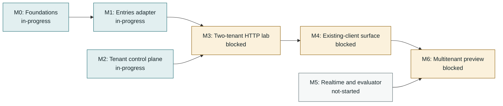

<!-- Generated by tools/queue/multitenant_dashboard.py. Edit the queue and multitenant-delivery-status.json. -->
# Multitenant delivery: working dashboard

**Recorded 2026-11-06; not a live branch monitor.** Observed integration tip: `c7778436` on `codex/serial-integration-20261106`.
Root integration c7778436 incorporates B338 plus A private acquisition; combined full verification is PENDING, not accepted. R51 bounded settings338 remains accepted at full7089/80pending/0failure/browser684/prcheckOK. R52 accepts A nativee5fe0b5e: fresh full7080/80pending/0failure, same-head prior browser684 and final prcheckOK; acquisition14/concurrency4, six semantic controls/restorations and caller4/reused-target2fail/restored4. Shared helper only owns fresh acquisition allocation; caller policies remain separate, with no atomic revision/stronger snapshot or milestone promotion. R49/R50 remain unchanged historical captures; independent profile2ee8b493 is helper-identical source preparation only, all new runtime/full/browser/prcheck UNMEASURED. A step finished; D/clock lower proof active with HTTP/full/bench pending, C queued. Original cleanup and bounded audits remain scoped; unknown40 volumes preserved. No candidate CI, application push or combined acceptance claimed.

**Start here:** use the dependency map for sequencing, the lane table for parallel work, and the acceptance ledger for what has actually passed. No milestone is promoted by a completed dependency slice.

[Decisions and detailed acceptance](multitenant-delivery-roadmap-2026-11-02.md) | [Programme overview](../../../site/pages/nightscout-next-gen-platform.html) | [Full queue](../../../queue/QUEUE.md)

## Acceptance stages

**Locally accepted -> incorporated / testing pending -> integrated acceptance recorded -> milestone promoted.** Incorporation is ancestry, not a passing test run. Stages below are dated evidence claims, not freshly executed gates. Queue states remain claims too; use `make queue-status` for measurements. Counts are not additive and are not completion percentages.

## Milestone dependencies

Arrows mean prerequisite -> dependent, **not progress**. These are the roadmap's milestone edges; work-item prerequisites appear separately below. M2 and M5 have additional work gates, not a claim that they can finish without storage/runtime foundations.

| Milestone | Claimed status | Prerequisites / work gates | Remaining promotion gate |
|---|---|---|---|
| **M0: Foundations** | in-progress | [ST-PG](#st-pg), [MIG-RUNNER](#mig-runner) | Finish deployment/schema acceptance; accepted PG/RLS and operator slices do not promote all foundations. |
| **M1: Entries adapter** | in-progress | M0, [ST-PG](#st-pg) | Reviewed DDL/import contract (JSONB logical equality; key-order parity is not required), full backend compatibility and resource bounds. |
| **M2: Tenant control plane** | in-progress | [MT-CONFIG-MIN](#mt-config-min), [MT-SECRETS-CONTRACT](#mt-secrets-contract), [MIG-RUNNER](#mig-runner), [TEN-RESOLVE](#ten-resolve), [T30-WIRING](#t30-wiring), [T30-TENANT-ADMIN](#t30-tenant-admin) | Current trusted policy/authentication, tenant resolution, owner/data/operator separation and runtime wiring. |
| **M3: Two-tenant HTTP lab** | blocked | M1, M2, [TEN-LAB](#ten-lab) | Real authorized A/B entries requests and stored outcomes; stale-schema startup refusal. |
| **M4: Existing-client surface** | blocked | M3, [ST-PG](#st-pg), [TEN-LAB](#ten-lab) | Complete admitted REST/client workflows, direct single/Mongo vs tenant/PG tests and explicit intended-change/refusal classification; old-release/current-dev/PR-single comparisons remain separately scoped. Actual client execution distinguished from source-pattern replay. |
| **M5: Realtime and evaluator** | not-started | [MT-RUNTIME-PLAN](#mt-runtime-plan) | Durable interprocess events/recovery, current socket authorization, tenant caches, replay-equivalent views and consumer integration. |
| **M6: Multitenant preview** | blocked | M4, M5 | Implemented adopted owner capabilities, management issuer/refresh and delegation ceilings, export/deletion/import fidelity, operations/recovery, resource/egress bounds and final-tree review. |

## Parallel lanes and next gates

Lane labels describe the recorded handoff, not a live assignment service. Confirm ownership before taking an unassigned lane. An in-progress prerequisite may support a dormant prototype; it does not authorize serving or promote its dependent.

Work-item dependency map (direct edges from the queue)

External prerequisites are shown one level deep; the full queue owns their further dependencies.

| Work item / queue claim | Lane | Queue prerequisites (claimed state) | Next bounded action |
|---|---|---|---|
| **MT-CONFIG-MIN**: in-progress | C: static preparation / runtime queued | None recorded | Accepted R48 remains scoped. New enforcement candidate3106f14d has no accepted head; static/control evidence is awaiting exact central capture, while new database, full/browser and prcheck acceptance remain pending its serialized slot. Human issuer/refresh and complete owner acceptance remain open. |
| **ST-PG**: in-progress | R51 settings accepted / B+A composition pending | None recorded | R51 native33870764 remains accepted full7089/80pending/0failure/browser684/prcheckOK with archived settings controls. Rootc7778436 adds native accepted A; combined full PENDING. Bounded settings/global sort cap4→5 is not full backend/client/resource acceptance. |
| **TEN-LAB**: blocked | B+A incorporated / cumulative full pending | ST-PG (in-progress), T30-WIRING (in-progress), MIG-RUNNER (in-progress) | Rootc7778436 incorporates accepted B338 and native A e5fe0b5e; combined full PENDING. R49/R50 and R51 remain immutable scoped captures. D measured history gap remains unfixed; C/clock/independent profile prep not accepted or joined, M1/M2/M3 incomplete. |
| **T30-WIRING**: in-progress | Current authority / optional local data-token verification | TEN-RESOLVE (blocked), MT-SECRETS-CONTRACT (in-progress) | The adopted owner-authority contract keeps current PostgreSQL session/key/grants checks per operation. Optional new-format Ed25519 data tokens verify locally on the local correction lane; R48 accepts bounded local data-token verification. Legacy compatibility and standalone management separation remain; human management issuer/refresh, owner ceiling enforcement and lifecycle acceptance remain unimplemented. |
| **MIG-RUNNER**: in-progress | Operator migration / readiness | MIG-VV (done) | R39 retains independently enabled migration/HTTP acceptance and prebind read-only selected-domain readiness. Full two-store runner acceptance, standalone/index fencing, chunking and populated-data import/resource guarantees remain open. |
| **MT-SECRETS-CONTRACT**: in-progress | Adopted local verification / provider acceptance | None recorded | The owner-authority amendment keeps private signing keys in the secrets component and permits local asymmetric verification for optional new-format data tokens, with current PG session/key/grants per operation. R48 accepts bounded local data-token verification; production format/provider interoperability, human management issuance, TLS/unseal/HA, renewal and recovery remain open. |
| **TEN-RESOLVE**: blocked | Production trust and lifecycle | MT-CONFIG-MIN (in-progress), MIG-RUNNER (in-progress), PLAT-SERVE (merged-upstream) | Canonical/direct-alias resolution remains composed at ae471ac7; the explicit API preview is runnable. Static maps and immediate-peer allowlisting do not establish durable allocation/publication, production workload identity or provision/suspend/export/delete lifecycle. Owner/operator listeners remain separate. |
| **MT-RUNTIME-PLAN**: in-progress | D/clock lower proof active / further acceptance pending | None recorded | Measured D2a6eaf73 replica-history gap remains unfixed; independent HTTP proof source pending. Adopted PG transactional clock direction has separate lower PG proof/control work active; HTTP/full/browser and contention/fresh-ingestion latency acceptance pending. No production clock fix or clock acceptance allocated. |
| **ARCH-SEAM-CONTRACT**: in-progress | Measured ports / remaining capabilities | None recorded | R42 real Mongo/PG lower and preview contracts remain the basis; R44 preserves them during composition. Broader schema/query/error/retry/import capabilities remain open; consolidation consumes measured differences. |
| **T30-TENANT-ADMIN**: in-progress | C: candidate preparation / runtime queued | T30-WIRING (in-progress) | Accepted R42/R48 scopes retained; candidate3106f14d proposed-grant enforcement is not accepted. Static/control evidence does not establish new database or full/browser behavior. New runtime verification follows D; human issuer/refresh and full owner lifecycle remain open. |
| **ST-VIEWS-PROFILE**: in-progress | R50 accepted / helper-only preparation unmeasured | ST-WRITES (merged-upstream) | Accepted independent5173864d/R50 retained. New descendant2ee8b493 has identical helper bytes and views-only integration, preserving evaluateCycle. No REST join; all new-head profile38/controls/full/browser/prcheck UNMEASURED pending separate slot. No subscriber/notification/runtime admission change. |
| **ARCH-SEAM-COMPOSE**: in-progress | Accepted current-domain extraction | ARCH-SEAM-CONTRACT (in-progress) | R44 current-head CLI/startup/refusal and failure/HTTP controls pass. Domain metadata and explicit PG backend composition are separate; preserve read-only startup, current Mongo default and independent binding/transaction semantics. Wider stable portability and consolidation remain separate. |
| **ARCH-SEAM-CONSOLIDATE**: in-progress | Accepted bounded shared PG mechanics | ARCH-SEAM-CONTRACT (in-progress), ARCH-SEAM-COMPOSE (in-progress) | R46 real-port baseline/candidate, full/browser-on-identical-app and meaningful ordering/projection/precommit controls accept the small extraction. Source-specific translation, natural order and write policy are explicit; broader portable helper relocation and capability review continue. |
| **ARCH-DERIVED-FRAME**: in-progress | R52 native A accepted / composition full pending | ARCH-SEAM-CONTRACT (in-progress), ST-VIEWS-PROFILE (in-progress) | Nativee5fe0b5e full7080/80pending/0failure, prior same-head browser684 and final prcheckOK; acquisition14/concurrency4, six semantic controls/restored14/4 and caller4/negative2/restored4. Adaptive control334dc571 incorporated. RootB+A c7778436 combined full PENDING. Helper owns private allocation only; stronger consistency and evaluator adaptation remain separate. |

## Accepted slices and integration handoff

A bounded slice below does **not** close its parent queue card or M0-M6.

| Slice / parent | Acceptance stage | Commit / evidence | Recorded result and boundary |
|---|---|---|---|
| Secrets component, Vault adapter, PG persistence and rewrap / [MT-SECRETS-CONTRACT](#mt-secrets-contract) | **Integrated acceptance recorded** | [`6943dccb`](multitenant-delivery-roadmap-2026-11-02.md#integration-entries-and-vault-facing-secrets-2026-11-02) | 230 focused combined checks at the integration record; dormant only. |
| Synthetic secrets recovery and worker crash/retry / [MT-SECRETS-CONTRACT](#mt-secrets-contract) | **Integrated acceptance recorded** | [`0de90852`](multitenant-delivery-roadmap-2026-11-02.md#integration-secrets-recovery-acceptance-and-next-control-plane-slice-2026-11-02) | 879 broad / 34 secrets checks; production recovery remains open. |
| Persistent current subject authority / [MT-CONFIG-MIN](#mt-config-min) | **Incorporated; testing pending** | [`1dd8990b`](multitenant-delivery-roadmap-2026-11-02.md#parallel-control-plane-acceptance-and-next-handoff-2026-11-02) | Local combined 36 checks with scalar settings; integrated gate pending. |
| Units/seconds, provenance, history and rollback / [MT-CONFIG-MIN](#mt-config-min) | **Incorporated; testing pending** | [`011802ba`](multitenant-delivery-roadmap-2026-11-02.md#parallel-control-plane-acceptance-and-next-handoff-2026-11-02) | Local combined 36 checks; injected policy is not atomic policy/write fencing. |
| MongoDB replica-set transactional operator runner / [MIG-RUNNER](#mig-runner) | **Incorporated; testing pending** | [`562f6206`](multitenant-delivery-roadmap-2026-11-02.md#parallel-mig-runner-transactional-mongodb-slice-2026-11-02) | Local 53 combined / 12 MongoDB checks; standalone/index steps refuse. |
| Primary crash/restart and expired-renewal refusal / [MIG-RUNNER](#mig-runner) | **Incorporated; testing pending** | [`436ef543`](multitenant-delivery-roadmap-2026-11-02.md#parallel-mig-runner-primary-recovery-and-renewal-loss-2026-11-02) | Local 56 combined / 15 MongoDB checks at floor and ceiling; not HA. |
| Tenant-bound JWT HTTP authorization proof / [T30-WIRING](#t30-wiring) | **Integrated acceptance recorded** | [`dc2c5fbf`](multitenant-delivery-roadmap-2026-11-02.md#tenant-jwt-proof-integration-and-http-gate) | 2 HTTP tests pass for cross-tenant signature refusal, current grants and authority outage; production runtime wiring remains open. |
| One-time API entries importer and PostgreSQL target / [ST-PG](#st-pg) | **Integrated acceptance recorded** | [`327cbb1f`](multitenant-delivery-roadmap-2026-11-02.md#m1-m2-code-slices-and-acceptance-2026-11-02) | Importer unit/CLI tests and disposable-PostgreSQL tenant-bound replay test pass; one-time best-effort import, not snapshot or ongoing sync. |
| Entries candidate schema and forced-RLS acceptance / [ST-PG](#st-pg) | **Integrated acceptance recorded** | [`025704cd`](multitenant-delivery-roadmap-2026-11-02.md#m1-m2-code-slices-and-acceptance-2026-11-02) | Disposable-Docker migration suite passes 13 checks, including generated fields, typed identity, unique identifier constraint and forced RLS. |
| Provider-neutral tenant policy and HTTP boundaries / [MT-CONFIG-MIN](#mt-config-min) | **Integrated acceptance recorded** | [`c496d009`](multitenant-delivery-roadmap-2026-11-02.md#m1-m2-code-slices-and-acceptance-2026-11-02) | 19 resolver/app/JWT HTTP checks pass; integrated secrets/Vault/PostgreSQL gate passes 37, including persisted current grants and atomic settings/grant fencing. No deployment adapter or serving role. |
| Two-tenant entries HTTP lab / [TEN-LAB](#ten-lab) | **Integrated acceptance recorded** | [`a19b549c`](multitenant-delivery-roadmap-2026-11-02.md#m1-m2-code-slices-and-acceptance-2026-11-02) | 10 disposable-PostgreSQL HTTP lab cases pass for tenant isolation, writes, revocation, startup refusal and data-plane separation; M3 promotion remains blocked. |
| Combined projection/current authority (R24) / [TEN-LAB](#ten-lab) | **Integrated acceptance recorded** | [`8b193e18`](multitenant-delivery-roadmap-2026-11-02.md#accepted-read-and-authority-continuations-2026-11-04) | Agent-run nonbrowser 6713 passing/108 pending/0 failing, browser 684/0/0; explicit PG/HTTP/Vault campaigns and controls. Dormant bounded integration, not M1/M2 completion. |
| Legacy credential to actual entries GET (R25) / [T30-WIRING](#t30-wiring) | **Integrated acceptance recorded** | [`7eb76c71`](multitenant-delivery-roadmap-2026-11-02.md#accepted-read-and-authority-continuations-2026-11-04) | Agent-run focused 72/0/0, nonbrowser 6718 passing/118 pending/0 failing, browser 684/0/0. Current persisted authority; synthetic HTTP crypto, real Vault separately measured. |
| Compatible exchange to current-authority GET (R26) / [T30-WIRING](#t30-wiring) | **Integrated acceptance recorded** | [`81bc71e6`](multitenant-delivery-roadmap-2026-11-02.md#accepted-read-and-authority-continuations-2026-11-04) | Published PR checkpoint. Agent-run focused 85/0/0, nonbrowser 6725 passing/124 pending/0 failing, browser 684/0/0; exact names, eight-hour policy and four source controls. Pinned clients inspected, not replayed. |
| Actual entries list/search (R27) / [ST-PG](#st-pg) | **Integrated acceptance recorded** | [`c10290d2`](multitenant-delivery-roadmap-2026-11-02.md#accepted-read-and-authority-continuations-2026-11-04) | Local cumulative slice: agent-run nonbrowser 6764 passing/88 pending/0 failing, browser 684/0/0; reader differential 8, HTTP search 2, three controls. Counts overlap; pending change reflects enabled PG cases. History/mutations, production runtime and client replay remain open. |
| Actual entries POST/create/resend (R29) / [ST-PG](#st-pg) | **Integrated acceptance recorded** | [`6cad7a42`](multitenant-delivery-roadmap-2026-11-02.md#accepted-post-provider-and-canonical-continuations-2026-11-04) | Agent-reproduced nonbrowser 6807/73 pending/0 failing, browser684, focused78 and six red controls; current grants/attribution, configured pruning and legitimate extension keys. Now included in cumulative R34; remaining mutations/history/import/resources open. |
| Real Vault/PG HTTP lab (R30) / [MT-SECRETS-CONTRACT](#mt-secrets-contract) | **Integrated acceptance recorded** | [`e410b163`](multitenant-delivery-roadmap-2026-11-02.md#accepted-post-provider-and-canonical-continuations-2026-11-04) | Enabled44 including new runtime5; nonbrowser6725/132 pending/0 failing, browser684; tenant-binding red control. Test-only provider composition, now included in R34; production service identity/TLS/HA not established. |
| Real-provider POST composition (R32) / [TEN-LAB](#ten-lab) | **Integrated acceptance recorded** | [`4621d5c4`](multitenant-delivery-roadmap-2026-11-02.md#accepted-post-provider-and-canonical-continuations-2026-11-04) | Enabled62, nonbrowser6807/79 pending/0 failing, browser684; three actual POST controls red. Real-provider write/read/isolation/current-grant/outage behavior, now included in R34. Counts overlap, not milestone completion. |
| Explicit canonical ingress (R33) / [TEN-RESOLVE](#ten-resolve) | **Integrated acceptance recorded** | [`468c41dc`](multitenant-delivery-roadmap-2026-11-02.md#accepted-post-provider-and-canonical-continuations-2026-11-04) | Focused25, nonbrowser6815/73 pending/0 failing, browser684; four resolver/app controls red. Direct mode preserved, canonical Host requires per-request explicit trust. Now in R34; no durable registry/production trust adapter. |
| Cumulative canonical/provider/POST (R34) / [TEN-LAB](#ten-lab) | **Integrated acceptance recorded** | [`c527fb7e`](multitenant-delivery-roadmap-2026-11-02.md#accepted-post-provider-and-canonical-continuations-2026-11-04) | Historical cumulative checkpoint, superseded by R38/R39. Enabled63, nonbrowser6815/80 pending/0 failing, browser684; composed forwarded-precedence, trust-loss and alias-conflict controls red. Synthetic loopback provenance only; no full M1/M2/M3, client, realtime or operations acceptance. |
| Executable entries CRUD/history (R38) / [T30-WIRING](#t30-wiring) | **Integrated acceptance recorded** | [`21145d0d`](multitenant-delivery-roadmap-2026-11-02.md#rest-continuation-and-qms-reconciliation-2026-11-04) | Recorded integration-agent reproduced acceptance through the actual PG/Vault executable, current authority, rollback and restart. See R38 for nonadditive campaign figures and controls; full REST and production lifecycle remain open. |
| Explicitly selected REST domains (R39) / [TEN-LAB](#ten-lab) | **Integrated acceptance recorded** | [`ae471ac7`](multitenant-delivery-roadmap-2026-11-02.md#rest-continuation-and-qms-reconciliation-2026-11-04) | Recorded integration-agent reproduced legacy v1/inherited-v2 data handlers, API3 collections and safe context. Now published on draft PR #8898 with successful head CI/CodeQL. Remaining route/client replay and M0-M6 criteria are incomplete; new Codex lane results remain UNMEASURED. |
| Derived REST and pinned-pattern cumulative acceptance (R40) / [TEN-LAB](#ten-lab) | **Integrated acceptance recorded** | [`ded254b9`](multitenant-delivery-roadmap-2026-11-02.md#rest-continuation-and-qms-reconciliation-2026-11-04) | Parent-reproduced actual v2 derived handlers, synthetic source-pinned client replay and independent authority probes, including real CLI/PG/Vault derived/current-authority/restart composition. R40 owns exact campaign figures and controls. Published on OPEN/draft #8898; current-head CI and CodeQL successful at read-back; full REST, client binaries and production M0-M6 criteria remain incomplete. |
| Persisted subject administration and cumulative compatibility (R41) / [MT-CONFIG-MIN](#mt-config-min) | **Integrated acceptance recorded** | [`94c57f1f`](multitenant-delivery-roadmap-2026-11-02.md#accepted-subject-administration-and-compatibility-continuation-2026-11-05) | Local full/browser/provider/compatibility acceptance with archived current-grants/tenant/atomic controls. No management HTTP, owner ceilings or milestone promotion. |
| Repeated bounded release/dev/PR-single refresh / [TEN-LAB](#ten-lab) | **Locally accepted** | [`ded254b9`](multitenant-delivery-roadmap-2026-11-02.md#accepted-subject-administration-and-compatibility-continuation-2026-11-05) | Repeated common corpus and hardened auditor controls; current dev/PR-single match. Old full-corpus residuals are diagnostic; identity/settings families and final R41 tree are not measured by this historical comparison. |
| Storage-port contract and management HTTP (R42) / [ARCH-SEAM-CONTRACT](#arch-seam-contract) | **Integrated acceptance recorded** | [`d4570e58`](multitenant-delivery-roadmap-2026-11-02.md#accepted-contract-management-and-independent-profile-wave-2026-11-05) | Local cumulative acceptance, real lower/preview/Mongo ports and standalone management HTTP with semantic controls; source contracts reconciled. No full portable runtime or owner listener. |
| Independent nonresident single refresh (R43) / [ST-VIEWS-PROFILE](#st-views-profile) | **Locally accepted** | [`925c9527`](multitenant-delivery-roadmap-2026-11-02.md#accepted-contract-management-and-independent-profile-wave-2026-11-05) | Separate current-dev refresh with full/default-browser and selected replay/controls. Not joined into #8898; physical subscriber unchanged and logical no-op policy remains open. |
| Current-domain composition and direct imported identity (R44) / [ARCH-SEAM-COMPOSE](#arch-seam-compose) | **Integrated acceptance recorded** | [`bc4ee1a9`](multitenant-delivery-roadmap-2026-11-02.md#accepted-composition-and-direct-identity-continuation-2026-11-05) | Parent-reproduced complete nonbrowser/default-browser, real CLI/HTTP contracts and direct Mongo/PG typed identity mutations with semantic controls and independent review. No new backend/write policy, helper consolidation or milestone promotion. |
| Independent actual HTTP profile writers and live handoff (R45) / [ST-VIEWS-PROFILE](#st-views-profile) | **Locally accepted** | [`dff9a8d4`](multitenant-delivery-roadmap-2026-11-02.md#accepted-independent-http-profile-continuation-2026-11-05) | Independent test-only replay adds API3 mutations/resends and live-service ownership assertions; parent archived replay/trigger/closed-service controls and independent review. R45 owns exact regression figures and limits. Physical subscriber retained; no REST join or multitenant evaluator acceptance. |
| Bounded PG mechanics and direct indexed races (R46) / [ARCH-SEAM-CONSOLIDATE](#arch-seam-consolidate) | **Integrated acceptance recorded** | [`44331668`](multitenant-delivery-roadmap-2026-11-02.md#accepted-adapter-consolidation-and-index-race-continuation-2026-11-05) | Parent full/final common-port and indexed-race acceptance, browser on identical application source and semantic order/projection/precommit/retry controls. Baseline/current UTC fixtures and diagnostic corrections explicit; broader portable helpers and milestones remain open. |
| Independent test-composed v1 evaluator writers (R47) / [ST-VIEWS-PROFILE](#st-views-profile) | **Locally accepted** | [`0c98ad06`](multitenant-delivery-roadmap-2026-11-02.md#accepted-independent-v1-evaluator-continuation-2026-11-05) | Agent full/default-browser plus parent archived36 and v1 trigger/closed-service controls. Test-only v1 configurators preserve reply/delete/no-op differences and live handoff; production routes/subscriber unchanged. Shared-frame inventory is read-derived, not runtime acceptance. |
| Optional local data-token authority (R48) / [T30-WIRING](#t30-wiring) | **Integrated acceptance recorded** | [`3d5eac19`](multitenant-delivery-roadmap-2026-11-02.md#accepted-optional-local-data-token-authority-2026-11-05) | Adopted owner-authority contract; actual API local Ed25519 verification checks current PostgreSQL session/key/grants per operation. R48 owns full/browser and semantic controls; human issuer/refresh, full catalogue, proposed-grant ceilings and production provider/key operations remain incomplete. |
| Actual frame acquisition and concurrent REST reads (R49) / [ARCH-DERIVED-FRAME](#arch-derived-frame) | **Integrated acceptance recorded** | [`1c55098a`](multitenant-delivery-roadmap-2026-11-02.md#accepted-frame-acquisition-and-concurrent-read-characterization-2026-11-05) | Actual Mongo/PG views, tenant snapshot and resident acquisition retain measured bounds/future/statistics/typed-union/private-cache differences. Held HTTP reads return old entries/new treatments despite an atomic independent writer commit; semantic controls cover clinical values, tenant/partial-read refusal and no read egress. Final cumulative full7076/80pending/0failure and browser684 pass; no shared implementation, atomic revision or milestone promotion. |
| Independent evaluator acquisition, failure retention and recovery (R50) / [ST-VIEWS-PROFILE](#st-views-profile) | **Locally accepted** | [`5173864d`](multitenant-delivery-roadmap-2026-11-02.md#accepted-independent-evaluator-frame-characterization-2026-11-05) | Agent full6690/3pending/0failure and default-browser684; parent archived38 and independently repeated clinical/retention semantic controls. Actual held rows yield A/B, then real trigger B/B; failed materialization retains previous time/properties and recovers. Teardown proves no late fake-provider delivery only, not cancellation/internal handoff absence. Runtime/subscriber unchanged; no REST join. |
| Bounded settings differential after serial recovery (R51) / [ST-PG](#st-pg) | **Integrated acceptance recorded** | [`33870764`](multitenant-delivery-roadmap-2026-11-02.md#accepted-settings-differential-and-serial-recovery-2026-11-06) | Root FF exact tested tree; full7089/80pending/0failure, browser684 and final prcheckOK. Archived12, sortcap/predicate/projection semantic failures and restored12. Global PG sort cap4→5 only; regex/dotted refusal and resource/client/replica limits explicit. A/C/D/clock not joined; no milestone promotion. |
| Private acquisition allocation extraction (R52) / [ARCH-DERIVED-FRAME](#arch-derived-frame) | **Locally accepted** | [`e5fe0b5e`](multitenant-delivery-roadmap-2026-11-02.md#accepted-private-acquisition-and-pending-composition-2026-11-06) | Native fresh full7080/80pending/0failure; same-head prior browser684, final prcheckOK. Acquisition14/concurrency4 and six semantic controls/restored14/4; caller4/reused-target2fail/restored4. RootB+A c7778436 incorporated, combined full PENDING. No atomic revision or independent profile runtime acceptance. |

## Deferred and separate lanes

| Candidate | Lane | Boundary / dependency |
|---|---|---|
| Recovered capacity / remaining serialized verification | A native finished; B+A full future; D/clock active, C queued | Authorized cleanup3779deleted/0errors/no outside-inventory loss. Four selected runtime cleanup cases and five archived settings audit files verify bounded ownership/removal;40unknown nested volumes preserved. Canonical new all flags have not run as a future combined campaign. |
| Shared consistency and independent evaluator adaptation | R52 native REST accepted / root composition pending | Nativee5fe0b5e accepted; rootc7778436 combined full PENDING. New independent profile2ee8b493 is helper-identical source only, runtime38/controls/full/browser/prcheck UNMEASURED. No atomic revision or full consistency/milestone guarantee. |
| Broader settings/client and resource acceptance | R51 bounded settings accepted | 33870764 accepted for bounded settings; full7089/80pending/0failure/browser684/prcheckOK and archived controls. Regex/dotted predicates refusePG500, performance unmeasured; no all-query/client parity. |
| NEXT C: owner enforcement (UNMEASURED) | Candidate3106f14d / no accepted head | Accepted R48 retained. Static/control preparation awaits exact central evidence capture; new DB/full/browser/prcheck pending serialized runtime slot. No issuer/refresh or full owner promotion. |
| NEXT D: history contract FAILED | Characterization2a6eaf73; candidate714f6c8b PENDING | Five actual HTTP characterization cases establish a missed later history row under equal cross-process timestamps. Candidate controls/cleanup/full/browser/prcheck remain unaccepted. No production clock fix or general replica interchangeability claim. |
| Read existing Nightscout data through its API | Entries / import | This is a one-time database population, not ongoing NS-to-NS synchronization; no durable checkpoint is required. Use bounded pagination, duplicate-safe reruns and best-effort srvModified reconciliation. Physical hard deletes may be undetectable, so do not claim exact deletion reconciliation or raw-backup fidelity; nightscout-connect remains the separate ongoing sync pipeline. |
| Human identity and next-generation execution | Separate programmes | Not prerequisites invented for the initial entries HTTP lab. Keep their independently reviewed authority/runtime contracts. |

## Updating this dashboard

1. Update `queue/work-queue.yaml` for work states and real prerequisites. Do not duplicate those edges in the status overlay.
2. Append measured evidence to the roadmap; update `multitenant-delivery-status.json` for dated slice stages, integration tip, lanes and remaining milestone gates. Use explicit commit/results; do not promote on ancestry alone.
3. Run `python tools/queue/multitenant_dashboard.py`, then `python tools/queue/multitenant_dashboard.py --check`, `make queue-check` and `make site-check`. Commit the source and generated view together. Publishing remains a separate maintainer action.
