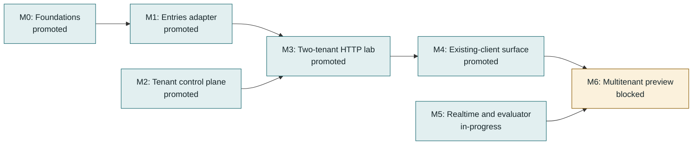
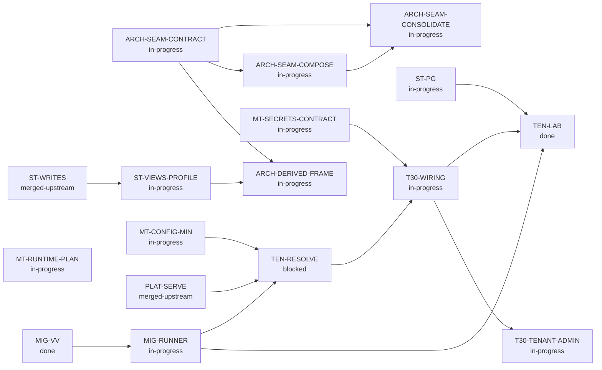

<!-- Generated by tools/queue/multitenant_dashboard.py. Edit the queue and multitenant-delivery-status.json. -->
# Multitenant delivery: working dashboard

**Recorded 2026-11-06; not a live branch monitor.** Observed integration tip: `74d7b3fc` on `codex/m1-m2-completion-batch-20261107`.
R72 accepts the coherent admitted entries/owner configuration batch: M0 retained; M1 and M2 promoted, followed by M3 and M4 on their cumulative evidence. M1 resource bounds deferred C; M4 actual headless/source-pattern scope, no all-client claim; Android emulator C. Reader clamping is removed, legacy own-tenant API_SECRET compatibility retained, writer proposed-grant fences remain. M5 is in progress and M6 blocked. Full/browser/enabled40-corpus/finalprcheck pass; runtime captures retain actual74d7 versus product-identical7015 attribution. Draft publication and remote verification are separate from dev merge/release/default enablement.

**Start here:** use the dependency map for sequencing, the lane table for parallel work, and the acceptance ledger for what has actually passed. No milestone is promoted by a completed dependency slice.

[Milestone criteria](multitenant-delivery-roadmap.md) | [Programme overview](../../../site/pages/nightscout-next-gen-platform.html) | [Full queue](../../../queue/QUEUE.md)

## Acceptance stages

**Locally accepted -> incorporated / testing pending -> integrated acceptance recorded -> milestone promoted.** Incorporation is ancestry, not a passing test run. Stages below are dated evidence claims, not freshly executed gates. Queue states remain claims too; use `make queue-status` for measurements. Counts are not additive and are not completion percentages.

## Milestone dependencies

Arrows mean prerequisite -> dependent, **not progress**. These are the roadmap's milestone edges; work-item prerequisites appear separately below. M2 and M5 have additional work gates, not a claim that they can finish without storage/runtime foundations.

| Milestone | Claimed status | Prerequisites / work gates | Remaining promotion gate |
|---|---|---|---|
| **M0: Foundations** | promoted | [ST-PG](#st-pg), [MIG-RUNNER](#mig-runner) | Promoted by R60: current restricted-role/RLS, isolation, rollback, pool reuse and paired controls plus migration/startup refusal. Explicit lab preview only; no default or production role enablement. |
| **M1: Entries adapter** | promoted | M0, [ST-PG](#st-pg) | R72 accepts the admitted Mongo/PG backend, typed JSON/query/history/batch and reviewed DDL/import contract. Resource bounds: deferred, measured in C; no numeric threshold approved. PG-only sort cap stays5. |
| **M2: Tenant control plane** | promoted | [MT-CONFIG-MIN](#mt-config-min), [MT-SECRETS-CONTRACT](#mt-secrets-contract), [MIG-RUNNER](#mig-runner), [TEN-RESOLVE](#ten-resolve), [T30-WIRING](#t30-wiring), [T30-TENANT-ADMIN](#t30-tenant-admin) | R72 accepts actual tenant-local typed/versioned settings, CAS/history/rollback, current configure/operator fences, unknown-tenant and cross-tenant signature refusal, no private-context leakage and OWNER/DATA/operator route separation. Two display names; human issuer/refresh, broader catalogue/lifecycle and production trust remain M6. |
| **M3: Two-tenant HTTP lab** | promoted | M1, M2, [TEN-LAB](#ten-lab) | R72 accepts actual authorized A/B entries-v3 requests, independent stored outcomes/restart, foreign credential refusal and stale/unsafe startup refusal after M1/M2 criteria pass. |
| **M4: Existing-client surface** | promoted | M3, [ST-PG](#st-pg), [TEN-LAB](#ten-lab) | R72 accepts actual pinned cgmsim/oref0 and source-pattern replay, tenant-local identity/history/batch/retry/refusal/exchange. No all-client claim. Android emulator C; iOS outside automated lab. |
| **M5: Realtime and evaluator** | in-progress | [MT-RUNTIME-PLAN](#mt-runtime-plan) | R62 accepts dormant typed replay; R67 measures native recovered clinical properties and typed/bootstrap controls on unpublished1990. Live role scheduling, current socket delivery, ack/snooze, notification/provider handoff, wider clinical cohorts and capacity remain. |
| **M6: Multitenant preview** | blocked | M4, M5 | Implemented adopted owner capabilities, human management issuer/refresh, backward-compatible existing-grant lifecycle policy, durable tenant lifecycle and production resolution trust; export/deletion/import fidelity, operations/recovery, resource/performance/egress bounds and final-tree review. Android emulator client lab in C. |

## Parallel lanes and next gates

Lane labels describe the recorded handoff, not a live assignment service. Confirm ownership before taking an unassigned lane. An in-progress prerequisite may support a dormant prototype; it does not authorize serving or promote its dependent.

Work-item dependency map (direct edges from the queue)

External prerequisites are shown one level deep; the full queue owns their further dependencies.

| Work item / queue claim | Lane | Queue prerequisites (claimed state) | Next bounded action |
|---|---|---|---|
| **MT-CONFIG-MIN**: in-progress | R72 preview criteria accepted / wider scope retained | None recorded | R72 promotes applicable M1–M4 criteria. Broader catalogue, identity/lifecycle, live runtime and resource work retain their M5/M6 contracts; see the criterion disposition. |
| **ST-PG**: in-progress | R72 preview criteria accepted / wider scope retained | None recorded | R72 promotes applicable M1–M4 criteria. Broader catalogue, identity/lifecycle, live runtime and resource work retain their M5/M6 contracts; see the criterion disposition. |
| **TEN-LAB**: done | R72 preview criteria accepted / wider scope retained | ST-PG (in-progress), T30-WIRING (in-progress), MIG-RUNNER (in-progress) | R72 promotes applicable M1–M4 criteria. Broader catalogue, identity/lifecycle, live runtime and resource work retain their M5/M6 contracts; see the criterion disposition. |
| **T30-WIRING**: in-progress | R72 preview criteria accepted / wider scope retained | TEN-RESOLVE (blocked), MT-SECRETS-CONTRACT (in-progress) | R72 promotes applicable M1–M4 criteria. Broader catalogue, identity/lifecycle, live runtime and resource work retain their M5/M6 contracts; see the criterion disposition. |
| **MIG-RUNNER**: in-progress | Operator migration / readiness | MIG-VV (done) | R39 retains independently enabled migration/HTTP acceptance and prebind read-only selected-domain readiness. Full two-store runner acceptance, standalone/index fencing, chunking and populated-data import/resource guarantees remain open. |
| **MT-SECRETS-CONTRACT**: in-progress | Adopted local verification / provider acceptance | None recorded | The owner-authority amendment keeps private signing keys in the secrets component and permits local asymmetric verification for optional new-format data tokens, with current PG session/key/grants per operation. R48 accepts bounded local data-token verification; production format/provider interoperability, human management issuance, TLS/unseal/HA, renewal and recovery remain open. |
| **TEN-RESOLVE**: blocked | M2 refusal / M6 durable lifecycle and trust | MT-CONFIG-MIN (in-progress), MIG-RUNNER (in-progress), PLAT-SERVE (merged-upstream) | M2 requires unknown-tenant refusal and separate routes. Static direct/canonical preview remains; durable allocation/publication, production trust and provision/suspend/export/delete lifecycle are M6. |
| **MT-RUNTIME-PLAN**: in-progress | Local native components / final-floor proof in progress | None recorded | R67/R68 bounded local proofs retained. Independent actual-PG final-floor component proof is running; fresh full campaign has not started. No live scheduling/current stream authority, notification/ack/provider or rollout acceptance. Resource budgets deferred to C. |
| **ARCH-SEAM-CONTRACT**: in-progress | Measured ports / remaining capabilities | None recorded | R42 real Mongo/PG lower and preview contracts remain the basis; R44 preserves them during composition. Broader schema/query/error/retry/import capabilities remain open; consolidation consumes measured differences. |
| **T30-TENANT-ADMIN**: in-progress | R72 preview criteria accepted / wider scope retained | T30-WIRING (in-progress) | R72 promotes applicable M1–M4 criteria. Broader catalogue, identity/lifecycle, live runtime and resource work retain their M5/M6 contracts; see the criterion disposition. |
| **ST-VIEWS-PROFILE**: in-progress | R55 independent helper integration accepted | ST-WRITES (merged-upstream) | Independent2ee8b493 full6690/3pending/0failure/browser684/finalprcheckOK; canonical archive38, actual-trigger(http)/clinical/retention controls each0/1semantic/restored38. Helper matches REST and evaluateCycle retained; no REST359 merge, runtime-role/subscriber/notification policy change. Wider writer/alarms/live stats/cost and durable recovery open. Notification-close v1-closed stays declared at2ee but new-head runtime UNMEASURED; prior517 measurement historical, not a fourth measuredR55 control. |
| **ARCH-SEAM-COMPOSE**: in-progress | Accepted current-domain extraction | ARCH-SEAM-CONTRACT (in-progress) | R44 current-head CLI/startup/refusal and failure/HTTP controls pass. Domain metadata and explicit PG backend composition are separate; preserve read-only startup, current Mongo default and independent binding/transaction semantics. Wider stable portability and consolidation remain separate. |
| **ARCH-SEAM-CONSOLIDATE**: in-progress | Accepted bounded shared PG mechanics | ARCH-SEAM-CONTRACT (in-progress), ARCH-SEAM-COMPOSE (in-progress) | R46 real-port baseline/candidate, full/browser-on-identical-app and meaningful ordering/projection/precommit controls accept the small extraction. Source-specific translation, natural order and write policy are explicit; broader portable helper relocation and capability review continue. |
| **ARCH-DERIVED-FRAME**: in-progress | R60 REST / R55 profile accepted separately | ARCH-SEAM-CONTRACT (in-progress), ST-VIEWS-PROFILE (in-progress) | REST d89 and independent PROFILE2ee retain their separate accepted scopes and shared private allocation helper. No common read revision, stronger frame snapshot, branch merge or distributed evaluator admission is implied. |

## Accepted slices and integration handoff

A bounded slice below does **not** close its parent queue card or M0-M6.

| Slice / parent | Acceptance stage | Commit / evidence | Recorded result and boundary |
|---|---|---|---|
| Secrets component, Vault adapter, PG persistence and rewrap / [MT-SECRETS-CONTRACT](#mt-secrets-contract) | **Integrated acceptance recorded** | [`6943dccb`](../../archive/tenancy/multitenant-delivery-roadmap-2026-11-02.md#integration-entries-and-vault-facing-secrets-2026-11-02) | 230 focused combined checks at the integration record; dormant only. |
| Synthetic secrets recovery and worker crash/retry / [MT-SECRETS-CONTRACT](#mt-secrets-contract) | **Integrated acceptance recorded** | [`0de90852`](../../archive/tenancy/multitenant-delivery-roadmap-2026-11-02.md#integration-secrets-recovery-acceptance-and-next-control-plane-slice-2026-11-02) | 879 broad / 34 secrets checks; production recovery remains open. |
| Persistent current subject authority / [MT-CONFIG-MIN](#mt-config-min) | **Incorporated; testing pending** | [`1dd8990b`](../../archive/tenancy/multitenant-delivery-roadmap-2026-11-02.md#parallel-control-plane-acceptance-and-next-handoff-2026-11-02) | Local combined 36 checks with scalar settings; integrated gate pending. |
| Units/seconds, provenance, history and rollback / [MT-CONFIG-MIN](#mt-config-min) | **Incorporated; testing pending** | [`011802ba`](../../archive/tenancy/multitenant-delivery-roadmap-2026-11-02.md#parallel-control-plane-acceptance-and-next-handoff-2026-11-02) | Local combined 36 checks; injected policy is not atomic policy/write fencing. |
| MongoDB replica-set transactional operator runner / [MIG-RUNNER](#mig-runner) | **Incorporated; testing pending** | [`562f6206`](../../archive/tenancy/multitenant-delivery-roadmap-2026-11-02.md#parallel-mig-runner-transactional-mongodb-slice-2026-11-02) | Local 53 combined / 12 MongoDB checks; standalone/index steps refuse. |
| Primary crash/restart and expired-renewal refusal / [MIG-RUNNER](#mig-runner) | **Incorporated; testing pending** | [`436ef543`](../../archive/tenancy/multitenant-delivery-roadmap-2026-11-02.md#parallel-mig-runner-primary-recovery-and-renewal-loss-2026-11-02) | Local 56 combined / 15 MongoDB checks at floor and ceiling; not HA. |
| Tenant-bound JWT HTTP authorization proof / [T30-WIRING](#t30-wiring) | **Integrated acceptance recorded** | [`dc2c5fbf`](../../archive/tenancy/multitenant-delivery-roadmap-2026-11-02.md#tenant-jwt-proof-integration-and-http-gate) | 2 HTTP tests pass for cross-tenant signature refusal, current grants and authority outage; production runtime wiring remains open. |
| One-time API entries importer and PostgreSQL target / [ST-PG](#st-pg) | **Integrated acceptance recorded** | [`327cbb1f`](../../archive/tenancy/multitenant-delivery-roadmap-2026-11-02.md#m1-m2-code-slices-and-acceptance-2026-11-02) | Importer unit/CLI tests and disposable-PostgreSQL tenant-bound replay test pass; one-time best-effort import, not snapshot or ongoing sync. |
| Entries candidate schema and forced-RLS acceptance / [ST-PG](#st-pg) | **Integrated acceptance recorded** | [`025704cd`](../../archive/tenancy/multitenant-delivery-roadmap-2026-11-02.md#m1-m2-code-slices-and-acceptance-2026-11-02) | Disposable-Docker migration suite passes 13 checks, including generated fields, typed identity, unique identifier constraint and forced RLS. |
| Provider-neutral tenant policy and HTTP boundaries / [MT-CONFIG-MIN](#mt-config-min) | **Integrated acceptance recorded** | [`c496d009`](../../archive/tenancy/multitenant-delivery-roadmap-2026-11-02.md#m1-m2-code-slices-and-acceptance-2026-11-02) | 19 resolver/app/JWT HTTP checks pass; integrated secrets/Vault/PostgreSQL gate passes 37, including persisted current grants and atomic settings/grant fencing. No deployment adapter or serving role. |
| Two-tenant entries HTTP lab / [TEN-LAB](#ten-lab) | **Integrated acceptance recorded** | [`a19b549c`](../../archive/tenancy/multitenant-delivery-roadmap-2026-11-02.md#m1-m2-code-slices-and-acceptance-2026-11-02) | 10 disposable-PostgreSQL HTTP lab cases pass for tenant isolation, writes, revocation, startup refusal and data-plane separation; M3 promotion remains blocked. |
| Combined projection/current authority (R24) / [TEN-LAB](#ten-lab) | **Integrated acceptance recorded** | [`8b193e18`](../../archive/tenancy/multitenant-delivery-roadmap-2026-11-02.md#accepted-read-and-authority-continuations-2026-11-04) | Agent-run nonbrowser 6713 passing/108 pending/0 failing, browser 684/0/0; explicit PG/HTTP/Vault campaigns and controls. Dormant bounded integration, not M1/M2 completion. |
| Legacy credential to actual entries GET (R25) / [T30-WIRING](#t30-wiring) | **Integrated acceptance recorded** | [`7eb76c71`](../../archive/tenancy/multitenant-delivery-roadmap-2026-11-02.md#accepted-read-and-authority-continuations-2026-11-04) | Agent-run focused 72/0/0, nonbrowser 6718 passing/118 pending/0 failing, browser 684/0/0. Current persisted authority; synthetic HTTP crypto, real Vault separately measured. |
| Compatible exchange to current-authority GET (R26) / [T30-WIRING](#t30-wiring) | **Integrated acceptance recorded** | [`81bc71e6`](../../archive/tenancy/multitenant-delivery-roadmap-2026-11-02.md#accepted-read-and-authority-continuations-2026-11-04) | Published PR checkpoint. Agent-run focused 85/0/0, nonbrowser 6725 passing/124 pending/0 failing, browser 684/0/0; exact names, eight-hour policy and four source controls. Pinned clients inspected, not replayed. |
| Actual entries list/search (R27) / [ST-PG](#st-pg) | **Integrated acceptance recorded** | [`c10290d2`](../../archive/tenancy/multitenant-delivery-roadmap-2026-11-02.md#accepted-read-and-authority-continuations-2026-11-04) | Local cumulative slice: agent-run nonbrowser 6764 passing/88 pending/0 failing, browser 684/0/0; reader differential 8, HTTP search 2, three controls. Counts overlap; pending change reflects enabled PG cases. History/mutations, production runtime and client replay remain open. |
| Actual entries POST/create/resend (R29) / [ST-PG](#st-pg) | **Integrated acceptance recorded** | [`6cad7a42`](../../archive/tenancy/multitenant-delivery-roadmap-2026-11-02.md#accepted-post-provider-and-canonical-continuations-2026-11-04) | Agent-reproduced nonbrowser 6807/73 pending/0 failing, browser684, focused78 and six red controls; current grants/attribution, configured pruning and legitimate extension keys. Now included in cumulative R34; remaining mutations/history/import/resources open. |
| Real Vault/PG HTTP lab (R30) / [MT-SECRETS-CONTRACT](#mt-secrets-contract) | **Integrated acceptance recorded** | [`e410b163`](../../archive/tenancy/multitenant-delivery-roadmap-2026-11-02.md#accepted-post-provider-and-canonical-continuations-2026-11-04) | Enabled44 including new runtime5; nonbrowser6725/132 pending/0 failing, browser684; tenant-binding red control. Test-only provider composition, now included in R34; production service identity/TLS/HA not established. |
| Real-provider POST composition (R32) / [TEN-LAB](#ten-lab) | **Integrated acceptance recorded** | [`4621d5c4`](../../archive/tenancy/multitenant-delivery-roadmap-2026-11-02.md#accepted-post-provider-and-canonical-continuations-2026-11-04) | Enabled62, nonbrowser6807/79 pending/0 failing, browser684; three actual POST controls red. Real-provider write/read/isolation/current-grant/outage behavior, now included in R34. Counts overlap, not milestone completion. |
| Explicit canonical ingress (R33) / [TEN-RESOLVE](#ten-resolve) | **Integrated acceptance recorded** | [`468c41dc`](../../archive/tenancy/multitenant-delivery-roadmap-2026-11-02.md#accepted-post-provider-and-canonical-continuations-2026-11-04) | Focused25, nonbrowser6815/73 pending/0 failing, browser684; four resolver/app controls red. Direct mode preserved, canonical Host requires per-request explicit trust. Now in R34; no durable registry/production trust adapter. |
| Cumulative canonical/provider/POST (R34) / [TEN-LAB](#ten-lab) | **Integrated acceptance recorded** | [`c527fb7e`](../../archive/tenancy/multitenant-delivery-roadmap-2026-11-02.md#accepted-post-provider-and-canonical-continuations-2026-11-04) | Historical cumulative checkpoint, superseded by R38/R39. Enabled63, nonbrowser6815/80 pending/0 failing, browser684; composed forwarded-precedence, trust-loss and alias-conflict controls red. Synthetic loopback provenance only; no full M1/M2/M3, client, realtime or operations acceptance. |
| Executable entries CRUD/history (R38) / [T30-WIRING](#t30-wiring) | **Integrated acceptance recorded** | [`21145d0d`](../../archive/tenancy/multitenant-delivery-roadmap-2026-11-02.md#rest-continuation-and-qms-reconciliation-2026-11-04) | Recorded integration-agent reproduced acceptance through the actual PG/Vault executable, current authority, rollback and restart. See R38 for nonadditive campaign figures and controls; full REST and production lifecycle remain open. |
| Explicitly selected REST domains (R39) / [TEN-LAB](#ten-lab) | **Integrated acceptance recorded** | [`ae471ac7`](../../archive/tenancy/multitenant-delivery-roadmap-2026-11-02.md#rest-continuation-and-qms-reconciliation-2026-11-04) | Recorded integration-agent reproduced legacy v1/inherited-v2 data handlers, API3 collections and safe context. Now published on draft PR #8898 with successful head CI/CodeQL. Remaining route/client replay and M0-M6 criteria are incomplete; new Codex lane results remain UNMEASURED. |
| Derived REST and pinned-pattern cumulative acceptance (R40) / [TEN-LAB](#ten-lab) | **Integrated acceptance recorded** | [`ded254b9`](../../archive/tenancy/multitenant-delivery-roadmap-2026-11-02.md#rest-continuation-and-qms-reconciliation-2026-11-04) | Parent-reproduced actual v2 derived handlers, synthetic source-pinned client replay and independent authority probes, including real CLI/PG/Vault derived/current-authority/restart composition. R40 owns exact campaign figures and controls. Published on OPEN/draft #8898; current-head CI and CodeQL successful at read-back; full REST, client binaries and production M0-M6 criteria remain incomplete. |
| Persisted subject administration and cumulative compatibility (R41) / [MT-CONFIG-MIN](#mt-config-min) | **Integrated acceptance recorded** | [`94c57f1f`](../../archive/tenancy/multitenant-delivery-roadmap-2026-11-02.md#accepted-subject-administration-and-compatibility-continuation-2026-11-05) | Local full/browser/provider/compatibility acceptance with archived current-grants/tenant/atomic controls. No management HTTP, owner ceilings or milestone promotion. |
| Repeated bounded release/dev/PR-single refresh / [TEN-LAB](#ten-lab) | **Locally accepted** | [`ded254b9`](../../archive/tenancy/multitenant-delivery-roadmap-2026-11-02.md#accepted-subject-administration-and-compatibility-continuation-2026-11-05) | Repeated common corpus and hardened auditor controls; current dev/PR-single match. Old full-corpus residuals are diagnostic; identity/settings families and final R41 tree are not measured by this historical comparison. |
| Storage-port contract and management HTTP (R42) / [ARCH-SEAM-CONTRACT](#arch-seam-contract) | **Integrated acceptance recorded** | [`d4570e58`](../../archive/tenancy/multitenant-delivery-roadmap-2026-11-02.md#accepted-contract-management-and-independent-profile-wave-2026-11-05) | Local cumulative acceptance, real lower/preview/Mongo ports and standalone management HTTP with semantic controls; source contracts reconciled. No full portable runtime or owner listener. |
| Independent nonresident single refresh (R43) / [ST-VIEWS-PROFILE](#st-views-profile) | **Locally accepted** | [`925c9527`](../../archive/tenancy/multitenant-delivery-roadmap-2026-11-02.md#accepted-contract-management-and-independent-profile-wave-2026-11-05) | Separate current-dev refresh with full/default-browser and selected replay/controls. Not joined into #8898; physical subscriber unchanged and logical no-op policy remains open. |
| Current-domain composition and direct imported identity (R44) / [ARCH-SEAM-COMPOSE](#arch-seam-compose) | **Integrated acceptance recorded** | [`bc4ee1a9`](../../archive/tenancy/multitenant-delivery-roadmap-2026-11-02.md#accepted-composition-and-direct-identity-continuation-2026-11-05) | Parent-reproduced complete nonbrowser/default-browser, real CLI/HTTP contracts and direct Mongo/PG typed identity mutations with semantic controls and independent review. No new backend/write policy, helper consolidation or milestone promotion. |
| Independent actual HTTP profile writers and live handoff (R45) / [ST-VIEWS-PROFILE](#st-views-profile) | **Locally accepted** | [`dff9a8d4`](../../archive/tenancy/multitenant-delivery-roadmap-2026-11-02.md#accepted-independent-http-profile-continuation-2026-11-05) | Independent test-only replay adds API3 mutations/resends and live-service ownership assertions; parent archived replay/trigger/closed-service controls and independent review. R45 owns exact regression figures and limits. Physical subscriber retained; no REST join or multitenant evaluator acceptance. |
| Bounded PG mechanics and direct indexed races (R46) / [ARCH-SEAM-CONSOLIDATE](#arch-seam-consolidate) | **Integrated acceptance recorded** | [`44331668`](../../archive/tenancy/multitenant-delivery-roadmap-2026-11-02.md#accepted-adapter-consolidation-and-index-race-continuation-2026-11-05) | Parent full/final common-port and indexed-race acceptance, browser on identical application source and semantic order/projection/precommit/retry controls. Baseline/current UTC fixtures and diagnostic corrections explicit; broader portable helpers and milestones remain open. |
| Independent test-composed v1 evaluator writers (R47) / [ST-VIEWS-PROFILE](#st-views-profile) | **Locally accepted** | [`0c98ad06`](../../archive/tenancy/multitenant-delivery-roadmap-2026-11-02.md#accepted-independent-v1-evaluator-continuation-2026-11-05) | Agent full/default-browser plus parent archived36 and v1 trigger/closed-service controls. Test-only v1 configurators preserve reply/delete/no-op differences and live handoff; production routes/subscriber unchanged. Shared-frame inventory is read-derived, not runtime acceptance. |
| Optional local data-token authority (R48) / [T30-WIRING](#t30-wiring) | **Integrated acceptance recorded** | [`3d5eac19`](../../archive/tenancy/multitenant-delivery-roadmap-2026-11-02.md#accepted-optional-local-data-token-authority-2026-11-05) | Adopted owner-authority contract; actual API local Ed25519 verification checks current PostgreSQL session/key/grants per operation. R48 owns full/browser and semantic controls; human issuer/refresh, full catalogue, proposed-grant ceilings and production provider/key operations remain incomplete. |
| Actual frame acquisition and concurrent REST reads (R49) / [ARCH-DERIVED-FRAME](#arch-derived-frame) | **Integrated acceptance recorded** | [`1c55098a`](../../archive/tenancy/multitenant-delivery-roadmap-2026-11-02.md#accepted-frame-acquisition-and-concurrent-read-characterization-2026-11-05) | Actual Mongo/PG views, tenant snapshot and resident acquisition retain measured bounds/future/statistics/typed-union/private-cache differences. Held HTTP reads return old entries/new treatments despite an atomic independent writer commit; semantic controls cover clinical values, tenant/partial-read refusal and no read egress. Final cumulative full7076/80pending/0failure and browser684 pass; no shared implementation, atomic revision or milestone promotion. |
| Independent evaluator acquisition, failure retention and recovery (R50) / [ST-VIEWS-PROFILE](#st-views-profile) | **Locally accepted** | [`5173864d`](../../archive/tenancy/multitenant-delivery-roadmap-2026-11-02.md#accepted-independent-evaluator-frame-characterization-2026-11-05) | Agent full6690/3pending/0failure and default-browser684; parent archived38 and independently repeated clinical/retention semantic controls. Actual held rows yield A/B, then real trigger B/B; failed materialization retains previous time/properties and recovers. Teardown proves no late fake-provider delivery only, not cancellation/internal handoff absence. Runtime/subscriber unchanged; no REST join. |
| Bounded settings differential after serial recovery (R51) / [ST-PG](#st-pg) | **Integrated acceptance recorded** | [`33870764`](../../archive/tenancy/multitenant-delivery-roadmap-2026-11-02.md#accepted-settings-differential-and-serial-recovery-2026-11-06) | Root FF exact tested tree; full7089/80pending/0failure, browser684 and final prcheckOK. Archived12, sortcap/predicate/projection semantic failures and restored12. Global PG sort cap4→5 only; regex/dotted refusal and resource/client/replica limits explicit. A/C/D/clock not joined; no milestone promotion. |
| Private acquisition allocation extraction (R52) / [ARCH-DERIVED-FRAME](#arch-derived-frame) | **Locally accepted** | [`e5fe0b5e`](../../archive/tenancy/multitenant-delivery-roadmap-2026-11-02.md#accepted-private-acquisition-and-pending-composition-2026-11-06) | Native fresh full7080/80pending/0failure; same-head prior browser684, final prcheckOK. Acquisition14/concurrency4 and six semantic controls/restored14/4; caller4/reused-target2fail/restored4. RootB+A c7778436 incorporated, combined full PENDING. No atomic revision or independent profile runtime acceptance. |
| Selected owner proposed-grant policy (R53) / [MT-CONFIG-MIN](#mt-config-min) | **Locally accepted** | [`17f9a457`](../../archive/tenancy/multitenant-delivery-roadmap-2026-11-02.md#accepted-selected-owner-policy-and-pending-composition-2026-11-06) | Native full7127/80pending/0failure/browser684/finalprcheckOK; static32 positive, actualDB22 and four guard controls, parent archived22/four0-1semantic/restored22. Explicit ownerPolicy transaction REST37 subset only. RootB+A+C4a15802c incorporated, combined fullPENDING; no listener, complete owner lifecycle or milestone promotion. |
| Cumulative settings, private acquisition and selected owner policy (R54) / [TEN-LAB](#ten-lab) | **Integrated acceptance recorded** | [`35903069`](../../archive/tenancy/multitenant-delivery-roadmap-2026-11-02.md#accepted-cumulative-settings-acquisition-and-owner-policy-2026-11-06) | Local cumulative B338+A e5+C17f full7144/80pending/0failure/browser684/settings12/finalprcheckOK; test-only normalization final fix. Successful captured cleanup verified absent/219preserved. Native R51-R53 unchanged; no clock/profile2ee join, production owner/listener enablement, stronger snapshot or milestone promotion. |
| Independent private acquisition profile integration (R55) / [ST-VIEWS-PROFILE](#st-views-profile) | **Locally accepted** | [`2ee8b493`](../../archive/tenancy/multitenant-delivery-roadmap-2026-11-02.md#accepted-independent-private-acquisition-profile-2026-11-06) | Independent full6690/3pending/0failure/browser684, archive38/three semantic trigger-clinical-retention controls/restored38, finalprcheckOK. Helper matches accepted REST; evaluateCycle/physical subscriber retained. REST359/profile2ee not merged, no runtime-role/notification policy or milestone promotion. |
| Coherent CI/client compatibility and M0 foundations (R60) / [TEN-LAB](#ten-lab) | **Integrated acceptance recorded** | [`d89a44e1`](../../archive/tenancy/multitenant-delivery-roadmap-2026-11-02.md#accepted-coherent-ci-client-batch-and-m0-foundations-2026-11-06) | R60 owns the exact-head corpus/prcheck and product-identical ancestor regression/client/pooler captures. M0 promoted; bounded client lab complete. Failed provisioner capture and original safety guard preserved. M1–M6 remain open; no release or default enablement. |
| Bounded owner reader and recovery batch (R62) / [MT-RUNTIME-PLAN](#mt-runtime-plan) | **Integrated acceptance recorded** | [`83582e87`](../../archive/tenancy/multitenant-delivery-roadmap-2026-11-02.md#accepted-bounded-owner-reader-and-recovery-batch-2026-11-06) | Fresh871 full7226/99pending/0failure, browser684, corpus460/1benchmarkpending/0failure, defaultclients82/82 and pooler9+4. Archived owner12 and replay7 semantic red/restored. Source-runner-only835 preserves product/test identity and passes finalprcheck. No activation or M1–M6 promotion. Historical reader-mode acceptance retained; maintainer subsequently withdrew the option for backward incompatibility. Removed in local candidate; comprehensive verification pending. |
| Recovered clinical projection native controls (R67) / [MT-RUNTIME-PLAN](#mt-runtime-plan) | **Locally accepted** | [`1990f453`](../../archive/tenancy/multitenant-delivery-roadmap-2026-11-02.md#accepted-bounded-clinical-projection-controls-2026-11-06) | Native identity111vs222 and missing123 assertions fail after independent physical inputs; fresh restoration7/0/0. Dormant constructor only; R66 socket failure retained. No whole1990/full-batch, live role, notification/ack or M5 promotion. |
| Fresh-schema socket DATA native controls (R68) / [MT-RUNTIME-PLAN](#mt-runtime-plan) | **Locally accepted** | [`12919f55`](../../archive/tenancy/multitenant-delivery-roadmap-2026-11-02.md#measured-fresh-schema-socket-data-controls-2026-11-06) | Canonical actual Mongo/PG pattern parity, reverse-lexical multiple match and reached commit/abort markers; early-ack and role physical controls red/restored4. Matrix3 at identical-product0d628 remains attributed there. Dormant fresh-schema prototype; no populated/import/downgrade, production transport/rollout or milestone promotion. |
| Admitted entries and owner configuration completion (R72) / [TEN-LAB](#ten-lab) | **Integrated acceptance recorded** | [`74d7b3fc`](../remedial/rc-16.0.0-integration-record.md#r72---admitted-entries-and-owner-configuration-completion-batch-2026-11-06) | Coherent full/browser/all40 enabled corpus/finalprcheck acceptance, current actor/policy/presentation native controls and real client/pooler proofs. M1–M4 promoted at adopted scope; exact74d7/7015 attribution preserved. M5/M6 remain open. |

## Deferred and separate lanes

| Candidate | Lane | Boundary / dependency |
|---|---|---|
| Older anonymous resource ownership | R60 current-run resources audited | Current observed campaign containers and mounts were verified absent. Older unknown resources remain preserved; there is no global leak-freedom or production capacity claim. |
| Stronger consistency and broader evaluator/runtime acceptance | R54 REST and R55 profile independently accepted | Private allocation shared on separate accepted REST359/profile2ee branches; no merge or common revision. Wider clinical/writer/alarm/statistics/cost and durable recovery remain open; no atomic snapshot or milestone promotion. |
| Broader settings/client and resource acceptance | R51 bounded settings accepted | 33870764 accepted for bounded settings; full7089/80pending/0failure/browser684/prcheckOK and archived controls. Regex/dotted predicates refusePG500, performance unmeasured; no all-query/client parity. |
| Wider owner catalogue and lifecycle | M6 lifecycle scope / reader option withdrawn | Optional subject-reader mode is withdrawn after R63 legacy-root incompatibility. Existing-grant clamping, if reconsidered in M6, must preserve existing credentials. Human issuer/refresh, durable lifecycle, production resolution trust and wider catalogue remain M6 work. Writer config.ownerPolicy is retained. |
| Replica history outside the selected clock contract | Clock correctness accepted in R60; wider replica contract open | The original unclocked timestamp characterization remains a failed exclusive-history guarantee. Joined commit-coupled clock paths have bounded correctness acceptance; clock default enablement, performance and general replica interchangeability are not inferred. |
| Read existing Nightscout data through its API | Entries / import | This is a one-time database population, not ongoing NS-to-NS synchronization; no durable checkpoint is required. Use bounded pagination, duplicate-safe reruns and best-effort srvModified reconciliation. Physical hard deletes may be undetectable, so do not claim exact deletion reconciliation or raw-backup fidelity; nightscout-connect remains the separate ongoing sync pipeline. |
| Human identity and next-generation execution | Separate programmes | Not prerequisites invented for the initial entries HTTP lab. Keep their independently reviewed authority/runtime contracts. |
| Resource/performance budgets and Android emulator lab | Batch C by maintainer decision | M1 resource bounds deferred, measured in C; no approved numeric threshold. Controlled quiet steady-state benchmark needs independent stored-count oracle. M4 uses headless actual/source-pattern coverage with no all-client claim; Android emulator belongs to C. |

## Updating this dashboard

1. Update `queue/work-queue.yaml` for work states and real prerequisites. Do not duplicate those edges in the status overlay.
2. Record measured evidence in the integration record or a dated report; set each slice's `evidence` to its document and heading. Update `multitenant-delivery-status.json` for dated slice stages, integration tip, lanes and remaining milestone gates. Use explicit commit/results; do not promote on ancestry alone.
3. Run `python tools/queue/multitenant_dashboard.py`, then `python tools/queue/multitenant_dashboard.py --check`, `make queue-check` and `make site-check`. Commit the source and generated view together. Publishing remains a separate maintainer action.
