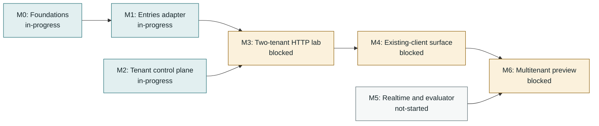

<!-- Generated by tools/queue/multitenant_dashboard.py. Edit the queue and multitenant-delivery-status.json. -->
# Multitenant delivery: working dashboard

**Recorded 2026-11-04; not a live branch monitor.** Observed integration tip: `c10290d2` on `workspace/tenant-entries-search-20261104`.
Published foundations PR nightscout/cgm-remote-monitor#8898 contains credential/exchange checkpoint 81bc71e6; newer local c10290d2 adds actual entries list/search through current tenant authority. R24-R27 record bounded agent-run acceptance, not production readiness. Latest nonbrowser tiers: 6764 passing / 88 pending / 0 failing; browser separately 684/0/0. Three published-head CodeQL fixture alerts were individually dismissed; API read-back confirms dismissal and CodeQL/Tests pass SUCCESS, not a new scan. Fresh entries-mutation and runtime-composition agents prepare scoped packets. Full M1 API/storage/import/resource acceptance and M2 production runtime/listeners remain open; no milestone promotion or serving enablement.

**Start here:** use the dependency map for sequencing, the lane table for parallel work, and the acceptance ledger for what has actually passed. No milestone is promoted by a completed dependency slice.

[Decisions and detailed acceptance](multitenant-delivery-roadmap-2026-11-02.md) | [Programme overview](../../../site/pages/nightscout-next-gen-platform.html) | [Full queue](../../../queue/QUEUE.md)

## Acceptance stages

**Locally accepted -> incorporated / testing pending -> integrated acceptance recorded -> milestone promoted.** Incorporation is ancestry, not a passing test run. Stages below are dated evidence claims, not freshly executed gates. Queue states remain claims too; use `make queue-status` for measurements. Counts are not additive and are not completion percentages.

## Milestone dependencies

Arrows mean prerequisite -> dependent, **not progress**. These are the roadmap's milestone edges; work-item prerequisites appear separately below. M2 and M5 have additional work gates, not a claim that they can finish without storage/runtime foundations.

| Milestone | Claimed status | Prerequisites / work gates | Remaining promotion gate |
|---|---|---|---|
| **M0: Foundations** | in-progress | [ST-PG](#st-pg), [MIG-RUNNER](#mig-runner) | Finish deployment/schema acceptance; accepted PG/RLS and operator slices do not promote all foundations. |
| **M1: Entries adapter** | in-progress | M0, [ST-PG](#st-pg) | Reviewed DDL/import contract (JSONB logical equality; key-order parity is not required), full backend compatibility and resource bounds. |
| **M2: Tenant control plane** | in-progress | [MT-CONFIG-MIN](#mt-config-min), [MT-SECRETS-CONTRACT](#mt-secrets-contract), [MIG-RUNNER](#mig-runner), [TEN-RESOLVE](#ten-resolve), [T30-WIRING](#t30-wiring) | Current trusted policy/authentication, tenant resolution, owner/data/operator separation and runtime wiring. |
| **M3: Two-tenant HTTP lab** | blocked | M1, M2, [TEN-LAB](#ten-lab) | Real authorized A/B entries requests and stored outcomes; stale-schema startup refusal. |
| **M4: Existing-client surface** | blocked | M3 | Pinned uploader/follower v1/v3 cases, further collections, exchange, history/indexes and retry semantics. |
| **M5: Realtime and evaluator** | not-started | [MT-RUNTIME-PLAN](#mt-runtime-plan) | Durable interprocess events/recovery, current socket authorization, tenant caches, replay-equivalent views and consumer integration. |
| **M6: Multitenant preview** | blocked | M4, M5 | Chosen owner capabilities, export/deletion/import fidelity, operations/recovery, resource/egress bounds and final-tree review. |

## Parallel lanes and next gates

Lane labels describe the recorded handoff, not a live assignment service. Confirm ownership before taking an unassigned lane. An in-progress prerequisite may support a dormant prototype; it does not authorize serving or promote its dependent.

Work-item dependency map (direct edges from the queue)

External prerequisites are shown one level deep; the full queue owns their further dependencies.

| Work item / queue claim | Lane | Queue prerequisites (claimed state) | Next bounded action |
|---|---|---|---|
| **ST-PG**: in-progress | Entries mutation packet | None recorded | Accepted local entries list/search at `c10290d2` after R24-R26 authority/credential/exchange slices. Fresh `workspace/entries-mutations-20261104` inventories actual POST/create/resend handler and branch-sensitive permissions before a bounded implementation. Later PATCH/PUT/DELETE/history, import and query/resource acceptance remain. Existing queue runnable commands still target the older foundation lane, not the entire new composition. Global backend registry remains Mongo-only; JSONB logical equality is accepted. |
| **MT-CONFIG-MIN**: in-progress | Control plane | None recorded | Persistent operator policy and atomic policy/write fencing pass the integrated disposable-PostgreSQL gate; tenant resolution and HTTP composition are committed at `c496d009`. Use provider-neutral injected authority ports; keep `serve` roles disabled until a deployment adapter supplies trusted tenant aliases/credentials, current authorization, data-router and listener composition. Full settings catalogue/API and production runtime wiring remain open. |
| **MT-SECRETS-CONTRACT**: in-progress | Runtime composition packet | None recorded | Fresh runtime lane inventories the smallest real-provider + PostgreSQL + actual HTTP join. Current HTTP crypto is synthetic; real Vault verification/exchange is separately measured. Keep dormant; production scoped credentials, provider identity/recovery, consumer cutover and signer choice remain outside acceptance. |
| **MIG-RUNNER**: in-progress | Parallel runner / integration handoff | MIG-VV (done) | Record integrated 56-check gate; standalone/index fencing, chunking, catalogues/baselines and serving compatibility remain open. |
| **TEN-RESOLVE**: blocked | Runtime composition packet | MT-CONFIG-MIN (in-progress), MIG-RUNNER (in-progress), PLAT-SERVE (merged-upstream) | Trusted resolver, persisted current Shiro authority and credential/exchange reads have bounded acceptance through R27. Deployment provisioning/suspension, transport/service identity, private operator lifecycle and distinct production listeners remain. Dependency-blocked promotion does not prohibit the dormant runtime packet. |
| **T30-WIRING**: in-progress | Runtime composition packet | TEN-RESOLVE (blocked), MT-SECRETS-CONTRACT (in-progress) | Partial implementation, not not-started: tenant-bound legacy credential verification and compatible exchange feed actual entries GET/list/search at `c10290d2`. Next inspect real-provider/PG/HTTP composition and read-only readiness; owner/operator authentication, provisioning and production runtime remain separate. R25-R27 are the measurement home, not a complete queue runtime gate. |
| **TEN-LAB**: blocked | Coordinator / integration after dependencies | ST-PG (in-progress), T30-WIRING (in-progress), MIG-RUNNER (in-progress) | R24-R27 extend the original lab with actual current-authority handlers, credential exchange and list/search. Keep M3 blocked until complete M1/M2 criteria pass on the combined head. Integrate clean accepted mutation/runtime slices in a new owned lane, rerun applicable full suites and controls; no role enablement. |
| **MT-RUNTIME-PLAN**: in-progress | Staged M4-M6 packets | None recorded | Roadmap preview packets scope pinned-client/wider-REST acceptance, durable checkpoint/replay and socket/evaluator semantics, then operational preview. Contract work may proceed independently; no event implementation before its recovery contract, no M6 promotion before M4/M5 and owner/operations acceptance. |

## Accepted slices and integration handoff

A bounded slice below does **not** close its parent queue card or M0-M6.

| Slice / parent | Acceptance stage | Commit / evidence | Recorded result and boundary |
|---|---|---|---|
| Secrets component, Vault adapter, PG persistence and rewrap / [MT-SECRETS-CONTRACT](#mt-secrets-contract) | **Integrated acceptance recorded** | [`6943dccb`](multitenant-delivery-roadmap-2026-11-02.md#integration-entries-and-vault-facing-secrets-2026-11-02) | 230 focused combined checks at the integration record; dormant only. |
| Synthetic secrets recovery and worker crash/retry / [MT-SECRETS-CONTRACT](#mt-secrets-contract) | **Integrated acceptance recorded** | [`0de90852`](multitenant-delivery-roadmap-2026-11-02.md#integration-secrets-recovery-acceptance-and-next-control-plane-slice-2026-11-02) | 879 broad / 34 secrets checks; production recovery remains open. |
| Persistent current subject authority / [MT-CONFIG-MIN](#mt-config-min) | **Incorporated; testing pending** | [`1dd8990b`](multitenant-delivery-roadmap-2026-11-02.md#parallel-control-plane-acceptance-and-next-handoff-2026-11-02) | Local combined 36 checks with scalar settings; integrated gate pending. |
| Units/seconds, provenance, history and rollback / [MT-CONFIG-MIN](#mt-config-min) | **Incorporated; testing pending** | [`011802ba`](multitenant-delivery-roadmap-2026-11-02.md#parallel-control-plane-acceptance-and-next-handoff-2026-11-02) | Local combined 36 checks; injected policy is not atomic policy/write fencing. |
| MongoDB replica-set transactional operator runner / [MIG-RUNNER](#mig-runner) | **Incorporated; testing pending** | [`562f6206`](multitenant-delivery-roadmap-2026-11-02.md#parallel-mig-runner-transactional-mongodb-slice-2026-11-02) | Local 53 combined / 12 MongoDB checks; standalone/index steps refuse. |
| Primary crash/restart and expired-renewal refusal / [MIG-RUNNER](#mig-runner) | **Incorporated; testing pending** | [`436ef543`](multitenant-delivery-roadmap-2026-11-02.md#parallel-mig-runner-primary-recovery-and-renewal-loss-2026-11-02) | Local 56 combined / 15 MongoDB checks at floor and ceiling; not HA. |
| Tenant-bound JWT HTTP authorization proof / [T30-WIRING](#t30-wiring) | **Integrated acceptance recorded** | [`dc2c5fbf`](multitenant-delivery-roadmap-2026-11-02.md#tenant-jwt-proof-integration-and-http-gate) | 2 HTTP tests pass for cross-tenant signature refusal, current grants and authority outage; production runtime wiring remains open. |
| One-time API entries importer and PostgreSQL target / [ST-PG](#st-pg) | **Integrated acceptance recorded** | [`327cbb1f`](multitenant-delivery-roadmap-2026-11-02.md#m1-m2-code-slices-and-acceptance-2026-11-02) | Importer unit/CLI tests and disposable-PostgreSQL tenant-bound replay test pass; one-time best-effort import, not snapshot or ongoing sync. |
| Entries candidate schema and forced-RLS acceptance / [ST-PG](#st-pg) | **Integrated acceptance recorded** | [`025704cd`](multitenant-delivery-roadmap-2026-11-02.md#m1-m2-code-slices-and-acceptance-2026-11-02) | Disposable-Docker migration suite passes 13 checks, including generated fields, typed identity, unique identifier constraint and forced RLS. |
| Provider-neutral tenant policy and HTTP boundaries / [MT-CONFIG-MIN](#mt-config-min) | **Integrated acceptance recorded** | [`c496d009`](multitenant-delivery-roadmap-2026-11-02.md#m1-m2-code-slices-and-acceptance-2026-11-02) | 19 resolver/app/JWT HTTP checks pass; integrated secrets/Vault/PostgreSQL gate passes 37, including persisted current grants and atomic settings/grant fencing. No deployment adapter or serving role. |
| Two-tenant entries HTTP lab / [TEN-LAB](#ten-lab) | **Integrated acceptance recorded** | [`a19b549c`](multitenant-delivery-roadmap-2026-11-02.md#m1-m2-code-slices-and-acceptance-2026-11-02) | 10 disposable-PostgreSQL HTTP lab cases pass for tenant isolation, writes, revocation, startup refusal and data-plane separation; M3 promotion remains blocked. |
| Combined projection/current authority (R24) / [TEN-LAB](#ten-lab) | **Integrated acceptance recorded** | [`8b193e18`](multitenant-delivery-roadmap-2026-11-02.md#accepted-read-and-authority-continuations-2026-11-04) | Agent-run nonbrowser 6713 passing/108 pending/0 failing, browser 684/0/0; explicit PG/HTTP/Vault campaigns and controls. Dormant bounded integration, not M1/M2 completion. |
| Legacy credential to actual entries GET (R25) / [T30-WIRING](#t30-wiring) | **Integrated acceptance recorded** | [`7eb76c71`](multitenant-delivery-roadmap-2026-11-02.md#accepted-read-and-authority-continuations-2026-11-04) | Agent-run focused 72/0/0, nonbrowser 6718 passing/118 pending/0 failing, browser 684/0/0. Current persisted authority; synthetic HTTP crypto, real Vault separately measured. |
| Compatible exchange to current-authority GET (R26) / [T30-WIRING](#t30-wiring) | **Integrated acceptance recorded** | [`81bc71e6`](multitenant-delivery-roadmap-2026-11-02.md#accepted-read-and-authority-continuations-2026-11-04) | Published PR checkpoint. Agent-run focused 85/0/0, nonbrowser 6725 passing/124 pending/0 failing, browser 684/0/0; exact names, eight-hour policy and four source controls. Pinned clients inspected, not replayed. |
| Actual entries list/search (R27) / [ST-PG](#st-pg) | **Integrated acceptance recorded** | [`c10290d2`](multitenant-delivery-roadmap-2026-11-02.md#accepted-read-and-authority-continuations-2026-11-04) | Local cumulative slice: agent-run nonbrowser 6764 passing/88 pending/0 failing, browser 684/0/0; reader differential 8, HTTP search 2, three controls. Counts overlap; pending change reflects enabled PG cases. History/mutations, production runtime and client replay remain open. |

## Deferred and separate lanes

| Candidate | Lane | Boundary / dependency |
|---|---|---|
| Read existing Nightscout data through its API | Entries / import | This is a one-time database population, not ongoing NS-to-NS synchronization; no durable checkpoint is required. Use bounded pagination, duplicate-safe reruns and best-effort srvModified reconciliation. Physical hard deletes may be undetectable, so do not claim exact deletion reconciliation or raw-backup fidelity; nightscout-connect remains the separate ongoing sync pipeline. |
| Human identity and next-generation execution | Separate programmes | Not prerequisites invented for the initial entries HTTP lab. Keep their independently reviewed authority/runtime contracts. |

## Updating this dashboard

1. Update `queue/work-queue.yaml` for work states and real prerequisites. Do not duplicate those edges in the status overlay.
2. Append measured evidence to the roadmap; update `multitenant-delivery-status.json` for dated slice stages, integration tip, lanes and remaining milestone gates. Use explicit commit/results; do not promote on ancestry alone.
3. Run `python tools/queue/multitenant_dashboard.py`, then `python tools/queue/multitenant_dashboard.py --check`, `make queue-check` and `make site-check`. Commit the source and generated view together. Publishing remains a separate maintainer action.
