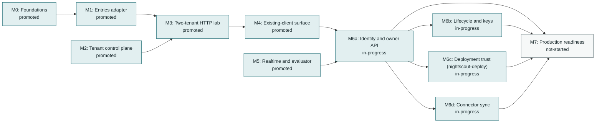
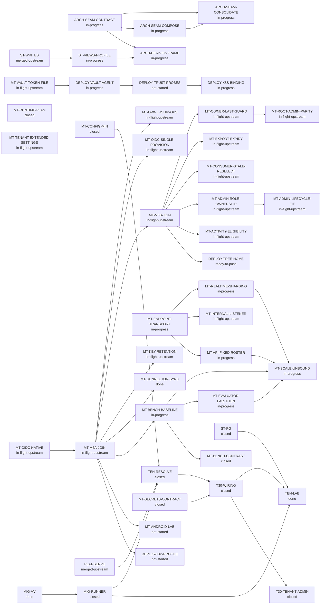

<!-- Generated by tools/queue/multitenant_dashboard.py. Edit the queue and multitenant-delivery-status.json. -->
# Multitenant delivery: working dashboard

**Recorded 2026-11-10; not a live branch monitor.** Observed integration tip: `16a1fc2d45e59602eb6ec3e3bf6f506f35bcc5b1` on `workspace/multitenant-20261102 (draft PR #8898)`.
Draft #8898 is at 16a1fc2d. Read from GitHub 2026-11-11 02:20 UTC: head 16a1fc2d, open draft, 17 checks pass and 3 skipped, none pending (CodeQL and the multitenant opt-in corpus included). 16a1fc2d is the 2026-11-10 batch join, a fast-forward of b70ad83f by 37 commits: last-owner guard (BF-229), root admin parity, ownership in the admin role with the lifecycle fit (BF-230), one serve.internal per role with graceful shutdown, pause/suspend activity, export-file removal on key destruction, content-change revisions with the alarm repeat clock (BF-231) and tenant extended settings (BF-232). Its acceptance (full campaign on frozen 3cd1c487, delta campaign on 16a1fc2d) is reports/tenancy/batch-join-2026-11-10/16a1fc2d-acceptance/README.md. The previous head b70ad83f carried the ed2 one-host reference, the M6a owner/OIDC and internal service API candidate (dc795bd1) and the M6b join (reports/tenancy/m6b-join-2026-11-10/b70ad83f-acceptance/README.md). On 2026-11-09 M6 was split into M6a-M6d and M7, the deployment tree moved to nightscout-deploy, Vault connectivity moved to a Vault Agent sidecar and native acceptance runs through a disposable harness (release decisions, 2026-11-09). No dev merge, operator release, production/default enablement, capacity or multi-host claim.

**Start here:** use the dependency map for sequencing, the lane table for parallel work, and the acceptance ledger for what has actually passed. No milestone is promoted by a completed dependency slice.

[Milestone criteria](multitenant-delivery-roadmap.md) | [Programme overview](../../../site/pages/nightscout-next-gen-platform.html) | [Full queue](../../../queue/QUEUE.md)

## Acceptance stages

**Locally accepted -> incorporated / testing pending -> integrated acceptance recorded -> milestone promoted.** Incorporation is ancestry, not a passing test run. Stages below are dated evidence claims, not freshly executed gates. Queue states remain claims too; use `make queue-status` for measurements. Counts are not additive and are not completion percentages.

## Milestone dependencies

Arrows mean prerequisite -> dependent, **not progress**. These are the roadmap's milestone edges; work-item prerequisites appear separately below. M2 and M5 have additional work gates, not a claim that they can finish without storage/runtime foundations.

| Milestone | Claimed status | Prerequisites / work gates | Remaining promotion gate |
|---|---|---|---|
| **M0: Foundations** | promoted | [ST-PG](#st-pg), [MIG-RUNNER](#mig-runner) | Promoted by R60: current restricted-role/RLS, isolation, rollback, pool reuse and paired controls plus migration/startup refusal. Explicit lab preview only; no default or production role enablement. |
| **M1: Entries adapter** | promoted | M0, [ST-PG](#st-pg) | R72 accepts the admitted Mongo/PG backend, typed JSON/query/history/batch and reviewed DDL/import contract. Resource bounds: deferred, measured in C; no numeric threshold approved. PG-only sort cap stays5. |
| **M2: Tenant control plane** | promoted | [MT-CONFIG-MIN](#mt-config-min), [MT-SECRETS-CONTRACT](#mt-secrets-contract), [MIG-RUNNER](#mig-runner), [TEN-RESOLVE](#ten-resolve), [T30-WIRING](#t30-wiring), [T30-TENANT-ADMIN](#t30-tenant-admin) | R72 accepts actual tenant-local typed/versioned settings, CAS/history/rollback, current configure/operator fences, unknown-tenant and cross-tenant signature refusal, no private-context leakage and OWNER/DATA/operator route separation. Two display names; human issuer/refresh, broader catalogue/lifecycle and production trust remain M6. |
| **M3: Two-tenant HTTP lab** | promoted | M1, M2, [TEN-LAB](#ten-lab) | R72 accepts actual authorized A/B entries-v3 requests, independent stored outcomes/restart, foreign credential refusal and stale/unsafe startup refusal after M1/M2 criteria pass. |
| **M4: Existing-client surface** | promoted | M3, [ST-PG](#st-pg), [TEN-LAB](#ten-lab) | R72 accepts actual pinned cgmsim/oref0 and source-pattern replay, tenant-local identity/history/batch/retry/refusal/exchange. No all-client claim. Android emulator C; iOS outside automated lab. |
| **M5: Realtime and evaluator** | promoted | [MT-RUNTIME-PLAN](#mt-runtime-plan) | R73 accepts the functional separate-role reference on one host: bounded consistent current-state/evaluator recovery, current socket authority/DATA compatibility, durable original suppression and actual stable-request consumer handoff, controls/restorations and complete final-tree verification. Current polling/snapshot reference makes no LISTEN/latency or evaluator-to-device claim. Provider/device, multi-node ownership and operating envelope remain separate; published through draft #8898, not merged or released. |
| **M6a: Identity and owner API** | in-progress | M4, M5, [MT-OIDC-NATIVE](#mt-oidc-native), [MT-M6A-JOIN](#mt-m6a-join) | Nine-stage native matrix (Vault single/multi, Mongo/PG sessions, Mongo HTTPS, owner consumer/authority/browser/compatibility) passes on the frozen candidate through the disposable harness with red controls; then the joined candidate passes full, default-browser, enabled-corpus, pinned-client and prcheck on #8898. Recorded: matrix 9/9 with 3/3 controls on the dc795bd1 and b70ad83f joined candidates (reports/tenancy/m6a-join-2026-11-09, reports/tenancy/m6b-join-2026-11-10). Real identity-provider interoperability is synthetic only; no promotion recorded. |
| **M6b: Lifecycle and keys** | in-progress | M6a, [MT-OWNERSHIP-OPS](#mt-ownership-ops), [MT-KEY-RETENTION](#mt-key-retention), [MT-M6B-JOIN](#mt-m6b-join), [MT-OWNER-LAST-GUARD](#mt-owner-last-guard), [MT-ADMIN-ROLE-OWNERSHIP](#mt-admin-role-ownership) | Operator-assisted ownership add/transfer/recovery with race and current-authority controls; 30-day retained-key destruction and after-window refusal; adopted deletion ceremony. Both capabilities are in the b70ad83f joined acceptance (reports/tenancy/m6b-join-2026-11-10). Ownership in the admin role, the last-owner guard and export-file removal are fixed on lane branches and in the batch join, which is in acceptance. Real role processes over Compose, the deploy-repo ownership overlay and the production key custodian remain open; no promotion recorded. |
| **M6c: Deployment trust (nightscout-deploy)** | in-progress | M6a, [MT-VAULT-TOKEN-FILE](#mt-vault-token-file), [DEPLOY-VAULT-AGENT](#deploy-vault-agent), [DEPLOY-IDP-PROFILE](#deploy-idp-profile), [DEPLOY-TRUST-PROBES](#deploy-trust-probes) | Vault Agent sidecar (auto-auth, sink, renewal) with core reading the sink; Authentik profile over HTTPS with synthetic people; live spoof/conflict/outage probes against the Compose edge and Vault; trust record written from the template. Vault Agent overlay and core tokenFile are measured (reports/tenancy/vault-agent-2026-11-09); the identity-provider profile and trust probes are not started. |
| **M6d: Connector sync** | in-progress | M6a, [MT-CONNECTOR-SYNC](#mt-connector-sync) | nightscout-connect pulls from a tenant with a pre-issued reader credential; independent stored/history outcomes; revocation stops the pull. Docker lab measured (reports/tenancy/connector-sync-2026-11-10): other collections, cadence, token refresh, owner-surface revocation and real ingress remain UNMEASURED; no promotion recorded. |
| **M7: Production readiness** | not-started | M6a, M6b, M6c, M6d, [MT-BENCH-BASELINE](#mt-bench-baseline), [MT-BENCH-CONTRAST](#mt-bench-contrast), [MT-SCALE-UNBOUND](#mt-scale-unbound), [MT-EVALUATOR-PARTITION](#mt-evaluator-partition), [MT-REALTIME-SHARDING](#mt-realtime-sharding), [MT-ANDROID-LAB](#mt-android-lab), [MT-ENDPOINT-TRANSPORT](#mt-endpoint-transport), [MT-API-FIXED-ROSTER](#mt-api-fixed-roster), [DEPLOY-K8S-BINDING](#deploy-k8s-binding) | Measured, not declared (maintainer 2026-11-09): benchmark the one-host reference at stepped tenant counts with a hot tenant and publish the numbers; contrast the cohort against N single-tenant processes and the per-site model at equal synthetic load; prove API, realtime, evaluator, PostgreSQL and Vault Agent each scale horizontally or vertically as intended with no hidden binding (any binding is a file:line finding). Evaluator partitioning by member count and ordinal with a pool-membership table (decision 2026-11-09); Android emulator lab; selectable endpoints and fixed-roster API; Kubernetes binding equivalence. Limits are set from the measurements afterwards. Required before a production cohort, not before the dormant alpha. |

## Parallel lanes and next gates

Lane labels describe the recorded handoff, not a live assignment service. Confirm ownership before taking an unassigned lane. An in-progress prerequisite may support a dormant prototype; it does not authorize serving or promote its dependent.

Work-item dependency map (direct edges from the queue)

External prerequisites are shown one level deep; the full queue owns their further dependencies.

| Work item / queue claim | Lane | Queue prerequisites (claimed state) | Next bounded action |
|---|---|---|---|
| **MT-ENDPOINT-TRANSPORT**: in-progress | M7 / listener composition reproduced in lane (reports/tenancy/listener-composition-2026-11-10), joined at b70ad83f | None recorded | Remaining work in selectable-endpoints-and-api-scaling-plan.md: a configuration shape for a shared component listener (maintainer), operational interfaces, remote binding and real api/realtime/evaluator roles over Compose. No Kubernetes proof/Jsonnet or new discovery service. |
| **MT-API-FIXED-ROSTER**: in-progress | Queued / consumes endpoint capability | MT-ENDPOINT-TRANSPORT (in-progress) | Prove two declared APIs behind a service destination while restore directly drains/invalidates every actual instance. Consume platform/config inventory; evaluator remains singleton. Native concurrency/replacement/client gates UNMEASURED; platform bindings and dynamic membership deferred. |
| **TEN-LAB**: done | R72 preview criteria accepted / wider scope retained | ST-PG (closed), T30-WIRING (closed), MIG-RUNNER (closed) | R72 M0–M4 reference scope is retained; R73 promotes functional M5. Wider owner catalogue, human identity/lifecycle, production trust, provider/device and operating envelope retain M6 or separately selected adapter contracts. |
| **ARCH-SEAM-CONTRACT**: in-progress | Measured ports / remaining capabilities | None recorded | R42 real Mongo/PG lower and preview contracts remain the basis; R44 preserves them during composition. Broader schema/query/error/retry/import capabilities remain open; consolidation consumes measured differences. |
| **ST-VIEWS-PROFILE**: in-progress | R55 independent helper integration accepted | ST-WRITES (merged-upstream) | Independent2ee8b493 full6690/3pending/0failure/browser684/finalprcheckOK; canonical archive38, actual-trigger(http)/clinical/retention controls each0/1semantic/restored38. Helper matches REST and evaluateCycle retained; no REST359 merge, runtime-role/subscriber/notification policy change. Wider writer/alarms/live stats/cost and durable recovery open. Notification-close v1-closed stays declared at2ee but new-head runtime UNMEASURED; prior517 measurement historical, not a fourth measuredR55 control. |
| **ARCH-SEAM-COMPOSE**: in-progress | Accepted current-domain extraction | ARCH-SEAM-CONTRACT (in-progress) | R44 current-head CLI/startup/refusal and failure/HTTP controls pass. Domain metadata and explicit PG backend composition are separate; preserve read-only startup, current Mongo default and independent binding/transaction semantics. Wider stable portability and consolidation remain separate. |
| **ARCH-SEAM-CONSOLIDATE**: in-progress | Accepted bounded shared PG mechanics | ARCH-SEAM-CONTRACT (in-progress), ARCH-SEAM-COMPOSE (in-progress) | R46 real-port baseline/candidate, full/browser-on-identical-app and meaningful ordering/projection/precommit controls accept the small extraction. Source-specific translation, natural order and write policy are explicit; broader portable helper relocation and capability review continue. |
| **ARCH-DERIVED-FRAME**: in-progress | Separate frames / bounded characterization accepted | ARCH-SEAM-CONTRACT (in-progress), ST-VIEWS-PROFILE (in-progress) | REST and independent computed-single profile retain separate policies. The derived-output characterization records selected current evaluator/API agreement under tested contexts; checkpoint alone is not result identity. No publication service, universal computed profile or distributed evaluator admission is selected. |
| **MT-CONFIG-MIN**: closed | Closed 2026-11-09 as superseded; accepted scope on draft #8898 | None recorded | Remaining scope moved to the M6a-M6d/M7 capability items. Gates and evidence retained on the closed item. |
| **ST-PG**: closed | Closed 2026-11-09 as superseded; accepted scope on draft #8898 | None recorded | Remaining scope moved to the M6a-M6d/M7 capability items. Gates and evidence retained on the closed item. |
| **T30-WIRING**: closed | Closed 2026-11-09 as superseded; accepted scope on draft #8898 | TEN-RESOLVE (closed), MT-SECRETS-CONTRACT (closed) | Remaining scope moved to the M6a-M6d/M7 capability items. Gates and evidence retained on the closed item. |
| **MIG-RUNNER**: closed | Closed 2026-11-09 as superseded; accepted scope on draft #8898 | MIG-VV (done) | Remaining scope moved to the M6a-M6d/M7 capability items. Gates and evidence retained on the closed item. |
| **MT-SECRETS-CONTRACT**: closed | Closed 2026-11-09 as superseded; accepted scope on draft #8898 | None recorded | Remaining scope moved to the M6a-M6d/M7 capability items. Gates and evidence retained on the closed item. |
| **TEN-RESOLVE**: closed | Closed 2026-11-09 as superseded; accepted scope on draft #8898 | MT-CONFIG-MIN (closed), MIG-RUNNER (closed), PLAT-SERVE (merged-upstream) | Remaining scope moved to the M6a-M6d/M7 capability items. Gates and evidence retained on the closed item. |
| **MT-RUNTIME-PLAN**: closed | Closed 2026-11-09 as superseded; accepted scope on draft #8898 | None recorded | Remaining scope moved to the M6a-M6d/M7 capability items. Gates and evidence retained on the closed item. |
| **T30-TENANT-ADMIN**: closed | Closed 2026-11-09 as superseded; accepted scope on draft #8898 | T30-WIRING (closed) | Remaining scope moved to the M6a-M6d/M7 capability items. Gates and evidence retained on the closed item. |
| **MT-OIDC-NATIVE**: in-flight-upstream | M6a / matrix 9/9 on the joined candidates | None recorded | Rerun tests/native/oidc-matrix/run.sh on each new joined head. |
| **MT-M6A-JOIN**: in-flight-upstream | M6a / dc795bd1 on #8898, CI green (release contents 2026-11-10) | MT-OIDC-NATIVE (in-flight-upstream) | Carried forward by MT-M6B-JOIN at b70ad83f. |
| **MT-OWNERSHIP-OPS**: in-flight-upstream | M6b / reproduced in lane, joined at b70ad83f | MT-M6A-JOIN (in-flight-upstream) | Start the operation in a serving role and add the operator identity to deploy config; last-owner subject removal and legacy subject-admin serialization are read-derived findings to close. |
| **MT-KEY-RETENTION**: in-flight-upstream | M6b / reproduced in lane, joined at b70ad83f (BF-228 fixed) | MT-M6A-JOIN (in-flight-upstream) | Production key custodian and Vault policy; export-file expiry is not automated. |
| **MT-VAULT-TOKEN-FILE**: in-flight-upstream | M6c / core: in dc795bd1 on #8898 | None recorded | Ships with the #8898 bundle. |
| **DEPLOY-VAULT-AGENT**: in-progress | M6c / nightscout-deploy main cda38265: overlay landed, smoke measured | MT-VAULT-TOKEN-FILE (in-flight-upstream) | Decided: one AppRole per deployment. Replace the policy union with a path glob; measure re-auth after token_max_ttl and seal/unseal. |
| **DEPLOY-IDP-PROFILE**: not-started | M6c / nightscout-deploy | MT-M6A-JOIN (in-flight-upstream) | Authentik provider profile over HTTPS with synthetic people; login/renewal/logout/outage against the owner HTTP routes; Kratos fallback profile only if the Authentik proof fails. |
| **DEPLOY-TRUST-PROBES**: not-started | M6c / nightscout-deploy | DEPLOY-VAULT-AGENT (in-progress) | Spoof, host/selector conflict, unknown tenant, socket and outage probes against the live Compose edge and Vault; trust record from edge/trust-record.template.md. |
| **MT-CONNECTOR-SYNC**: done | M6d / Docker lab measured (reports/tenancy/connector-sync-2026-11-10) | MT-M6A-JOIN (in-flight-upstream) | Other collections, long-running cadence, token refresh, owner-surface revocation, real ingress and the lock-pinned connector commit remain UNMEASURED. |
| **MT-ANDROID-LAB**: not-started | M7 | MT-M6A-JOIN (in-flight-upstream) | Android emulator acceptance for the pinned uploader/follower shapes; iOS stays outside the automated lab. |
| **DEPLOY-K8S-BINDING**: in-progress | M7 / nightscout-deploy | DEPLOY-TRUST-PROBES (not-started) | One Pod per cohort, private socket volume, no-overlap update; binding equivalence table. |
| **MT-BENCH-BASELINE**: in-progress | M7 / measurement | MT-M6A-JOIN (in-flight-upstream) | k6 or autocannon driving pinned client shapes at 1/10/50/200 tenants with one hot tenant on the Compose reference; p50/p95/p99, socket fanout, evaluator cycle, pool/lock waits, CPU/RSS per role, disk per tenant-day, reconnect recovery. Independent stored-count oracle. Numbers are the deliverable. |
| **MT-BENCH-CONTRAST**: closed | M7 / measurement | MT-BENCH-BASELINE (in-progress) | Same workload against N single-tenant Mongo processes and the per-site process model; resource per tenant, latency, startup/restore time, operator steps per tenant, side by side. |
| **MT-SCALE-UNBOUND**: in-progress | M7 / architecture proof | MT-BENCH-BASELINE (in-progress), MT-API-FIXED-ROSTER (in-progress), MT-REALTIME-SHARDING (in-progress), MT-EVALUATOR-PARTITION (in-progress) | API 1->2->4 replicas, realtime vertical then horizontal, evaluator vertical, PG vertical and pool bounds; binding inventory with file:line; horizontal realtime consumes endpoint transport and realtime sharding correctness, API scale consumes fixed roster; vertical baselines remain independent. |
| **MT-REALTIME-SHARDING**: in-progress | M7 / realtime placement and recovery | MT-ENDPOINT-TRANSPORT (in-progress) | Evaluate stable logical tenant shards with explicit edge/alarm mapping, owner incarnations, checkpoint continuity, subset-aware maintenance and controlled moves/rollback. Preserve separate evaluator/delivery responsibilities with optional measured co-location; no lease-only HA or implied alarm replay. |
| **MT-EVALUATOR-PARTITION**: in-progress | M7 / evaluator scaling | MT-BENCH-BASELINE (in-progress) | Flag with member count and ordinal env vars; pool-membership heartbeat table (ordinal, expected members, slice, lease); evaluate only while live rows agree; scale-event control 2->3 mid-cycle and duplicate-ordinal control. |
| **MT-M6B-JOIN**: in-flight-upstream | M6b / b70ad83f on #8898, CI green | MT-M6A-JOIN (in-flight-upstream) | Carried forward by the batch join, accepted and pushed to #8898 at 16a1fc2d. |
| **MT-OIDC-SINGLE-PROVISION**: in-flight-upstream | Single-site OIDC / joined at b70ad83f | MT-M6A-JOIN (in-flight-upstream) | Authoritative identity list decided 2026-11-10. Real provider interoperability and concurrent starts remain UNMEASURED. |
| **MT-OWNER-LAST-GUARD**: in-flight-upstream | M6b / fixed on lane 65657a62 (BF-229); joined at 16a1fc2d (#8898) | MT-M6B-JOIN (in-flight-upstream) | Joined and accepted at 16a1fc2d; no lane action remains recorded. |
| **MT-ADMIN-ROLE-OWNERSHIP**: in-flight-upstream | M6b / fixed on lane 1376c294; joined at 16a1fc2d (#8898) | MT-M6B-JOIN (in-flight-upstream) | Port the ownership_operator grants to a nightscout-deploy overlay. |
| **MT-ADMIN-LIFECYCLE-FIT**: in-flight-upstream | Admin role beside lifecycle / lane 66655756 (BF-230); joined at 16a1fc2d (#8898) | MT-ADMIN-ROLE-OWNERSHIP (in-flight-upstream) | Clinical logical restore with the admin role connected; the restore census with the api role holding a root_writer backend (UNMEASURED at 16a1fc2d). |
| **MT-ROOT-ADMIN-PARITY**: in-flight-upstream | Tenant API_SECRET parity / lane 165c13bf; joined at 16a1fc2d (#8898) | MT-OWNER-LAST-GUARD (in-flight-upstream) | Preview API boot with subject admin on real PostgreSQL and Vault, and the browser admin page. |
| **MT-INTERNAL-LISTENER**: in-flight-upstream | serve.internal per role / lane 78ecba76; joined at 16a1fc2d (#8898) | MT-ENDPOINT-TRANSPORT (in-progress) | Real role processes over Compose (UNMEASURED: the instrument uses stand-ins). |
| **MT-ACTIVITY-ELIGIBILITY**: in-flight-upstream | Pause/suspend / lane 07981b55; joined at 16a1fc2d (#8898) | MT-M6B-JOIN (in-flight-upstream) | Isolation of one tenant's unreadable activity row; activity selections and grants in the deploy demo and nightscout-deploy. |
| **MT-EXPORT-EXPIRY**: in-flight-upstream | Key destruction removes the export / lane 701eba6f; joined at 16a1fc2d (#8898) | MT-M6B-JOIN (in-flight-upstream) | Production composition of the artifact remover and the operator UPDATE grant. |
| **MT-CONSUMER-STALE-RESELECT**: in-flight-upstream | Alarm path / lane 956d0940 (BF-231); joined at 16a1fc2d (#8898) | MT-M6B-JOIN (in-flight-upstream) | No lane action remains recorded beyond the joined acceptance at 16a1fc2d. |
| **MT-TENANT-EXTENDED-SETTINGS**: in-flight-upstream | Plugin extended settings / lane 2f1ae027 (BF-232); joined at 16a1fc2d (#8898) | None recorded | Owner editing of plugin alert enables after the first preview; the browser tier on 16a1fc2d (carried over from 3cd1c487). |
| **DEPLOY-TREE-HOME**: ready-to-push | M6c / nightscout-deploy branch 9387428, unpushed | MT-M6B-JOIN (in-flight-upstream) | Operator README and ownership-admin overlay; #8898 drops or shrinks deploy/multitenant to the fixture its tests boot. |

## Accepted slices and integration handoff

This ledger retains source-scoped checkpoints in chronological order; later acceptance can supersede an earlier pending boundary. Use the milestone table and next-action table for current work. A bounded slice does **not** close its parent queue card or a milestone.

| Slice / parent | Acceptance stage | Commit / evidence | Recorded result and boundary |
|---|---|---|---|
| Secrets component, Vault adapter, PG persistence and rewrap / [MT-SECRETS-CONTRACT](#mt-secrets-contract) | **Integrated acceptance recorded** | [`6943dccb`](../../archive/tenancy/multitenant-delivery-roadmap-2026-11-02.md#integration-entries-and-vault-facing-secrets-2026-11-02) | 230 focused combined checks at the integration record; dormant only. |
| Synthetic secrets recovery and worker crash/retry / [MT-SECRETS-CONTRACT](#mt-secrets-contract) | **Integrated acceptance recorded** | [`0de90852`](../../archive/tenancy/multitenant-delivery-roadmap-2026-11-02.md#integration-secrets-recovery-acceptance-and-next-control-plane-slice-2026-11-02) | 879 broad / 34 secrets checks; production recovery remains open. |
| Persistent current subject authority / [MT-CONFIG-MIN](#mt-config-min) | **Incorporated; testing pending** | [`1dd8990b`](../../archive/tenancy/multitenant-delivery-roadmap-2026-11-02.md#parallel-control-plane-acceptance-and-next-handoff-2026-11-02) | Local combined 36 checks with scalar settings; integrated gate pending. |
| Units/seconds, provenance, history and rollback / [MT-CONFIG-MIN](#mt-config-min) | **Incorporated; testing pending** | [`011802ba`](../../archive/tenancy/multitenant-delivery-roadmap-2026-11-02.md#parallel-control-plane-acceptance-and-next-handoff-2026-11-02) | Local combined 36 checks; injected policy is not atomic policy/write fencing. |
| MongoDB replica-set transactional operator runner / [MIG-RUNNER](#mig-runner) | **Incorporated; testing pending** | [`562f6206`](../../archive/tenancy/multitenant-delivery-roadmap-2026-11-02.md#parallel-mig-runner-transactional-mongodb-slice-2026-11-02) | Local 53 combined / 12 MongoDB checks; standalone/index steps refuse. |
| Primary crash/restart and expired-renewal refusal / [MIG-RUNNER](#mig-runner) | **Incorporated; testing pending** | [`436ef543`](../../archive/tenancy/multitenant-delivery-roadmap-2026-11-02.md#parallel-mig-runner-primary-recovery-and-renewal-loss-2026-11-02) | Local 56 combined / 15 MongoDB checks at floor and ceiling; not HA. |
| Tenant-bound JWT HTTP authorization proof / [T30-WIRING](#t30-wiring) | **Integrated acceptance recorded** | [`dc2c5fbf`](../../archive/tenancy/multitenant-delivery-roadmap-2026-11-02.md#tenant-jwt-proof-integration-and-http-gate) | 2 HTTP tests pass for cross-tenant signature refusal, current grants and authority outage; production runtime wiring remains open. |
| One-time API entries importer and PostgreSQL target / [ST-PG](#st-pg) | **Integrated acceptance recorded** | [`327cbb1f`](../../archive/tenancy/multitenant-delivery-roadmap-2026-11-02.md#m1-m2-code-slices-and-acceptance-2026-11-02) | Importer unit/CLI tests and disposable-PostgreSQL tenant-bound replay test pass; one-time best-effort import, not snapshot or ongoing sync. |
| Entries candidate schema and forced-RLS acceptance / [ST-PG](#st-pg) | **Integrated acceptance recorded** | [`025704cd`](../../archive/tenancy/multitenant-delivery-roadmap-2026-11-02.md#m1-m2-code-slices-and-acceptance-2026-11-02) | Disposable-Docker migration suite passes 13 checks, including generated fields, typed identity, unique identifier constraint and forced RLS. |
| Provider-neutral tenant policy and HTTP boundaries / [MT-CONFIG-MIN](#mt-config-min) | **Integrated acceptance recorded** | [`c496d009`](../../archive/tenancy/multitenant-delivery-roadmap-2026-11-02.md#m1-m2-code-slices-and-acceptance-2026-11-02) | 19 resolver/app/JWT HTTP checks pass; integrated secrets/Vault/PostgreSQL gate passes 37, including persisted current grants and atomic settings/grant fencing. No deployment adapter or serving role. |
| Two-tenant entries HTTP lab / [TEN-LAB](#ten-lab) | **Integrated acceptance recorded** | [`a19b549c`](../../archive/tenancy/multitenant-delivery-roadmap-2026-11-02.md#m1-m2-code-slices-and-acceptance-2026-11-02) | 10 disposable-PostgreSQL HTTP lab cases pass for tenant isolation, writes, revocation, startup refusal and data-plane separation; M3 promotion remains blocked. |
| Combined projection/current authority (R24) / [TEN-LAB](#ten-lab) | **Integrated acceptance recorded** | [`8b193e18`](../../archive/tenancy/multitenant-delivery-roadmap-2026-11-02.md#accepted-read-and-authority-continuations-2026-11-04) | Agent-run nonbrowser 6713 passing/108 pending/0 failing, browser 684/0/0; explicit PG/HTTP/Vault campaigns and controls. Dormant bounded integration, not M1/M2 completion. |
| Legacy credential to actual entries GET (R25) / [T30-WIRING](#t30-wiring) | **Integrated acceptance recorded** | [`7eb76c71`](../../archive/tenancy/multitenant-delivery-roadmap-2026-11-02.md#accepted-read-and-authority-continuations-2026-11-04) | Agent-run focused 72/0/0, nonbrowser 6718 passing/118 pending/0 failing, browser 684/0/0. Current persisted authority; synthetic HTTP crypto, real Vault separately measured. |
| Compatible exchange to current-authority GET (R26) / [T30-WIRING](#t30-wiring) | **Integrated acceptance recorded** | [`81bc71e6`](../../archive/tenancy/multitenant-delivery-roadmap-2026-11-02.md#accepted-read-and-authority-continuations-2026-11-04) | Published PR checkpoint. Agent-run focused 85/0/0, nonbrowser 6725 passing/124 pending/0 failing, browser 684/0/0; exact names, eight-hour policy and four source controls. Pinned clients inspected, not replayed. |
| Actual entries list/search (R27) / [ST-PG](#st-pg) | **Integrated acceptance recorded** | [`c10290d2`](../../archive/tenancy/multitenant-delivery-roadmap-2026-11-02.md#accepted-read-and-authority-continuations-2026-11-04) | Local cumulative slice: agent-run nonbrowser 6764 passing/88 pending/0 failing, browser 684/0/0; reader differential 8, HTTP search 2, three controls. Counts overlap; pending change reflects enabled PG cases. History/mutations, production runtime and client replay remain open. |
| Actual entries POST/create/resend (R29) / [ST-PG](#st-pg) | **Integrated acceptance recorded** | [`6cad7a42`](../../archive/tenancy/multitenant-delivery-roadmap-2026-11-02.md#accepted-post-provider-and-canonical-continuations-2026-11-04) | Agent-reproduced nonbrowser 6807/73 pending/0 failing, browser684, focused78 and six red controls; current grants/attribution, configured pruning and legitimate extension keys. Now included in cumulative R34; remaining mutations/history/import/resources open. |
| Real Vault/PG HTTP lab (R30) / [MT-SECRETS-CONTRACT](#mt-secrets-contract) | **Integrated acceptance recorded** | [`e410b163`](../../archive/tenancy/multitenant-delivery-roadmap-2026-11-02.md#accepted-post-provider-and-canonical-continuations-2026-11-04) | Enabled44 including new runtime5; nonbrowser6725/132 pending/0 failing, browser684; tenant-binding red control. Test-only provider composition, now included in R34; production service identity/TLS/HA not established. |
| Real-provider POST composition (R32) / [TEN-LAB](#ten-lab) | **Integrated acceptance recorded** | [`4621d5c4`](../../archive/tenancy/multitenant-delivery-roadmap-2026-11-02.md#accepted-post-provider-and-canonical-continuations-2026-11-04) | Enabled62, nonbrowser6807/79 pending/0 failing, browser684; three actual POST controls red. Real-provider write/read/isolation/current-grant/outage behavior, now included in R34. Counts overlap, not milestone completion. |
| Explicit canonical ingress (R33) / [TEN-RESOLVE](#ten-resolve) | **Integrated acceptance recorded** | [`468c41dc`](../../archive/tenancy/multitenant-delivery-roadmap-2026-11-02.md#accepted-post-provider-and-canonical-continuations-2026-11-04) | Focused25, nonbrowser6815/73 pending/0 failing, browser684; four resolver/app controls red. Direct mode preserved, canonical Host requires per-request explicit trust. Now in R34; no durable registry/production trust adapter. |
| Cumulative canonical/provider/POST (R34) / [TEN-LAB](#ten-lab) | **Integrated acceptance recorded** | [`c527fb7e`](../../archive/tenancy/multitenant-delivery-roadmap-2026-11-02.md#accepted-post-provider-and-canonical-continuations-2026-11-04) | Historical cumulative checkpoint, superseded by R38/R39. Enabled63, nonbrowser6815/80 pending/0 failing, browser684; composed forwarded-precedence, trust-loss and alias-conflict controls red. Synthetic loopback provenance only; no full M1/M2/M3, client, realtime or operations acceptance. |
| Executable entries CRUD/history (R38) / [T30-WIRING](#t30-wiring) | **Integrated acceptance recorded** | [`21145d0d`](../../archive/tenancy/multitenant-delivery-roadmap-2026-11-02.md#rest-continuation-and-qms-reconciliation-2026-11-04) | Recorded integration-agent reproduced acceptance through the actual PG/Vault executable, current authority, rollback and restart. See R38 for nonadditive campaign figures and controls; full REST and production lifecycle remain open. |
| Explicitly selected REST domains (R39) / [TEN-LAB](#ten-lab) | **Integrated acceptance recorded** | [`ae471ac7`](../../archive/tenancy/multitenant-delivery-roadmap-2026-11-02.md#rest-continuation-and-qms-reconciliation-2026-11-04) | Recorded integration-agent reproduced legacy v1/inherited-v2 data handlers, API3 collections and safe context. Now published on draft PR #8898 with successful head CI/CodeQL. Remaining route/client replay and M0-M6 criteria are incomplete; new Codex lane results remain UNMEASURED. |
| Derived REST and pinned-pattern cumulative acceptance (R40) / [TEN-LAB](#ten-lab) | **Integrated acceptance recorded** | [`ded254b9`](../../archive/tenancy/multitenant-delivery-roadmap-2026-11-02.md#rest-continuation-and-qms-reconciliation-2026-11-04) | Parent-reproduced actual v2 derived handlers, synthetic source-pinned client replay and independent authority probes, including real CLI/PG/Vault derived/current-authority/restart composition. R40 owns exact campaign figures and controls. Published on OPEN/draft #8898; current-head CI and CodeQL successful at read-back; full REST, client binaries and production M0-M6 criteria remain incomplete. |
| Persisted subject administration and cumulative compatibility (R41) / [MT-CONFIG-MIN](#mt-config-min) | **Integrated acceptance recorded** | [`94c57f1f`](../../archive/tenancy/multitenant-delivery-roadmap-2026-11-02.md#accepted-subject-administration-and-compatibility-continuation-2026-11-05) | Local full/browser/provider/compatibility acceptance with archived current-grants/tenant/atomic controls. No management HTTP, owner ceilings or milestone promotion. |
| Repeated bounded release/dev/PR-single refresh / [TEN-LAB](#ten-lab) | **Locally accepted** | [`ded254b9`](../../archive/tenancy/multitenant-delivery-roadmap-2026-11-02.md#accepted-subject-administration-and-compatibility-continuation-2026-11-05) | Repeated common corpus and hardened auditor controls; current dev/PR-single match. Old full-corpus residuals are diagnostic; identity/settings families and final R41 tree are not measured by this historical comparison. |
| Storage-port contract and management HTTP (R42) / [ARCH-SEAM-CONTRACT](#arch-seam-contract) | **Integrated acceptance recorded** | [`d4570e58`](../../archive/tenancy/multitenant-delivery-roadmap-2026-11-02.md#accepted-contract-management-and-independent-profile-wave-2026-11-05) | Local cumulative acceptance, real lower/preview/Mongo ports and standalone management HTTP with semantic controls; source contracts reconciled. No full portable runtime or owner listener. |
| Independent nonresident single refresh (R43) / [ST-VIEWS-PROFILE](#st-views-profile) | **Locally accepted** | [`925c9527`](../../archive/tenancy/multitenant-delivery-roadmap-2026-11-02.md#accepted-contract-management-and-independent-profile-wave-2026-11-05) | Separate current-dev refresh with full/default-browser and selected replay/controls. Not joined into #8898; physical subscriber unchanged and logical no-op policy remains open. |
| Current-domain composition and direct imported identity (R44) / [ARCH-SEAM-COMPOSE](#arch-seam-compose) | **Integrated acceptance recorded** | [`bc4ee1a9`](../../archive/tenancy/multitenant-delivery-roadmap-2026-11-02.md#accepted-composition-and-direct-identity-continuation-2026-11-05) | Parent-reproduced complete nonbrowser/default-browser, real CLI/HTTP contracts and direct Mongo/PG typed identity mutations with semantic controls and independent review. No new backend/write policy, helper consolidation or milestone promotion. |
| Independent actual HTTP profile writers and live handoff (R45) / [ST-VIEWS-PROFILE](#st-views-profile) | **Locally accepted** | [`dff9a8d4`](../../archive/tenancy/multitenant-delivery-roadmap-2026-11-02.md#accepted-independent-http-profile-continuation-2026-11-05) | Independent test-only replay adds API3 mutations/resends and live-service ownership assertions; parent archived replay/trigger/closed-service controls and independent review. R45 owns exact regression figures and limits. Physical subscriber retained; no REST join or multitenant evaluator acceptance. |
| Bounded PG mechanics and direct indexed races (R46) / [ARCH-SEAM-CONSOLIDATE](#arch-seam-consolidate) | **Integrated acceptance recorded** | [`44331668`](../../archive/tenancy/multitenant-delivery-roadmap-2026-11-02.md#accepted-adapter-consolidation-and-index-race-continuation-2026-11-05) | Parent full/final common-port and indexed-race acceptance, browser on identical application source and semantic order/projection/precommit/retry controls. Baseline/current UTC fixtures and diagnostic corrections explicit; broader portable helpers and milestones remain open. |
| Independent test-composed v1 evaluator writers (R47) / [ST-VIEWS-PROFILE](#st-views-profile) | **Locally accepted** | [`0c98ad06`](../../archive/tenancy/multitenant-delivery-roadmap-2026-11-02.md#accepted-independent-v1-evaluator-continuation-2026-11-05) | Agent full/default-browser plus parent archived36 and v1 trigger/closed-service controls. Test-only v1 configurators preserve reply/delete/no-op differences and live handoff; production routes/subscriber unchanged. Shared-frame inventory is read-derived, not runtime acceptance. |
| Optional local data-token authority (R48) / [T30-WIRING](#t30-wiring) | **Integrated acceptance recorded** | [`3d5eac19`](../../archive/tenancy/multitenant-delivery-roadmap-2026-11-02.md#accepted-optional-local-data-token-authority-2026-11-05) | Adopted owner-authority contract; actual API local Ed25519 verification checks current PostgreSQL session/key/grants per operation. R48 owns full/browser and semantic controls; human issuer/refresh, full catalogue, proposed-grant ceilings and production provider/key operations remain incomplete. |
| Actual frame acquisition and concurrent REST reads (R49) / [ARCH-DERIVED-FRAME](#arch-derived-frame) | **Integrated acceptance recorded** | [`1c55098a`](../../archive/tenancy/multitenant-delivery-roadmap-2026-11-02.md#accepted-frame-acquisition-and-concurrent-read-characterization-2026-11-05) | Actual Mongo/PG views, tenant snapshot and resident acquisition retain measured bounds/future/statistics/typed-union/private-cache differences. Held HTTP reads return old entries/new treatments despite an atomic independent writer commit; semantic controls cover clinical values, tenant/partial-read refusal and no read egress. Final cumulative full7076/80pending/0failure and browser684 pass; no shared implementation, atomic revision or milestone promotion. |
| Independent evaluator acquisition, failure retention and recovery (R50) / [ST-VIEWS-PROFILE](#st-views-profile) | **Locally accepted** | [`5173864d`](../../archive/tenancy/multitenant-delivery-roadmap-2026-11-02.md#accepted-independent-evaluator-frame-characterization-2026-11-05) | Agent full6690/3pending/0failure and default-browser684; parent archived38 and independently repeated clinical/retention semantic controls. Actual held rows yield A/B, then real trigger B/B; failed materialization retains previous time/properties and recovers. Teardown proves no late fake-provider delivery only, not cancellation/internal handoff absence. Runtime/subscriber unchanged; no REST join. |
| Bounded settings differential after serial recovery (R51) / [ST-PG](#st-pg) | **Integrated acceptance recorded** | [`33870764`](../../archive/tenancy/multitenant-delivery-roadmap-2026-11-02.md#accepted-settings-differential-and-serial-recovery-2026-11-06) | Root FF exact tested tree; full7089/80pending/0failure, browser684 and final prcheckOK. Archived12, sortcap/predicate/projection semantic failures and restored12. Global PG sort cap4→5 only; regex/dotted refusal and resource/client/replica limits explicit. A/C/D/clock not joined; no milestone promotion. |
| Private acquisition allocation extraction (R52) / [ARCH-DERIVED-FRAME](#arch-derived-frame) | **Locally accepted** | [`e5fe0b5e`](../../archive/tenancy/multitenant-delivery-roadmap-2026-11-02.md#accepted-private-acquisition-and-pending-composition-2026-11-06) | Native fresh full7080/80pending/0failure; same-head prior browser684, final prcheckOK. Acquisition14/concurrency4 and six semantic controls/restored14/4; caller4/reused-target2fail/restored4. RootB+A c7778436 incorporated, combined full PENDING. No atomic revision or independent profile runtime acceptance. |
| Selected owner proposed-grant policy (R53) / [MT-CONFIG-MIN](#mt-config-min) | **Locally accepted** | [`17f9a457`](../../archive/tenancy/multitenant-delivery-roadmap-2026-11-02.md#accepted-selected-owner-policy-and-pending-composition-2026-11-06) | Native full7127/80pending/0failure/browser684/finalprcheckOK; static32 positive, actualDB22 and four guard controls, parent archived22/four0-1semantic/restored22. Explicit ownerPolicy transaction REST37 subset only. RootB+A+C4a15802c incorporated, combined fullPENDING; no listener, complete owner lifecycle or milestone promotion. |
| Cumulative settings, private acquisition and selected owner policy (R54) / [TEN-LAB](#ten-lab) | **Integrated acceptance recorded** | [`35903069`](../../archive/tenancy/multitenant-delivery-roadmap-2026-11-02.md#accepted-cumulative-settings-acquisition-and-owner-policy-2026-11-06) | Local cumulative B338+A e5+C17f full7144/80pending/0failure/browser684/settings12/finalprcheckOK; test-only normalization final fix. Successful captured cleanup verified absent/219preserved. Native R51-R53 unchanged; no clock/profile2ee join, production owner/listener enablement, stronger snapshot or milestone promotion. |
| Independent private acquisition profile integration (R55) / [ST-VIEWS-PROFILE](#st-views-profile) | **Locally accepted** | [`2ee8b493`](../../archive/tenancy/multitenant-delivery-roadmap-2026-11-02.md#accepted-independent-private-acquisition-profile-2026-11-06) | Independent full6690/3pending/0failure/browser684, archive38/three semantic trigger-clinical-retention controls/restored38, finalprcheckOK. Helper matches accepted REST; evaluateCycle/physical subscriber retained. REST359/profile2ee not merged, no runtime-role/notification policy or milestone promotion. |
| Coherent CI/client compatibility and M0 foundations (R60) / [TEN-LAB](#ten-lab) | **Integrated acceptance recorded** | [`d89a44e1`](../../archive/tenancy/multitenant-delivery-roadmap-2026-11-02.md#accepted-coherent-ci-client-batch-and-m0-foundations-2026-11-06) | R60 owns the exact-head corpus/prcheck and product-identical ancestor regression/client/pooler captures. M0 promoted; bounded client lab complete. Failed provisioner capture and original safety guard preserved. M1–M6 remain open; no release or default enablement. |
| Bounded owner reader and recovery batch (R62) / [MT-RUNTIME-PLAN](#mt-runtime-plan) | **Integrated acceptance recorded** | [`83582e87`](../../archive/tenancy/multitenant-delivery-roadmap-2026-11-02.md#accepted-bounded-owner-reader-and-recovery-batch-2026-11-06) | Fresh871 full7226/99pending/0failure, browser684, corpus460/1benchmarkpending/0failure, defaultclients82/82 and pooler9+4. Archived owner12 and replay7 semantic red/restored. Source-runner-only835 preserves product/test identity and passes finalprcheck. No activation or M1–M6 promotion. Historical reader-mode acceptance retained; maintainer subsequently withdrew the option for backward incompatibility. Removed in local candidate; comprehensive verification pending. |
| Recovered clinical projection native controls (R67) / [MT-RUNTIME-PLAN](#mt-runtime-plan) | **Locally accepted** | [`1990f453`](../../archive/tenancy/multitenant-delivery-roadmap-2026-11-02.md#accepted-bounded-clinical-projection-controls-2026-11-06) | Native identity111vs222 and missing123 assertions fail after independent physical inputs; fresh restoration7/0/0. Dormant constructor only; R66 socket failure retained. No whole1990/full-batch, live role, notification/ack or M5 promotion. |
| Fresh-schema socket DATA native controls (R68) / [MT-RUNTIME-PLAN](#mt-runtime-plan) | **Locally accepted** | [`12919f55`](../../archive/tenancy/multitenant-delivery-roadmap-2026-11-02.md#measured-fresh-schema-socket-data-controls-2026-11-06) | Canonical actual Mongo/PG pattern parity, reverse-lexical multiple match and reached commit/abort markers; early-ack and role physical controls red/restored4. Matrix3 at identical-product0d628 remains attributed there. Dormant fresh-schema prototype; no populated/import/downgrade, production transport/rollout or milestone promotion. |
| Admitted entries and owner configuration completion (R72) / [TEN-LAB](#ten-lab) | **Integrated acceptance recorded** | [`74d7b3fc`](../remedial/rc-16.0.0-integration-record.md#r72---admitted-entries-and-owner-configuration-completion-batch-2026-11-06) | Coherent full/browser/all40 enabled corpus/finalprcheck acceptance, current actor/policy/presentation native controls and real client/pooler proofs. M1–M4 promoted at adopted scope; exact74d7/7015 attribution preserved. M5/M6 remain open. |
| R73 durable PostgreSQL runtime, alarm and request record / [MT-RUNTIME-PLAN](#mt-runtime-plan) | **Integrated acceptance recorded** | [`353bb444`](../../../reports/tenancy/m5-runtime-2026-11-07/postgres/README.md#m5-bounded-postgresql-recorded-evidence) | Recorded23 ordinary/19 distinct physical controls/fresh23 restoration, with actual f4e3/353 attribution and original stops/regrades retained. Component record alone does not promote M5; no fresh native or provider/device claim. |
| R73 joined runtime and actual notification/socket/browser consumers / [MT-RUNTIME-PLAN](#mt-runtime-plan) | **Integrated acceptance recorded** | [`b6bb39fd`](../../../reports/tenancy/m5-runtime-2026-11-07/roles/README.md#joined-m5-roles-recorded-evidence) | Six fresh ordinary, six physical semantic reds and six fresh restored cohorts; actual evaluator/realtime handoff and separate unchanged-browser presentation. Current recipient/config authority, suppression/plugin/cold clear and DATA parity measured. No evaluator-to-device journey or universal offline-cache claim. |
| R73 populated SQL operations and synthetic lifecycle / [TEN-RESOLVE](#ten-resolve) | **Integrated acceptance recorded** | [`9298d793`](../../../reports/tenancy/m6-ops-2026-11-07/postgres/README.md#m6-operations-bounded-postgresql-recorded-evidence) | Initial five SQL cases/11 physical controls/11 targeted restorations/fresh final five;37 CURRENT/31 OLD tables. Exact nine terminal-Z audit reconciliation and independent release preserve original false closure. Same-ID tenant restore and whole M6 remain open. |
| R73 coherent final-tree verification and M5 reference promotion / [MT-RUNTIME-PLAN](#mt-runtime-plan) | **Integrated acceptance recorded** | [`f0fac99a`](../remedial/rc-16.0.0-integration-record.md#r73---durable-runtime-and-bounded-operations-batch-2026-11-07) | Complete full suite, entire default browser and all45 enabled corpus suites pass; only declared pending cases, final prcheck unchanged. Explicit family disposition promotes M5 reference; M6 blocked. Later publication/CI is recorded below; this checkpoint retains its executed scope. Earlier failure/cleanup receipts remain attributed to their captures. |
| Tenant-local restore and shared-role restart / [T30-TENANT-ADMIN](#t30-tenant-admin) | **Integrated acceptance recorded** | [`c23cf1f3`](../../../reports/tenancy/operation-window-acceptance-2026-11-07/c23-native-accepted/README.md#c23-complete-native-operation-window-acceptance) | Reproduced native fixed-cohort controller matrix, forward history and B progress after fresh API/realtime/evaluator restart while A remains unavailable. Earlier b029 scope is retained separately. No arbitrary SQL writer fence or multi-host recovery. |
| Cold Compose UI/restore, pinned clients and final regression / [MT-RUNTIME-PLAN](#mt-runtime-plan) | **Integrated acceptance recorded** | [`ed2ced00`](../../../reports/tenancy/operation-window-acceptance-2026-11-07/README.md#coherent-operation-window-acceptance-family) | Reproduced exact image and complete cold UI/socket/restore/client-convergence reference; actual cgmsim/oref0 and final nonbrowser acceptance. Native/browser c23 and corpus39f4 retain actual attribution. No counts summed or M6 promotion. |
| Draft PR publication and alignment CI / [MT-RUNTIME-PLAN](#mt-runtime-plan) | **Integrated acceptance recorded** | [`ed2ced00`](../../../reports/tenancy/operation-window-acceptance-2026-11-07/README.md#coherent-operation-window-acceptance-family) | Reproduced remote head/PR readback and published alignment CI. Draft remains open; publication is distinct from dev merge, release and production admission. |
| Nine-stage owner/OIDC native matrix through the disposable harness / [MT-OIDC-NATIVE](#mt-oidc-native) | **Locally accepted** | [`3b09131e`](../../../reports/tenancy/oidc-native-2026-11-09/README.md#per-stage-verdicts) | Reproduced 2026-11-09: all nine stages PASS (vault single/multi, mongo/pg sessions, mongo HTTPS, owner consumer/authority/browser/compatibility), zero leftovers, three mutant controls red then green, images by digest. Harness replaces the grant driver. Branch is local; full/browser/corpus/prcheck and the join to #8898 are MT-M6A-JOIN. |
| Vault Agent sidecar overlay and core tokenFile read / [DEPLOY-VAULT-AGENT](#deploy-vault-agent) | **Locally accepted** | [`cda38265`](../../../reports/tenancy/vault-agent-2026-11-09/README.md#measured-run) | Reproduced 2026-11-09: renewal past a 2-minute TTL, stopped Agent fails closed with env tokens still present (no fallback), recovery after secret-id reissue, restore demo through the overlay. Core tokenFile on codex/vault-token-file-20261109 (0c547958). Imported tree unchanged. |
| M6a joined candidate for draft #8898 / [MT-M6A-JOIN](#mt-m6a-join) | **Locally accepted** | [`74036ba6`](../../../reports/tenancy/m6a-join-2026-11-09/README.md#10-final-verification) | Reproduced 2026-11-09: OIDC matrix 9/9 with 3/3 controls; test:all 0 failing; browser 686/0; multitenant corpus 537/1/0; prcheck exit 0. Fast-forward of the PR branch; push awaits two maintainer decisions. |
| M6b joined candidate for #8898 / [MT-M6B-JOIN](#mt-m6b-join) | **Integrated acceptance recorded** | [`b70ad83f`](../../../reports/tenancy/m6b-join-2026-11-10/b70ad83f-acceptance/README.md#per-suite-results) | Reproduced 2026-11-10 on the frozen head: unit 3106, dom 205, integration 3643/547 pending, browser 686, multitenant corpus 550/1 pending, all 0 failing; OIDC matrix 9/9 with 3/3 controls; prcheck OK. Pushed by the maintainer; all 16 CI jobs green including CodeQL. |
| Last usable owner cannot be revoked (BF-229) / [MT-OWNER-LAST-GUARD](#mt-owner-last-guard) | **Locally accepted** | [`65657a62`](../../../reports/tenancy/m6b-followups-2026-11-10/README.md#item-1-last-owner-revocation-reproduced-fixed) | Reproduced 2026-11-10: PostgreSQL 16 23/2 on b70ad83f, 25/0 with the fix; four ablations. Joins through the batch join, in acceptance. |
| Ownership operations in the admin role / [MT-ADMIN-ROLE-OWNERSHIP](#mt-admin-role-ownership) | **Locally accepted** | [`1376c294`](../../../reports/tenancy/ownership-role-2026-11-10/README.md#commands-and-results-lane-head-1376c294-from-tool-output) | Reproduced 2026-11-10: native admin-role suite 11/0; unit admin-role 9/0; unit tier 3116 passing; eight controls red then restored. Joins through the batch join, in acceptance. |
| Restore census, ownership phase and restore ledger (BF-230) / [MT-ADMIN-LIFECYCLE-FIT](#mt-admin-lifecycle-fit) | **Locally accepted** | [`66655756`](../../../reports/tenancy/admin-lifecycle-2026-11-10/README.md#addendum-2026-11-10-third-pass-bf-230-fixed-on-the-lane) | Reproduced 2026-11-10: the restore driver passes the retention ledger; controls B1 (driver drops the ledger) and B2 (operator grant removed) red 4/2. Joins through the batch join, in acceptance. |
| Tenant API_SECRET admin tools parity / [MT-ROOT-ADMIN-PARITY](#mt-root-admin-parity) | **Locally accepted** | [`165c13bf`](../../../reports/tenancy/root-admin-parity-2026-11-10/README.md#results-at-165c13bf) | Reproduced 2026-11-10 with synthetic tenants on real PostgreSQL: role edit, rename and held-role refusals, last-owner guard, admin-role subjects; controls each red then restored. Joins through the batch join, in acceptance. |
| One serve.internal per role and graceful shutdown / [MT-INTERNAL-LISTENER](#mt-internal-listener) | **Locally accepted** | [`78ecba76`](../../../reports/tenancy/internal-listener-2026-11-10/README.md#separated-processes-over-docker-compose-reproduced-78ecba76-dirty0) | Reproduced 2026-11-10: Compose instrument exit 0; early-drop and blanket-window controls exit 1; five source ablations red. Joins through the batch join, in acceptance. |
| Pause/suspend drive serving and worker eligibility / [MT-ACTIVITY-ELIGIBILITY](#mt-activity-eligibility) | **Locally accepted** | [`07981b55`](../../../reports/tenancy/activity-eligibility-2026-11-10/README.md#checks-reproduced-at-07981b55) | Reproduced 2026-11-10: suspend refuses uploads and reads (423), pause refuses reads/UI and admits uploads, sockets disconnected, deletion request auto-pauses; controls red then green (23 passing). Joins through the batch join, in acceptance. |
| Key destruction removes the export file / [MT-EXPORT-EXPIRY](#mt-export-expiry) | **Locally accepted** | [`701eba6f`](../../../reports/tenancy/export-expiry-2026-11-10/README.md#4-commands-and-results-from-tool-output-worktree) | Reproduced 2026-11-10: tenant-lifecycle unit 36/0, native key-retention 6 passing; two ablations red. Joins through the batch join, in acceptance. |
| Content-change revision, alarm repeat clock and targeted wake (BF-231) / [MT-CONSUMER-STALE-RESELECT](#mt-consumer-stale-reselect) | **Locally accepted** | [`956d0940`](../../../reports/tenancy/consumer-refusal-2026-11-10/README.md#addendum-2026-11-10-second-revision-on-content-change-and-the-alarm-repeat-clock) | Reproduced 2026-11-10 at deployed intervals: deliveries per active alarm 60/min to 1/min, selections 360 to 125/min, 0 refusals; 150 ms churn 8/8 delivered. Joins through the batch join, in acceptance. |
| Tenant plugin extended settings (BF-232) / [MT-TENANT-EXTENDED-SETTINGS](#mt-tenant-extended-settings) | **Locally accepted** | [`2f1ae027`](../../../reports/tenancy/tenant-extended-settings-2026-11-10/README.md#4-acceptance-measured-on-2f1ae027) | Reproduced 2026-11-10: unit 9 passing, HTTP status route 10 passing, unit tier 3115; four controls red. Joins through the batch join, in acceptance. |

## Deferred and separate lanes

| Candidate | Lane | Boundary / dependency |
|---|---|---|
| Historical anonymous resource ownership | Historical captures and later closure receipts | Original failures and their ownership limits remain immutable. Later campaign/publication records retain their actual cleanup receipts. Do not turn an earlier residual inventory into a current live count or infer global leak freedom. |
| Stronger consistency and broader evaluator/runtime acceptance | R73 functional one-host M5 accepted | R73 joins bounded current-state/evaluator, durable alarm/request and actual consumer proofs with complete final-tree verification. Broader clinical workloads, operating envelope, selected providers, multi-node ownership and production/default admission remain separate; historical R54/R55 source attribution is unchanged. |
| Broader settings/client and resource acceptance | R51 bounded settings accepted | 33870764 accepted for bounded settings; full7089/80pending/0failure/browser684/prcheckOK and archived controls. Regex/dotted predicates refusePG500, performance unmeasured; no all-query/client parity. |
| Wider owner catalogue and lifecycle | M6 lifecycle scope / reader option withdrawn | Optional subject-reader mode is withdrawn after R63 legacy-root incompatibility. Existing-grant clamping, if reconsidered in M6, must preserve existing credentials. Human issuer/refresh, durable lifecycle, production resolution trust and wider catalogue remain M6 work. Operator inactivity/resource eligibility is a separate open policy topic, not inferred from restore suspension. Writer config.ownerPolicy is retained. |
| Replica history outside the selected clock contract | Clock correctness accepted in R60; wider replica contract open | The original unclocked timestamp characterization remains a failed exclusive-history guarantee. Joined commit-coupled clock paths have bounded correctness acceptance; clock default enablement, performance and general replica interchangeability are not inferred. |
| Read existing Nightscout data through its API | Entries / import | This is a one-time database population, not ongoing NS-to-NS synchronization; no durable checkpoint is required. Use bounded pagination, duplicate-safe reruns and best-effort srvModified reconciliation. Physical hard deletes may be undetectable, so do not claim exact deletion reconciliation or raw-backup fidelity; nightscout-connect remains the separate ongoing sync pipeline. |
| Human identity and next-generation execution | Separate source and acceptance boundaries | Shared optional OIDC/owner implementation is local source work; actual signed native DB/Vault/HTTPS/browser acceptance remains UNMEASURED. Independent computed-single and derived-output characterization do not select a universal profile or publication service. See current release contents for ownership. |
| Resource/performance budgets and Android emulator lab | Batch C by maintainer decision | M1 resource bounds deferred, measured in C; no approved numeric threshold. Controlled quiet steady-state benchmark needs independent stored-count oracle. M4 uses headless actual/source-pattern coverage with no all-client claim; Android emulator belongs to C. |

## Updating this dashboard

1. Update `queue/work-queue.yaml` for work states and real prerequisites. Do not duplicate those edges in the status overlay.
2. Record measured evidence in the integration record or a dated report; set each slice's `evidence` to its document and heading. Update `multitenant-delivery-status.json` for dated slice stages, integration tip, lanes and remaining milestone gates. Use explicit commit/results; do not promote on ancestry alone.
3. Run `python tools/queue/multitenant_dashboard.py`, then `python tools/queue/multitenant_dashboard.py --check`, `make queue-check` and `make site-check`. Commit the source and generated view together. Publishing remains a separate maintainer action.
