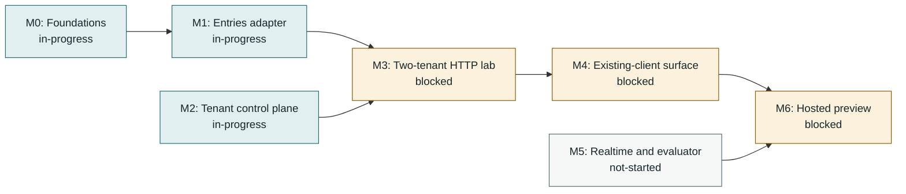
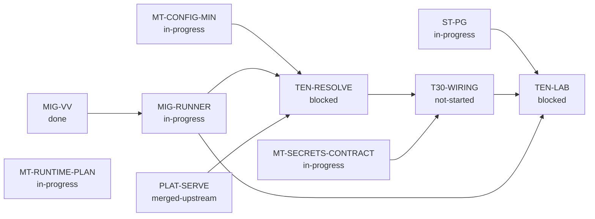

<!-- Generated by tools/queue/multitenant_dashboard.py. Edit the queue and multitenant-delivery-status.json. -->
# Multitenant delivery: working dashboard

**Recorded 2026-11-02; not a live branch monitor.** Observed integration tip: `436ef543` on `workspace/multitenant-20261102`.
Authority/settings and both MongoDB runner commits are incorporated. Their broader integrated acceptance is not yet recorded here. Last recorded broad gate: 879 passing, zero pending at 0de90852. No serving enablement or upstream push.

**Start here:** use the dependency map for sequencing, the lane table for parallel work, and the acceptance ledger for what has actually passed. No milestone is promoted by a completed dependency slice.

[Decisions and detailed acceptance](multitenant-delivery-roadmap-2026-11-02.md) | [Programme overview](../../../site/pages/nightscout-next-gen-platform.html) | [Full queue](../../../queue/QUEUE.md)

## Acceptance stages

**Locally accepted -> incorporated / testing pending -> integrated acceptance recorded -> milestone promoted.** Incorporation is ancestry, not a passing test run. Stages below are dated evidence claims, not freshly executed gates. Queue states remain claims too; use `make queue-status` for measurements. Counts are not additive and are not completion percentages.

## Milestone dependencies

Arrows mean prerequisite -> dependent, **not progress**. These are the roadmap's milestone edges; work-item prerequisites appear separately below. M2 and M5 have additional work gates, not a claim that they can finish without storage/runtime foundations.

| Milestone | Claimed status | Prerequisites / work gates | Remaining promotion gate |
|---|---|---|---|
| **M0: Foundations** | in-progress | [ST-PG](#st-pg), [MIG-RUNNER](#mig-runner) | Finish deployment/schema acceptance; accepted PG/RLS and operator slices do not promote all foundations. |
| **M1: Entries adapter** | in-progress | M0, [ST-PG](#st-pg) | Reviewed DDL/import/field-order contract, full backend compatibility and resource bounds. |
| **M2: Tenant control plane** | in-progress | [MT-CONFIG-MIN](#mt-config-min), [MT-SECRETS-CONTRACT](#mt-secrets-contract), [MIG-RUNNER](#mig-runner), [TEN-RESOLVE](#ten-resolve), [T30-WIRING](#t30-wiring) | Current trusted policy/authentication, tenant resolution, owner/data/operator separation and runtime wiring. |
| **M3: Two-tenant HTTP lab** | blocked | M1, M2, [TEN-LAB](#ten-lab) | Real authorized A/B entries requests and stored outcomes; stale-schema startup refusal. |
| **M4: Existing-client surface** | blocked | M3 | Pinned uploader/follower v1/v3 cases, further collections, exchange, history/indexes and retry semantics. |
| **M5: Realtime and evaluator** | not-started | [MT-RUNTIME-PLAN](#mt-runtime-plan) | Durable interprocess events/recovery, current socket authorization, tenant caches, replay-equivalent views and consumer integration. |
| **M6: Hosted preview** | blocked | M4, M5 | Chosen owner capabilities, export/deletion/import fidelity, operations/recovery, resource/egress bounds and final-tree review. |

## Parallel lanes and next gates

Lane labels describe the recorded handoff, not a live assignment service. Confirm ownership before taking an unassigned lane. An in-progress prerequisite may support a dormant prototype; it does not authorize serving or promote its dependent.

Work-item dependency map (direct edges from the queue)

External prerequisites are shown one level deep; the full queue owns their further dependencies.

| Work item / queue claim | Lane | Queue prerequisites (claimed state) | Next bounded action |
|---|---|---|---|
| **ST-PG**: in-progress | Integration / entries | None recorded | Continue DDL/import/field-order, compatibility and resource acceptance; do not infer full adapter readiness from dormant writes. |
| **MT-CONFIG-MIN**: in-progress | Control plane | None recorded | Persistent operator rules/grant ceilings and atomic policy/write fencing. Management authentication, full catalogue and public API remain open. |
| **MT-SECRETS-CONTRACT**: in-progress | Control plane / secrets | None recorded | Keep dormant; consumer cutover, built-in signer option and production provider/recovery acceptance remain open. |
| **MIG-RUNNER**: in-progress | Parallel runner / integration handoff | MIG-VV (done) | Record integrated 56-check gate; standalone/index fencing, chunking, catalogues/baselines and serving compatibility remain open. |
| **TEN-RESOLVE**: blocked | Unassigned; coordinate first | MT-CONFIG-MIN (in-progress), MIG-RUNNER (in-progress), PLAT-SERVE (merged-upstream) | Trusted tenant resolution and private operator lifecycle after its queue prerequisites. |
| **T30-WIRING**: not-started | Unassigned; coordinate first | TEN-RESOLVE (blocked), MT-SECRETS-CONTRACT (in-progress) | Runtime configuration/tenant credentials after resolution and secrets contract; not enabled by service-only tests. |
| **TEN-LAB**: blocked | Integration after dependencies | ST-PG (in-progress), T30-WIRING (not-started), MIG-RUNNER (in-progress) | Two-tenant HTTP acceptance after storage, wiring and migration gates. |
| **MT-RUNTIME-PLAN**: in-progress | Separate runtime design | None recorded | Reconcile durable events and evaluator/socket acceptance; do not mix with the dormant runner lane. |

## Accepted slices and integration handoff

A bounded slice below does **not** close its parent queue card or M0-M6.

| Slice / parent | Acceptance stage | Commit / evidence | Recorded result and boundary |
|---|---|---|---|
| Secrets component, Vault adapter, PG persistence and rewrap / [MT-SECRETS-CONTRACT](#mt-secrets-contract) | **Integrated acceptance recorded** | [`6943dccb`](multitenant-delivery-roadmap-2026-11-02.md#integration-entries-and-vault-facing-secrets-2026-11-02) | 230 focused combined checks at the integration record; dormant only. |
| Synthetic secrets recovery and worker crash/retry / [MT-SECRETS-CONTRACT](#mt-secrets-contract) | **Integrated acceptance recorded** | [`0de90852`](multitenant-delivery-roadmap-2026-11-02.md#integration-secrets-recovery-acceptance-and-next-control-plane-slice-2026-11-02) | 879 broad / 34 secrets checks; production recovery remains open. |
| Persistent current subject authority / [MT-CONFIG-MIN](#mt-config-min) | **Incorporated; testing pending** | [`1dd8990b`](multitenant-delivery-roadmap-2026-11-02.md#parallel-control-plane-acceptance-and-next-handoff-2026-11-02) | Local combined 36 checks with scalar settings; integrated gate pending. |
| Units/seconds, provenance, history and rollback / [MT-CONFIG-MIN](#mt-config-min) | **Incorporated; testing pending** | [`011802ba`](multitenant-delivery-roadmap-2026-11-02.md#parallel-control-plane-acceptance-and-next-handoff-2026-11-02) | Local combined 36 checks; injected policy is not atomic policy/write fencing. |
| MongoDB replica-set transactional operator runner / [MIG-RUNNER](#mig-runner) | **Incorporated; testing pending** | [`562f6206`](multitenant-delivery-roadmap-2026-11-02.md#parallel-mig-runner-transactional-mongodb-slice-2026-11-02) | Local 53 combined / 12 MongoDB checks; standalone/index steps refuse. |
| Primary crash/restart and expired-renewal refusal / [MIG-RUNNER](#mig-runner) | **Incorporated; testing pending** | [`436ef543`](multitenant-delivery-roadmap-2026-11-02.md#parallel-mig-runner-primary-recovery-and-renewal-loss-2026-11-02) | Local 56 combined / 15 MongoDB checks at floor and ceiling; not HA. |

## Deferred and separate lanes

| Candidate | Lane | Boundary / dependency |
|---|---|---|
| Read existing Nightscout data through its API | Entries / import | After target schema/identity/import contract. Resumable pagination, duplicate-safe retries, fidelity and source-change/cutover policy need acceptance; not raw DB backup. |
| Human identity and next-generation execution | Separate programmes | Not prerequisites invented for the initial entries HTTP lab. Keep their independently reviewed authority/runtime contracts. |

## Updating this dashboard

1. Update `queue/work-queue.yaml` for work states and real prerequisites. Do not duplicate those edges in the status overlay.
2. Append measured evidence to the roadmap; update `multitenant-delivery-status.json` for dated slice stages, integration tip, lanes and remaining milestone gates. Use explicit commit/results; do not promote on ancestry alone.
3. Run `python tools/queue/multitenant_dashboard.py`, then `python tools/queue/multitenant_dashboard.py --check`, `make queue-check` and `make site-check`. Commit the source and generated view together. Publishing remains a separate maintainer action.
