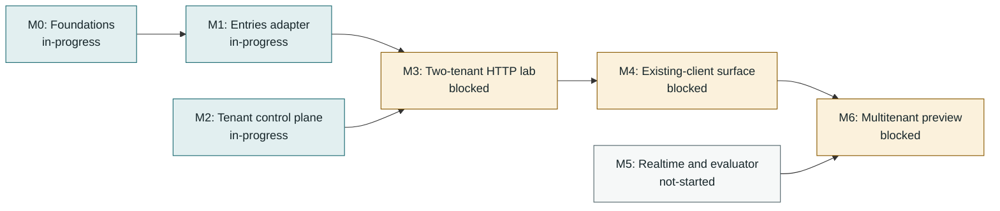

<!-- Generated by tools/queue/multitenant_dashboard.py. Edit the queue and multitenant-delivery-status.json. -->
# Multitenant delivery: working dashboard

**Recorded 2026-11-04; not a live branch monitor.** Observed integration tip: `ded254b9` on `codex/rest-integration-20261104`.
Published #8898 remains OPEN/draft at ae471ac7. Local ded254b9 adds actual v2 properties/ddata/summary, source-pinned synthetic uploader/follower replay and independent authority probes. R40 owns parent-reproduced cumulative full/browser/provider/focused/migration and semantic-control evidence; counts overlap. The archived authority queue instrument passes with a NON-VACUOUS control. New continuation is unpushed; existing published-head CI does not cover it. Administration, notices/debug, notifications/assistants, full route/client-binary coverage, import/resources and production lifecycle remain incomplete. No M0-M6 promotion or shipping candidate change.

**Start here:** use the dependency map for sequencing, the lane table for parallel work, and the acceptance ledger for what has actually passed. No milestone is promoted by a completed dependency slice.

[Decisions and detailed acceptance](multitenant-delivery-roadmap-2026-11-02.md) | [Programme overview](../../../site/pages/nightscout-next-gen-platform.html) | [Full queue](../../../queue/QUEUE.md)

## Acceptance stages

**Locally accepted -> incorporated / testing pending -> integrated acceptance recorded -> milestone promoted.** Incorporation is ancestry, not a passing test run. Stages below are dated evidence claims, not freshly executed gates. Queue states remain claims too; use `make queue-status` for measurements. Counts are not additive and are not completion percentages.

## Milestone dependencies

Arrows mean prerequisite -> dependent, **not progress**. These are the roadmap's milestone edges; work-item prerequisites appear separately below. M2 and M5 have additional work gates, not a claim that they can finish without storage/runtime foundations.

| Milestone | Claimed status | Prerequisites / work gates | Remaining promotion gate |
|---|---|---|---|
| **M0: Foundations** | in-progress | [ST-PG](#st-pg), [MIG-RUNNER](#mig-runner) | Finish deployment/schema acceptance; accepted PG/RLS and operator slices do not promote all foundations. |
| **M1: Entries adapter** | in-progress | M0, [ST-PG](#st-pg) | Reviewed DDL/import contract (JSONB logical equality; key-order parity is not required), full backend compatibility and resource bounds. |
| **M2: Tenant control plane** | in-progress | [MT-CONFIG-MIN](#mt-config-min), [MT-SECRETS-CONTRACT](#mt-secrets-contract), [MIG-RUNNER](#mig-runner), [TEN-RESOLVE](#ten-resolve), [T30-WIRING](#t30-wiring) | Current trusted policy/authentication, tenant resolution, owner/data/operator separation and runtime wiring. |
| **M3: Two-tenant HTTP lab** | blocked | M1, M2, [TEN-LAB](#ten-lab) | Real authorized A/B entries requests and stored outcomes; stale-schema startup refusal. |
| **M4: Existing-client surface** | blocked | M3 | Pinned uploader/follower v1/v3 cases, further collections, exchange, history/indexes and retry semantics. |
| **M5: Realtime and evaluator** | not-started | [MT-RUNTIME-PLAN](#mt-runtime-plan) | Durable interprocess events/recovery, current socket authorization, tenant caches, replay-equivalent views and consumer integration. |
| **M6: Multitenant preview** | blocked | M4, M5 | Chosen owner capabilities, export/deletion/import fidelity, operations/recovery, resource/egress bounds and final-tree review. |

## Parallel lanes and next gates

Lane labels describe the recorded handoff, not a live assignment service. Confirm ownership before taking an unassigned lane. An in-progress prerequisite may support a dormant prototype; it does not authorize serving or promote its dependent.

Work-item dependency map (direct edges from the queue)

External prerequisites are shown one level deep; the full queue owns their further dependencies.

| Work item / queue claim | Lane | Queue prerequisites (claimed state) | Next bounded action |
|---|---|---|---|
| **ST-PG**: in-progress | Remaining REST / import and resources | None recorded | R40 accepts derived reads and pinned-pattern replay atop R38/R39 at local ded254b9. Next measure supported import/rerun fidelity, populated-table insertion-order backfill and query/resource bounds. Full route/client-binary parity remains open; foundation commands do not measure the complete composition. |
| **MT-CONFIG-MIN**: in-progress | Administration mutation contract | None recorded | R40 retains current authority and safe settings with independent persisted-grant probes. Next implement a separately authorized subject update/delete and known-role assignment service; characterize omission/default/dangling-role and rename semantics before HTTP administration. Full owner/settings catalogue and production lifecycle remain open. |
| **MT-SECRETS-CONTRACT**: in-progress | Provider/runtime acceptance | None recorded | R38/R39 compose real Vault/PG credential exchange and data operations through the explicit API executable. Keep production TLS/unseal/HA, token issuance/renewal, trusted service identity and operational recovery as separate uncompleted gates. |
| **MIG-RUNNER**: in-progress | Operator migration / readiness | MIG-VV (done) | R39 retains independently enabled migration/HTTP acceptance and prebind read-only selected-domain readiness. Full two-store runner acceptance, standalone/index fencing, chunking and populated-data import/resource guarantees remain open. |
| **TEN-RESOLVE**: blocked | Production trust and lifecycle | MT-CONFIG-MIN (in-progress), MIG-RUNNER (in-progress), PLAT-SERVE (merged-upstream) | Canonical/direct-alias resolution remains composed at ae471ac7; the explicit API preview is runnable. Static maps and immediate-peer allowlisting do not establish durable allocation/publication, production workload identity or provision/suspend/export/delete lifecycle. Owner/operator listeners remain separate. |
| **T30-WIRING**: in-progress | Accepted derived REST / next administration | TEN-RESOLVE (blocked), MT-SECRETS-CONTRACT (in-progress) | R40 accepts local ded254b9: actual v2 derived handlers, pinned client patterns and real CLI/PG/Vault current-authority composition. Archived authority gate PASS and NON-VACUOUS measure a bounded slice. Next subject/role administration requires its own persisted mutation contract and separate writer authority; production runtime/lifecycle remains open. |
| **TEN-LAB**: blocked | Coordinator / remaining REST acceptance | ST-PG (in-progress), T30-WIRING (in-progress), MIG-RUNNER (in-progress) | R40 joins the derived-read and client-replay lanes at local ded254b9 with parent-run cumulative acceptance. Full administration/side-effect routes and route/client-binary coverage remain; complete M1/M2 criteria are unmet, so M3 stays blocked. Reuse owned runner and archived authority controls without treating a narrow PASS as milestone promotion. |
| **MT-RUNTIME-PLAN**: in-progress | Administration/side effects and M5/M6 | None recorded | R40 accepts bounded derived reads and source-pinned client-pattern replay. Finish admin/notices/debug/notification/assistant REST rows and wider clients. Durable events/replay, socket/evaluator semantics and operational preview retain separate contracts and acceptance; no M5/M6 promotion. |

## Accepted slices and integration handoff

A bounded slice below does **not** close its parent queue card or M0-M6.

| Slice / parent | Acceptance stage | Commit / evidence | Recorded result and boundary |
|---|---|---|---|
| Secrets component, Vault adapter, PG persistence and rewrap / [MT-SECRETS-CONTRACT](#mt-secrets-contract) | **Integrated acceptance recorded** | [`6943dccb`](multitenant-delivery-roadmap-2026-11-02.md#integration-entries-and-vault-facing-secrets-2026-11-02) | 230 focused combined checks at the integration record; dormant only. |
| Synthetic secrets recovery and worker crash/retry / [MT-SECRETS-CONTRACT](#mt-secrets-contract) | **Integrated acceptance recorded** | [`0de90852`](multitenant-delivery-roadmap-2026-11-02.md#integration-secrets-recovery-acceptance-and-next-control-plane-slice-2026-11-02) | 879 broad / 34 secrets checks; production recovery remains open. |
| Persistent current subject authority / [MT-CONFIG-MIN](#mt-config-min) | **Incorporated; testing pending** | [`1dd8990b`](multitenant-delivery-roadmap-2026-11-02.md#parallel-control-plane-acceptance-and-next-handoff-2026-11-02) | Local combined 36 checks with scalar settings; integrated gate pending. |
| Units/seconds, provenance, history and rollback / [MT-CONFIG-MIN](#mt-config-min) | **Incorporated; testing pending** | [`011802ba`](multitenant-delivery-roadmap-2026-11-02.md#parallel-control-plane-acceptance-and-next-handoff-2026-11-02) | Local combined 36 checks; injected policy is not atomic policy/write fencing. |
| MongoDB replica-set transactional operator runner / [MIG-RUNNER](#mig-runner) | **Incorporated; testing pending** | [`562f6206`](multitenant-delivery-roadmap-2026-11-02.md#parallel-mig-runner-transactional-mongodb-slice-2026-11-02) | Local 53 combined / 12 MongoDB checks; standalone/index steps refuse. |
| Primary crash/restart and expired-renewal refusal / [MIG-RUNNER](#mig-runner) | **Incorporated; testing pending** | [`436ef543`](multitenant-delivery-roadmap-2026-11-02.md#parallel-mig-runner-primary-recovery-and-renewal-loss-2026-11-02) | Local 56 combined / 15 MongoDB checks at floor and ceiling; not HA. |
| Tenant-bound JWT HTTP authorization proof / [T30-WIRING](#t30-wiring) | **Integrated acceptance recorded** | [`dc2c5fbf`](multitenant-delivery-roadmap-2026-11-02.md#tenant-jwt-proof-integration-and-http-gate) | 2 HTTP tests pass for cross-tenant signature refusal, current grants and authority outage; production runtime wiring remains open. |
| One-time API entries importer and PostgreSQL target / [ST-PG](#st-pg) | **Integrated acceptance recorded** | [`327cbb1f`](multitenant-delivery-roadmap-2026-11-02.md#m1-m2-code-slices-and-acceptance-2026-11-02) | Importer unit/CLI tests and disposable-PostgreSQL tenant-bound replay test pass; one-time best-effort import, not snapshot or ongoing sync. |
| Entries candidate schema and forced-RLS acceptance / [ST-PG](#st-pg) | **Integrated acceptance recorded** | [`025704cd`](multitenant-delivery-roadmap-2026-11-02.md#m1-m2-code-slices-and-acceptance-2026-11-02) | Disposable-Docker migration suite passes 13 checks, including generated fields, typed identity, unique identifier constraint and forced RLS. |
| Provider-neutral tenant policy and HTTP boundaries / [MT-CONFIG-MIN](#mt-config-min) | **Integrated acceptance recorded** | [`c496d009`](multitenant-delivery-roadmap-2026-11-02.md#m1-m2-code-slices-and-acceptance-2026-11-02) | 19 resolver/app/JWT HTTP checks pass; integrated secrets/Vault/PostgreSQL gate passes 37, including persisted current grants and atomic settings/grant fencing. No deployment adapter or serving role. |
| Two-tenant entries HTTP lab / [TEN-LAB](#ten-lab) | **Integrated acceptance recorded** | [`a19b549c`](multitenant-delivery-roadmap-2026-11-02.md#m1-m2-code-slices-and-acceptance-2026-11-02) | 10 disposable-PostgreSQL HTTP lab cases pass for tenant isolation, writes, revocation, startup refusal and data-plane separation; M3 promotion remains blocked. |
| Combined projection/current authority (R24) / [TEN-LAB](#ten-lab) | **Integrated acceptance recorded** | [`8b193e18`](multitenant-delivery-roadmap-2026-11-02.md#accepted-read-and-authority-continuations-2026-11-04) | Agent-run nonbrowser 6713 passing/108 pending/0 failing, browser 684/0/0; explicit PG/HTTP/Vault campaigns and controls. Dormant bounded integration, not M1/M2 completion. |
| Legacy credential to actual entries GET (R25) / [T30-WIRING](#t30-wiring) | **Integrated acceptance recorded** | [`7eb76c71`](multitenant-delivery-roadmap-2026-11-02.md#accepted-read-and-authority-continuations-2026-11-04) | Agent-run focused 72/0/0, nonbrowser 6718 passing/118 pending/0 failing, browser 684/0/0. Current persisted authority; synthetic HTTP crypto, real Vault separately measured. |
| Compatible exchange to current-authority GET (R26) / [T30-WIRING](#t30-wiring) | **Integrated acceptance recorded** | [`81bc71e6`](multitenant-delivery-roadmap-2026-11-02.md#accepted-read-and-authority-continuations-2026-11-04) | Published PR checkpoint. Agent-run focused 85/0/0, nonbrowser 6725 passing/124 pending/0 failing, browser 684/0/0; exact names, eight-hour policy and four source controls. Pinned clients inspected, not replayed. |
| Actual entries list/search (R27) / [ST-PG](#st-pg) | **Integrated acceptance recorded** | [`c10290d2`](multitenant-delivery-roadmap-2026-11-02.md#accepted-read-and-authority-continuations-2026-11-04) | Local cumulative slice: agent-run nonbrowser 6764 passing/88 pending/0 failing, browser 684/0/0; reader differential 8, HTTP search 2, three controls. Counts overlap; pending change reflects enabled PG cases. History/mutations, production runtime and client replay remain open. |
| Actual entries POST/create/resend (R29) / [ST-PG](#st-pg) | **Integrated acceptance recorded** | [`6cad7a42`](multitenant-delivery-roadmap-2026-11-02.md#accepted-post-provider-and-canonical-continuations-2026-11-04) | Agent-reproduced nonbrowser 6807/73 pending/0 failing, browser684, focused78 and six red controls; current grants/attribution, configured pruning and legitimate extension keys. Now included in cumulative R34; remaining mutations/history/import/resources open. |
| Real Vault/PG HTTP lab (R30) / [MT-SECRETS-CONTRACT](#mt-secrets-contract) | **Integrated acceptance recorded** | [`e410b163`](multitenant-delivery-roadmap-2026-11-02.md#accepted-post-provider-and-canonical-continuations-2026-11-04) | Enabled44 including new runtime5; nonbrowser6725/132 pending/0 failing, browser684; tenant-binding red control. Test-only provider composition, now included in R34; production service identity/TLS/HA not established. |
| Real-provider POST composition (R32) / [TEN-LAB](#ten-lab) | **Integrated acceptance recorded** | [`4621d5c4`](multitenant-delivery-roadmap-2026-11-02.md#accepted-post-provider-and-canonical-continuations-2026-11-04) | Enabled62, nonbrowser6807/79 pending/0 failing, browser684; three actual POST controls red. Real-provider write/read/isolation/current-grant/outage behavior, now included in R34. Counts overlap, not milestone completion. |
| Explicit canonical ingress (R33) / [TEN-RESOLVE](#ten-resolve) | **Integrated acceptance recorded** | [`468c41dc`](multitenant-delivery-roadmap-2026-11-02.md#accepted-post-provider-and-canonical-continuations-2026-11-04) | Focused25, nonbrowser6815/73 pending/0 failing, browser684; four resolver/app controls red. Direct mode preserved, canonical Host requires per-request explicit trust. Now in R34; no durable registry/production trust adapter. |
| Cumulative canonical/provider/POST (R34) / [TEN-LAB](#ten-lab) | **Integrated acceptance recorded** | [`c527fb7e`](multitenant-delivery-roadmap-2026-11-02.md#accepted-post-provider-and-canonical-continuations-2026-11-04) | Historical cumulative checkpoint, superseded by R38/R39. Enabled63, nonbrowser6815/80 pending/0 failing, browser684; composed forwarded-precedence, trust-loss and alias-conflict controls red. Synthetic loopback provenance only; no full M1/M2/M3, client, realtime or operations acceptance. |
| Executable entries CRUD/history (R38) / [T30-WIRING](#t30-wiring) | **Integrated acceptance recorded** | [`21145d0d`](multitenant-delivery-roadmap-2026-11-02.md#rest-continuation-and-qms-reconciliation-2026-11-04) | Recorded integration-agent reproduced acceptance through the actual PG/Vault executable, current authority, rollback and restart. See R38 for nonadditive campaign figures and controls; full REST and production lifecycle remain open. |
| Explicitly selected REST domains (R39) / [TEN-LAB](#ten-lab) | **Integrated acceptance recorded** | [`ae471ac7`](multitenant-delivery-roadmap-2026-11-02.md#rest-continuation-and-qms-reconciliation-2026-11-04) | Recorded integration-agent reproduced legacy v1/inherited-v2 data handlers, API3 collections and safe context. Now published on draft PR #8898 with successful head CI/CodeQL. Remaining route/client replay and M0-M6 criteria are incomplete; new Codex lane results remain UNMEASURED. |
| Derived REST and pinned-pattern cumulative acceptance (R40) / [TEN-LAB](#ten-lab) | **Integrated acceptance recorded** | [`ded254b9`](multitenant-delivery-roadmap-2026-11-02.md#rest-continuation-and-qms-reconciliation-2026-11-04) | Parent-reproduced actual v2 derived handlers, synthetic source-pinned client replay and independent authority probes, including real CLI/PG/Vault derived/current-authority/restart composition. R40 owns exact campaign figures and controls. Local/unpushed; full REST, client binaries and production M0-M6 criteria remain incomplete. |

## Deferred and separate lanes

| Candidate | Lane | Boundary / dependency |
|---|---|---|
| Read existing Nightscout data through its API | Entries / import | This is a one-time database population, not ongoing NS-to-NS synchronization; no durable checkpoint is required. Use bounded pagination, duplicate-safe reruns and best-effort srvModified reconciliation. Physical hard deletes may be undetectable, so do not claim exact deletion reconciliation or raw-backup fidelity; nightscout-connect remains the separate ongoing sync pipeline. |
| Human identity and next-generation execution | Separate programmes | Not prerequisites invented for the initial entries HTTP lab. Keep their independently reviewed authority/runtime contracts. |

## Updating this dashboard

1. Update `queue/work-queue.yaml` for work states and real prerequisites. Do not duplicate those edges in the status overlay.
2. Append measured evidence to the roadmap; update `multitenant-delivery-status.json` for dated slice stages, integration tip, lanes and remaining milestone gates. Use explicit commit/results; do not promote on ancestry alone.
3. Run `python tools/queue/multitenant_dashboard.py`, then `python tools/queue/multitenant_dashboard.py --check`, `make queue-check` and `make site-check`. Commit the source and generated view together. Publishing remains a separate maintainer action.
