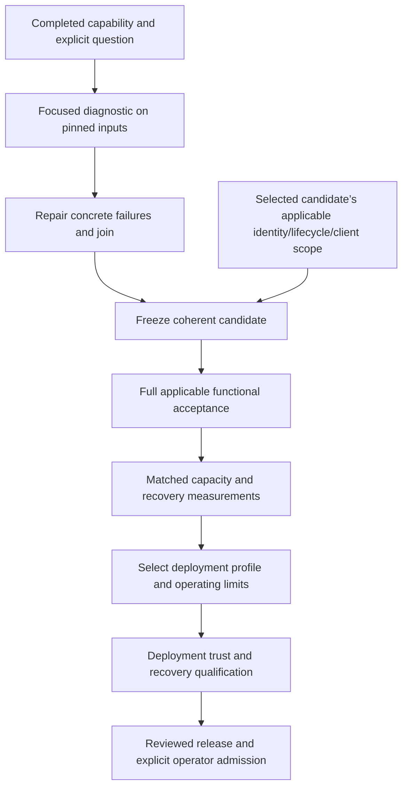

# From multitenant preview to production

*Living contributor-facing production guide, reconciled 2026-11-12 against the
release decisions at alignment `8ae6f4a3729548de0c88cc0ee5b3c0aede9aba61`.
This is **read-derived** sequencing and explanation, not an application measurement.
[Release decisions](../../../releases/cgm-remote-monitor-16.0.0/decisions.md) own
adopted policy; the [queue](../../../queue/work-queue.yaml) owns claimed work state;
[release contents](../../../releases/cgm-remote-monitor-16.0.0/contents.md) and linked
reports own executed acceptance, source heads and publication. Use those records
for the current candidate and blockers.*

Production means a particular deployment is admitted for a stated workload and
failure/recovery envelope. It is a stronger claim than implementing a component,
passing a functional preview or running a capacity experiment. This guide explains
how those pieces join without making every later production feature a prerequisite
to testing an independently ready capability.

## The proposed first production boundary

Qualify a bounded deployment of the reusable API, evaluator, realtime, admin and
supporting roles. The [runtime topology](runtime-topology.md) explains their
contracts and scale profiles; the [deployment binding guide](deployment-bindings-and-public-names.md)
explains placement, transport and public access. Colocating roles and scaling them
independently are different configurations of capabilities that still need their
own deployment proof. A role diagram is not a required number of Pods or nodes.

**Recommendation for review:** start with the smallest topology that meets the
chosen workload and outage objectives. A single application host is an option
only when its outage and operator-led recovery are acceptable. Multiple application
nodes, a replicated database or an external secrets service are not automatic
proofs of availability. Specify which dependency or failure domain may be lost,
what continues serving, and what recovery must establish before service resumes.

The capacity campaign's tenant levels are experimental points. The
[adopted capacity gate](../../../releases/cgm-remote-monitor-16.0.0/decisions.md#m7-capacity-gate)
defines its current milestone and stretch target; it does not select a production
node type or an ultimate fleet size. Small-group efficiency and a larger fleet's
bounded growth must be evaluated separately. Multiple independently admitted
deployments are a fleet option, not an adopted cell architecture or implemented
tenant-migration service.

## Dependency map

There are two boundaries: learn from a scoped-ready capability, then admit a
coherent deployment. Independent experiments can run before full acceptance;
their results keep their exact scope and cannot substitute for final acceptance.

This is a dependency explanation, not a new serial reservation process. The
[completion schedule](multitenant-integration-batching-plan-2026-11-06.md#completion-focused-coordination)
owns integration practice. Ready diagnostics may run in parallel with isolated
state and an aggregate resource budget. Production scope work on separate branches
must not silently change a frozen experiment or delay its agreed deliverable.
A failed level with correct measurement is useful capacity evidence; it is not
permission to admit that workload to production.

## What blocks the path, and what closes it

These are enduring closure criteria, not a second live task list. Identify each
remaining implementation change in the queue and its exact failing or missing
criterion in the release record. Existing measurements are evidence inputs, not
blanket admission for a changed source or topology. A skipped criterion remains
UNMEASURED.

| Boundary | Design question | Closing evidence and canonical home |
|---|---|---|
| Workload and resource envelope | How much useful work fits, including interference and recovery? | Matched synthetic measurements with stored-write, authority and evaluator/consumer outcomes; latency/freshness tails, CPU, memory, pool/lock waits and recovery. Follow [M7 measurement policy](../../../releases/cgm-remote-monitor-16.0.0/decisions.md#m7-envelope-measured-not-declared) and the [capacity gate](../../../releases/cgm-remote-monitor-16.0.0/decisions.md#m7-capacity-gate). The latter closes the separate single-site contrast requirement. Historical counts or node density are assumptions until reproduced on comparable inputs. |
| Human identity and owner authority | Does the selected identity provider preserve current tenant authority throughout sessions and streams? | Actual provider/HTTPS login, renewal, logout, revocation and outage behavior, owner settings consumed by roles, legacy-client compatibility and strict audience separation. [Owner authority](owner-authority.md), M6a criteria in the [roadmap](multitenant-delivery-roadmap.md#milestones-and-continuous-integration). |
| Provisioning, ingress and secrets | Are storage, authority and keys ready before serving; are private controls actually private? | Operator provisioning and recoverable partial failures; current grants/RLS; TLS/host/selector/client-IP/socket probes; service credential renewal, expiry, revocation and outage/recovery, CA verification/rotation and recoverable Vault unseal custody. A disposable lab bootstrap is not an operator provisioner. Existing Agent proofs retain their scope; the selected deployment needs a [trust record and probes](../../../releases/cgm-remote-monitor-16.0.0/decisions.md#deployment-admission-probes-and-trust-record). |
| Lifecycle, keys and recovery | Can supported operations finish or stop safely, and can an operator recover? | Provision/pause/suspend/export/delete/ownership, retained-key destruction, production key-custodian responsibilities and artifact fidelity; interrupted restore/upgrade, lost acknowledgement, participant death and dependency/host replacement. Verify the affected tenant and an independent tenant's progress. Use [M6 acceptance families](multitenant-delivery-roadmap.md#m5m6-acceptance-families) and the [recovery boundaries](deployment-and-rig-testing.md#credential-and-recovery-boundaries). Safe refusal is distinct from eventual recovery. |
| Connectors and supported clients | Which actual journeys work through the selected ingress and credentials? | Declared collection coverage, independent stored/history outcomes, cadence/retry/revocation and supported credential renewal; required Android and pinned client journeys. Source-pattern replay is distinct from executing a client binary. [Roadmap](multitenant-delivery-roadmap.md) and current release evidence own the supported scope; do not infer an all-client claim or treat an old entries-only run as the latest result. |
| Shared-fault and operating behavior | What happens when bursts or outages affect many tenants together? | Hot tenant, reconnect flood, large history, active-alarm work, backlog, slow/down dependencies, restores/upgrades and storage/backup growth. Measure other-tenant progress and authorized effects while queues fill and recover. [Experiment contract](durable-event-delivery-contract-2026-11-06.md#11-maintainer-acceptance-and-experiments). |
| Release and deployment admission | Are the actual source, configuration, image and operational procedure qualified together? | Applicable full/browser/enabled-corpus/native/client acceptance, named pending cases, final prcheck, deployment trust and recovery rehearsal, rollback and explicit operator admission. [Release contents](../../../releases/cgm-remote-monitor-16.0.0/contents.md), [deployment admission decision](../../../releases/cgm-remote-monitor-16.0.0/decisions.md#deployment-admission-probes-and-trust-record). |

Do not reopen completed capability work merely because this guide names its
production criterion. Conversely, ancestry or an old green report does not prove
new inputs. Reuse evidence through an explicit affected-input assessment and keep
its original source/instrument attribution.

The supported application cohort follows the
[exclusive application ownership contract](../../../releases/cgm-remote-monitor-16.0.0/decisions.md#exclusive-application-postgres-ownership).
External direct SQL writers are outside that contract. Every supported participant
still follows its authority, write and lifecycle rules; current connections alone
do not prove complete membership or credential custody. A load-balanced address
is not a census of actual role instances.

## Multi-host and HA work that can wait

Deferral depends on the declared deployment profile and recovery objectives, not
on the application being unable to reuse its components at another scale.

| Capability | Can wait when | Required before enabling it |
|---|---|---|
| Dynamic API membership | A fixed roster meets workload and outage needs | Admission/removal serialized with maintenance; all-instance drain/invalidation and incarnation-aware replacement. Request replicas are not evaluator owners. |
| Additional evaluator/realtime workers | The qualified worker set meets its measured budget | Explicit tenant assignments, complete participant coverage, checkpoint/effect continuity and safe moves. Additional workers distribute ownership; they are not automatically standby failover replicas. |
| Cross-host placement | The selected local transport and fixed roster meet the profile | Qualified private reachability, lifetime/uncertainty behavior, complete direct instance control and partition/late-join refusal. The application owns these semantics; the platform supplies placement/network primitives. |
| Automatic failover | Operator-led recovery meets the outage/data-loss objectives | Old-owner exclusion, uncertain commits, dependency/key recovery and measured cutover. Backups and rehearsed restoration remain necessary with or without HA. |
| Fleet placement and tenant migration | Independently provisioned deployments suffice | Durable tenant-to-deployment mapping, compatible target initialization, credential/data/checkpoint handling and a controlled routing cutover. This is a separate design proposal, not a replica-count flag. |
| Transaction-pooling proxy | Direct connection budgets suffice | Re-prove backend identity, RLS/transaction binding, operation lifetimes and recovery. Do not add a proxy to hide multiplied pools without qualifying its semantics. |
| Broker, cache or alternate CDC transport | Current signalling and authoritative-state recovery meet measured needs | A named missing capability or measured cost/lag bottleneck, publication/replay/idempotency and authority contracts, bounded failure/recovery, and a comparative experiment. No product is selected merely by a tenant-count target. |

Live external providers, self-service ownership transfer, first-party owner UI and
richer sharing schedules retain their own adopted scope and decision boundaries.
The [public-name contract](deployment-bindings-and-public-names.md#authenticated-sharing-and-group-policies)
explains authentication, group policy and native credential preservation.

## Prior art from the existing projects

Initialize durable resources before serving. Separate public names from stable tenant identity.
Make ownership, deletion, consent and partial provisioning explicit.
Preserve data and keys independently of compute. Existing per-tenant process designs do not establish shared-role
resource or failure limits.

The [retained November source assessment](../../archive/tenancy/production-path-assessment-2026-11-10.md#prior-art-from-the-existing-projects)
contains commit-pinned node-multienv, roles-gateway and WWW mechanisms, their
original hypotheses and re-proof boundaries. Those source readings are not
measurements of deployed services or security/production approval of those projects.

## Where provider experience changes the decisions

Use aggregate or synthetic descriptions to define representative work and failure
scenarios. Keep private organization names, adoption estimates, real identifiers,
credentials and clinical traces out of public plans and metric labels.

| Input | Design or measurement it informs |
|---|---|
| Active/quiet mix, histories, viewers, uploads, enabled plugins and alarms | Workload families, fixed/marginal resource cost and interference; tenant count alone is insufficient. |
| Common-mode outages and available operator response | Failure domains, redundancy, spare capacity, recovery time and acceptable loss. |
| Restores, key loss, credential expiry and upgrades | Custody, retention, rotation, rehearsal and uncertain-state stop conditions. |
| Alias changes, tenant movement and partial provisioning | Stable identity, routing publication and recoverable reconciliation. |
| Sharing, revocation and support journeys | Current-owner/session proof and separately scoped delegation requirements. |

Publish deployment recommendations only after connecting these requirements to
measurements on named resources. Fewer nodes are an economic hypothesis: include
all application and dependency resources, storage/backups/network and operational
cost, plus capacity surviving the declared failure. Neither a stress rig nor a
single successful run supplies that recipe.

## Retained planning baseline

The [November 8–10 assessment](../../archive/tenancy/production-path-assessment-2026-11-10.md)
preserves the original gap table, topology/HA proposals and source survey from
alignment `8ae6f4a3729548de0c88cc0ee5b3c0aede9aba61`. Its present-tense statuses
belong to that capture. Use this guide for sequencing, runtime topology for
architecture, and the release/queue/report homes for current state and evidence.
