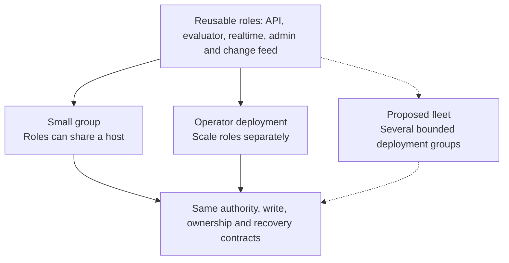
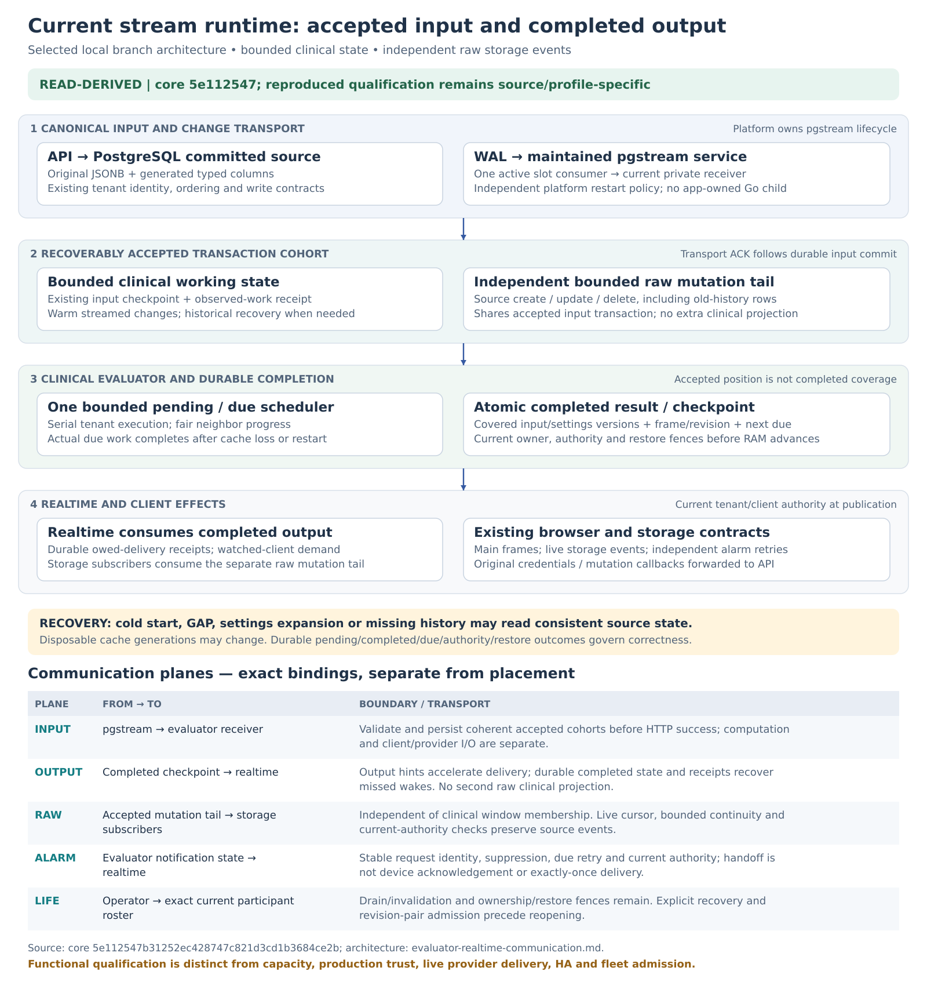
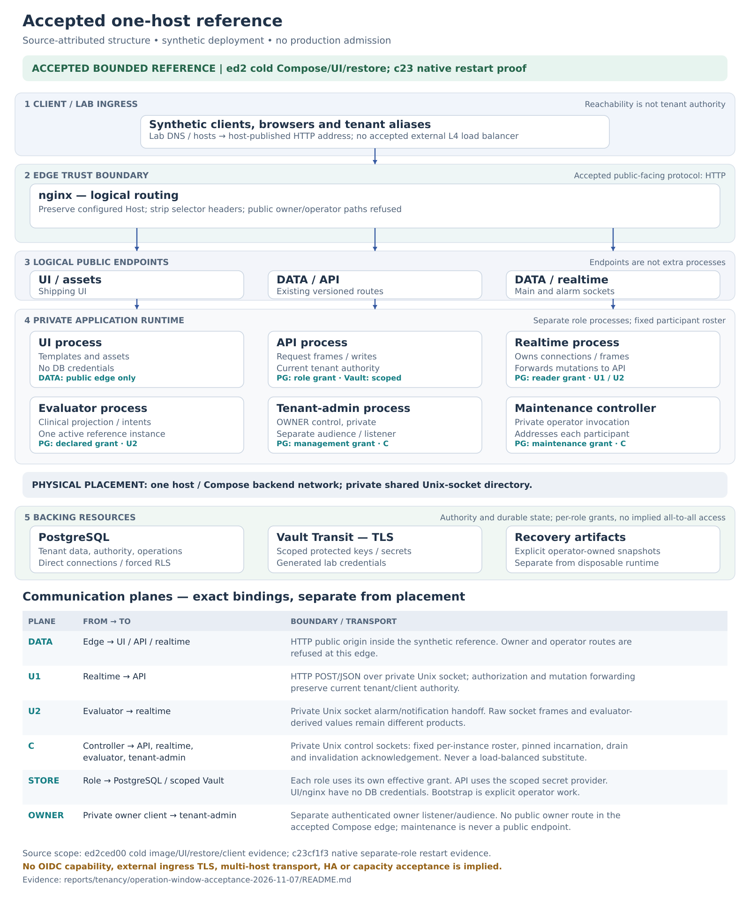
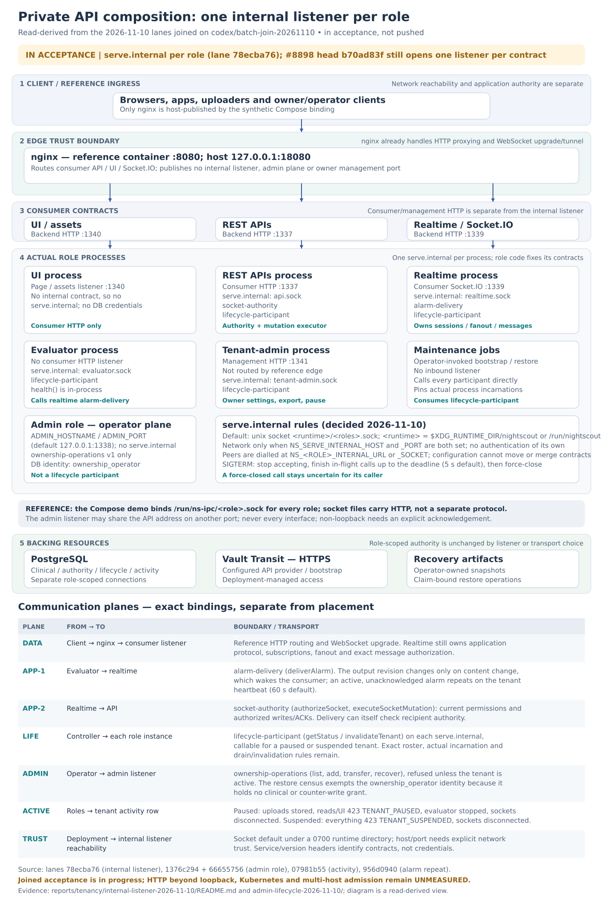
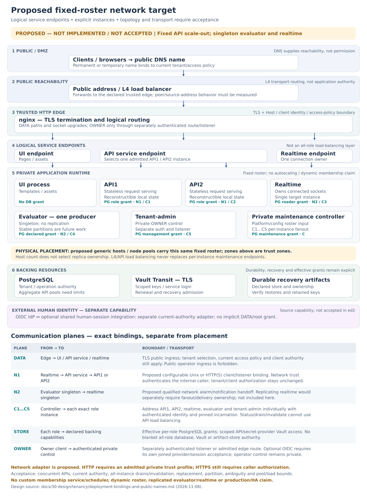

# Runtime topology: zones, components and private APIs

*Living contributor-facing architecture guide, reconciled 2026-11-16. Structure is
**read-derived**; measured acceptance retains its exact source in the linked
records. The [endpoint/API work plan](selectable-endpoints-and-api-scaling-plan.md) owns remaining
implementation and acceptance criteria; the [queue](../../../queue/work-queue.yaml)
owns claimed work state. A diagram is not deployment or capacity acceptance.*

## Reuse the components across profiles

A deployment profile selects where the same roles run and how they share work.
Configuration can select a supported capability. It cannot supply missing ownership,
migration or recovery behavior.

The arrows show composition choices, not an upgrade sequence or a capacity claim.
Fleet placement and tenant moves need separate design and qualification.
The [scale envelopes](#scale-envelopes-and-fleet-planning) define the evidence needed
for each profile. The [deployment guide](deployment-bindings-and-public-names.md#experiment-rigs-and-deployment-recipes)
distinguishes experimental rigs from operating recipes.

| Term | Meaning here |
|---|---|
| Role | A responsibility, such as serving API requests or evaluating tenant data. |
| Replica | Another instance of a role. It needs a valid work-assignment rule. |
| Cohort | The declared processes that cooperate on a workload and its maintenance. |
| Instance / incarnation | An actual process / one lifetime of that process. A replacement has a new incarnation. |
| Shard / partition | A selected share of tenant work. The role's assignment rule determines its owner. |
| Cell | A proposed bounded deployment, datastore and recovery unit. Several cells could form a fleet. |
| Admission / fencing | Checks that permit work / controls that prevent an old or invalid actor from continuing it. |
| Hint / checkpoint | A signal to inspect authoritative state / a position or revision in a named input stream or snapshot. Its contract states what completion it proves. |

## Component inventory and operator-topic readiness

The component boundaries are clear enough to organize operator reference topics.
They do not imply separate binaries, containers or production qualification.
The inventory below groups existing responsibilities; release records own their
current acceptance. Role launch details remain in the application source.

**Read-derived source check, 2026-11-16:** cgm-remote-monitor
`5e112547b31252ec428747c821d3cd1b3684ce2b`, `lib/server/serve/roles.js` and
`lib/server/serve/preview-realtime.js`. The selected registry declares API,
evaluator, realtime, vcpool, tenant-admin and admin. The platform runs pgstream
as a separate service; the application does not own its process lifecycle.
UI, maintenance jobs and backing services have different entry points.

| Component or responsibility | Boundary and state ownership | Natural reference topic |
|---|---|---|
| API | REST version adapters and canonical clinical writes; current client authority. Each instance has pools, caches and in-flight requests. | Request service, authority, pool limits, replica routing and drain. |
| Evaluator | Durable stream receiver, bounded clinical working state and clinical/plugin computation. Accepted input, completed output and notification effects have separate completion meanings. | Assignment, pending/due scheduling, freshness, output eligibility and recovery. |
| Realtime | Client connections, completed-output fanout and independent raw storage events; forwards authorized writes to API. Owns delivery receipts and connection state, without another raw clinical projection. | Socket service, authority checks, tenant placement and reconnect/recovery. |
| vcpool | Tenant connector actors. Reads scoped configuration and sends tenant-bound writes through the API. | Connector membership, credentials, outbound limits and retries. |
| Tenant-admin | Tenant owner management with a separate credential audience; distinct from clinical DATA and operator ownership control. | Owner settings, delegation and management listener. |
| Admin | Private operator ownership, pool and provisioning operations with scoped backing identities. It is not a lifecycle participant. | Operator control, provisioning, credentials and refused operations. |
| UI | Page and asset delivery in the selected deployment binding. It is not a role in the inspected CLI registry. | Browser endpoint, routing and asset configuration. |
| Maintenance jobs/controller | Explicit migration and restore operations; exact participant roster, incarnation and operation claims. | Migration, backup/restore, fencing, uncertain outcomes and recovery. |
| Platform pgstream service | Maintained WAL change transport to the evaluator receiver. The platform owns the pinned process/restart policy; the application owns durable acceptance, completion and readiness. | Slot/receiver ownership, grants, WAL retention, delivery health and explicit gap recovery. |
| Projections and durable delivery | Library/protocol responsibilities used by workers; input positions and effect completion have separate contracts. | Replay, checkpoints, retained work and delivery guarantees. |
| Edge and backing dependencies | Deployment-selected ingress, PostgreSQL, Vault and optional identity/monitoring services. Their availability and custody affect the whole deployment. | Binding, credentials, retained data, resource budgets and dependency recovery. |

Use the [communication guide](evaluator-realtime-communication.md) for output and
checkpoint ownership. Use the [deployment guide](deployment-bindings-and-public-names.md)
for resource bindings and the [production path](production-critical-path.md) for
operational closure. Proposed cell/fleet control remains a design topic; it is
not another implemented service in this inventory.

A component passes the operator-topic maturity test when a reader can identify
its purpose, inputs, outputs, authority, retained state and owner.
The same topic must explain configuration, startup refusal, readiness, shutdown,
failure recovery, compatibility and operating limits. Follow existing contract
and evidence links for each answer; mark missing answers as unmeasured or proposed.
These are review questions for the existing design, not another status checklist.

The [current communication guide](evaluator-realtime-communication.md) explains
accepted transaction cohorts, bounded clinical state, completed result/checkpoint
and the separate source-mutation tail. The old metadata feed-reader and independent
realtime clinical acquisition are retained only in the [historical reference](../../archive/tenancy/evaluator-realtime-reference-2026-11-16.md).
Health alone does not prove completed tenant work. Measured resource limits,
remote placement and recovery qualification remain source/profile-specific.

## Read the diagrams

The current stream plate explains the selected runtime. Three retained plates
show the historical accepted deployment, November private-listener composition
and a fixed-roster scale placement example. Their captured heads and publication labels belong to those
plates; use release contents for current implementation and acceptance.
Read downward through client ingress, edge, service destinations,
actual role processes and backing resources. Components sit on a grid; named
terminals and a communication ledger replace long crossing connectors.

A trust zone is not a host or Pod. A logical API contract, bound listener and
deployable process are separate boundaries. Ordinary service destinations and
the exact instance endpoints needed for maintenance are also different identities.

### Current stream runtime

[PNG preview](diagrams/current-stream-runtime-topology.png) · [SVG source](diagrams/current-stream-runtime-topology.svg)

The [communication contract](evaluator-realtime-communication.md) owns accepted
cohorts, bounded clinical state, completed output/checkpoint and independent raw
storage delivery. The platform owns pgstream lifecycle. Source-scoped functional
qualification and recovery/upgrade pairs live in the
[selected integration record](../../../reports/tenancy/pgstream-idiomatic-2026-11-14/README.md#streamlined-runtime-integration--2026-11-16).
This plate grants no workload, HA, provider or fleet admission. The [follow-on amplification/retirement source](../../../reports/tenancy/pgstream-idiomatic-2026-11-14/README.md#stream-amplification-and-executable-retirement--2026-11-16)
has separate functional qualification; matched operating evidence remains separate.

### Historical accepted one-host reference

[PNG preview](diagrams/accepted-one-host-topology.png) · [SVG source](diagrams/accepted-one-host-topology.svg)

The [ed2 cold Compose record](../../../reports/tenancy/operation-window-acceptance-2026-11-07/ed2-cold-accepted.json)
measures synthetic UI/socket/ordinary restore; the
[c23 native matrix](../../../reports/tenancy/operation-window-acceptance-2026-11-07/c23-native-accepted/README.md)
retains its separate-role restore and restart scope. The reference publishes lab
HTTP and uses TLS for Vault. Those captured runs are not relabelled as new-head,
OIDC, network transport, scaling or production measurements.

### Private API composition: one internal listener per role

[PNG preview](diagrams/current-internal-api-topology.png) · [SVG source](diagrams/current-internal-api-topology.svg)

The plate illustrates the [adopted listener composition](multitenancy-decisions.md#internal-listener-ory-pattern).
In this composition, each process that serves private contracts has one private listener.
Explicit contract modules select its operations. The [listener evidence](../../../reports/tenancy/internal-listener-2026-11-10/README.md)
and [shared-transport acceptance](../../../reports/tenancy/m6a-join-2026-11-09/dc795bd1-acceptance/)
retain their executed heads and controls. Their source-scoped passes do not qualify
every network, topology or later candidate. Current integration/publication belongs
in [release contents](../../../releases/cgm-remote-monitor-16.0.0/contents.md), not
in a second chronological account here.

**Both application and lifecycle operations are private APIs.** The labels name
purpose, not different networks or mandatory sockets:

| Dimension | Meaning |
|---|---|
| Audience | Consumer DATA, owner management, or private component/operator access. A backend-only owner port still has a different contract from lifecycle control. |
| Contract family | Application authority/mutations, notification delivery, lifecycle status/invalidation; operational health/readiness/metrics can be another family. |
| Binding | HTTP over UDS or an explicitly selected TCP/HTTP origin, with a separately configurable bind address. The deployment chooses reachability and access policy. |
| Instance addressing | Ordinary calls may target a service destination; maintenance must reach every actual participant and pin its incarnation. |

Each process that serves private contracts opens one `serve.internal`.
API serves socket-authority and
lifecycle-participant; realtime serves alarm-delivery and lifecycle-participant; evaluator and
tenant-admin serve lifecycle-participant. The selected stream evaluator also
serves its private receiver; realtime serves completed-output hints. A process with no contract (UI) opens none. The default is a
unix socket under the runtime directory; host/port is set explicitly by environment. On shutdown the
listener finishes in-flight calls up to a deadline ([graceful shutdown](multitenancy-decisions.md#internal-listener-graceful-shutdown)).
The `admin` role serves ownership operations on its operator listener
(`ADMIN_HOSTNAME`/`ADMIN_PORT`). It uses the `ownership_operator` database identity.
It is not a lifecycle participant ([restore census](multitenancy-decisions.md#restore-census-and-ownership-phase),
[same address, different port](multitenancy-decisions.md#admin-plane-same-address-different-port)). Evaluator's in-process
`health()` result is not a remote metrics endpoint.

The private arrows show specific calls.
`evaluator → realtime` delivers notifications.
`realtime → API` checks current permissions and forwards authorized writes and acknowledgements. Realtime
owns Socket.IO semantics, subscriptions and fanout. It also checks recipients'
current permissions during delivery. That synchronous authority dependency is
read-derived; its latency, load and failure effects need measurement.

### Fixed-roster API-scale placement example

[PNG preview](diagrams/proposed-fixed-roster-network-topology.png) · [SVG source](diagrams/proposed-fixed-roster-network-topology.svg)

Bind public, management and private interfaces separately.
Each process that serves private contracts has one `serve.internal` listener under the
[adopted decision](multitenancy-decisions.md#internal-listener-ory-pattern).
The role's code selects its contract modules. Configuration selects a socket or
host/port; it cannot move or merge contracts. The default is a Unix socket.
On SIGTERM, the listener [drains in-flight calls up to a deadline](multitenancy-decisions.md#internal-listener-graceful-shutdown).
Operational inspection is another explicit private contract; its existence does
not imply a public metrics endpoint or complete production monitoring.

The plate shows equivalent REST replicas behind a service destination, with
directly addressable private instance endpoints for maintenance. Implementation
and bounded native checks for fixed API rosters, evaluator partitions and realtime
placement are recorded in the [release contents](../../../releases/cgm-remote-monitor-16.0.0/contents.md).
Qualification still belongs to the exact source/image, transport and deployment;
this example does not establish multi-host, Kubernetes, capacity or failover admission.
Realtime [sharding and recovery](realtime-sharding-plan.md) uses tenant ownership;
evaluator partitioning uses its selected membership/ordinal policy. A replica count
alone establishes neither assignment nor safe handoff.

## Logical REST cohesion and worker placement

**REST APIs v1/v2/v3 form one stateless request-serving component.** Version
adapters remain inside each equivalent replica. Data, authorization and owner REST
modules may co-locate while retaining their credentials/audiences/listener rules.
Process layout is a deployment choice; request pools, caches and in-flight work
still make every real instance a maintenance participant. The
[placement/admission review](tenant-admission-and-activity.md#one-logical-api-does-not-require-one-listener-or-process)
owns the detailed assessment and the adopted activity policy.

Nginx already performs reverse proxying and Socket.IO upgrade/tunnelling in the
reference. An optional nginx `auth_request` or Oathkeeper decision adapter would
need its own private HTTP status/metadata/trusted-header contract. The socket
`/authorize` operation is not that adapter: it can return HTTP success with a JSON
denial. A gateway's initial connection decision also does not authorize later
messages, subscriptions, delivery recipients or database writes. Existing
current-client, tenant, RLS, ACK transaction and lifecycle gates remain.

This is a response-adaptation boundary, not a requirement to redesign existing
application-to-application authentication. Direct component clients can consume
the current JSON decision efficiently; nginx can consume a selected projection
through status and response headers. Existing
[roles-gateway header handlers](https://github.com/t1pal/nightscout-roles-gateway/blob/90840acee1ec641d881512e91f1728f7ed8f7817/lib/policies/index.js#L107)
demonstrate that separation. The work plan records that prior art and keeps this
optional edge integration independent of direct private service calls.

HTTP network reachability is deployment-owned; contract/version headers are not
credentials. The current application adapter implements HTTP, not direct HTTPS.
A selected TLS proxy/mesh can supply a deployment boundary; no new bearer login,
credential-renewal system or mandatory gateway is implied by these diagrams.

## Ownership and placement constraints

| Responsibility | Boundary to preserve |
|---|---|
| Private listener composition | Server-owned method/path registry, collision checks, per-operation schemas and service/version rules. No arbitrary URL-selected handler. |
| Operation lifetime | API work and delivery retain tenant admission through actual response completion. Lifecycle status/invalidation and operational probes need their own policy; do not blanket-wrap them in the tenant work they must inspect or invalidate. |
| Restore coordination | Complete supplied roster, direct instance reachability, actual datastore/backend/incarnation pins, drain and every invalidation acknowledgement. A sampled load-balanced endpoint is not a census. |
| Placement/discovery | Platform lifecycle and configured inventory are inputs. Native acceptance uses a fixed roster; no custom scheduler/discovery service is required. Unready or terminating actors with outstanding work cannot disappear from the roster merely because they left a routing table. |
| Backing resources | Follow the [component ownership map](sql-and-migration-architecture.md#component-ownership-and-internal-application-apis): scoped reads and component-owned state can use storage; cross-component commands use admitted APIs. UI/nginx receive no blanket database/Vault authority. |
| Workload ownership | Size replicas for measured load/availability, and define ownership separately. API replicas do not require evaluator partition leases. The selected evaluator partition work has its own membership/conflict criteria. |

### Single-worker priority and component regrouping

The maintainer's 2026-11-16 execution priority is single-evaluator efficiency,
while preserving future tenant-partitioned execution. The
[single-evaluator efficiency plan](evaluator-realtime-communication.md#single-evaluator-efficiency-plan)
owns keep/replace/regroup choices, ongoing-lane boundaries and ordered
measurements. It reconciles REST's canonical storage service, evaluator clinical
completion and realtime authorized delivery. Process placement does not change
those responsibilities.

The plan retains pgstream and compares the qualified incremental input path with
the source lane's unqualified coalesced snapshot alternative. It adopts neither
a performance winner nor a new production profile. Intake, clinical execution
and delivery need separate bounded work budgets even when co-located. Current
membership/assignment semantics remain in the [ownership inventory](#evaluator-inspection-and-workload-ownership);
additional evaluator replicas and fleet machinery follow measured need and their
own qualification, not this documentation change.

### Scale envelopes and fleet planning

*Post-baseline planning clarification, 2026-11-12; evidence below is UNMEASURED.
Cell/fleet arrangement is **PROPOSED**, requiring explicit maintainer adoption.
This adds no gate or prerequisite to current acceptance or the pilot.*

10,000 tenants is an arbitrary experimental point and current preview bound,
not an overall product goal. Planning covers small groups of 10–100 tenants and operators with hundreds or thousands.
It also needs a credible path to 100,000+ tenants **across a fleet**. Record tenants, human users,
concurrent sockets, active evaluation tenants and active alarm/delivery demand
separately; none is a multiplier implied by another. A cohort is the selected
workload/participant scope. A proposed cell is a bounded deployment/datastore
and recovery unit; fleet totals must not be presented as one cell's or one
PostgreSQL instance's capacity.

Reuse the same API, evaluator, realtime, PostgreSQL and change-feed components
across qualified profiles. Experimental rigs isolate variables; they are not
production recipes. Fleet routing, placement, cross-database tenant moves and
control-plane recovery are additional responsibilities: adding replicas does
not implement them. The existing [deployment/fault-domain guide](deployment-and-rig-testing.md#deployment-choices-and-fault-domains)
keeps per-tenant cells distinct from shared-cohort and multi-host choices.

| Envelope | Evidence needed | Next bounded proof and owner |
|---|---|---|
| Small group | Whole-stack fixed and marginal cost at idle and steady load. Include application, database, secrets and platform resources. | Measurement and deployment owners compare two selected profiles after the baseline. Use one population and workload; change one axis. |
| Operator fleet | Density and total cost within freshness, correctness and recovery limits. Include capacity after the declared node or dependency failure. | Measurement and deployment owners test one stated failure on a selected topology. Check independent tenant progress and recovery before recommending a recipe. |
| Large fleet, proposed | Bounded routing, provisioning, database growth, maintenance and recovery across deployment groups. Total fleet size is not one database's capacity. | Architecture and storage owners first inventory boundaries. A two-group synthetic move/recovery proof can inform an explicit placement and migration decision. |

Small-profile cost differences can justify packaging changes. They do not adopt a
new production profile. Fleet experiments require independent stored-data and
ownership checks. They do not prove fleet capacity or adopt a cell architecture.

Keep the same behavior across topology choices. Preserve current tenant authority
and revocation, committed write outcomes and uncertainty. Preserve owned work,
checkpoints, lifecycle fencing, response drain, timer rules and public client contracts.
Proposed compatibility seams are versioned
internal contracts/capabilities **or explicit coordinated-upgrade refusal**, not
a blanket mixed-version promise. Keep role instance/incarnation distinct from a
service address, durable tenant identity distinct from a worker, and hints
distinct from durable truth. Transport adapters share a behavioral contract;
these seams do not require a universal framework or a new broker.

Each design brief states the required property, affected code and smallest necessary change.
It names the owner and explains compatibility, migration and failure behavior.
It specifies one discriminating control and the evidence needed to justify infrastructure changes. Classify it as required correctness/compatibility,
measured optimization, bounded prototype or deferred hypothesis. This is a
**proposed tracking rubric**, preserving adopted decisions rather than choosing
a fleet topology or adding current acceptance requirements.

Comparative baselines and savings remain **ASSUMPTION** until reproduced with
whole-stack resource/cost accounting, workload, retention, prices and availability
scope. Before raising a preview limit, inventory work that scans the whole tenant roster.
Account for connection pools, file descriptors, queues, backpressure, WAL retention and database growth.
Include every maintenance participant. Identify bounded work per request/tick and explicit degraded recovery;
extra worker count does not remove these constraints. The maintainer adopts
later architecture/profile choices from those measurements with the named
owners. These envelopes neither raise current limits nor infer PostgreSQL HA,
automatic realtime failover or a production capacity claim.

## Qualification and delivery boundaries

The [work plan](selectable-endpoints-and-api-scaling-plan.md#remaining-work-and-acceptance)
retains the implementation seams and intended failure controls. Consult the queue
and release records before treating a listed seam as missing implementation.
The durable qualification questions are:

1. Does the selected private binding preserve authority, exact operations,
   response completion, shutdown and commit/response uncertainty?
2. Do all actual API instances initialize the relevant tenant and participate in
   maintenance, including actors outside ordinary service routing?
3. Do evaluator partition changes and realtime moves preserve checkpoints,
   current authority and durable effect identity without duplicate protected output?
4. Is successful evaluator work distinguished from healthy quiet state, failed
   work and inspection? A health response is not proof of per-tenant progress.
5. What workload and resource envelope does the admitted topology meet, including
   restart, dependency outage and other-tenant interference?

These are separate from production/default admission. Gateway hooks, additional
brokers and new fleet protocols are selected by a concrete requirement or measured
constraint, not by diagram shape. This page explains components and topology.
The [deployment guide](deployment-bindings-and-public-names.md#configurable-transports-and-independently-scaled-api)
owns binding responsibilities. The [production guide](production-critical-path.md) explains admission order.
The queue and release records own current state.

Figures are generated by
[`render_tenancy_topologies.py`](../../../tools/site/render_tenancy_topologies.py).
Use `--png` to render previews and `--check` to detect stale vector outputs. Review
the figures with contract/listener or deployment changes. Rendering checks
freshness and layout, not application runtime acceptance.

## Evaluator inspection and workload ownership

The private evaluator inspection contract exposes bounded read-only state and
successful-completion observations. Its schema and current implementation are
owned by the source capability and [release evidence](../../../releases/cgm-remote-monitor-16.0.0/contents.md).
It does not drive evaluation or turn a process health check into workload proof.
Membership/assignment health and workload progress are distinct concepts; a field
must name the actual rule and observation rather than inventing a generic ring.

The interpretation and any extension of that contract must distinguish:

- Configured mode and assignment rule/version, member count, this instance's
  ordinal and actual incarnation, and intended hash slice.
- Observed peer membership/heartbeat expiry, agreement/conflict, the observation
  time and whether this instance is currently eligible to evaluate, with a reason
  when blocked. Configuration alone is not observed ring health.
- Workload counts and progress: assigned/active/suspended tenants, current jobs,
  last successful acquisition/tick, lag/backlog and notification-handoff health.
  Aggregate metrics and bounded private drill-down serve different inspection needs.

In standalone Compose mode the intended assignment is all configured tenants
(the complete assignment space); no membership lease should be fabricated when
partitioning is disabled. With N configured members and one distinct eligible
ordinal per member, each handles its assigned hash slice, approximately 1/N of a
well-distributed tenant population. Equal hash slices do not guarantee equal
tenant counts or computational load. A StatefulSet can supply ordinals; the
application's selected membership/assignment policy decides eligibility.
For the initial modulo-style assignment, an ordinal owns a hash bucket/predicate,
not necessarily a contiguous token interval on a consistent-hash ring. Inspection
must name the actual rule rather than inventing token-range metadata.

Stable assignment intends one evaluator owner per tenant. The adopted M7 policy
allows a bounded overlap window with idempotent effects during membership change;
it does not establish instantaneous exactly-once execution or automatic takeover.
Transition and duplicate-effect claims require their actual source-scoped evidence. The operational API must report conflicts and blocked work, including when evaluation refuses.
Inspection must not create work, acquire ownership or clear suspension.

Evaluator is not the only component with ownership-sensitive state. A ring is
one possible assignment mechanism, not a universal scaling rule:

| Component/work | Relevant ownership unit | Scaling implication |
|---|---|---|
| Clinical evaluator | Tenant's accepted-input, pending and clinical due work | Selected M7 member-count/ordinal assignment; partition inspection belongs here. |
| Notification producer/consumer | Tenant/consumer state and individual durable delivery attempts | Current consumer timers are serialized per tenant within each process; the store locks state and records attempt tokens/deadlines. Co-located consumers must follow the evaluator's admitted assignment, or have a separately qualified work-claim distribution model. A ring alone does not establish exactly-once external delivery. |
| Connector actors | Tenant/source account, polling cursor/session and upstream effects | Tenant-side workers need explicit assignment or claims to avoid duplicate polling/ingestion. External connector-to-tenant and tenant-side connector directions have separate evidence; use the release record for joined scope rather than infer either direction from the other. |
| Realtime | Client connections, completed output and raw-delivery cursors/receipts | It retains connection/delivery state and recovers missed wakes. Replication needs affinity, checkpoint ownership and complete notification fanout; it is not ordinary stateless replication and does not inherently require one realtime instance per tenant. |
| REST/owner request serving | Individual admitted request/transaction, plus instance drain state | Equivalent replicas serve tenants without assigning each tenant to exactly one API. Every actual replica still participates in maintenance. |
| Maintenance jobs | Exclusive claim for the affected tenant/operation | Existing database/lifecycle claim and census rules serialize destructive work; a tenant ring is not required for all maintenance jobs. |
| PostgreSQL/Vault/edge/UI | Their native storage, connection or request responsibilities | Scale with their own mechanisms and resource bounds; the application evaluator ring does not assign their per-tenant ownership. They are not assumed to have tenant-independent cost. |

These mechanisms are read-derived from the inspected runtime. The next owner must
measure placement transitions, duplicate effects, recovery and cost before
claiming another worker type is safe to replicate. Shared infrastructure may
scale with tenant load even when it has no per-tenant scheduler.
