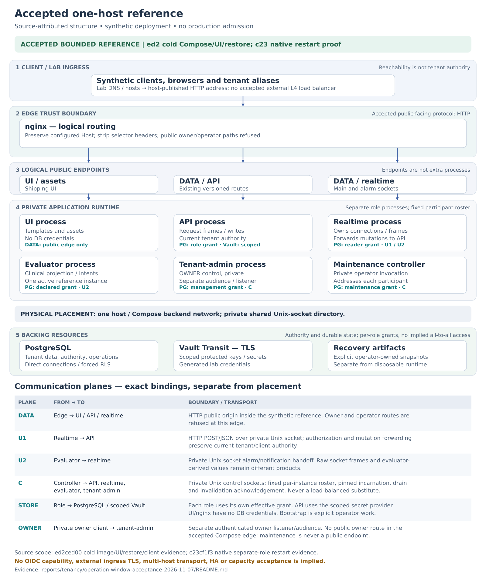
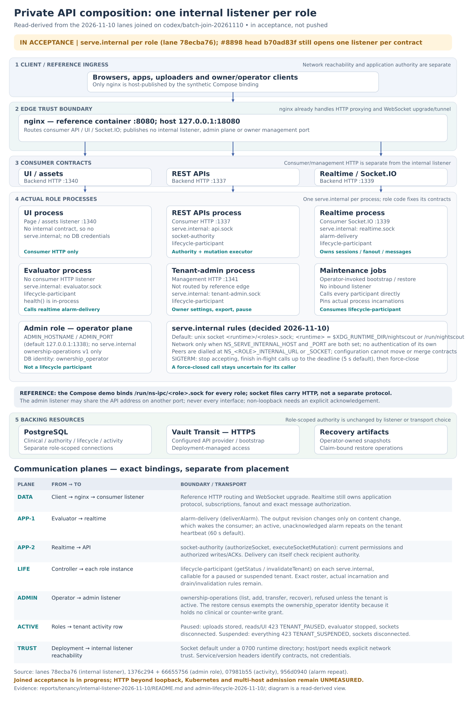
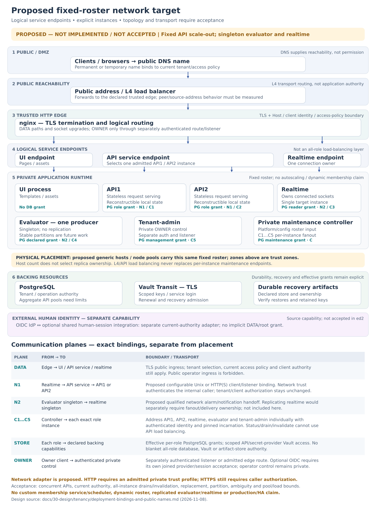

# Runtime topology: zones, components and private APIs

*Living contributor-facing architecture guide, refreshed 2026-11-10. Structure is
**read-derived**; measured acceptance retains its exact source in the linked
records. This Markdown generates the site's `runtime-topology.html`. The
[endpoint/API work plan](selectable-endpoints-and-api-scaling-plan.md) owns remaining
implementation and acceptance criteria; the [queue](../../../queue/work-queue.yaml)
owns claimed work state. A diagram is not deployment or capacity acceptance.*

## Read the diagrams

The three plates answer different questions: the historical accepted deployment,
the internal-listener composition in the batch join (in acceptance), and the proposed
fixed-roster scale target. Read downward through client ingress, edge, service destinations,
actual role processes and backing resources. Components sit on a grid; named
terminals and a communication ledger replace long crossing connectors.

A trust zone is not a host or Pod. A logical API contract, bound listener and
deployable process are separate boundaries. Ordinary service destinations and
the exact instance endpoints needed for maintenance are also different identities.

### Historical accepted one-host reference

[PNG preview](diagrams/accepted-one-host-topology.png) · [SVG source](diagrams/accepted-one-host-topology.svg)

The [ed2 cold Compose record](../../../reports/tenancy/operation-window-acceptance-2026-11-07/ed2-cold-accepted.json)
measures synthetic UI/socket/ordinary restore; the
[c23 native matrix](../../../reports/tenancy/operation-window-acceptance-2026-11-07/c23-native-accepted/README.md)
retains its separate-role restore and restart scope. The reference publishes lab
HTTP and uses TLS for Vault. Those captured runs are not relabelled as new-head,
OIDC, network transport, scaling or production measurements.

### Private API composition: one internal listener per role

[PNG preview](diagrams/current-internal-api-topology.png) · [SVG source](diagrams/current-internal-api-topology.svg)

The plate draws the [internal-listener decisions](../../../releases/cgm-remote-monitor-16.0.0/decisions.md#internal-listener-ory-pattern)
as built on lane `78ecba76` and joined, with the admin-role, activity and alarm-repeat lanes, on
`codex/batch-join-20261110`. That join is **in acceptance, not pushed**; the
[lane evidence](../../../reports/tenancy/internal-listener-2026-11-10/README.md) records its focused,
Compose and break-it runs. Draft #8898 at `b70ad83f` still opens one listener per contract
(`alarm.sock`, `cohort-<role>.sock`); its [joined acceptance](../../../reports/tenancy/m6b-join-2026-11-10/b70ad83f-acceptance/README.md)
retains that source. The shared transport, contracts, schemas and named clients came with `dc795bd1`
([acceptance](../../../reports/tenancy/m6a-join-2026-11-09/dc795bd1-acceptance/)).
These measurements do not qualify a remote HTTP deployment or multiple API replicas.

**Both application and lifecycle operations are private APIs.** The labels name
purpose, not different networks or mandatory sockets:

| Dimension | Meaning |
|---|---|
| Audience | Consumer DATA, owner management, or private component/operator access. A backend-only owner port still has a different contract from lifecycle control. |
| Contract family | Application authority/mutations, notification delivery, lifecycle status/invalidation; operational health/readiness/metrics can be another family. |
| Binding | HTTP over UDS or an explicitly selected TCP/HTTP origin, with a separately configurable bind address. The deployment chooses reachability and access policy. |
| Instance addressing | Ordinary calls may target a service destination; maintenance must reach every actual participant and pin its incarnation. |

Each role process opens one `serve.internal`: API serves socket-authority and
lifecycle-participant; realtime serves alarm-delivery and lifecycle-participant; evaluator and
tenant-admin serve lifecycle-participant. A process with no contract (UI) opens none. The default is a
unix socket under the runtime directory; host/port is set explicitly by environment. On shutdown the
listener finishes in-flight calls up to a deadline ([graceful shutdown](../../../releases/cgm-remote-monitor-16.0.0/decisions.md#internal-listener-graceful-shutdown)).
The `admin` role keeps its own operator-plane listener (`ADMIN_HOSTNAME`/`ADMIN_PORT`) for
ownership operations, with its own `ownership_operator` database identity; it is not a lifecycle
participant ([restore census](../../../releases/cgm-remote-monitor-16.0.0/decisions.md#restore-census-and-ownership-phase),
[same address, different port](../../../releases/cgm-remote-monitor-16.0.0/decisions.md#admin-plane-same-address-different-port)). Evaluator's in-process
`health()` result is not a remote metrics endpoint.

The private application arrows are different calls, not a generic proxy chain:
`evaluator → realtime` delivers notifications; `realtime → API` asks for current
permissions and forwards authorized client writes/acknowledgements. Realtime
owns Socket.IO semantics, subscriptions and fanout. It also checks recipients'
current permissions during delivery. That synchronous authority dependency is
read-derived; its latency, load and failure effects need measurement.

### Proposed fixed-roster API-scale target

[PNG preview](diagrams/proposed-fixed-roster-network-topology.png) · [SVG source](diagrams/proposed-fixed-roster-network-topology.svg)

Keep public/management and private interfaces independently bound. The adopted
shape ([decision](../../../releases/cgm-remote-monitor-16.0.0/decisions.md#internal-listener-ory-pattern), 2026-11-10) gives each role
process one private listener, `serve.internal`, serving the contract modules the
role's code selects; configuration chooses only `host`/`port` or `socket`
(default: a unix socket under a runtime directory) and cannot move or merge
contracts. On SIGTERM it [drains in-flight calls up to a deadline](../../../releases/cgm-remote-monitor-16.0.0/decisions.md#internal-listener-graceful-shutdown).
An operational contract would be another module on that listener. #8898 at
`b70ad83f` still opens one listener per contract; the composition is built and
accepted in the 2026-11-10 batch join (`MT-INTERNAL-LISTENER`, `MT-BATCH-JOIN-1110`),
which is not pushed.

The target also shows two equivalent REST replicas behind a service destination,
with directly addressable private instance endpoints for maintenance. It is not
an accepted multihost or Kubernetes deployment. Realtime tenant placement and recovery have their own
[sharding proposal](realtime-sharding-plan.md); the two-API fixture shown here
retains one realtime process and does not establish realtime scale-out. Evaluator partitioning is separately
adopted/queued under `MT-EVALUATOR-PARTITION`; the current reference remains one
active owner. A replica count is not a workload-assignment rule.

## Logical REST cohesion and worker placement

**REST APIs v1/v2/v3 form one stateless request-serving component.** Version
adapters remain inside each equivalent replica. Data, authorization and owner REST
modules may co-locate while retaining their credentials/audiences/listener rules.
Process layout is a deployment choice; request pools, caches and in-flight work
still make every real instance a maintenance participant. The
[placement/admission review](tenant-admission-and-activity.md#one-logical-api-does-not-require-one-listener-or-process)
owns the detailed assessment and the separate open activity-policy proposal.

Nginx already performs reverse proxying and Socket.IO upgrade/tunnelling in the
reference. An optional nginx `auth_request` or Oathkeeper decision adapter would
need its own private HTTP status/metadata/trusted-header contract. The socket
`/authorize` operation is not that adapter: it can return HTTP success with a JSON
denial. A gateway's initial connection decision also does not authorize later
messages, subscriptions, delivery recipients or database writes. Existing
current-client, tenant, RLS, ACK transaction and lifecycle gates remain.

This is a response-adaptation boundary, not a requirement to redesign existing
application-to-application authentication. Direct component clients can consume
the current JSON decision efficiently; nginx can consume a selected projection
through status and response headers. Existing
[roles-gateway header handlers](https://github.com/t1pal/nightscout-roles-gateway/blob/90840acee1ec641d881512e91f1728f7ed8f7817/lib/policies/index.js#L107)
demonstrate that separation. The work plan records that prior art and keeps this
optional edge integration independent of direct private service calls.

HTTP network reachability is deployment-owned; contract/version headers are not
credentials. The current application adapter implements HTTP, not direct HTTPS.
A selected TLS proxy/mesh can supply a deployment boundary; no new bearer login,
credential-renewal system or mandatory gateway is implied by these diagrams.

## Ownership and placement constraints

| Responsibility | Boundary to preserve |
|---|---|
| Private listener composition | Server-owned method/path registry, collision checks, per-operation schemas and service/version rules. No arbitrary URL-selected handler. |
| Operation lifetime | API work and delivery retain tenant admission through actual response completion. Lifecycle status/invalidation and operational probes need their own policy; do not blanket-wrap them in the tenant work they must inspect or invalidate. |
| Restore coordination | Complete supplied roster, direct instance reachability, actual datastore/backend/incarnation pins, drain and every invalidation acknowledgement. A sampled load-balanced endpoint is not a census. |
| Placement/discovery | Platform lifecycle and configured inventory are inputs. Native acceptance uses a fixed roster; no custom scheduler/discovery service is required. Unready or terminating actors with outstanding work cannot disappear from the roster merely because they left a routing table. |
| Backing resources | Follow the [component ownership map](sql-and-migration-architecture.md#component-ownership-and-internal-application-apis): scoped reads and component-owned state can use storage; cross-component commands use admitted APIs. UI/nginx receive no blanket database/Vault authority. |
| Workload ownership | Size replicas for measured load/availability, and define ownership separately. API replicas do not require evaluator partition leases. The selected evaluator partition work has its own membership/conflict criteria. |

### Scale envelopes and fleet planning

*Post-baseline planning clarification, 2026-11-12; evidence below is UNMEASURED.
Cell/fleet arrangement is **PROPOSED**, requiring explicit maintainer adoption.
This adds no gate or prerequisite to current acceptance or the pilot.*

10,000 tenants is an arbitrary experimental point and current preview bound,
not an overall product goal. Planning must cover efficient groups of 10–100
tenants, operators serving hundreds or thousands, and a credible path to
100,000+ tenants **in total across a fleet**. Record tenants, human users,
concurrent sockets, active evaluation tenants and active alarm/delivery demand
separately; none is a multiplier implied by another. A cohort is the selected
workload/participant scope. A proposed cell is a bounded deployment/datastore
and recovery unit; fleet totals must not be presented as one cell's or one
PostgreSQL instance's capacity.

Reuse the same API, evaluator, realtime, PostgreSQL and change-feed components
across qualified profiles. Experimental rigs isolate variables; they are not
production recipes. Fleet routing, placement, cross-database tenant moves and
control-plane recovery are additional responsibilities: adding replicas does
not implement them. The existing [deployment/fault-domain guide](deployment-and-rig-testing.md#deployment-choices-and-fault-domains)
keeps per-tenant cells distinct from shared-cohort and multi-host choices.

| Envelope | Evidence needed, with exact source/profile and population | Later owner, decision trigger and smallest discriminating experiment |
|---|---|---|
| Small group: idle and steady fixed cost | Whole-stack idle/steady vCPU, RAM, storage/IOPS and dependency cost at 10–100 tenants, with identical functional/freshness/recovery checks. Include edge, UI, control, feed, PostgreSQL, Vault/Agent and selected identity/monitoring dependencies. | M7 measurement owner with deployment owner: after the frozen baseline, compare two explicitly selected profiles at one small population and the same workload; change one axis. A reproduced fixed-cost difference can motivate a packaging/profile proposal, not automatic adoption. |
| Operator density: hundreds/thousands | Whole-stack cost per tenant-month at stated utilization, including retained data, backups, dependency charges and reserved N−1 recovery headroom. Measure correctness, data/alarm freshness and recovery ceilings under steady/hot load and loss of one selected participant or failure domain; name the actual fault scope. | Deployment/recovery owner with M7 measurement owner: run one matched-density baseline and one candidate, then one supported controlled failure/recovery. A measured bottleneck or recovery ceiling triggers review of the affected component/placement design; fewer nodes alone proves no cost advantage. |
| Fleet: 100,000+ total path | Bound coordination/roster work and database growth per proposed unit and across units: routing, provisioning, retention, migration, backup/restore, feed/WAL and maintenance remain accounted for. Preserve tenant isolation, current authority, clinical outcomes and freshness/recovery ceilings across placement changes. | Architecture/control-plane and storage owners: first inventory boundaries, then a two-unit synthetic routing/move/recovery discriminator with independent stored-data and ownership oracles. Only an explicit reviewed adoption of placement, cross-database move and control recovery contracts can select a cell/fleet arrangement; this experiment is not fleet-capacity proof. |

Design should preserve topology-independent behavior before stress testing:
current tenant authority/revocation; committed write outcomes and uncertainty;
owned work/checkpoint continuity; lifecycle fencing and response drain; timer
semantics and public client contracts. Proposed compatibility seams are versioned
internal contracts/capabilities **or explicit coordinated-upgrade refusal**, not
a blanket mixed-version promise. Keep role instance/incarnation distinct from a
service address, durable tenant identity distinct from a worker, and hints
distinct from durable truth. Transport adapters share a behavioral contract;
these seams do not require a universal framework or a new broker.

For each later design brief, state the invariant and concrete code/call boundary,
smallest necessary implementation, compatibility/migration/failure behavior,
owner, one focused discriminating control and the evidence that would justify
infrastructure changes. Classify it as required correctness/compatibility,
measured optimization, bounded prototype or deferred hypothesis. This is a
**proposed tracking rubric**, preserving adopted decisions rather than choosing
a fleet topology or adding current acceptance requirements.

Comparative baselines and savings remain **ASSUMPTION** until reproduced with
whole-stack resource/cost accounting, workload, retention, prices and availability
scope. Before proposing any higher preview limit, inventory every all-roster
O(N) path, pool/connection and file-descriptor budget, queue/backpressure bound,
WAL/slot retention, database/index growth and complete maintenance participant
set. Identify bounded work per request/tick and explicit degraded recovery;
extra worker count does not remove these constraints. The maintainer adopts
later architecture/profile choices from those measurements with the named
owners. These envelopes neither raise current limits nor infer PostgreSQL HA,
automatic realtime failover or a production capacity claim.

## Work needed to reach the target

The [work plan](selectable-endpoints-and-api-scaling-plan.md#remaining-work-and-acceptance)
defines owners, integration boundaries and controls. It separates code already
incorporated in `dc795bd1` from these remaining changes:

1. The adopted `serve.internal` listener per role, with graceful shutdown and
   explicit lifetime policies; define operational endpoints without pretending
   `/metrics` already exists.
2. Deployment binding and remote UDS/HTTP parity, preserving the selected trust,
   actual acknowledgement and suspension semantics. Gateway hooks are an optional
   deployment integration, not a new authentication prerequisite.
3. Fixed-roster API service/instance addressing and native concurrency,
   all-instance restore, replacement and uncertainty acceptance.
4. [Realtime sharding and recovery](realtime-sharding-plan.md), including a
   measured co-location option, stable assignment and complete owner coverage.
5. Measured scaling/fanout costs and separately scoped evaluator partitioning.

No milestone promotion, default enablement or production admission follows from
this reconciliation. Historical captures remain unchanged; stale living prose
is corrected in place rather than kept as a second current design. The
[deployment guide](deployment-bindings-and-public-names.md#configurable-transports-and-independently-scaled-api)
owns platform/binding examples. This page owns topology interpretation; the work
plan owns the acceptance matrix; the queue owns work state.

Figures are generated by
[`render_tenancy_topologies.py`](../../../tools/site/render_tenancy_topologies.py).
Use `--png` to render previews and `--check` to detect stale vector outputs. Review
the figures with contract/listener or deployment changes. Rendering checks
freshness and layout, not application runtime acceptance.

## Evaluator inspection and workload ownership

The planned evaluator operational API includes read-only assignment and membership
inspection, not only process liveness. `MT-ENDPOINT-TRANSPORT` owns the shared
operational listener/module plumbing; `MT-EVALUATOR-PARTITION` owns the evaluator's
assignment facts, membership rules, payload/schema and scaling controls. Neither
the current lifecycle status response nor in-process `health()` exposes a ring API.

The inspection contract must distinguish:

- Configured mode and assignment rule/version, member count, this instance's
  ordinal and actual incarnation, and intended hash slice.
- Observed peer membership/heartbeat expiry, agreement/conflict, the observation
  time and whether this instance is currently eligible to evaluate, with a reason
  when blocked. Configuration alone is not observed ring health.
- Workload counts and progress: assigned/active/suspended tenants, current jobs,
  last successful acquisition/tick, lag/backlog and notification-handoff health.
  Aggregate metrics and bounded private drill-down serve different inspection needs.

In standalone Compose mode the intended assignment is all configured tenants
(the complete assignment space); no membership lease should be fabricated when
partitioning is disabled. With N configured members and one distinct eligible
ordinal per member, each handles its assigned hash slice, approximately 1/N of a
well-distributed tenant population. Equal hash slices do not guarantee equal
tenant counts or computational load. A StatefulSet can supply ordinals; the
application's selected membership/assignment policy decides eligibility.
For the initial modulo-style assignment, an ordinal owns a hash bucket/predicate,
not necessarily a contiguous token interval on a consistent-hash ring. Inspection
must name the actual rule rather than inventing token-range metadata.

Stable assignment intends one evaluator owner per tenant. The adopted M7 policy
allows a bounded overlap window with idempotent effects during membership change;
it does not establish instantaneous exactly-once execution or automatic takeover.
Those transition/duplicate-effect criteria remain unmeasured. The operational API
must report conflicts and blocked work even when it refuses evaluation; querying
inspection must not itself create work, acquire ownership or clear suspension.

Evaluator is not the only component with ownership-sensitive state. A ring is
one possible assignment mechanism, not a universal scaling rule:

| Component/work | Relevant ownership unit | Scaling implication |
|---|---|---|
| Clinical evaluator | Tenant's scheduled acquisition/time-based evaluation | Selected M7 member-count/ordinal assignment; partition inspection belongs here. |
| Notification producer/consumer | Tenant/consumer state and individual durable delivery attempts | Current consumer timers are serialized per tenant within each process; the store locks state and records attempt tokens/deadlines. Co-located consumers must follow the evaluator's admitted assignment, or have a separately qualified work-claim distribution model. A ring alone does not establish exactly-once external delivery. |
| Connector actors | Tenant/source account, polling cursor/session and upstream effects | Future tenant-side workers need explicit assignment or claims to avoid duplicate polling/ingestion. `MT-CONNECTOR-SYNC` currently tests an external existing connector; it does not implement a partitioned tenant-side pool. |
| Realtime | Client connections/rooms and per-tenant projection/checkpoint consumers | It has scheduled refresh work and retained state. Replication needs affinity, checkpoint ownership and complete notification fanout; it is not ordinary stateless replication and does not inherently require one realtime instance per tenant. |
| REST/owner request serving | Individual admitted request/transaction, plus instance drain state | Equivalent replicas serve tenants without assigning each tenant to exactly one API. Every actual replica still participates in maintenance. |
| Maintenance jobs | Exclusive claim for the affected tenant/operation | Existing database/lifecycle claim and census rules serialize destructive work; a tenant ring is not required for all maintenance jobs. |
| PostgreSQL/Vault/edge/UI | Their native storage, connection or request responsibilities | Scale with their own mechanisms and resource bounds; the application evaluator ring does not assign their per-tenant ownership. They are not assumed to have tenant-independent cost. |

These mechanisms are read-derived from the inspected runtime. The next owner must
measure placement transitions, duplicate effects, recovery and cost before
claiming another worker type is safe to replicate. Shared infrastructure may
scale with tenant load even when it has no per-tenant scheduler.
