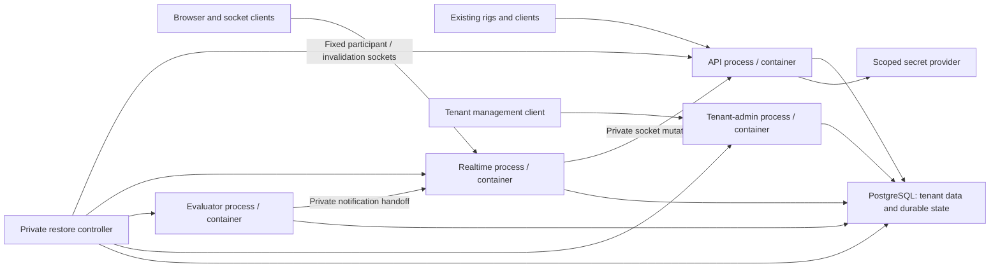
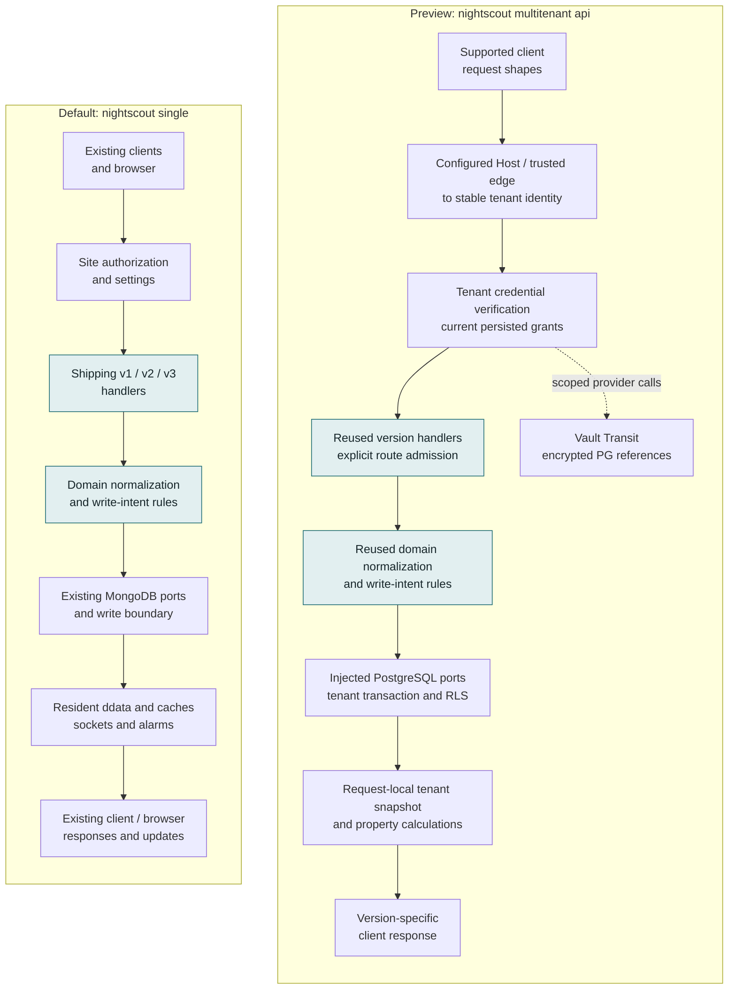
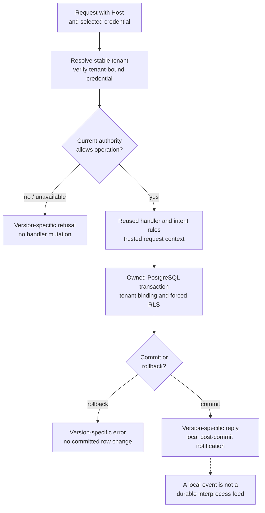
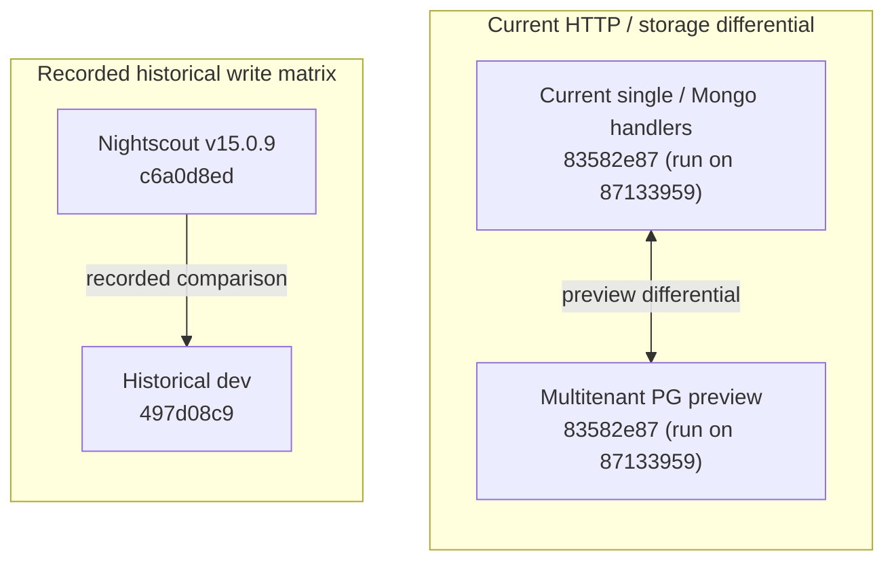

# Single and multitenant Nightscout: architecture and compatibility

*Contributor-facing living explanation. Source inspection is **read-derived** at
cgm-remote-monitor `83582e876dd193f4448f44c28e379fb5464a26c7`, the published head
of draft PR #8898 on 2026-11-06, based on dev `4a482627bfdafb1fef8dcbe0ac6c484811cae563`
(172 commits and 245 files over dev: 193 new, 52 modified, none deleted; read
from `git` at the re-pin). Every source link below was re-verified to resolve at
that head; the shared-code line anchors were re-read there. Test figures below are
**recorded reproductions**, not new runs for this explanation. Current delivery
and milestone claims live in the [delivery dashboard](multitenant-delivery-dashboard.md).
[R62](../remedial/rc-16.0.0-integration-record.md#r62---bounded-owner-reader-replay-and-populated-recovery-batch-2026-11-06)
accepts `83582e87`; [R64](../remedial/rc-16.0.0-integration-record.md#r64---published-control-recovery-batch-remote-verification-2026-11-06)
verifies its publication and remote CI. The earlier
[R40](../remedial/rc-16.0.0-integration-record.md#r40---derived-rest-and-pinned-pattern-cumulative-acceptance-on-ded254b9-2026-11-04)
preview acceptance on `ded254b9`, [R41](../remedial/rc-16.0.0-integration-record.md#r41---subject-administration-and-cross-compatibility-on-94c57f1f-2026-11-05),
[R42](../remedial/rc-16.0.0-integration-record.md#r42---storage-contracts-and-separate-management-http-on-d4570e58-2026-11-05)
and independent [R43](../remedial/rc-16.0.0-integration-record.md#r43---independent-nonresident-profile-refresh-on-925c9527-2026-11-05)
are retained as history where this page cites them. PR #8898 is open/draft, not
merged or released.*

## Current service composition and restore integration (2026-11-07)

This section describes the separate-service implementation by source inspection
at `151de0248a1e4301c85b5c638185eec3ca8c38e6`; the older survey below remains
pinned to `83582e87`. [R73](../remedial/rc-16.0.0-integration-record.md#r73---durable-runtime-and-bounded-operations-batch-2026-11-07)
records runtime composition on its own source. The
[b029 native matrix](../../../reports/tenancy/operation-window-acceptance-2026-11-07/b029-native-accepted/README.md)
accepts 17 separate-process restore criteria on `b029f5d8`, not the newer startup
implementation, Compose/browser deployment or whole M6. Pinned source links in
the detailed guides require publication of the local `151de024` candidate.
The maintainer [reaffirmed separate service processes](../../../releases/cgm-remote-monitor-16.0.0/decisions.md#restore-service-processes),
including containers with shared private sockets where appropriate. Compose and
jsonnet are packaging options; no generator is selected.

| Role | Responsibility | Communication in the bounded reference |
|---|---|---|
| API | Existing tenant REST handlers, authorization and clinical writes | PostgreSQL, scoped secret provider, private socket-write endpoint |
| Realtime | Browser/socket connections and record frames | Reads PostgreSQL; forwards socket mutations to API over private IPC |
| Evaluator | Clinical evaluation, durable notification intent and retries | Reads PostgreSQL; selected notification handoff to realtime over private IPC |
| Tenant-admin | Tenant management and owner configuration | Separate audience/listener and current persisted management authority |

Component paths describe the reference source, with executed acceptance bounded
by its named record above.
Realtime's raw record frames and evaluator-derived values are distinct products;
see the [characterization](../../../reports/tenancy/derived-output-2026-11-07/README.md).
Existing client protocols do not change when these roles move into containers.
The default single-tenant process retains its existing composition.

During tenant A restoration, each participating process must stop admitting A's
new work, finish admitted work, and acknowledge clearing A's retained state before
reactivation. Tenant B has its own operation window. The implemented fixed cohort
registers actual separate processes through configured private participant
endpoints. A PostgreSQL advisory lock protects
participating code. A database-enforced fence would reject bypassing operations
in PostgreSQL itself. Process separation and that stronger fence are separate
questions; neither a process list nor a configuration assertion proves exclusive
credential custody. Native tests must exercise actual separate processes,
restart/lost acknowledgement and late-connection behavior under the declared
trust boundary. The
[tenant-local startup requirement](../../../releases/cgm-remote-monitor-16.0.0/decisions.md#tenant-local-startup-admission)
prevents a suspended tenant from blocking another tenant's shared-role restart.
Its implementation is source-checked at `151de024`; native restart acceptance is
pending. It does not clear claims or provide automatic uncertain-outcome recovery.

See [deployment/rig scenarios](deployment-and-rig-testing.md),
[evaluator/realtime communication](evaluator-realtime-communication.md) and
[SQL/migration architecture](sql-and-migration-architecture.md) for runnable
preparation, sequence diagrams and storage/recovery boundaries. Documentation
checks do not establish an executed deployment or capacity/recovery guarantee.

## What the write seam made possible

**Shared single-tenant code did change.** The storage/write seams let the
multitenant preview reuse shipping domain rules and version-specific handlers
while injecting a different store and tenant context. They did not make every
service tenant-safe automatically, or freeze the code used by `single`.

The compatibility objective is to preserve the existing default MongoDB behavior
when no trusted replacement is injected. That objective is supported by tests;
it is different from claiming no shared source changed or every possible request
behaves identically.

There are two related seams: reads/counts use a storage interface, and mutations
use shared write-intent rules and a write boundary. Tenant resolution, credentials,
current grants, settings, caches, derived views and service lifecycle also require
explicit boundaries. The clinical-record write seam is not a universal wrapper
around operator policy, secrets or every side effect.

## The two executable paths

The same color marks shared handler/rule code; different stores and runtime state
remain separate. Arrows show request/data flow, not milestone completion.

The default single process retains its resident runtime. The preview builds
request-local frames using the shipping loader/cache and property setters for
v2 properties, ddata/as-of and summary. It does **not** thereby enable the
multitenant evaluator, realtime or notification lifecycle, and it is not proof
that the separate ST-VIEWS execution-profile prototype has been wired.

The preview defaults to API3 entries. Explicit domain configuration, prepared
catalogues and safe database roles are required for the wider implemented
surface. API3 covers entries, treatments, devicestatus, profile, food and settings;
activity stays legacy-only. Legacy v2 inherits the actual v1 routes. Derived
properties/ddata/summary are v2-only. Administration, notices/debug, notification
receipts/egress and assistants are unfinished REST work.

See the CRM [preview contract](https://github.com/nightscout/cgm-remote-monitor/blob/83582e876dd193f4448f44c28e379fb5464a26c7/docs/architecture/multitenant-api-preview.md)
for exact admission/configuration, and the [REST inventory](multitenant-rest-api-delivery-plan-2026-11-04.md)
for the full target surface.

## What actually changed in shared code

These are **read-derived** source findings, pinned to `83582e87` (first read at
`ded254b9`; the anchors were re-read at the new head, where only the write-clock
entry point moved, from line 62 to 64). They refute a literal zero-code-change
claim without alleging a single-tenant defect. Across the whole PR, 52 existing
files are modified: the hooks below, the legacy v1 routers for activity,
devicestatus, food, profile, status and treatments, the API3 generic operations
and specific status/version/lastModified handlers, `lib/api2`, the serve roles,
the CLI, `bin/nightscout.js`, the write-intent module, `package.json` (adds `pg`
and `umzug`, and the `test:multitenant` script), the CI workflow and the tier
registry.

| Shared code | Change for the preview | Existing single/default branch |
|---|---|---|
| [storage-reads.js:34](https://github.com/nightscout/cgm-remote-monitor/blob/83582e876dd193f4448f44c28e379fb5464a26c7/lib/server/storage-reads.js#L34) and domain constructors | Accept trusted collection/read/intent ports; incomplete injected capabilities refuse | Absent injection still constructs the existing Mongo collection and intent factory |
| [API3 Collection:26](https://github.com/nightscout/cgm-remote-monitor/blob/83582e876dd193f4448f44c28e379fb5464a26c7/lib/api3/generic/collection.js#L26) | Accept explicit storage, intent and narrow validation/error adapters | Absent injected storage retains MongoCollectionStorage plus CachedCollectionStorage |
| [collectionWriteIntent.js:5](https://github.com/nightscout/cgm-remote-monitor/blob/83582e876dd193f4448f44c28e379fb5464a26c7/lib/api3/shared/collectionWriteIntent.js#L5) | Choose the supplied intent factory | Otherwise use the existing shared write-intent factory |
| [srv-dates.js:64](https://github.com/nightscout/cgm-remote-monitor/blob/83582e876dd193f4448f44c28e379fb5464a26c7/lib/server/srv-dates.js#L64) | Maintain bound-tenant write clocks | The single-tenant sentinel retains the process clock branch |
| [legacy router factories](https://github.com/nightscout/cgm-remote-monitor/blob/83582e876dd193f4448f44c28e379fb5464a26c7/lib/api/index.js), API3 operations and credential/parser seams | Allow deliberate composition and request-bound authority while reusing handler behavior | Existing registrations and default service construction remain covered by the single/Mongo suites |
| [multitenant CLI](https://github.com/nightscout/cgm-remote-monitor/blob/83582e876dd193f4448f44c28e379fb5464a26c7/lib/cli/commands/multitenant.js) | Opt into preview boot, provider/configuration preparation, readiness and owned shutdown | Missing preview configuration refuses; it never falls back to starting `single` |

This is dependency injection plus explicit tenant/runtime composition. It is not
one global backend flag that turns every existing Nightscout feature multitenant.

### What the preview holds at `83582e87`

The 193 new files are dormant, opt-in modules. Each directory carries its own
README in the PR; the alignment contract that governs it is named beside it.

| New module at `83582e87` | What it is | Governing record |
|---|---|---|
| [`lib/tenant-resolution`](https://github.com/nightscout/cgm-remote-monitor/blob/83582e876dd193f4448f44c28e379fb5464a26c7/lib/tenant-resolution/README.md), [`lib/server/tenant-app`](https://github.com/nightscout/cgm-remote-monitor/blob/83582e876dd193f4448f44c28e379fb5464a26c7/lib/server/tenant-app/README.md) | Host-to-tenant resolution (direct alias and canonical ingress) and the dormant tenant HTTP composition that reuses the shipping v1/API3 handlers | roadmap §1–2; the [preview contract](https://github.com/nightscout/cgm-remote-monitor/blob/83582e876dd193f4448f44c28e379fb5464a26c7/docs/architecture/multitenant-api-preview.md) |
| [`lib/storage/postgres-*`](https://github.com/nightscout/cgm-remote-monitor/blob/83582e876dd193f4448f44c28e379fb5464a26c7/lib/storage/PORT-CONTRACT.md), `lib/migrations`, `migrations/candidates` | PostgreSQL connection/transaction binding, entries/treatments/devicestatus/activity ports, identity codec, write limits, the tenant write clock, the migration catalogue and `nightscout migrate` | [storage seam §11](nightscout-storage-seam-interface-2026-09-14.md), [write contract §9](write-contract-spec-2026-10-07.md), [clock proof plan](postgres-tenant-clock-proof.md) |
| [`lib/tenant-authorization`](https://github.com/nightscout/cgm-remote-monitor/blob/83582e876dd193f4448f44c28e379fb5464a26c7/lib/tenant-authorization/README.md), `lib/api3/tenant-authentication.js`, `lib/authorization/credential-extraction.js` | Tenant-bound credential exchange, current persisted grants, optional new-format data tokens verified locally | [owner authority](owner-authority.md); execution-plan D22 |
| [`lib/secrets`](https://github.com/nightscout/cgm-remote-monitor/blob/83582e876dd193f4448f44c28e379fb5464a26c7/lib/secrets/README.md) | Secrets component, Vault Transit adapter, PostgreSQL persistence and rewrap | roadmap §3 |
| [`lib/tenant-settings`](https://github.com/nightscout/cgm-remote-monitor/blob/83582e876dd193f4448f44c28e379fb5464a26c7/lib/tenant-settings), [`lib/subject-admin`](https://github.com/nightscout/cgm-remote-monitor/blob/83582e876dd193f4448f44c28e379fb5464a26c7/lib/subject-admin/README.md), [`lib/subject-policy`](https://github.com/nightscout/cgm-remote-monitor/blob/83582e876dd193f4448f44c28e379fb5464a26c7/lib/subject-policy/README.md), [`lib/operator-policy`](https://github.com/nightscout/cgm-remote-monitor/blob/83582e876dd193f4448f44c28e379fb5464a26c7/lib/operator-policy/README.md), `lib/server/subject-management-app.js` | Per-tenant settings with provenance and history; subject administration; the optional subject-reader policy that clamps stored grants to the reviewed catalogue and the current operator ceiling (unselected by default) | [tenant config schema](tenant-config-schema-2026-10-27.md), [owner authority](owner-authority.md); R53, R62, R63 |
| [`lib/storage/postgres-durable-replay.js`](https://github.com/nightscout/cgm-remote-monitor/blob/83582e876dd193f4448f44c28e379fb5464a26c7/docs/durable-current-state-replay.md), `migrations/candidates/postgres-consumer-checkpoint-v1.json` | Dormant durable current-row replay: typed projection and checkpoint persisted atomically, repeatable-read bootstrap, publish after commit | [durable event delivery contract](durable-event-delivery-contract-2026-11-06.md) (B7); R62 |
| [`lib/import`](https://github.com/nightscout/cgm-remote-monitor/blob/83582e876dd193f4448f44c28e379fb5464a26c7/lib/import/README.md), `tools/import-entries.js`, `lib/data/private-acquisition.js` | One-time API entries importer to a PostgreSQL target; private acquisition of a request-local frame | roadmap M1; R52, R55 |
| [`docs/multitenant-test-corpus.md`](https://github.com/nightscout/cgm-remote-monitor/blob/83582e876dd193f4448f44c28e379fb5464a26c7/docs/multitenant-test-corpus.md), `scripts/test-multitenant.js`, the `multitenant-postgres` CI job | One command for the opt-in corpus, 35 suites at this head, with disposable PostgreSQL 16, MongoDB 8.0 and Vault; the same corpus runs in the PR's CI | [batching plan §3 rules 4–5](multitenant-integration-batching-plan-2026-11-06.md#3-batch-rules); R60, R61, R64 |

Only the `api` role starts; `evaluator`, `realtime`, `vcpool`, `tenant-admin`
and `admin` refuse with exit 64, and missing configuration or failed readiness
refuses with exit 78 before listening. Nothing here changes `nightscout single`.

## Isolation extends beyond the write boundary

Tenant identity must also bind reads, settings, history/lastModified clocks,
secrets, cache frames and returned derived values. PostgreSQL/RLS is defense in
depth alongside request-bound application context; it does not replace request
authorization. Static host maps and loopback lab trust do not establish durable
provisioning or production transport/service identity.

Current grants are checked again on the next protected operation, rather than
frozen into an exchanged token. This does not promise cancellation of work already
authorized. The shipping read-then-write precondition behavior is retained; the
preview does not claim a new atomic compare-and-swap guarantee.

Properties/ddata retain shipping entries-and-treatments permission semantics,
including secondary profile/device/activity/food snapshot arrays. Summary retains
its wildcard read requirement. Those are inherited compatibility boundaries, not
new declarations that every exposed field has an independent collection grant.

## What evidence supports compatibility?

### Preview versus current single/Mongo behavior

The current accepted head is `83582e87`
([R62](../remedial/rc-16.0.0-integration-record.md#r62---bounded-owner-reader-replay-and-populated-recovery-batch-2026-11-06)):
full nonbrowser 7,226 passing / 99 pending / 0 failing, browser 684 / 0 / 0, the
35-suite opt-in corpus 460 / 1 pending (the disabled benchmark) / 0, and the actual
default cgmsim/oref0 gate with 82 checks over 19 paired Mongo/PG cells with zero
differences, all executed on `87133959`; only the source-control runner differs
on `83582e87`, whose final prcheck passed. Archived owner-reader and durable-replay
gates went red under their semantic controls and passed restored.
[R63](../remedial/rc-16.0.0-integration-record.md#r63---selected-subject-actual-client-compatibility-boundary-2026-11-06)
bounds the optional selected-reader mode with actual clients: three oref0
subject-token uploads match the reference, tightening the ceiling refuses the next
upload with no effects, and an actual cgmsim root upload gets 503 under selected
mode against 200 unselected, so that mode stays unselected and the 503 mapping
awaits a disposition. [R64](../remedial/rc-16.0.0-integration-record.md#r64---published-control-recovery-batch-remote-verification-2026-11-06)
reads back the published head: all 15 CI jobs and CodeQL passed, including the
opt-in corpus job; three release-image jobs were skipped by condition. The
sections below retain the earlier records they cite.

Latest local [R42](../remedial/rc-16.0.0-integration-record.md#r42---storage-contracts-and-separate-management-http-on-d4570e58-2026-11-05)
adds real lower/preview/Mongo port characterization and a separate authenticated
management factory, with current-head cumulative/control evidence. Independent
R43 measures the opt-in single/nonresident prototype; it is not joined into the
multitenant preview and does not establish tenant evaluator recovery.

The earlier local [R41 continuation](../remedial/rc-16.0.0-integration-record.md#r41---subject-administration-and-cross-compatibility-on-94c57f1f-2026-11-05)
adds dormant persisted subject mutation and strict mixed-version treatment /
credential-rename comparisons, with full cumulative regression and mutation
controls. It does not expose owner HTTP management or select grant ceilings.
The table below retains the published R40 scope and pin.

[R40](../remedial/rc-16.0.0-integration-record.md#r40---derived-rest-and-pinned-pattern-cumulative-acceptance-on-ded254b9-2026-11-04)
is **recorded reproduced** on `ded254b9`. This document audit did not rerun it.

| Evidence | What it supports | Limit |
|---|---|---|
| Complete nonbrowser: 6,926 passing, 80 pending, zero failing | Broad regression coverage on a coherent tree, including unchanged default/single paths and enabled relevant provider tests | Pending checks are not passes; the total is not a count of independent multitenant properties |
| Complete browser tier: 684 passing | Existing browser/application behavior remains covered | This is not a multitenant UI or production deployment campaign |
| Enabled REST/storage/authority/client focused: 138 passing; separate migration/HTTP: 30 passing | Actual PG/RLS HTTP, current grants, version replies, stored outcomes, derived Mongo differentials and process/restart joins | These overlap the full suite and must not be added as independent coverage |
| Authored semantic source controls | Checks detect cross-bound tenants, stale authority, incorrect IOB, retry/response identity and disabled executable admission; restored runs pass | Demonstrates sensitivity to those exercised breaks, not every possible isolation or semantic defect |
| Pinned NightscoutKit and LoopFollow request patterns through actual CLI/PG/Vault | Concrete uploader/follower request, retry, response-ID and history/restart workflows | Synthetic extraction from pinned source, not execution of Swift applications or every client version |

The R40 head's [CI](https://github.com/nightscout/cgm-remote-monitor/actions/runs/41956417437)
and [CodeQL](https://github.com/nightscout/cgm-remote-monitor/actions/runs/41956417396)
succeeded at read-back; at that time remote defaults enabled no opt-in provider
lab, so R40 and those CI jobs had different scopes. Since Batch A (R60, R61) the
PR's CI runs the opt-in corpus as its own job; on `83582e87` that job and the
other 14 passed ([R64](../remedial/rc-16.0.0-integration-record.md#r64---published-control-recovery-batch-remote-verification-2026-11-06)).

Explicit default-construction checks include
[storage-trusted-ports.test.js](https://github.com/nightscout/cgm-remote-monitor/blob/83582e876dd193f4448f44c28e379fb5464a26c7/tests/storage-trusted-ports.test.js),
[credential/exchange contract tests](https://github.com/nightscout/cgm-remote-monitor/blob/83582e876dd193f4448f44c28e379fb5464a26c7/tests/authorization-exchange-contract.test.js),
and [process admission tests](https://github.com/nightscout/cgm-remote-monitor/blob/83582e876dd193f4448f44c28e379fb5464a26c7/tests/multitenant-preview-process.integration.test.js).
Differentials compare current shipping Mongo handlers against the PG preview,
not an old release. Some comparisons normalize nondeterministic timestamps or
transport fields; they are not a claim of identical bytes everywhere.

There are deliberate preview differences: unsupported query/path/representation
shapes refuse, JSONB uses logical JSON equality rather than BSON key order, and
an invalid selected credential does not silently become anonymous; carrier precedence remains version-specific. Unsupported route
and error mappings can differ from the single application. See the pinned
[tenant-app boundaries](https://github.com/nightscout/cgm-remote-monitor/blob/83582e876dd193f4448f44c28e379fb5464a26c7/lib/server/tenant-app/README.md).
Full query/resource acceptance and populated import-order fidelity remain open.

### New Nightscout versus older releases

The [R42 final-head capture](../../../reports/compat-rest-next-2026-11-05/README.md)
extends the bounded direct comparison to the final REST candidate with verified
driver/dependency provenance. Its explicit omitted families and diagnostic
residuals still limit the claim; it is not a universal old-release/PG equivalence.

The [November 5 bounded refresh](../../../reports/compat-refresh-2026-11-05/README.md)
directly compares release/current-dev/published-PR-single with repeated runs and
an explicit limited pass scope. It excludes identity/settings families, retains
historical projection residuals and does not establish old-release-to-PG parity.
The full-corpus experiment below retains its earlier source pins.

This is a **separate recorded experiment**, not an automatic consequence of the
write seam or a fresh historical comparison of the multitenant preview.

The [comparison contract](../../../releases/cgm-remote-monitor-16.0.0/compat/page.yaml)
and [results](../../../releases/cgm-remote-monitor-16.0.0/compat/headline.json)
record v15.0.9 `c6a0d8ed` versus dev `497d08c9`, twice per endpoint:
**4,916 synthetic write cells, 2,803 changed outputs, zero unexplained differences**.
The recorded classifications contain no Defect-verdict cells; this is not a proof
of no defects outside the corpus. The attribution pin is historical, and this
matrix was not rerun against current dev or the preview head.

The later endpoint uses `WRITE_IDENTIFIER_INDEX=off` so deliberately duplicated
fixtures can be seeded. Separate batch/index measurements cover off/try behavior.
Intentional differences include identity matching, resend/deletion behavior,
validation and fixes; a difference count is not a count of broken clients or
production writes. The matrix's client matches are request-shape mappings, not
live client application runs. Use the [interactive compatibility report](../../../site/pages/cgm-remote-monitor-16.0.0-write-compatibility.html)
to inspect classified cases and the [compatibility assessment](../../10-domain/nightscout-v16-ecosystem-deep-dive.md#compatibility-confidence-what-the-record-supports)
for directional guarantees.

| Compatibility question | Supported answer |
|---|---|
| Existing clients using established API shapes against the new server? | Strong bounded regression, source-pattern and differential evidence supports interoperability; documented behavior changes still matter |
| New-only features against an older Nightscout server? | Require an actual capability or tested fallback; the server write matrix does not establish universal forward compatibility |
| Single and multi identical for every request/data shape? | No; only admitted/tested shapes are supported, with explicit representation, authority and route differences |
| Existing installations upgrade without operational changes? | No blanket guarantee: runtime/database floors, built-in bridge removal, source-build procedure and write settings have documented changes |

The [operator release notes](../../../releases/cgm-remote-monitor-16.0.0/release-notes.md)
retain the upgrade and safety caveats. They explicitly say no single setting
restores every 15.0.9 behavior. API interoperability, stored-data fidelity and
installation/rollback compatibility must be assessed separately.

## Hypothetical third-backend smell test

**Read-derived at `ded254b9`, 2026-11-05, and the resolver anchor re-read at
`83582e87` on 2026-11-06 (`collection` at line 34, `resolve` at 41, `intent` at
54); no SQLite adapter, isolation or performance experiment was run.** A third backend has a clearer insertion point than the
Mongo-only base: trusted `ctx.storagePorts.resolve` supplies storage and an
intent factory (`lib/server/storage-reads.js:34–56`), and the PG adapters call
the shared `write-intent.forCollectionResolved` rules. Existing shipping routers,
validation and client quirks therefore need not be copied into another API.
This improves reuse; it does not establish a backend-neutral runtime.

There are concrete consolidation candidates:

| Source at the pinned CRM head | Smell / bounded improvement |
|---|---|
| `lib/storage/postgres-entries-intent.js:16,30,84` and `postgres-collection-intent.js:24,47,142` | Related filter/projection helpers and transaction/event wrappers are repeated. Generalize only their measured common contract; entries-specific and legacy query/natural-order differences are intentional until disproved by tests. |
| `lib/server/tenant-app/entries.js:20`, `treatments.js:18`, `profile-food-errors.js:13` | Repeated PG error classification and representation-refusal translation can drift. A shared adapter helper is plausible, guarded by existing HTTP error tests. |
| `lib/server/tenant-app/domain-catalogue.js:7–13` | Domain factories are coupled to PG candidate migrations. A hypothetical additional backend needs trusted backend-specific factory/schema/readiness selection behind the same domain capabilities. |
| PG intent adapters' `fromMongo`/`toMongo` dialect bridge and `api3/storage/mongoCollection/utils` import | The boundary still carries Mongo-shaped legacy semantics and Mongo-named normalization helpers. Separate API/document semantics from backend query lowering before treating this as a neutral database plugin interface. Renaming alone proves nothing. |
| `lib/storage/postgres-connection.js:26–50` and tenant authority/secrets persistence | PostgreSQL RLS, roles, tenant-bound transactions and control-plane persistence are a separate protection contract. A cell/file/container isolation primitive would need equivalent tested ownership, lifecycle, failure and authority boundaries; substituting the data adapter alone is insufficient. |

For a hypothetical celld/SQLite design, keep the domain/write semantics above the
backend; implement query/identity/document representation, atomic writes and
commit hooks below it. Reuse the Mongo/PG differential corpus for a third adapter,
including refusal cases. Isolation placement, concurrent writers, crash recovery,
migration/backup and durable event delivery each need a new measured contract.
This is **easier at the handler/write-rule layer, still substantial at the storage
and runtime layers**. No claim of SQLite equivalence, operational advantage or
celld adoption follows. The current REST/compatibility wave comes first; measured
duplication can be consolidated without introducing a third backend.

## Remaining evidence gaps and next work

The [milestone dashboard](multitenant-delivery-dashboard.md) deliberately does
not promote M0–M6 on component evidence alone. Full REST administration/side
effects, client binary execution, arbitrary extensions/localization, import and
resource bounds, production identity/trust, lifecycle, durable events,
realtime/evaluation, HA and operations remain unaccepted.

A fresh selected queue audit also shows the historical
`T30-SCHEMA-CONFIG` static gate fails its old `crm-seam` D15 configuration-table
check; several broader cards are UNMEASURED when integrations are skipped. That
old-seam predicate is distinct from R40's new-tree persisted settings/authority
acceptance. It is an instrument/coverage boundary to keep visible, not evidence
that the new preview has no settings table or that a full catalogue is complete.

Next engineering is the bounded persisted subject mutation/known-role assignment
packet, followed by the remaining REST side effects and wider client/operational
acceptance. No new architecture, safety policy or milestone status is approved
by drawing these diagrams.
