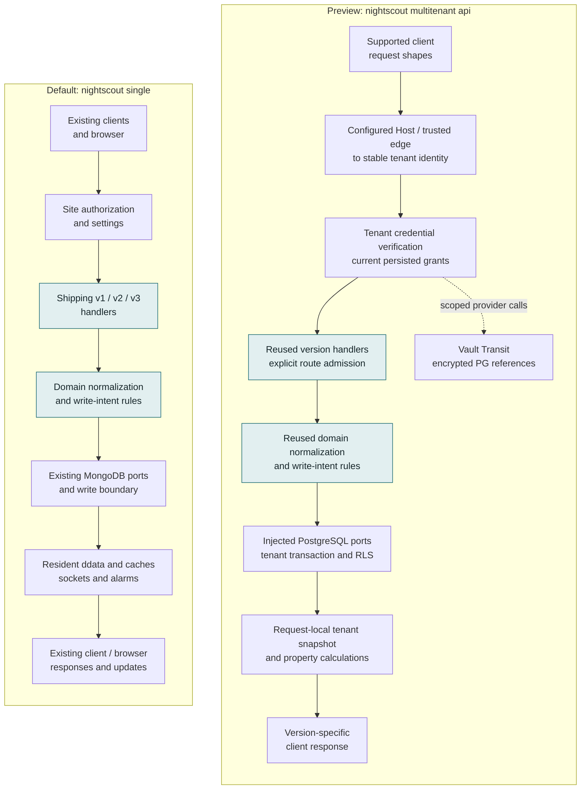
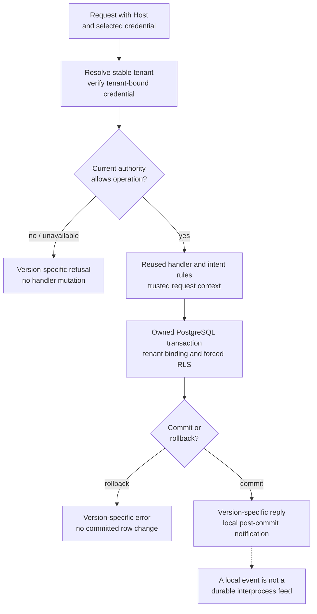
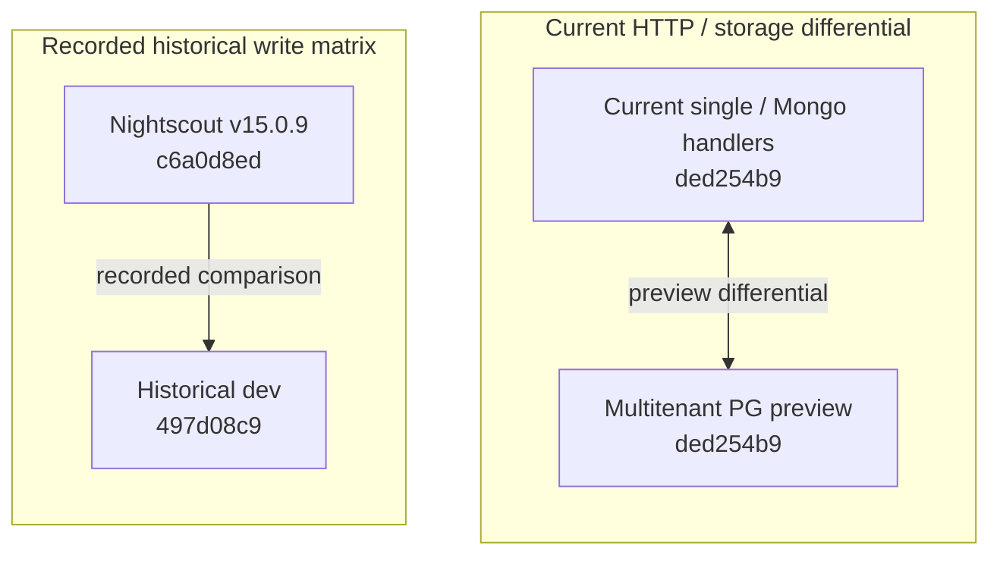

# Single and multitenant Nightscout: architecture and compatibility

*Contributor-facing living explanation. Source inspection is **read-derived** at
cgm-remote-monitor `ded254b9acf5a94e3a4fd99c85b23e1413fa08b6`, based on dev
`4a482627bfdafb1fef8dcbe0ac6c484811cae563`. Test figures below are **recorded
reproductions**, not new runs for this explanation. Current delivery and milestone
claims live in the [delivery dashboard](multitenant-delivery-dashboard.md);
[R40](../remedial/rc-16.0.0-integration-record.md#r40---derived-rest-and-pinned-pattern-cumulative-acceptance-on-ded254b9-2026-11-04)
owns the preview acceptance. PR #8898 is open/draft, not merged or released.*

## What the write seam made possible

**Shared single-tenant code did change.** The storage/write seams let the
multitenant preview reuse shipping domain rules and version-specific handlers
while injecting a different store and tenant context. They did not make every
service tenant-safe automatically, or freeze the code used by `single`.

The compatibility objective is to preserve the existing default MongoDB behavior
when no trusted replacement is injected. That objective is supported by tests;
it is different from claiming no shared source changed or every possible request
behaves identically.

There are two related seams: reads/counts use a storage interface, and mutations
use shared write-intent rules and a write boundary. Tenant resolution, credentials,
current grants, settings, caches, derived views and service lifecycle also require
explicit boundaries. The clinical-record write seam is not a universal wrapper
around operator policy, secrets or every side effect.

## The two executable paths

The same color marks shared handler/rule code; different stores and runtime state
remain separate. Arrows show request/data flow, not milestone completion.

The default single process retains its resident runtime. The preview builds
request-local frames using the shipping loader/cache and property setters for
v2 properties, ddata/as-of and summary. It does **not** thereby enable the
multitenant evaluator, realtime or notification lifecycle, and it is not proof
that the separate ST-VIEWS execution-profile prototype has been wired.

The preview defaults to API3 entries. Explicit domain configuration, prepared
catalogues and safe database roles are required for the wider implemented
surface. API3 covers entries, treatments, devicestatus, profile, food and settings;
activity stays legacy-only. Legacy v2 inherits the actual v1 routes. Derived
properties/ddata/summary are v2-only. Administration, notices/debug, notification
receipts/egress and assistants are unfinished REST work.

See the CRM [preview contract](https://github.com/nightscout/cgm-remote-monitor/blob/ded254b9acf5a94e3a4fd99c85b23e1413fa08b6/docs/architecture/multitenant-api-preview.md)
for exact admission/configuration, and the [REST inventory](multitenant-rest-api-delivery-plan-2026-11-04.md)
for the full target surface.

## What actually changed in shared code

These are **read-derived** source findings, pinned to the preview commit. They
refute a literal zero-code-change claim without alleging a single-tenant defect.

| Shared code | Change for the preview | Existing single/default branch |
|---|---|---|
| [storage-reads.js:34](https://github.com/nightscout/cgm-remote-monitor/blob/ded254b9acf5a94e3a4fd99c85b23e1413fa08b6/lib/server/storage-reads.js#L34) and domain constructors | Accept trusted collection/read/intent ports; incomplete injected capabilities refuse | Absent injection still constructs the existing Mongo collection and intent factory |
| [API3 Collection:26](https://github.com/nightscout/cgm-remote-monitor/blob/ded254b9acf5a94e3a4fd99c85b23e1413fa08b6/lib/api3/generic/collection.js#L26) | Accept explicit storage, intent and narrow validation/error adapters | Absent injected storage retains MongoCollectionStorage plus CachedCollectionStorage |
| [collectionWriteIntent.js:5](https://github.com/nightscout/cgm-remote-monitor/blob/ded254b9acf5a94e3a4fd99c85b23e1413fa08b6/lib/api3/shared/collectionWriteIntent.js#L5) | Choose the supplied intent factory | Otherwise use the existing shared write-intent factory |
| [srv-dates.js:62](https://github.com/nightscout/cgm-remote-monitor/blob/ded254b9acf5a94e3a4fd99c85b23e1413fa08b6/lib/server/srv-dates.js#L62) | Maintain bound-tenant write clocks | The single-tenant sentinel retains the process clock branch |
| [legacy router factories](https://github.com/nightscout/cgm-remote-monitor/blob/ded254b9acf5a94e3a4fd99c85b23e1413fa08b6/lib/api/index.js), API3 operations and credential/parser seams | Allow deliberate composition and request-bound authority while reusing handler behavior | Existing registrations and default service construction remain covered by the single/Mongo suites |
| [multitenant CLI](https://github.com/nightscout/cgm-remote-monitor/blob/ded254b9acf5a94e3a4fd99c85b23e1413fa08b6/lib/cli/commands/multitenant.js) | Opt into preview boot, provider/configuration preparation, readiness and owned shutdown | Missing preview configuration refuses; it never falls back to starting `single` |

This is dependency injection plus explicit tenant/runtime composition. It is not
one global backend flag that turns every existing Nightscout feature multitenant.

## Isolation extends beyond the write boundary

Tenant identity must also bind reads, settings, history/lastModified clocks,
secrets, cache frames and returned derived values. PostgreSQL/RLS is defense in
depth alongside request-bound application context; it does not replace request
authorization. Static host maps and loopback lab trust do not establish durable
provisioning or production transport/service identity.

Current grants are checked again on the next protected operation, rather than
frozen into an exchanged token. This does not promise cancellation of work already
authorized. The shipping read-then-write precondition behavior is retained; the
preview does not claim a new atomic compare-and-swap guarantee.

Properties/ddata retain shipping entries-and-treatments permission semantics,
including secondary profile/device/activity/food snapshot arrays. Summary retains
its wildcard read requirement. Those are inherited compatibility boundaries, not
new declarations that every exposed field has an independent collection grant.

## What evidence supports compatibility?

### Preview versus current single/Mongo behavior

[R40](../remedial/rc-16.0.0-integration-record.md#r40---derived-rest-and-pinned-pattern-cumulative-acceptance-on-ded254b9-2026-11-04)
is **recorded reproduced** on `ded254b9`. This document audit did not rerun it.

| Evidence | What it supports | Limit |
|---|---|---|
| Complete nonbrowser: 6,926 passing, 80 pending, zero failing | Broad regression coverage on a coherent tree, including unchanged default/single paths and enabled relevant provider tests | Pending checks are not passes; the total is not a count of independent multitenant properties |
| Complete browser tier: 684 passing | Existing browser/application behavior remains covered | This is not a multitenant UI or production deployment campaign |
| Enabled REST/storage/authority/client focused: 138 passing; separate migration/HTTP: 30 passing | Actual PG/RLS HTTP, current grants, version replies, stored outcomes, derived Mongo differentials and process/restart joins | These overlap the full suite and must not be added as independent coverage |
| Authored semantic source controls | Checks detect cross-bound tenants, stale authority, incorrect IOB, retry/response identity and disabled executable admission; restored runs pass | Demonstrates sensitivity to those exercised breaks, not every possible isolation or semantic defect |
| Pinned NightscoutKit and LoopFollow request patterns through actual CLI/PG/Vault | Concrete uploader/follower request, retry, response-ID and history/restart workflows | Synthetic extraction from pinned source, not execution of Swift applications or every client version |

The published head's [CI](https://github.com/nightscout/cgm-remote-monitor/actions/runs/41956417437)
and [CodeQL](https://github.com/nightscout/cgm-remote-monitor/actions/runs/41956417396)
succeeded at read-back. Remote defaults do not enable every opt-in provider lab;
R40 and the CI jobs have different scopes.

Explicit default-construction checks include
[storage-trusted-ports.test.js](https://github.com/nightscout/cgm-remote-monitor/blob/ded254b9acf5a94e3a4fd99c85b23e1413fa08b6/tests/storage-trusted-ports.test.js),
[credential/exchange contract tests](https://github.com/nightscout/cgm-remote-monitor/blob/ded254b9acf5a94e3a4fd99c85b23e1413fa08b6/tests/authorization-exchange-contract.test.js),
and [process admission tests](https://github.com/nightscout/cgm-remote-monitor/blob/ded254b9acf5a94e3a4fd99c85b23e1413fa08b6/tests/multitenant-preview-process.integration.test.js).
Differentials compare current shipping Mongo handlers against the PG preview,
not an old release. Some comparisons normalize nondeterministic timestamps or
transport fields; they are not a claim of identical bytes everywhere.

There are deliberate preview differences: unsupported query/path/representation
shapes refuse, JSONB uses logical JSON equality rather than BSON key order, and
an invalid selected credential does not silently become anonymous; carrier precedence remains version-specific. Unsupported route
and error mappings can differ from the single application. See the pinned
[tenant-app boundaries](https://github.com/nightscout/cgm-remote-monitor/blob/ded254b9acf5a94e3a4fd99c85b23e1413fa08b6/lib/server/tenant-app/README.md).
Full query/resource acceptance and populated import-order fidelity remain open.

### New Nightscout versus older releases

This is a **separate recorded experiment**, not an automatic consequence of the
write seam or a fresh historical comparison of the multitenant preview.

The [comparison contract](../../../releases/cgm-remote-monitor-16.0.0/compat/page.yaml)
and [results](../../../releases/cgm-remote-monitor-16.0.0/compat/headline.json)
record v15.0.9 `c6a0d8ed` versus dev `497d08c9`, twice per endpoint:
**4,916 synthetic write cells, 2,803 changed outputs, zero unexplained differences**.
The recorded classifications contain no Defect-verdict cells; this is not a proof
of no defects outside the corpus. The attribution pin is historical, and this
matrix was not rerun against current dev or the preview head.

The later endpoint uses `WRITE_IDENTIFIER_INDEX=off` so deliberately duplicated
fixtures can be seeded. Separate batch/index measurements cover off/try behavior.
Intentional differences include identity matching, resend/deletion behavior,
validation and fixes; a difference count is not a count of broken clients or
production writes. The matrix's client matches are request-shape mappings, not
live client application runs. Use the [interactive compatibility report](../../../site/pages/cgm-remote-monitor-16.0.0-write-compatibility.html)
to inspect classified cases and the [compatibility assessment](../../10-domain/nightscout-v16-ecosystem-deep-dive.md#compatibility-confidence-what-the-record-supports)
for directional guarantees.

| Compatibility question | Supported answer |
|---|---|
| Existing clients using established API shapes against the new server? | Strong bounded regression, source-pattern and differential evidence supports interoperability; documented behavior changes still matter |
| New-only features against an older Nightscout server? | Require an actual capability or tested fallback; the server write matrix does not establish universal forward compatibility |
| Single and multi identical for every request/data shape? | No; only admitted/tested shapes are supported, with explicit representation, authority and route differences |
| Existing installations upgrade without operational changes? | No blanket guarantee: runtime/database floors, built-in bridge removal, source-build procedure and write settings have documented changes |

The [operator release notes](../../../releases/cgm-remote-monitor-16.0.0/release-notes.md)
retain the upgrade and safety caveats. They explicitly say no single setting
restores every 15.0.9 behavior. API interoperability, stored-data fidelity and
installation/rollback compatibility must be assessed separately.

## Hypothetical third-backend smell test

**Read-derived at `ded254b9`, 2026-11-05; no SQLite adapter, isolation or performance
experiment was run.** A third backend has a clearer insertion point than the
Mongo-only base: trusted `ctx.storagePorts.resolve` supplies storage and an
intent factory (`lib/server/storage-reads.js:34–56`), and the PG adapters call
the shared `write-intent.forCollectionResolved` rules. Existing shipping routers,
validation and client quirks therefore need not be copied into another API.
This improves reuse; it does not establish a backend-neutral runtime.

There are concrete consolidation candidates:

| Source at the pinned CRM head | Smell / bounded improvement |
|---|---|
| `lib/storage/postgres-entries-intent.js:16,30,84` and `postgres-collection-intent.js:24,47,142` | Related filter/projection helpers and transaction/event wrappers are repeated. Generalize only their measured common contract; entries-specific and legacy query/natural-order differences are intentional until disproved by tests. |
| `lib/server/tenant-app/entries.js:20`, `treatments.js:18`, `profile-food-errors.js:13` | Repeated PG error classification and representation-refusal translation can drift. A shared adapter helper is plausible, guarded by existing HTTP error tests. |
| `lib/server/tenant-app/domain-catalogue.js:7–13` | Domain factories are coupled to PG candidate migrations. A hypothetical additional backend needs trusted backend-specific factory/schema/readiness selection behind the same domain capabilities. |
| PG intent adapters' `fromMongo`/`toMongo` dialect bridge and `api3/storage/mongoCollection/utils` import | The boundary still carries Mongo-shaped legacy semantics and Mongo-named normalization helpers. Separate API/document semantics from backend query lowering before treating this as a neutral database plugin interface. Renaming alone proves nothing. |
| `lib/storage/postgres-connection.js:26–50` and tenant authority/secrets persistence | PostgreSQL RLS, roles, tenant-bound transactions and control-plane persistence are a separate protection contract. A cell/file/container isolation primitive would need equivalent tested ownership, lifecycle, failure and authority boundaries; substituting the data adapter alone is insufficient. |

For a hypothetical celld/SQLite design, keep the domain/write semantics above the
backend; implement query/identity/document representation, atomic writes and
commit hooks below it. Reuse the Mongo/PG differential corpus for a third adapter,
including refusal cases. Isolation placement, concurrent writers, crash recovery,
migration/backup and durable event delivery each need a new measured contract.
This is **easier at the handler/write-rule layer, still substantial at the storage
and runtime layers**. No claim of SQLite equivalence, operational advantage or
celld adoption follows. The current REST/compatibility wave comes first; measured
duplication can be consolidated without introducing a third backend.

## Remaining evidence gaps and next work

The [milestone dashboard](multitenant-delivery-dashboard.md) deliberately does
not promote M0–M6 on component evidence alone. Full REST administration/side
effects, client binary execution, arbitrary extensions/localization, import and
resource bounds, production identity/trust, lifecycle, durable events,
realtime/evaluation, HA and operations remain unaccepted.

A fresh selected queue audit also shows the historical
`T30-SCHEMA-CONFIG` static gate fails its old `crm-seam` D15 configuration-table
check; several broader cards are UNMEASURED when integrations are skipped. That
old-seam predicate is distinct from R40's new-tree persisted settings/authority
acceptance. It is an instrument/coverage boundary to keep visible, not evidence
that the new preview has no settings table or that a full catalogue is complete.

Next engineering is the bounded persisted subject mutation/known-role assignment
packet, followed by the remaining REST side effects and wider client/operational
acceptance. No new architecture, safety policy or milestone status is approved
by drawing these diagrams.
