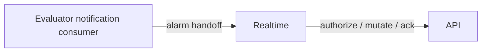
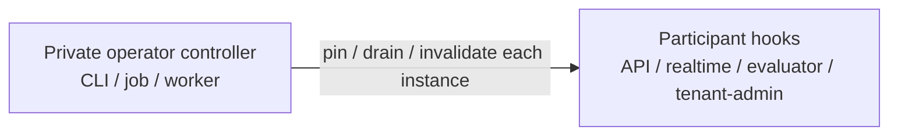
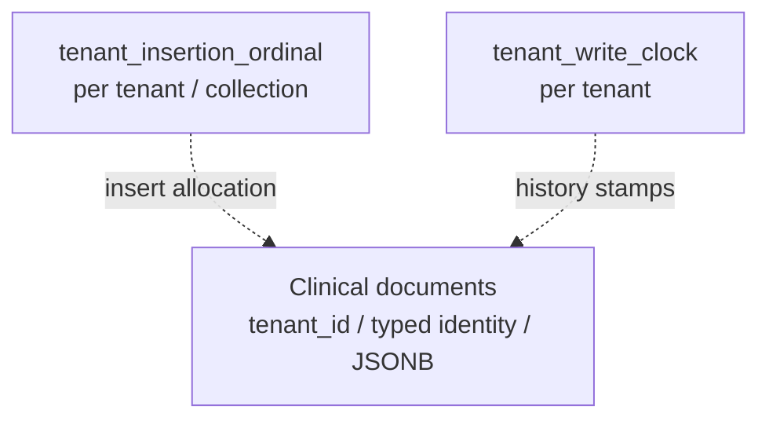
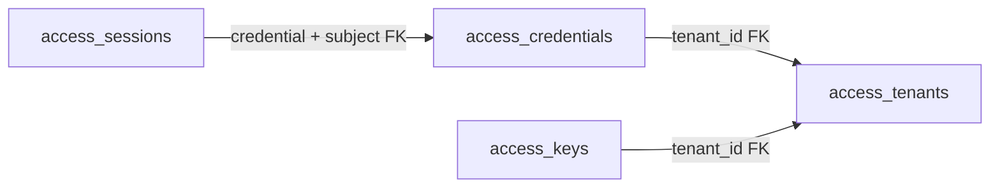
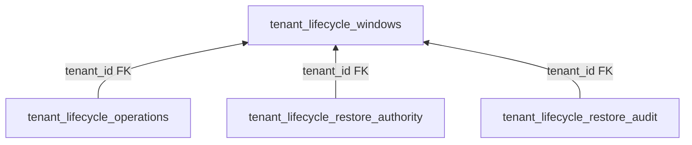
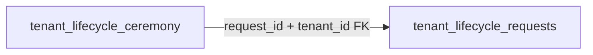
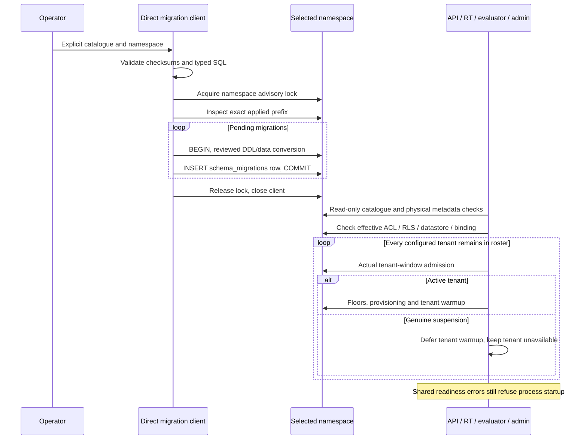
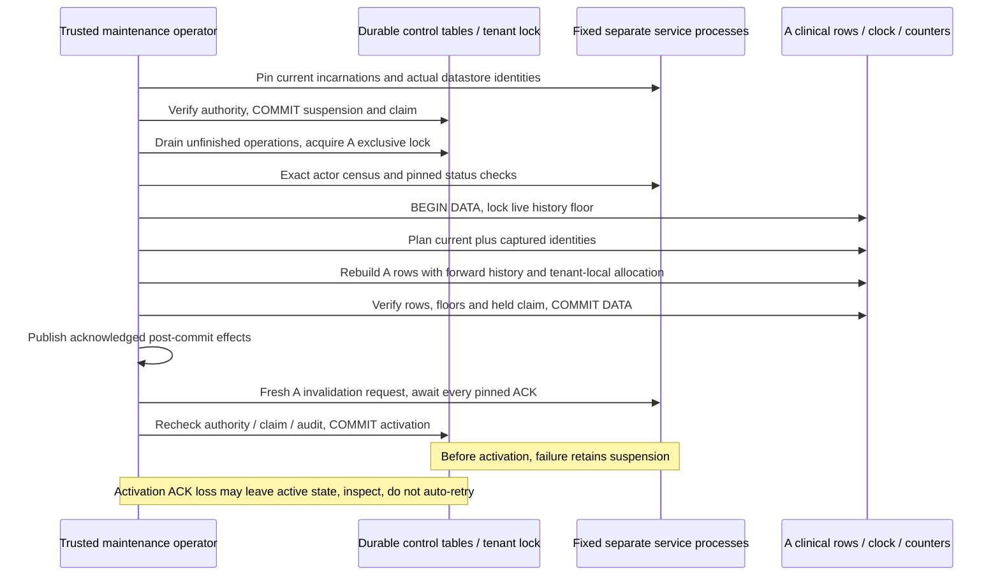

# SQL, migrations and tenant recovery architecture

*Living contributor-facing architecture guide. Source reading verified 2026-11-07
against cgm-remote-monitor `151de0248a1e4301c85b5c638185eec3ca8c38e6`
(tree `3bb46431a19e604dc028768f0e72e6ad29616c26`). Mechanisms and diagrams below are
**read-derived** unless a linked record says reproduced. These are branch
implementation mechanisms, not a released operator feature. Commit-pinned
application links identify that inspected revision; executed measurements retain
their own source. Decisions live in the [tenancy contracts](multitenancy-decisions.md)
and [release decisions](../../../releases/cgm-remote-monitor-16.0.0/decisions.md);
acceptance lives in the [release contents](../../../releases/cgm-remote-monitor-16.0.0/contents.md).
Ownership/API guidance updated 2026-11-08 under the maintainer's exclusive
application ownership decision. Design recommendations and Kubernetes scale-out
assessment are **read-derived**; no new runtime or cluster campaign was run.
This guide explains their SQL implementation and does not promote M6.*

## Scope and evidence

For diagram-first review, open the [database and component ownership visual
review](../../../site/pages/multitenant-database-design.html). It renders the
tables and diagrams below from this guide, with the source revision recorded.

The explicit multitenant PostgreSQL deployment shares physical tables among tenants.
It maps each selected catalogue to an operator-configured schema; a schema is a
component/domain namespace, not a new schema for each tenant. Single-tenant and
MongoDB entrypoints retain their separate composition. The [deployment catalogue
selection][deployment-catalogues] is the concrete reference for the preview;
the [storage seam](nightscout-storage-seam-interface-2026-09-14.md#11-current-admitted-ports-and-independent-scopes-2026-11-05)
and [write contract](write-contract-spec-2026-10-07.md#9-current-shared-intent-and-backend-capabilities-2026-11-05)
own admitted port behavior.

| Evidence | What it establishes | Boundary |
|---|---|---|
| [b029 native acceptance](../../../reports/tenancy/operation-window-acceptance-2026-11-07/b029-native-accepted/README.md) | **Reproduced:** all 17 stated native operation-window criteria on `b029f5d81f539a4846e51ab88e540cb4511910fa`, including separate roles, forward-history restore, running B progress and fault refusals. | Different source from this guide. It does not measure the new tenant-local startup admission or whole M6. |
| [c23 native matrix](../../../reports/tenancy/operation-window-acceptance-2026-11-07/c23-native-accepted/README.md) | **Reproduced:** separate-role restore and fresh shared-role restarts with B progress while A remained unavailable in the recorded failure cases; unsafe-clock API startup refused; independent physical closure. | Exact c23 executed source, fixed trusted cooperative cohort. No automatic orphan clearance, suspended-restore resume command or production recovery bound. |
| [ed2 cold Compose measurement](../../../reports/tenancy/operation-window-acceptance-2026-11-07/ed2-cold-accepted.json) | **Reproduced:** packaged A restore preserved clinical value/public identity, forward history and B rows while B committed work; actual controller committed/reactivated; independent configuration/resource/process closure. | Exact ed2 source/image, fixed cooperative one-host reference. Client and final regression gates remain separate. |
| [Application startup source guide][cohort-guide] and [startup controls][startup-controls] | The `151de024` source defers genuinely suspended tenants while retaining shared readiness failures and later full initialization. | Source/protocol reading; actual runtime measurements retain their c23 attribution above. |
| [Counter analysis](counter-and-restore-options.md) and [clock proof plan](postgres-tenant-clock-proof.md) | Rationale, alternatives and invariants, with individually scoped experiments. | Their earlier source anchors and feasibility results do not replace current catalogue/readiness verification. |

## Supported database ownership contract

The [exclusive application ownership decision](../../../releases/cgm-remote-monitor-16.0.0/decisions.md#exclusive-application-postgres-ownership)
defines supported writers. Nightscout collectively owns its selected namespaces:
multiple internal processes and controlled maintenance tools may use PostgreSQL,
but every supported participant follows the relevant application contract.
External direct writers are unsupported and their effects are undefined behavior,
consistent with single-tenant Nightscout's external MongoDB writer boundary.
Other applications may own unrelated namespaces; this does not require exclusive
ownership of an entire PostgreSQL server.

Exclusive application ownership does not confer unrestricted SQL rights on each
component. Retain effective privilege/readiness checks, tenant-bound transactions,
forced RLS, current authorization and narrowly scoped credentials. Internal
clinical writes must use the canonical write path; lifecycle participants must
honor admission, drain and invalidation. The advisory-lock protocol coordinates
these supported participants. A direct writer ignoring it is outside the contract,
not a reason to require a stronger database fence for the supported topology.
PostgreSQL documents [advisory locks](https://www.postgresql.org/docs/current/explicit-locking.html#ADVISORY-LOCKS)
as application-coordinated locks.

## Logical API, workers and admission

### One logical REST/API component

Data REST, credential authorization and owner-management REST are cohesive
application modules. Their logical grouping does not prescribe a single listener,
process or privilege set. Owner management retains its own audience and listener
contract and may be colocated with API serving under the existing
[owner-authority boundary](owner-authority.md#shared-oidc-integration). The accepted
separate-role reference remains one concrete composition, not a requirement that
every REST responsibility become a separate service.

### Headless workload owners

Realtime owns live connections; the evaluator is a headless worker and remains
one current workload owner. Connector actors (`vcpool`) belong to background
polling/egress work and submit clinical writes through the canonical API boundary;
the [ed2 role declaration](https://github.com/nightscout/cgm-remote-monitor/blob/ed2ced00c80bd0a6a7d75f834d2c6e2af8c71364/lib/server/serve/roles.js#L81)
has no runnable start. Evaluator partitioning and realtime replication are separate future capabilities, not
prerequisites for the queued request-serving API scale-out.

### Private maintenance execution

The lifecycle/restore controller executes as a private operator CLI, job or
worker; the [ed2 operator tool](https://github.com/nightscout/cgm-remote-monitor/blob/ed2ced00c80bd0a6a7d75f834d2c6e2af8c71364/deploy/multitenant/restore.js#L97)
composes it outside API serving. Each serving instance supplies generic
operation-admission, lifetime and invalidation hooks; those hooks do not place a restore engine or maintenance
credentials in every API replica. A future command/status REST surface could
request or observe maintenance while the privileged worker executes it separately;
no new endpoint or process layout is selected here. The
[logical placement map](runtime-topology.md#logical-rest-cohesion-and-worker-placement)
owns the broader component explanation.

### Maintenance safety is distinct from desired activity

The existing claim/generation-bound maintenance window determines whether an
operation can run safely during recovery. Operator-controlled resource/activity
policy asks which serving, ingestion, evaluation or connector work should run at
all; that policy remains **proposed and undecided** in the
[tenant-admission review](tenant-admission-and-activity.md). A maintenance phase
named `active` is not evidence of operator enablement or background-work
eligibility. Preserve the existing pause/suspend meanings and captured restore
behavior; no activity field, transition or automatic inactive-tenant resource
control is implemented by this database design. Observed health is a further
separate fact. No new activity-policy gate is claimed by the diagrams below.

## Component ownership and internal application APIs

**Read-derived architecture direction:** place commands at the component that
owns their semantics, and let that component persist its state. An internal API
can be a module interface within a process or a private application protocol
between processes. The reference's process transport is private HTTP/JSON over
Unix sockets; network endpoint selection requires the separately described
[transport binding](deployment-bindings-and-public-names.md#configurable-transports-and-independently-scaled-api).
The following ownership map does not introduce a generic SQL-over-HTTP service.

| Operation / state | Owner and internal boundary | Existing reference or recommended direction |
|---|---|---|
| Clinical documents, public write outcomes and history stamps | API executes canonical writes, including a writer's current authority. Socket/connector/other component commands enter the same application write boundary. Document, clock and insertion changes retain their transaction coupling. | API clinical writes and D23 socket forwarding exist. Additional internal command producers must use the admitted path; their implementation/acceptance remains separately scoped. |
| Alarm acknowledgement / snooze | Realtime forwards the original client authorization and event to API; API persists suppression through its acknowledgement admission. Evaluator reads current suppression. | Existing [private authorization and mutation protocol](evaluator-realtime-communication.md#browser-authorization-and-mutations); realtime must not edit suppression rows as a substitute. |
| Clinical acquisition and consumer recovery state | Evaluator and realtime each read through tenant-bound storage interfaces and own separate projection/checkpoint namespaces. | Existing bounded snapshot acquisition. Direct admitted reads and atomic projection/checkpoint persistence remain appropriate; sending every read through API would add dependency and transport cost without establishing stronger semantics. |
| Notification intent, attempts and handoff | Evaluator's notification component owns durable producer/request/attempt state; realtime owns connected-browser fanout. Deliver an application handoff with stable request identity and durable retry outcome. | Existing [notification handoff](evaluator-realtime-communication.md#notification-intents-retries-and-alarm-handoff). Other components should not insert producer requests or edit attempt rows to impersonate its protocol. |
| Credentials, owner configuration and current policy | Management/authority components own mutation checks, audit and invalidation. Consumers use their admitted authority/settings interfaces; data-plane requests retain their own current authorization. | Separate management audience and component interfaces exist. Cross-process consumers should invoke owned commands rather than edit these tables; this is not a claim that every authority operation has a new network endpoint. |
| Maintenance exclusion, restore, deletion and activation | Private operator lifecycle controller coordinates each actual participant through its control API and owns controlled maintenance transactions. Explicit migration/provisioning tools own their separate catalogues and grants. | Existing fixed-cohort restore protocol. A table update or clinical API write alone cannot drain in-flight responses, clear another process's cache or authorize a deletion ceremony. |

### Application command paths

**Read-derived command diagram.** These are private application calls, not SQL
relationships. The alarm handoff and socket mutation have separate authorization
and acknowledgement contracts; the arrows do not imply one chained transaction.

### Component storage ownership

**Read-derived ownership matrix.** Each row is an admitted component's storage
responsibility, not a mandatory process or a separate physical database. The two
REST/API rows are responsibilities within one logical component, retaining their
separate authority/listener contracts. Realtime and evaluator read the same clinical tables, but own distinct checkpoint namespaces. Privilege checks
remain specific to the selected catalogue and operation.

| Component | Admitted reads | Owned persistence / controlled writes |
|---|---|---|
| Logical REST/API — data handlers | Clinical records; current authority and configuration | Canonical clinical documents, insertion counters and history clock in one transaction; admitted alarm suppression |
| Realtime | Clinical records; current configuration and admitted authority | Realtime projection and checkpoint namespace |
| Evaluator / notification component | Clinical records; current configuration and suppression | Evaluator projection and checkpoint namespace; notification producer state, requests and attempts |
| Logical REST/API — owner/authority modules | Current authority, policy, owner configuration and secret references | Admitted credential, session, policy, owner-settings and secret mutations with audit |
| Private operator lifecycle worker | Current authority, durable operations and pinned participant identities | Lifecycle windows, claims and audit; controlled clinical restore and forward history |

### Lifecycle control boundary

**Read-derived control diagram.** The participant group means every declared
instance, including replicas. A load-balanced endpoint reaching just one instance
cannot replace this control boundary. Controller orchestration belongs to the
private operator worker; the receiving instances host participation hooks, not
restoration engines. The restore sequence below gives ordering and uncertainty
rules, not administrative activity-policy transitions.

Application APIs preserve existing client payloads, authority and reply behavior.
Ambiguous mutation completion must preserve the existing no-acknowledgement/error
contract rather than trigger a transparent new retry. Database-backed transaction
and idempotency semantics remain explicit. The [communication guide](evaluator-realtime-communication.md)
owns actual runtime sequences; no RPC consolidation has been benchmarked here.

### Kubernetes scalability smell test

**Yes, as an architecture smell test:** a replaceable request-serving instance
with durable authority outside the process is a natural candidate for a
Kubernetes [Deployment](https://kubernetes.io/docs/concepts/workloads/controllers/deployment/).
Exclusive application database ownership permits multiple cooperating replicas;
it does not mean a single API process. An internal API boundary helps separate
those replicas from consumers, but does not itself make either end stateless.

| Component | Scale-out implication | Required boundary before claiming it works |
|---|---|---|
| Static UI serving | Replaceable replica candidate. | Consistent assets/configuration and edge behavior. |
| Request-scoped API and management handlers | Natural replica candidates when local state is reconstructible and durable authority/transactions remain shared. | Current authority/config consistency, safe concurrent writes, graceful drain, bounded aggregate pools and actual participation of every replica in restore. Existing canonical serialization still bounds same-tenant write throughput. |
| Realtime | Connection-owning service with retained frames and subscriptions. | Admitted session routing, cross-instance fanout and reconnect/recovery; a load-balanced alarm call does not reach every viewer by itself. |
| Evaluator / notification producer | One current workload owner with durable recovery; partitioning is deferred. | Preserve current producer/checkpoint identity, eligibility and durable retry under restart/replacement. No new scheduler or replicated evaluator is required for API scaling; future disjoint assignments need their own contract. |
| Lifecycle controller / migrations | Controlled operations with exclusive authority. | Maintenance claims, every participant's incarnation and uncertain-outcome handling; Kubernetes placement or Job completion cannot substitute for application ownership. |

The current fixed cohort needs a declared roster containing every serving replica.
A load-balanced API endpoint can route an ordinary command to any equivalent
admitted API, whereas restore control must address every instance. Dynamic HPA
membership and Kubernetes-specific bindings are deferred. Selectable private
network transport and fixed-roster API serving have their own queued native
acceptance. Reuse platform/configuration inventory and identities as application
inputs; no parallel membership product or evaluator scheduler is selected. Deployments
can overlap old/new Pods during rolling updates, so replica count is not an
exclusion guarantee. A StatefulSet's stable identity/storage does not supply the
application's producer or restore protocol either. See the [deployment binding
and replica assessment](deployment-bindings-and-public-names.md#configurable-transports-and-independently-scaled-api)
for endpoint semantics and acceptance cases. Kubernetes is an architectural frame;
cluster proof and Jsonnet are deferred. Throughput, failover and any later actual
binding retain their own acceptance; no new runtime measurement follows here.

## Tables and their ownership

Every selected namespace has its own `schema_migrations(name,checksum,applied_at)`
ledger. Tenant tables carry `tenant_id`; ledgers describe a whole namespace and
are not tenant records. Domain documents use JSONB with typed identity metadata
and generated/indexed projections where the candidate declares them. SQL columns
and indexes support the existing document interfaces rather than introducing a
new client record identity. See the [entries candidate][entries-schema] and
[lifecycle catalogue inventory][lifecycle-inventory] for exact definitions.

| Family | Tables / durable responsibility | Relationship and restore treatment |
|---|---|---|
| Clinical/document domains | `entries`, `treatments`, `devicestatus`, `profile`, `food`, `activity`, `settings` in their selected namespaces. | Tenant-bound documents. The first five have insertion counters. `settings` is the existing document collection, distinct from owner presentation `tenant_settings`. Logical restore reconciles these selected domains. |
| Insertion state | `tenant_insertion_ordinal(tenant_id,last_ordinal)` in each ordered domain namespace. | One row per tenant/collection; allocation trigger and unique tenant/ordinal index. The document relation and counter share a binding, not a declared foreign key. |
| History state | `tenant_write_clock(tenant_id,last_stamp)`. | Tenant-wide history floor across admitted stamped writes; current floor is retained and advanced during logical restore. |
| Projection state | `tenant_consumer_checkpoint(tenant_id,consumer,checkpoint,projection,contract_digest)`. | Per-consumer recovery position/materialization. Preview realtime and evaluator select separate checkpoint namespaces. Retained current during logical clinical restore; actual invalidation and fresh acquisition reconcile output. |
| Authentication / authorization | `tenant_authorization_*`, owner policy/actor tables and audit; `access_tenants`, `access_credentials`, `access_sessions`, `access_keys`; `legacy_credential_*`; `secret_records`, `secret_audit`. | Current authority, credential generations, sessions and encryption/signing references remain current during clinical restore. Access credentials/keys reference tenant rows; sessions reference their credential/subject tuple. Provider key material is outside tenant artifact handling. |
| Owner / operator policy | `subject_policy`, `subject_policy_audit`, `tenant_operator_policy`, `tenant_settings`, `tenant_settings_history`, `tenant_owner_configuration_authority`, when selected. | Policy and management state, not a clinical snapshot to rewind. The owner settings history is independent of the clinical `settings` collection. |
| Notification delivery | `tenant_notification_state`, `tenant_notification_heads`, `tenant_notification_requests`. | Durable producer state, deduplication heads and attempts/receipts. Retained current; invalidation retires retained output/intents through the actual consumer protocol. No general exactly-once external effect follows from these tables. |
| Alarm acknowledgement | `tenant_alarm_suppression(tenant_id,alarm_group,alarm_level,acked_at,expires_at)`. | Current suppression state is retained; fresh eligibility reads remain tenant-bound. |
| Restore control | `tenant_lifecycle_windows`, `tenant_lifecycle_operations`, `tenant_lifecycle_restore_authority`, `tenant_lifecycle_restore_audit`. | Durable phase/generation/claim, unfinished operations, authorized maintenance roles and audit. Operations, authority and audit reference window tenant rows. These are control authority, not clinical restore payload. |
| Deletion ceremony | `tenant_lifecycle_requests`, `tenant_lifecycle_ceremony`. | Separate requested/confirmed/cancelled/executing/executed deletion workflow; ceremony references request plus tenant. A restore claim does not itself authorize deletion. |

The [preview lifecycle mapping][deployment-lifecycle] explicitly extends the
reviewed catalogue with both checkpoint namespaces, outbox and suppression. The
generic lifecycle module has its own admitted inventory; an arbitrary relation
found in PostgreSQL is not automatically exported, restored or deleted. Exact
outbox, suppression and control DDL lives in the [notification candidate][outbox-schema],
[suppression candidate][alarm-schema] and [lifecycle candidate][control-schema].

### Clinical ordering and history

**Read-derived logical bindings.** Dotted arrows describe allocation or history
protocol use, not SQL foreign keys. Namespace ledgers govern catalogue admission;
consumer checkpoints materialize each consumer's input separately.

### Authentication foreign keys

**Read-derived declared foreign keys.** These are a bounded relationship view;
the table inventory above includes additional authorization and secret families.

### Lifecycle foreign keys

**Read-derived declared foreign keys.** Operation, authority and audit rows bind
to their tenant's window. The deletion ceremony has its own request relationship;
a restore claim does not authorize deletion. These diagrams do not specify phase
transitions; the restore sequence below describes the admitted protocol.

## Binding, forced RLS and privileges

The [lower connection transaction][lower-transaction] acquires the selected
window lease before starting SQL, binds the tenant with transaction-local
`app.current_tenant_id`, then verifies current window admission. Tenant policies
compare `tenant_id` with that setting for both reads and writes. Reviewed tables
use `ENABLE ROW LEVEL SECURITY` and `FORCE ROW LEVEL SECURITY`. An application
identity must be a nonowner without superuser/bypass authority. A tenant binding
is trusted service context; RLS does not authenticate the end user or constrain a
compromised worker that holds all tenants' credentials.

Readiness examines effective grants and ownership, including inherited rights;
a reassuring role name is insufficient. The [insertion readiness oracle][insertion-acl]
distinguishes:

- serving roles: clinical read/update/delete, input-column INSERT excluding
  `insertion_ordinal`, allocator execution and bounded counter read/insert/update;
- readers: clinical/counter SELECT, without mutation or allocator execution;
- restore roles: separately checked explicit-ordinal and counter maintenance
  rights for the admitted restore protocol.

The actual trigger is `SECURITY INVOKER`, with fixed `pg_catalog` search path.
It neither grants a writer extra authority nor requires a service with elevated
function privileges. The [structural oracle][insertion-shape] checks the current
function body, trigger enablement/binding, exact counter shape, ownership, RLS,
constraints and absence of a native identity default. A ledger check alone cannot
prove these physical invariants.

The reserved metadata tenant binding is a separate lower-connection path that
requires a database-confirmed read-only transaction. It permits shared schema/ACL
checks while normal tenants are suspended; it is not permission to read a paused
tenant's documents. The source uses it for the consumer advisory-lock same-database
challenge and unconditional metadata checks. The [c23 native matrix](../../../reports/tenancy/operation-window-acceptance-2026-11-07/c23-native-accepted/README.md)
measures its stated actual startup cases; other guard controls retain their own
source/protocol scope. [Consumer startup source][consumer-startup]

## History clock and insertion counter serve different contracts

| State | Meaning | Client-visible implication |
|---|---|---|
| `last_stamp` | The [clock decorator][clock-writes] locks the tenant row through the outer data transaction, allocates strictly increasing numeric server stamps and updates the durable floor. | Preserves the existing `srvModified` / history cursor protocol. Clinical timestamps and public IDs retain their own meanings. Serialization is tenant-local; a sequence value alone would not prevent a reader advancing past an earlier uncommitted write. |
| `last_ordinal` | The [insertion trigger][insertion-sql] allocates within one tenant/collection in the same transaction as the row. Missing/invalid state refuses; updates cannot change tenant/ordinal identity. | Reproduces supported natural/first-match ordering. The [read path][natural-read] selects `id_kind,doc` and orders by the private ordinal; the ordinal is not a public ID or history cursor. |

There is no required cross-tenant total order. Separate insertion state also
works without opting into the history-clock decorator. Counter-row contention
serializes same-tenant inserts for that collection; history-clock composition
serializes admitted stamped writes across that tenant's domains. Pools, storage,
CPU and DDL locks remain shared resources. The adopted
[insertion semantics](../../../releases/cgm-remote-monitor-16.0.0/decisions.md#tenant-local-insertion-semantics)
and [history-forward restore policy](../../../releases/cgm-remote-monitor-16.0.0/decisions.md#restore-history-forward-correction)
own compatibility decisions; the [counter analysis](counter-and-restore-options.md)
retains alternatives and comparisons with database revision/change-stream designs.

## Upgrade and readiness sequence

The [catalogue validator][catalogue] accepts an explicit ordered JSON catalogue,
checks SQL checksums and validates the exact reviewed typed conversion/correction
plans. It does not discover arbitrary executable migrations. The
[runner's ledger inspection][migration-ledger] requires applied migrations to be
an exact checksum-matching prefix, refusing unknown entries, gaps and drift.

The [operator runner][migration-up] uses one direct client for the namespace
advisory lock, DDL and ledger writes. Each migration and its ledger entry commit
atomically; the catalogue as a whole can span several transactions. `status` and
`check` use a read-only inspection transaction; stale `check` refuses. There is
no migration-down operation. Serving boot checks; it does not run migrations or
provision grants.

Deployment backup restore has a stricter order: prepare fresh target namespaces
with the artifact's exact catalogue, verify exact ledgers and restore raw state,
then upgrade. A longer current ledger is not interchangeable with the artifact's
schema. The [physical restore module][tenant-operations] validates before effects,
recreates selected ACLs and verifies restored counts/digests before COMMIT; it
does not fabricate migration ledger entries.

The insertion conversion takes an ordinary access-exclusive DDL lock, validates
existing identity rows, seeds counter maxima by tenant, removes the table-wide
identity and installs the tenant trigger/index. That one-time upgrade exclusion
is distinct from a recurring tenant restore pause. Its original catalogue bytes
remain immutable; the [binding SQLSTATE correction][binding-correction] is an
appended checksummed operation. An upgraded binary must still verify the current
physical trigger/function, grants and tenant floors before admission.

**Read-derived upgrade/readiness sequence:**

The [startup helper][startup-helper] defers only actual-window suspension errors,
not arbitrary errors with a matching string. Lazy initialization runs under the
actual later tenant admission; invalidation rejects stale initializer completion.
A suspended A therefore need not prevent B startup in the new source. The
[startup decision](../../../releases/cgm-remote-monitor-16.0.0/decisions.md#tenant-local-startup-admission)
requires fresh-process native proof. The [c23 native matrix](../../../reports/tenancy/operation-window-acceptance-2026-11-07/c23-native-accepted/README.md)
reproduces the bounded shared-role restart criterion on its exact later source;
this guide retains the inspected source attribution above.

## Write transaction and restore transaction boundaries

For ordinary admitted writes, the upper HTTP/IPC/socket lifetime and the lower
SQL transaction have different lengths. The [operation window][operation-window]
records unfinished work until the outer callback/response/acknowledgement ends;
ending a SQL transaction alone does not prove that work drained. Within SQL, the
tenant clock, document changes and insertion counter changes commit or roll back
together. [Post-commit publication][clock-publication] runs only after the outer
transaction acknowledges COMMIT.

Logical tenant restore uses the private [maintenance controller][maintenance],
not an arbitrary `quiesced: true` assertion. It pins actual fixed participants,
checks current operator authority, commits durable suspension/generation/claim,
drains unfinished operations, then obtains the tenant's exclusive advisory lock.
The bound claim is revalidated on the same operator transaction. Unknown actors
and changed participant incarnations refuse; a restarted process cannot inherit
an earlier pin's authority.

**Read-derived tenant A restore sequence; B has its own admission window:**

The [logical planner][logical-plan] preserves public/typed identities and sorts
captured ordered rows using BigInt ordinals. It replays them through ordinary
allocation, preserving relative order without preserving private numeric ordinal
values. Unchanged documents keep current server metadata. Changed/restored
history documents receive stamps above the live issued floor; current records
absent from the artifact become `isValid:false` deletion records. Activity has no
v3 history protocol and uses snapshot replacement plus invalidation. Exact
physical/raw backup import has a separate fidelity contract in
[tenant operations][tenant-operations]; it must not be substituted for client
history reconciliation.

The [restore implementation][logical-data] retains current nonclinical catalogues,
including selected authority, sessions, secrets, policies, checkpoints, outbox and
suppression. It retains the live history floor and advances it through the clock
decorator. It does not replay old control claims/audit as clinical data. The
identity guarantee covers records retained in the current tenant or artifact;
identities hard-purged from both retain the existing history-retention limit.

A DATA COMMIT whose acknowledgement is lost has an uncertain outcome. Retrying
or reopening automatically could publish contradictory history or reuse stale
cache state. A committed suspension, unresolved unfinished operation, missing
invalidation acknowledgement or uncertain activation requires verification and
operator recovery. If the activation COMMIT acknowledgement is lost, the stored
window may already be active and its audit activated; the uncertain response
does not prove continued suspension. Inspect the committed state rather than
automatically replaying activation. The [controller commit handling][maintenance-commit] preserves
those distinctions. This preview provides no automatic orphan clearance or
supported suspended-restore resume command. Operator-verified recovery remains
separate work; no deterministic recovery-time bound follows from the
refusal/restart evidence.

## Shared resources and remaining fences

The fixed cohort uses private same-UID sockets and trusted credential custody.
It compares actual backend PID, birth, role and datastore identity; application
names are not membership. The [actor census][actor-census] refreshes PostgreSQL's
statistics snapshot on the same operator client before reading actors. It remains
a diagnostic/refusal check, not a physical database fence against a newly opened
raw client with already-authorized DATA credentials. Such external writers are
unsupported under the [application ownership contract](../../../releases/cgm-remote-monitor-16.0.0/decisions.md#exclusive-application-postgres-ownership);
arbitrary-writer exclusion is not a supported-topology admission gate. A trusted
all-tenant worker or DBA remains within the deployment trust
boundary. See the [deployment/trust decision](../../../releases/cgm-remote-monitor-16.0.0/decisions.md#m6-deployment-and-trust-2026-11-07).

Tenant-local state removes cross-tenant counter maintenance during restore; it
does not partition database capacity or remove shared service failure. Restarts,
full membership availability and operator recovery remain distinct from running
B continuity. Realtime aggregate readiness remains strict while additive live
and per-tenant fields describe partial tenant availability. The exact startup,
health and fixed-cohort boundaries live in the [application cohort guide][cohort-guide].
The [ed2 cold measurement](../../../reports/tenancy/operation-window-acceptance-2026-11-07/ed2-cold-accepted.json)
adds the packaged ordinary-restore/UI/B-continuity scope. HA, multihost
membership, capacity and whole M6 retain separate admission criteria. The
[current acceptance family](../../../reports/tenancy/operation-window-acceptance-2026-11-07/README.md)
owns the distinct browser, cold Compose, client, regression and corpus verdicts.

[deployment-catalogues]: https://github.com/nightscout/cgm-remote-monitor/blob/151de0248a1e4301c85b5c638185eec3ca8c38e6/deploy/multitenant/config.js#L14
[deployment-lifecycle]: https://github.com/nightscout/cgm-remote-monitor/blob/151de0248a1e4301c85b5c638185eec3ca8c38e6/deploy/multitenant/config.js#L131
[entries-schema]: https://github.com/nightscout/cgm-remote-monitor/blob/151de0248a1e4301c85b5c638185eec3ca8c38e6/migrations/candidates/postgres-entries-v1.json#L16
[lifecycle-inventory]: https://github.com/nightscout/cgm-remote-monitor/blob/151de0248a1e4301c85b5c638185eec3ca8c38e6/lib/tenant-lifecycle/index.js#L21
[outbox-schema]: https://github.com/nightscout/cgm-remote-monitor/blob/151de0248a1e4301c85b5c638185eec3ca8c38e6/lib/tenant-notifications/postgres-candidate.json#L8
[alarm-schema]: https://github.com/nightscout/cgm-remote-monitor/blob/151de0248a1e4301c85b5c638185eec3ca8c38e6/migrations/candidates/postgres-alarm-suppression-v1.json#L8
[control-schema]: https://github.com/nightscout/cgm-remote-monitor/blob/151de0248a1e4301c85b5c638185eec3ca8c38e6/lib/tenant-lifecycle/postgres-candidate.json#L33
[lower-transaction]: https://github.com/nightscout/cgm-remote-monitor/blob/151de0248a1e4301c85b5c638185eec3ca8c38e6/lib/storage/postgres-connection.js#L115
[insertion-acl]: https://github.com/nightscout/cgm-remote-monitor/blob/151de0248a1e4301c85b5c638185eec3ca8c38e6/lib/storage/postgres-insertion-readiness.js#L94
[insertion-shape]: https://github.com/nightscout/cgm-remote-monitor/blob/151de0248a1e4301c85b5c638185eec3ca8c38e6/lib/storage/postgres-insertion-readiness.js#L34
[consumer-startup]: https://github.com/nightscout/cgm-remote-monitor/blob/151de0248a1e4301c85b5c638185eec3ca8c38e6/lib/server/serve/evaluator-consumers.js#L131
[clock-writes]: https://github.com/nightscout/cgm-remote-monitor/blob/151de0248a1e4301c85b5c638185eec3ca8c38e6/lib/storage/postgres-write-clock.js#L49
[clock-publication]: https://github.com/nightscout/cgm-remote-monitor/blob/151de0248a1e4301c85b5c638185eec3ca8c38e6/lib/storage/postgres-write-clock.js#L83
[insertion-sql]: https://github.com/nightscout/cgm-remote-monitor/blob/151de0248a1e4301c85b5c638185eec3ca8c38e6/lib/tenant-lifecycle/tenant-insertion-sql.js#L36
[natural-read]: https://github.com/nightscout/cgm-remote-monitor/blob/151de0248a1e4301c85b5c638185eec3ca8c38e6/lib/storage/postgres-entries-read.js#L102
[catalogue]: https://github.com/nightscout/cgm-remote-monitor/blob/151de0248a1e4301c85b5c638185eec3ca8c38e6/lib/migrations/catalogue.js#L23
[migration-ledger]: https://github.com/nightscout/cgm-remote-monitor/blob/151de0248a1e4301c85b5c638185eec3ca8c38e6/lib/migrations/postgres.js#L69
[migration-up]: https://github.com/nightscout/cgm-remote-monitor/blob/151de0248a1e4301c85b5c638185eec3ca8c38e6/lib/migrations/postgres.js#L105
[binding-correction]: https://github.com/nightscout/cgm-remote-monitor/blob/151de0248a1e4301c85b5c638185eec3ca8c38e6/lib/tenant-lifecycle/tenant-insertion-sql.js#L119
[startup-helper]: https://github.com/nightscout/cgm-remote-monitor/blob/151de0248a1e4301c85b5c638185eec3ca8c38e6/lib/server/serve/tenant-startup.js#L5
[startup-controls]: https://github.com/nightscout/cgm-remote-monitor/blob/151de0248a1e4301c85b5c638185eec3ca8c38e6/tests/tenant-startup-admission.test.js#L19
[operation-window]: https://github.com/nightscout/cgm-remote-monitor/blob/151de0248a1e4301c85b5c638185eec3ca8c38e6/lib/tenant-lifecycle/operation-window.js#L93
[maintenance]: https://github.com/nightscout/cgm-remote-monitor/blob/151de0248a1e4301c85b5c638185eec3ca8c38e6/lib/tenant-lifecycle/maintenance-window.js#L130
[maintenance-commit]: https://github.com/nightscout/cgm-remote-monitor/blob/151de0248a1e4301c85b5c638185eec3ca8c38e6/lib/tenant-lifecycle/maintenance-window.js#L168
[logical-plan]: https://github.com/nightscout/cgm-remote-monitor/blob/151de0248a1e4301c85b5c638185eec3ca8c38e6/lib/tenant-lifecycle/logical-restore.js#L72
[logical-data]: https://github.com/nightscout/cgm-remote-monitor/blob/151de0248a1e4301c85b5c638185eec3ca8c38e6/lib/tenant-lifecycle/logical-restore.js#L163
[tenant-operations]: https://github.com/nightscout/cgm-remote-monitor/blob/151de0248a1e4301c85b5c638185eec3ca8c38e6/lib/tenant-operations/restore.js#L3
[actor-census]: https://github.com/nightscout/cgm-remote-monitor/blob/151de0248a1e4301c85b5c638185eec3ca8c38e6/lib/server/serve/operation-cohort.js#L118
[cohort-guide]: https://github.com/nightscout/cgm-remote-monitor/blob/151de0248a1e4301c85b5c638185eec3ca8c38e6/docs/tenant-operation-cohort.md#L74
