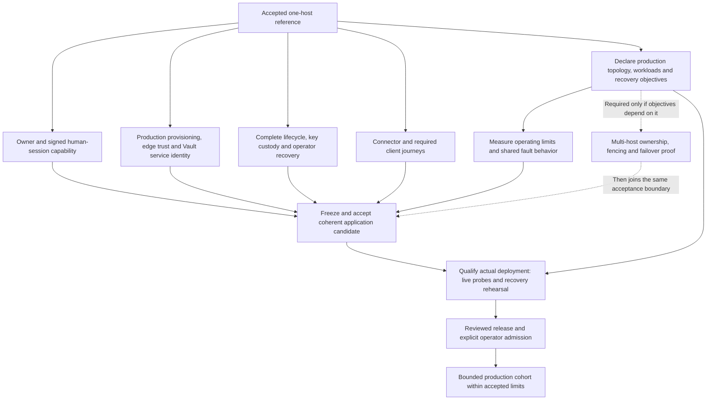

# From accepted one-host preview to production

*Retained contributor-facing planning assessment, captured from alignment
`8ae6f4a3729548de0c88cc0ee5b3c0aede9aba61` on 2026-11-12. Its November 8–10
implementation gaps, recommendations and prior-art observations retain their original scope.
Current production sequencing and closure criteria live in the
[production guide](../../30-design/tenancy/production-critical-path.md); this archive
is not a current blocker list. Body changes are relative-link relocation only.*

*Living contributor-facing decision-preparation guide, 2026-11-08; M6 rows 2026-11-10. This is a
**read-derived** dependency analysis and prior-art survey, not production
acceptance or an adopted topology/SLO decision. Existing requirements retain their
canonical homes in the [release decisions](../../../releases/cgm-remote-monitor-16.0.0/decisions.md),
[owner authority](../../30-design/tenancy/owner-authority.md) and [delivery roadmap](../../30-design/tenancy/multitenant-delivery-roadmap.md).
The [dashboard](../../30-design/tenancy/multitenant-delivery-dashboard.md) owns milestone claims; release
contents and named reports own execution/publication. No application campaign
was run for this guide.*

The [deployment binding and public-name contract](../../30-design/tenancy/deployment-bindings-and-public-names.md)
records the clarified portability, public-access and emergent-load target.
Kubernetes packaging is distinct from adding distributed application ownership.

## The proposed first production boundary

**Recommendation for review:** qualify a bounded deployment with one fixed
cooperating application cohort first, if its declared availability and recovery
objectives permit a host outage and operator-led recovery. Keep the existing
separate API, realtime, evaluator and tenant-admin processes. Define how many
and what kinds of tenants it admits before promising service. This is a proposed
production scope, not a new approval or a waiver of M6.

A production service can have an explicit maintenance/outage budget without
active-active replicas. It still needs safe operation, observable failure,
recoverable data and credentials, and a practiced response. If the required
availability or recovery time cannot tolerate replacement of one host, HA is
part of the first production target and must move onto its critical path.

“One host” here describes the application cohort. Selecting an external or
managed PostgreSQL/Vault service changes dependency and connection behavior;
it does not automatically require distributed application membership, and it
does not inherit failover acceptance from this preview. Declare actual placement
and test dependency reconnection, backend identity and commit uncertainty.

**Already useful:** the [accepted operation-window family](../../../reports/tenancy/operation-window-acceptance-2026-11-07/README.md)
proves bounded one-host restore/history/client convergence and healthy-tenant
continuity, including shared-role restart with another tenant suspended. ed2
cold/client/full, c23 native/browser and 39f4 corpus retain their actual source
attribution. R72/R73 retain the bounded M0–M5 scope. None supplies a production
workload limit, host-loss recovery objective or whole-M6 admission.

## Dependency map

This is a dependency path, not a measured longest-duration schedule: effort,
workload limits and recovery objectives are not yet estimated here. Independent
capability work can proceed together; acceptance joins on a coherent candidate.

The current implementation/admission gap is not another storage-seam prototype.
The owner/OIDC source now has joined acceptance records
([M6a](../../../reports/tenancy/m6a-join-2026-11-09/README.md),
[M6b](../../../reports/tenancy/m6b-join-2026-11-10/b70ad83f-acceptance/README.md));
production trust, lifecycle/recovery, connector/client completion and
operating-envelope work progress alongside. Existing source and acceptance owners remain those in
[release contents](../../../releases/cgm-remote-monitor-16.0.0/contents.md);
this map does not redispatch their lanes.

## What blocks the path, and what closes it

Rows summarize canonical criteria rather than adding queue claims. “Required”
below means required by the current milestone or production contract; proposed
operating procedures and numeric objectives still need operator agreement.
Every claimed closure needs source/image and instrument pins, actual commands,
independent outcomes, meaningful failure controls and restoration. A skipped or
pending case remains UNMEASURED.

| Boundary / prerequisite | Gap that blocks the declared scope | Evidence that closes it | Canonical home / integration owner |
|---|---|---|---|
| **Production envelope** — measured before limits are set | No measured workload, availability, freshness or recovery figures exist yet. A synthetic functional pass does not define tenant capacity. | Benchmark the reference at stepped tenant counts with a hot tenant and publish the numbers; contrast against N single-tenant processes and the per-site model at equal synthetic load; prove component-wise horizontal/vertical scaling with a binding inventory. Then agree recovery time and acceptable loss from the measurements and use them as thresholds ([decision 2026-11-09](../../../releases/cgm-remote-monitor-16.0.0/decisions.md#m7-envelope-measured-not-declared)). | `MT-BENCH-BASELINE`, `MT-BENCH-CONTRAST`, `MT-SCALE-UNBOUND`; measurement owner, coordinator schedules the windows. |
| **Human identity and owner authority** — M6a | The disposable-harness OIDC matrix and the joined suites pass on the M6a and M6b candidates ([M6b record](../../../reports/tenancy/m6b-join-2026-11-10/b70ad83f-acceptance/README.md)); real identity-provider interoperability is synthetic only. Wider adopted settings/threshold/credential consumers still need their actual acceptance. | Real generic-adapter provider login/renewal/logout/outage over HTTPS with synthetic people; Mongo/PG enabled/disabled parity; current tenant membership/key/session and next-operation revocation across HTTP/streams/workers; management freshness and renewal races; legacy clients unchanged; actual owner settings consumed by API/evaluator/realtime. Authentik must pass the adopted reference proof or use the measured fallback direction. | [Owner authority](../../30-design/tenancy/owner-authority.md), [current decision index](../../30-design/tenancy/m5-m6-decision-list.md), [source capability record](../../../reports/tenancy/shared-oidc-sessions-2026-11-07/README.md); current combined source/acceptance owners. |
| **Production provisioning, ingress and secrets** — required before production use | Demo bootstrap seeds synthetic tenants and restricts its database; it is not a general production provisioner. Peer/client-IP trust unification and production Vault login/renewal/custody need implementation or live acceptance. | Explicit operator provisioning and append-only migrations with effective grants/RLS/read-only readiness; safe partial-failure refusal and retry/inspection. Real TLS edge tests for host/selector conflict, spoof, unknown tenant, sockets, client IP and private owner/operator/database reachability. Vault Agent sidecar auto-auth (one AppRole per deployment), token-file renewal/expiry/revocation, seal/outage, CA verification/rotation and recoverable unseal custody. Wrong or missing authority refuses without fallback. | [Deployment/trust decisions](../../../releases/cgm-remote-monitor-16.0.0/decisions.md#m6-deployment-and-trust-2026-11-07), [Vault Agent sidecar](../../../releases/cgm-remote-monitor-16.0.0/decisions.md#vault-agent-sidecar), [deploy-tree home](../../../releases/cgm-remote-monitor-16.0.0/decisions.md#deploy-tree-home-now) (`DEPLOY-VAULT-AGENT` in `nightscout-deploy`, `MT-VAULT-TOKEN-FILE` in core), [ed2 credential inventory](https://github.com/nightscout/cgm-remote-monitor/blob/ed2ced00c80bd0a6a7d75f834d2c6e2af8c71364/deploy/multitenant/CREDENTIALS.md); source integration + deployment operator. |
| **Lifecycle, keys and recovery** — M6b plus actual deployment recovery | Bounded restore is accepted; key retention/destruction and operator-assisted ownership are in the M6b joined acceptance, while ownership in a serving role, the production key custodian and recoverable operation after unresolved suspension remain open. Fail-closed is safe refusal, not demonstrated eventual recovery. | Actual provision/pause/suspend/export/delete/ownership flows with race and current-authority controls, including the adopted [activity policy](../../../releases/cgm-remote-monitor-16.0.0/decisions.md#activity-is-pause-suspend), [restore census](../../../releases/cgm-remote-monitor-16.0.0/decisions.md#restore-census-and-ownership-phase) and [export removal at key destruction](../../../releases/cgm-remote-monitor-16.0.0/decisions.md#key-destruction-removes-export); artifact/key-reference fidelity, cancellation vs execution, recovery within retention and destruction/after-window refusal. Rehearse interrupted restore/upgrade, lost acknowledgements, participant death and host/dependency replacement using supported operator procedures. Verify A state/history and independent B state. Record when recovery must stop; never clear orphans or replay uncertain activation blindly. | [M6 acceptance families](../../30-design/tenancy/multitenant-delivery-roadmap.md#m5m6-acceptance-families), [recovery guide](../../30-design/tenancy/deployment-and-rig-testing.md#credential-and-recovery-boundaries); lifecycle/source owner + operator. |
| **Connector and client journeys** — adopted preview scope | The outbound pull against a tenant has a [Docker lab measurement](../../../reports/tenancy/connector-sync-2026-11-10/README.md) (entries only); cadence, token refresh, real ingress, the tenant-side connector role and relevant client/device cases remain open. | Existing single-site connector pulls with a pre-issued tenant reader first, with independent stored/history outcomes and retry/revocation checks. Tenant-side inbound connector uses the adopted tenant-bound API/secrets/egress contract before claiming that direction. Complete retained Android requirement and the declared supported-client/rig checks; name iOS/all-client exclusions. Any scope reduction needs an explicit decision. | [First external channel](../../../releases/cgm-remote-monitor-16.0.0/decisions.md#first-preview-no-push-provider), [roadmap](../../30-design/tenancy/multitenant-delivery-roadmap.md); connector/client owner, coordinated into final candidate. |
| **Measured operating behavior** — after envelope declaration, on representative inputs | No production capacity/freshness/recovery budget follows from existing functional campaigns. Shared roles/pool/database create interference paths. | Quiet steady-state and burst/soak evidence with independent stored-state oracle: hot tenant alongside healthy tenants, large history, evaluator backlog, reconnect flood, slow/down dependencies, restores/upgrades, disk/backup growth and egress refusal. Measure latency tails, freshness, pool/lock/memory costs and recovery against agreed bounds. Verify limits shed/refuse work while preserving other tenants and authorized effects. | [Experiment contract](../../30-design/tenancy/durable-event-delivery-contract-2026-11-06.md#11-maintainer-acceptance-and-experiments); operations/measurement owner and acceptance coordinator. |
| **Coherent release and deployment admission** — join the preceding rows | A collection of source slices, or the old ed2 campaign, cannot qualify a changed production candidate. M6 promotion, release and deployment trust are separate decisions. | Frozen joined candidate with applicable full/default-browser/enabled-corpus/client/native acceptance and final prcheck; exact pending/unsupported inventory and controls. Then actual deployment trust record plus live spoof/conflict/outage probes, backup restore/recovery rehearsal, observable service failures and operator response. Reviewed release/rollback and explicit real-data/identity/role admission precede the production cohort. | [Batching rules](../../30-design/tenancy/multitenant-integration-batching-plan-2026-11-06.md#3-batch-rules), [deployment admission](../../../releases/cgm-remote-monitor-16.0.0/decisions.md#deployment-admission-probes-and-trust-record), release records; coordinator, maintainer and deployment operator. |

The production deployment must establish custody/private ingress and the
declared cooperative application roster under the
[exclusive application ownership contract](../../../releases/cgm-remote-monitor-16.0.0/decisions.md#exclusive-application-postgres-ownership).
External direct SQL writers are unsupported and their effects are undefined
behavior; arbitrary-writer exclusion is not an admission gate for this supported
topology. Every supported internal participant must still follow its authority,
write and lifecycle contracts. A current-session census is diagnostic, not proof
of credential custody or complete participant registration. The existing
[separate-process decision](../../../releases/cgm-remote-monitor-16.0.0/decisions.md#restore-service-processes)
does not require inventing a stronger database fence merely to keep processes
separate. Transaction pooling is outside the accepted reference.

Monitoring and runbooks should expose tenant unavailable/suspended state, evaluator
and data freshness, failed renewals, dependency failures, pool/disk pressure and
backup/recovery outcomes without logging credentials or clinical data. This is
proposed operating coverage for the declared service, not a claim that the current
preview already supplies an admitted operations console.

## Multi-host and HA work that can wait

Deferral is conditional on the chosen first-production objectives. These are later
capabilities, not prerequisites invented for the fixed one-host reference.

| Work | Can wait when | Required before widening the topology |
|---|---|---|
| Autoscaling/dynamic application membership | A fixed deployment meets placement, restart and operating limits. Kubernetes/Jsonnet may already package that fixed deployment. | Explicit membership, producer fencing, resource ownership and safe scale-down. See the [binding contract](../../30-design/tenancy/deployment-bindings-and-public-names.md#what-a-kubernetes-binding-must-preserve) for packaging equivalence. |
| Dynamic API membership | A fixed declared API roster meets workload and outage objectives; API request serving need not be singleton. | Every replica participates in current authority, drain/invalidation and replacement acceptance; dynamic membership must serialize admission/removal with maintenance. A load-balanced API destination and per-instance control endpoints serve different purposes. See [API scaling and endpoint contracts](../../30-design/tenancy/deployment-bindings-and-public-names.md#configurable-transports-and-independently-scaled-api). |
| Replicated realtime/evaluator workloads | The admitted runtime meets workload and outage objectives. | Realtime connection affinity/fanout and consumer state, plus evaluator/notification producer ownership and duplicate/missed work controls. A checkpoint lock is not a distributed producer lease; these requirements are distinct from ordinary API replication. |
| Cross-host restore and dynamic participant discovery | The complete trusted roster and private same-host transport remain fixed. | Authenticated cross-host transport, complete membership/incarnation agreement, partition/late-join refusal, draining and invalidation acknowledgements across all actual participants. |
| Automatic host failover or regional failover | Operator-led recovery fits accepted recovery time/data-loss limits. | Split-ownership exclusion, dependency failover/commit uncertainty, restored key custody, stale routing/producer refusal and measured recovery. Backups and restoration practice remain required now. |
| Transaction-pooling proxies | Direct database connections fit the admitted envelope. | Re-prove backend identity, transaction binding, RLS, operation lifetime and recovery under the proxy; the reference currently refuses this topology. |
| Alternative secrets providers, universal result-publication service and every-transition event recovery | The adopted Vault/polling/snapshot reference meets the declared feature and operating scope. | Their own interface/compatibility/recovery proofs; no current requirement selects them to achieve HA. |

Live push providers, self-service ownership transfer and a new first-party owner UI
remain separately scoped under existing decisions. The clarified public-name target
includes explicit anonymous/authenticated access and group policy; schedule-specific
semantics and their first-production scope require a bounded decision and acceptance
in the [public-name contract](../../30-design/tenancy/deployment-bindings-and-public-names.md#authenticated-sharing-and-group-policies). Deferring HA does not defer signed human/owner acceptance,
key custody, safe upgrades/recovery, current authority or an operating envelope.

Growing through several independently admitted deployments is another possible
step before distributing one cohort. It needs durable tenant-to-deployment routing
and an admitted cutover/migration ceremony; it is an option for review, not an
adopted cell architecture or proof of cross-deployment mobility.

## Prior art from the existing projects

These are **read-derived source mechanisms**, inspected from tracked local HEADs;
no services/tests or existing provider deployments were exercised. Source links
are commit-pinned. No old timing, resource count or operational success claim is
transferred to this production path. Existing private env/log/data files were
outside the survey. The WWW working copy has a pre-existing invitations edit;
its citations below use the committed version only.

| Project / inspected source | Experience worth carrying forward | Re-proof needed for shared multitenant production |
|---|---|---|
| **node-multienv**, `2602c94ee2f9ceefc886907f1df63ef2e172daf4`: [storage before compute activation](https://github.com/bewest/node-multienv/blob/2602c94ee2f9ceefc886907f1df63ef2e172daf4/cmd/webhook/handlers/tenant-composite-sync.js#L627), [desired-input hash](https://github.com/bewest/node-multienv/blob/2602c94ee2f9ceefc886907f1df63ef2e172daf4/cmd/webhook/handlers/tenant-composite-sync.js#L730) | Separate provisioned resources, initialized state and serving admission; record intended generation and convergence. This can shape the production operator lifecycle without requiring Kubernetes. | Admit a tenant inside existing shared processes rather than equating activation with Pod creation. Bind readiness to current schema/roles/credentials; a desired-state hash does not fence in-flight operations or stale producers. |
| Same source: [final snapshot ceremony](https://github.com/bewest/node-multienv/blob/2602c94ee2f9ceefc886907f1df63ef2e172daf4/cmd/webhook/handlers/decorator-finalize.js#L15) | Keep data lifetime distinct from compute lifetime; make deletion/capture an explicit policy and observable state transition. | Snapshot readiness alone does not establish logical fidelity or recoverable keys. A shared physical PG backup includes other tenants; tenant-local restore/deletion needs its own contract. |
| Same source: [resource discovery](https://github.com/bewest/node-multienv/blob/2602c94ee2f9ceefc886907f1df63ef2e172daf4/cmd/webhook/handlers/tenant-composite-customize.js#L27) | Prior operating experience with per-tenant workloads informs controller/object/watch/rollout cost and ownership inventories. | A fleet of independent processes/databases and shared RLS roles have different failure and resource boundaries. Measure shared-pool/process interference afresh; do not import an old tenant-count limit. |
| **nightscout-roles-gateway**, `90840acee1ec641d881512e91f1728f7ed8f7817`: [name registry](https://github.com/t1pal/nightscout-roles-gateway/blob/90840acee1ec641d881512e91f1728f7ed8f7817/lib/policies/index.js#L33), [edge decision chain](https://github.com/t1pal/nightscout-roles-gateway/blob/90840acee1ec641d881512e91f1728f7ed8f7817/lib/routes.js#L327) | Public routing, registered upstreams and policy decisions are distinct responsibilities. Use this experience to specify alias changes, unknown/suspended-site behavior, socket forwarding and edge outage probes. | This fronts separate Nightscout upstreams. An edge identity assertion or upstream selection does not supply shared clinical RLS, current tenant grants or the restore protocol. Keep operator unreachability and owner authentication explicit. |
| Same source: [active policy joined to membership](https://github.com/t1pal/nightscout-roles-gateway/blob/90840acee1ec641d881512e91f1728f7ed8f7817/lib/policies/index.js#L150), [weekly schedules](https://github.com/t1pal/nightscout-roles-gateway/blob/90840acee1ec641d881512e91f1728f7ed8f7817/migrations/20220516233454_add_filter_only_active_schedule_segments.js#L8), [upstream token broker](https://github.com/t1pal/nightscout-roles-gateway/blob/90840acee1ec641d881512e91f1728f7ed8f7817/lib/tokens/index.js#L11) | Authenticate a person separately from membership, permission and a site's native device credential. Care-group/schedule journeys are concrete future delegation requirements. | Current owner/data audiences, delegation ceilings, tenant/principal/key/session-scoped caches, expiry/revocation and long-lived stream behavior need current contracts and controls. Weekly schedule logic is not full delegated-authority acceptance. Avoid expanding first production to every gateway feature. |
| **nightscout-gateway-www**, `67cbe4660a96ca776c3f5f8092efaa549089d9a3`: [joined sites and invitations](https://github.com/t1pal/nightscout-gateway-www/blob/67cbe4660a96ca776c3f5f8092efaa549089d9a3/lib/dashboard.js#L20), [consent/join](https://github.com/t1pal/nightscout-gateway-www/blob/67cbe4660a96ca776c3f5f8092efaa549089d9a3/lib/hydra.js#L263), [group exit](https://github.com/t1pal/nightscout-gateway-www/blob/67cbe4660a96ca776c3f5f8092efaa549089d9a3/lib/groups.js#L41) | Reuse the user journeys and vocabulary: what sites I own/can visit, why I have access, what I consent to, how I leave. A UI can become an adapter over the headless owner API after its behavior is accepted. | Neither login success nor account deletion proves tenant ownership transfer, credential revocation, clinical deletion/retention or production session custody. Use the adopted generic OIDC/current-authority contract. A first-party owner UI remains deferred. |

The useful inheritance is **operational scenarios, state transitions, authority
boundaries and user journeys**. Reusing an old gateway's implementation wholesale
would also import its provider coupling, session/cache/lifecycle assumptions and
separate-upstream model. Those assumptions require review and acceptance before
any implementation reuse. This survey provides no security or production sign-off
for the older projects.

## Where provider experience changes the decisions

Provider experience is most valuable before choosing an envelope and while
defining failure controls. The source survey cannot establish what happened in
an actual service; incident frequency, customer workloads and support burden
remain unmeasured here until supplied and characterized. Use aggregate/synthetic
cases, without tenant identifiers, credentials or glucose traces.

| Experience to extract | Decision it informs | Concrete output for acceptance |
|---|---|---|
| Typical and busiest active sites, uploaders, history sizes and reconnect storms | Shared-process density, pool/scan limits and admission capacity | Representative workload families and a hot-tenant interference benchmark; no invented uniform “tenant” unit. |
| Worst common-mode outage: edge, identity, database, storage, secrets or controller | First production fault domain; whether one host/manual recovery meets expectations | Dependency/fault map and one synthetic failure/recovery drill per shared dependency; agreed outage and recovery objectives. |
| Actual restores, lost keys, expired credentials and upgrades | Custody, backup retention, rollover, operator steps and recovery support | Independently verified restoration rehearsal including ciphertext/key availability, current authority and client history; explicit uncertain-state stop conditions. |
| Alias reuse, tenant movement and partial provisioning | Stable tenant identity, routing publication/cutover and reconcile semantics | Idempotent provision/rename/suspend/cutover scenarios with stale mapping and partial-failure controls. |
| Sharing/revocation incidents and invitation/support journeys | Minimal owner surface and future delegated/group features | Accepted current-owner/session cases now; a bounded future delegation backlog rather than adding every UI feature to production. |
| Upgrade/certificate/credential rotation cadence and on-call capacity | Maintenance policy and whether automation or HA pays for itself | Practiced deployment/rollback/rotation procedure, alert routing, operator handoff and workload-based release checks. |

The proposed direction favors a small qualified topology for maintenance and
backward compatibility, preserves explicit service boundaries for future growth,
and makes reliability/performance claims depend on measurements. Production
placement and any HA deferral remain operator/maintainer decisions once the
workload, recovery objectives and provider experience are available.
