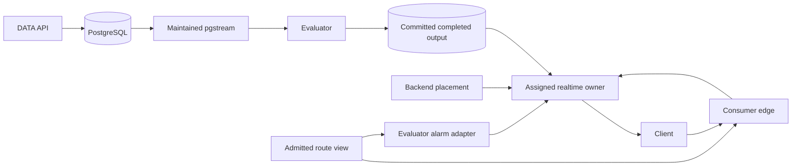

# Realtime sharding, composition and recovery

> Archived from alignment `b8b2b823ca`. This fixed-roster publisher and its controlled-move tests predate static hash ownership. [Current guide](../../30-design/tenancy/realtime-sharding-plan.md).

*Contributor-facing living guide, updated 2026-11-15. **Read-derived** current
source: application `8ddcc01208c11c18145c44c1076ae4c91f79ffa2`, deployment
`23e73da7ad8d57bb0a360c29b3ef2320ed229238`. Fixed-roster realtime sharding and
controlled moves are implemented on local branches. Historical native evidence
keeps its exact source below; it does not qualify this later candidate or prove
horizontal capacity. Queue home: `MT-REALTIME-SHARDING`. The
[runtime topology](pgstream-topology-2026-11-16.md) owns current composition; the
[release contents](../../../releases/cgm-remote-monitor-16.0.0/contents.md) own
joined qualification and publication state.*

## Implemented boundary

Each tenant has one admitted realtime owner for connections, projection work and
notification handoff. Stable logical shards group tenants. A separate versioned
map places those shards on workers. Changing worker count does not change the
logical shard count. Evaluator assignment remains independent.

The ordinary deployment uses one realtime process when placement is unselected.
The optional fixed-roster binding renders realtime workers, their private
addresses, backend assignment, admitted routes, edge routing and lifecycle
participants together. Selecting more workers supplies this composition; capacity
and a particular platform binding still require measurement.

Realtime now consumes committed evaluator output and builds its client projection
and frames. The old description of two independent clinical acquisition paths is
superseded by the [maintained communication contract](pgstream-communication-2026-11-16.md).
A completed acquisition, committed output, client frame and notification handoff
remain different outcomes.

| Component | Responsibility and source home |
|---|---|
| Placement reader | Validates fixed workers, logical shards, assignment tokens and monotonic map changes. `lib/realtime-placement/index.js`. |
| Owner resource | Holds an actual datastore resource for the stable consumer and selected worker/assignment contract. Loss revokes work. `lib/realtime-placement/owner.js`. |
| Realtime runtime | Selects assigned registry tenants, stages warm state privately and checks current ownership, activity and settings before activation and effects. `lib/server/serve/preview-realtime.js` and `lib/server/realtime/runtime.js`. |
| Publisher and maintenance | Serializes controlled publication against a pinned maintenance cohort, excludes old owners and preserves uncertain outcomes. `lib/realtime-placement/publish.js`, `publication-lock.js` and the operation cohort. |
| Deployment binding | Expands the actual worker roster, operation configurations and consumer edge from one selection. Deployment `bindings/compose/multitenant/realtime-workers.js`. |

The exact fields, owner-key versions, private contract versions and publisher
callbacks live in core `lib/realtime-placement/README.md`. Consumers must use the
matching core/deployment contract rather than copy a map or transport schema.

## Logical roles and process placement

REST v1/v2/v3 are one logical request-serving component. Each real replica still
owns pools and in-flight operations and participates in maintenance. Realtime
owns live connections and process-local projection state; its durable checkpoints
remain in PostgreSQL. A replacement reconstructs current state and clients
establish new sessions. Evaluator receipts, completed output and current ownership
also survive independently of its process-local working state.

These responsibilities do not select a Kubernetes workload kind. A platform
binding must map every declared worker to actual process identity, private
addresses and consumer routes, prove old-owner exclusion and wait for target
readiness. An ordinal or assignment UUID alone proves none of those conditions.
The existing evidence below covers its declared native/Compose bindings; it does
not establish a Kubernetes or multi-host deployment.

Co-location remains a deployment choice. Separate role contexts and ownership
must survive shared processes or Pods, and clinical scheduling must retain its
budget under viewer load. Starting identical realtime configurations behind a
load balancer does not create admitted ownership or complete notification routing.

## Placement, routing and durable state

The backend placement view describes intended ownership. A separate admitted
route view serves the edge and evaluator alarm adapter. Backend/cohort readers
use the authoritative assignment; publishing a consumer route does not change
maintenance coverage or make a cold owner ready.

A tenant is selected by canonical tenant identity. Fixed worker destinations are
validated private instance addresses, not client-selected URLs. Polling,
WebSocket upgrades and main/storage/alarm namespaces retain process affinity for
a live connection. Backend admission checks current assignment and authority;
the route map grants no client permissions.

A realtime owner retains the stable durable consumer identity across restarts
and moves. The actual held owner resource, assignment contract and fresh process
observation are distinct from a reusable worker name. Supported owner-key versions
have explicit compatibility rules; a binding must select the same version in its
runtime, routes and cohort.

Registry admission and placement changes can stage new assigned tenants. Cold or
failed preparation stays outside healthy scheduling until current activity,
settings, membership and ownership checks pass. Empty and all-deferred workers
remain inspectable. Paused or suspended tenants do not gain fabricated clinical
progress merely because their worker is live.

## Controlled moves and failure recovery

The implemented publisher supports controlled fixed-roster moves and consumes
independently confirmed old-owner exclusion during recovery. Its sequence is:

1. Hold the publication fence and validate the actual prior map, complete registry
   revision and affected tenant operation windows. A pinned restore excludes a
   conflicting move.
2. Stop and drain affected old owners through the trusted platform callback.
   Verify exact old-process termination or effective fencing. Route removal,
   connection loss and lease age alone do not establish exclusion.
3. Publish the next backend generation, start the declared replacement and warm
   its actual assigned state while retaining the fence.
4. Wait for eligible target readiness, then publish matching consumer/alarm
   routes and commit. Clients reconnect, reauthorize and recover current state.

Unchanged shards can continue while a target warms. A cold target refuses
connections and alarm effects. A failed or partly published move retains
uncertainty; recovery uses a fresh admitted generation. It does not restore an
old map, stopped incarnation or checkpoint to simulate rollback success.

If the old owner may still be alive, the affected shard remains unavailable.
Automatic takeover under an ambiguous partition needs a separate effective-fence
contract and adversarial proof. Process termination cannot recall bytes already
sent to a socket.

The source cohort supports realtime tenant subsets alongside full API coverage.
It includes real idle and draining workers, pins the placement revision and checks
actual datastore/backend identity. Missing owners or unknown clinical backends
refuse; a sampled endpoint or self-reported subset does not prove completeness.
Current pause, suspension, deletion and authority checks still apply during moves.

## Client and alarm semantics

A main-namespace full frame recovers current state. Storage subscriptions also
need their supported collection/history reload ordering; an acknowledgement is
not itself that reload. Reconnection does not replay every alarm a device missed.
Alarm handoff acceptance is distinct from confirmation that a device received it.

A move preserves durable notification request/attempt identity. A late old-owner
response belongs to its original attempt. A lost response remains ambiguous;
changing the address does not justify an immediate transparent retry or synthetic
success. Accepted handoffs are not made pending again solely because an owner
moved. Durable per-device replay would be a separate protocol and state capability.

## Evidence and remaining qualification

| Evidence | What it establishes | Limit |
|---|---|---|
| [Focused sharding source/native record](../../../reports/tenancy/realtime-sharding-2026-11-12/README.md) | Original fixed-roster implementation, actual owner-resource exclusion, two-view client/alarm movement, checkpoint continuity, idle/suspended admission, census and meaningful broken/restored controls. | Exact recorded core and fixture sources; its test edge and idle synthetic peers do not qualify a later shipping composition. |
| [Paired native qualification](../../../reports/tenancy/m7-paired-qualification-2026-11-12/final-ff515-cf5-ready/README.md) | Controlled old-boot stop, held cold target, route publication, unaffected B progress, current client state and census on core `ff5156b984424f1ef34bcef22d5bfa0071354cfa` / deploy `cf5bda3f2d189bac5d60269df5644759c40db9e1`. | Historical bounded shipping pair; no later-source, horizontal-capacity, pilot or release claim. |
| [Queue and release records](../../../releases/cgm-remote-monitor-16.0.0/contents.md) | Claimed work state, exact joined candidates and their measured qualification. | A prior pass is not a new-source or new-topology measurement. |

Horizontal capacity, reconnect pressure, a hot tenant, selected co-location and
multi-host failure behavior retain separate workload/resource oracles. Compare
fixed worker configurations with the same logical shard count and routing mode;
state whether aggregate quota grows with worker count. More workers distribute
tenants. One tenant remains bounded by its owner unless a separately qualified
connection-fanout capability is selected.

`MT-SCALE-UNBOUND` consumes the correctness capability for scaling measurements.
It does not replace current-authority, checkpoint, ownership, maintenance,
uncertainty or supported-client gates. Final acceptance applies to the exact
joined application/deployment/image and its declared profile.
