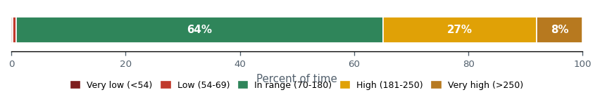
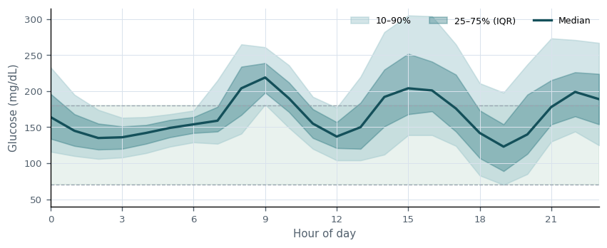
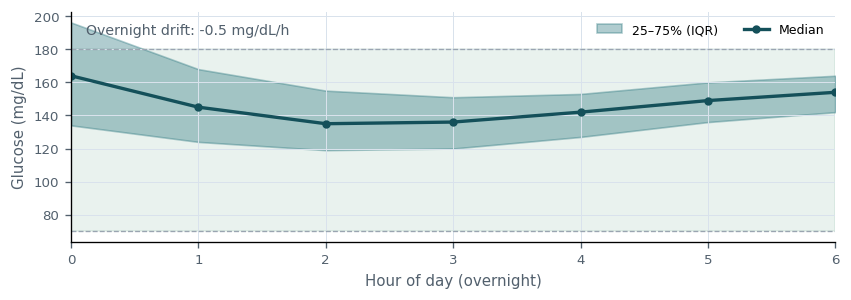
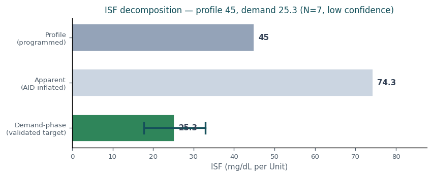
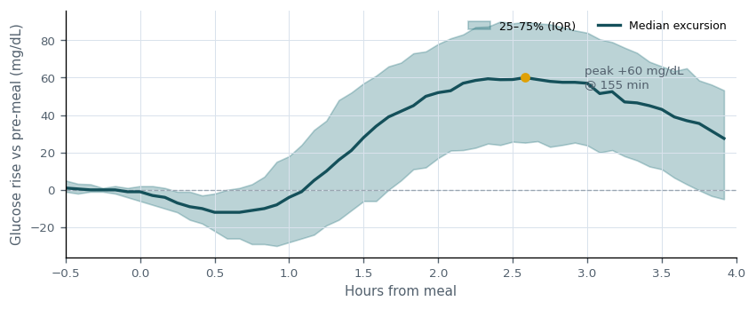

# Synthetic demonstration — Clinical Decision Support — patient `synthetic-demo`

> **Synthetic demonstration data: generated by tools/cgmencode/synthetic_demo_patient.py with seed 20261016; no real person's data. The recommendations show what the prototype produces; they are not advice for anyone.**

_Generated: 2026-10-16T23:07:34.601774+00:00_

## Insulin sufficiency

Overall insulin delivery shows opportunity for improvement (TIR 64%, TBR<70 0.8%, TAR>180 35%). 1 risk(s) identified; 2 parameter change(s) proposed this cycle.

**Main risks:**
- Hyperglycemia burden elevated (TAR>180 34.9% vs target 25%).

**What's working:**
- Hypoglycemia within target (TBR<70 0.8%).
- Glucose variability controlled (CV 31%).

**Time-in-range distribution**

_Share of time in each glycemic band over 25,758 readings. Green is the 70-180 mg/dL target; reds are lows, ambers are highs._

**Ambulatory glucose profile (AGP)**

_Median glucose by time of day with interquartile (25–75%) and 10–90% bands. The green zone is the 70–180 mg/dL target; a flat median inside it is the goal._

## Recommendations

### Basal

**Decision:** CHANGE  
**Summary:** Basal: increase from 0.85 to 0.94 (+11%).

| Field | Value |
|---|---|
| Current | 0.85 |
| Practical (implement now) | 0.94 (+11%) |
| Time block | 06:00–12:00 |
| Confidence | 0.71 |

**Justification:** Basal increase: implement the practical step 0.85 -> 0.94 (+11%) now. Theoretical optimum is 0.94 (+11%); the practical step honors a safe titration cap of 20% per cycle. This derives from a validated deconfounded estimate (the controller-masking confound is already removed), so it is not down-weighted for controller masking. Increase basal by 10% during morning (6:00-12:00). This is a narrow deconfounded step: inferred-meal windows are excluded, Loop is consistently adding basal, and TBR is below 4%. Use the 2-week TBR guardrail before considering another step.

**Expected outcomes (2-week):**

| Metric | Baseline | Expected | Direction |
|---|---|---|---|
| TIR | 64.3% | 65.3% | increase |
| TBR<70 | 0.77% | 0.77% | stable |
| TAR>180 | 34.9% | 33.9% | decrease |

**Overnight glucose profile (00:00–06:00)**

_Median overnight glucose with IQR. A rising trend suggests basal is too low; a falling trend suggests it is too high. Used to contextualize the basal recommendation._

**Scheduled vs actual basal**

_Median programmed basal vs what the loop actually delivered by hour. Persistent loop deviation indicates the scheduled rate is mismatched in that direction._

**Success criteria** (revisit in 14 days):
- TIR improves by at least +0.5 pp toward the projected 65% within 2 weeks.
- TBR<70 does not worsen by more than 1 pp.

**Stop / escalate criteria:**
- TBR<70 increases by more than 1 pp after the Basal change -> revert and escalate.
- Severe hypoglycemia (TBR<54) emerges -> revert immediately.
- No measurable TIR improvement at 2 weeks -> reassess direction.

### ISF

**Decision:** NO CHANGE  
**Hold reason:** insufficient_evidence  
**Summary:** ISF: no change recommended (insufficient evidence (confidence 0.35 below 0.50)).

**Justification:** ISF reviewed: a directional signal exists (theoretical target 25.3) but is held due to insufficient evidence (confidence 0.35 below 0.50). Re-evaluate at the next review.

**Expected outcomes (2-week):**

| Metric | Baseline | Expected | Direction |
|---|---|---|---|
| TIR | 64.3% | 64.3% | stable |
| TBR<70 | 0.77% | 0.77% | stable |
| TAR>180 | 34.9% | 34.9% | stable |

**Demand-phase ISF decomposition**

_Profile ISF vs the apparent/correction ISF (amplified by AID compensation) vs the demand-phase ISF — the validated 0–2h insulin effect (EXP-2651) and the true target, shown with its 95% confidence interval. The apparent value is not the target; the recommendation tracks the demand-phase value, bounded by a safety margin (EXP-2738)._

**ISF reconciliation (profile vs observed)**

_Profile ISF vs the correction-derived (observed/apparent) ISF. The observed value is amplified by AID compensation (basal suspension during corrections), so it is NOT a direct ISF target: the recommendation deliberately preserves the controller's residual safety margin (EXP-2738) rather than chasing the apparent value. Separately, a lower effective ISF for large single corrections is dose-shaping guidance (split the dose), not a baseline schedule change._

**Success criteria** (revisit in 14 days):
- ISF held: glycemic metrics remain within tolerance of baseline over the 2-week window.
- No new hypoglycemia signal (TBR<70 stays below 4%).

**Stop / escalate criteria:**
- TBR<70 rises by more than 1 pp -> escalate review.
- TIR declines materially -> re-open ISF for change.

### Carb ratio

**Decision:** CHANGE  
**Summary:** Carb ratio: decrease from 10.5 to 9.7 (-8%).

| Field | Value |
|---|---|
| Current | 10.5 |
| Practical (implement now) | 9.7 (-8%) |
| Time block | 00:00–24:00 |
| Confidence | 0.50 |

**Justification:** Carb ratio decrease: implement the practical step 10.5 -> 9.7 (-8%) now. Theoretical optimum is 9.7 (-8%); the practical step honors a safe titration cap of 20% per cycle. Decrease morning CR from 10.5 to 9.7 g/U (7% more insulin). Mean post-meal excursion is 55 mg/dL.

**Expected outcomes (2-week):**

| Metric | Baseline | Expected | Direction |
|---|---|---|---|
| TIR | 64.3% | 56.3% | decrease |
| TBR<70 | 0.77% | 0.77% | stable |
| TAR>180 | 34.9% | 42.9% | stable |

**Post-meal glucose excursion**

_Median glucose rise after 189 carb-counted, bolused meals (peak +60 mg/dL at 155 min; +28 mg/dL vs baseline at 4 h). Recommendation: decrease carb ratio 10.5→9.7 g/U to tighten meal coverage and lower these peaks._

**Success criteria** (revisit in 14 days):
- TIR improves by at least -4.0 pp toward the projected 56% within 2 weeks.
- TBR<70 does not worsen by more than 1 pp.

**Stop / escalate criteria:**
- TBR<70 increases by more than 1 pp after the Carb ratio change -> revert and escalate.
- Severe hypoglycemia (TBR<54) emerges -> revert immediately.
- No measurable TIR improvement at 2 weeks -> reassess direction.

## Overall justification

Practical changes this cycle: Basal 0.85->0.94; Carb ratio 10.5->9.7. Each practical step is the safe-titration projection of a larger theoretical optimum (documented in the addenda). Held/deferred: ISF (insufficient_evidence).

## Addenda

- Factors considered: time-in-range distribution, hypo/hyper burden, glycemic variability, per-parameter advisory evidence, and cross-parameter sequencing.
- Basal theoretical optimum: 0.94 (+11% vs current 0.85); practical step capped at 20%/cycle -> 0.94.
- ISF theoretical optimum: 25.3 (-44% vs current 45); held this cycle.
- Carb ratio theoretical optimum: 9.7 (-8% vs current 10.5); practical step capped at 20%/cycle -> 9.7.
- Risks reviewed and mitigated: Hyperglycemia burden elevated (TAR>180 34.9% vs target 25%).
- Deconfounding applied: Basal recommendation(s) derive from validated deconfounded estimates (e.g. demand-phase ISF EXP-2651, correction-denominator/bilateral EXP-2741, deconfounded basal EXP-3447). The controller-masking confidence penalty does not apply to these, improving accuracy without removing the controller's residual safety margin (EXP-2738).
- Mitigations: changes are bounded by a per-cycle titration cap; carb ratio is sequenced after basal/ISF to avoid confounded adjustment; explicit stop/escalate criteria accompany every recommendation for the 2-week feedback loop.
- Dose-shaping guidance (ISF, NOT a baseline schedule change): Correction doses above 1.5U show diminishing returns. At 4.1U, each unit achieves only 13 mg/dL drop vs 45 mg/dL at 1U. Consider: (1) splitting large corrections into smaller doses spaced 30+ min apart, (2) using ISF=13 for doses ≥4U. This is a pharmacokinetic property (β=0.9), not circadian. This describes a dose-conditional effective value for large corrections; prefer splitting large corrections over altering the baseline ISF schedule.
