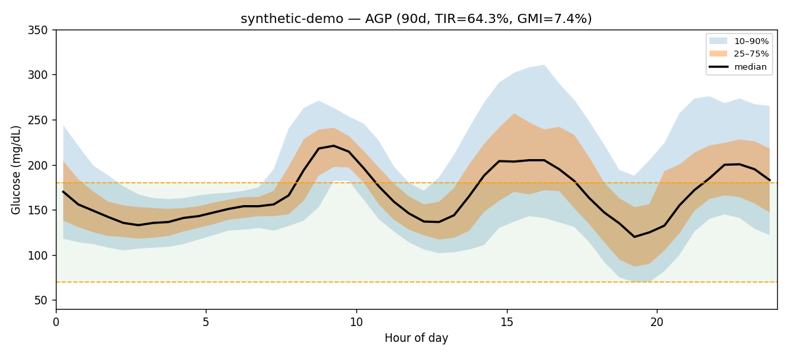
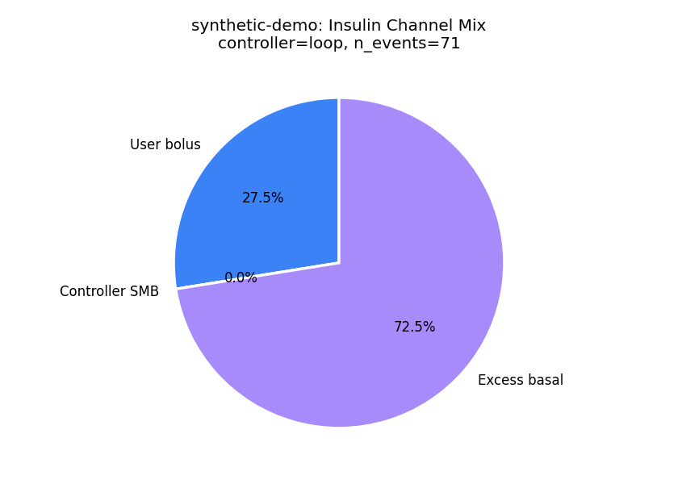
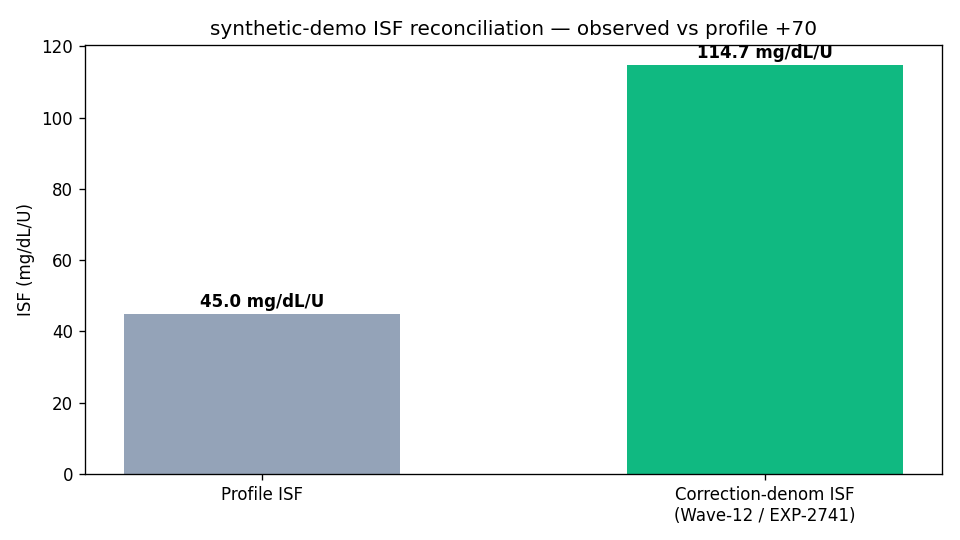
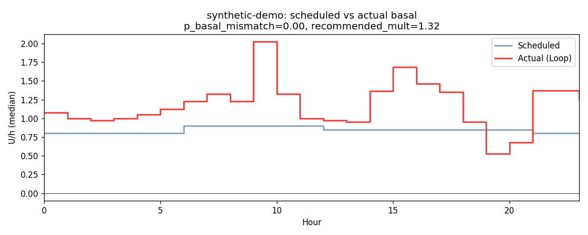
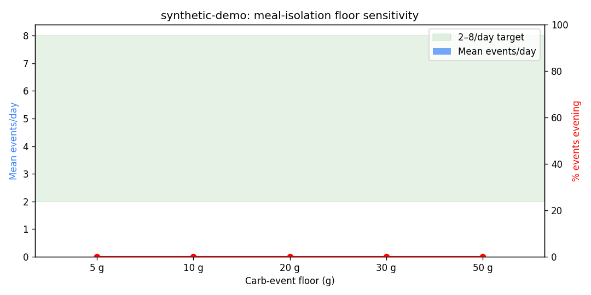
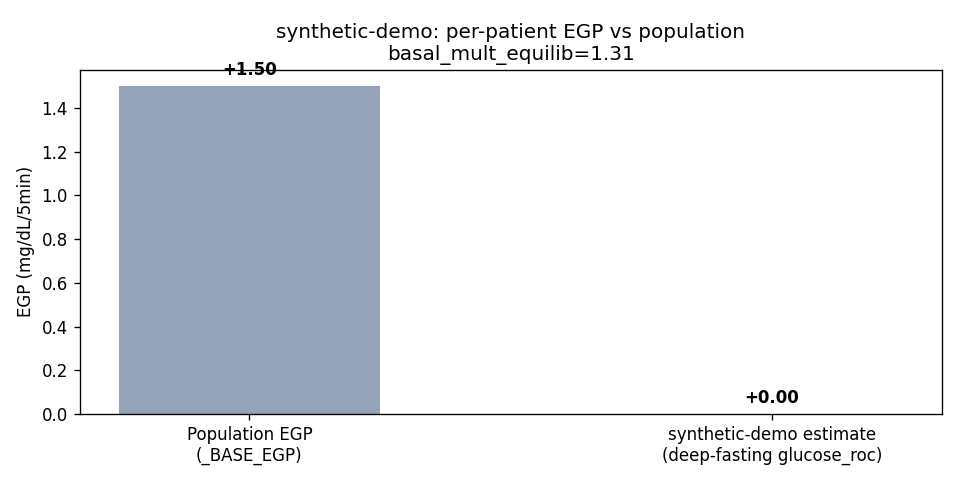

# Synthetic demonstration — Clinical Analysis Report — patient `synthetic-demo`

> **Synthetic demonstration data: generated by tools/cgmencode/synthetic_demo_patient.py with seed 20261016; no real person's data. The recommendations show what the prototype produces; they are not advice for anyone.**

_Generated: 2026-10-16T23:07:34.593897+00:00_  
_Source parquet: `externals/synthetic-demo/parquet`_  
_Profile timezone: `Etc/UTC`_  
_Days of data: 90.0_

## 1. Glycemic summary

| Metric | Value |
|---|---|
| Mean glucose (mg/dL) | 170.5 |
| GMI / eA1c (%) | 7.39 |
| TIR 70–180 (%) | 64.3 |
| TBR <70 (%) | 0.77 |
| TBR <54 (%) | 0.19 |
| TAR >180 (%) | 34.9 |
| TAR >250 (%) | 8.01 |
| CV (%) | 31.5 |
| n readings | 25,758 |

## 2. Per-patient EGP (read-only)

- Method: EXP-2739 fasting-drift, deep-fasting subset
- Patient glucose_roc (low-IOB fasting): **0.000** mg/dL/5min  (population _BASE_EGP=1.50)
- Controller basal multiplier in equilibrium: **1.31**
- Sample size: 4,079 deep-fasting rows, 828 equilibrium rows

## 3. Meal-isolation smell test

_Source: inferred meals from the production residual+insulin spectral detector (logged-carb input is treated as an unreliable prior). Logged column is shown for comparison only._

| Floor | Inferred events/day | Logged events/day | Target band | In band? |
|---|---|---|---|---|
| ≥5g | 0.00 | 3.47 | 2.0–10.0 | ❌ |
| ≥10g | 0.00 | 3.47 | 2.0–10.0 | ❌ |
| ≥20g | 0.00 | 3.09 | 2.0–8.0 | ❌ |
| ≥30g | 0.00 | 2.58 | 2.0–6.0 | ❌ |
| ≥50g | 0.00 | 1.64 | 1.0–3.0 | ❌ |

## 4. Meal-logging QC

- Flag: **insufficient_data**
- Logged: 312 (3.47/day)
- Inferred (rises): 0 (0.00/day)

## 4a. Wave-13 facts (read-only)

**Controller dynamics (EXP-2753)**

| Field | Value |
|---|---|
| controller_type | loop |
| n_events | 71 |
| mean_correction_fraction | 0.275 |
| mean_smb_fraction | 0.000 |
| corr_denom_gap_closure | -8.73 |
| isf_profile_median | 45 |
| isf_corr_denom_median | 115 |

**Basal mismatch (EXP-2869)**

| Field | Value |
|---|---|
| p_basal_mismatch | 0.00 |
| median_recommended_mult | 1.32 |

**ISF gap (EXP-2861)**

| Field | Value |
|---|---|
| p_isf_under_correction | 0.00 |
| p_isf_over_correction | 1.00 |

**Phenotype**

| Field | Value |
|---|---|
| stack_score | 5.000 |
| brake_ratio | 0.065 |
| counter_reg_intercept | None |
| beta_nadir | None |
| p_haaf | None |
| evening_bolus_excess_4h | None |
| evening_iob_at_descent | None |
| controller_lineage | loop |

## 5. Recommendations

### Rec 1: hypo_alert (priority 1), predicted TIR Δ +2.0 pp
- Hypoglycemia risk: 33% probability within 120 minutes (est. 105 min). Consider reducing insulin or taking carbs. Over-correction pattern detected — consider reducing correction dose or extending pre-bolus timing.

### Rec 2: adjust_cr (priority 2), predicted TIR Δ -8.0 pp
- Decrease morning CR from 10.5 to 9.7 g/U (7% more insulin). Mean post-meal excursion is 55 mg/dL.
- Settings change: **cr** decrease 10.5 → 9.7 (+14 %)
- Rationale: Decrease morning CR from 10.5 to 9.7 g/U (7% more insulin). Mean post-meal excursion is 55 mg/dL.

### Rec 3: adjust_isf (priority 2), predicted TIR Δ +5.1 pp
- Correction doses above 1.5U show diminishing returns. At 4.1U, each unit achieves only 13 mg/dL drop vs 45 mg/dL at 1U. Consider: (1) splitting large corrections into smaller doses spaced 30+ min apart, (2) using ISF=13 for doses ≥4U. This is a pharmacokinetic property (β=0.9), not circadian.
- Settings change: **isf** decrease 45.0 → 13.0 (+25 %)
- Rationale: Correction doses above 1.5U show diminishing returns. At 4.1U, each unit achieves only 13 mg/dL drop vs 45 mg/dL at 1U. Consider: (1) splitting large corrections into smaller doses spaced 30+ min apart, (2) using ISF=13 for doses ≥4U. This is a pharmacokinetic property (β=0.9), not circadian.

### Rec 4: adjust_basal_rate (priority 2), predicted TIR Δ +1.0 pp
- Increase basal by 10% during morning (6:00-12:00). This is a narrow deconfounded step: inferred-meal windows are excluded, Loop is consistently adding basal, and TBR is below 4%. Use the 2-week TBR guardrail before considering another step.
- Settings change: **basal_rate** increase 0.8500000238418579 → 0.94 (+10 %)
- Rationale: Increase basal by 10% during morning (6:00-12:00). This is a narrow deconfounded step: inferred-meal windows are excluded, Loop is consistently adding basal, and TBR is below 4%. Use the 2-week TBR guardrail before considering another step.

### Rec 5: adjust_basal_rate (priority 2), predicted TIR Δ +0.6 pp
- Increase basal by 23% (from 0.85 to 1.05 U/hr) across all hours. The AID loop's systematic adding indicates scheduled basal understates metabolic need.
- Settings change: **basal_rate** increase 0.8500000238418579 → 1.05 (+17 %)
- Rationale: Increase basal by 23% (from 0.85 to 1.05 U/hr) across all hours. The AID loop's systematic adding indicates scheduled basal understates metabolic need.

### Rec 6: adjust_correction_threshold (priority 2), predicted TIR Δ +0.4 pp
- Increase correction threshold from 180 to 220 mg/dL. Corrections below 220 mg/dL show net-negative outcomes: glucose rebounds and hypo risk exceed the glucose-lowering benefit. Per-patient thresholds range 130-290 mg/dL. Predicted TIR improvement: +0.4pp.
- Settings change: **correction_threshold** increase 180.0 → 220.0 (+22 %)
- Rationale: Increase correction threshold from 180 to 220 mg/dL. Corrections below 220 mg/dL show net-negative outcomes: glucose rebounds and hypo risk exceed the glucose-lowering benefit. Per-patient thresholds range 130-290 mg/dL. Predicted TIR improvement: +0.4pp.

### Rec 7: clinical_insight (priority 3), predicted TIR Δ +1.0 pp
- Time above range is 34.9%. Consider reviewing correction factors and carb counting.

### Rec 8: loop_override_recommendation (priority 3), predicted TIR Δ +1.5 pp
- Consider configuring a controller override named "Dinner Aggressive" active 18:00–06:00 with target 100 mg/dL and ISF ratio 0.85 (45 → 38). Late-night peak (244 mg/dL) sits 97 mg/dL above the dinner baseline (147 mg/dL), indicating sustained post-dinner overshoot — current evening settings under-cover the late absorption phase.

## 6. Plots

- 
- 
- 
- 
- 
- 
