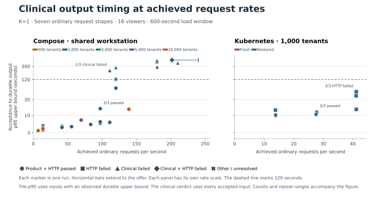

# K=1 capacity on Compose and Kubernetes

**Reproduced on Compose at 1,000 tenants.** The highest offer with three independent passes delivered **97.225 successful ordinary requests/s** in each run, seven times the realistic cadence. All 91,071 acknowledged inputs reached durable clinical output within 120 s and the driver missed zero starts. At the next offer, 111.11 req/s, HTTP passed three times, but one run proved 128 acknowledged inputs late. The post-acceptance backlog coincided with high workstation contention.

**Read-derived from the companion Kubernetes receipts on the existing worker.** The highest offer with three HTTP and product passes was **27.78 req/s**, twice realistic cadence, with **27.777 successful req/s** at the median. Only one of the three trials delivered every scheduled start. At 41.67 req/s all three returned HTTP 5xx responses. Every acknowledged input in those trials still met the clinical deadline. These are bounds on the named rigs, workloads and observation windows.

The figure covers 36 reference-workload runs. The data also include the three single-variable controls. [Repeat groups and denominators](cross-platform-groups.md) · [Case, operation and role data with definitions](aggregate-data.md)

## Measurement

**Reproduced on the synthetic rigs.** Both platforms ran one API, one evaluator and one realtime worker on core `6da24edbb7`. The image was built from deploy `c4d598bb3`. Compose used that binding, and Kubernetes rendered fixture binding `a8ad951`. Harness `33889a80a0` ran seven ordinary REST shapes over 600 s, with up to 300 s of drain. The reference workload had 16 viewers. The Compose workstation had an Intel Core i7-11800H, eight cores and 16 logical CPUs. The Kubernetes lane used the existing worker in the SFO2 region. Its CPU model was unavailable in the case evidence. Acknowledgement starts the 120 s clinical deadline. The [study plan](../../../docs/30-design/tenancy/k1-capacity-test-plan-2026-11-19.md) identifies the profile and earlier baselines.

Each rate uses the steady window. Offered is the resolved target, issued counts actual starts, achieved counts completions, and successful counts the expected HTTP status for the operation. The accepted-input census includes ordinary and probe writes through the end of their execution. It measures stored writes, clinical timing, isolation and datastore health. A missing start reduces delivered load. HTTP can fail before the application acknowledges a write. A proven deadline miss, unresolved deadline timing and absence of durable output at drain are separate counts.

Compose sampled the host 60 times per 600 s steady window at both endpoints of the first bracket. The SQL observer completed 163–171 clinical collection rounds in the 97.22 trials and 167–188 rounds at 111.11 through drain. Opening and closing cost captures took 0.424–1.176 s each across those six cases. On Kubernetes, each traffic run retained 40 steady resource samples. Median collection time per sample ranged from 0.690 to 8.956 s across runs. The observers shared host and database resources with the application. The experiment did not measure a counterfactual with observation disabled.

## Kubernetes at 1,000 tenants

**Read-derived from nine completed traffic cases and their cluster-owner measurements.** Each restored point used an independent copy of the same four-claim seed. At 27.78 offered req/s, every accepted input met the clinical deadline and all three trials passed HTTP. Only one issued every scheduled start. At 41.67 offered req/s every trial still passed the four product checks, and every trial returned HTTP errors.

| Offer and fixture | Trials | Achieved req/s, min / median / max | Successful req/s, min / median / max | Dropped starts, in run order | HTTP 5xx, in run order | Product / HTTP passes |
|---|---:|---:|---:|---:|---:|---:|
| 13.89 fresh | 1 | 13.892 | 13.892 | 0 | 0 | 1/1 · 1/1 |
| 13.89 restored | 2 | 13.822 / 13.857 / 13.892 | 13.818 / 13.855 / 13.892 | 42 / 0 | 2 / 0 | 2/2 · 1/2 |
| 27.78 restored | 3 | 27.535 / 27.777 / 27.782 | 27.535 / 27.777 / 27.782 | 3 / 0 / 148 | 0 / 0 / 0 | 3/3 · 3/3 |
| 41.67 restored | 3 | 41.125 / 41.158 / 41.165 | 41.073 / 41.075 / 41.110 | 305 / 301 / 325 | 29 / 54 / 31 | 3/3 · 0/3 |

All 77,548 accepted inputs were stored and durable on time. Sixty additional write attempts had uncertain outcomes after HTTP failures and are outside this denominator. All nine expected viewer frames matched. The first restored baseline frame took 13.495 s and the other eight each arrived within 0.441 s. In two high-rate trials the API logged PostgreSQL pool acquisition timeouts during the HTTP error bursts. The nearest node CPU samples were 91% and 93%. In the third trial PostgreSQL had 38 client backends against a configured maximum of 140 at the nearest sample. Across the three trials none of the missed starts coincided with the affected scenario already reaching its maximum number of in-flight requests in the preceding millisecond. These observations locate a service-side wait during the bursts. Its initiating cause remains open.

A separate campaign ran the same application on temporary dedicated cloud nodes and measured CPU-model-dependent evaluator saturation. Its placement, pinning option and observers differed from the existing-worker trials here. Its node-specific results and profiles have a separate evidence record. [Dedicated-node campaign](../../../docs/30-design/tenancy/evaluator-scaling-options-2026-11-19.md)

### Fixture reuse

The seed reached primer completion in 298.028 s. Stopping writers took 3.698 s, capturing the four snapshots took 11.299 s, and release of the seed namespace was verified 14.293 s later. The first restore reached the same primer boundary in 84.175 s. From foundation through receipt of the complete host roster, the matched fresh case took 293.565 s and the first restore took 119.740 s. They had the same ordered 1,000 tenant IDs and hosts. SQL found historical rows for all 1,000 restored tenants. The first restore saved 173.825 s (59.2%) to roster receipt. At those observed setup times, two copies save 20.332 s after the one-time 327.318 s seed and release cost. A reader-volume mount failure and an access timeout each stopped an additional restore before traffic.

## Compose population and load

**Reproduced across ten fresh comparison cases.** At a fixed offer of 13.889 req/s every population delivered 13.892 successful req/s, with zero drops. Once the roster exceeded 1,000, ordinary writes reached 2,001 tenants per run. At realistic cadence, every eligible tenant received an ordinary write. All 115,066 accepted inputs in these ten cases reached storage and durable output on time. Case 003 supplies the shared 1,000-tenant reference. Case 004 supplies the additional 1,000-tenant comparison against 3,000 at 41.667 req/s.

| Eligible tenants | Tenants touched at fixed offer | Durable p95 upper at fixed offer, s | Successful req/s at realistic cadence | Durable p95 upper at realistic cadence, s | First ordinary input per tenant, durable p95 upper at realistic cadence, s |
|---:|---:|---:|---:|---:|---:|
| 500 | 500 | 3.60 | 6.948 | 3.47 | 3.39 |
| 1,000 | 1,000 | 3.67 | 13.892 | 3.67 | 3.56 |
| 3,000 | 2,008 | 4.89 | 41.667 | 4.68 | 4.36 |
| 5,000 | 2,013 | 4.30 | 69.448 | 7.23 | 7.47 |
| 10,000 | 2,018 | 3.99 | 138.882 | 15.37 | 8.25 |

At 41.667 req/s, both the 1,000- and 3,000-tenant cases delivered all 25,000 steady requests, with zero missed starts. Median API/evaluator/PostgreSQL CPU was 166/367/779 and 173/364/737 millicores respectively. Each cell has one independent observation. The accepted-write and viewer identities were observed directly. Successful read coverage is derived from the verified roster and request schedule. The first-input statistic uses each tenant's first logged ordinary acknowledgement after setup. In the fixed arm, setup grew from 39.5 s at 500 tenants to 1,000.5 s at 10,000. Median API working set grew from 284 to 698 MiB and evaluator working set from 394 to 1,651 MiB. At 10,000 tenants, moving from fixed aggregate to realistic cadence raised median API/evaluator/PostgreSQL CPU from 102/170/312 to 489/979/2,104 millicores.

At 10,000 tenants and 138.889 offered req/s there were six missed starts. They occurred in two intervals in steady traffic. The affected request shapes had reached their initial VU allocations. Their HTTP p95 during the intervals was 395–614 ms, and the measured pool grew from 57 to 63 VUs. Nearby PostgreSQL samples showed WAL waits. All 43,354 accepted inputs were durable by drain. Only one or two probe frames were eligible per population case, and all matched.

## Local high-rate observations

**Reproduced at 1,000 tenants with 16 viewers and matched seven-operation offers.** Each trial had its own freshly provisioned fixture. Product requires all four checks to pass. The HTTP verdict includes graceful stop. The successful rates below use the steady window.

| Offered req/s | Successful req/s, min / median / max | Product passes | HTTP passes | Drops, run order | All-input durable p95 upper, min / median / max (s) |
|---:|---:|---:|---:|---:|---:|
| 97.22 | 97.225 / 97.225 / 97.225 | 3/3 | 3/3 | 0 / 0 / 0 | 5.779 / 6.402 / 15.953 |
| 111.11 | 111.088 / 111.115 / 111.115 | 2/3 | 3/3 | 2 / 0 / 0 | 6.001 / 6.193 / 226.554 |
| 120 | 119.992 / 120.000 / 120.000 | 1/3 | 3/3 | 5 / 0 / 0 | 66.093 / 122.740 / 276.241 |
| 180 | 179.738 / 179.893 / 180.000 | 0/3 | 3/3 | 68 / 62 / 0 | 288.427 / 413.122 / 445.520 |

At 111.11 req/s the failure proved 128 inputs late and left 10,681 with unresolved deadline timing. All 34,691 had durable output by drain. The other two trials returned zero errors and all 34,689 accepted inputs each reached durable output on time. Confirmed replication-slot lag peaked at 158,352,928 bytes during the failed steady window, versus 184,072 and 714,896 bytes in the passes. Median host CPU busy was 81.6%, 30.4% and 32.2% respectively. Median 10 s CPU pressure was 38.43%, 0.19% and 0.47%. The failed trial overlapped with a separate Kubernetes campaign using the same controller workstation and with local disk reclamation. Lag was already growing before the disk-reclamation receipt. These observations establish a backlog after acknowledgement. They leave the service or peer that initiated it unresolved.

At 180 offered req/s all three fresh cases passed HTTP and proved 295, 328 and 210 inputs late respectively. The third trial delivered 180.000 successful req/s with zero drops and still proved 210 late. By drain it had 56,114 confirmed durable and 69 unresolved of 56,183 accepted. A generator shortfall cannot account for that trial’s clinical failure. At 210 offered req/s one fresh trial delivered 209.998 successful req/s and missed one read start. HTTP passed. There were 277 proven late, 43,515 of unresolved deadline timing and 55,223 confirmed durable of 65,544 accepted by drain. Two inputs were confirmed missing and 10,319 had unknown drain status.

At 240 offered req/s the driver issued 203.96 req/s, completed 201.628 req/s and delivered 196.000 successful req/s. The API returned 3,377 HTTP 5xx responses and logged PostgreSQL pool connection timeouts. Six of seven request shapes reached their VU maxima. Of 21,630 missed starts, 20,038 occurred while the affected shape was already at maximum concurrency. All 61,078 accepted inputs were stored. End-drain evidence confirmed durable output for 41,186, confirmed two missing and left 19,890 unresolved. The 210 and 240 trials had median host CPU busy of 36.8% and 85.4%. These single observations locate the HTTP change between those offers on the observed runs. The 300 req/s comparison was skipped after the HTTP and clinical failures at 240.

The descending 120 req/s case delivered all steady traffic. It left deadline timing unresolved for 2,130 accepted inputs, all of which were durable by drain. The ascending 120 case proved 207 late. The 13.89 req/s return after the descent passed all four product checks and HTTP with zero drops. Each comparison used a fresh fixture, so the down steps measure independent returns to the earlier offers.

## Changing writes and viewers independently

**Reproduced, one fresh trial per changed setting.** All four configurations offered 57.60 reads/s across the same four read operations. Write cadence changed across the first three rows. The fourth row repeated all seven reference REST offers with two connected viewers per tenant. Case 025 is the passing 120 req/s reference. The other two 120 req/s reference outcomes are reported above.

| Case | Offered writes/s | Connected viewers | Successful ordinary req/s | Dropped starts | Accepted / durable by drain | Proven late / deadline unknown | Durable p95 upper among timed inputs (s) | Matched / expected frames (p95) |
|---|---:|---:|---:|---:|---:|---:|---:|---|
| 030 · half writes | 31.20 | 16 | 88.800 | 0 | 18,743 / 18,743 | 0 / 0 | 5.125 | 1/1 (126 ms) |
| 025 · reference | 62.40 | 16 | 120.000 | 0 | 37,463 / 37,463 | 0 / 0 | 66.093 | 1/1 (141 ms) |
| 031 · double writes | 124.80 | 16 | 182.393 | 4 | 74,900 / 53,046 | 313 / 58,851 | 454.312 | 1/1 (125 ms) |
| 032 · more viewers | 62.40 | 2,000 | 120.000 | 0 | 37,464 / 37,464 | 0 / 0 | 25.200 | 42/42 (16.827 s) |

All four passed HTTP. With double writes, all 74,900 acknowledgements reached storage. Two lacked durable output at drain and 21,852 had unresolved drain status. As the write offer increased across the first three rows, median evaluator CPU rose from 620 to 1,024 to 1,078 millicores. PostgreSQL rose from 1,226 to 1,916 to 2,282 millicores. Peak confirmed slot lag was 0.02, 95.05 and 523.25 MiB at half, reference and double writes respectively. Keeping reads steady isolates write pressure as a way to reproduce the post-acceptance backlog. These samples do not establish which evaluator instruction or database operation initiated it.

With 2,000 viewers, all 21 eligible probe writes delivered both expected callbacks. The median acceptance-to-frame time was 0.409 s, p95 was 16.827 s and the maximum was 21.664 s. Median realtime CPU was 236 millicores, versus 124 in case 025. The 16-viewer trial had one eligible callback, which limits a direct tail comparison. The one receiving tenant shared by the two trials saw 140.8 ms with 16 viewers and 140.9 and 141.1 ms with 2,000. Eight callbacks over 10 s came from the last four probe writes in the 2,000-viewer trial. Setup recorded 1,920 WebSocket and 80 polling viewers. All 2,000 received an initial frame, zero server disconnects were recorded in the window, and 2,000 were connected at its end.

## Cleanup and evidence custody

**Reproduced on Compose.** Each of the 30 projects has a harness cleanup receipt and an independent readback. After the last case, a second campaign-wide Docker inventory searched by project label and name. It found zero owned containers, networks or volumes.

**Read-derived from the cluster owner's reconciliation.** All 12 Kubernetes case namespaces, run claims, persistent volumes, provider volumes and owned forwarding scopes were released. Four seed snapshot contents and their four corresponding DigitalOcean snapshots remain. The cluster owner holds the seed pending a maintainer decision on permanent deletion. The private reconciliation identifies the four snapshots.

## Reproducing the measurements

The retained local evidence identifier is `k1-capacity-live-20261119`. The 18 input profiles and base configuration are under `k1-capacity-study-20261119/resolved-33889a80a0`. Compose used the pinned harness entry `tools/mt-bench/m7-joined/runner.py run CONFIG NEW_CASE --candidate IMAGE_ID --standard-case` with a new owned project and subnet pair per case. Higher-rate cases used a five-million-row scheduling trace allowance. The per-case selection and configuration record the exact settings. Kubernetes used the pinned [standard fixture lifecycle](../../../tools/mt-bench/kubernetes/README.md). Each raw result retains its run intent, role samples, timing evidence and cleanup receipt.
